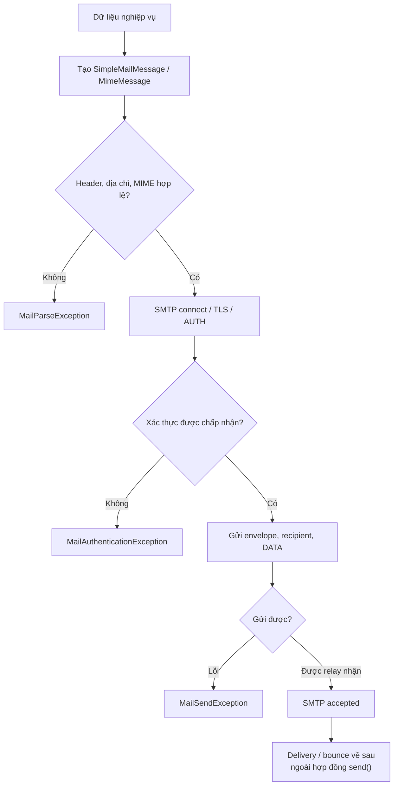
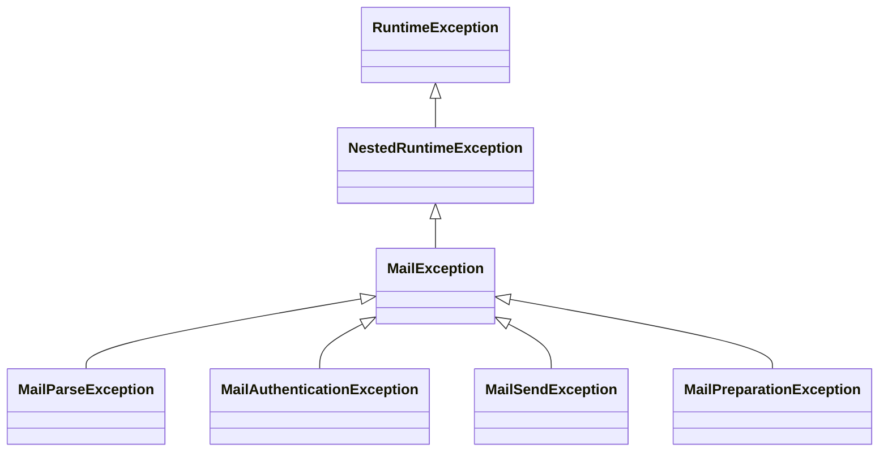
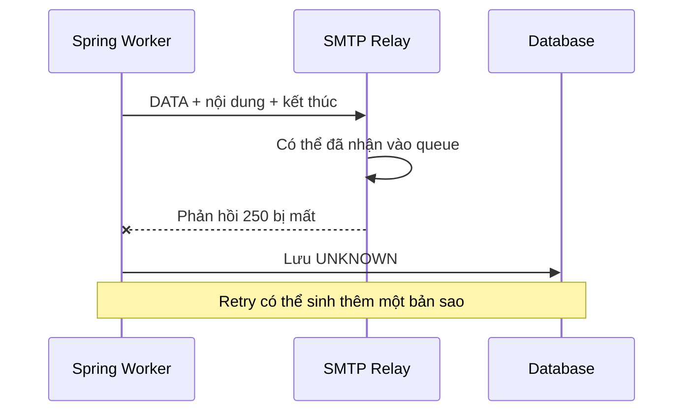
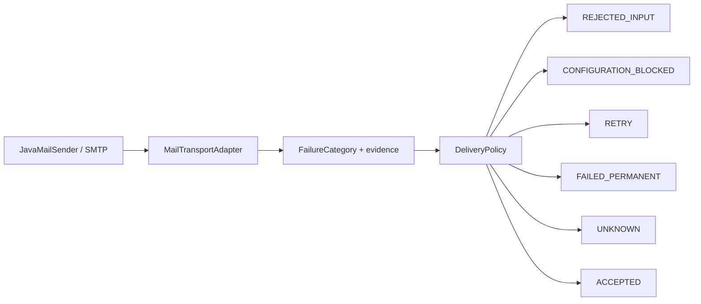
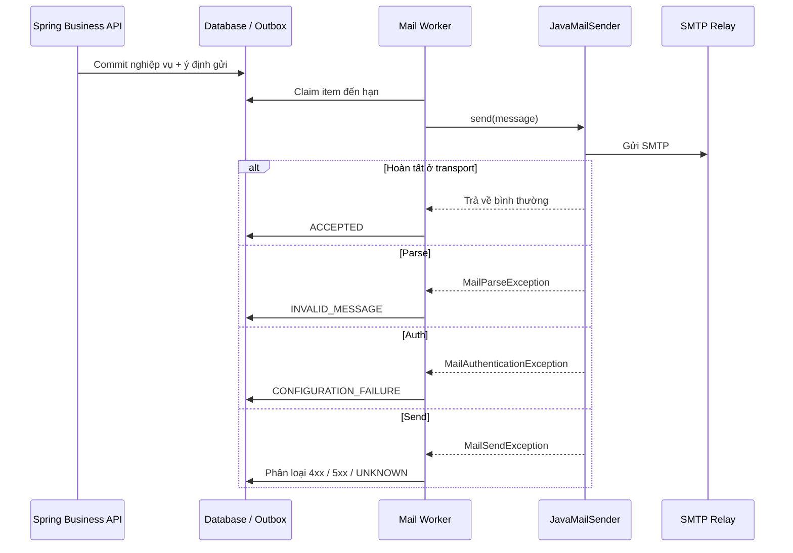

# Phân biệt MailParseException, MailAuthenticationException và MailSendException

Khi tích hợp gửi email bằng **Spring Framework Mail**, ba kiểu ngoại lệ `MailParseException`, `MailAuthenticationException` và `MailSendException` thường xuất hiện gần nhau trong tài liệu và log. Tuy cùng thuộc họ `MailException`, chúng biểu thị **ba nhóm sự cố khác nhau**: thông điệp không thể được phân tích hoặc dựng hợp lệ, xác thực với máy chủ email thất bại, và lỗi phát sinh trong quá trình truyền/gửi thư.

Phân biệt đúng giúp ứng dụng có phản ứng phù hợp. Một địa chỉ nhận sai cú pháp cần được sửa ở đầu vào; mật khẩu SMTP sai cần can thiệp cấu hình; máy chủ SMTP trả mã lỗi tạm thời có thể cần thử lại sau một khoảng chờ. Nguy hiểm nhất là coi mọi `MailSendException` như bằng chứng rằng chưa thư nào rời khỏi ứng dụng: trong một số trường hợp máy chủ đã chấp nhận thư nhưng phản hồi bị mất, hoặc chỉ một phần của nhóm thư/người nhận thất bại.

Bài này dùng Spring Framework 6.x, Spring Boot 3.x, Java 21 và Jakarta Mail trong các ví dụ. Các nguyên tắc phân loại lỗi áp dụng cả khi ứng dụng Spring thuần tự cấu hình `JavaMailSenderImpl`. Trọng tâm là **hợp đồng API và chính sách xử lý lỗi**, không phụ thuộc vào một nhà cung cấp SMTP cụ thể.

## 1. Vị trí của ba ngoại lệ trong luồng gửi

Một email đi qua các công đoạn:

1. Ứng dụng lấy dữ liệu nghiệp vụ như recipient, tiêu đề, nội dung hoặc tệp đính kèm.
2. Spring/Jakarta Mail tạo đối tượng `SimpleMailMessage` hoặc `MimeMessage`, kiểm tra và dựng các header/MIME part.
3. Mail transport kết nối tới SMTP relay và thực hiện các bước phù hợp như EHLO, TLS và AUTH.
4. Client gửi envelope, các lệnh `MAIL FROM`, `RCPT TO`, `DATA` cùng nội dung.
5. SMTP relay trả phản hồi, có thể chấp nhận, từ chối hoặc mất kết nối giữa chừng.
6. Nếu relay chấp nhận, các hệ thống phía sau tiếp tục định tuyến/giao thư và có thể phát sinh bounce sau đó.

Ba exception thường chỉ ra những ranh giới khác nhau:



Sơ đồ mô tả **tình huống điển hình**, không phải quy tắc rằng mọi implementation luôn ném chính xác một loại exception ở cùng một dòng lệnh. Ví dụ, lỗi kết nối trước khi tới AUTH có thể được `JavaMailSenderImpl` báo là `MailSendException`; lỗi trong callback chuẩn bị MIME có thể là `MailPreparationException`. Cần đọc nguyên nhân lồng nhau và ngữ cảnh thao tác.

## 2. Bảng so sánh nhanh

| Tiêu chí | `MailParseException` | `MailAuthenticationException` | `MailSendException` |
|---|---|---|---|
| Ý nghĩa chính | Không phân tích hoặc dựng được dữ liệu thư hợp lệ | Không xác thực được với mail server | Lỗi khi thực hiện gửi, kết nối hoặc truyền thông điệp |
| Giai đoạn thường gặp | Tạo/chuẩn bị message và MIME header | SMTP AUTH hoặc thao tác xác thực của transport | Thiết lập transport, gửi SMTP envelope/data, gửi nhiều message |
| Ví dụ | Địa chỉ/header không hợp lệ, lỗi chuyển đổi sang MIME | Username/password sai, credential hết hiệu lực, quyền xác thực bị từ chối | Timeout, SMTP 4xx/5xx, kết nối bị đóng, recipient bị từ chối |
| Đầu vào cần kiểm tra | Địa chỉ, tiêu đề, cấu trúc MIME, dữ liệu template | Secret, username, phương thức AUTH, quyền của tài khoản | Mã SMTP, giai đoạn lỗi, người nhận, trạng thái server |
| Retry ngay cùng dữ liệu? | Thường **không**; sửa dữ liệu hoặc lỗi lập trình | Thường **không**; cần sửa cấu hình hoặc xác minh trạng thái provider | **Tùy nguyên nhân**: có lỗi tạm thời, vĩnh viễn hoặc kết quả chưa chắc chắn |
| Có thể có kết quả một phần? | Chưa có bằng chứng đã gửi trong lỗi tạo thông điệp điển hình | Thường chưa gửi được nội dung nếu AUTH bị từ chối | **Có thể**, đặc biệt với nhiều message/recipient |
| Hành động vận hành | Trả lỗi dữ liệu hoặc ghi nhận lỗi tạo thư | Cảnh báo người vận hành, kiểm tra secret/tài khoản | Phân loại, theo dõi, lên lịch retry hoặc dừng |

**Quy tắc ghi nhớ:** *Parse* liên quan đến **message**, *Authentication* liên quan đến **quyền đăng nhập mail server**, còn *Send* liên quan đến **thực thi việc gửi**. Dù vậy, tên ngoại lệ chỉ là điểm bắt đầu điều tra; nó không thay thế mã lỗi và bằng chứng thực tế.

## 3. MailException là lớp cha của hệ thống ngoại lệ Spring Mail

Các exception này đều là hậu duệ của `org.springframework.mail.MailException`, một ngoại lệ runtime của Spring. Vì là unchecked exception, chữ ký `MailSender.send(...)` có thể khai báo `throws MailException` để mô tả hợp đồng nhưng caller không buộc phải `catch` hay `throws`.

Hệ phân cấp rút gọn:



Những tên trên thuộc Spring:

```java
import org.springframework.mail.MailException;
import org.springframework.mail.MailParseException;
import org.springframework.mail.MailAuthenticationException;
import org.springframework.mail.MailSendException;
import org.springframework.mail.MailPreparationException;
```

Không nhầm chúng với exception của **Jakarta Mail**, chẳng hạn:

```java
import jakarta.mail.MessagingException;
import jakarta.mail.AuthenticationFailedException;
import jakarta.mail.SendFailedException;
import jakarta.mail.internet.AddressException;
```

Jakarta Mail mô tả lỗi ở tầng giao thức và dựng thông điệp; Spring có thể **bọc** lỗi đó bằng một trong các `MailException` để service làm việc với API thống nhất hơn. Loại Spring wrapper và cấu trúc chuỗi nguyên nhân có thể khác theo phương thức gọi, implementation và phiên bản mail provider.

`MailPreparationException` cũng rất đáng biết dù không nằm trong bộ ba của bài: nó thường liên quan callback `MimeMessagePreparator` không chuẩn bị được message. Vì vậy không nên ép mọi lỗi trước khi gửi vào riêng `MailParseException`.

## 4. MailParseException: lỗi phân tích hoặc xây dựng thông điệp

### 4.1. Khi nào có thể xuất hiện?

`MailParseException` biểu thị lỗi khi **chuẩn bị/phân tích cú pháp dữ liệu email**. Trong Spring JavaMail, các thao tác tạo và chuyển đổi `MimeMessage` hoặc set header có thể dẫn đến lỗi Jakarta Mail và được Spring chuyển thành exception này trong những đường đi phù hợp.

Những nguồn lỗi thường gặp:

- Địa chỉ email không thể được phân tích hợp lệ theo cách parser đang dùng.
- Cách khai báo From/To/Cc/Bcc hoặc một header có cấu trúc không hợp lệ.
- Dữ liệu mà thư viện cần chuyển thành header/MIME message không thể được xử lý.
- Code ứng dụng tự xây dựng `MimeMessage` sai hoặc đưa dữ liệu không phù hợp vào quá trình tạo thông điệp.

Ví dụ input có vấn đề:

```text
recipient = "alice@@example.com"
recipient = "not-an-address"
from      = "bad-address<CR><LF>Bcc: attacker@example.test"
```

Đây là dữ liệu **minh họa nguy cơ**, không phải cam kết mọi parser đều từ chối chính xác các chuỗi trên tại cùng thời điểm. Một số API chỉ giữ địa chỉ dưới dạng chuỗi và trì hoãn kiểm tra; một số kiểm tra ở bước `setTo()`, một số ở lúc `send()`; mức độ strict phụ thuộc thư viện/cấu hình.

### 4.2. Phân biệt lỗi cú pháp với lỗi tồn tại của mailbox

Hai trường hợp sau không giống nhau:

1. `alice@@example.com`: cú pháp addr-spec có thể không hợp lệ và bị parser từ chối.
2. `nobody@example.com`: cú pháp có vẻ hợp lệ, nhưng mailbox có thể không tồn tại; SMTP server có thể từ chối tại `RCPT TO` hoặc hệ thống nhận bounce sau khi relay đã chấp nhận.

Trường hợp thứ hai **không mặc nhiên là `MailParseException`**. Nếu SMTP server trả `550 5.1.1`, lỗi sẽ nằm trong luồng gửi/SMTP, thường cần được đọc từ `MailSendException` hoặc các nguyên nhân liên quan.

Điều này giúp thiết kế API trả lỗi cho người dùng: validation có thể bắt lỗi định dạng sớm, nhưng không nên hứa rằng việc qua validation có nghĩa địa chỉ tồn tại hoặc sẽ nhận email.

### 4.3. Ví dụ kiểm tra đầu vào trước khi gọi MailSender

Một service gửi thư đơn giản có thể tách validation khỏi transport:

```java
package com.example.mail;

import jakarta.mail.internet.AddressException;
import jakarta.mail.internet.InternetAddress;
import org.springframework.mail.MailSender;
import org.springframework.mail.SimpleMailMessage;
import org.springframework.stereotype.Service;

@Service
public class WelcomeMailService {

    private final MailSender mailSender;

    public WelcomeMailService(MailSender mailSender) {
        this.mailSender = mailSender;
    }

    public void sendWelcome(String recipient) {
        String address = requireAddress(recipient);

        SimpleMailMessage mail = new SimpleMailMessage();
        mail.setFrom("notifications@example.test");
        mail.setTo(address);
        mail.setSubject("Chào mừng");
        mail.setText("Tài khoản của bạn đã được tạo.");

        mailSender.send(mail);
    }

    private static String requireAddress(String value) {
        if (value == null || value.isBlank()) {
            throw new IllegalArgumentException("Missing recipient address");
        }
        try {
            InternetAddress[] parsed = InternetAddress.parse(value, true);
            if (parsed.length != 1) {
                throw new IllegalArgumentException("Exactly one recipient required");
            }
            parsed[0].validate();
            return parsed[0].getAddress();
        } catch (AddressException ex) {
            throw new IllegalArgumentException("Invalid recipient address", ex);
        }
    }
}
```

Đây là **validation sớm** tại ranh giới nghiệp vụ; mã ví dụ ném `IllegalArgumentException` cho input không hợp lệ. Nó không chủ động ném `MailParseException`. Khi chính Spring/Jakarta Mail phát hiện lỗi trong các thao tác tạo/gửi thông điệp, wrapper tương ứng có thể là `MailParseException`.

Mẫu `InternetAddress.parse(..., true)` và `validate()` kiểm tra cấu trúc ở mức thư viện; nó **không xác minh DNS, mailbox tồn tại, quyền gửi, danh tiếng domain hoặc hỗ trợ SMTPUTF8**. Nếu yêu cầu chỉ một địa chỉ, quy tắc nghiệp vụ nên loại những chuỗi biểu diễn danh sách nhiều địa chỉ.

### 4.4. Khi MailParseException xuất hiện thì xử lý thế nào?

Phản ứng hợp lý:

1. Ghi nhận thông báo gửi nào đang được chuẩn bị bằng `notificationId` và loại lỗi.
2. Xác định input hoặc bước MIME/header gây lỗi.
3. Nếu người dùng có thể sửa input, trả lỗi validation thích hợp.
4. Nếu lỗi do template hoặc code, đưa vào trạng thái cần sửa và cảnh báo nhóm phụ trách.
5. **Không tự retry cùng một dữ liệu không đổi** theo lịch vô hạn.

Trong log, không ghi nguyên toàn bộ `MimeMessage`, danh sách người nhận, token, mật khẩu hay body thư. Thông tin ngoại lệ có thể chứa một phần dữ liệu nhạy cảm; cần chính sách redaction phù hợp.

## 5. MailAuthenticationException: không xác thực được SMTP

### 5.1. Tình huống điển hình

Sau khi ứng dụng có message hợp lệ, mail provider thường phải mở kết nối và có thể yêu cầu xác thực bằng SMTP AUTH. `MailAuthenticationException` biểu thị **không xác thực được**, thường do provider từ chối thông tin hoặc phương thức xác thực.

Nguyên nhân có thể gồm:

- Sai `username` hoặc `password`.
- Credential hết hạn, bị khóa, bị thu hồi hoặc chưa được cấp quyền SMTP.
- Provider yêu cầu application password/token hoặc cơ chế AUTH khác, nhưng ứng dụng đang dùng cấu hình cũ.
- Account được xác thực không có quyền gửi ở địa chỉ From đã chọn; tùy provider, điều này cũng có thể xuất hiện dưới lỗi gửi/policy thay vì `MailAuthenticationException`.
- Provider tạm không sẵn sàng ở bước xác thực; cần đọc mã lỗi và trạng thái dịch vụ để phân biệt với cấu hình sai.

Ví dụ log khái niệm:

```text
org.springframework.mail.MailAuthenticationException:
    Authentication failed
Caused by: jakarta.mail.AuthenticationFailedException:
    535 5.7.8 Authentication credentials invalid
```

`535 5.7.8` là ví dụ SMTP server từ chối credential; mã và văn bản có thể khác theo provider. Lỗi `535` được coi là thất bại đối với thông tin đang dùng, **không nên retry hàng trăm lần bằng chính credential đó**.

### 5.2. Không nhầm lỗi TLS với lỗi AUTH

SMTP submission thường dùng một trong hai cơ chế:

- Cổng **587 + STARTTLS**: kết nối được nâng cấp lên TLS theo khả năng provider, sau đó thực hiện AUTH khi phù hợp.
- Cổng **465 + implicit TLS**: TLS được thiết lập ngay từ đầu.

Nếu lỗi bắt tay TLS hoặc xác minh chứng chỉ xảy ra **trước** bước AUTH, một implementation có thể báo lỗi kết nối/gửi, chẳng hạn `MailSendException`, chứ không nhất thiết là `MailAuthenticationException`. Cần xem `cause` sâu hơn để xác định lỗi certificate, protocol, hostname hay AUTH.

**Không giải quyết lỗi TLS bằng cách tắt xác minh chứng chỉ hoặc bỏ yêu cầu TLS** trong production.

### 5.3. Cấu hình Spring Boot với SMTP AUTH

Ví dụ cấu hình cho server hỗ trợ STARTTLS trên cổng 587:

```yaml
spring:
  mail:
    host: ${SMTP_HOST}
    port: ${SMTP_PORT:587}
    username: ${SMTP_USERNAME}
    password: ${SMTP_PASSWORD}
    default-encoding: UTF-8
    properties:
      mail:
        smtp:
          auth: true
          starttls:
            enable: true
            required: true
          connectiontimeout: 5000
          timeout: 10000
          writetimeout: 10000

app:
  mail:
    from: ${MAIL_FROM}
```

Các timeout được tính bằng mili giây, chỉ là giá trị minh họa. Cấu hình SMTP thật phải lấy secret từ môi trường hoặc kho quản lý bí mật có kiểm soát quyền truy cập; không đưa password vào repository hay log. Nếu provider dùng implicit TLS trên cổng 465, cần cấu hình SSL phù hợp theo tài liệu provider thay vì giữ nguyên chế độ STARTTLS của cổng 587.

Khi gặp lỗi authentication, quy trình khắc phục:

1. Kiểm tra giá trị **đang được ứng dụng nạp**: host, port, profile, username (có thể log một định danh được che), chế độ TLS.
2. Xác định credential được cấp quyền cho đúng môi trường và tài khoản SMTP.
3. Kiểm tra tài khoản/SMTP AUTH có đang bị khóa hoặc bị vô hiệu hóa không.
4. Xem mã lỗi từ provider, trạng thái dịch vụ và chính sách account.
5. Xoay vòng secret hoặc sửa cấu hình theo quy trình vận hành, sau đó thử lại có kiểm soát.

**Hành động vận hành khuyến nghị:** tạm ngừng hàng gửi thuộc provider/account đang xác thực lỗi, báo lỗi cấu hình để người vận hành xử lý. Tránh để hàng triệu thư cùng retry thất bại và khóa tài khoản thêm.

### 5.4. Authentication có phải lỗi vĩnh viễn?

Không nên trả lời bằng một nhãn tuyệt đối. Sai credential rõ ràng là lỗi **không tự phục hồi khi giữ nguyên dữ liệu**. Tuy nhiên, một số máy chủ có thể trả lỗi 4xx tạm thời ở bước AUTH khi dịch vụ xác thực đang quá tải hoặc unavailable. Vì vậy, tầng xử lý nên ghi cả **loại ngoại lệ Spring** và **mã/điều kiện của provider** nếu có.

Điểm mặc định an toàn: `MailAuthenticationException` là **lỗi cấu hình hoặc quyền truy cập cần can thiệp**. Chỉ đưa vào retry ngắn có giới hạn khi có bằng chứng đây là sự cố hạ tầng tạm thời, đồng thời áp dụng rate limit để không tạo vòng lặp đăng nhập thất bại.

## 6. MailSendException: lỗi trong quá trình gửi

### 6.1. Phạm vi rộng hơn nhiều người nghĩ

`MailSendException` thường phát sinh khi implementation không thể hoàn tất thao tác gửi. Đây là loại **rộng nhất** trong ba ngoại lệ đang xét về các kết quả có thể có.

Ví dụ nguyên nhân:

- Không mở được kết nối SMTP do DNS, timeout, từ chối kết nối hoặc server không sẵn sàng.
- Kết nối bị đóng trong lúc gửi envelope hoặc DATA.
- Server trả mã `421`, `450`, `451`, `452` hoặc lỗi khác.
- Server từ chối người nhận, người gửi hoặc chính sách gửi với các mã 5xx.
- Một message trong nhóm gửi thất bại trong khi message khác đã được chấp nhận.
- Lỗi I/O khiến **không thể xác định** server đã nhận email chưa.

Ví dụ log khái niệm:

```text
org.springframework.mail.MailSendException:
    Mail server connection failed
Caused by: java.net.SocketTimeoutException:
    Connect timed out
```

Hoặc:

```text
org.springframework.mail.MailSendException:
    Failed messages: ...
Caused by: jakarta.mail.SendFailedException: ...
```

Không dựa duy nhất vào đoạn văn của exception: cùng loại `MailSendException` có thể chứa lỗi phục hồi được và lỗi vĩnh viễn. Một thao tác `send()` thất bại **không đủ bằng chứng** để quyết định retry toàn bộ người nhận.

### 6.2. Mã SMTP 4xx và 5xx

SMTP phản hồi theo mã ba chữ số:

| Nhóm | Ý nghĩa theo giao thức | Ví dụ | Hướng xử lý ban đầu |
|---|---|---|---|
| `2xx` | Lệnh đã được chấp nhận | `250` sau DATA | Ghi nhận relay đã chấp nhận |
| `4xx` | Từ chối **tạm thời** | `421`, `450`, `451`, `452` | Thử lại sau với backoff khi thông báo còn giá trị |
| `5xx` | Từ chối **vĩnh viễn** với lệnh hiện tại | `550`, `553` | Phân tích nguyên nhân, thường cần sửa dữ liệu/policy |

Ví dụ mở rộng:

```text
451 4.3.0 Temporary local problem - try again later
550 5.1.1 Recipient address rejected: user unknown
```

Chữ số đầu tiên của enhanced status code `4.Y.Z` hoặc `5.Y.Z` cũng hỗ trợ phân loại. Nhưng mã SMTP **chỉ có ý nghĩa trong ngữ cảnh câu lệnh**: lỗi ở RCPT TO khác lỗi sau DATA; provider khác nhau có thể dùng mã bổ sung để diễn tả policy/rate limit.

**Kết luận quan trọng:** `MailSendException` không đồng nghĩa lỗi tạm thời. Cần phân tích mã phản hồi và nguyên nhân trước khi lên lịch retry.

### 6.3. Gửi nhiều thư: MailSendException có thể báo thất bại một phần

`MailSender` và `JavaMailSender` hỗ trợ gửi một tập message:

```java
SimpleMailMessage first = new SimpleMailMessage();
first.setFrom("noreply@example.test");
first.setTo("alice@example.test");
first.setSubject("Thông báo A");
first.setText("Nội dung A");

SimpleMailMessage second = new SimpleMailMessage();
second.setFrom("noreply@example.test");
second.setTo("bob@example.test");
second.setSubject("Thông báo B");
second.setText("Nội dung B");

mailSender.send(first, second);
```

Trong implementation Spring JavaMail, một `MailSendException` có thể giữ bản đồ các message thất bại:

```java
import java.util.Map;
import org.springframework.mail.MailSendException;

try {
    mailSender.send(first, second);
} catch (MailSendException ex) {
    Map<Object, Exception> failed = ex.getFailedMessages();

    // failed ghi nhận các message mà implementation xác định có lỗi.
    // Không tự suy ra message vắng trong map đã được người nhận đọc.
    System.out.println("Failed message count: " + failed.size());
}
```

`MailSendException.getFailedMessages()` trả về map các thông điệp lỗi được ghi nhận, nhưng chi tiết object key, nguyên nhân và hành vi gom lỗi phụ thuộc đường gửi/implementation. Ngoài ra, `getMessageExceptions()` có thể giúp lấy các exception liên quan tới việc gửi message.

**Đặc biệt thận trọng** nếu một `SimpleMailMessage` có nhiều địa chỉ To/Cc/Bcc. Một message thất bại không luôn có nghĩa toàn bộ recipient chưa được chấp nhận. Jakarta Mail có thể chứa thông tin người nhận hợp lệ, đã gửi hoặc chưa gửi trong `SendFailedException`; cần điều tra ở tầng transport/provider nếu muốn retry theo từng người nhận.

Khi gửi cho khách hàng độc lập, cách quản lý dễ tin cậy hơn là tạo **một bản ghi giao hàng cho mỗi recipient** và gắn `notificationId`/idempotency key riêng; khi đó việc retry không vô tình gửi lại cả lô.

### 6.4. Lỗi socket sau DATA: kết quả không chắc chắn

Tình huống quan trọng:

1. Client hoàn thành gửi phần DATA và dấu kết thúc thông điệp.
2. SMTP relay nhận và có thể đã ghi nhận thông điệp vào queue.
3. Kết nối mạng đứt trước khi client nhận được phản hồi `250`.
4. Jakarta Mail/Spring báo lỗi I/O dưới dạng `MailSendException`.
5. Ứng dụng **không biết chắc** thư đã được relay nhận hay chưa.



Một số timeout trước khi thiết lập kết nối cho thấy nhiều khả năng chưa gửi gì, nhưng không phải mọi timeout đều xảy ra trước DATA. Vì thế, retry phải tính đến **giai đoạn giao tiếp và khả năng đã chấp nhận**, thay vì chỉ kiểm tra tên exception.

SMTP thông thường **không cung cấp idempotency key** được bảo đảm trên mọi server. Header `Message-ID` giống nhau cũng không bảo đảm hệ thống nhận loại bỏ bản trùng. Nếu nhà cung cấp có API hỗ trợ idempotency hoặc truy vấn trạng thái theo provider ID, có thể tận dụng theo hợp đồng riêng; còn với SMTP thuần, cần chấp nhận giới hạn của giao tiếp phân tán và điều chỉnh nghiệp vụ để giảm hậu quả của email trùng.

## 7. Vì sao không nên viết một catch(MailException) duy nhất?

Code kiểu này tuy biên dịch được nhưng không đưa ra chính sách lỗi rõ ràng:

```java
try {
    mailSender.send(message);
} catch (MailException ex) {
    // Sai lầm: coi mọi exception là lỗi mạng tạm thời.
    scheduleRetryImmediately(message);
}
```

Nó có thể:

- Thử lại vô hạn một địa chỉ sai hoặc MIME không hợp lệ.
- Liên tục đăng nhập bằng credential sai và làm provider khóa tài khoản.
- Gửi lại toàn bộ recipient dù một số đã được SMTP chấp nhận.
- Tạo cơn bão retry khi SMTP bị quá tải.
- Ghi nhận sai kết quả nếu email đã được relay nhận nhưng response bị mất.

Một cấu trúc tốt hơn là **phân loại ở ranh giới adapter gửi mail**, sau đó chuyển sang chính sách của workflow:



Trong đó:

- `REJECTED_INPUT`: sửa dữ liệu, không thử lại nguyên trạng.
- `CONFIGURATION_BLOCKED`: cảnh báo, tạm dừng gửi bằng credential/provider đang lỗi.
- `RETRY`: lỗi đã xác định tạm thời, lập lịch thử lại theo hạn mức.
- `FAILED_PERMANENT`: provider từ chối dứt khoát với dữ liệu hiện tại.
- `UNKNOWN`: chưa đủ bằng chứng để kết luận SMTP đã chấp nhận hay chưa.
- `ACCEPTED`: relay đã chấp nhận theo bằng chứng transport.

Đây là **trạng thái nghiệp vụ gợi ý**, không phải enum có sẵn trong Spring Framework Mail.

## 8. Ví dụ Java: phân loại ba exception ở ranh giới gửi

Giả sử ứng dụng gửi email text đơn giản và cần nhận kết quả có cấu trúc cho tầng điều phối. Có thể bắt ba ngoại lệ riêng rồi xử lý các lỗi Spring Mail còn lại:

```java
package com.example.mail;

import org.springframework.mail.MailAuthenticationException;
import org.springframework.mail.MailException;
import org.springframework.mail.MailParseException;
import org.springframework.mail.MailSendException;
import org.springframework.mail.MailSender;
import org.springframework.mail.SimpleMailMessage;
import org.springframework.stereotype.Component;

@Component
public class MailTransportAdapter {

    private final MailSender mailSender;

    public MailTransportAdapter(MailSender mailSender) {
        this.mailSender = mailSender;
    }

    public AttemptResult send(SimpleMailMessage message) {
        try {
            mailSender.send(message);
            return new AttemptResult(AttemptKind.ACCEPTED, "TRANSPORT_OK");
        } catch (MailParseException ex) {
            return new AttemptResult(
                    AttemptKind.INVALID_MESSAGE, "MAIL_PARSE");
        } catch (MailAuthenticationException ex) {
            return new AttemptResult(
                    AttemptKind.CONFIGURATION_FAILURE, "MAIL_AUTH");
        } catch (MailSendException ex) {
            // Chưa đủ thông tin để kết luận retry.
            // Tầng chuyên trách cần xem SMTP code, cause, phase, partial result.
            return new AttemptResult(
                    AttemptKind.REQUIRES_SEND_DIAGNOSIS, "MAIL_SEND");
        } catch (MailException ex) {
            return new AttemptResult(
                    AttemptKind.OTHER_MAIL_FAILURE, "MAIL_OTHER");
        }
    }

    public enum AttemptKind {
        ACCEPTED,
        INVALID_MESSAGE,
        CONFIGURATION_FAILURE,
        REQUIRES_SEND_DIAGNOSIS,
        OTHER_MAIL_FAILURE
    }

    public record AttemptResult(AttemptKind kind, String safeErrorCode) {}
}
```

Ví dụ này cố ý **không tự định nghĩa retry bằng tên `MailSendException`**. `REQUIRES_SEND_DIAGNOSIS` chỉ có nghĩa cần bước tiếp theo xem chi tiết provider. Trong hệ thống thật, adapter có thể ghi mã SMTP, mã mở rộng, thời gian lỗi, message/recipient liên quan và mức chắc chắn về kết quả trước khi trả cho workflow.

Đoạn ví dụ cũng **không ghi log raw exception** vì thông báo lỗi và các header có thể chứa dữ liệu nhạy cảm. Một mã lỗi an toàn/ổn định thường phù hợp hơn cho metric và log tổng quan; chi tiết chẩn đoán cần giới hạn quyền truy cập.

### 8.1. Lưu ý về thứ tự catch

Các exception trên đều là con của `MailException`. Vì vậy phải bắt **loại cụ thể trước, loại chung sau**:

```java
try {
    mailSender.send(message);
} catch (MailParseException ex) {
    // Lỗi tạo/phân tích message.
} catch (MailAuthenticationException ex) {
    // Lỗi xác thực.
} catch (MailSendException ex) {
    // Lỗi gửi cần phân loại thêm.
} catch (MailException ex) {
    // Các lỗi mail còn lại.
}
```

Nếu đặt `catch (MailException ex)` đầu tiên, các catch con phía sau trở thành không thể tiếp cận và Java sẽ báo lỗi biên dịch.

### 8.2. Không giả định exception do người gọi cung cấp luôn là lỗi transport

Ví dụ ở trên nhận một `SimpleMailMessage` được tạo sẵn. Nếu code nghiệp vụ tự ném `IllegalArgumentException` khi validate người nhận hoặc template ném exception khi render trước khi gọi adapter, những lỗi đó nằm **ngoài** ba loại Spring Mail được bắt. Cần có hợp đồng validation riêng tại đầu vào.

Ngược lại, khi dùng `JavaMailSender.send(MimeMessagePreparator)`, lỗi từ callback chuẩn bị message có thể được Spring bọc thành `MailPreparationException`, không nhất thiết thành `MailParseException`. Chính sách xử lý nên phân biệt bước chuẩn bị với bước gửi thay vì ép mọi thứ vào ba nhãn.

## 9. Cách đọc chuỗi nguyên nhân đúng cách

Để chẩn đoán `MailSendException`, cần nhìn sâu hơn top-level Spring wrapper. Có thể gặp:

- `jakarta.mail.SendFailedException`: vấn đề gửi, có thể có thông tin recipient.
- `jakarta.mail.AuthenticationFailedException`: lỗi xác thực từ Jakarta Mail, thường được Spring bọc phù hợp.
- `jakarta.mail.MessagingException`: nguyên nhân chung của Jakarta Mail; có thể nối với một exception khác qua `getNextException()`.
- `java.net.SocketTimeoutException`, `ConnectException`, `UnknownHostException`: lỗi hạ tầng mạng/giải tên.
- Lỗi SMTP chuyên biệt do provider triển khai, có thể có API lấy mã trả về SMTP; package và tên class khác giữa các provider/phiên bản.

Spring `MailSendException` còn hỗ trợ:

```java
try {
    mailSender.send(message);
} catch (MailSendException ex) {
    Exception[] messageErrors = ex.getMessageExceptions();
    Map<Object, Exception> failed = ex.getFailedMessages();
    // Chuyển thành dữ liệu chẩn đoán có kiểm soát.
}
```

Ví dụ trên cần import `java.util.Map`. Không phải mọi tình huống đều có `messageErrors` hoặc `failed` hữu ích; với lỗi kết nối chung, không thể giả định map sẽ liệt kê đủ trạng thái từng recipient.

Nếu cần đọc chuỗi `MessagingException.getNextException()`, phải biết đây là cơ chế liên kết riêng của Jakarta Mail và không đồng nhất với `Throwable.getCause()` thông thường. Tránh viết vòng lặp tự động trên dữ liệu không tin cậy mà không giới hạn số bước và tránh in toàn bộ thông tin nhạy cảm từ thông điệp exception.

### 9.1. Phân loại dựa trên bằng chứng thay vì substring

Một số code dễ gây lỗi:

```java
if (ex.getMessage().contains("451")) {
    retry();
}
```

Văn bản `ex.getMessage()` có thể thay đổi theo provider, có thể không có SMTP code, hoặc chứa chuỗi `451` trong một thông tin khác. Việc parse text tự do thường thiếu ổn định.

Hướng tốt hơn:

1. Dùng API chính thức của provider exception để lấy **SMTP reply code** nếu có.
2. Xác định pha lỗi: connection, AUTH, MAIL FROM, RCPT TO hoặc DATA.
3. Với `4xx` có bằng chứng là phản hồi SMTP tạm thời, xét retry.
4. Với `5xx` và nguyên nhân vĩnh viễn, dừng retry nguyên trạng và báo lỗi.
5. Với lỗi I/O không thể biết trạng thái sau DATA, ghi nhận `UNKNOWN` và chính sách xử lý trùng.
6. Nếu thiếu dữ liệu, trả về **classification chưa đủ thông tin** thay vì gán tùy tiện `TEMPORARY`.

## 10. Chiến lược xử lý theo từng exception

| Exception / tình huống | Trạng thái nội bộ gợi ý | Retry | Người/nhóm xử lý |
|---|---|---|---|
| `MailParseException` do recipient sai cú pháp | `INVALID_MESSAGE` | Không, cho đến khi sửa input | Service nghiệp vụ hoặc caller |
| `MailParseException` do lỗi tạo MIME | `INVALID_MESSAGE` | Không, cho đến khi sửa template/code | Developer/nhóm sở hữu template |
| `MailAuthenticationException` do password sai | `CONFIGURATION_FAILURE` | Tạm dừng, sửa credential | Vận hành / quản lý secret |
| AUTH 4xx tạm thời có bằng chứng | `TEMPORARY_AUTH_FAILURE` | Có giới hạn, giảm tải | Worker và vận hành |
| `MailSendException` với SMTP `451` | `RETRY` | Có, backoff + hạn mức | Delivery worker |
| `MailSendException` với SMTP `550 5.1.1` | `FAILED_PERMANENT` | Không với địa chỉ hiện tại | Quản lý dữ liệu người nhận |
| `MailSendException` timeout trước kết nối | `RETRY`/`NETWORK_FAILURE` | Có thể, xét quota | Worker/hạ tầng |
| `MailSendException` mất phản hồi sau DATA | `UNKNOWN` | Theo chính sách rủi ro gửi trùng | Delivery workflow |
| Một phần recipient được chấp nhận | Theo dõi từng recipient | Chỉ retry phần được xác định chưa chấp nhận | Delivery workflow |
| `MailPreparationException` khi render template | `PREPARATION_FAILURE` | Thường sửa dữ liệu/template | Developer/biên soạn nội dung |

Không nên biến bảng này thành một `switch` cứng mà không có metadata provider. Ví dụ SMTP `550` có thể liên quan policy và được nhà cung cấp diễn giải cụ thể; cần lưu mã/chi tiết an toàn để hỗ trợ điều tra.

## 11. Kết hợp với outbox và retry có kiểm soát

Trong ứng dụng có yêu cầu gửi bền vững, việc bắt exception chỉ là **một bước của workflow**. Mẫu thường dùng là lưu ý định gửi vào bảng outbox cùng transaction nghiệp vụ rồi để worker lấy bản ghi tới hạn.



Một bảng outbox tối thiểu có thể theo dõi:

```sql
CREATE TABLE mail_outbox (
    id UUID PRIMARY KEY,
    business_key VARCHAR(200) NOT NULL UNIQUE,
    recipient VARCHAR(320) NOT NULL,
    template_id VARCHAR(100) NOT NULL,
    payload_json TEXT NOT NULL,
    status VARCHAR(40) NOT NULL,
    attempts INTEGER NOT NULL DEFAULT 0,
    next_attempt_at TIMESTAMP NULL,
    last_error_category VARCHAR(80) NULL,
    last_smtp_code INTEGER NULL,
    lease_until TIMESTAMP NULL,
    created_at TIMESTAMP NOT NULL,
    updated_at TIMESTAMP NOT NULL
);
```

Đây là **schema minh họa**. Hệ thống thực tế còn cần cơ chế claim có owner/fencing và thu hồi lease, chính sách bảo vệ dữ liệu payload, xử lý nhiều recipient và đối chiếu provider event. Chỉ mục, kiểu thời gian, khóa/transaction và chiến lược đồng thời phụ thuộc database.

### 11.1. Pseudocode phân tuyến

```text
item = claimDueOutboxItem()
try:
    send(item)
    mark ACCEPTED

catch MailParseException:
    mark INVALID_MESSAGE
    alert owning service / template team if needed

catch MailAuthenticationException:
    mark CONFIGURATION_FAILURE
    pause affected mail account/provider; alert operator

catch MailSendException:
    inspect provider reply code, phase, recipient and partial results
    if confirmed temporary:
        if attempts and deadline allow:
            mark RETRY, schedule backoff with jitter
        else:
            mark EXHAUSTED
    else if confirmed permanent:
        mark FAILED_PERMANENT
    else:
        mark UNKNOWN, apply duplicate-aware policy

catch other MailException:
    mark MAIL_FAILURE_NEEDS_CLASSIFICATION
```

Pseudo-code cố ý không ấn định `MailSendException -> RETRY`. Đặc biệt, nếu `MailSendException` báo một phần message đã thành công, việc retry toàn bộ nhóm sẽ có nguy cơ tạo bản sao.

### 11.2. Backoff, giới hạn thử lại và hạn dùng

Một ví dụ đơn giản:

```text
Thất bại tạm thời #1 → chờ xấp xỉ 1 phút
Thất bại tạm thời #2 → chờ xấp xỉ 2 phút
Thất bại tạm thời #3 → chờ xấp xỉ 4 phút
Thất bại tạm thời #4 → chờ xấp xỉ 8 phút
...
Chạm trần 30 phút, cộng jitter, tối đa 8 attempts
```

Các con số chỉ minh họa chính sách, không phải mặc định của Spring Mail. Jitter giúp các worker không đồng loạt thử lại đúng một thời điểm. Nếu email là OTP chỉ còn hiệu lực 5 phút, việc thử gửi sau 20 phút không có giá trị, cho dù `maxAttempts` chưa hết.

Lịch retry nên được lưu bền vững bằng `next_attempt_at`, không giữ thread ngủ trong từng request HTTP. Một retry dài trong bộ nhớ hoặc `@Async` không bảo đảm khôi phục khi JVM dừng.

## 12. Minh họa ba tình huống cụ thể

### Tình huống A: recipient bị lỗi cú pháp

Ứng dụng nhận `"alice@@example.com"` rồi cố tạo/gửi một `MimeMessage`. Parser phát hiện địa chỉ không hợp lệ và code xuất hiện một `MailParseException` (hoặc exception validation phù hợp trong đường đi khác).

**Điểm xử lý:** người gọi cần sửa recipient; không retry liên tục vì cùng dữ liệu sẽ tiếp tục không hợp lệ. Ghi mã lỗi an toàn, tránh log đầy đủ input độc hại.

### Tình huống B: SMTP credential không hợp lệ

Message đã tạo hợp lệ, nhưng SMTP trả:

```text
535 5.7.8 Authentication credentials invalid
```

Spring có thể báo `MailAuthenticationException`. Hàng trăm yêu cầu gửi cùng dùng một account sẽ cùng thất bại.

**Điểm xử lý:** tạm dừng hàng gửi của account, tạo cảnh báo, xác định profile/secret đang dùng, sửa credential hoặc quyền AUTH rồi mới tiếp tục. Không tăng tốc retry bằng cùng credential sai.

### Tình huống C: SMTP tạm thời quá tải

Message hợp lệ và AUTH thành công. Tại một bước gửi, server trả:

```text
451 4.3.0 Temporary local problem
```

Spring có thể báo `MailSendException` cùng nguyên nhân Jakarta Mail/provider. Lớp điều phối ghi nhận lỗi tạm thời, tăng `attempts` và đặt `next_attempt_at` với backoff.

**Điểm xử lý:** thử lại có giới hạn sau một khoảng chờ, đồng thời theo dõi tổng tải/rate limit. Nếu provider tiếp tục báo lỗi tới hết ngân sách, chuyển `EXHAUSTED` và cung cấp thông tin cho vận hành.

### Tình huống D: một người nhận hợp lệ, một người bị từ chối

Một thông điệp gửi cho hai recipient. Relay chấp nhận một địa chỉ và từ chối địa chỉ còn lại. Hành vi transport phụ thuộc cấu hình và provider; caller có thể nhận `MailSendException`, chứa hoặc dẫn tới thông tin partial failure.

**Điểm xử lý:** lưu kết quả từng recipient nếu có thể; không tự động retry cả hai mà không điều tra. Nếu cần độ tin cậy và bảo mật cao, nên tạo mỗi yêu cầu gửi riêng cho một người nhận.

### Tình huống E: SMTP server đã nhận nhưng ACK bị mất

Sau khi client hoàn thành DATA, relay đã chấp nhận, nhưng kết nối bị ngắt trước khi client thấy phản hồi `250`. Ở phía Spring có thể xuất hiện `MailSendException` do timeout.

**Điểm xử lý:** đây là `UNKNOWN`. Retry có nguy cơ tạo trùng; không có cách suy luận chắc chắn chỉ từ exception. Cần chính sách theo rủi ro nghiệp vụ, tận dụng cơ chế idempotency/status API của provider nếu có, và bảo đảm tác động của đường link trong email có thể xử lý trùng an toàn.

## 13. Kiểm thử phân loại lỗi trong Spring

Để xác nhận logic caller chọn đúng nhánh, **unit test nên chủ động tạo exception**. Sau đó integration test với SMTP giả lập hoặc stub xác nhận các kiểu lỗi thực sự xuất hiện trong môi trường mail provider đang dùng.

### 13.1. Test phân nhánh bằng fake MailSender

Vì `MailSender` có hai overload, tạo một fake để ném exception mong muốn:

```java
package com.example.mail;

import org.springframework.mail.MailException;
import org.springframework.mail.MailSender;
import org.springframework.mail.SimpleMailMessage;

final class FailingMailSender implements MailSender {

    private final MailException failure;

    FailingMailSender(MailException failure) {
        this.failure = failure;
    }

    @Override
    public void send(SimpleMailMessage message) {
        throw failure;
    }

    @Override
    public void send(SimpleMailMessage... messages) {
        throw failure;
    }
}
```

Sử dụng JUnit 5 kiểm tra adapter:

```java
package com.example.mail;

import static org.junit.jupiter.api.Assertions.assertEquals;

import org.junit.jupiter.api.Test;
import org.springframework.mail.MailAuthenticationException;
import org.springframework.mail.MailParseException;
import org.springframework.mail.MailSendException;
import org.springframework.mail.SimpleMailMessage;

class MailTransportAdapterTest {

    private static SimpleMailMessage sample() {
        SimpleMailMessage mail = new SimpleMailMessage();
        mail.setFrom("noreply@example.test");
        mail.setTo("learner@example.test");
        mail.setSubject("Thử nghiệm");
        mail.setText("Nội dung");
        return mail;
    }

    @Test
    void reportsInvalidMessage() {
        MailTransportAdapter adapter = new MailTransportAdapter(
                new FailingMailSender(new MailParseException("Invalid MIME")));

        assertEquals(MailTransportAdapter.AttemptKind.INVALID_MESSAGE,
                adapter.send(sample()).kind());
    }

    @Test
    void reportsAuthenticationProblem() {
        MailTransportAdapter adapter = new MailTransportAdapter(
                new FailingMailSender(
                        new MailAuthenticationException("Auth failed")));

        assertEquals(
                MailTransportAdapter.AttemptKind.CONFIGURATION_FAILURE,
                adapter.send(sample()).kind());
    }

    @Test
    void sendErrorRequiresFurtherDiagnosis() {
        MailTransportAdapter adapter = new MailTransportAdapter(
                new FailingMailSender(new MailSendException("SMTP 451")));

        assertEquals(
                MailTransportAdapter.AttemptKind.REQUIRES_SEND_DIAGNOSIS,
                adapter.send(sample()).kind());
    }
}
```

Những test này kiểm tra **hợp đồng phân loại theo exception Spring**. Chúng không chứng minh email đã được gửi SMTP, không chứng minh mã `451` thực sự đến từ server, và cũng không xác minh logic retry cuối cùng. Dòng `new MailSendException("SMTP 451")` chỉ tạo lỗi giả lập; không nên suy từ chuỗi text trong môi trường thật.

### 13.2. Integration test có kiểm soát

Một môi trường test có thể kết hợp:

1. **Mailpit** hoặc SMTP fake server để xem thư hợp lệ.
2. SMTP stub có thể từ chối AUTH, trả 4xx/5xx ở từng bước, hoặc đóng kết nối khi đang gửi DATA.
3. Database test cho outbox và trạng thái retry.
4. Provider sandbox nếu cần kiểm tra hành vi riêng như mã lỗi, quota và tương tác SMTPUTF8.

| Kịch bản | Quan sát cần thu thập |
|---|---|
| Message/header không hợp lệ | Exception ở bước chuẩn bị, workflow không retry mù quáng |
| Credential sai | Exception xác thực, cấu hình bị đánh dấu lỗi và có cảnh báo |
| SMTP trả 451 | `MailSendException`/cause phù hợp, retry có backoff |
| SMTP trả 550 | Phân loại vĩnh viễn theo response, không lặp mãi |
| Mất mạng trước khi kết nối | Lỗi mạng và trạng thái retry phù hợp |
| Mất mạng sau DATA | Không tuyên bố chắc chắn thư chưa được nhận |
| Hai message, một message lỗi | Không gửi lại message đã được chấp nhận |
| Nhiều recipient trong một message | Kiểm tra tình trạng partial acceptance theo provider |
| Worker dừng sau khi claim | Bản ghi trở lại hàng xử lý qua lease/timeout |

Không dùng hộp thư khách hàng thật trong test tự động, và không cần tắt bảo mật TLS trên production chỉ để mô phỏng lỗi.

## 14. Quan sát lỗi mà không làm lộ dữ liệu nhạy cảm

Ứng dụng vận hành lâu dài cần metric theo loại lỗi, không chỉ một dòng log “Cannot send mail”.

Ví dụ log có cấu trúc:

```json
{
  "event": "mail.delivery_attempt",
  "notificationId": "7c78089a-8c56-49dc-b092-c3bb144aa652",
  "provider": "primary-smtp",
  "attempt": 2,
  "category": "MAIL_SEND",
  "smtpCode": 451,
  "enhancedStatus": "4.3.0",
  "decision": "RETRY",
  "durationMs": 1534
}
```

Một số metric hữu ích:

| Metric gợi ý | Ý nghĩa |
|---|---|
| `mail_attempts_total{category,provider}` | Số lần gửi thành công ở transport hoặc gặp từng nhóm lỗi |
| `mail_parse_failures_total{template}` | Template hoặc dữ liệu gửi không hợp lệ tăng bất thường |
| `mail_auth_failures_total{provider}` | Credential/quyền AUTH gặp sự cố |
| `mail_send_failures_total{smtp_class}` | Tình hình lỗi SMTP tạm thời/vĩnh viễn |
| `mail_unknown_outcomes_total` | Nguy cơ gửi trùng hoặc chưa rõ trạng thái |
| `mail_outbox_pending_count` | Số yêu cầu gửi đang chờ |
| `mail_oldest_due_age_seconds` | Backlog tồn tại quá SLA |

Chỉ đặt **nhãn cardinality thấp** ở hệ thống metric; `notificationId`, địa chỉ email đầy đủ và raw exception không nên là label của metric. Với log, hạn chế lưu người nhận/subject/body và secret; nếu cần điều tra chi tiết, sử dụng định danh nội bộ cùng kiểm soát truy cập.

Khi `MailAuthenticationException` tăng hàng loạt, cảnh báo nên chỉ ra account/provider bị ảnh hưởng để xử lý credential. Khi `MailParseException` tăng theo một template vừa cập nhật, điều tra dữ liệu/renderer. Khi `MailSendException` tăng theo mã 4xx, theo dõi quota và độ dài hàng chờ. Những nhóm lỗi khác nhau cần **đường xử lý khác nhau**, dù cùng hiển thị dưới một biểu đồ email failure tổng thể.

## 15. Các nhầm lẫn thường gặp

**Nhầm MailParseException với địa chỉ không tồn tại.** Một địa chỉ đúng cú pháp vẫn có thể không tồn tại; trường hợp này thường được phát hiện khi SMTP từ chối recipient hoặc qua bounce, không phải lúc parser kiểm tra chuỗi.

**Cho rằng mọi lỗi đăng nhập là MailSendException.** Spring JavaMail thường phân biệt lỗi xác thực bằng `MailAuthenticationException` khi mail transport nhận biết được thất bại AUTH; tuy nhiên lỗi TLS, kết nối hay implementation khác có thể báo wrapper khác. Cần xem chuỗi nguyên nhân.

**Cho rằng MailSendException luôn retry được.** Nó bao gồm lỗi 4xx, 5xx, I/O và partial failure. Phải phân loại dựa trên mã SMTP, giai đoạn và provider.

**Cho rằng MailSendException nghĩa là chưa gửi cho ai.** Với nhiều message hoặc recipient và trường hợp mất phản hồi sau DATA, có thể đã có thư được chấp nhận. Retry toàn bộ có nguy cơ tạo trùng.

**Bắt MailException trước các exception con.** Java sẽ không cho các catch cụ thể phía sau hoạt động; luôn bắt specific exception trước rồi mới fallback.

**Ghi toàn bộ stack trace và message cho mọi lỗi mail.** Exception có thể chứa địa chỉ người nhận, nội dung header hoặc thông tin provider nhạy cảm. Ghi mã lỗi đã chuẩn hóa và giới hạn quyền xem chi tiết khi cần.

**Dùng @Async và nghĩ lỗi không thể mất.** `@Async` chỉ thay đổi thread thực hiện, không tạo hàng đợi bền vững. Nếu việc gửi quan trọng, cần lưu ý định gửi và có trạng thái xử lý.

**Coi send() trả về bình thường là DELIVERED.** Thao tác gửi hoàn tất ở tầng sender/relay không chứng minh thư đã vào inbox hoặc được đọc; muốn biết mốc sau đó cần provider feedback.

## 16. Bài thực hành tổng hợp

Xây dựng dịch vụ Spring Boot gửi email xác nhận đăng ký khóa học bằng `spring-boot-starter-mail`. Tách code thành **service tạo nội dung**, **MailTransportAdapter** và **delivery worker**.

**Bước 1 — Thông điệp hợp lệ:** tạo `SimpleMailMessage`, gửi tới SMTP giả lập, quan sát subject/body tiếng Việt. Với email HTML hoặc attachment, chuyển sang `MimeMessage`/`MimeMessageHelper`.

**Bước 2 — Lỗi cú pháp:** cố ý tạo input recipient/header không hợp lệ trong luồng test. Xác định exception được tạo ở validation, helper hay sender; phân loại thành `INVALID_MESSAGE` và không retry nếu dữ liệu không thay đổi.

**Bước 3 — Lỗi xác thực:** dùng SMTP stub từ chối AUTH để quan sát `MailAuthenticationException` hoặc wrapper thực tế. Khi lỗi phát sinh, worker không lặp đăng nhập liên tục; ghi cảnh báo và trạng thái cấu hình cần xử lý.

**Bước 4 — Lỗi gửi:** dùng stub trả `451` và `550` tại các pha khác nhau. Theo dõi `MailSendException`, mã SMTP thực tế và đường đi `RETRY` hoặc `FAILED_PERMANENT`. Đặt hạn mức số lần thử, jitter và thời hạn thông báo.

**Bước 5 — Lỗi một phần:** tạo hai thư hoặc một thư nhiều recipient; khiến một người nhận bị từ chối. Thiết kế lưu trạng thái riêng để không retry lại phần đã được chấp nhận.

**Bước 6 — Trạng thái không chắc chắn:** ngắt kết nối sau DATA trước phản hồi của server. Ghi trạng thái `UNKNOWN` và giải thích vì sao `MailSendException` không đủ bằng chứng để khẳng định thư đã thất bại hoàn toàn.

**Bước 7 — Đo lường:** thêm log và metric cho ba nhóm lỗi, backlog và unknown outcome. Không đưa nội dung email, secret hoặc danh sách khách hàng vào metric labels.

Sau bài thực hành, hãy tự giải thích được: **lỗi thuộc dữ liệu thư, quyền xác thực hay quá trình gửi; có bằng chứng server đã chấp nhận phần nào chưa; và quyết định tiếp theo là sửa dữ liệu, sửa cấu hình, thử lại có giới hạn hay điều tra trạng thái chưa chắc chắn**. Đây là cách sử dụng ba exception của Spring Framework Mail như tín hiệu kỹ thuật phục vụ một quy trình gửi đáng tin cậy, thay vì chỉ ba tên class để `catch`.
