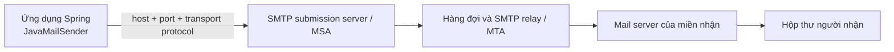
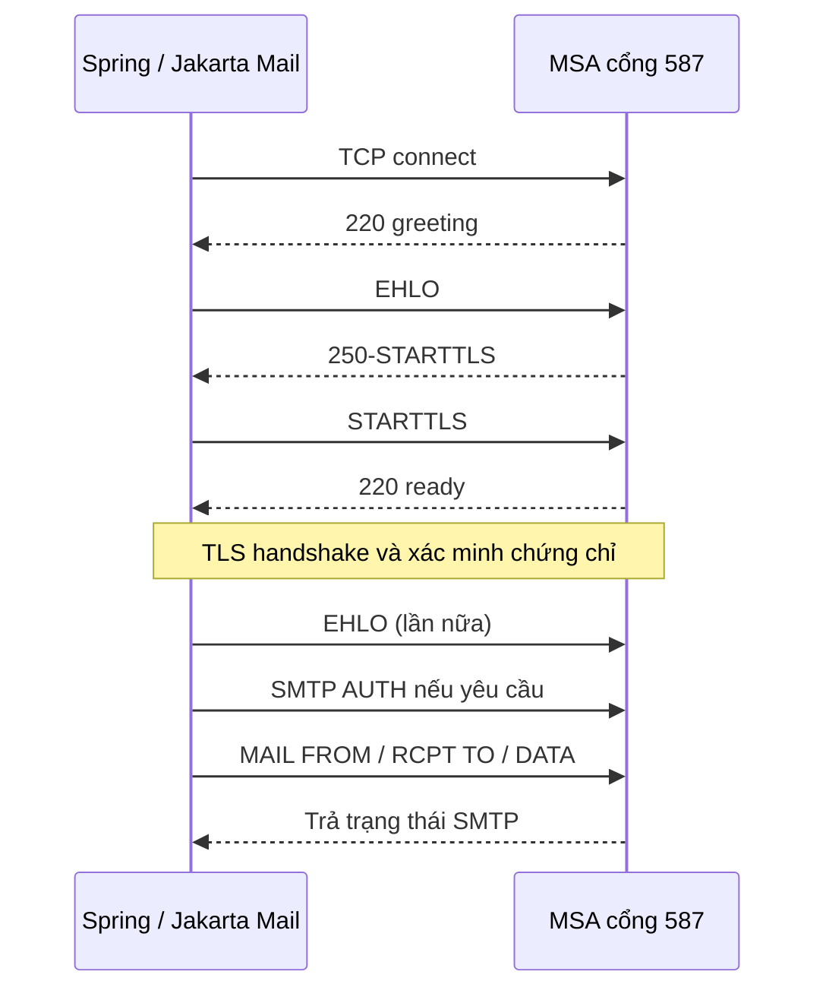
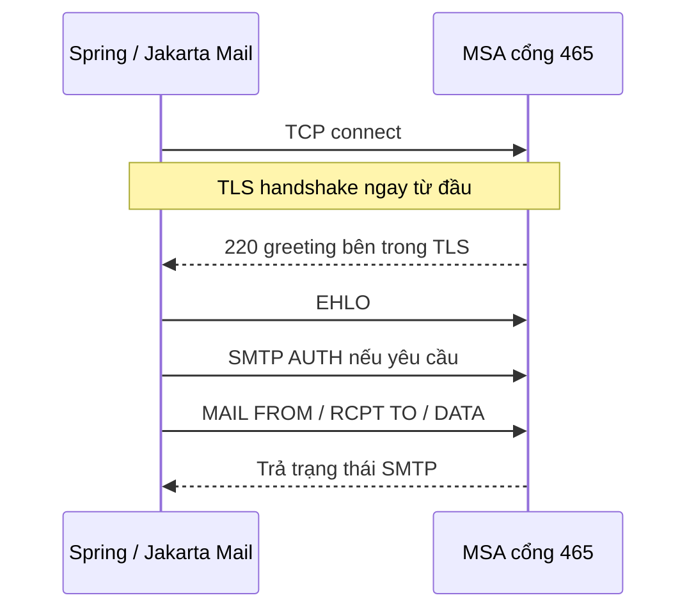
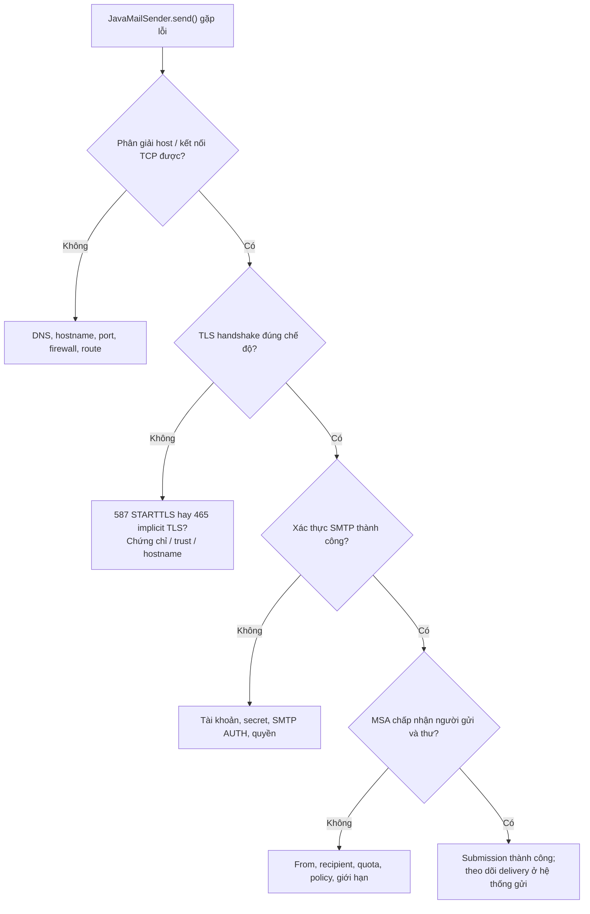

# Cấu hình host, port và protocol của mail server trong Spring Framework Mail

Để một ứng dụng Spring gửi được email, `JavaMailSender` cần biết **kết nối đến máy chủ nào**, **qua cổng nào** và **sử dụng transport protocol nào**. Ba tham số cốt lõi là `host`, `port` và `protocol`. Chúng xác định điểm đến của kết nối gửi thư; các yêu cầu như TLS, xác thực và giới hạn thời gian chờ được cấu hình bổ sung.

Một cấu hình đúng không chỉ là điền ba giá trị để chương trình biên dịch. Ví dụ, cổng **587** thường yêu cầu SMTP rồi nâng cấp lên TLS bằng **STARTTLS**, trong khi cổng **465** thường yêu cầu **TLS ngay từ khi thiết lập kết nối**. Nếu chọn đúng hostname nhưng dùng sai kiểu TLS, ứng dụng vẫn không thể gửi thư.

Bài này giải thích ý nghĩa từng trường, cách cấu hình bằng Spring Boot và Spring Framework thuần, mối liên hệ giữa `smtp`/`smtps` và các cổng phổ biến, cùng cách xác định nguyên nhân khi kết nối thất bại.

## 1. Host, port và protocol nằm ở đâu trong luồng gửi email?

Một ứng dụng Spring thường hoạt động như **SMTP client**. Nó tạo nội dung thư, sau đó nộp thư cho **Mail Submission Agent (MSA)** hoặc SMTP relay đã được cấp quyền. Máy chủ tiếp nhận sẽ xử lý việc xếp hàng và chuyển phát tiếp.



Ví dụ thông số được nhà cung cấp SMTP cấp:

```text
SMTP host:      smtp.provider.example
SMTP port:      587
SMTP protocol:  smtp
Security:       STARTTLS required
Authentication: username/password or provider-supported mechanism
```

Ý nghĩa:

- **`host`**: hostname hoặc địa chỉ của máy chủ SMTP mà ứng dụng sẽ mở kết nối tới.
- **`port`**: cổng TCP nơi dịch vụ SMTP của máy chủ đó đang lắng nghe.
- **`protocol`**: tên transport mà JavaMail/Jakarta Mail sử dụng để gửi thông điệp, thường là `smtp`; trong một số cấu hình còn có `smtps`.

Để gửi email thực tế, thường còn cần **xác thực**, **TLS**, **timeout** và quyền sử dụng địa chỉ gửi. Ba trường host/port/protocol chỉ giải quyết được bước đầu tiên: xác định cách kết nối đến dịch vụ gửi thư.

### Phân biệt mail server gửi và mail server nhận

Đầu vào của `JavaMailSender` là SMTP submission endpoint, **không phải địa chỉ máy chủ IMAP/POP3 để đọc inbox**.

| Nhiệm vụ | Giao thức thường gặp | Ví dụ ứng dụng |
|---|---|---|
| Nộp email gửi đi từ Spring | SMTP submission | `JavaMailSender` |
| Chuyển email giữa các mail server | SMTP transfer | Các MTA |
| Đọc và đồng bộ inbox | IMAP | Mail client hoặc ứng dụng đọc thư |
| Tải thư theo mô hình POP3 | POP3 | Mail client hoặc ứng dụng thu thư |

Ngay cả khi một nhà cung cấp dùng chung tên miền thương mại cho cả dịch vụ gửi và nhận, **hostname, cổng và giao thức** của hai dịch vụ vẫn có thể khác nhau. Không thay `smtp.provider.example` bằng `imap.provider.example` chỉ vì cùng một tài khoản email.

## 2. `host`: địa chỉ máy chủ SMTP

`host` thường là **DNS hostname** như:

```text
smtp.provider.example
mail.internal.example
127.0.0.1
```

Trong Spring Boot:

```yaml
spring:
  mail:
    host: smtp.provider.example
```

Trong Spring Framework thuần:

```java
JavaMailSenderImpl sender = new JavaMailSenderImpl();
sender.setHost("smtp.provider.example");
```

**Host là tên máy chủ, không phải URL hoàn chỉnh.** Tránh những giá trị như:

```text
smtp://smtp.provider.example:587    # sai: gộp scheme và port vào host
https://smtp.provider.example        # sai: HTTPS URL không phải SMTP hostname
user@smtp.provider.example           # sai: đây trông như địa chỉ email
smtp.provider.example:465           # sai: port đã có trường riêng
```

Đúng là tách thành:

```text
host     = smtp.provider.example
port     = 587
protocol = smtp
```

Nếu dùng địa chỉ IP thay hostname, cấu hình có thể kết nối được về TCP nhưng **xác thực chứng chỉ TLS có thể thất bại** khi chứng chỉ được cấp cho hostname. Trong sản xuất, nên sử dụng hostname chính thức do nhà cung cấp công bố để khớp với DNS và chứng chỉ TLS.

### Host SMTP có phải bản ghi MX của người nhận?

Thông thường **không**. Ứng dụng Spring nộp email tới **một submission server được cấu hình sẵn**. Hệ thống MTA phía sau sẽ định tuyến thư đến các miền nhận, thường thông qua DNS MX.

Ví dụ:

```text
Ứng dụng gửi email cho:
  alice@example.net
  bob@another.example

Nhưng JavaMailSender của ứng dụng vẫn kết nối đến:
  smtp.provider.example:587
```

Không cần tự tìm MX của từng người nhận trong application service. Làm như vậy sẽ biến ứng dụng thành một phần của hạ tầng chuyển thư, kéo theo các nhiệm vụ vận hành khác như queue/retry, quản lý uy tín IP và chính sách chuyển tiếp.

### Chọn host theo môi trường

Cùng một code gửi email có thể dùng các endpoint khác nhau:

| Môi trường | Ví dụ host | Mục tiêu |
|---|---|---|
| Local | `localhost` hoặc tên service container `mailpit` | SMTP sink để xem thư thử, không phát ra Internet |
| Development / staging | SMTP sandbox hoặc tài khoản thử nghiệm | Kiểm thử tích hợp và chính sách gửi |
| Production | SMTP submission endpoint chính thức | Chuyển phát email thật |
| Mạng nội bộ | Host relay được quản trị cấp | Gửi qua hạ tầng email nội bộ |

Lưu ý: `localhost` luôn chỉ **chính máy/container chạy ứng dụng**. Nếu Spring chạy trong container riêng, `localhost` không tự động trỏ tới container SMTP sandbox bên cạnh; cần dùng hostname phân giải được trong mạng/container tương ứng.

## 3. `port`: cổng TCP của dịch vụ SMTP

`port` xác định địa chỉ logic của dịch vụ trên host. Các cổng thường gặp:

| Port | Mục đích phổ biến | Cách thiết lập bảo mật |
|---|---|---|
| **25** | SMTP transfer giữa các MTA; đôi khi relay nội bộ | Có thể dùng STARTTLS theo chính sách máy chủ |
| **587** | Message submission từ ứng dụng hoặc mail client đến MSA | SMTP ban đầu, sau đó **STARTTLS** |
| **465** | Message submission với TLS ngay từ lúc kết nối | **Implicit TLS** |
| **2525** | Cổng thay thế do một số nhà cung cấp hỗ trợ | Tùy chính sách nhà cung cấp; thường cần STARTTLS |
| **1025** | Cổng ví dụ của SMTP sink local | Thường không TLS/AUTH trong mạng test được kiểm soát |

Khi ứng dụng Spring gửi email qua SMTP provider, hãy ưu tiên **submission endpoint được provider chỉ định**, thường là 587 hoặc 465.

### Cổng 587: STARTTLS

Với cổng 587, client kết nối TCP, trao đổi SMTP ban đầu, gửi `STARTTLS` để nâng cấp kênh rồi mới thực hiện SMTP AUTH/gửi thư theo chính sách.



Tại đây, cần phân biệt hai thuộc tính:

- `mail.smtp.starttls.enable=true`: cho phép Jakarta Mail dùng STARTTLS khi server hỗ trợ.
- `mail.smtp.starttls.required=true`: yêu cầu STARTTLS thành công; không âm thầm gửi plaintext nếu server không hỗ trợ hoặc nâng cấp thất bại.

Đối với thông tin đăng nhập và email nghiệp vụ trên mạng không tin cậy, nên **yêu cầu STARTTLS** trên 587 và xác minh chứng chỉ TLS.

### Cổng 465: implicit TLS

Với cổng 465, TLS bắt đầu **ngay sau khi TCP được kết nối**. Chỉ sau TLS handshake, client mới nhận lời chào SMTP và gửi `EHLO`.



Với Jakarta Mail, cách cấu hình thường dùng là giữ `protocol=smtp` và bật `mail.smtp.ssl.enable=true`. Tên thuộc tính chứa chữ `ssl` là **tên API lịch sử**; nó yêu cầu thiết lập TLS từ đầu, không có nghĩa nên sử dụng phiên bản SSL cũ.

Nếu client dùng cách kết nối của cổng 587 với một endpoint chỉ nhận implicit TLS trên 465, hai phía có thể chờ nhau hoặc kết nối bị cắt; hiện tượng tương tự xảy ra khi dùng implicit TLS sai trên 587.

### Cổng 25 và những khác biệt cần hiểu

Cổng 25 truyền thống thường phục vụ MTA-to-MTA. Nó **không đồng nghĩa luôn là plaintext** vì SMTP transfer cũng có thể sử dụng STARTTLS. Tuy nhiên, nhiều nhà cung cấp cloud và ISP giới hạn outbound TCP 25 để giảm thư rác. Ứng dụng nghiệp vụ thường không nên tự chọn cổng 25 nếu đã có submission port dành riêng.

Trong mạng nội bộ, quản trị viên có thể cung cấp SMTP relay trên cổng 25 hoặc cổng tùy chỉnh và xác thực theo mạng. Hãy dùng đúng chính sách của relay đó thay vì mặc định mọi SMTP server đều có username/password hoặc luôn dùng 587.

## 4. `protocol`: SMTP transport của Jakarta Mail

Trong `JavaMailSenderImpl`, trường `protocol` xác định transport mà Jakarta Mail sử dụng khi gửi thư. Giá trị thông dụng nhất là:

```text
smtp
```

Trong Spring Boot:

```yaml
spring:
  mail:
    protocol: smtp
```

Trong Java:

```java
sender.setProtocol("smtp");
```

`smtp` là **giao thức gửi email**, không phải tên lớp mã hóa. Có thể dùng `smtp` với **587 + STARTTLS** hoặc với **465 + implicit TLS** bằng cách bật đúng thuộc tính.

### `smtp` và `smtps` có gì khác?

Jakarta Mail có thể cung cấp transport `smtps` để triển khai SMTP chạy trên kết nối TLS ngay từ đầu. Tuy nhiên, đối với Spring Mail, bạn **không bắt buộc đổi `protocol` thành `smtps` khi dùng cổng 465**.

Hai cấu hình có thể phục vụ cùng một endpoint TLS:

| Cách triển khai | `protocol` | `port` | Thuộc tính tiêu biểu |
|---|---|---:|---|
| SMTP + STARTTLS | `smtp` | 587 | `mail.smtp.starttls.enable=true` và `required=true` |
| SMTP + implicit TLS | `smtp` | 465 | `mail.smtp.ssl.enable=true` |
| SMTPS transport (khi provider hỗ trợ) | `smtps` | 465 | Thuộc tính transport tương ứng mang tiền tố `mail.smtps.*` |

Cách **`smtp` + `mail.smtp.ssl.enable=true`** thường dễ hiểu và đồng nhất với các cấu hình Spring Boot phổ biến: host, port, protocol vẫn dùng `smtp`, còn tính chất bảo mật được chỉ định riêng.

Nếu chủ động chọn transport `smtps`, cần kiểm tra Jakarta Mail provider tương thích và những thuộc tính có tiền tố **`mail.smtps.*`**, chẳng hạn `mail.smtps.auth`, `mail.smtps.connectiontimeout`, `mail.smtps.timeout`. Một số cài đặt `mail.smtp.*` cho transport `smtp` không tự động áp dụng cho transport `smtps`. Vì vậy, tránh đổi tên protocol mà vẫn giữ nguyên toàn bộ properties rồi mặc định chúng sẽ có tác dụng như cũ.

### Không dùng IMAP hoặc POP3 làm protocol của JavaMailSender

Giá trị `spring.mail.protocol` dùng cho **gửi** thư. Đặt `imap` hoặc `pop3` vào đó không biến `JavaMailSender` thành công cụ đọc mail; hai giao thức đó thuộc nhóm **nhận/truy xuất hộp thư** với API khác. Dùng transport gửi email tương ứng với server submission đã cấp.

### Protocol cũng không phải scheme URL

Những giá trị sau biểu thị các khái niệm khác nhau:

```text
spring.mail.host: smtp.provider.example     # hostname
spring.mail.port: 587                      # TCP port
spring.mail.protocol: smtp                 # Jakarta Mail transport
mail.smtp.starttls.enable: true            # TLS mode
mail.smtp.auth: true                       # SMTP AUTH client setting
```

Không điền `protocol: smtp://`, `protocol: tls` hoặc `protocol: 587`. Chúng không phải tên transport SMTP thông dụng mà `JavaMailSenderImpl` cần.

## 5. Cấu hình Spring Boot với `application.yml`

Spring Boot có thể tự cấu hình một `JavaMailSender` từ **Spring Boot Mail starter** và nhóm thuộc tính `spring.mail.*` khi các điều kiện auto-configuration được đáp ứng.

### Dependency

Với Gradle:

```groovy
dependencies {
    implementation 'org.springframework.boot:spring-boot-starter-mail'
}
```

Với Maven:

```xml
<dependency>
    <groupId>org.springframework.boot</groupId>
    <artifactId>spring-boot-starter-mail</artifactId>
</dependency>
```

Ví dụ trong bài dùng Spring Boot hiện đại và Jakarta Mail. Khi dùng Spring Boot 2/Spring Framework 5, các import thuộc bộ `javax.mail` cũ có thể khác; cách hiểu host/port/protocol cơ bản không thay đổi.

### A. Cấu hình SMTP submission cổng 587 + STARTTLS

Đây là một ví dụ phù hợp với MSA yêu cầu SMTP AUTH và STARTTLS:

```yaml
spring:
  mail:
    host: ${SMTP_HOST}
    port: 587
    protocol: smtp
    username: ${SMTP_USERNAME}
    password: ${SMTP_PASSWORD}
    properties:
      "[mail.smtp.auth]": true
      "[mail.smtp.starttls.enable]": true
      "[mail.smtp.starttls.required]": true
      "[mail.smtp.ssl.checkserveridentity]": true
      "[mail.smtp.connectiontimeout]": 5000
      "[mail.smtp.timeout]": 10000
      "[mail.smtp.writetimeout]": 10000

app:
  mail:
    from: ${MAIL_FROM}
```

Với ví dụ này, biến môi trường có thể là:

```text
SMTP_HOST=smtp.provider.example
SMTP_USERNAME=mailer@example.org
SMTP_PASSWORD=(secret cung cấp qua môi trường)
MAIL_FROM=notifications@example.org
```

Chọn đúng tài khoản và quyền gửi theo hướng dẫn của nhà cung cấp. Không đưa secret thật vào mã nguồn hoặc git. Một số provider yêu cầu **app password**, OAuth2 hoặc token thay cho mật khẩu email thông thường; cấu hình AUTH phải tương ứng với cơ chế mà server hỗ trợ.

Giải thích các thuộc tính:

| Thuộc tính | Mục đích |
|---|---|
| `spring.mail.host` | Hostname của SMTP submission server |
| `spring.mail.port` | Cổng TCP mà server lắng nghe |
| `spring.mail.protocol` | Transport protocol, ở đây là `smtp` |
| `spring.mail.username`, `password` | Dữ liệu xác thực dành cho MSA nếu cần |
| `mail.smtp.auth` | Bật cơ chế SMTP AUTH của SMTP transport |
| `mail.smtp.starttls.enable` | Yêu cầu client hỗ trợ nâng cấp STARTTLS |
| `mail.smtp.starttls.required` | Bắt buộc đàm phán STARTTLS thành công |
| `mail.smtp.ssl.checkserveridentity` | Kiểm tra hostname trên chứng chỉ TLS |
| `mail.smtp.connectiontimeout` | Thời gian chờ tạo kết nối TCP (mili giây) |
| `mail.smtp.timeout` | Giới hạn thời gian chờ đọc dữ liệu |
| `mail.smtp.writetimeout` | Giới hạn thời gian chờ ghi dữ liệu |
| `app.mail.from` | Thuộc tính **do ứng dụng định nghĩa** để chọn địa chỉ `From` |

Nhóm `spring.mail.properties` là nơi truyền các thuộc tính tương ứng xuống Jakarta Mail. Những tên `mail.smtp.*` bên trong dấu ngoặc vuông là **khóa nguyên văn** của transport; Spring Boot không tự diễn giải chúng thành `spring.mail.host` hay `spring.mail.port`.

### B. Cấu hình SMTP submission cổng 465 + implicit TLS

Khi provider yêu cầu implicit TLS, cách cấu hình phổ biến là:

```yaml
spring:
  mail:
    host: ${SMTP_HOST}
    port: 465
    protocol: smtp
    username: ${SMTP_USERNAME}
    password: ${SMTP_PASSWORD}
    properties:
      "[mail.smtp.auth]": true
      "[mail.smtp.ssl.enable]": true
      "[mail.smtp.ssl.checkserveridentity]": true
      "[mail.smtp.connectiontimeout]": 5000
      "[mail.smtp.timeout]": 10000
      "[mail.smtp.writetimeout]": 10000
```

Ở đây **`protocol` vẫn là `smtp`**. Khác biệt quan trọng nằm ở `port: 465` và `mail.smtp.ssl.enable=true`. Chế độ này bắt đầu TLS từ đầu, vì vậy không cần dùng `STARTTLS` của ví dụ cổng 587.

Không thể chỉ đổi `587` thành `465` mà giữ lại cấu hình như cũ rồi luôn kỳ vọng thành công. Tương tự, đừng bật `mail.smtp.ssl.enable=true` trên 587 nếu provider đòi SMTP greeting rồi STARTTLS.

### C. Cấu hình SMTP sandbox cho local development

Nếu ứng dụng chạy cùng SMTP sink như Mailpit, có thể sử dụng cấu hình dành riêng cho local:

```yaml
# application-local.yml — ví dụ SMTP sink được cô lập
spring:
  mail:
    host: localhost
    port: 1025
    protocol: smtp
    properties:
      "[mail.smtp.auth]": false
      "[mail.smtp.starttls.enable]": false

app:
  mail:
    from: local@example.test
```

Các giá trị không TLS/không AUTH này **chỉ phù hợp trong môi trường phát triển được kiểm soát**. Nếu Spring chạy trong container, hãy thay `localhost` bằng tên service Docker hoặc địa chỉ SMTP sink có thể truy cập từ container đó.

### D. Cấu hình theo môi trường và giá trị mặc định

Spring Boot hỗ trợ placeholder để không phải sửa code khi chuyển môi trường:

```yaml
spring:
  mail:
    host: ${SMTP_HOST}
    port: ${SMTP_PORT:587}
    protocol: smtp
    username: ${SMTP_USERNAME}
    password: ${SMTP_PASSWORD}
```

`${SMTP_PORT:587}` nghĩa là lấy `SMTP_PORT` nếu có, nếu không thì dùng `587`. Vì TLS còn phụ thuộc cổng, khi môi trường cần chuyển từ 587 sang 465, phải thay **cả nhóm thuộc tính bảo mật**, không chỉ đổi port. Cách quản lý dễ đọc là dùng profile riêng cho từng kiểu SMTP endpoint hoặc cấu hình deployment theo một bộ giá trị nhất quán.

## 6. Spring Framework thuần: cấu hình `JavaMailSenderImpl` bằng Java

Nếu không dùng Spring Boot auto-configuration, ứng dụng có thể tự tạo bean `JavaMailSenderImpl`.

```java
package com.example.mail;

import java.util.Properties;
import org.springframework.context.annotation.Bean;
import org.springframework.context.annotation.Configuration;
import org.springframework.mail.javamail.JavaMailSender;
import org.springframework.mail.javamail.JavaMailSenderImpl;

@Configuration
public class MailConfiguration {

    @Bean
    JavaMailSender javaMailSender() {
        JavaMailSenderImpl sender = new JavaMailSenderImpl();
        sender.setHost(System.getenv("SMTP_HOST"));
        sender.setPort(587);
        sender.setProtocol("smtp");
        sender.setUsername(System.getenv("SMTP_USERNAME"));
        sender.setPassword(System.getenv("SMTP_PASSWORD"));
        sender.setDefaultEncoding("UTF-8");

        Properties properties = sender.getJavaMailProperties();
        properties.put("mail.smtp.auth", "true");
        properties.put("mail.smtp.starttls.enable", "true");
        properties.put("mail.smtp.starttls.required", "true");
        properties.put("mail.smtp.ssl.checkserveridentity", "true");
        properties.put("mail.smtp.connectiontimeout", "5000");
        properties.put("mail.smtp.timeout", "10000");
        properties.put("mail.smtp.writetimeout", "10000");

        return sender;
    }
}
```

Trong ví dụ trên:

- `setHost(...)` là **điểm đến**.
- `setPort(587)` là **cổng TCP**.
- `setProtocol("smtp")` chọn **SMTP transport**.
- `setUsername(...)` và `setPassword(...)` cung cấp thông tin xác thực cho quá trình kết nối nếu server yêu cầu.
- Các thuộc tính `mail.smtp.*` điều khiển TLS, AUTH và timeout.

Đây là ví dụ cấu hình đơn giản. Trong ứng dụng thực tế, nên inject cấu hình qua `@ConfigurationProperties` hoặc cơ chế cấu hình tương đương, kiểm tra các biến bắt buộc và lấy secrets từ nơi quản lý được cấp quyền. Không phụ thuộc việc `System.getenv(...)` trả về `null` mà không được phát hiện cho đến lúc gửi thư.

### Dùng `smtps` transport khi có yêu cầu riêng

Với ứng dụng chọn `smtps` thay vì `smtp`, cần cấu hình các thuộc tính cho transport tương ứng:

```java
JavaMailSenderImpl sender = new JavaMailSenderImpl();
sender.setHost("smtp.provider.example");
sender.setPort(465);
sender.setProtocol("smtps");
sender.setUsername(System.getenv("SMTP_USERNAME"));
sender.setPassword(System.getenv("SMTP_PASSWORD"));

Properties props = sender.getJavaMailProperties();
props.put("mail.smtps.auth", "true");
props.put("mail.smtps.ssl.checkserveridentity", "true");
props.put("mail.smtps.connectiontimeout", "5000");
props.put("mail.smtps.timeout", "10000");
props.put("mail.smtps.writetimeout", "10000");
```

Ví dụ này minh họa **cách tên transport chi phối tiền tố property**; nó chỉ phù hợp nếu Jakarta Mail runtime của ứng dụng có provider `smtps` tương ứng. Đối với cấu hình phổ biến trên 465, dùng `protocol=smtp` cùng `mail.smtp.ssl.enable=true` thường đơn giản hơn.

### Cấu hình JavaMailSender không tự tạo SMTP server

Tạo bean `JavaMailSenderImpl` chỉ tạo một **client gửi thư**. Ứng dụng vẫn cần một SMTP service đang chạy, DNS/network cho phép truy cập, tài khoản được cấp quyền và địa chỉ người gửi hợp lệ. Spring không tự khởi chạy MSA chỉ vì đã khai báo bean.

## 7. Dùng bean đã cấu hình trong dịch vụ gửi email

Sau khi cấu hình host, port và protocol, mã nghiệp vụ chỉ cần inject `JavaMailSender`, không nên lặp lại thông tin endpoint trong mỗi phương thức:

```java
package com.example.mail;

import org.springframework.beans.factory.annotation.Value;
import org.springframework.mail.SimpleMailMessage;
import org.springframework.mail.javamail.JavaMailSender;
import org.springframework.stereotype.Service;

@Service
public class NotificationMailService {

    private final JavaMailSender sender;
    private final String fromAddress;

    public NotificationMailService(
            JavaMailSender sender,
            @Value("${app.mail.from}") String fromAddress) {
        this.sender = sender;
        this.fromAddress = fromAddress;
    }

    public void sendNotification(String recipient) {
        SimpleMailMessage message = new SimpleMailMessage();
        message.setFrom(fromAddress);
        message.setTo(recipient);
        message.setSubject("Thông báo hệ thống");
        message.setText("Tác vụ của bạn đã hoàn tất.");
        sender.send(message);
    }
}
```

`SimpleMailMessage` phù hợp với email text đơn giản. Với HTML, file đính kèm hoặc tài nguyên inline, dùng `MimeMessage` và `MimeMessageHelper`. Dù tạo loại thông điệp nào, bean `JavaMailSender` vẫn sử dụng cùng endpoint và transport đã được cấu hình.

Khi gọi `send(...)`, Jakarta Mail thường thực hiện kết nối SMTP, xác thực nếu cần, gửi envelope và nội dung rồi đọc phản hồi của MSA. **Phương thức trả về thành công không có nghĩa email đã tới inbox của người nhận**; nó thường chỉ xác nhận chặng submission hoàn tất theo phản hồi của máy chủ gửi.

## 8. Các thuộc tính cấu hình liên quan nhưng khác vai trò

Host, port, protocol dễ bị nhầm với các thuộc tính khác vì đều nằm trong `spring.mail.*`.

| Thuộc tính | Vai trò | Có thay thế host/port/protocol không? |
|---|---|---|
| `spring.mail.host` | Máy chủ SMTP submission | Là host |
| `spring.mail.port` | Cổng TCP của máy chủ | Là port |
| `spring.mail.protocol` | Transport `smtp` hoặc `smtps` tương ứng | Là protocol |
| `spring.mail.username` | Danh tính xác thực | Không |
| `spring.mail.password` | Bí mật xác thực | Không |
| `spring.mail.default-encoding` | Charset mặc định cho thông điệp | Không |
| `spring.mail.properties.*` | Cấu hình Jakarta Mail như TLS, AUTH, timeout | Bổ sung và điều khiển hành vi transport |
| `spring.mail.test-connection` | Yêu cầu kiểm tra kết nối mail khi khởi động (nếu được hỗ trợ bởi auto-config) | Không |
| `app.mail.from` | Thuộc tính ứng dụng tự định nghĩa cho địa chỉ người gửi | Không |

### `spring.mail.host` và `mail.smtp.host` có phải một thứ?

Jakarta Mail có nhiều thuộc tính transport như `mail.smtp.host`, `mail.smtp.port`. Tuy nhiên, khi dùng Spring Boot và `JavaMailSenderImpl`, cách rõ ràng là thiết lập:

```yaml
spring:
  mail:
    host: smtp.provider.example
    port: 587
    protocol: smtp
```

Và đặt riêng những tùy chọn transport bổ sung dưới `spring.mail.properties`. Không khai báo những giá trị host/port mâu thuẫn trong hai nơi khác nhau; sự khác biệt về độ ưu tiên sẽ làm cấu hình khó hiểu và khó điều tra.

### Khi không chỉ định port hoặc protocol

`JavaMailSenderImpl` có giá trị mặc định cho một số thiết lập (ví dụ protocol gửi phổ biến là `smtp`); nếu không cấu hình port rõ ràng, transport có thể dùng giá trị mặc định theo provider và cơ chế TLS. Không nên dựa vào mặc định trong môi trường sản xuất vì:

1. Dịch vụ SMTP của nhà cung cấp thường yêu cầu một cổng submission cụ thể.
2. Mặc định không xác định liệu endpoint cần STARTTLS hay implicit TLS.
3. Chạy trên mạng khác có thể chịu giới hạn outbound port khác.

Hãy **khai báo port và chế độ bảo mật tường minh** theo hướng dẫn của nhà cung cấp, ngay cả khi `smtp` là protocol mặc định.

## 9. Kiểm tra nhanh cấu hình theo từng tầng

Khi gửi thư thất bại, nên xác định lỗi xảy ra ở tầng nào trước khi chỉnh code:



### Kiểm tra DNS và TCP

Nếu ứng dụng chạy trên Windows PowerShell, có thể kiểm tra kết nối TCP:

```powershell
Resolve-DnsName smtp.provider.example
Test-NetConnection smtp.provider.example -Port 587
```

Nếu dùng hệ điều hành khác, các công cụ phân giải DNS và kiểm tra TCP tương đương có thể được dùng từ **cùng môi trường mạng nơi ứng dụng chạy**.

Kết quả kết nối TCP thành công chỉ xác nhận có thể mở socket tới host/port; **chưa chứng minh SMTP, TLS, AUTH hoặc quyền gửi hoạt động**.

### Kiểm tra STARTTLS và implicit TLS

Nếu có OpenSSL, dùng:

```bash
# Cổng 587: kết nối SMTP rồi nâng cấp STARTTLS
openssl s_client -starttls smtp \
  -connect smtp.provider.example:587 \
  -servername smtp.provider.example

# Cổng 465: kết nối TLS ngay lập tức
openssl s_client \
  -connect smtp.provider.example:465 \
  -servername smtp.provider.example
```

Đối chiếu chứng chỉ và hostname, chú ý thông tin lỗi xác minh. Không tắt xác minh chứng chỉ hoặc dùng chế độ tin cậy tất cả host chỉ để vượt qua lỗi TLS.

### Kiểm tra SMTP connection qua JavaMailSender

`JavaMailSenderImpl` có phương thức `testConnection()` để kiểm tra việc kết nối được tới mail server theo cấu hình hiện tại:

```java
import org.springframework.mail.MailException;
import org.springframework.mail.javamail.JavaMailSenderImpl;

public void verifySubmissionConnection(JavaMailSenderImpl sender) {
    try {
        sender.testConnection();
        System.out.println("Đã kết nối được tới SMTP server.");
    } catch (MailException ex) {
        System.err.println("Không kết nối được SMTP: " + ex.getMessage());
    }
}
```

Đây là kiểm tra **kết nối/phiên SMTP**, không phải email test được phát tới người nhận. Chẳng hạn MSA có thể chấp nhận AUTH nhưng từ chối địa chỉ `From` hoặc `RCPT TO` sau đó.

Trong Spring Boot, nếu môi trường và phiên bản hỗ trợ, `spring.mail.test-connection=true` có thể yêu cầu kiểm tra kết nối khi ứng dụng khởi động. Tùy hạ tầng, điều này khiến startup thất bại khi SMTP tạm thời không hoạt động. Chọn cách kiểm tra phù hợp với yêu cầu availability của ứng dụng; không dùng nó làm thay thế cho quan sát lỗi gửi và delivery.

## 10. Bảng lỗi thường gặp do host, port và protocol

| Triệu chứng | Khả năng gây lỗi | Cách xử lý |
|---|---|---|
| `UnknownHostException` | Sai hostname, DNS không phân giải được | Kiểm tra `spring.mail.host`, DNS và mạng nơi ứng dụng chạy |
| `Connection refused` | Đúng host nhưng không có listener trên port hoặc server chặn | Xác minh port và dịch vụ SMTP của nhà cung cấp |
| `Connection timed out` | Firewall, route, proxy hoặc chính sách cloud chặn kết nối | Kiểm tra outbound policy và truy cập TCP từ môi trường thực |
| `SSLHandshakeException` | Chọn sai kiểu TLS, chứng chỉ/trust hoặc hostname sai | Kiểm tra 587/STARTTLS so với 465/implicit TLS, chứng chỉ và DNS |
| Treo lâu khi kết nối 465 | Client mong banner SMTP plaintext trong khi server chờ TLS | Với `protocol=smtp`, bật `mail.smtp.ssl.enable=true` |
| `530 Must issue STARTTLS first` | Server yêu cầu TLS trước AUTH hoặc gửi thư | Bật `starttls.enable` và `starttls.required` trên 587 |
| `535 Authentication failed` | Sai secret, cơ chế SMTP AUTH hoặc tài khoản chưa được phép | Kiểm tra tài khoản SMTP, app password/OAuth2 và quyền |
| `550` hoặc `554 Relay denied` | Xác thực/quyền gửi không hợp lệ hoặc chính sách relay | Kiểm tra `From`, envelope sender, quyền gửi và chính sách MSA |
| Không hỗ trợ protocol | Giá trị `spring.mail.protocol` không có transport provider | Chọn `smtp` hoặc provider phù hợp; kiểm tra dependency |
| `mail.smtp.*` không có hiệu lực như kỳ vọng | Transport `smtps` được chọn nhưng vẫn dùng các property của `smtp` | Dùng đúng tiền tố property theo transport hoặc dùng `smtp` + implicit TLS |
| Gửi được từ laptop nhưng thất bại trong container/cloud | Host `localhost` sai ngữ cảnh, DNS khác hoặc outbound bị chặn | Kiểm tra endpoint thực từ container, network rules và secret |
| `send()` thành công nhưng email chưa đến | Submission thành công, lỗi ở bước delivery hoặc lọc | Tra provider events, queue ID, bounce và inbox/spam |

Một exception Spring Mail có thể bao bọc lỗi từ Jakarta Mail hoặc socket/TLS. Xem **nguyên nhân gốc** và thời điểm lỗi xảy ra. Thay port bừa theo mã lỗi thường khiến cấu hình thiếu nhất quán.

## 11. Tình huống triển khai: chọn bộ cấu hình phù hợp

| Tình huống | Host | Port | Protocol và TLS |
|---|---|---:|---|
| Dùng SMTP provider có STARTTLS | Host `smtp.*` do provider cấp | 587 | `smtp` + STARTTLS bắt buộc |
| Provider yêu cầu SSL/TLS ngay từ đầu | Host submission do provider cấp | 465 | `smtp` + `mail.smtp.ssl.enable=true` |
| Relay nội bộ có cấu hình mạng riêng | Host nội bộ do quản trị cấp | Theo hệ thống | Theo chính sách relay; có thể không giống Internet submission |
| Dùng SMTP sink cục bộ | `localhost` hoặc tên service test | Ví dụ 1025 | `smtp`, theo cơ chế bảo mật test |
| Gửi email qua HTTP API | API endpoint của provider | HTTPS 443 | Dùng HTTP client/SDK, không cấu hình `JavaMailSender` như SMTP |
| Ứng dụng muốn đọc inbox | IMAP/POP3 endpoint | Theo giao thức nhận | Dùng API đọc thư, không dùng `JavaMailSender` để truy xuất inbox |

Ví dụ cấu hình ứng dụng có thể thay đổi tùy provider, nhưng **host, port, protocol và chế độ TLS phải là một bộ nhất quán**. Không thể suy ra đúng cổng chỉ từ tên miền, cũng không thể suy ra có SMTP AUTH chỉ vì máy chủ có TLS.

### Hệ thống có nhiều SMTP sender

Một số ứng dụng gửi email giao dịch và email tiếp thị bằng hai provider khác nhau. Khi đó có thể tạo nhiều bean `JavaMailSenderImpl` với tên và `@Qualifier` rõ ràng, mỗi bean có host, port, protocol và secret riêng:

```java
@Bean("transactionalMailSender")
JavaMailSender transactionalMailSender() {
    JavaMailSenderImpl sender = new JavaMailSenderImpl();
    sender.setHost("smtp.transactional.example");
    sender.setPort(587);
    sender.setProtocol("smtp");
    // Bổ sung credential, STARTTLS bắt buộc, TLS hostname check và timeout.
    return sender;
}

@Bean("bulkMailSender")
JavaMailSender bulkMailSender() {
    JavaMailSenderImpl sender = new JavaMailSenderImpl();
    sender.setHost("smtp.bulk.example");
    sender.setPort(465);
    sender.setProtocol("smtp");
    // Bổ sung credential, implicit TLS, hostname check và timeout.
    return sender;
}
```

Đoạn minh họa chỉ cho thấy cách tổ chức **nhiều endpoint độc lập**, chưa phải cấu hình gửi sản xuất hoàn chỉnh. Mỗi bean phải được hoàn thiện TLS/AUTH và kiểm tra quyền `From` theo provider; các dịch vụ gọi cần inject bean phù hợp. Đừng đặt nhiều hostname cách nhau bằng dấu phẩy trong một `spring.mail.host` rồi kỳ vọng Jakarta Mail tự failover nếu chưa xây dựng cơ chế hỗ trợ rõ ràng.

## 12. Lưu ý vận hành và bảo mật

1. **Đọc đúng thông số từ SMTP provider.** Xác nhận hostname submission, port, kiểu TLS, yêu cầu AUTH và danh tính được phép gửi. Không suy đoán hostname theo tên miền email.
2. **Bảo vệ credentials.** Dùng biến môi trường hoặc secret manager, cấp quyền tối thiểu và tách tài khoản theo môi trường. Không để mật khẩu trong `application.yml` được commit.
3. **Xác minh TLS.** Khi dùng 587, yêu cầu STARTTLS; khi dùng 465, bật implicit TLS. Xác minh hostname/chứng chỉ; không cấu hình `mail.smtp.ssl.trust=*` trong sản xuất để né lỗi.
4. **Đặt timeout tường minh.** Cấu hình connection, read và write timeout để ứng dụng không chờ vô hạn khi SMTP server không đáp ứng.
5. **Kiểm soát dữ liệu email.** Xác thực quyền sử dụng địa chỉ `From`, giới hạn tốc độ, kích thước và loại nội dung. Không đưa dữ liệu cá nhân hoặc token vào SMTP debug log.
6. **Theo dõi submission tách với delivery.** MSA trả thành công nghĩa là nó chấp nhận thư xử lý tiếp; nếu cần biết đã phát hoặc bounce, dùng sự kiện provider và log của hệ thống gửi.
7. **Thiết kế retry thận trọng.** Lỗi tạm thời và SMTP `4xx` có thể retry có giới hạn và backoff; lỗi cấu hình/`5xx` thường cần xử lý nguyên nhân. Việc MSA đã nhận nhưng client mất phản hồi có thể gây gửi trùng nếu retry.
8. **Không đặt mail server trực tiếp trong HTTP request lâu.** Với hệ thống có lượng thư lớn hoặc yêu cầu bền vững, cân nhắc queue/outbox và worker gửi email để hạn chế ảnh hưởng tới thời gian phản hồi API.

## 13. Câu hỏi thường gặp

**Chỉ cần `spring.mail.host` và `spring.mail.port` là gửi được email?** Chỉ khi SMTP server cho phép kết nối/gửi theo cấu hình đó. Nhiều MSA yêu cầu thêm TLS, SMTP AUTH và quyền sử dụng địa chỉ `From`.

**Tôi nên đặt `spring.mail.protocol: smtp` hay `smtps` trên cổng 465?** Một cấu hình phổ biến là **`smtp` cùng `mail.smtp.ssl.enable=true`** trên 465. `smtps` có thể dùng với provider thích hợp, nhưng cần các thuộc tính có tiền tố `mail.smtps.*` tương ứng.

**`smtp` có nghĩa là truyền email không mã hóa?** Không. `smtp` cùng STARTTLS trên 587 hoặc implicit TLS trên 465 đều có thể bảo vệ kết nối. Protocol transport và chế độ TLS là hai cấu hình cần phối hợp.

**Có thể nhập `smtp://smtp.provider.example:587` vào host không?** Không nên. `host` nhận hostname; `port` và `protocol` là các trường riêng. Đừng gộp URL scheme, port hoặc user info vào host.

**Cổng 25 có luôn sai?** Không. Cổng 25 phục vụ luồng SMTP transfer và đôi khi relay nội bộ. Nhưng đối với ứng dụng Spring nộp email ra ngoài qua nhà cung cấp, nên dùng submission endpoint được cấp, thường là 587 hoặc 465.

**Tại sao 587 hoạt động ở máy local nhưng không hoạt động ở production?** Có thể vì DNS, firewall, network policy, secret, TLS trust store hoặc chính sách của SMTP server khác nhau. Kiểm tra từng tầng từ đúng host/container đang chạy ứng dụng.

**Đổi host có làm thay đổi `From` không?** Không tự động. `host` là nơi nộp thư; `From` là trường hiển thị tác giả thư. Tuy nhiên, MSA mới có thể yêu cầu xác minh địa chỉ/miền gửi trước khi cho phép nộp.

**Có thể dùng cùng một JavaMailSender cho nhiều người nhận ở các domain khác nhau?** Có. Ứng dụng nộp thư đến MSA đã cấu hình; hạ tầng gửi sẽ thực hiện định tuyến đến miền nhận. Không cần thay host theo `To` của mỗi email.

**`spring.mail.test-connection=true` đã chứng minh gửi thư ổn chưa?** Chưa. Kiểm tra kết nối chỉ giúp phát hiện một số lỗi host/port/TLS/AUTH. Lỗi địa chỉ gửi, người nhận, quota hoặc delivery vẫn có thể xuất hiện khi gửi thật.

**Nếu nhà cung cấp chỉ có REST API thì cấu hình JavaMailSender thế nào?** `JavaMailSender` là API gửi qua SMTP. Với provider chỉ hỗ trợ HTTP API, hãy dùng SDK/HTTP client phù hợp, cấu hình HTTPS endpoint và authentication riêng.

## 14. Tài liệu tham khảo kỹ thuật

- **Spring Framework Mail — `JavaMailSender` và `JavaMailSenderImpl`:** các API cấu hình `host`, `port`, `protocol` và gửi thông điệp.
- **Spring Boot Mail Properties:** nhóm cấu hình `spring.mail.*` và `spring.mail.properties.*` cho SMTP transport.
- **Jakarta Mail SMTP Transport:** các thuộc tính `mail.smtp.*`, `mail.smtps.*`, SMTP AUTH, STARTTLS, implicit TLS và timeout.
- **RFC 5321 — Simple Mail Transfer Protocol:** các nguyên tắc SMTP và chuyển tiếp email.
- **RFC 6409 — Message Submission for Mail:** chức năng message submission qua cổng 587.
- **RFC 3207 — SMTP STARTTLS:** cách nâng cấp kết nối SMTP sang TLS.
- **RFC 8314 — TLS cho Email Submission và Access:** đề cập implicit TLS submission trên cổng 465.

---

**Mô hình cần nhớ:** `host` trả lời **kết nối đến đâu**, `port` trả lời **kết nối qua cổng TCP nào**, và `protocol` trả lời **Jakarta Mail dùng transport gửi nào**. Với Spring Mail, cấu hình thông dụng là **`smtp` + cổng 587 + STARTTLS bắt buộc** hoặc **`smtp` + cổng 465 + implicit TLS**. Cả hai đều cần hostname đúng, xác thực/quyền gửi phù hợp, chứng chỉ TLS hợp lệ và cách theo dõi kết quả submission.
