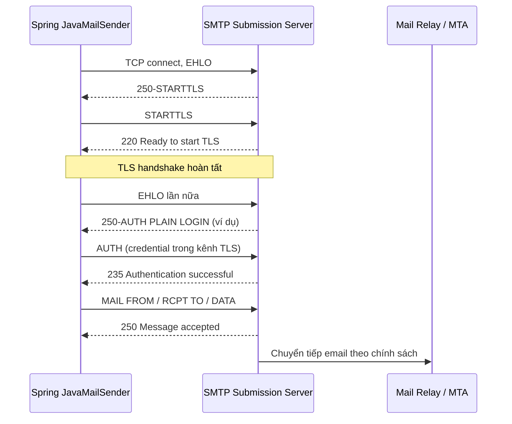
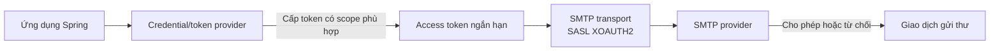

# Username, password và thông tin xác thực khi cấu hình mail sender

Để một ứng dụng Spring gửi email qua máy chủ SMTP của nhà cung cấp, thông thường ứng dụng phải chứng minh rằng nó **được phép sử dụng dịch vụ gửi thư**. Phần lớn dịch vụ SMTP submission yêu cầu thông tin xác thực, thường là **username và password**, được truyền qua cơ chế **SMTP AUTH** trên một kết nối được bảo vệ bằng TLS.

Trong Spring Framework Mail, các thông tin này được cấu hình cho `JavaMailSender` hoặc `JavaMailSenderImpl`. Chúng thuộc **kết nối từ ứng dụng đến SMTP server**; không phải nội dung của email, không phải địa chỉ người nhận, và cũng không nhất thiết trùng với địa chỉ `From:` mà người nhận nhìn thấy.

Ví dụ, hệ thống thương mại điện tử có thể sử dụng:

```text
SMTP server: smtp.provider.example
SMTP port:   587
SMTP username: mailer-account-42
SMTP password: [giá trị bí mật, lấy từ secret store]

Email From: "Shop Example" <notifications@shop.example>
Email To:   customer@company.example
```

`mailer-account-42` là **danh tính đăng nhập SMTP**. `notifications@shop.example` là **danh tính người gửi hiển thị**; việc tài khoản SMTP có được phép dùng địa chỉ `From:` đó hay không còn phụ thuộc chính sách của nhà cung cấp.

## 1. Phân biệt tài khoản SMTP với các địa chỉ email

Email có nhiều khái niệm đều dễ được gọi chung là “người gửi”. Chúng cần được tách ra:

| Thành phần | Nằm ở đâu? | Dùng để làm gì? | Ví dụ |
| --- | --- | --- | --- |
| **SMTP username** | Cấu hình ứng dụng / SMTP AUTH | Xác thực tài khoản có quyền dùng SMTP relay | `mailer-account-42` hoặc `notifications@shop.example` |
| **SMTP password / token** | Secret của ứng dụng / SMTP AUTH | Chứng minh quyền sử dụng tài khoản SMTP | App password, service credential hoặc OAuth2 access token |
| **SMTP host** | Cấu hình mail sender | Máy chủ ứng dụng kết nối để submit thư | `smtp.provider.example` |
| **Header `From:`** | Nội dung thông điệp RFC 5322 | Người gửi hiển thị khi nhận thư | `notifications@shop.example` |
| **Envelope `MAIL FROM`** | Lệnh SMTP trong giao dịch | Reverse-path, thường dùng cho DSN/bounce | `bounces@shop.example` |
| **`Reply-To:`** | Header của thông điệp | Gợi ý đích nhận thư khi người dùng bấm Reply | `support@shop.example` |
| **`RCPT TO`** | Lệnh SMTP trong giao dịch | Người nhận thực sự được SMTP server chuyển thư đến | `customer@company.example` |

**Username không buộc phải có dạng địa chỉ email.** Nhiều nhà cung cấp yêu cầu dùng địa chỉ mailbox đầy đủ, nhưng có nhà cung cấp cấp username riêng, định danh API hoặc chuỗi nhận dạng dịch vụ. Phải sử dụng chính xác giá trị theo cấu hình SMTP của nhà cung cấp, không tự suy ra từ `From:`.

Tương tự, SMTP AUTH thành công **không tự động cho phép giả mạo bất kỳ `From:` nào**. Server có thể tiếp tục từ chối ở bước `MAIL FROM`, `RCPT TO` hoặc sau `DATA` nếu domain gửi chưa được xác minh, tài khoản thiếu quyền hoặc thông điệp vi phạm chính sách.

## 2. SMTP AUTH hoạt động như thế nào?

SMTP AUTH là một extension của Extended SMTP (ESMTP). SMTP client (ở đây là transport do Jakarta Mail/Spring sử dụng) hỏi các khả năng của server qua `EHLO`. Server có thể quảng bá các cơ chế xác thực hỗ trợ, ví dụ `PLAIN`, `LOGIN` hoặc `XOAUTH2`.

Ở mô hình phổ biến dùng cổng 587, ứng dụng thực hiện:



Các bước diễn ra như sau:

1. **Kết nối:** ứng dụng mở kết nối đến SMTP submission server đã cấu hình.
2. **`EHLO`:** server công bố các tính năng ESMTP có thể sử dụng.
3. **`STARTTLS`:** nếu được cấu hình, hai bên nâng cấp kết nối sang TLS. Sau khi handshake thành công, client phải gửi `EHLO` lại vì danh sách capability có thể thay đổi.
4. **`AUTH`:** transport gửi thông tin xác thực theo một cơ chế cả hai bên hỗ trợ.
5. **Gửi thư:** sau khi được cho phép, ứng dụng tiếp tục giao dịch SMTP bằng `MAIL FROM`, `RCPT TO` và `DATA`.
6. **Chuyển tiếp:** SMTP relay nhận thư rồi định tuyến qua MTA; việc người nhận có thực sự nhận được email là giai đoạn riêng.

### Transcript minh họa, cố ý không chứa credential thật

```smtp
S: 220 smtp.provider.example ESMTP ready
C: EHLO app.shop.example
S: 250-smtp.provider.example
S: 250-STARTTLS
S: 250 SIZE 26214400
C: STARTTLS
S: 220 Ready to start TLS

[TLS handshake hoàn tất]

C: EHLO app.shop.example
S: 250-smtp.provider.example
S: 250-AUTH PLAIN LOGIN
S: 250 SIZE 26214400
C: AUTH [cơ chế và payload đã được ẩn]
S: 235 2.7.0 Authentication successful
C: MAIL FROM:<bounces@shop.example>
S: 250 2.1.0 Sender OK
C: RCPT TO:<customer@company.example>
S: 250 2.1.5 Recipient OK
C: DATA
S: 354 End data with <CRLF>.<CRLF>
C: From: notifications@shop.example
C: To: customer@company.example
C: Subject: Welcome
C:
C: Welcome to Shop.
C: .
S: 250 2.0.0 Message queued
C: QUIT
S: 221 Bye
```

Transcript được rút gọn. Trong thực tế, nội dung giao dịch SMTP sử dụng CRLF; payload xác thực có định dạng khác nhau theo cơ chế. Không đưa username/password hoặc chuỗi AUTH Base64 vào ví dụ log thật: **Base64 chỉ là mã hóa biểu diễn, không phải mã hóa bảo mật**.

### Cơ chế xác thực phổ biến

| Cơ chế | Cách hiểu | Lưu ý |
| --- | --- | --- |
| **PLAIN** | Gửi thông tin đăng nhập dưới một dạng chuẩn hóa của SASL, thường được Base64 | Chỉ sử dụng qua kết nối TLS đã được xác thực; Base64 không bảo vệ bí mật |
| **LOGIN** | Cơ chế username/password phổ biến ở nhiều SMTP service | Thường được hỗ trợ vì tương thích; vẫn cần TLS và chính sách nhà cung cấp |
| **XOAUTH2** | Dùng OAuth2 access token thông qua SMTP SASL | Cần quy trình cấp/làm mới token và provider hỗ trợ; không thể thay đại password bằng token bất kỳ |

**SMTP AUTH khác SPF, DKIM và DMARC.** SMTP AUTH kiểm tra **ứng dụng có quyền dùng relay gửi thư hay không**. SPF/DKIM/DMARC giúp hệ thống phía nhận đánh giá danh tính miền gửi và thông điệp. Một email có thể được SMTP server chấp nhận sau AUTH nhưng vẫn bị hệ thống nhận từ chối vì SPF, DKIM, DMARC hoặc chính sách chống spam.

## 3. Cổng SMTP và yêu cầu TLS liên quan đến username/password

Thông tin xác thực có thể bị lộ nếu truyền qua kết nối không được bảo vệ đúng cách. Khi cấu hình sender, cổng, giao thức TLS và yêu cầu xác thực phải **phù hợp với dịch vụ SMTP cụ thể**.

| Cổng | Cách sử dụng phổ biến | Cách bảo vệ kết nối | Đối với ứng dụng Spring |
| --- | --- | --- | --- |
| **587** | Message submission | Kết nối SMTP ban đầu rồi nâng cấp bằng **STARTTLS** | Thường dùng `mail.smtp.starttls.enable=true` và `required=true` |
| **465** | Message submission với implicit TLS | **TLS ngay từ lúc bắt đầu kết nối** | Thường dùng `mail.smtp.ssl.enable=true` |
| **25** | Chuyển thư giữa các MTA; cũng có cấu hình relay đặc biệt | STARTTLS tùy server/chính sách | Thường không phải cổng submission mặc định cho ứng dụng; có thể bị chặn outbound |

Các cổng trên là **thông lệ**, không phải điều kiện tuyệt đối; nhà cung cấp có thể có cấu hình riêng. Không chọn cổng bằng cách thử ngẫu nhiên rồi tắt TLS để “gửi được”.

**STARTTLS và implicit TLS không dùng chung kiểu bắt tay.** Nếu server yêu cầu implicit TLS trên 465 mà ứng dụng lại đợi banner SMTP dạng plaintext để gọi STARTTLS, kết nối có thể timeout hoặc gặp lỗi handshake. Ngược lại, nếu ứng dụng bắt đầu TLS ngay trên port 587 của server chỉ hỗ trợ STARTTLS, cũng sẽ lỗi.

Trong triển khai có password, nên kiểm tra chứng chỉ máy chủ và tên host khi thiết lập TLS. Với Jakarta Mail SMTP transport, cấu hình `mail.smtp.ssl.checkserveridentity=true` hỗ trợ kiểm tra tên máy chủ trong chứng chỉ. Không sử dụng cấu hình kiểu tin cậy tất cả chứng chỉ để che giấu lỗi CA/hostname.

## 4. Cấu hình username/password bằng Spring Boot

Với dự án Spring Boot có hỗ trợ auto-configuration mail, thêm starter:

```groovy
// build.gradle
dependencies {
    implementation 'org.springframework.boot:spring-boot-starter-mail'
}
```

Sau đó cấu hình mail sender trong `application.yml`:

```yaml
spring:
  mail:
    host: smtp.provider.example
    port: 587
    username: ${SMTP_USERNAME}
    password: ${SMTP_PASSWORD}
    default-encoding: UTF-8
    properties:
      mail.smtp.auth: true
      mail.smtp.starttls.enable: true
      mail.smtp.starttls.required: true
      mail.smtp.ssl.checkserveridentity: true
      mail.smtp.connectiontimeout: 5000
      mail.smtp.timeout: 10000
      mail.smtp.writetimeout: 10000

app:
  mail:
    from: notifications@shop.example
```

Các trường có ý nghĩa:

| Thuộc tính | Vai trò |
| --- | --- |
| `spring.mail.host` | Tên SMTP server mà ứng dụng kết nối |
| `spring.mail.port` | Cổng SMTP submission |
| **`spring.mail.username`** | Danh tính được đưa vào cơ chế SMTP AUTH |
| **`spring.mail.password`** | Bí mật mà SMTP AUTH cần: password, app password hoặc token tùy cơ chế |
| `spring.mail.properties.mail.smtp.auth` | Cho SMTP transport sử dụng xác thực |
| `mail.smtp.starttls.enable` | Cho phép nâng cấp kết nối SMTP sang TLS nếu server hỗ trợ |
| `mail.smtp.starttls.required` | Yêu cầu STARTTLS; nếu không khả dụng thì không tiếp tục submission theo kiểu plaintext |
| `mail.smtp.ssl.checkserveridentity` | Kiểm tra danh tính tên host của chứng chỉ TLS |
| `connectiontimeout` | Giới hạn thời gian mở kết nối TCP, đơn vị millisecond |
| `timeout` | Giới hạn thời gian đọc phản hồi, đơn vị millisecond |
| `writetimeout` | Giới hạn thời gian ghi dữ liệu, đơn vị millisecond |
| `app.mail.from` | Thuộc tính riêng của ứng dụng để đặt header `From:`; **không phải** property chuẩn tự dùng bởi Spring Mail |

Trong ví dụ, `spring.mail.username` và `spring.mail.password` lấy giá trị **từ biến môi trường** `SMTP_USERNAME`, `SMTP_PASSWORD` khi ứng dụng khởi động. Đây là cấu hình minh họa; giá trị thực và việc triển khai secret store phụ thuộc môi trường.

Nên để các biến nhạy cảm **không có default giả** như `password: ${SMTP_PASSWORD:password}`: nếu quên cấu hình production, ứng dụng nên báo thiếu thông tin một cách rõ ràng thay vì tự thử một password yếu hoặc không hợp lệ.

### Cấu hình cho cổng 465 (implicit TLS)

Nếu SMTP provider yêu cầu implicit TLS, chọn cấu hình phù hợp:

```yaml
spring:
  mail:
    host: smtp.provider.example
    port: 465
    username: ${SMTP_USERNAME}
    password: ${SMTP_PASSWORD}
    properties:
      mail.smtp.auth: true
      mail.smtp.ssl.enable: true
      mail.smtp.ssl.checkserveridentity: true
      mail.smtp.connectiontimeout: 5000
      mail.smtp.timeout: 10000
      mail.smtp.writetimeout: 10000
```

Cổng 465 ở đây dùng TLS ngay khi kết nối; không cần coi nó là trường hợp `STARTTLS` của cổng 587. Một số nhà cung cấp cung cấp cả hai cách; hãy chọn đúng endpoint/cổng theo tài liệu tài khoản SMTP.

### Cấu hình theo môi trường thay vì viết password vào file

Ví dụ phân biệt thông tin có thể lưu trong mã nguồn và thông tin cần bảo vệ:

```text
Có thể đưa vào source/config chung:
  smtp.provider.example
  587
  TLS required
  notifications@shop.example
  timeout

Không commit vào source:
  SMTP_PASSWORD
  app password
  OAuth access/refresh token
  secret key
  credential được cấp riêng cho môi trường
```

`SMTP_USERNAME` thường ít nhạy cảm hơn password, nhưng cũng nên quản lý như dữ liệu cấu hình có quyền truy cập phù hợp vì có thể tiết lộ tên tài khoản dịch vụ hoặc thông tin nội bộ.

## 5. Cấu hình `JavaMailSenderImpl` khi không dùng Spring Boot

Trong **Spring Framework thuần**, việc đặt `spring.mail.*` vào YAML không tự sinh bean mail sender nếu không có Spring Boot auto-configuration hoặc lớp cấu hình tương đương. Có thể khởi tạo `JavaMailSenderImpl` thủ công:

```java
package com.example.mail;

import java.util.Properties;

import org.springframework.beans.factory.annotation.Value;
import org.springframework.context.annotation.Bean;
import org.springframework.context.annotation.Configuration;
import org.springframework.mail.javamail.JavaMailSender;
import org.springframework.mail.javamail.JavaMailSenderImpl;

@Configuration
public class MailSenderConfiguration {

    @Bean
    public JavaMailSender javaMailSender(
            @Value("${mail.smtp.host}") String host,
            @Value("${mail.smtp.port:587}") int port,
            @Value("${mail.smtp.username}") String username,
            @Value("${mail.smtp.password}") String password) {

        JavaMailSenderImpl sender = new JavaMailSenderImpl();
        sender.setHost(host);
        sender.setPort(port);
        sender.setUsername(username);
        sender.setPassword(password);
        sender.setDefaultEncoding("UTF-8");

        Properties javaMailProperties = new Properties();
        javaMailProperties.put("mail.smtp.auth", "true");
        javaMailProperties.put("mail.smtp.starttls.enable", "true");
        javaMailProperties.put("mail.smtp.starttls.required", "true");
        javaMailProperties.put("mail.smtp.ssl.checkserveridentity", "true");
        javaMailProperties.put("mail.smtp.connectiontimeout", "5000");
        javaMailProperties.put("mail.smtp.timeout", "10000");
        javaMailProperties.put("mail.smtp.writetimeout", "10000");
        sender.setJavaMailProperties(javaMailProperties);

        return sender;
    }
}
```

Trong ví dụ này, cần có nguồn thuộc tính cho `mail.smtp.host`, `mail.smtp.username` và `mail.smtp.password` (environment, property source hoặc secret integration) cũng như dependency Jakarta Mail tương thích. Có thể cấp các property từ biến môi trường hoặc cơ chế quản lý cấu hình của ứng dụng.

Điểm quan trọng:

- `setUsername(...)` và `setPassword(...)` cung cấp credential cho sender, **không tạo thông điệp email**.
- `mail.smtp.auth=true` yêu cầu SMTP transport sử dụng cơ chế AUTH phù hợp.
- `setHost(...)` và `setPort(...)` xác định endpoint thực tế nhận thông tin xác thực.
- `setDefaultEncoding("UTF-8")` giúp tạo nội dung email đúng mã hóa, **không ảnh hưởng quyền đăng nhập**.
- Không sửa username/password của một singleton `JavaMailSenderImpl` đang dùng chung chỉ để gửi một request dưới tài khoản khác; hành vi đa luồng có thể lẫn credential. Nếu cần nhiều danh tính gửi, thiết kế sender/transport tách biệt hoặc sử dụng cơ chế quản lý account phù hợp.

## 6. Sử dụng sender đã xác thực để gửi email

Ví dụ service gửi thông báo bằng `JavaMailSender`:

```java
package com.example.mail;

import org.springframework.beans.factory.annotation.Value;
import org.springframework.mail.MailAuthenticationException;
import org.springframework.mail.MailException;
import org.springframework.mail.SimpleMailMessage;
import org.springframework.mail.javamail.JavaMailSender;
import org.springframework.stereotype.Service;

@Service
public class NotificationMailService {

    private final JavaMailSender mailSender;
    private final String fromAddress;

    public NotificationMailService(
            JavaMailSender mailSender,
            @Value("${app.mail.from}") String fromAddress) {
        this.mailSender = mailSender;
        this.fromAddress = fromAddress;
    }

    public void sendNotice(String recipient, String orderId) {
        SimpleMailMessage message = new SimpleMailMessage();
        message.setFrom(fromAddress); // Header From, không phải SMTP username
        message.setTo(recipient);
        message.setSubject("Đơn hàng " + orderId + " đã sẵn sàng");
        message.setText("Đơn hàng của bạn đã sẵn sàng.");

        try {
            mailSender.send(message);
        } catch (MailAuthenticationException exception) {
            // Cần kiểm tra credential/quyền đăng nhập SMTP và báo vận hành.
            throw new IllegalStateException(
                    "SMTP authentication failed; check sender configuration",
                    exception);
        } catch (MailException exception) {
            // Có thể là lỗi kết nối, TLS, từ chối SMTP hoặc lỗi gửi khác.
            // Phân loại từ cause/provider diagnostics trước khi retry.
            throw new IllegalStateException(
                    "Email could not be submitted to SMTP server",
                    exception);
        }
    }
}
```

Tại đây, method **không nhận password** làm tham số. Credential đã được cấu hình trong sender và được SMTP transport sử dụng khi kết nối. Điều này giảm việc truyền bí mật qua nhiều lớp nghiệp vụ và giúp thay đổi nhà cung cấp mà không phải sửa toàn bộ nơi gửi email.

`send()` kết thúc bình thường cho biết việc submission qua mail transport không báo lỗi đồng bộ trong lần gọi đó. Điều này **không chứng minh** thư đã đến inbox hoặc người nhận đã đọc. Sau khi relay chấp nhận, lỗi phát đến miền đích vẫn có thể tạo bounce hoặc provider event bất đồng bộ.

Nếu cùng service cần gửi HTML, attachment hoặc ảnh inline, đổi sang `MimeMessage` và `MimeMessageHelper`. **Thông tin xác thực của SMTP transport không phụ thuộc body là plain text hay HTML**.

## 7. Password đăng nhập, app password và OAuth2

Không phải mọi SMTP provider đều cho phép ứng dụng dùng password đăng nhập mailbox thông thường. Với các hệ thống có xác thực đa yếu tố hoặc chính sách bảo mật tăng cường, nhà cung cấp có thể yêu cầu **app password**, **service credential**, hoặc hỗ trợ **OAuth2**.

### 7.1. Password của tài khoản

Ở dịch vụ hỗ trợ username/password SMTP AUTH truyền thống, tài khoản SMTP nhận một bí mật mà client trình bày trong phiên AUTH. Bí mật này phải được lưu và vận hành như credential production, có chính sách phân quyền và thay đổi định kỳ phù hợp.

Không nên tái sử dụng mật khẩu tài khoản quản trị hoặc mật khẩu mailbox cá nhân cho ứng dụng nếu có cơ chế credential dành riêng cho service. Nếu một developer rời nhóm, credential dùng chung với tài khoản cá nhân rất khó chuyển quyền và kiểm soát.

### 7.2. App password

Một số nhà cung cấp phát hành **app password** cho ứng dụng/thiết bị không dùng được luồng đăng nhập tương tác. App password thường là một bí mật tách biệt với password tài khoản chính, có thể bị thu hồi riêng theo chính sách provider.

Khi provider yêu cầu app password:

```yaml
spring:
  mail:
    username: ${SMTP_USERNAME}
    password: ${SMTP_APP_PASSWORD}
    properties:
      mail.smtp.auth: true
```

`SMTP_APP_PASSWORD` **vẫn là password bí mật**, không an toàn chỉ vì tên có chữ `APP`. Các quy định về app password và khả năng dùng SMTP AUTH có thể thay đổi theo loại tài khoản và chính sách của tổ chức. Luôn dùng luồng cấp credential được nhà cung cấp hỗ trợ.

### 7.3. OAuth2 / XOAUTH2

Với OAuth2, ứng dụng có thể dùng **access token có thời hạn** thay cho password dài hạn khi SMTP provider và thư viện transport hỗ trợ cơ chế XOAUTH2.

Mô hình khái quát:



Trong Jakarta Mail SMTP transport có hỗ trợ XOAUTH2, thuộc tính dạng:

```properties
mail.smtp.auth=true
mail.smtp.auth.mechanisms=XOAUTH2
```

có thể yêu cầu sử dụng XOAUTH2. Một số provider/phiên bản library dùng access token ở vị trí `password` của API transport. Tuy nhiên, **chỉ đặt `spring.mail.password` bằng một token bất kỳ là chưa đủ**: token phải được cấp đúng tài khoản, phạm vi quyền, audience và cơ chế SMTP provider hỗ trợ; phải xử lý hết hạn/làm mới token đúng thời điểm gửi. Nếu sender dùng chung lâu dài trong ứng dụng, cần bảo đảm token còn hợp lệ khi kết nối mới được tạo.

OAuth2 không đồng nghĩa SMTP có thể gửi không cần TLS. Kết nối vẫn phải được bảo vệ và token vẫn là bí mật nhạy cảm. Cách cấp token có thể là delegated flow, service application identity hoặc cơ chế riêng tùy hệ thống; Spring Mail không tự cung cấp toàn bộ quy trình cấp quyền OAuth2 cho mọi SMTP provider.

### Chọn cơ chế nào?

| Bối cảnh | Cách tiếp cận |
| --- | --- |
| Nhà cung cấp phát credential SMTP service riêng | Dùng username/secret được cấp riêng, bảo vệ và xoay vòng secret |
| Provider yêu cầu app password | Dùng app password theo chính sách, lưu như credential production |
| Tổ chức yêu cầu OAuth2 hoặc tắt basic SMTP AUTH | Tích hợp luồng cấp access token và SMTP XOAUTH2 hoặc API gửi mail được hỗ trợ |
| Môi trường phát triển chỉ cần xem email | Dùng SMTP capture/test server, không sử dụng credential production |
| Hạ tầng nội bộ cho phép relay từ mạng tin cậy | Có thể có cấu hình không cần SMTP AUTH, nhưng phải có kiểm soát relay/mạng rõ ràng |

## 8. Khi nào không cần username/password?

Một số SMTP relay **nội bộ** tin cậy danh tính của ứng dụng qua mạng, IP allowlist, TLS client certificate hoặc cách kiểm soát khác, nên không yêu cầu SMTP AUTH với username/password. Trường hợp này cần được quản trị viên xác định rõ và có giới hạn relay phù hợp.

Ví dụ cấu hình cho một relay thực sự **không yêu cầu** SMTP AUTH:

```yaml
spring:
  mail:
    host: smtp-relay.internal.example
    port: 25
    properties:
      mail.smtp.auth: false
```

Đây chỉ là minh họa trong mạng được quản lý, **không phải cấu hình nên sao chép cho SMTP công khai**. Không nên tắt `mail.smtp.auth` chỉ vì gặp `535 Authentication failed`: một server công khai không kiểm soát quyền relay có thể bị lợi dụng làm **open relay**.

Ngược lại, nếu server cần AUTH mà ứng dụng thiếu username/password hoặc cấu hình `auth=false`, việc kết nối TCP vẫn có thể thành công nhưng lệnh gửi thư bị trả `530 Authentication required` hoặc một mã chính sách tương ứng.

## 9. Bảo vệ thông tin xác thực trong vòng đời ứng dụng

Username/password không chỉ là hai chuỗi trong YAML. Chúng là **quyền sử dụng hạ tầng mail**, có thể bị lạm dụng để gửi spam, lộ dữ liệu hoặc làm mất danh tiếng miền gửi nếu bị đánh cắp.

### 9.1. Không đưa secret vào Git

Không lưu password thật trong:

```text
application.yml đã commit
application.properties đã commit
README / ví dụ Markdown / screenshot
docker-compose.yml chứa giá trị thật
test fixture được đưa lên repository
log lỗi với JavaMail Properties đầy đủ
HTTP response trả về client
```

Sử dụng **environment variables**, secret manager, secret được inject vào container/runtime hoặc dịch vụ quản lý cấu hình có kiểm soát truy cập. Cách triển khai cụ thể tùy nền tảng, nhưng nguyên tắc là chỉ thành phần cần dùng credential mới được quyền đọc.

### 9.2. Giới hạn quyền và phân tách môi trường

- Dùng **service identity** cho chức năng gửi thư, có quyền vừa đủ.
- Dùng credential khác nhau cho development, staging và production.
- Giới hạn miền/địa chỉ `From:` được phép dùng theo khả năng provider.
- Áp dụng quota, rate limit và phát hiện sử dụng bất thường tại provider.
- Không dùng mật khẩu SMTP cho API quản trị, database hoặc mục đích khác.
- Nếu có thể, cấp quyền xem secret tách khỏi quyền thay đổi nội dung email hoặc vận hành ứng dụng.

### 9.3. Xoay vòng và thu hồi credential

Khi credential cần thay đổi, một quy trình an toàn thường gồm:

1. Cấp credential/token mới trong hệ thống cung cấp SMTP, với quyền tương đương cần thiết.
2. Cập nhật secret trong môi trường chạy và triển khai lại/reload sender nếu cần.
3. Xác minh ứng dụng submit một email thử qua cấu hình mới.
4. Thu hồi credential cũ sau khi đã chắc chắn các instance không còn phụ thuộc vào nó.
5. Quan sát log xác thực để phát hiện tiến trình cũ còn cố đăng nhập bằng secret đã thu hồi.

Không in credential ra console để “xem đúng chưa”; dùng kỹ thuật so khớp qua secret manager hoặc gửi thử có kiểm soát. Nếu nghi credential bị lộ, cần thu hồi và thay ngay theo quy trình sự cố của tổ chức.

### 9.4. Tránh lộ dữ liệu qua debug

Jakarta Mail có khả năng bật debug để quan sát trao đổi giao thức, ví dụ các thuộc tính `mail.debug`/tùy chọn debug của thư viện. Điều này hữu ích khi điều tra nhưng **có nguy cơ ghi thông tin nhạy cảm**, đặc biệt nếu bật thêm các mức log chi tiết hoặc cấu hình hiển thị AUTH.

Khi cần debug:

- Dùng môi trường thử nghiệm và tài khoản thử với quyền hạn hẹp.
- Giới hạn thời gian bật debug và quyền đọc log.
- Che/redact secret, access token, địa chỉ nhận và nội dung thư trước khi chia sẻ.
- Không bật các tùy chọn hiển thị payload AUTH hoặc trace dữ liệu bí mật trong production.
- Không dump `JavaMailSenderImpl`, `Session` hoặc `Properties` nếu có nguy cơ lộ password trong object/config.

Thông tin có ích để log thường là: SMTP host, cổng, TLS mode, cơ chế AUTH đã chọn, trạng thái kết nối, loại exception, mã SMTP và correlation ID. **Không log giá trị password/token**.

## 10. Những lỗi xác thực SMTP thường gặp

Để sửa đúng, cần phân biệt **đăng nhập thất bại**, **thiếu TLS**, **bị từ chối quyền gửi**, và **lỗi kết nối**. Chúng có thể xuất hiện qua `MailAuthenticationException`, `MailSendException` hoặc các cause từ Jakarta Mail tùy nơi xảy ra lỗi.

| Phản hồi/hiện tượng minh họa | Nguyên nhân thường gặp | Hướng xử lý |
| --- | --- | --- |
| **`535 5.7.8 Authentication credentials invalid`** | Sai username/password/token hoặc tài khoản không được SMTP AUTH cho phép | Xác minh credential, quyền, trạng thái khóa tài khoản |
| **`534 5.7.x`** kèm thông báo provider | Yêu cầu phương thức đăng nhập khác, app password hoặc bước chính sách bổ sung | Đọc thông báo provider, cập nhật cơ chế hỗ trợ |
| **`530 5.7.x Authentication required`** | Chưa thực hiện AUTH trước khi gửi, hoặc server không coi phiên là đã xác thực | Kiểm tra `mail.smtp.auth`, user/password, `EHLO` và AUTH |
| **`454 4.7.x Temporary authentication failure`** | Dịch vụ xác thực tạm thời không khả dụng | Retry có giới hạn/backoff và kiểm tra provider status |
| **`504 5.5.x Unrecognized authentication type`** | Cơ chế AUTH client chọn không được server hỗ trợ | Xem capability `AUTH` sau TLS, phiên bản thư viện, cơ chế cấu hình |
| **`550/553/554 5.7.x` sau AUTH thành công** | Account có thể đăng nhập nhưng thiếu quyền gửi từ `From`/domain hoặc đến recipient | Kiểm tra verified sender, relay policy và chính sách người nhận |
| **TLS handshake/PKIX failure** | Chứng chỉ không tin cậy, tên host sai, hoặc TLS không tương thích | Xác minh server, chain CA, hostname, mode TLS |
| **Connection timeout/refused** | Sai host, cổng, DNS, firewall hoặc server ngừng phục vụ | Kiểm tra network và cấu hình SMTP endpoint |

Các mã và câu chữ trong bảng là **ví dụ phổ biến**, không phải bảo đảm mọi SMTP server trả đúng một mã cho cùng nguyên nhân. Enhanced status code và phần mô tả có thể khác nhau giữa nhà cung cấp.

### Phân tích một phiên đăng nhập thất bại

```smtp
S: 220 smtp.provider.example ESMTP
C: EHLO app.shop.example
S: 250-STARTTLS
S: 250 OK
C: STARTTLS
S: 220 Ready to start TLS
[TLS thành công]
C: EHLO app.shop.example
S: 250-AUTH PLAIN LOGIN
S: 250 OK
C: AUTH [đã che payload]
S: 535 5.7.8 Authentication credentials invalid
```

Từ transcript này có thể kết luận server **đã được kết nối**, STARTTLS đã đi qua và **AUTH bị từ chối**. Không hợp lý nếu chỉ tăng timeout hoặc sửa `From:` để giải quyết `535`. Cần xem username, loại secret, cơ chế AUTH, tình trạng tài khoản và chính sách provider.

Một trường hợp khác:

```smtp
S: 235 2.7.0 Authentication successful
C: MAIL FROM:<notifications@unverified.example>
S: 553 5.7.1 Sender address not authorized
```

Ở đây **AUTH đã thành công**. Lỗi là quyền dùng sender address, không phải password sai. Nếu chỉ xoay vòng password sẽ không giải quyết được nguyên nhân; cần xác minh domain hoặc cấu hình gửi theo provider.

## 11. Xử lý lỗi trong ứng dụng Spring

`MailAuthenticationException` cho biết Spring ghi nhận thất bại xác thực ở mail transport, thường khi SMTP server từ chối credential. Nhưng cách ném/bọc exception thực tế còn phụ thuộc mail provider, loại lỗi và giai đoạn kết nối.

Khi xử lý:

1. **Tách lỗi xác thực khỏi lỗi gửi khác.** Không coi mọi `MailException` là username/password sai.
2. **Không retry mù quáng khi nhận `535`.** Việc gọi AUTH liên tục với secret sai có thể kích hoạt khóa tài khoản hoặc rate limiting.
3. **Cảnh báo cho hệ thống vận hành.** Sự cố credential thường ảnh hưởng mọi email từ cùng mail sender, không chỉ một người nhận.
4. **Giữ job gửi ở trạng thái phù hợp.** Nếu ứng dụng dùng queue/outbox, dừng hoặc giãn retry cho sender đang lỗi cấu hình; tránh tăng hàng đợi vô hạn mà không có cảnh báo.
5. **Sau khi khắc phục, gửi thử có kiểm soát.** Xác minh submission thành công rồi tiếp tục xử lý backlog, có giới hạn tốc độ gửi.
6. **Không tiết lộ nội dung exception thô cho người dùng cuối.** Thông báo công khai chỉ nên nêu thư chưa thể gửi và cách liên hệ hỗ trợ khi cần.

Ví dụ một biểu diễn trạng thái nghiệp vụ:

```text
PENDING
  |
  +-- AUTH thành công, relay nhận thư --> SUBMITTED
  |
  +-- 535 invalid credentials --------> SENDER_CONFIG_ERROR
  |                                      (cảnh báo, chờ sửa secret/quyền)
  |
  +-- 454 temporary AUTH problem ------> RETRY_SCHEDULED
  |                                      (backoff giới hạn)
  |
  +-- timeout không rõ kết quả --------> UNKNOWN
                                         (đối chiếu provider, tránh gửi trùng)
```

Đây là mô hình minh họa. Một timeout sau khi máy chủ đã chấp nhận `DATA` không cho biết chắc email có được nhận hay chưa; cần cách liên kết message ID/provider event và chiến lược chống gửi trùng. Thành công của AUTH **chỉ là một bước**, không có nghĩa toàn bộ email delivery thành công.

## 12. Các lỗi cấu hình dễ mắc phải

### 12.1. Đặt password nhưng quên bật SMTP AUTH

```yaml
spring:
  mail:
    username: ${SMTP_USERNAME}
    password: ${SMTP_PASSWORD}
    properties:
      mail.smtp.auth: false
```

Nếu provider yêu cầu AUTH, chỉ có hai trường username/password chưa đủ để client đăng nhập; cần cấu hình transport phù hợp với server, thường là `mail.smtp.auth=true`.

### 12.2. Lấy `From:` làm username theo suy đoán

```text
From: alerts@shop.example
SMTP username provider cấp: acct-smtp-7921
```

Nếu tự đặt `spring.mail.username=alerts@shop.example` trong khi provider yêu cầu `acct-smtp-7921`, SMTP AUTH có thể thất bại dù địa chỉ `From:` là hợp lệ. Luôn dùng credential đúng của account.

### 12.3. Dùng password đăng nhập webmail khi provider yêu cầu app password/OAuth2

Một số provider không chấp nhận username/password tài khoản thông thường trong SMTP AUTH. Cần kiểm tra chính sách provider, MFA, app password hoặc tích hợp OAuth2/SMTP API được hỗ trợ. Không tắt cơ chế bảo mật của tài khoản chỉ để giữ cách đăng nhập cũ.

### 12.4. Không bắt buộc TLS khi gửi credential

```yaml
spring:
  mail:
    properties:
      mail.smtp.auth: true
      mail.smtp.starttls.enable: true
      mail.smtp.starttls.required: false
```

`enable=true` không đồng nghĩa luôn bắt buộc mã hóa trong mọi tình huống. Nếu môi trường yêu cầu giữ bí mật credential, hãy cấu hình `required=true` cho SMTP submission dùng STARTTLS, đồng thời xác minh server/certificate. Không dùng workaround để bỏ kiểm tra chứng chỉ khi TLS lỗi.

### 12.5. Dùng implicit TLS sai cổng

Đặt `mail.smtp.ssl.enable=true` trên port 587 của server chỉ nhận STARTTLS có thể làm kết nối lỗi ngay từ đầu. Ngược lại, dùng STARTTLS trên cổng implicit TLS 465 mà không bật SSL ngay từ kết nối cũng gây lỗi. Chọn một mode theo endpoint provider cung cấp.

### 12.6. Secret chứa ký tự đặc biệt hoặc khoảng trắng

Trong file cấu hình, biến môi trường và YAML có quy tắc parse khác nhau. Việc vô tình thêm dấu nháy, khoảng trắng đầu/cuối, ký tự xuống dòng hoặc thay đổi encoding có thể làm password sai. Không in ra password để kiểm tra; so sánh bằng công cụ quản lý bí mật hoặc cập nhật lại secret từ nguồn được xác minh.

### 12.7. Gửi từ địa chỉ không được xác thực

Account SMTP đăng nhập thành công nhưng provider chỉ cho gửi bằng địa chỉ hoặc domain đã verify. `helper.setFrom(...)` không tự cấp quyền đó. Kiểm tra verified sender/domain và quyền gửi thay vì thay password.

### 12.8. Nhầm lỗi AUTH với lỗi từ MTA nhận

Sau AUTH thành công và submission thành công, relay có thể gặp `550 5.7.1` ở miền đích do chính sách SPF, DKIM, DMARC hay spam. Lỗi này có thể xuất hiện sau qua bounce/provider event. **Không thể kết luận credential SMTP sai từ một lỗi SMTP 5xx ở hop sau.**

## 13. Quy trình chẩn đoán username/password và thông tin xác thực

Khi Spring không gửi được email, một quy trình điều tra thực dụng là:

1. **Xác định SMTP endpoint:** `host`, `port`, chế độ STARTTLS hay implicit TLS, có cần AUTH hay không.
2. **Phân biệt loại lỗi:** DNS/TCP, TLS handshake, SMTP AUTH, quyền relay/sender, hay lỗi recipient/nội dung.
3. **Xác nhận nguồn credential:** ứng dụng đã nhận đúng biến môi trường/secret chưa, credential có còn hiệu lực không, đã bị thu hồi/khóa không.
4. **Kiểm tra đúng username:** provider yêu cầu email đầy đủ, tên account riêng hay service identity?
5. **Kiểm tra cơ chế AUTH:** server công bố cơ chế gì sau TLS; client có dùng cơ chế được hỗ trợ không?
6. **Xác minh quyền sender/domain:** `From:` và `MAIL FROM` có được account cho phép không?
7. **Quan sát phản hồi theo bước:** `535` ở AUTH khác `553` ở MAIL FROM hoặc `550` ở RCPT TO.
8. **Gửi email thử an toàn:** dùng người nhận kiểm thử đã được phép, nội dung tối giản, quan sát submission và delivery event nếu có.
9. **Cập nhật vận hành:** nếu nguyên nhân là credential hết hạn hoặc sai cấu hình, sửa tại secret store và thực hiện rotation/thu hồi đúng quy trình.

Một bản log chẩn đoán không lộ credential có thể như sau:

```json
{
  "mailProvider": "smtp.provider.example",
  "port": 587,
  "tlsMode": "STARTTLS_REQUIRED",
  "authenticationEnabled": true,
  "authMechanism": "PLAIN",
  "smtpPhase": "AUTH",
  "smtpReplyCode": 535,
  "enhancedStatusCode": "5.7.8",
  "category": "AUTHENTICATION_REJECTED",
  "credentialValueLogged": false
}
```

Đây là dữ liệu **mô phỏng để minh họa**, không phải log Spring Mail tự sinh. Không ghi trực tiếp username nếu chính sách hệ thống phân loại nó là thông tin nhạy cảm; thay bằng account alias hoặc ID đã được kiểm soát.

## 14. Những tình huống thường gặp

### Tình huống A — Đổi password trên SMTP provider

Nhóm vận hành xoay vòng credential SMTP nhưng quên cập nhật secret cho một instance Spring đang chạy. Instance đó bắt đầu nhận phản hồi `535 5.7.8`, trong khi kết nối và TLS vẫn bình thường.

**Cách xử lý:** xác minh instance đang dùng phiên bản secret nào mà không in giá trị ra log; cập nhật/restart hoặc reload sender phù hợp, xác nhận gửi thử thành công, rồi thu hồi credential cũ sau khi các instance đã chuyển đổi.

### Tình huống B — Header From khác username SMTP

Ứng dụng dùng tài khoản `smtp-service-42` để submit email hiển thị `From: billing@shop.example`. SMTP AUTH trả `235`, nhưng lệnh `MAIL FROM` bị từ chối với phản hồi chính sách do domain chưa verify.

**Cách xử lý:** kiểm tra quyền của sender và xác thực miền gửi tại provider. Đây không phải lỗi password vì SMTP AUTH đã thành công.

### Tình huống C — Di chuyển từ port 587 sang 465

Một đội chuyển cổng thành 465 nhưng giữ duy nhất `mail.smtp.starttls.enable=true`, không cấu hình implicit TLS. Kết nối gặp timeout hoặc TLS negotiation failure.

**Cách xử lý:** cấu hình `mail.smtp.ssl.enable=true` và TLS hostname verification cho endpoint 465, thay vì suy ra password sai.

### Tình huống D — Service account bị yêu cầu OAuth2

Tổ chức thay đổi chính sách không còn cho phép đăng nhập SMTP bằng password thông thường. Ứng dụng giữ `mail.smtp.auth=true` và password cũ nên gặp lỗi AUTH.

**Cách xử lý:** sử dụng luồng xác thực được provider hỗ trợ, chẳng hạn XOAUTH2 với token hợp lệ hoặc API gửi mail; bổ sung cơ chế cấp và làm mới token, quan sát lỗi hết hạn và quyền gửi.

### Tình huống E — Không thể gửi mail do policy của miền đích

Ứng dụng đã SMTP AUTH thành công và relay trả `250` khi submit, nhưng vài phút sau có hard bounce từ miền nhận do chính sách chống spam. Đổi SMTP password không giải quyết được vì quá trình đăng nhập đã thành công.

**Cách xử lý:** điều tra DSN, SPF/DKIM/DMARC, danh tiếng và nội dung thông điệp qua provider, đồng thời phân biệt lỗi đồng bộ tại submission với lỗi phát bất đồng bộ.

## 15. Câu hỏi tự kiểm tra

**1. `spring.mail.username` có bắt buộc giống `helper.setFrom(...)` không?**

Không. Username là account dùng SMTP AUTH; `From:` là địa chỉ hiển thị trong thông điệp. Provider có thể yêu cầu domain/sender được verify nhưng hai chuỗi không nhất thiết trùng.

**2. Có password trong `application.yml` thì Spring chắc chắn đăng nhập SMTP?**

Không. Phải có mail sender/transport được cấu hình chính xác và nhà cung cấp hỗ trợ/đòi hỏi AUTH; `mail.smtp.auth`, port, TLS và credential cũng phải phù hợp.

**3. SMTP AUTH `PLAIN` có nghĩa password được bảo vệ bằng Base64?**

Không. Base64 không phải mã hóa bảo mật; cần TLS được xác thực để bảo vệ credential khi truyền qua mạng.

**4. Port 587 và 465 có khác nhau ở cơ chế TLS không?**

Có. 587 thường sử dụng STARTTLS; 465 thường dùng TLS ngay từ khi kết nối. Cấu hình của ứng dụng phải tương ứng với endpoint thật.

**5. AUTH trả `235` thì người nhận đã nhận email?**

Không. `235` chỉ báo xác thực được chấp nhận. SMTP server còn cần chấp nhận người gửi, người nhận, nội dung và xử lý các hop chuyển tiếp.

**6. `535` có nên tự retry hàng trăm lần?**

Không. Đây thường là credential hoặc cơ chế xác thực không hợp lệ. Cần kiểm tra/sửa trước; retry mù quáng có thể làm account bị khóa hoặc giới hạn.

**7. Khi dùng OAuth2, có thể để access token cố định trong `spring.mail.password` vĩnh viễn không?**

Không nên. Access token thường hết hạn; cần thiết kế cấp, làm mới, giới hạn quyền và bảo vệ token phù hợp với provider.

**8. Nếu SMTP relay nội bộ không cần AUTH, có thể tắt `mail.smtp.auth` không?**

Có, khi đó là chính sách được quản trị viên xác nhận và mạng/relay có biện pháp kiểm soát thay thế. Không áp dụng tùy tiện cho SMTP public.

**9. Có nên in password hoặc AUTH payload khi debug không?**

Không. Log các mã lỗi và trạng thái kết nối/TLS/AUTH thay vì giá trị bí mật; dùng secret store và kênh hỗ trợ bảo mật để điều tra.

## Kết luận

**Username và password của mail sender dùng để xác thực ứng dụng với SMTP submission server**, thường qua SMTP AUTH trên kết nối TLS. Trong Spring Boot, cấu hình bằng `spring.mail.username`, `spring.mail.password` và các thuộc tính `mail.smtp.*`; với Spring Framework thuần, cấu hình tương đương qua `JavaMailSenderImpl`. Hãy phân biệt **SMTP account** với header `From:`, envelope sender, Reply-To và recipient; chọn đúng **STARTTLS trên 587** hoặc **implicit TLS trên 465**; dùng credential riêng được quản lý trong secret store, hỗ trợ app password/OAuth2 khi provider yêu cầu, và chẩn đoán lỗi theo giai đoạn SMTP. Việc đăng nhập thành công cho biết ứng dụng được phép submit thư, còn **kết quả phát email tới người nhận là một bước khác**.
