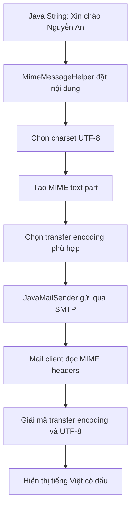

# Default encoding cho message trong Spring Framework Mail

Khi ứng dụng gửi email có tiếng Việt, cùng một chuỗi Java như **“Xin chào, tài khoản của bạn đã sẵn sàng!”** phải được chuyển thành các byte có quy tắc mã hóa rõ ràng. Nếu cấu hình không nhất quán, người nhận có thể thấy ký tự `�`, dấu hỏi `?`, hoặc những chuỗi khó đọc như `Xin chà o`. Trong **Spring Framework Mail**, thuộc tính **default encoding** của mail sender giúp xác định bộ mã ký tự mặc định được dùng khi xây dựng một số thành phần văn bản của email.

Bài học này giải thích vai trò của **`JavaMailSenderImpl#setDefaultEncoding(...)`**, cấu hình **`spring.mail.default-encoding`** trong Spring Boot, cách `MimeMessageHelper` nhận encoding và các trường hợp cần chỉ định charset riêng. Mục tiêu là gửi tiêu đề, tên người gửi, nội dung plain text và HTML có dấu đúng cách, đồng thời hiểu giới hạn của cấu hình này.

## 1. Vì sao email cần encoding?

Một chuỗi Java là dữ liệu ký tự Unicode. Tuy nhiên, email phải được biểu diễn thành các byte để lưu trữ và truyền qua hệ thống thư. Mail client cần biết cách biến những byte đó trở lại thành văn bản.

Ví dụ, nội dung nghiệp vụ:

```text
Xin chào Nguyễn An!
Đơn hàng #123 của bạn đã được xác nhận.
```

Khi tạo MIME text part, thông điệp có thể mang thông tin:

```text
Content-Type: text/plain; charset=UTF-8
Content-Transfer-Encoding: quoted-printable
```

hoặc dùng một **content-transfer-encoding** khác như `base64`, tùy thư viện và nội dung. Các header này có nhiệm vụ khác nhau:

| Khái niệm | Mô tả | Ví dụ |
|---|---|---|
| **Character encoding / charset** | Quy định cách chuyển ký tự thành byte và ngược lại. | `UTF-8`, `ISO-8859-1` |
| **MIME Content-Type** | Cho biết loại nội dung và có thể chỉ định charset của một text part. | `text/plain; charset=UTF-8` |
| **Content-Transfer-Encoding** | Quy định cách biểu diễn byte của từng phần email khi vận chuyển. | `quoted-printable`, `base64` |
| **Header encoding** | Cách biểu diễn các giá trị header chứa ký tự ngoài ASCII theo định dạng mail. | Encoded-word cho `Subject` hoặc tên hiển thị |
| **SMTP transport encoding** | Khả năng giao thức và máy chủ hỗ trợ các loại dữ liệu truyền qua SMTP. | SMTP extension `8BITMIME`, `SMTPUTF8` |

Các tầng này liên quan nhưng **không đồng nghĩa**. Chọn UTF-8 không có nghĩa nội dung thô trên đường truyền luôn chứa trực tiếp các byte UTF-8 nhìn thấy được. MIME library có thể mã hóa phần body thành `base64` hoặc `quoted-printable` rồi mail client giải mã để hiển thị văn bản.

### Luồng từ chuỗi Java đến nội dung người nhận nhìn thấy



Nếu bên gửi khai báo sai charset so với byte thực tế, bên nhận có thể giải mã sai. **Đặt cùng một encoding hợp lý xuyên suốt quá trình tạo message** giúp loại bỏ một nhóm lỗi phổ biến.

## 2. “Default encoding” của sender là gì?

Trong Spring, triển khai mail sender thông dụng là:

```java
org.springframework.mail.javamail.JavaMailSenderImpl
```

Lớp này có phương thức cấu hình:

```java
sender.setDefaultEncoding("UTF-8");
```

Thuộc tính này chỉ định **encoding mặc định cho các thông điệp MIME được tạo qua sender khi thành phần soạn thư sử dụng giá trị mặc định của sender**. Trong Spring Mail, `JavaMailSenderImpl.createMimeMessage()` tạo một kiểu message của Spring có mang theo thông tin default encoding. `MimeMessageHelper` có thể phát hiện và sử dụng thông tin đó khi được xây dựng mà không truyền charset riêng.

Có thể hình dung:

```text
JavaMailSenderImpl
  └── defaultEncoding = "UTF-8"
        ↓
  mailSender.createMimeMessage()
        ↓
  MimeMessage mới mang gợi ý default encoding
        ↓
  new MimeMessageHelper(message)
        ↓
  helper.setSubject(...) / helper.setText(...)
        ↓
  Các phần văn bản được tạo với encoding thích hợp
```

Điểm cốt lõi: **default encoding là cấu hình hỗ trợ khi tạo nội dung thông điệp, không phải một bộ lọc toàn cục tự động chuyển mã tất cả email đi qua SMTP.**

Nó không tự động sửa những MIME part đã được mã hóa sai từ trước, không ép charset của mọi attachment và không bảo đảm các dịch vụ trung gian giữ nguyên thông điệp.

### Phạm vi thực tế của default encoding

| Thao tác | Tác động của default encoding |
|---|---|
| Tạo message qua `JavaMailSenderImpl.createMimeMessage()` | Sender có thể gắn gợi ý default encoding cho message được tạo. |
| Tạo `MimeMessageHelper(message)` không truyền charset | Helper có thể lấy encoding mặc định từ message do Spring sender tạo. |
| `helper.setText(...)` | Helper dùng encoding đang áp dụng để tạo nội dung văn bản. |
| `helper.setSubject(...)` | Helper dùng encoding để biểu diễn subject có ký tự ngoài ASCII khi cần. |
| `helper.setFrom(address, personal)` | Encoding của helper có thể được dùng để mã hóa tên hiển thị. |
| Tạo `new MimeMessage(session)` thủ công | Không mặc nhiên có metadata default encoding của `JavaMailSenderImpl`. |
| Dùng API `MimeMessage` trực tiếp với charset được chỉ định rõ | Charset truyền vào phương thức là lựa chọn tường minh của thao tác đó. |
| Tệp PDF/PNG đính kèm | Dữ liệu nhị phân không chuyển thành UTF-8 chỉ vì default encoding của message. |
| Chuỗi địa chỉ email có Unicode trong local-part | Còn phụ thuộc khả năng hỗ trợ email quốc tế hóa, đặc biệt `SMTPUTF8`. |

## 3. Cấu hình bằng Spring Boot: `spring.mail.default-encoding`

Nếu dự án dùng Spring Boot và `spring-boot-starter-mail`, có thể cấu hình qua `application.yml`:

```yaml
spring:
  mail:
    host: smtp.example.net
    port: 587
    username: ${SMTP_USERNAME}
    password: ${SMTP_PASSWORD}
    default-encoding: UTF-8
    properties:
      "[mail.smtp.auth]": true
      "[mail.smtp.starttls.enable]": true
      "[mail.smtp.starttls.required]": true
      "[mail.smtp.connectiontimeout]": 5000
      "[mail.smtp.timeout]": 5000
      "[mail.smtp.writetimeout]": 5000
```

Trong cấu hình này:

- `host` và `port` xác định máy chủ SMTP mà ứng dụng kết nối.
- `username`, `password` và các `mail.smtp.*` property phục vụ xác thực, TLS và timeout.
- **`default-encoding: UTF-8`** quyết định giá trị encoding mặc định được đưa vào sender.
- `${SMTP_USERNAME}` và `${SMTP_PASSWORD}` tham chiếu tới các biến môi trường, giúp tránh ghi bí mật trực tiếp trong file cấu hình.

**`spring.mail.default-encoding` là cấu hình của Spring Boot.** Nó khác với `spring.mail.properties`, vốn thường được dùng để truyền các thuộc tính cho Jakarta Mail/SMTP provider. Ví dụ `mail.smtp.starttls.enable` liên quan đến bảo mật kết nối, không quyết định charset của phần văn bản.

Ở các phiên bản Spring Boot hiện đại, UTF-8 thường đã là giá trị mặc định cho property này. Dù vậy, **cấu hình rõ `UTF-8`** vẫn giúp thể hiện ý định của dự án, nhất là khi cấu hình được đọc từ nhiều profile hoặc môi trường khác nhau.

### Ví dụ `application.properties`

Cấu hình tương đương cho phần encoding:

```properties
spring.mail.default-encoding=UTF-8
```

Không cần thêm một thuộc tính kiểu `spring.mail.charset` do tự đoán tên. Khi sử dụng Spring Boot, hãy dùng khóa cấu hình được framework cung cấp.

### Cấu hình theo môi trường

Giả sử `application.yml` đặt UTF-8, nhưng profile riêng thay bằng encoding khác. Khi ứng dụng chạy với profile đó, cấu hình thực tế của sender có thể thay đổi. Nếu thấy email chỉ lỗi dấu ở một môi trường, nên kiểm tra **cấu hình đã được resolve khi chạy** và cách message được tạo, thay vì chỉ nhìn file cấu hình mặc định trong repository.

Không in credential SMTP khi kiểm tra cấu hình. Encoding có thể ghi nhận trong diagnostic log riêng nếu cần, còn thông tin đăng nhập phải giữ kín.

## 4. Cấu hình Spring Framework thuần bằng Java

Không phải dự án nào cũng dùng auto-configuration của Spring Boot. Khi đăng ký `JavaMailSenderImpl` thủ công, có thể gọi trực tiếp setter:

```java
import java.util.Properties;
import org.springframework.context.annotation.Bean;
import org.springframework.context.annotation.Configuration;
import org.springframework.mail.javamail.JavaMailSender;
import org.springframework.mail.javamail.JavaMailSenderImpl;

@Configuration
public class MailConfiguration {

    @Bean
    public JavaMailSender mailSender() {
        JavaMailSenderImpl sender = new JavaMailSenderImpl();

        sender.setHost("smtp.example.net");
        sender.setPort(587);
        sender.setUsername(System.getenv("SMTP_USERNAME"));
        sender.setPassword(System.getenv("SMTP_PASSWORD"));

        sender.setDefaultEncoding("UTF-8");

        Properties properties = sender.getJavaMailProperties();
        properties.put("mail.smtp.auth", "true");
        properties.put("mail.smtp.starttls.enable", "true");
        properties.put("mail.smtp.starttls.required", "true");
        properties.put("mail.smtp.connectiontimeout", "5000");
        properties.put("mail.smtp.timeout", "5000");
        properties.put("mail.smtp.writetimeout", "5000");

        return sender;
    }
}
```

Ví dụ mô tả **cấu hình sender**; các giá trị SMTP phải được thay bằng thông tin dịch vụ thực tế. Mục tiêu của `setDefaultEncoding("UTF-8")` là tạo một quy ước mặc định cho các email soạn qua sender đó.

Có thể cấu hình khác nhau cho hai bean sender nếu ứng dụng cần các hệ thống gửi thư khác nhau. Tuy nhiên, nếu mọi nội dung đều được gửi bằng tiếng Việt hoặc nhiều ngôn ngữ, **UTF-8 thường là lựa chọn thống nhất và ít gây bất ngờ nhất**.

## 5. `MimeMessageHelper` nhận encoding từ sender thế nào?

Xét service sau:

```java
import jakarta.mail.MessagingException;
import jakarta.mail.internet.MimeMessage;
import org.springframework.mail.javamail.JavaMailSender;
import org.springframework.mail.javamail.MimeMessageHelper;
import org.springframework.stereotype.Service;

@Service
public class VietnameseNoticeService {

    private final JavaMailSender mailSender;

    public VietnameseNoticeService(JavaMailSender mailSender) {
        this.mailSender = mailSender;
    }

    public void sendNotice(String recipient) throws MessagingException {
        MimeMessage message = mailSender.createMimeMessage();

        // Không truyền charset riêng: dùng encoding mặc định
        // được hỗ trợ bởi message tạo từ Spring sender.
        MimeMessageHelper helper = new MimeMessageHelper(message);

        helper.setFrom("notifications@example.org");
        helper.setTo(recipient);
        helper.setSubject("Xác nhận đăng ký tài khoản");
        helper.setText(
                "Xin chào!\n" +
                "Tài khoản của bạn đã được xác nhận."
        );

        mailSender.send(message);
    }
}
```

Nếu `JavaMailSenderImpl` được cấu hình với default encoding `UTF-8` và message được tạo qua `mailSender.createMimeMessage()`, helper có thể dùng giá trị đó mà không cần mỗi lần gọi constructor đều truyền chuỗi `"UTF-8"`.

Từ góc nhìn vòng đời:

1. **Sender** nắm cấu hình default encoding.
2. **Message** được sender tạo mang thông tin cấu hình mà Spring helper có thể nhận ra.
3. **Helper** dùng encoding đã xác định khi tạo header/body từ chuỗi Java.
4. **Jakarta Mail** hoàn thiện MIME, chọn cách biểu diễn phù hợp để gửi.
5. **Mail client** dựa trên MIME header để giải mã phần văn bản.

### Nếu không dùng helper thì sao?

API Jakarta Mail trên `MimeMessage` có các overload nhận charset tường minh:

```java
MimeMessage message = mailSender.createMimeMessage();

message.setSubject("Xác nhận đăng ký", "UTF-8");
message.setText("Xin chào từ ứng dụng!", "UTF-8");

mailSender.send(message);
```

Ở đây, charset được truyền trực tiếp cho phương thức của `MimeMessage`. **Không nên suy luận rằng mọi lời gọi setter trực tiếp không truyền charset đều tự đọc default encoding của Spring sender**, vì metadata Spring chủ yếu được hỗ trợ bởi `MimeMessageHelper`. Khi thao tác trực tiếp với Jakarta Mail, truyền charset tường minh là lựa chọn rõ ràng.

## 6. Encoding mặc định và encoding chỉ định riêng: cách quyết định

Ứng dụng có thể chọn encoding ở **nhiều cấp**:

- **Cấp sender:** `JavaMailSenderImpl.setDefaultEncoding("UTF-8")` hoặc `spring.mail.default-encoding: UTF-8`.
- **Cấp helper:** constructor `new MimeMessageHelper(message, false, "UTF-8")` hoặc constructor multipart có charset.
- **Cấp từng API Jakarta Mail:** các overload của `MimeMessage`/MIME part nhận charset.
- **Cấp dữ liệu đã có:** một `MimeMessage` đọc từ MIME source có thể chứa các part với charset đã được khai báo riêng.

Ví dụ chỉ định charset trực tiếp ở helper:

```java
MimeMessage message = mailSender.createMimeMessage();

MimeMessageHelper helper =
        new MimeMessageHelper(message, false, "UTF-8");

helper.setTo("user@example.net");
helper.setSubject("Hóa đơn của bạn");
helper.setText("Đã ghi nhận thanh toán.");
```

Tham số thứ ba `"UTF-8"` là giá trị **được yêu cầu rõ ràng cho helper này**. Nó giúp kết quả ít phụ thuộc vào cấu hình mặc định của sender.

Một bảng định hướng:

| Cách xây dựng | Nơi xác định encoding | Ý nghĩa |
|---|---|---|
| `new MimeMessageHelper(mailSender.createMimeMessage())` | Default encoding được message do Spring sender cung cấp, nếu có | Thuận tiện khi ứng dụng thống nhất cấu hình. |
| `new MimeMessageHelper(message, false, "UTF-8")` | Đối số constructor của helper | Tường minh tại điểm xây dựng email. |
| `new MimeMessageHelper(message, true, "UTF-8")` | Đối số constructor của helper, có multipart | Tương tự, cho email phức tạp. |
| `message.setText(text, "UTF-8")` | Đối số setter Jakarta Mail | Tường minh cho phần body được đặt trực tiếp. |
| `message.setSubject(subject, "UTF-8")` | Đối số setter Jakarta Mail | Tường minh cho tiêu đề. |
| Nội dung MIME đã có sẵn `charset=...` | Metadata của từng text part | Không nên mong default sender ghi đè mọi part đã được tạo. |

Nếu helper không có encoding cụ thể và message cũng không mang gợi ý của Spring sender, Jakarta Mail/Spring có thể phải dựa vào các mặc định của thư viện hoặc môi trường. Không nên xây dựng tính đúng đắn của email nhiều ngôn ngữ dựa trên giả định không kiểm soát được này.

**Quy tắc sử dụng:** đặt UTF-8 ở sender như mặc định chung; với đoạn mã thư viện, message được tạo từ một nguồn khác, hoặc yêu cầu bảo đảm độc lập với cấu hình sender, hãy chỉ định UTF-8 tại helper hoặc API soạn thư.

## 7. Header `Subject` và tên hiển thị cần mã hóa như thế nào?

Encoding không chỉ áp dụng cho body.

Một email có thể có:

```text
From: "Cửa hàng Việt" <sales@example.org>
To: customer@example.net
Subject: Xác nhận đơn hàng – tháng 11
```

Tên hiển thị **“Cửa hàng Việt”** và tiêu đề **“Xác nhận đơn hàng – tháng 11”** chứa ký tự ngoài ASCII. Khi truyền qua các hệ thống email truyền thống, chúng có thể cần được biểu diễn bằng cú pháp mã hóa header MIME, chẳng hạn encoded-word theo quy tắc tương ứng.

Với `MimeMessageHelper`, có thể viết:

```java
MimeMessage message = mailSender.createMimeMessage();
MimeMessageHelper helper = new MimeMessageHelper(
        message,
        false,
        "UTF-8"
);

helper.setFrom("sales@example.org", "Cửa hàng Việt");
helper.setTo("customer@example.net");
helper.setSubject("Xác nhận đơn hàng – tháng 11");
helper.setText("Cảm ơn bạn đã mua hàng.");
```

Ở đây:

- `setFrom(address, personal)` nhận **địa chỉ** và **tên hiển thị** riêng biệt; helper hỗ trợ mã hóa personal name.
- `setSubject(...)` để helper chuẩn bị header tiêu đề phù hợp.
- `setText(...)` tạo body với charset đã cấu hình.

Không nên tự chèn chuỗi header như `From: Cửa hàng Việt <sales@example.org>` rồi ghép thẳng với các dòng khác. Sử dụng API của Jakarta Mail/Spring giúp thư viện xử lý escape, encoded-word và các chi tiết định dạng.

### Subject có UTF-8 không có nghĩa header thô hiển thị nguyên văn

Khi xem **raw source** của email, tiêu đề có thể xuất hiện ở dạng encoded-word, ví dụ với tiền tố minh họa:

```text
Subject: =?UTF-8?B?...?=
```

Đây có thể là biểu diễn hợp lệ để mail client giải mã thành tiêu đề Unicode. **Không kết luận email bị lỗi chỉ vì raw header không hiển thị tiếng Việt nguyên bản.** Hãy kiểm tra liệu client hiển thị đúng hay không và raw message có encoding phù hợp hay không.

## 8. Nội dung plain text và HTML sử dụng charset thế nào?

`MimeMessageHelper` có thể tạo một body văn bản:

```java
helper.setText("Xin chào! Đây là thông báo của bạn.");
```

Hoặc tạo **hai bản tương đương** của một email:

```java
String plain = """
        Chào bạn!
        Vui lòng kiểm tra thông tin tại https://example.org/account
        """;

String html = """
        <html>
          <body>
            <h1>Chào bạn!</h1>
            <p>Vui lòng kiểm tra thông tin tại
              <a href="https://example.org/account">trang tài khoản</a>.
            </p>
          </body>
        </html>
        """;

helper.setText(plain, html);
```

Với cách thứ hai, helper xây dựng nội dung theo mô hình `multipart/alternative`: một part `text/plain` và một part `text/html`. **Mỗi MIME text part đều có thể mang charset riêng.** Khi dùng helper nhất quán với UTF-8, cả hai phần sẽ được xây dựng bằng encoding phù hợp cho nội dung được truyền vào.

Không nên tự thêm `<meta charset="UTF-8">` vào HTML rồi coi như đã cấu hình đầy đủ MIME. Trong email, header của MIME part như `Content-Type: text/html; charset=UTF-8` giữ vai trò quan trọng đối với cách client đọc các byte của phần nội dung. Thẻ meta trong HTML có thể hữu ích trong một số ngữ cảnh, nhưng không thay thế việc chọn charset khi tạo MIME part.

### Khi có multipart, ảnh inline và attachment

Ví dụ:

```java
import jakarta.mail.MessagingException;
import jakarta.mail.internet.MimeMessage;
import org.springframework.core.io.ClassPathResource;
import org.springframework.mail.javamail.JavaMailSender;
import org.springframework.mail.javamail.MimeMessageHelper;

public void sendCatalog(JavaMailSender mailSender)
        throws MessagingException {

    MimeMessage message = mailSender.createMimeMessage();

    MimeMessageHelper helper = new MimeMessageHelper(
            message,
            MimeMessageHelper.MULTIPART_MODE_MIXED_RELATED,
            "UTF-8"
    );

    helper.setFrom("catalog@example.org", "Cửa hàng Việt");
    helper.setTo("customer@example.net");
    helper.setSubject("Danh mục sản phẩm mới");

    helper.setText(
            "Danh mục đã sẵn sàng. Xem tài liệu đính kèm.",
            "<p>Danh mục đã sẵn sàng.</p>" +
            "" +
            "<p>Xem tài liệu đính kèm.</p>"
    );

    // Đặt body trước khi thêm tài nguyên inline.
    helper.addInline(
            "logo",
            new ClassPathResource("mail/logo.png"),
            "image/png"
    );

    helper.addAttachment(
            "catalog.pdf",
            new ClassPathResource("mail/catalog.pdf"),
            "application/pdf"
    );

    mailSender.send(message);
}
```

Ở ví dụ này:

- **Encoding UTF-8** áp dụng cho các nội dung văn bản mà helper tạo.
- `logo.png` và `catalog.pdf` là **dữ liệu nhị phân**, không chuyển mã nội dung theo charset văn bản.
- Tên attachment, tên hiển thị và các MIME parameter có thể cần **cơ chế mã hóa header/parameter** riêng khi chứa ký tự quốc tế.
- `MULTIPART_MODE_MIXED_RELATED` giải quyết **cấu trúc part**, còn `"UTF-8"` giải quyết **mã ký tự**. Hai lựa chọn này có ý nghĩa độc lập.

## 9. Phân biệt default encoding với việc gửi địa chỉ email quốc tế hóa

Một cấu hình gửi thư tiếng Việt thường có hai tình huống:

**Tình huống 1: địa chỉ ASCII, tên hiển thị Unicode**

```text
"Cửa hàng Việt" <sales@example.org>
```

Đây là kiểu rất phổ biến. Tên hiển thị có thể được mã hóa bằng MIME header encoding, còn địa chỉ thực vẫn là ASCII.

**Tình huống 2: local-part của địa chỉ chứa Unicode**

```text
người@example.org
```

Trường hợp thứ hai liên quan đến khả năng **email address internationalization** và mở rộng SMTP như `SMTPUTF8`. **`default-encoding=UTF-8` không tự động biến mọi máy chủ SMTP thành hệ thống hỗ trợ Unicode trong địa chỉ.** Địa chỉ, server, relay và hạ tầng nhận cần có khả năng phù hợp.

Tương tự, tên miền quốc tế hóa có thể cần quy tắc IDNA/Punycode. Đó là bài toán địa chỉ và hạ tầng, khác với việc chọn UTF-8 để mã hóa body và tên hiển thị.

## 10. Những hiểu nhầm thường gặp

| Hiểu nhầm | Cách hiểu đúng |
|---|---|
| “Máy chạy Windows/Linux dùng UTF-8 thì email chắc chắn đúng.” | Charset của từng MIME text part và header phải được thiết lập hoặc suy ra đúng trong quá trình xây dựng email. |
| “Đặt `spring.mail.default-encoding` là mã hóa lại mọi byte đi qua SMTP.” | Cấu hình này cung cấp default cho thao tác soạn message qua sender; nó không sửa tự động mọi part cũ hoặc dữ liệu nhị phân. |
| “UTF-8 và base64 là cùng một thứ.” | UTF-8 mã hóa **ký tự thành byte**; base64 là một cách **biểu diễn byte** để truyền tải. |
| “HTML có `<meta charset>` nên MIME không cần charset.” | MIME text part vẫn cần khai báo/định dạng charset phù hợp để client giải mã. |
| “`setSubject(subject)` trực tiếp trên mọi `MimeMessage` đều thừa hưởng default sender.” | Khi dùng trực tiếp API Jakarta Mail, nên chỉ định charset qua overload tương ứng; helper là nơi Spring hỗ trợ đọc default từ message. |
| “UTF-8 bảo đảm địa chỉ có local-part Unicode gửi thành công.” | Còn cần hỗ trợ SMTPUTF8 của các hệ thống liên quan. |
| “File PDF bị sai tiếng Việt vì sender chưa đặt UTF-8.” | Nếu byte PDF đã được tạo sai bên trong thì default encoding cho email không sửa được nội dung file; cần kiểm tra quy trình tạo PDF. |
| “Tiếng Việt bị lỗi chắc chắn do SMTP server.” | Nhiều lỗi đến từ việc tạo chuỗi, template, charset của MIME part hoặc hiển thị ở mail client. |

## 11. Các lỗi encoding phổ biến và nguyên nhân

### 11.1. Body hiển thị `Xin chà o` hoặc ký tự thay thế

Đây thường là dấu hiệu **giải mã byte bằng charset không khớp**. Ví dụ các byte UTF-8 bị hiểu là một charset khác sẽ tạo văn bản sai.

Hướng tiếp cận:

1. Kiểm tra chuỗi Java trước khi xây message đã đúng Unicode hay chưa.
2. Xác định `Content-Type` và `charset` của **MIME part cụ thể** bị lỗi.
3. Quan sát raw MIME để phân biệt charset và `Content-Transfer-Encoding`.
4. Kiểm tra xem có bước trung gian nào sửa nội dung hoặc đọc template bằng charset sai không.

Nếu chuỗi nguồn đã sai ngay trước khi gọi `helper.setText(...)`, việc cấu hình sender là UTF-8 **không thể khôi phục các ký tự đã mất**.

### 11.2. Body đúng nhưng Subject lỗi dấu

Đây có thể là lỗi **mã hóa header**, chứ không phải body. Kiểm tra việc sử dụng `MimeMessageHelper.setSubject(...)` hoặc overload `message.setSubject(subject, "UTF-8")`, và không tự nối raw header bằng chuỗi thiếu encoding.

### 11.3. Subject đúng nhưng tên hiển thị người gửi lỗi

Kiểm tra cách tạo `InternetAddress` hoặc `MimeMessageHelper.setFrom(address, personal)`. Tên hiển thị cần được mã hóa như header text, khác với cú pháp địa chỉ email thực.

### 11.4. HTML đúng nhưng plain text lỗi

Một `multipart/alternative` có **hai text part riêng biệt**. Cần kiểm tra header charset của cả `text/plain` lẫn `text/html`, không chỉ phần mà mail client thường hiển thị. Nội dung plain nên được tạo đầy đủ và độc lập, vì có client chỉ dùng bản text.

### 11.5. Tên tệp đính kèm chứa tiếng Việt hiển thị khác nhau

Ví dụ attachment có tên `hóa-đơn-tháng-11.pdf`. Vấn đề này liên quan đến **mã hóa tên file trong MIME header/parameter** và mức độ hỗ trợ của mail client, bên cạnh cấu hình encoding của helper. Đừng suy luận rằng cứ `spring.mail.default-encoding=UTF-8` là mọi client sẽ hiển thị tên file giống nhau; hãy để helper xử lý filename qua API chính thức và quan sát trên các client mục tiêu.

## 12. Phân biệt file nguồn, template, database và MIME encoding

Ngay cả khi sender được cấu hình chuẩn, dữ liệu có thể đi qua nhiều bước khác nhau:

```text
File/template UTF-8 hoặc dữ liệu từ DB
             ↓
Ứng dụng đọc thành Java String
             ↓
Đưa tham số vào template, tạo nội dung email
             ↓
MimeMessageHelper dùng charset UTF-8
             ↓
Jakarta Mail tạo MIME và Content-Transfer-Encoding
             ↓
SMTP chuyển message
             ↓
Mail client giải mã và hiển thị
```

Ở mỗi ranh giới, cách xử lý khác nhau:

| Ranh giới | Cần chú ý |
|---|---|
| Đọc template từ file | Chỉ định charset khi tự đọc file; bảo đảm file được lưu đúng mã. |
| Đọc dữ liệu từ database | JDBC/driver và cấu hình lưu trữ cần bảo toàn Unicode. |
| Render HTML/text | Không tự encode/decode nhiều lần; escape HTML phù hợp với nguồn đầu vào. |
| Tạo `MimeMessage` | Chọn UTF-8 qua sender, helper hoặc API trực tiếp. |
| MIME serialization | Thư viện tạo đúng header charset và transfer encoding. |
| Mail client | Cách render, hỗ trợ HTML và chính sách bảo mật có thể khác nhau. |

**Default encoding của sender chỉ giải quyết phần liên quan đến việc soạn email.** Khi dữ liệu nguồn đã hỏng, phải sửa ở nơi dữ liệu bị chuyển mã sai trước đó.

## 13. Khi nào nên dùng encoding tường minh thay vì dựa vào mặc định?

Với ứng dụng có một sender và cùng một quy ước UTF-8, việc cấu hình `spring.mail.default-encoding=UTF-8` ở một nơi sẽ giảm trùng lặp.

Tuy nhiên, có những trường hợp nên đưa charset vào chính lời gọi tạo helper:

- Một module thư viện nhận `MimeMessage` từ code bên ngoài, không biết message có được tạo bởi `JavaMailSenderImpl` hay không.
- Một luồng xử lý đọc thông điệp MIME từ `InputStream`, với cấu trúc và charset đã có.
- Một thư cụ thể có yêu cầu encoding khác mặc định của sender.
- Một đoạn code dùng trực tiếp setter của Jakarta Mail và muốn thể hiện charset ngay tại vị trí đặt header/body.
- Ứng dụng có nhiều sender với cấu hình khác nhau nhưng một service gửi mail cần hành vi thống nhất.

Ví dụ sử dụng encoding tường minh trong helper:

```java
MimeMessage message = mailSender.createMimeMessage();
MimeMessageHelper helper =
        new MimeMessageHelper(message, false, "UTF-8");
```

Cách này có ý nghĩa rõ ràng mà không yêu cầu người đọc phải tra cấu hình bean sender để biết message sẽ dùng charset nào.

### Message được parse từ nguồn ngoài

Giả sử `MimeMessage` được tạo từ email MIME có sẵn. Một số part đã mang `charset=ISO-8859-1` hoặc charset khác theo nguồn ban đầu. Thay đổi default encoding của sender không đồng nghĩa thư viện tự đọc, giải mã rồi xây lại toàn bộ các part đó bằng UTF-8.

Nếu nghiệp vụ cần **tạo một email mới bằng UTF-8**, nên trích xuất nội dung có kiểm soát, chuyển thành chuỗi Unicode đúng, rồi tạo một `MimeMessage` mới với charset mong muốn. Tránh tự động “sửa” toàn bộ raw MIME không rõ nguồn gốc.

## 14. Vận hành và xử lý sự cố encoding

Khi một người nhận phản ánh email bị lỗi dấu, cần thu thập đủ dữ liệu để biết **lỗi ở lớp nào**. Một quy trình thực dụng:

1. **Xác định phần bị lỗi:** subject, tên hiển thị, plain body, HTML body hay tên attachment?
2. **Kiểm tra nguồn dữ liệu:** ký tự đã sai trước khi đưa vào helper hay chỉ sai sau khi gửi?
3. **Xem cấu hình sender:** `spring.mail.default-encoding` hoặc `JavaMailSenderImpl#getDefaultEncoding()` trong môi trường chạy có đúng như dự kiến không?
4. **Xem điểm tạo message:** message có được tạo bằng `mailSender.createMimeMessage()` không? Helper có nhận charset explicit không?
5. **Quan sát nguồn MIME:** xem `Content-Type`, `charset`, `Content-Transfer-Encoding`, cách mã hóa `Subject` và tên hiển thị.
6. **So sánh client:** nếu cùng một thông điệp được hiển thị khác nhau giữa webmail và mobile, xem các quy tắc render/decoder của từng client hoặc các phần bị gateway biến đổi.

Có thể sử dụng môi trường phát triển với máy chủ nhận thử như Mailpit hoặc GreenMail để quan sát message mà không gửi tới người dùng thật. Khi cần log để chẩn đoán, hãy tránh ghi mật khẩu SMTP, mã xác nhận, dữ liệu cá nhân và toàn bộ attachment.

### Một ví dụ chẩn đoán

Ứng dụng tạo:

```java
helper.setSubject("Báo cáo doanh thu tháng 11");
helper.setText("Tổng doanh thu đã được cập nhật.");
```

Người nhận thấy body đúng nhưng subject sai. Trường hợp này gợi ý xem **đường tạo header Subject**: có bị một đoạn code khác ghi đè bằng API trực tiếp mà không chỉ định charset, hoặc có bị một gateway thay đổi không? Việc body đúng cho thấy text part ít nhất đã được tạo/giải mã phù hợp; nó không chứng minh mọi header khác đã đúng.

Ngược lại, nếu ngay tại phía ứng dụng biến `subject` đã chứa `Báo cáo`, phải sửa khâu đọc dữ liệu nguồn. Encoder không thể đoán để khôi phục chính xác một chuỗi đã bị biến đổi.

## 15. Ví dụ hoàn chỉnh: ứng dụng Spring Boot gửi nội dung tiếng Việt

**Cấu hình**:

```yaml
spring:
  mail:
    host: smtp.example.net
    port: 587
    username: ${SMTP_USERNAME}
    password: ${SMTP_PASSWORD}
    default-encoding: UTF-8
    properties:
      "[mail.smtp.auth]": true
      "[mail.smtp.starttls.enable]": true
      "[mail.smtp.starttls.required]": true
```

**Dịch vụ**:

```java
import jakarta.mail.MessagingException;
import jakarta.mail.internet.MimeMessage;
import org.springframework.mail.javamail.JavaMailSender;
import org.springframework.mail.javamail.MimeMessageHelper;
import org.springframework.stereotype.Service;

@Service
public class OrderConfirmationMailService {

    private final JavaMailSender mailSender;

    public OrderConfirmationMailService(JavaMailSender mailSender) {
        this.mailSender = mailSender;
    }

    public void sendConfirmation(String recipient, String orderNumber)
            throws MessagingException {

        MimeMessage message = mailSender.createMimeMessage();

        // Spring helper có thể sử dụng defaultEncoding
        // của message do JavaMailSenderImpl tạo ra.
        MimeMessageHelper helper = new MimeMessageHelper(message, true);

        helper.setFrom("orders@example.org", "Cửa hàng Việt");
        helper.setTo(recipient);
        helper.setSubject("Xác nhận đơn hàng " + orderNumber);

        String plainText =
                "Đơn hàng " + orderNumber + " đã được xác nhận.\n" +
                "Cảm ơn bạn đã mua hàng.";

        // orderNumber cần được kiểm soát/escape phù hợp
        // trước khi đưa vào HTML thật.
        String htmlText =
                "<html><body><h1>Xác nhận đơn hàng</h1>" +
                "<p>Cảm ơn bạn đã mua hàng.</p>" +
                "</body></html>";

        helper.setText(plainText, htmlText);

        mailSender.send(message);
    }
}
```

Ví dụ cố ý giữ HTML đơn giản; với dữ liệu động do người dùng cung cấp, phải escape HTML phù hợp và xác thực input trước khi đưa vào tiêu đề hoặc nội dung. Khi dùng helper với `MimeMessage` sinh từ sender đã cấu hình UTF-8, các thành phần text/subject/personal name được helper xử lý theo encoding có sẵn. Nếu muốn thể hiện rõ charset ngay trong code, thay:

```java
MimeMessageHelper helper = new MimeMessageHelper(message, true);
```

bằng:

```java
MimeMessageHelper helper =
        new MimeMessageHelper(message, true, "UTF-8");
```

Cả hai cách đều có vị trí sử dụng hợp lý. Cách thứ nhất tận dụng **cấu hình mặc định tập trung**; cách thứ hai **ràng buộc encoding rõ tại điểm soạn thư**.

## 16. Ghi nhớ

- **`JavaMailSenderImpl#setDefaultEncoding("UTF-8")`** thiết lập bộ mã ký tự mặc định cho quá trình soạn message qua Spring sender.
- **`spring.mail.default-encoding: UTF-8`** là cách cấu hình tương ứng trong Spring Boot, giúp một ứng dụng thống nhất quy ước UTF-8.
- **`MimeMessageHelper`** có thể lấy default encoding từ message do Spring sender tạo; charset truyền tường minh trong constructor của helper cho phép kiểm soát ở từng lần soạn thư.
- **`MimeMessage#setSubject(..., "UTF-8")`** và **`setText(..., "UTF-8")`** là các cách chỉ định charset khi thao tác trực tiếp với API Jakarta Mail.
- **Charset** và **Content-Transfer-Encoding** là hai tầng khác nhau; UTF-8 có thể được kết hợp với base64 hoặc quoted-printable trong MIME.
- **Body, subject, tên hiển thị và tên attachment** có quy tắc encoding riêng trong định dạng email; default encoding không tự sửa dữ liệu nhị phân hoặc nội dung nguồn đã bị lỗi.
- **SMTPUTF8** giải quyết khả năng vận chuyển một số địa chỉ email quốc tế hóa, không phải hệ quả tự động của việc đặt UTF-8 cho nội dung.
- Khi gặp lỗi dấu, hãy xác định chính xác thành phần bị lỗi và kiểm tra lần lượt **dữ liệu nguồn → Java String → MIME header/part → mail client**.

Với phần lớn ứng dụng Spring Mail gửi tiếng Việt, lựa chọn thực tế là **dùng UTF-8 làm mặc định của sender và sử dụng `MimeMessageHelper` nhất quán để tạo các phần văn bản**. Nhờ đó, cấu hình rõ ràng, dễ bảo trì và các vấn đề encoding có thể được khoanh vùng theo từng lớp thay vì sửa mò ở SMTP.
