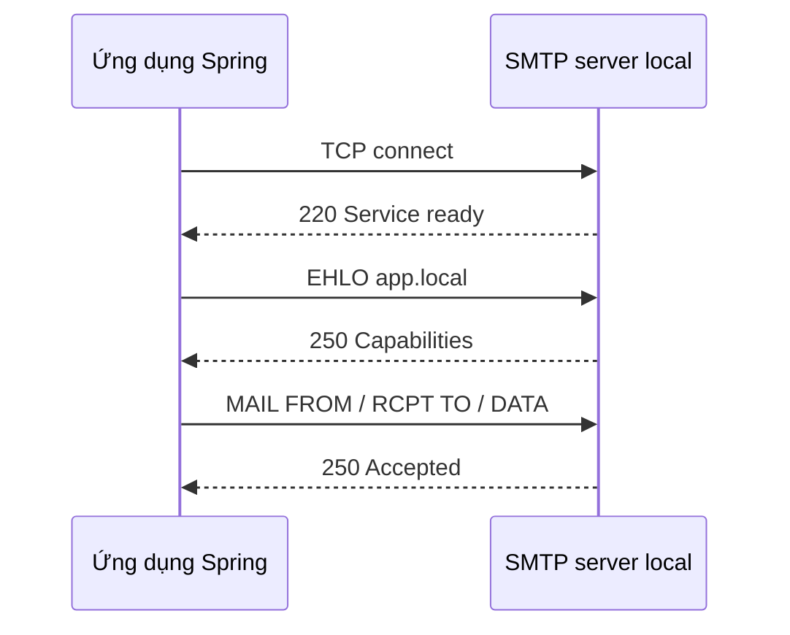
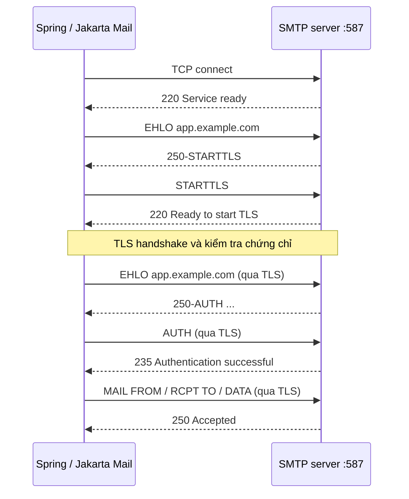
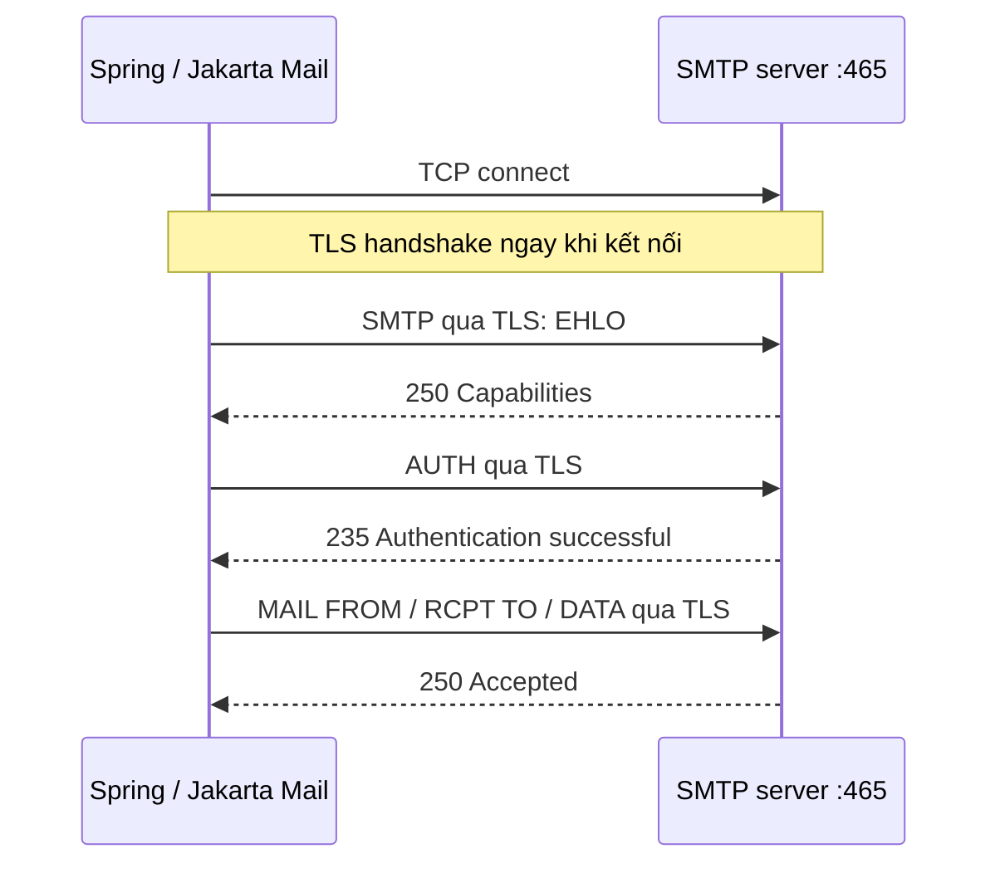
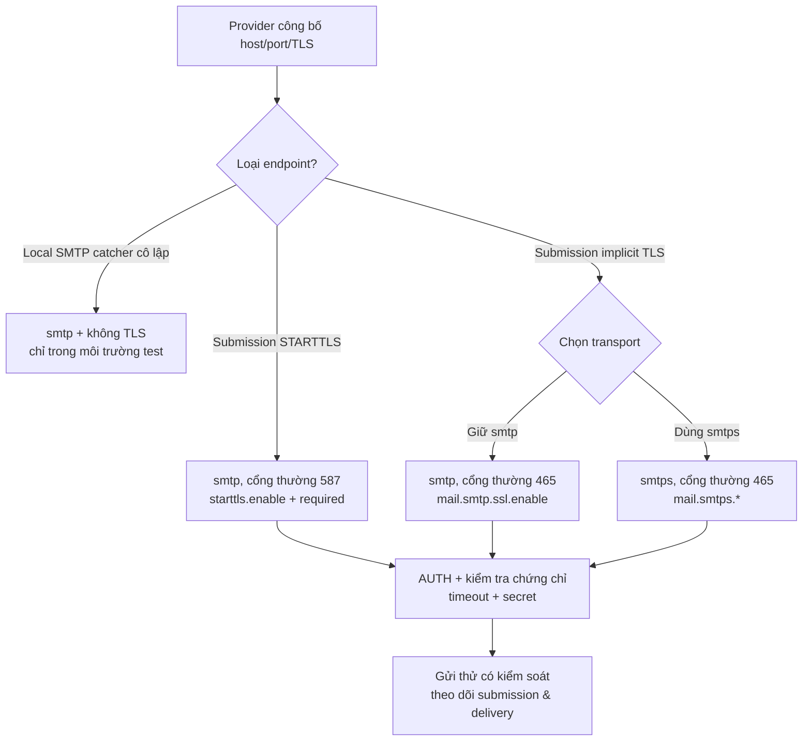

# Protocol smtp, smtps và lựa chọn theo môi trường

Khi cấu hình gửi email trong Spring Boot, hai tên `smtp` và `smtps` thường xuất hiện cạnh nhau. Đôi khi ứng dụng gửi được thư qua cổng 587 nhưng lỗi khi đổi sang cổng 465; đôi khi đã đặt `spring.mail.protocol=smtps` mà thuộc tính `mail.smtp.auth=true` dường như không có hiệu lực. Nguyên nhân thường nằm ở việc **nhầm tên transport của Jakarta Mail với cách bắt đầu phiên TLS**, hoặc dùng sai nhóm thuộc tính cấu hình cho transport đã chọn.

Trong **Spring Framework Mail**, `JavaMailSender` và `JavaMailSenderImpl` hỗ trợ gửi thư thông qua Jakarta Mail. Ứng dụng lựa chọn transport phù hợp với máy chủ SMTP, cổng dịch vụ và chính sách bảo mật của môi trường. Bài học này giải thích sự khác biệt giữa **SMTP thông thường, SMTP nâng cấp bằng STARTTLS và SMTPS/implicit TLS**, sau đó áp dụng vào cấu hình cho local, staging và production.

## 1. Trước hết: `smtp` và `smtps` khác nhau ở điểm nào?

### 1.1. Cả hai đều dùng giao thức gửi thư SMTP

**SMTP (Simple Mail Transfer Protocol)** là giao thức dùng để gửi và chuyển tiếp email. Trong Jakarta Mail, `smtp` và `smtps` là **tên protocol của transport provider**:

- **`smtp`**: transport SMTP. Có thể kết nối thông thường, nâng cấp kết nối bằng **STARTTLS**, hoặc dùng **implicit TLS** nếu bật thuộc tính phù hợp.
- **`smtps`**: transport SMTP được cấu hình để thiết lập **TLS ngay từ đầu kết nối** (*implicit TLS*), thường dùng với cổng 465.

Vì vậy, **`smtps` không phải một bộ lệnh email khác thay thế SMTP**. Sau khi kênh TLS được thiết lập, hai bên vẫn trao đổi các lệnh SMTP như `EHLO`, `MAIL FROM`, `RCPT TO` và `DATA`. Khác biệt chính là **cách bảo vệ kết nối khi bắt đầu phiên làm việc** và **nhóm thuộc tính được Jakarta Mail sử dụng**.

Một nhầm lẫn cần tránh: tên `smtps` trong Jakarta Mail không đồng nghĩa mọi hệ thống bắt buộc phải đặt `spring.mail.protocol=smtps` để dùng cổng 465. Transport `smtp` cũng có thể dùng cổng 465 bằng cách bật `mail.smtp.ssl.enable=true`.

### 1.2. SMTP submission khác SMTP relay

Một ứng dụng Spring Boot thường **nộp thư lên dịch vụ gửi** (*message submission*), thay vì tự trở thành máy chủ chuyển tiếp thư trên Internet.

| Kết nối | Cổng TCP phổ biến | Ý nghĩa |
|---|---:|---|
| SMTP **server-to-server relay** | **25** | Mail transfer agent chuyển tiếp email giữa các máy chủ. Có thể dùng STARTTLS khi hỗ trợ và chính sách cho phép. |
| SMTP **submission với STARTTLS** | **587** | Ứng dụng khách kết nối, thương lượng STARTTLS, sau đó thường xác thực để nộp thư. |
| SMTP **submission với implicit TLS** | **465** | Kênh TLS được thiết lập ngay khi kết nối; sau đó thực hiện SMTP và xác thực. |
| Cổng SMTP riêng của nhà cung cấp | Ví dụ **2525** | Chỉ sử dụng khi nhà cung cấp công bố hỗ trợ; cách bảo vệ kết nối phụ thuộc tài liệu dịch vụ. |

Các cổng trong bảng là **quy ước sử dụng phổ biến**, không phải luật buộc mọi server phải có đúng cấu hình. Một SMTP server nội bộ có thể lắng nghe cổng 1025 hoặc một cổng tùy chọn. Không nên chọn TLS chỉ dựa vào số cổng mà bỏ qua hướng dẫn của nhà cung cấp.

**Port 25 không phải lựa chọn mặc định tốt cho ứng dụng Spring Boot gửi thư giao dịch ra Internet.** Nhà cung cấp dịch vụ hoặc mạng vận hành có thể hạn chế kết nối outbound tới cổng 25, và cổng này chủ yếu phục vụ chuyển tiếp giữa MTA. Đối với ứng dụng khách, hãy dùng dịch vụ submission được cấp phép.

## 2. Ba kiểu kết nối thường gặp

### 2.1. Plain SMTP — không mã hóa kết nối

Trong môi trường lab, một ứng dụng có thể kết nối tới SMTP server mô phỏng bằng TCP thông thường:



Đặc điểm:

- SMTP command và dữ liệu email đi qua kết nối **không được TLS bảo vệ**.
- Phù hợp với SMTP catcher chạy **chỉ trong môi trường phát triển được kiểm soát**, chẳng hạn Mailpit/MailHog/GreenMail; đây không phải cấu hình an toàn để gửi thư thật trên mạng không tin cậy.
- Nên tắt cơ chế gửi email đến địa chỉ ngoài môi trường test, hoặc sử dụng dịch vụ chuyên bắt và lưu thư thử nghiệm.
- Nếu máy chủ yêu cầu authentication thì không nên truyền mật khẩu qua kết nối không bảo vệ.

Cấu hình Spring Mail kiểu này thường dùng `protocol=smtp` và không bật `starttls` hay `ssl`.

### 2.2. SMTP + STARTTLS — bắt đầu SMTP rồi nâng cấp sang TLS

STARTTLS là **lệnh nâng cấp kết nối đã thiết lập** sang kênh TLS. Thường gặp trong SMTP submission cổng 587.



Thứ tự cần hiểu:

1. Máy khách tạo kết nối TCP và đọc lời chào SMTP `220`.
2. `EHLO` trả về các extension server hỗ trợ; khi có `STARTTLS`, khách có thể gửi lệnh nâng cấp.
3. Sau `220 Ready to start TLS`, hai bên thực hiện TLS handshake và kiểm tra chứng chỉ máy chủ.
4. Sau khi TLS được thiết lập, máy khách **gửi `EHLO` lại** để nhận khả năng có hiệu lực trên kênh bảo mật.
5. SMTP AUTH và các thao tác gửi thư diễn ra qua TLS nếu máy chủ yêu cầu.

Trong Jakarta Mail, các thuộc tính hay dùng:

```properties
mail.smtp.starttls.enable=true
mail.smtp.starttls.required=true
mail.smtp.auth=true
mail.smtp.ssl.checkserveridentity=true
```

Sự khác biệt giữa hai thuộc tính STARTTLS rất quan trọng:

- **`starttls.enable=true`**: cho phép transport sử dụng STARTTLS nếu server cung cấp.
- **`starttls.required=true`**: yêu cầu STARTTLS; nếu máy chủ không hỗ trợ hoặc không nâng cấp được, quá trình gửi **phải thất bại** thay vì tiếp tục không mã hóa.

Với môi trường thực dùng mật khẩu để xác thực, nên đặt **cả enable và required** theo chính sách bảo mật. Nếu chỉ bật enable nhưng không yêu cầu, có thể có đường đi không TLS khi server không quảng bá STARTTLS, tùy ngữ cảnh và cấu hình.

### 2.3. SMTPS / implicit TLS — TLS ngay khi kết nối

Với **implicit TLS**, phiên TCP mở ra là bắt đầu **TLS handshake trước**. Server không gửi lời chào SMTP `220` dạng plaintext rồi mới chờ `STARTTLS`.



Hai cách cấu hình Jakarta Mail phổ biến:

1. **Transport `smtp` và bật `mail.smtp.ssl.enable=true`.**
2. **Transport `smtps`** với nhóm cấu hình `mail.smtps.*`.

Chúng cùng có thể thiết lập kết nối SMTP qua implicit TLS. Việc chọn cách nào nên nhất quán với property prefix và quy ước cấu hình của dự án; đừng đổi tên protocol mà giữ nguyên mọi thuộc tính cũ.

### 2.4. So sánh nhanh

| Đặc điểm | SMTP plain (local) | SMTP + STARTTLS | SMTPS/implicit TLS |
|---|---|---|---|
| Cổng thường dùng | 1025 ở SMTP catcher nội bộ | 587 | 465 |
| Kết nối bắt đầu bằng | SMTP plaintext | SMTP plaintext | TLS handshake |
| Lệnh `STARTTLS` | Không | **Có** | Không |
| Mã hóa sau khi kết nối | Không | Có, sau nâng cấp thành công | Có, ngay từ đầu |
| Transport Jakarta Mail | `smtp` | `smtp` | `smtp` + SSL hoặc `smtps` |
| Thuộc tính đặc trưng | `mail.smtp.*` | `mail.smtp.starttls.*` | `mail.smtp.ssl.enable` hoặc `mail.smtps.*` |
| Phù hợp | Local/test được cô lập | Submission khi provider yêu cầu STARTTLS | Submission khi provider yêu cầu implicit TLS |

**STARTTLS và implicit TLS đều là TLS**, nhưng **không thể hoán đổi cấu hình bằng cách chỉ đổi số cổng**.

## 3. Tên protocol trong Spring Boot và property prefix của Jakarta Mail

Khi dùng `spring-boot-starter-mail`, Spring Boot thường tạo một `JavaMailSenderImpl` từ cấu hình `spring.mail.*`.

```groovy
dependencies {
    implementation 'org.springframework.boot:spring-boot-starter-mail'
}
```

Các nhóm thuộc tính liên quan:

| Spring Boot / Jakarta Mail | Chức năng |
|---|---|
| `spring.mail.host` | Host của server gửi thư. |
| `spring.mail.port` | Cổng kết nối TCP. |
| `spring.mail.username` | Tài khoản xác thực nếu provider yêu cầu. |
| `spring.mail.password` | Thông tin xác thực; có thể là app password/token tùy provider. |
| `spring.mail.protocol` | Tên transport Jakarta Mail, thường là `smtp` hoặc `smtps`. |
| `spring.mail.default-encoding` | Charset mặc định hỗ trợ tạo thông điệp MIME, ví dụ UTF-8. |
| `spring.mail.properties.*` | Chuyển tiếp các thuộc tính bổ sung đến Jakarta Mail Session/transport. |
| `spring.mail.test-connection` | Nếu bật, Boot thử kiểm tra kết nối mail khi khởi động; phù hợp khi chủ động muốn fail-fast. |

Ví dụ:

```yaml
spring:
  mail:
    host: smtp.example.com
    port: 587
    protocol: smtp
    properties:
      mail:
        smtp:
          auth: true
          starttls:
            enable: true
            required: true
```

Những khóa lồng nhau dưới `spring.mail.properties` tương ứng với các property JavaMail đầy đủ, chẳng hạn `mail.smtp.starttls.enable`. Spring Boot truyền chúng cho Jakarta Mail, còn `spring.mail.protocol` quyết định transport mà sender chọn.

### 3.1. Đừng nhầm `spring.mail.protocol` với thuộc tính của JavaMail Session

Trong Spring Boot, `spring.mail.protocol=smtp` là cấu hình được bind vào `JavaMailSenderImpl`. Đây không phải một lệnh được gửi qua mạng.

Đối với thư viện Jakarta Mail, cũng có thuộc tính `mail.transport.protocol` trong một số ngữ cảnh để chọn transport mặc định. Nhưng khi đã dùng Spring Boot và `JavaMailSenderImpl`, **nên cấu hình `spring.mail.protocol` rõ ràng** và tập trung quản lý cấu hình qua Spring; trộn nhiều cơ chế có thể khiến việc chẩn đoán khó khăn.

### 3.2. Vì sao `mail.smtp.*` có thể không có tác dụng khi dùng `smtps`?

Jakarta Mail sử dụng namespace khác nhau theo tên transport:

```text
protocol=smtp
    mail.smtp.auth
    mail.smtp.starttls.enable
    mail.smtp.starttls.required
    mail.smtp.ssl.enable
    mail.smtp.ssl.checkserveridentity
    mail.smtp.connectiontimeout

protocol=smtps
    mail.smtps.auth
    mail.smtps.ssl.checkserveridentity
    mail.smtps.connectiontimeout
    mail.smtps.timeout
    mail.smtps.writetimeout
```

Ví dụ cấu hình sau **không nhất quán**:

```yaml
spring:
  mail:
    protocol: smtps
    port: 465
    properties:
      mail:
        smtp:       # Sai nhóm thuộc tính cho transport smtps
          auth: true
          ssl:
            checkserveridentity: true
```

Nếu sử dụng `smtps` thì cần đặt các thuộc tính transport liên quan dưới `mail.smtps.*`. Ngược lại, nếu vẫn dùng `protocol=smtp` với `ssl.enable=true`, hãy giữ prefix `mail.smtp.*`.

Điểm đáng chú ý: `spring.mail.username` và `spring.mail.password` vẫn nằm ở mức `spring.mail`; chúng không cần đổi thành `spring.mail.smtps.username`. Cần đổi **những thuộc tính riêng của transport**.

## 4. Cấu hình chuẩn: submission cổng 587 với STARTTLS

Đây là lựa chọn phổ biến cho **ứng dụng production** khi provider chỉ định dùng cổng 587.

```yaml
# application-prod.yml — ví dụ STARTTLS
spring:
  mail:
    host: ${MAIL_HOST}
    port: 587
    protocol: smtp
    username: ${MAIL_USERNAME}
    password: ${MAIL_PASSWORD}
    default-encoding: UTF-8
    properties:
      mail:
        smtp:
          auth: true
          starttls:
            enable: true
            required: true
          ssl:
            checkserveridentity: true
          connectiontimeout: 5000
          timeout: 10000
          writetimeout: 10000
```

Giải thích:

- `protocol: smtp` chọn Jakarta Mail SMTP transport.
- `port: 587` là cổng submission theo ví dụ; vẫn cần đối chiếu tài liệu provider.
- `auth: true` yêu cầu xác thực SMTP khi transport giao tiếp với server.
- `starttls.enable: true` cho phép thực hiện nâng cấp TLS.
- `starttls.required: true` ngăn gửi tiếp nếu không thể bảo vệ kết nối bằng STARTTLS.
- `ssl.checkserveridentity: true` bổ sung bước kiểm tra danh tính máy chủ TLS theo hostname, tránh chỉ dựa vào việc chứng chỉ được một CA tin cậy ký.
- Các timeout là **mili-giây**, giúp luồng gửi không treo vô hạn khi mạng hoặc máy chủ gặp sự cố.

**Không đặt `mail.smtp.ssl.enable=true` đồng thời với ý định dùng luồng STARTTLS cổng 587 trong cấu hình này.** Thuộc tính đó làm transport bắt đầu bằng implicit TLS, không đúng cách server 587 theo ví dụ mong đợi.

Trong production, các biến `MAIL_USERNAME` và `MAIL_PASSWORD` phải được cấp từ môi trường triển khai hoặc hệ thống lưu bí mật. Với nhà cung cấp yêu cầu OAuth2, ứng dụng phải tích hợp đúng cơ chế token/auth của provider; không giả định mọi dịch vụ chấp nhận mật khẩu thông thường.

### 4.1. Nếu server không quảng bá STARTTLS?

Khi `mail.smtp.starttls.required=true`, JavaMail sẽ từ chối tiếp tục nếu không thể thiết lập STARTTLS. Đây là hành vi phù hợp khi chính sách gửi yêu cầu TLS.

Không nên “sửa nhanh” lỗi bằng cách tắt `required` ở môi trường production rồi cho phép truyền thông tin xác thực qua kết nối không mã hóa. Cần xác minh lại **host, port, chính sách provider, proxy/network và sự có mặt của STARTTLS**.

### 4.2. STARTTLS bảo vệ nội dung đến đâu?

STARTTLS bảo vệ **chặng kết nối cụ thể** giữa Spring Boot và server mà nó đang giao tiếp. Sau khi provider tiếp nhận thư, quá trình chuyển tiếp giữa các mail server có cơ chế/chính sách TLS riêng, có thể không giống chặng submission. Vì vậy TLS cho SMTP **không đồng nghĩa mã hóa đầu cuối email** như một ứng dụng nhắn tin E2EE.

Nếu dữ liệu thật sự nhạy cảm, cân nhắc gửi liên kết tải được phân quyền hoặc giải pháp mã hóa nội dung đầu cuối theo yêu cầu nghiệp vụ.

## 5. Cấu hình cổng 465: hai cách hợp lệ

Với server yêu cầu **implicit TLS trên 465**, có hai cách phổ biến. Chọn **một cách** và giữ property prefix nhất quán.

### 5.1. Cách A — giữ `protocol=smtp` và bật SSL/TLS

```yaml
# Ví dụ 465, vẫn dùng transport smtp
spring:
  mail:
    host: ${MAIL_HOST}
    port: 465
    protocol: smtp
    username: ${MAIL_USERNAME}
    password: ${MAIL_PASSWORD}
    default-encoding: UTF-8
    properties:
      mail:
        smtp:
          auth: true
          ssl:
            enable: true
            checkserveridentity: true
          connectiontimeout: 5000
          timeout: 10000
          writetimeout: 10000
```

Đặc điểm:

- Tên transport vẫn là **`smtp`**.
- `mail.smtp.ssl.enable=true` yêu cầu **TLS ngay khi tạo kết nối**.
- Cấu hình vẫn dùng **`mail.smtp.*`** cho AUTH, timeout và kiểm tra danh tính.
- **Không yêu cầu `STARTTLS`** vì kênh đã được mã hóa từ đầu.

Cách này có lợi khi ứng dụng muốn duy trì một transport `smtp` nhất quán và thay đổi cách tạo kết nối theo profile.

### 5.2. Cách B — dùng `protocol=smtps`

```yaml
# Ví dụ 465, dùng transport smtps
spring:
  mail:
    host: ${MAIL_HOST}
    port: 465
    protocol: smtps
    username: ${MAIL_USERNAME}
    password: ${MAIL_PASSWORD}
    default-encoding: UTF-8
    properties:
      mail:
        smtps:
          auth: true
          ssl:
            enable: true
            checkserveridentity: true
          connectiontimeout: 5000
          timeout: 10000
          writetimeout: 10000
```

`smtps` là tên transport của Jakarta Mail dùng SMTP trên kết nối TLS implicit. Thuộc tính `mail.smtps.ssl.enable=true` trong ví dụ nêu rõ chủ ý bảo mật; trên SMTPS transport, implicit TLS vốn là hành vi mặc định. Các tùy chọn AUTH, TLS identity check và timeout được đặt dưới prefix **`mail.smtps.*`**.

### 5.3. So sánh hai cấu hình cổng 465

| Hạng mục | Cách A | Cách B |
|---|---|---|
| `spring.mail.protocol` | `smtp` | `smtps` |
| Cổng ví dụ | 465 | 465 |
| Kênh bảo mật | Implicit TLS | Implicit TLS |
| Nhóm property | `mail.smtp.*` | `mail.smtps.*` |
| Bật TLS | `mail.smtp.ssl.enable=true` | SMTPS implicit TLS; `mail.smtps.ssl.enable=true` có thể khai báo rõ |
| SMTP AUTH | `mail.smtp.auth=true` | `mail.smtps.auth=true` |
| STARTTLS | Không sử dụng | Không sử dụng |

Không có lựa chọn nào “mạnh hơn” chỉ vì tên `smtps`. Điều quan trọng là **phiên thực tế sử dụng TLS với chứng chỉ được kiểm tra đúng, xác thực được cấu hình hợp lệ và không bị hạ cấp**.

## 6. Chọn cấu hình theo môi trường

Khi ứng dụng chạy trên laptop, CI, staging và production, **host, port, tài khoản và chính sách gửi** không giống nhau. Nên dùng **Spring profiles** và biến môi trường để tách các giá trị vận hành, đồng thời không để một cấu hình debug/SMTP plain vô tình được áp dụng trong production.

### 6.1. Môi trường local development

Với máy chủ bắt email thử nghiệm như Mailpit, ứng dụng chỉ cần gửi đến một SMTP server nằm trong phạm vi được kiểm soát. Ví dụ:

```yaml
# application-local.yml
spring:
  mail:
    host: localhost
    port: 1025
    protocol: smtp
    default-encoding: UTF-8
    properties:
      mail:
        smtp:
          auth: false
          starttls:
            enable: false
```

Trong ví dụ này:

- `localhost:1025` là server SMTP giả định đang chạy trên **cùng host** với ứng dụng.
- Không có username/password vì server thử nghiệm được cấu hình không yêu cầu AUTH.
- Kết nối không TLS **chỉ chấp nhận khi nó được cô lập trong môi trường phát triển**, không dùng để truyền dữ liệu production qua mạng không tin cậy.
- Email được lưu/hiển thị trong công cụ bắt mail, không cần chuyển ra Internet.

Nếu **ứng dụng Spring chạy trong container** và Mailpit là container/service khác trên cùng mạng Docker Compose, `localhost` bên trong container ứng dụng chỉ về **chính container đó**. Khi ấy dùng tên service DNS nội bộ, chẳng hạn:

```yaml
spring:
  mail:
    host: mailpit
    port: 1025
```

Ví dụ `mailpit` chỉ có ý nghĩa khi thực sự tồn tại service với tên tương ứng trên mạng container. Đừng sao chép nguyên host này vào môi trường không có service đó.

### 6.2. CI và automated tests

Với unit test, thường nên **mock `JavaMailSender`** để kiểm tra việc nghiệp vụ yêu cầu gửi thư, không phụ thuộc kết nối mạng.

Với integration test, có thể chạy SMTP catcher hoặc server giả hỗ trợ giao thức thích hợp để quan sát message nhận được:

- **SMTP catcher không TLS**: xác nhận ứng dụng tạo đúng người nhận, subject, body/attachment trong môi trường được cô lập.
- **SMTP server test hỗ trợ STARTTLS**: kiểm tra một nhánh cấu hình TLS trong bài thực hành tích hợp nếu mục tiêu thử nghiệm yêu cầu.
- **Provider sandbox**: sử dụng khi cần xác thực cấu hình gần production mà không chuyển thư tới người dùng thật.

Tài khoản và secret test phải tách khỏi production. Không nên dùng tài khoản gửi thư thật trong một test chạy tự động không được kiểm soát.

### 6.3. Staging

Môi trường staging nên gần production về **giao thức, TLS, cơ chế xác thực và cách cung cấp secret**, nhưng nên có **tuyến gửi an toàn cho thử nghiệm**:

| Hạng mục | Gợi ý cho staging |
|---|---|
| Protocol/cổng | Dùng cùng kiểu transport/TLS dự kiến ở production khi muốn xác nhận tính tương thích. |
| Tài khoản | Dùng tài khoản staging hoặc sandbox riêng, quota và quyền gửi phù hợp. |
| Người nhận | Chỉ các mailbox kiểm thử được phép hoặc destination đã được thay thế theo chính sách. |
| Nội dung | Dùng dữ liệu giả/làm sạch thông tin cá nhân. |
| Theo dõi | Lưu kết quả submission, lỗi xác thực/TLS và trạng thái gửi của provider. |

Nếu staging dùng một SMTP catcher không TLS để đơn giản hóa thao tác, kết quả đó chỉ chứng minh **luồng tạo/gửi MIME cơ bản**, không chứng minh production TLS configuration hoạt động. Vì thế khi cần kiểm chứng TLS thực tế, hãy có một môi trường kiểm thử đúng giao thức submission dự định sử dụng.

### 6.4. Production

Production cần tuân thủ hợp đồng của SMTP provider:

1. Lấy **hostname và port submission** được công bố.
2. Xác định transport yêu cầu **STARTTLS trên 587** hay **implicit TLS trên 465**.
3. Chọn `smtp` hoặc `smtps` nhất quán, và cấu hình đúng namespace thuộc tính.
4. Yêu cầu TLS, kiểm tra chứng chỉ và hostname.
5. Thiết lập cơ chế AUTH được provider hỗ trợ, quản lý secret tập trung.
6. Đặt timeout, giới hạn tốc độ, retry và theo dõi trạng thái gửi.
7. Theo dõi bounce/DSN hoặc event của provider nếu nghiệp vụ cần biết kết quả chuyển phát sau submission.

Một email gửi thành công qua `JavaMailSender` có nghĩa transport đã không báo lỗi tại thời điểm gọi. Nó **không bảo đảm thư đã vào Inbox của người nhận**.

### 6.5. Ma trận quyết định

| Môi trường/tình huống | Protocol | Cổng điển hình | Cấu hình TLS | Ghi chú |
|---|---|---:|---|---|
| Local SMTP catcher nội bộ | `smtp` | 1025 | Không TLS nếu thực sự cô lập | Chỉ để phát triển/kiểm thử. |
| Production provider yêu cầu STARTTLS | `smtp` | 587 | `mail.smtp.starttls.enable=true` và `required=true` | Thường kèm SMTP AUTH. |
| Production provider yêu cầu implicit TLS, giữ `smtp` | `smtp` | 465 | `mail.smtp.ssl.enable=true` | Giữ prefix `mail.smtp.*`. |
| Production provider yêu cầu implicit TLS, chọn `smtps` | `smtps` | 465 | SMTPS implicit TLS | Dùng prefix `mail.smtps.*`. |
| Hệ thống relay nội bộ được phép | Phụ thuộc hợp đồng relay | Thường 25 hoặc port riêng | Theo chính sách máy chủ nội bộ | Không suy ra relay tự cho phép anonymous plaintext. |

**Cách chọn đáng tin cậy nhất là dựa trên tài liệu và khả năng thực tế của SMTP server đang dùng**, sau đó cố định profile cấu hình phù hợp.

## 7. Tổ chức cấu hình Spring profiles để tránh nhầm lẫn

Một phương án có thể hiểu và bảo trì:

```text
src/main/resources/
├── application.yml
├── application-local.yml
├── application-staging.yml
└── application-prod.yml
```

`application.yml` chứa phần dùng chung:

```yaml
# application.yml
spring:
  mail:
    default-encoding: UTF-8
```

Profile local định nghĩa SMTP catcher. Profile staging/prod định nghĩa cấu hình submission TLS thực tế.

Có thể khởi động bằng:

```text
SPRING_PROFILES_ACTIVE=local
SPRING_PROFILES_ACTIVE=staging
SPRING_PROFILES_ACTIVE=prod
```

Đây là ví dụ khai báo biến môi trường tại hệ thống chạy ứng dụng; cơ chế đặt biến cụ thể khác nhau giữa IDE, shell, container và môi trường triển khai.

### 7.1. Có nên để `MAIL_PROTOCOL` nhận cả `smtp` và `smtps`?

Về mặt kỹ thuật có thể bind:

```yaml
spring:
  mail:
    protocol: ${MAIL_PROTOCOL:smtp}
```

Tuy nhiên, nếu đổi `MAIL_PROTOCOL` từ `smtp` sang `smtps` mà không đổi **prefix** từ `mail.smtp.*` sang `mail.smtps.*`, nhiều thuộc tính transport sẽ không còn khớp với transport được chọn.

Vì thế, khi hai môi trường cần **hai protocol khác nhau**, cấu hình qua profile tường minh thường dễ hiểu hơn:

- Profile STARTTLS: `protocol=smtp`, cổng 587, `mail.smtp.starttls.*`.
- Profile implicit TLS bằng `smtp`: `protocol=smtp`, cổng 465, `mail.smtp.ssl.enable`.
- Profile SMTPS: `protocol=smtps`, cổng 465, `mail.smtps.*`.

Nếu chỉ khác host, username, password nhưng cùng kiểu TLS, có thể dùng biến môi trường cho các giá trị đó, tránh nhân bản toàn bộ file YAML.

### 7.2. Không hardcode secret

Ví dụ:

```yaml
spring:
  mail:
    username: ${MAIL_USERNAME}
    password: ${MAIL_PASSWORD}
```

Lưu ý:

- Không commit secret thật vào Git hoặc tệp mẫu.
- Không in giá trị password, access token hoặc `Authorization` vào log.
- Tài khoản có thể yêu cầu app password/OAuth2 hay cơ chế riêng; áp dụng theo provider.
- Thu hồi/đổi secret khi bị lộ, hạn chế phạm vi sử dụng và quyền gửi.

Đối với nhiều SMTP provider, còn cần xác minh domain gửi, DKIM/SPF/DMARC và quyền dùng địa chỉ `From`. Những bước này liên quan khả năng thư được chấp nhận và phân phối nhưng **không thay thế bảo mật TLS của kết nối SMTP**.

## 8. Tạo JavaMailSender bằng code khi cần cấu hình động

Thông thường Spring Boot auto-configuration là đủ. Nhưng trong hệ thống gửi qua nhiều nhà cung cấp hoặc cấu hình động theo tenant, ứng dụng có thể chủ động tạo `JavaMailSenderImpl`.

Ví dụ transport `smtp` qua STARTTLS:

```java
import org.springframework.mail.javamail.JavaMailSenderImpl;

import java.util.Properties;

public class MailSenderFactory {

    public static JavaMailSenderImpl startTlsSender(
            String host, int port, String username, String password) {

        JavaMailSenderImpl sender = new JavaMailSenderImpl();
        sender.setHost(host);
        sender.setPort(port);
        sender.setProtocol("smtp");
        sender.setUsername(username);
        sender.setPassword(password);
        sender.setDefaultEncoding("UTF-8");

        Properties props = sender.getJavaMailProperties();
        props.put("mail.smtp.auth", "true");
        props.put("mail.smtp.starttls.enable", "true");
        props.put("mail.smtp.starttls.required", "true");
        props.put("mail.smtp.ssl.checkserveridentity", "true");
        props.put("mail.smtp.connectiontimeout", "5000");
        props.put("mail.smtp.timeout", "10000");
        props.put("mail.smtp.writetimeout", "10000");

        return sender;
    }
}
```

Nếu phải chuyển factory sang implicit TLS trên 465 theo cách A, thay:

```java
sender.setPort(465);
sender.setProtocol("smtp");
props.put("mail.smtp.ssl.enable", "true");
props.put("mail.smtp.ssl.checkserveridentity", "true");
// Không bật starttls.enable/required cho kiểu kết nối này.
```

Nếu dùng `smtps` theo cách B:

```java
sender.setPort(465);
sender.setProtocol("smtps");
props.put("mail.smtps.auth", "true");
props.put("mail.smtps.ssl.checkserveridentity", "true");
props.put("mail.smtps.connectiontimeout", "5000");
props.put("mail.smtps.timeout", "10000");
props.put("mail.smtps.writetimeout", "10000");
```

Các đoạn chuyển đổi ở trên minh họa **cấu hình thay thế**, không phải chỉ nối thêm thuộc tính vào cùng một object đang có đầy đủ thuộc tính của kiểu cũ. Khi chuyển protocol, hãy dựng sender mới/đặt lại cấu hình và chỉ giữ các thuộc tính hợp lệ cho kiểu được chọn.

### 8.1. Tạo sender không đồng nghĩa tạo kết nối ngay

Các lời gọi như `new JavaMailSenderImpl()`, `setHost()` và `setPort()` chủ yếu tạo **cấu hình đối tượng**. Kết nối mạng thường chỉ xảy ra khi gửi hoặc chủ động kiểm tra kết nối. Vì vậy việc ứng dụng khởi động thành công khi mới tạo bean **không chứng minh SMTP credentials, cổng và TLS đã hoạt động**.

Nếu muốn fail-fast lúc startup, Spring Boot có `spring.mail.test-connection=true`. Hãy bật khi chính sách khởi động yêu cầu SMTP phải sẵn sàng và ứng dụng có môi trường mạng phù hợp. Với hệ thống cần chạy được kể cả khi dịch vụ mail gián đoạn, có thể chọn kiểm tra trạng thái riêng và gửi bất đồng bộ thay vì khiến toàn bộ ứng dụng ngừng khởi động.

### 8.2. Một message đơn giản để minh họa gửi

```java
import org.springframework.mail.SimpleMailMessage;
import org.springframework.mail.javamail.JavaMailSender;
import org.springframework.stereotype.Service;

@Service
public class EmailNotificationService {

    private final JavaMailSender mailSender;

    public EmailNotificationService(JavaMailSender mailSender) {
        this.mailSender = mailSender;
    }

    public void sendNotification(String recipient) {
        SimpleMailMessage message = new SimpleMailMessage();
        message.setFrom("notifications@example.com");
        message.setTo(recipient);
        message.setSubject("Thông báo từ hệ thống");
        message.setText("Bạn có một thông báo mới.");

        mailSender.send(message);
    }
}
```

Service gửi thư **không cần biết** cổng đang dùng là 587 hay 465. Cấu hình vận chuyển thuộc về `JavaMailSender`. Đây là lợi ích của việc tách **logic tạo email** và **cơ chế kết nối SMTP**.

## 9. SMTP AUTH, TLS và chứng chỉ là ba vấn đề khác nhau

### 9.1. TLS bảo vệ kênh; AUTH xác thực người gửi

**TLS** mã hóa kết nối và giúp ứng dụng xác minh mình đang kết nối tới server mong muốn. **SMTP AUTH** là bước máy chủ xác thực danh tính ứng dụng/tài khoản được phép gửi.

Không nên đánh đồng:

- Có `mail.smtp.auth=true` **không** bảo đảm kết nối được mã hóa.
- Có STARTTLS hoặc implicit TLS **không** tự chứng minh tài khoản đã được phép gửi.
- Máy chủ cho phép kết nối và xác thực **không** bảo đảm mọi địa chỉ `From` đều được chấp nhận.
- SMTP submission được chấp nhận **không** bảo đảm thư đã phát đến hộp thư người nhận.

Một mail relay nội bộ có thể chỉ xác thực theo địa chỉ IP và không dùng SMTP AUTH, nhưng điều đó là **chính sách riêng của server**. Không nên bỏ `auth=true` trên Internet vì nghĩ TLS đã thay vai trò xác thực.

### 9.2. Kiểm tra certificate trust và hostname

Khi Java thiết lập TLS, hệ thống cần:

1. Tin cậy chuỗi chứng chỉ máy chủ theo trust store/chính sách TLS hợp lệ.
2. Kiểm tra chứng chỉ còn hiệu lực và hostname kết nối khớp danh tính máy chủ.
3. Đàm phán phiên bản TLS và bộ mã hóa được hai bên hỗ trợ.

Đối với Jakarta Mail SMTP, `mail.smtp.ssl.checkserveridentity=true` hoặc `mail.smtps.ssl.checkserveridentity=true` là một thiết lập hữu ích để yêu cầu kiểm tra hostname.

Không nên xử lý lỗi certificate bằng các cách như:

```properties
# KHÔNG sử dụng kiểu tin cậy mọi host trong production
mail.smtp.ssl.trust=*
```

Tin cậy mọi host hoặc tắt xác thực chứng chỉ làm giảm khả năng phát hiện kẻ đứng giữa kết nối. Khi gặp lỗi TLS, hãy xác minh DNS, hostname, chứng chỉ server, CA/truststore, proxy và cấu hình giao thức đúng trước.

### 9.3. TLS phiên bản nào?

Java và Jakarta Mail sử dụng JSSE để thiết lập TLS. Phiên bản được hỗ trợ phụ thuộc JDK, chính sách bảo mật và server. Nếu chính sách doanh nghiệp cần giới hạn TLS version, Jakarta Mail hỗ trợ cấu hình như `mail.smtp.ssl.protocols` hoặc `mail.smtps.ssl.protocols`, ví dụ:

```properties
# Chỉ minh họa khi đã xác nhận server và runtime hỗ trợ
mail.smtp.ssl.protocols=TLSv1.2 TLSv1.3
```

Không nên ép một phiên bản TLS cụ thể bằng thói quen nếu JDK/provider đã cấu hình chính sách tốt. Việc ép sai có thể gây handshake thất bại khi server không hỗ trợ phiên bản đó. Cần tuân theo chính sách bảo mật hiện hành của môi trường.

## 10. Lỗi điển hình khi chọn sai protocol hoặc port

### 10.1. Cổng 465 nhưng chỉ bật STARTTLS

Ví dụ cấu hình có vấn đề:

```yaml
spring:
  mail:
    port: 465
    protocol: smtp
    properties:
      mail:
        smtp:
          starttls:
            enable: true
            required: true
```

Nếu server ở 465 chỉ chấp nhận implicit TLS, ứng dụng sẽ đợi banner SMTP trong khi server chờ TLS ClientHello. Kết quả có thể là timeout hoặc lỗi kết nối.

**Cách sửa:** với transport `smtp`, bật `mail.smtp.ssl.enable=true`; hoặc đổi sang `smtps` và sử dụng `mail.smtps.*`. Đồng thời đối chiếu host và quy định của provider.

### 10.2. Cổng 587 nhưng bật implicit TLS

```yaml
spring:
  mail:
    port: 587
    protocol: smtp
    properties:
      mail:
        smtp:
          ssl:
            enable: true
```

Nếu server ở 587 chờ SMTP `EHLO` rồi mới nâng cấp bằng `STARTTLS`, việc gửi TLS ClientHello ngay từ đầu không đúng trình tự; có thể xuất hiện lỗi handshake, timeout hoặc “unrecognized SSL message”.

**Cách sửa:** tắt `mail.smtp.ssl.enable`, dùng `mail.smtp.starttls.enable=true` và `required=true` khi server hỗ trợ STARTTLS.

### 10.3. Protocol là `smtps` nhưng vẫn dùng `mail.smtp.auth`

```yaml
spring:
  mail:
    protocol: smtps
    properties:
      mail:
        smtp:
          auth: true
```

Transport `smtps` đọc nhóm thuộc tính tương ứng **`mail.smtps.*`**. Nếu cấu hình thiếu `mail.smtps.auth=true`, server yêu cầu AUTH có thể từ chối thao tác gửi.

**Cách sửa:** nhất quán `protocol=smtps` và `mail.smtps.auth`, `mail.smtps.ssl.checkserveridentity`, timeout tương ứng.

### 10.4. Lỗi phản hồi SMTP và lỗi TLS không giống nhau

| Dấu hiệu | Nhóm nguyên nhân thường gặp | Điều cần làm |
|---|---|---|
| Kết nối tới 465 bị timeout khi dùng STARTTLS | Mismatch implicit TLS / STARTTLS hoặc network | Kiểm tra đúng port và cách bắt đầu TLS. |
| `SSLException: Unsupported or unrecognized SSL message` | Thường gặp khi cố bắt đầu TLS vào endpoint chỉ nói plaintext | Đối chiếu endpoint và loại TLS. |
| `SSLHandshakeException` | Chứng chỉ, truststore, hostname, TLS version hoặc middlebox | Kiểm tra chuỗi chứng chỉ, tên server và JSSE. |
| `530 Must issue STARTTLS first` | Server yêu cầu TLS trước một thao tác SMTP | Kích hoạt STARTTLS đúng trình tự. |
| `535 Authentication failed` | Sai thông tin đăng nhập, cơ chế AUTH hoặc chính sách provider | Kiểm tra tài khoản, app password/OAuth2, quyền gửi. |
| `550` / `553` | Có thể liên quan người nhận, địa chỉ gửi hoặc chính sách server | Đọc mã mở rộng và chẩn đoán, không quy ngay cho TLS. |
| `452` / `4xx` | Lỗi tạm thời, quota hoặc chính sách tùy trường hợp | Phân loại nguyên nhân và retry có kiểm soát. |
| `552 5.3.4` | Thường liên quan message vượt giới hạn kích thước | Kiểm tra MIME/base64 và hạn mức provider. |

Lỗi hiển thị là **tín hiệu điều tra**, không phải bằng chứng duy nhất cho một nguyên nhân. Ví dụ timeout có thể do firewall hoặc DNS chứ không nhất thiết vì protocol. Cần kết hợp phản hồi server, cấu hình dự định và trạng thái kết nối thực tế.

### 10.5. Sender khởi động tốt nhưng gửi vẫn lỗi

`JavaMailSenderImpl` có thể được tạo từ YAML mà chưa mở kết nối ngay. Do đó lỗi DNS, firewall, chứng chỉ hoặc tài khoản thường chỉ xuất hiện khi `send(...)` chạy.

Để dễ điều tra:

- Ghi nhận **môi trường/profile, protocol, hostname/cổng** và loại lỗi, nhưng che username khi cần và **không bao giờ ghi password/token**.
- Có thể bật diagnostic của Jakarta Mail trong môi trường kiểm soát để xem các bước SMTP, sau đó tắt khi hoàn tất; trace có thể chứa địa chỉ email, header và nội dung nhạy cảm.
- Khi cần kiểm tra khả năng kết nối ở startup, cân nhắc `spring.mail.test-connection` cùng với chính sách availability của ứng dụng.
- Nếu production chạy từ container/VPC, kiểm tra khả năng kết nối **từ chính môi trường đó**; kết nối thành công trên laptop không chứng minh container cũng được phép ra cổng SMTP.

## 11. Quy trình chọn protocol khi triển khai một dịch vụ mới

Một trình tự giúp giảm các lỗi thường gặp:

1. **Đọc thông số SMTP submission của provider.** Ghi lại host, port, kiểu TLS, auth mechanism, hạn mức gửi và địa chỉ From được phép.
2. **Chọn một transport và property prefix.** Với 587 STARTTLS: `smtp` + `mail.smtp.*`. Với 465 implicit TLS: `smtp` + `mail.smtp.ssl.enable=true` hoặc `smtps` + `mail.smtps.*`.
3. **Tách môi trường.** Local sử dụng SMTP catcher; staging sử dụng tài khoản sandbox hoặc phạm vi người nhận thử nghiệm; production sử dụng cấu hình và secret thực.
4. **Yêu cầu bảo mật đúng mức.** Với STARTTLS, đặt `required=true`; với implicit TLS, khởi tạo kênh TLS ngay từ đầu và kiểm tra chứng chỉ/hostname.
5. **Cấu hình timeout và lỗi.** Không để request nghiệp vụ chờ kết nối mail vô hạn.
6. **Tạo/gửi một message kiểm thử có kiểm soát.** Kiểm tra recipient, subject, nội dung và log lỗi được làm sạch; tránh gửi nhầm dữ liệu thật ra ngoài.
7. **Theo dõi sau submission.** Nếu cần biết kết quả chuyển phát, tích hợp webhook, DSN hoặc bounce của nhà cung cấp.

Ví dụ quyết định:



## 12. Tình huống thực hành

### Tình huống A — thay đổi từ 587 sang 465

Ứng dụng đang dùng:

```yaml
spring:
  mail:
    port: 587
    protocol: smtp
    properties:
      mail:
        smtp:
          auth: true
          starttls:
            enable: true
            required: true
```

Nhà cung cấp đổi endpoint production sang **465 implicit TLS**. Một lập trình viên chỉ thay `port: 465`.

Hãy giải thích:

1. Vì sao kết nối có thể timeout?
2. Nếu giữ `protocol=smtp`, cần đổi các thuộc tính TLS nào?
3. Nếu chọn `protocol=smtps`, những property prefix nào cần đổi?
4. Vì sao không nên bật cả STARTTLS và implicit TLS rồi chờ thư viện “tự chọn”?

### Tình huống B — local vẫn gửi được, production lại lỗi

Local dùng SMTP catcher `localhost:1025` không AUTH/TLS. Production sử dụng provider `smtp.provider.example:587` có STARTTLS và AUTH.

Hãy xác định:

- Những cấu hình phải khác nhau giữa local và production.
- Những bí mật tuyệt đối không nên đặt trong `application.yml` commit vào Git.
- Vì sao kiểm thử nội dung email bằng SMTP catcher không chứng minh cấu hình TLS production đã đúng.
- Cách vận hành khi production thiếu kết nối SMTP nhưng nghiệp vụ vẫn cần lưu ý định gửi.

### Tình huống C — `smtps` và thuộc tính sai namespace

Một service có `spring.mail.protocol=smtps`, cổng 465, username/password đúng, nhưng cấu hình chỉ có `mail.smtp.auth=true`.

Hãy chỉ ra phần thiếu trong cấu hình và viết lại YAML với `mail.smtps.auth=true`, `mail.smtps.ssl.checkserveridentity=true` cùng timeout.

### Tình huống D — STARTTLS bị vô hiệu hóa

Một server không còn quảng bá `STARTTLS` sau `EHLO`. Ứng dụng chỉ cấu hình `mail.smtp.starttls.enable=true`.

Hãy phân tích:

1. Vì sao chỉ bật `enable` chưa đủ nếu chính sách yêu cầu mã hóa bắt buộc?
2. `mail.smtp.starttls.required=true` thay đổi hành vi như thế nào?
3. Trong production, nên sửa lỗi theo hướng xác minh server/port/TLS hay cho phép hạ cấp xuống kết nối không mã hóa?

### Tình huống E — TLS hoạt động nhưng bị từ chối gửi

Kết nối implicit TLS trên cổng 465 hoàn tất và chứng chỉ hợp lệ, nhưng SMTP server trả `535 Authentication failed`.

Hãy phân biệt bước TLS với bước SMTP AUTH, xác định nhóm thông tin phải kiểm tra và giải thích vì sao đổi từ `smtp` sang `smtps` không tự sửa lỗi credential.

## 13. Những điều cần ghi nhớ

- **`smtp` và `smtps` là tên transport của Jakarta Mail**, đều dùng lệnh SMTP; khác biệt thực hành nằm ở cách thiết lập TLS và namespace cấu hình.
- **587 + STARTTLS:** thường dùng `spring.mail.protocol=smtp`, `mail.smtp.starttls.enable=true`, `mail.smtp.starttls.required=true`.
- **465 + implicit TLS:** có thể dùng **`smtp` + `mail.smtp.ssl.enable=true`** hoặc **`smtps` + `mail.smtps.*`**.
- **Đổi protocol phải xem lại property prefix.** `mail.smtp.auth` không thay thế cho `mail.smtps.auth` khi đã chọn transport `smtps`.
- **Local SMTP catcher** có thể dùng plaintext trong môi trường cô lập; **staging và production** phải tuân thủ TLS, xác thực và chính sách nhà cung cấp.
- **TLS, SMTP AUTH và chuyển phát cuối cùng là ba khái niệm riêng biệt.** Kênh bảo mật không xác nhận người gửi được cấp phép; `send(...)` hoàn thành không chứng minh email đã đến Inbox.
- **Cấu hình tốt** gồm host/port rõ ràng, chế độ TLS đúng, chứng chỉ/hostname hợp lệ, secret được bảo vệ, timeout và cơ chế theo dõi lỗi gửi.

### Tài liệu tham khảo để đọc sâu

- **Spring Boot Reference — Sending Email:** cấu hình `spring.mail.*` và `JavaMailSender`.
- **Spring Framework Reference — Email:** `JavaMailSender`, `JavaMailSenderImpl` và tạo nội dung MIME.
- **Jakarta Mail / Angus Mail SMTP Transport Properties:** phân biệt `mail.smtp.*`, `mail.smtps.*`, `starttls.enable`, `ssl.enable` và `ssl.checkserveridentity`.
- **RFC 5321 — Simple Mail Transfer Protocol:** các lệnh và mô hình chuyển phát SMTP.
- **RFC 3207 — SMTP Service Extension for Secure SMTP over TLS:** cơ chế STARTTLS.
- **RFC 6409 — Message Submission for Mail:** mô hình message submission.
- **RFC 8314 — Cleartext Considered Obsolete: Use of TLS for Email Submission and Access:** hướng dẫn TLS cho submission, trong đó có implicit TLS.
- **RFC 4954 — SMTP Service Extension for Authentication:** SMTP AUTH.

Sau khi hiểu sự khác biệt giữa **protocol transport**, **cổng**, **STARTTLS/implicit TLS** và **môi trường chạy**, việc chọn cấu hình Spring Mail sẽ trở thành một quyết định kỹ thuật có thể giải thích, chẩn đoán và bảo trì, thay vì chỉ thử thay cổng cho tới khi email gửi được.
