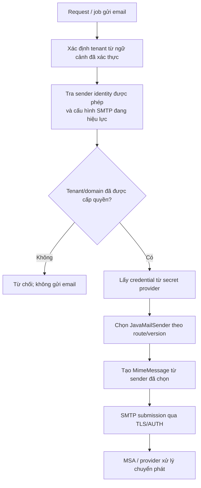
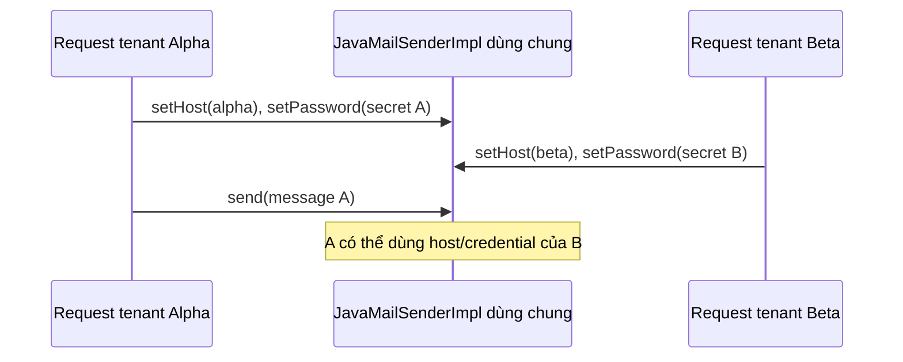
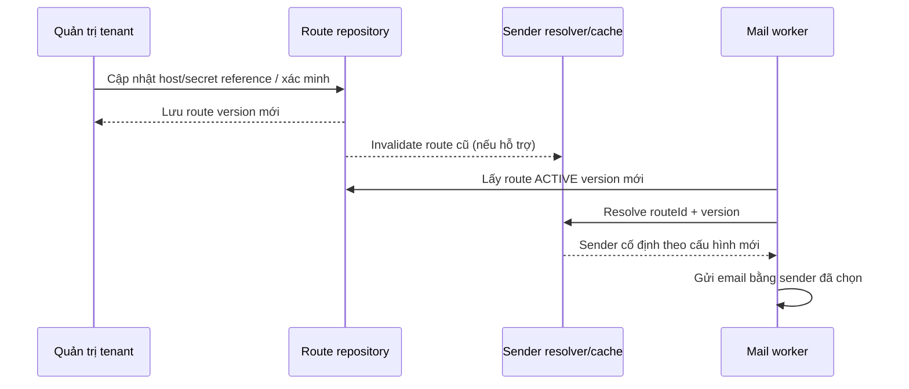
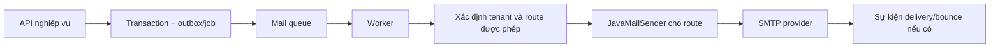

# Cấu hình động theo tenant hoặc miền người gửi trong Spring Framework Mail

Một ứng dụng chỉ phục vụ một tổ chức thường dùng duy nhất một SMTP server, tài khoản gửi và địa chỉ `From`. Khi ứng dụng trở thành hệ thống **đa tenant (multi-tenant)**, tình huống phức tạp hơn: mỗi khách hàng có thể dùng một miền email riêng, một tài khoản SMTP riêng, thậm chí một nhà cung cấp gửi thư khác. Ví dụ, cùng dịch vụ gửi hóa đơn của Spring có thể cần gửi thư từ `billing@alpha.example` qua SMTP của Alpha và `invoices@beta.example` qua dịch vụ của Beta.

**Cấu hình sender động** là việc ứng dụng chọn đúng cấu hình gửi email **theo tenant, miền người gửi hoặc danh tính gửi đã được cho phép** tại thời điểm xử lý tác vụ. Các cấu hình này có thể được lưu trong database, config service hoặc kho bí mật và thay đổi mà không phải sửa mã nghiệp vụ cho từng khách hàng.

Trong Spring Framework Mail, lớp trọng tâm là `JavaMailSender`, thường được triển khai bằng `JavaMailSenderImpl`. Để tránh gửi chéo tenant, cách thiết kế an toàn là **định tuyến đến một sender có cấu hình riêng cho từng định danh gửi đã được xác minh**, thay vì đổi `host`, `username`, `password` hoặc các thuộc tính TLS trên một bean `JavaMailSenderImpl` dùng chung ngay trước mỗi lần gửi.

## 1. Tại sao một `spring.mail.*` cố định không đủ?

Spring Boot có thể tự tạo `JavaMailSender` dựa trên:

```yaml
spring:
  mail:
    host: smtp.provider.example
    port: 587
    username: sender@example.org
    password: ${SMTP_PASSWORD}
    properties:
      "[mail.smtp.auth]": true
      "[mail.smtp.starttls.enable]": true
      "[mail.smtp.starttls.required]": true
```

Cấu hình này phù hợp khi mọi email đi qua **một SMTP submission endpoint**. Nhưng trong một SaaS đa tenant, các trường có thể biến đổi:

| Thuộc tính | Tenant Alpha | Tenant Beta |
|---|---|---|
| Miền gửi được xác minh | `alpha.example` | `beta.example` |
| Địa chỉ `From` | `billing@alpha.example` | `notify@beta.example` |
| SMTP host | `smtp.alpha-provider.example` | `smtp.beta-provider.example` |
| Port | `587` | `465` |
| TLS | STARTTLS bắt buộc | Implicit TLS |
| Tài khoản SMTP | Danh tính dành cho Alpha | Danh tính dành cho Beta |
| Secret | Tham chiếu bí mật của Alpha | Tham chiếu bí mật của Beta |
| Quota, DKIM, chính sách | Theo Alpha | Theo Beta |

Khi một request thuộc Alpha, ứng dụng phải dùng **toàn bộ bộ cấu hình của Alpha**; khi request thuộc Beta, phải dùng **toàn bộ bộ cấu hình của Beta**. Không chỉ thay địa chỉ `From` rồi giữ nguyên SMTP account của tenant trước đó: nhà cung cấp có thể từ chối, hoặc tệ hơn, gửi thư dưới danh tính không đúng quyền.

### Luồng kiến trúc



Khóa định tuyến thường là **tenant ID** (và tùy nhu cầu là `sender identity` hoặc `mail purpose` như transaction/marketing). Miền `From` là một phần của chính sách gửi, không nên trở thành đầu vào tùy ý cho phép người dùng chọn bất kỳ SMTP server nào.

## 2. Ba kiểu định tuyến sender thường gặp

### 2.1. Theo tenant

Mỗi tenant được liên kết với một cấu hình SMTP:

```text
tenant-alpha -> smtp-alpha.example:587 -> billing@alpha.example
tenant-beta  -> smtp-beta.example:465  -> notify@beta.example
```

Cách này phù hợp khi mỗi tenant chỉ có một tài khoản gửi chính. Khi chuyển giữa tenant, ứng dụng phải xác định tenant **từ principal/claims đã được xác minh và hệ thống phân quyền**, không nhận `tenantId` tùy ý từ request body rồi mặc nhiên tin tưởng.

### 2.2. Theo miền hoặc địa chỉ người gửi đã xác minh

Một tenant có thể quản lý nhiều miền hoặc nhiều địa chỉ gửi:

```text
tenant-alpha:
  billing@alpha.example    -> transactional-route
  support@alpha.example    -> support-route
  news@updates.alpha.example -> marketing-route
```

Ở đây, hệ thống chọn route dựa trên **danh tính gửi thuộc danh sách được phép của tenant**. Người dùng không được tự đặt `From: finance@another-company.example` rồi khiến hệ thống gửi qua bất kỳ server nào.

Lựa chọn miền phải dựa trên địa chỉ đã được chuẩn hóa và xác minh quyền sở hữu/quyền sử dụng; với các miền quốc tế hóa, việc chuẩn hóa tên miền cần tuân theo quy tắc email/DNS tương ứng. Không dựa vào việc `endsWith("alpha.example")` để xác định miền, vì `fakealpha.example` hoặc dữ liệu bất thường có thể dẫn đến so khớp sai.

### 2.3. Theo mục đích gửi, môi trường hoặc nhà cung cấp

Cùng tenant đôi khi tách hạ tầng:

| Mục đích | Route ví dụ | Vì sao tách? |
|---|---|---|
| OTP / reset password | Transactional SMTP provider | Ưu tiên độ trễ, giới hạn chống lạm dụng |
| Hóa đơn / thông báo thanh toán | Billing provider | Nhật ký giao dịch và danh tính gửi chuyên dụng |
| Email marketing | Bulk provider | Quota và chính sách unsubscribe riêng |
| Development | SMTP sandbox | Không gửi thư thử ra Internet |

Trong trường hợp này, khóa định tuyến có thể là `(tenantId, mailPurpose, senderIdentity)`. Dù nhiều route được phép sử dụng chung hostname, **quyền gửi và secrets vẫn phải được quản lý tách biệt**.

## 3. Các dữ liệu nên có trong một cấu hình sender

Một bản ghi cấu hình nên đủ để xây dựng một SMTP client mà không cần hỏi lại người dùng khi job đang chạy:

| Trường | Mục đích | Ví dụ |
|---|---|---|
| `tenantId` | Tenant sở hữu cấu hình | `tenant-alpha` |
| `routeId` | Khóa định danh cấu hình gửi | `alpha-transactional` |
| `version` | Phiên bản phục vụ refresh/cache | `42` |
| `host` | SMTP submission endpoint | `smtp.alpha-provider.example` |
| `port` | Cổng TCP | `587` |
| `protocol` | Transport Jakarta Mail | `smtp` |
| `tlsMode` | STARTTLS bắt buộc hoặc implicit TLS | `STARTTLS` |
| `smtpUsername` | Danh tính SMTP AUTH | `mailer-alpha` |
| `credentialRef` | Tham chiếu tới secret, không chứa password công khai | `secrets/mail/alpha/v3` |
| `fromAddress` | Địa chỉ hiển thị đã được cấp quyền | `billing@alpha.example` |
| `replyToAddress` | Địa chỉ nhận phản hồi nếu khác `From` | `help@alpha.example` |
| `envelopeFrom` | Địa chỉ SMTP envelope sender nếu cần cấu hình riêng | `bounce@alpha.example` |
| `status` | Bật/tắt cấu hình và khả năng sử dụng | `ACTIVE` |
| `verifiedDomain` | Dấu vết hoặc trạng thái xác minh quyền gửi miền | `alpha.example` |

Trong hệ thống thực, cấu hình có thể còn có ID nhà cung cấp, quota, thời điểm kiểm tra thành công, ngày hết hạn credential, chính sách retry và metadata của quá trình xác minh SPF/DKIM/DMARC.

**Không lưu mật khẩu SMTP dạng plaintext** trong bảng tenant hoặc log. Bảng cấu hình nên tham chiếu một bí mật được quản lý bằng secret manager; ứng dụng chỉ lấy giá trị thật ở nơi cần thiết và bảo vệ quyền truy cập theo môi trường.

### Ví dụ YAML mô tả route nghiệp vụ

Đây là **cấu hình ứng dụng tự định nghĩa**, không phải các thuộc tính `spring.mail.*` mà Spring Boot tự động biến thành nhiều sender:

```yaml
app:
  tenant-mail:
    routes:
      alpha-transactional:
        tenant-id: tenant-alpha
        from-address: billing@alpha.example
        reply-to-address: support@alpha.example
        host: smtp.alpha-provider.example
        port: 587
        protocol: smtp
        tls-mode: STARTTLS
        smtp-username: alpha-mailer
        credential-ref: secrets/mail/alpha/v3
        version: 42
      beta-transactional:
        tenant-id: tenant-beta
        from-address: notify@beta.example
        host: smtp.beta-provider.example
        port: 465
        protocol: smtp
        tls-mode: IMPLICIT_TLS
        smtp-username: beta-mailer
        credential-ref: secrets/mail/beta/v1
        version: 8
```

Với số lượng tenant lớn, bảng cấu hình trong database hoặc config service thường tiện quản trị hơn hàng trăm phần tử YAML. Dù dùng nguồn nào, **dữ liệu cấu hình cần được thẩm định và lưu có kiểm soát**, không để người gọi API ghi trực tiếp endpoint và secret của mọi tenant.

## 4. Những thành phần Spring Mail cần sử dụng

Spring Framework Mail cung cấp:

- `JavaMailSender`: giao diện gửi email, hỗ trợ cả `SimpleMailMessage` và `MimeMessage`.
- `JavaMailSenderImpl`: triển khai có thể cấu hình SMTP `host`, `port`, `username`, `password`, `protocol` và thuộc tính Jakarta Mail.
- `MimeMessageHelper`: hỗ trợ đặt `From`, `To`, `Reply-To`, tiêu đề, text/HTML, tài nguyên inline, attachment.

Ví dụ một route sử dụng `smtp` với STARTTLS trên 587:

```java
JavaMailSenderImpl sender = new JavaMailSenderImpl();
sender.setHost("smtp.alpha-provider.example");
sender.setPort(587);
sender.setProtocol("smtp");
sender.setUsername("alpha-mailer");
sender.setPassword(secretResolvedForAlpha);

Properties properties = sender.getJavaMailProperties();
properties.put("mail.smtp.auth", "true");
properties.put("mail.smtp.starttls.enable", "true");
properties.put("mail.smtp.starttls.required", "true");
properties.put("mail.smtp.ssl.checkserveridentity", "true");
properties.put("mail.smtp.connectiontimeout", "5000");
properties.put("mail.smtp.timeout", "10000");
properties.put("mail.smtp.writetimeout", "10000");
```

Với route 465 dùng implicit TLS, giữ `protocol="smtp"` nhưng bật `mail.smtp.ssl.enable=true` thay cho STARTTLS. Không chọn loại TLS chỉ bằng việc thử ngẫu nhiên các cổng; phải tuân theo endpoint mà nhà cung cấp SMTP công bố.

### Vì sao không sửa bean dùng chung ngay trước mỗi lần gửi?

Giả sử Spring có một singleton:

```java
@Autowired
JavaMailSenderImpl globalMailSender;
```

Nếu mỗi request thực hiện `globalMailSender.setHost(...)`, `setUsername(...)` và `setPassword(...)` trước khi `send(...)`, hai request gửi song song sẽ tạo **race condition**:



Ngay cả khi chỉ thay `From`, ứng dụng vẫn có thể gửi qua tài khoản không được phép sử dụng miền đó. Sửa động các thuộc tính `Properties` của một `Session` đang được dùng đồng thời cũng mang rủi ro tương tự.

**Nguyên tắc:** tạo sender từ một **bộ cấu hình hoàn chỉnh**, sau đó **không thay đổi cấu hình của sender đang được sử dụng**. Có thể tạo sender mới mỗi lần, hoặc tái sử dụng sender đã cấu hình cố định trong cache theo `routeId` và `version`.

## 5. Ví dụ thiết kế: factory tạo sender cho từng route

Phần code sau dùng Spring Framework 6+/Spring Boot 3+, Java 17+ và Jakarta Mail. Các lớp repository/secret provider chỉ mô tả hợp đồng; việc truy vấn database và secret manager phụ thuộc kiến trúc ứng dụng. Mục tiêu là làm rõ **cách cách ly cấu hình và lựa chọn đúng sender khi gửi**.

### 5.1. Kiểu dữ liệu và hợp đồng nguồn cấu hình

```java
package com.example.mail;

public enum TlsMode {
    STARTTLS,
    IMPLICIT_TLS
}
```

```java
package com.example.mail;

public record SmtpRoute(
        String tenantId,
        String routeId,
        long version,
        String host,
        int port,
        TlsMode tlsMode,
        String smtpUsername,
        String credentialRef,
        String fromAddress,
        String replyToAddress,
        String envelopeFrom) {
}
```

```java
package com.example.mail;

// Repository phải thực thi isolation, trạng thái ACTIVE và xác minh quyền gửi.
public interface TenantMailRouteRepository {
    SmtpRoute requireActiveVerifiedRoute(String authorizedTenantId);
}

// Đây là adapter của hệ thống lưu bí mật; không ghi secret vào log.
public interface MailSecretResolver {
    String requireSecret(String credentialRef);
}

// Thành phần lấy tenant từ authentication context và kiểm tra quyền.
public interface AuthorizedTenantResolver {
    String requireAuthorizedTenantId();
}
```

Để một route được coi là **active, verified**, repository/policy layer cần bảo đảm ít nhất: tenant sở hữu route, địa chỉ `From`/miền gửi được chấp thuận, endpoint SMTP và hình thức xác thực đã được phê duyệt, secret reference thuộc quyền truy cập của tenant.

### 5.2. Factory tạo `JavaMailSenderImpl`

```java
package com.example.mail;

import java.nio.charset.StandardCharsets;
import java.util.Properties;
import org.springframework.mail.javamail.JavaMailSenderImpl;
import org.springframework.stereotype.Component;

@Component
public class TenantMailSenderFactory {

    private final MailSecretResolver secrets;

    public TenantMailSenderFactory(MailSecretResolver secrets) {
        this.secrets = secrets;
    }

    public JavaMailSenderImpl create(SmtpRoute route) {
        if (route.port() < 1 || route.port() > 65535) {
            throw new IllegalArgumentException("Invalid SMTP port");
        }

        // route đã được kiểm tra quyền và host bởi lớp cấu hình/policy.
        String password = secrets.requireSecret(route.credentialRef());

        JavaMailSenderImpl sender = new JavaMailSenderImpl();
        sender.setHost(route.host());
        sender.setPort(route.port());
        sender.setProtocol("smtp");
        sender.setUsername(route.smtpUsername());
        sender.setPassword(password);
        sender.setDefaultEncoding(StandardCharsets.UTF_8.name());

        Properties props = sender.getJavaMailProperties();
        props.put("mail.smtp.auth", "true");
        props.put("mail.smtp.ssl.checkserveridentity", "true");
        props.put("mail.smtp.connectiontimeout", "5000");
        props.put("mail.smtp.timeout", "10000");
        props.put("mail.smtp.writetimeout", "10000");

        if (route.tlsMode() == TlsMode.STARTTLS) {
            props.put("mail.smtp.starttls.enable", "true");
            props.put("mail.smtp.starttls.required", "true");
        } else if (route.tlsMode() == TlsMode.IMPLICIT_TLS) {
            props.put("mail.smtp.ssl.enable", "true");
        } else {
            throw new IllegalArgumentException("Unsupported TLS mode");
        }

        if (route.envelopeFrom() != null) {
            props.put("mail.smtp.from", route.envelopeFrom());
        }
        return sender;
    }
}
```

Điểm quan trọng:

1. `create(...)` nhận **một route đã được kiểm tra quyền**, không nhận hostname tùy ý từ request.
2. `setHost`, `setPort`, `setUsername`, `setPassword` và tất cả thuộc tính TLS được gán **trước khi sender được sử dụng**.
3. Ví dụ đặt `protocol="smtp"` cho cả hai chế độ TLS. Khi dùng 587, bật STARTTLS bắt buộc; khi dùng 465, bật implicit TLS. Cả hai đều xác minh danh tính máy chủ bằng chứng chỉ.
4. Giá trị `mail.smtp.from` tùy chọn thiết lập **SMTP envelope sender** khi dùng SMTP transport. Nó khác `From` trong header của email. Chỉ thiết lập khi nhà cung cấp cho phép và miền/address đã được xác minh.
5. Factory không đặt sender vào biến singleton được chỉnh sửa theo request; mỗi đối tượng đã tạo có cấu hình dành riêng cho route đó.

Ví dụ này giả định SMTP provider dùng username/password hoặc loại secret có thể cung cấp tương ứng. Nếu provider yêu cầu OAuth2/XOAUTH2, client certificate hoặc HTTP API, cần một adapter tương ứng; không được xem việc điền token vào `setPassword(...)` là đủ trong mọi trường hợp.

### 5.3. Service chọn route từ tenant đã xác thực

```java
package com.example.mail;

import jakarta.mail.MessagingException;
import jakarta.mail.internet.MimeMessage;
import java.nio.charset.StandardCharsets;
import org.springframework.mail.javamail.JavaMailSender;
import org.springframework.mail.javamail.MimeMessageHelper;
import org.springframework.stereotype.Service;

@Service
public class TenantNotificationService {

    private final AuthorizedTenantResolver tenants;
    private final TenantMailRouteRepository routes;
    private final TenantMailSenderFactory factory;

    public TenantNotificationService(
            AuthorizedTenantResolver tenants,
            TenantMailRouteRepository routes,
            TenantMailSenderFactory factory) {
        this.tenants = tenants;
        this.routes = routes;
        this.factory = factory;
    }

    public void sendWelcome(String recipient) throws MessagingException {
        // Không dùng tenantId lấy tùy ý từ HTTP request body.
        String tenantId = tenants.requireAuthorizedTenantId();
        SmtpRoute route = routes.requireActiveVerifiedRoute(tenantId);
        JavaMailSender sender = factory.create(route);

        // Tạo MimeMessage từ chính sender sẽ thực hiện send().
        MimeMessage message = sender.createMimeMessage();
        MimeMessageHelper helper = new MimeMessageHelper(
                message, StandardCharsets.UTF_8.name());

        helper.setFrom(route.fromAddress());
        if (route.replyToAddress() != null) {
            helper.setReplyTo(route.replyToAddress());
        }
        helper.setTo(recipient);
        helper.setSubject("Chào mừng bạn");
        helper.setText("Tài khoản của bạn đã được tạo.", false);

        sender.send(message);
    }
}
```

Luồng này có ba ranh giới quan trọng:

- **Authorization:** `AuthorizedTenantResolver` trả về tenant hiện tại dựa trên thông tin xác thực/ủy quyền. Nếu hệ thống dùng job chạy nền, worker phải mang tenant context đã được xác thực/đóng gói từ job và kiểm tra quyền tương ứng; không thể mặc định mọi worker đều có HTTP security context.
- **Route selection:** `requireActiveVerifiedRoute` chọn đúng route của tenant và từ chối route bị vô hiệu, chưa xác minh hoặc không thuộc tenant đó.
- **Message creation + send:** tạo `MimeMessage` từ sender được chọn rồi gọi `send(...)` trên **cùng sender**. Không tạo message từ sender A nhưng gửi bằng sender B khi các `Session` có thuộc tính riêng.

`MessagingException` trong ví dụ liên quan đến việc dựng MIME; lỗi SMTP khi gửi thường được Spring đóng gói trong họ `MailException` (ví dụ lỗi xác thực, kết nối hoặc gửi). Ứng dụng nên bắt lỗi ở ranh giới gửi job/service để ghi nhận trạng thái và quyết định retry phù hợp.

## 6. Trường hợp một tenant có nhiều miền gửi

Lúc này chỉ dùng `tenantId` là chưa đủ. Thêm **senderIdentityId** hoặc **mailPurpose** vào khóa định tuyến:

```text
Authenticated tenant: tenant-alpha
Purpose:               BILLING
Sender identity:       alpha-billing

Lookup:
  (tenant-alpha, BILLING, alpha-billing)
       -> route alpha-transactional
       -> From billing@alpha.example
       -> SMTP smtp.alpha-provider.example:587
```

Một giao diện quản trị có thể cho tenant thêm địa chỉ `support@alpha.example` hoặc `alerts@alerts.alpha.example`. Quy trình thông thường:

1. Tenant đề nghị thêm miền hoặc địa chỉ gửi.
2. Hệ thống xác định quyền quản trị tenant và giới hạn loại địa chỉ được hỗ trợ.
3. Nhà cung cấp hoặc hạ tầng mail yêu cầu xác minh miền và cấu hình DNS tương ứng.
4. Sau khi xác minh, cấu hình route được chuyển sang `ACTIVE`; địa chỉ mới mới được chọn trong tác vụ gửi.
5. Nếu tenant xóa miền, khóa credential hoặc hết quyền, route bị vô hiệu và sender cache cần được làm mới.

### Vì sao không lấy domain từ `To` để chọn sender?

`To` là địa chỉ người nhận; sender phải phản ánh **tenant và danh tính gửi**, không phụ thuộc người nhận thuộc Gmail, Outlook hay domain riêng. Nếu một đơn hàng của tenant Alpha gửi tới ba địa chỉ khác miền, cả ba vẫn cần xuất phát từ đúng sender được tenant Alpha cấp quyền.

### Vì sao không dùng chuỗi `From` từ request làm khóa duy nhất?

Trường `From` có thể bị giả mạo nếu nó đến từ người dùng chưa được phân quyền. Ngay cả domain đúng, địa chỉ cụ thể có thể chưa được xác minh hoặc không thuộc quyền gửi của tài khoản SMTP. Hãy dùng **ID danh tính gửi đã đăng ký**, rồi lấy địa chỉ `From` từ bản ghi tin cậy của hệ thống.

Khi cần đối chiếu tên miền, phân tích địa chỉ email đúng cú pháp, chuẩn hóa domain theo chính sách của hệ thống và so sánh theo giá trị canonical; tránh `contains`/`endsWith` hoặc regex tùy tiện trên toàn chuỗi email.

## 7. Gửi qua nhiều provider: nên chia trách nhiệm thế nào?

Trong thực tế, không phải nhà cung cấp nào cũng có một SMTP route giống nhau. Có provider yêu cầu SMTP AUTH, có provider hỗ trợ OAuth2 và có provider khuyến nghị HTTPS API.

Một thiết kế mở rộng có thể định nghĩa giao diện nghiệp vụ:

```java
public interface TenantMailTransport {
    void send(MailJob job, SenderIdentity identity);
}
```

Rồi cung cấp các adapter:

```text
TenantMailTransport
├── SmtpTenantMailTransport  -> JavaMailSender / Jakarta Mail
└── ApiTenantMailTransport   -> SDK hoặc HTTPS API nhà cung cấp
```

Định tuyến đến adapter dựa trên **loại provider của route**, sau đó áp dụng các chính sách chung như quyền gửi, logging và theo dõi lỗi. Đây là một **hướng mở rộng kiến trúc**, không phải API có sẵn mang các tên `MailJob`/`SenderIdentity` trong Spring Framework.

Khi chỉ có vài tenant với cấu hình cố định, nhiều bean `@Qualifier` có thể đơn giản hơn:

```java
@Bean("alphaMailSender")
JavaMailSender alphaMailSender() {
    // Tạo và cố định cấu hình SMTP dành cho Alpha.
}

@Bean("betaMailSender")
JavaMailSender betaMailSender() {
    // Tạo và cố định cấu hình SMTP dành cho Beta.
}
```

Đây là ví dụ **khung thiết kế**, chưa phải code cấu hình đầy đủ. Khi cần thêm tenant mà không triển khai lại ứng dụng, route repository + factory + resolver thường linh hoạt hơn việc thêm một bean tĩnh cho từng tenant.

## 8. Cache, thay đổi cấu hình và xoay vòng credential

Tạo `JavaMailSenderImpl` mỗi lần gửi thường khả thi về mặt chức năng, nhưng trong hệ thống tải lớn, việc giải mã secret và đọc cấu hình liên tục có thể tốn chi phí. Có thể cache sender đã cấu hình hoàn chỉnh.

### Cách đặt khóa cache

Không chỉ cache theo `tenantId` nếu một tenant có nhiều route hoặc cấu hình có thể thay đổi. Khóa nên chứa:

```text
(routeId, configVersion, secretVersion)
```

hoặc một khóa cấu hình bất biến tương đương. Nếu route Alpha đổi từ SMTP provider A sang B, tăng `configVersion` để lần gửi mới chọn sender đã được tạo từ cấu hình mới. Nếu credential được xoay vòng mà các thông số khác không đổi, `secretVersion` cần thay đổi hoặc cache phải được vô hiệu một cách đáng tin cậy.

### Cần cache gì, và điều gì không tự động được cache?

| Thành phần | Có thể cache? | Điểm cần chú ý |
|---|---|---|
| Bản ghi route đã xác minh | Có, với TTL/invalidation | Khi quyền gửi bị thu hồi cần hết hiệu lực kịp thời |
| Sender đã cấu hình cố định | Có, theo route/version | Không đổi thuộc tính của sender đang dùng |
| Metadata secret/version | Có, theo chính sách của secret manager | Phải có cơ chế làm mới khi xoay vòng |
| SMTP credential dạng plaintext | Hạn chế tối đa | Chú ý vòng đời lưu trong RAM và quyền truy cập |
| Kết nối SMTP mở sẵn | Không tự suy ra từ cache sender | `JavaMailSenderImpl` không tự là một SMTP connection pool đa tenant |

**Cache đối tượng sender không đồng nghĩa cache kết nối SMTP.** Chi phí mạng, TLS handshake, SMTP AUTH và giới hạn kết nối của provider vẫn cần được tính. Không giữ một SMTP transport kết nối lâu dài rồi chia sẻ tùy tiện cho các tenant có credential khác nhau.

### Quy trình cập nhật route



Một job đang thực hiện có thể đã lấy route version cũ trước khi cập nhật. Hệ thống cần chính sách nhất quán: cấu hình cũ còn được phép hoàn tất trong một khoảng chuyển tiếp hay phải từ chối ngay khi tenant bị đình chỉ. Với sự kiện **thu hồi quyền gửi hoặc lộ secret**, kiểm tra authorization gần thời điểm gửi và vô hiệu cache kịp thời có thể quan trọng hơn tối ưu tốc độ.

### Dùng một số lượng lớn tenant

Đừng tạo vô hạn sender trong cache cho mọi route từng tồn tại. Nên có giới hạn kích thước, thời gian sống, metric hit/miss và cơ chế loại bỏ. Nếu route ít được dùng, việc tạo sender theo nhu cầu thường đủ đơn giản. Với hàng nghìn tenant và provider rate-limit khác nhau, nên bổ sung quota/rate limiting **theo tenant/route**, không áp dụng một giới hạn duy nhất vô phân biệt.

## 9. From, Reply-To và envelope sender phải được tách bạch

Trong email có ít nhất ba khái niệm dễ nhầm:

| Trường | Vai trò | Cấu hình Spring/Jakarta Mail |
|---|---|---|
| `From:` | Địa chỉ người gửi hiển thị cho người đọc | `MimeMessageHelper.setFrom(...)` |
| `Reply-To:` | Địa chỉ được đề nghị nhận câu trả lời | `MimeMessageHelper.setReplyTo(...)` |
| SMTP `MAIL FROM` | Địa chỉ envelope sender dùng khi vận chuyển và xử lý bounce | Có thể cấu hình bằng `mail.smtp.from` cho SMTP transport khi phù hợp |

Ví dụ một tenant muốn email hóa đơn hiển thị:

```text
From: Billing Alpha <billing@alpha.example>
Reply-To: support@alpha.example
SMTP envelope sender: bounce@alpha.example
```

Ba địa chỉ có thể khác nhau nhưng phải phù hợp với chính sách của hạ tầng gửi và quyền sử dụng miền. Không được mặc định rằng đổi `From:` tự động đổi envelope sender hoặc rằng đặt `Reply-To:` sẽ khiến provider cho phép mọi miền gửi.

### SPF, DKIM và DMARC trong hệ thống đa tenant

Kết nối SMTP thành công mới xác nhận server nhận submission; việc email được phía đích tin cậy còn chịu ảnh hưởng bởi:

- **SPF:** xác định IP/đơn vị gửi được ủy quyền bởi miền phù hợp với SPF.
- **DKIM:** kiểm tra chữ ký mật mã của miền ký thông điệp; provider thường ký theo cấu hình đã xác minh.
- **DMARC:** kiểm tra sự phù hợp (alignment) của domain trong `From:` với kết quả SPF và/hoặc DKIM theo chính sách miền.

Các tenant dùng miền riêng thường phải xác minh DNS và cấu hình DKIM/SPF/DMARC theo hướng dẫn của provider. SMTP AUTH của tenant Alpha có thể thành công nhưng thư từ `billing@beta.example` vẫn bị từ chối hoặc có nguy cơ không đạt xác thực miền. **Không dùng SMTP AUTH như bằng chứng rằng tenant được quyền giả mạo mọi miền.**

### Bảo mật endpoint và secret

Tính năng “tenant tự điền SMTP server” rất nhạy cảm. Nếu ứng dụng lập tức kết nối đến host do người dùng chỉ định rồi gửi credential, kẻ tấn công có thể:

1. Khiến backend kết nối đến địa chỉ mạng nội bộ hoặc endpoint không được phép.
2. Cấu hình máy chủ SMTP do họ kiểm soát để thu thập thông tin đăng nhập.
3. Gây gửi thư trái quyền hoặc lạm dụng hệ thống.

Vì vậy, cần kiểm soát quyền cấu hình, quy trình xác minh endpoint, hostname/port được phép, chính sách mạng egress, TLS verification và quyền truy cập secret. Khi hỗ trợ BYO SMTP (tenant cung cấp SMTP riêng), cần thiết kế rõ ràng hơn về xác minh kết nối và cách cô lập quyền so với mô hình dùng một provider tập trung.

## 10. Xử lý job bất đồng bộ trong hệ thống đa tenant

Đối với thông báo giao dịch, gửi email trực tiếp trong HTTP request có thể khiến người dùng chờ mạng SMTP. Một kiến trúc thường gặp là ghi nhận job/outbox rồi để worker xử lý.



Một bản ghi job nên có các thông tin tối thiểu:

| Trường | Công dụng |
|---|---|
| `jobId` | Định danh tác vụ và theo dõi retry |
| `tenantId` | Quyền sở hữu và cách ly dữ liệu |
| `senderIdentityId` / `routeId` | Danh tính gửi đã được cấp phép |
| `recipient` | Địa chỉ nhận |
| `templateId` và dữ liệu template | Xây dựng nội dung theo chính sách tenant |
| `status`, `attempts`, `nextAttemptAt` | Xử lý hàng đợi và retry |
| `routeVersion` (nếu chính sách yêu cầu) | Truy vết cấu hình được chọn |
| `providerMessageId` hoặc queue ID (nếu có) | Tra cứu sự kiện xử lý sau submission |

Tùy chính sách, job có thể **chốt route version** khi tạo hoặc **đọc cấu hình ACTIVE mới nhất** khi gửi. Lựa chọn này ảnh hưởng đến việc gửi những job đang chờ khi tenant đổi provider hoặc bị đình chỉ. Dù dùng cách nào, worker vẫn phải **kiểm tra quyền và trạng thái route tại thời điểm thích hợp**.

Không ghi password hoặc token SMTP vào payload queue. Job nên giữ `tenantId`, `routeId` hoặc secret reference được cấp quyền; chỉ lớp gửi lấy credential khi cần.

### Phản hồi `250` không phải delivery

Khi `JavaMailSender.send(...)` trả về bình thường, thông thường SMTP submission đã thành công. Tuy nhiên, thư có thể tiếp tục ở hàng đợi provider, bị trì hoãn, bounce hoặc vào spam. Vì vậy cần phân biệt:

- `QUEUED`: job đang chờ.
- `SUBMITTING`: worker đang nộp thư.
- `SUBMITTED`: MSA đã chấp nhận email.
- `DELIVERED`: chỉ gán khi có bằng chứng tương ứng từ provider/đích.
- `BOUNCED` / `FAILED`: hệ thống nhận tín hiệu lỗi hoặc quyết định dừng.

Đừng gộp `SUBMITTED` và `DELIVERED` thành một trạng thái chỉ vì lời gọi `send()` không ném exception.

### Retry, trùng thư và lỗi riêng từng tenant

Lỗi SMTP `4xx` thường biểu thị tạm thời; `5xx` thường biểu thị từ chối mang tính lâu dài. Trong thực tế còn có timeout, TLS handshake, AUTH, quota và chính sách provider. Retry cần phân loại nguyên nhân, có backoff, giới hạn số lần và quota theo tenant.

Nếu server đã chấp nhận thư nhưng mạng đứt trước khi worker nhận được phản hồi cuối, retry có thể gây **gửi trùng**. Không có đảm bảo exactly-once chỉ từ SMTP. Hãy dùng `jobId`/trạng thái nội bộ để kiểm soát retry, và nếu provider hỗ trợ idempotency key hoặc event correlation, tích hợp theo cơ chế thực tế của provider.

Một tenant bị giới hạn quota không nên làm nghẽn toàn bộ hàng đợi của các tenant khác. Có thể dùng partition hoặc concurrency limit theo tenant/route, kết hợp circuit breaker và giám sát riêng từng provider.

## 11. Kiểm thử và quan sát việc định tuyến

Trong môi trường phát triển, có thể dùng nhiều SMTP sink độc lập để kiểm tra tách biệt:

```text
tenant-alpha -> mailpit-alpha:1025
tenant-beta  -> mailpit-beta:1025
```

Thiết lập trên chỉ dành cho môi trường kiểm thử được kiểm soát; sandbox thường không yêu cầu AUTH/TLS. Với production, mỗi tenant phải dùng chế độ TLS và credential tương ứng.

Những kịch bản cần quan sát trong quy trình kiểm thử tích hợp:

| Kịch bản | Kết quả mong đợi |
|---|---|
| Tenant Alpha gửi email | Thư tới SMTP sink/provider Alpha, `From` thuộc danh tính được cấp |
| Tenant Beta gửi đồng thời | Thư tới provider Beta, không dùng credential/endpoint Alpha |
| Tenant A yêu cầu sender identity của B | Bị từ chối trước khi gửi |
| Miền gửi chưa xác minh hoặc route bị vô hiệu | Job không được gửi qua route đó |
| Route đổi host/credential version | Job mới dùng route mới theo chính sách |
| TLS trên route bị cấu hình sai | Lỗi rõ tại handshake, không hạ xuống plaintext |
| Provider Alpha bị timeout | Lỗi được gắn với Alpha, không ảnh hưởng định tuyến Beta |
| Credential bị thu hồi | Cache được làm mới/vô hiệu; không fallback sang credential tenant khác |

Khi ghi log, nên có `tenantId`, `routeId`, `configVersion`, `jobId`, loại email, kết quả SMTP, thời gian và mã lỗi đã lọc dữ liệu nhạy cảm. Không ghi `password`, access token, nội dung email nhạy cảm hay toàn bộ phiên SMTP AUTH.

### Một ví dụ lỗi định tuyến khó phát hiện

Ứng dụng nhận hai job đồng thời:

```text
Job 1: tenant Alpha, From billing@alpha.example
Job 2: tenant Beta,  From notify@beta.example
```

Nếu ứng dụng thay đổi singleton `JavaMailSenderImpl` giữa các request, cả hai job đôi khi có thể dùng host/credential vừa được set gần nhất. Lỗi có thể chỉ xuất hiện dưới tải đồng thời, khiến việc gửi thử thủ công một email luôn thành công.

Một sender cố định theo route giúp tránh loại lỗi này. Nếu xảy ra thất bại, log có `routeId`/`version` sẽ giúp xác định cấu hình mà job thực sự sử dụng mà không tiết lộ secret.

## 12. Các sai lầm thường gặp và cách xử lý

| Sai lầm | Rủi ro | Cách tiếp cận |
|---|---|---|
| Sửa `setHost`/`setPassword` của singleton theo request | Race condition và gửi chéo tenant | Chọn sender độc lập, cấu hình bất biến sau khi tạo |
| Dùng `tenantId` không được xác thực từ request body | Một tenant có thể chọn route của tenant khác | Lấy tenant từ security context và kiểm tra quyền |
| Lấy host SMTP trực tiếp từ input công khai | SSRF, kết nối nội bộ ngoài ý muốn, lộ credentials | Kiểm soát cấu hình và chính sách egress |
| Cho phép bất kỳ `From` trên một tài khoản SMTP | Giả mạo miền, bị provider từ chối hoặc đánh dấu spam | Chỉ dùng sender identity/miền đã xác minh |
| Chuyển 587 sang 465 mà không đổi TLS mode | Kết nối treo hoặc handshake thất bại | 587 + STARTTLS, 465 + implicit TLS theo provider |
| Cache chỉ theo tenantId, không invalidate | Dùng host hoặc secret cũ sau thay đổi | Khóa cache có version, TTL và invalidation |
| Cache giữ secret quá lâu | Rủi ro tồn tại credential cũ/lộ dữ liệu RAM | Quản lý vòng đời và xoay vòng secrets |
| Dùng chung một reply-to/from cho mọi tenant | Trả lời sai tổ chức, giảm tin cậy, lộ thông tin | Lấy cả `From`/`Reply-To` từ route được phép |
| Gửi bằng sender B một `MimeMessage` được tạo từ sender A | Có thể dùng `Session`/transport properties không phù hợp | Tạo message và gửi bằng cùng sender |
| Khi Alpha lỗi tự fallback sang SMTP Beta | Gửi dưới danh tính tenant khác | Chỉ fallback sang route phụ **được Alpha ủy quyền** |
| Xem `send()` thành công là người nhận đã nhận | Trạng thái nghiệp vụ sai | Theo dõi delivery/bounce độc lập |
| Retry toàn bộ lỗi vô hạn | Spam, gửi trùng, vượt quota | Phân loại lỗi, backoff và giới hạn theo tenant |

## 13. Những lựa chọn thiết kế và khi nào phù hợp

| Cách tổ chức | Phù hợp | Giới hạn |
|---|---|---|
| Một `JavaMailSender` từ `spring.mail.*` | Một provider/cấu hình gửi duy nhất | Không hỗ trợ chọn host/credential khác nhau theo tenant nếu không thêm cơ chế |
| Nhiều bean `@Qualifier` cố định | Ít tenant hoặc ít provider biết trước | Phải quản lý bean khi thêm tenant và khó cấu hình động |
| Factory tạo sender theo request/job | Tenant thay đổi thường xuyên, số lượng vừa phải | Đọc config/secret nhiều lần nếu không tối ưu |
| Cache sender cố định theo route/version | Nhiều email dùng lại cùng cấu hình | Cần invalidation, TTL, bảo vệ secret |
| Tách transport SMTP/HTTP API theo provider | Provider hỗn hợp và yêu cầu mở rộng | Cần adapter, event/error mapping thống nhất |

Đối với một hệ thống SaaS có tenant quản lý miền gửi riêng, **route repository + policy xác minh + factory/resolver sender** thường là nền tảng dễ duy trì. Sau khi đã ổn định chức năng, có thể bổ sung cache phiên bản, worker và quota theo tenant.

## 14. Câu hỏi thường gặp

**Spring Boot có tự tạo một `JavaMailSender` cho mỗi tenant từ `spring.mail.*` không?** Không. Cấu hình auto-configuration thông thường xây dựng sender theo một bộ thuộc tính. Muốn nhiều sender theo tenant, ứng dụng cần cơ chế định tuyến và tạo/quản lý bean hoặc đối tượng sender riêng.

**Có thể chỉ thay `From` để gửi cho từng tenant qua cùng SMTP provider không?** Có thể nếu provider cho phép các miền/địa chỉ đó và chính sách xác thực miền đã được thiết lập. Nếu không, MSA có thể từ chối hoặc thư gặp vấn đề DMARC. Cùng hostname không đồng nghĩa cùng quyền gửi.

**Có cần tạo một TCP connection và Session Jakarta Mail riêng cho mỗi tenant?** Mỗi sender có thể có `Session` cấu hình riêng, nhưng không cần giữ một kết nối SMTP mở liên tục cho từng tenant. `JavaMailSenderImpl` không tự là connection pool. Điều quan trọng là không chia sẻ trạng thái credential có thể bị thay đổi giữa các tenant.

**Khi tenant đổi password SMTP, ứng dụng có cần restart không?** Không nhất thiết. Nếu cấu hình được tra từ nguồn động và sender cache có invalidation/version, job sau có thể dùng credential mới. Nếu chỉ cấu hình tĩnh và giữ singleton, việc thay đổi có thể cần cơ chế refresh hoặc restart tùy triển khai.

**Có nên truyền password SMTP trong job queue không?** Không. Job chỉ nên có khóa tenant/route và dữ liệu nghiệp vụ cần thiết. Worker có quyền mới lấy secret từ hệ thống quản lý bí mật.

**Chọn sender bằng miền email của người nhận có đúng không?** Không. Miền người nhận dùng cho routing email phía hệ thống chuyển phát, không xác định tenant sở hữu email đi ra. Sender được chọn từ tenant và danh tính gửi đã được phê duyệt.

**Có thể chọn sender bằng tham số `from=...` của API không?** Chỉ khi giá trị đó được ánh xạ sang một **sender identity thuộc tenant hiện tại** và được phân quyền. Không cho phép giá trị tùy ý trở thành quyền gửi từ một miền bất kỳ.

**Nếu tenant A bị lỗi SMTP, có thể gửi bằng credential tenant B để tránh gián đoạn không?** Không nên. Điều đó có thể vi phạm quyền gửi và làm sai danh tính. Chỉ dùng route dự phòng đã được thiết lập, xác minh và cho phép đối với cùng tenant/miền gửi.

**Khi email gửi thành công, có cần lưu provider message ID không?** Nếu provider có mã để theo dõi, nên lưu liên kết `jobId`, `tenantId`, route và mã thông điệp của nhà cung cấp. Điều này giúp tra sự kiện delivery/bounce; mã queue của provider không nhất thiết trùng với `Message-ID` MIME.

**Có thể sử dụng `ThreadLocal` để giữ tenant ID rồi tự đổi sender không?** Tenant context có thể được dùng như một cơ chế hỗ trợ, nhưng các luồng bất đồng bộ hoặc thread pool có thể làm mất/lan truyền sai context nếu không quản lý đúng. Hãy truyền hoặc khôi phục tenant context trong job một cách rõ ràng và kiểm tra quyền trước khi gửi.

## 15. Tài liệu kỹ thuật liên quan

- **Spring Framework Mail:** `JavaMailSender`, `JavaMailSenderImpl` và `MimeMessageHelper`.
- **Spring Boot Mail:** auto-configuration và thuộc tính `spring.mail.*`, `spring.mail.properties.*`.
- **Jakarta Mail SMTP Transport:** `mail.smtp.auth`, `mail.smtp.starttls.enable`, `mail.smtp.starttls.required`, `mail.smtp.ssl.enable`, `mail.smtp.ssl.checkserveridentity` và `mail.smtp.from`.
- **RFC 5321 — SMTP:** envelope sender và cơ chế truyền email qua SMTP.
- **RFC 6409 — Message Submission:** vai trò SMTP submission agent đối với client.
- **RFC 3207 — STARTTLS:** nâng cấp kết nối SMTP sang TLS.
- **RFC 8314 — TLS for Email Submission and Access:** implicit TLS submission trên cổng 465.
- **SPF, DKIM, DMARC:** bộ cơ chế xác thực liên quan đến hạ tầng gửi email và miền danh tính gửi.

---

**Ghi nhớ:** Cấu hình động theo tenant hoặc miền gửi là bài toán **chọn đúng sender, credential, TLS, miền gửi và quyền sử dụng** cho từng tác vụ. Trong Spring Framework Mail, hãy lấy tenant từ ngữ cảnh đã xác thực, tra route đang hiệu lực, tạo hoặc chọn `JavaMailSenderImpl` đã được cấu hình cố định, rồi tạo và gửi message bằng chính sender đó. Cách này giúp cô lập tenant, cho phép thay đổi provider hoặc xoay vòng credential và tránh lỗi gửi chéo khi nhiều request chạy đồng thời.
