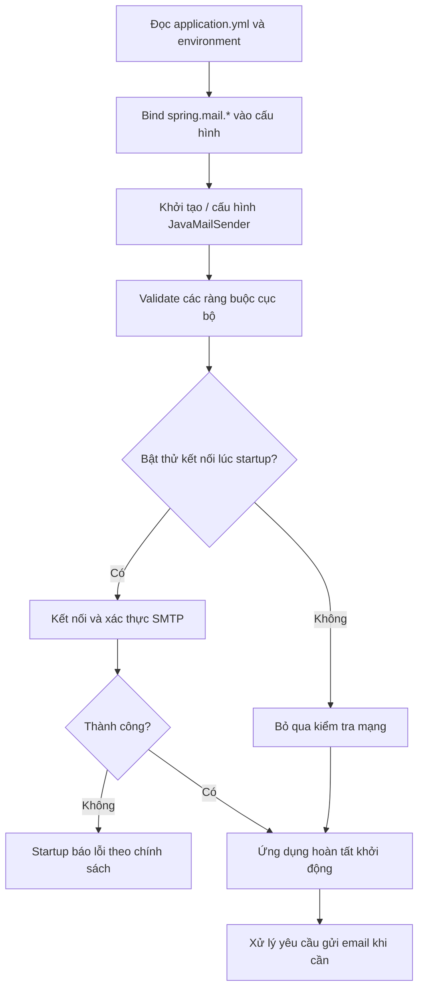

# Kiểm tra cấu hình sớm khi ứng dụng khởi động

Một ứng dụng Spring Boot có thể khởi động bình thường, xử lý HTTP và truy cập cơ sở dữ liệu, nhưng đến lần đầu gọi `JavaMailSender.send(...)` mới phát hiện thiếu tên máy chủ SMTP, sai mật khẩu, cấu hình TLS không phù hợp hoặc timeout quá dài. Nếu chức năng email là điều kiện quan trọng để ứng dụng hoạt động, phát hiện lỗi muộn sẽ khiến người dùng gặp sự cố trước khi đội vận hành biết hệ thống chưa sẵn sàng.

**Kiểm tra cấu hình sớm khi ứng dụng khởi động** (*fail-fast mail configuration validation*) là cách phát hiện các lỗi có thể xác định ngay từ đầu. Trong **Spring Framework Mail**, cần phân biệt việc kiểm tra **giá trị cấu hình trong ứng dụng** với việc **thử kết nối thực tế tới máy chủ SMTP**. Hai bước cung cấp bằng chứng khác nhau và nên được lựa chọn theo mức độ quan trọng của email đối với hệ thống.

Bài học tập trung vào cấu hình `JavaMailSender`, đặc biệt là `JavaMailSenderImpl` và cách Spring Boot hỗ trợ thông qua `spring.mail.*`, đồng thời trình bày những giới hạn cần hiểu trước khi quyết định chặn khởi động nếu SMTP không sẵn sàng.

## 1. Tại sao cần kiểm tra sớm?

Hãy xét một dịch vụ gửi mã xác nhận khi người dùng đăng ký:

```text
Ứng dụng khởi động lúc 09:00
    ↓
Health endpoint báo ứng dụng đã sẵn sàng
    ↓
09:15: người dùng đăng ký tài khoản
    ↓
RegistrationService gọi JavaMailSender.send(...)
    ↓
SMTP yêu cầu STARTTLS nhưng cấu hình không bật
    ↓
Gửi email thất bại; người dùng không nhận được mã
```

Lỗi kết nối, xác thực hoặc cấu hình TLS có thể tồn tại từ **trước khi ứng dụng nhận yêu cầu đầu tiên**. Nếu quá trình khởi động có bước kiểm tra phù hợp, hệ thống có thể báo lỗi ngay lúc triển khai.

Lợi ích thường thấy:

- **Phát hiện thiếu cấu hình:** hostname, địa chỉ `From`, tài khoản SMTP hoặc biến môi trường chưa được cung cấp.
- **Phát hiện giá trị không hợp lệ:** cổng ngoài phạm vi cho phép, địa chỉ gửi không đúng cú pháp, thiếu các thông số đi kèm nhau.
- **Phát hiện lỗi kết nối sớm:** DNS không phân giải, port không mở, TLS handshake hoặc xác thực thất bại khi thử kết nối.
- **Phản hồi rõ ràng cho quá trình triển khai:** ứng dụng có thể thất bại khi khởi động, thay vì chỉ báo lỗi sau khi người dùng bắt đầu gửi mail.
- **Tách nguyên nhân lỗi:** phân biệt vấn đề cấu hình cố định với các lỗi phân phát thư có thể xuất hiện sau này.

Tuy nhiên, không phải mọi ứng dụng đều nên coi SMTP là điều kiện bắt buộc để chạy. Nếu email chỉ là chức năng phụ, yêu cầu kết nối SMTP thành công ngay lúc startup có thể khiến toàn bộ dịch vụ không hoạt động trong một đợt gián đoạn ngắn của nhà cung cấp mail. Đây là **quyết định vận hành**, không phải yêu cầu bắt buộc của Spring Mail.

## 2. Các tầng kiểm tra và điều chúng chứng minh

Một chuỗi kiểm tra thường tiến từ **rẻ, cục bộ** đến **cần mạng**:

| Tầng | Ví dụ kiểm tra | Chứng minh được | Chưa chứng minh được |
|---|---|---|---|
| **Nạp và bind cấu hình** | Giá trị `spring.mail.port` có chuyển được thành số không? | Cấu hình có thể đọc/bind theo kiểu dữ liệu mong đợi. | Host có tồn tại hoặc kết nối được. |
| **Ràng buộc cục bộ** | `app.mail.from` không rỗng, một email hợp lệ. | Các quy tắc nghiệp vụ về cấu hình được đáp ứng. | SMTP cho phép gửi từ địa chỉ đó. |
| **Nhất quán chính sách** | Bật auth kiểu username/password thì có username và secret. | Bộ thông số không thiếu những thành phần mà ứng dụng yêu cầu. | Username/password có đúng hay không. |
| **Kết nối SMTP** | Mở connection, thực hiện TLS/auth khi được cấu hình. | Máy chủ có thể truy cập và chấp nhận kết nối theo cấu hình ở thời điểm thử. | Gửi một thông điệp cụ thể sẽ được chấp nhận. |
| **Gửi thông điệp thử nghiệm** | Gửi đến mailbox kiểm thử riêng. | SMTP đã chấp nhận thao tác gửi mẫu. | Thư đã tới Inbox hoặc không bị lọc spam. |
| **Theo dõi phân phát** | Đọc event delivered/bounced từ nhà cung cấp. | Có thêm bằng chứng về tiến trình phân phát. | Người nhận đã thực sự mở và đọc email. |

Trong thực tế, startup thường phù hợp với **ba hoặc bốn tầng đầu**. Gửi thư thật lúc ứng dụng khởi động có thể tạo email lặp lại ở mỗi lần deploy/scale/restart, tiêu tốn hạn mức và không bảo đảm trạng thái phân phát cuối cùng. Khi cần thử luồng gửi trọn vẹn, nên thực hiện bằng bài kiểm tra tích hợp có kiểm soát.

### Hai khái niệm cần tách rõ

- **Validation cục bộ:** đọc và kiểm tra cấu hình mà không cần truy cập SMTP server. Ví dụ hostname không rỗng, tài khoản bắt buộc có mặt, `From` hợp lệ theo chính sách.
- **Connection test:** thử thiết lập phiên tới SMTP server. Có thể phát hiện lỗi DNS, timeout, TLS và xác thực, nhưng chỉ phản ánh trạng thái **tại thời điểm kết nối**.

Một kết quả connection test thành công **không** bảo đảm thư sau đó được server nhận, được relay đến miền đích hoặc tới hộp thư người nhận.

## 3. Cấu hình Spring Boot được chuẩn bị trong quá trình khởi động như thế nào?

Khi dùng `spring-boot-starter-mail` với các điều kiện auto-configuration phù hợp, Spring Boot có thể tạo bean `JavaMailSender` từ `spring.mail.*`. Một vòng đời đơn giản:



Sơ đồ thể hiện các trách nhiệm logic. Thứ tự chính xác của việc tạo bean, binding, các callback và runner tùy cách cấu hình Spring Boot/Spring Framework, nhưng điểm quan trọng vẫn là **giai đoạn cấu hình bean xảy ra trước lần xử lý email nghiệp vụ**.

Một số điều dễ nhầm:

1. **Có bean `JavaMailSender` không đồng nghĩa kết nối SMTP đã thành công.** Sender có thể chỉ chứa các thông số sẽ được dùng khi gửi.
2. **Không có bean mail sender** có thể là dấu hiệu thiếu điều kiện auto-configuration, ví dụ cấu hình SMTP host không xuất hiện và ứng dụng cũng không tự cung cấp sender.
3. **Bind thành công không phải validation nghiệp vụ.** Một chuỗi trông giống địa chỉ email có thể vẫn không phù hợp với quy tắc sản phẩm.
4. **Connection test không thay thế việc gửi.** Server có thể chấp nhận kết nối và xác thực nhưng từ chối `MAIL FROM`, `RCPT TO` hoặc `DATA` của một email cụ thể.

## 4. Bật thử kết nối bằng `spring.mail.test-connection`

Spring Boot cung cấp property:

```properties
spring.mail.test-connection=true
```

Khi mail sender được auto-configure theo đường hỗ trợ tính năng này, property cho phép **kiểm tra kết nối tới mail server trong lúc ứng dụng khởi động**. Với `JavaMailSenderImpl`, hoạt động tương ứng sử dụng `testConnection()` để mở kết nối transport rồi đóng nó.

Ví dụ cấu hình SMTP submission qua cổng 587:

```yaml
spring:
  mail:
    host: ${SMTP_HOST}
    port: ${SMTP_PORT:587}
    username: ${SMTP_USERNAME}
    password: ${SMTP_PASSWORD}
    default-encoding: UTF-8

    # Kiểm tra máy chủ mail lúc khởi động:
    test-connection: true

    properties:
      "[mail.smtp.auth]": true
      "[mail.smtp.starttls.enable]": true
      "[mail.smtp.starttls.required]": true
      "[mail.smtp.connectiontimeout]": 5000
      "[mail.smtp.timeout]": 5000
      "[mail.smtp.writetimeout]": 5000

app:
  mail:
    from: no-reply@example.org
    reply-to: support@example.org
```

Trong ví dụ:

- `SMTP_HOST`, `SMTP_PORT`, `SMTP_USERNAME` và `SMTP_PASSWORD` được cung cấp qua biến môi trường hoặc hệ thống cấu hình bí mật.
- `test-connection: true` yêu cầu một lần kiểm tra kết nối trong giai đoạn startup khi cấu hình Spring Boot hỗ trợ.
- `mail.smtp.auth=true` yêu cầu xác thực qua cơ chế SMTP provider hỗ trợ; ví dụ giả định sử dụng tài khoản/mật khẩu.
- `mail.smtp.starttls.enable=true` bật nâng cấp lên TLS khi server hỗ trợ; `required=true` yêu cầu STARTTLS phải có.
- `mail.smtp.connectiontimeout` và `mail.smtp.timeout` hạn chế thời gian chờ kết nối và đọc phản hồi SMTP; `writetimeout` giới hạn thời gian chờ ghi khi gửi dữ liệu.
- `app.mail.from` và `app.mail.reply-to` là **property nghiệp vụ tự định nghĩa**, không phải thuộc tính tự động được Spring Boot dùng để đặt header của mọi message.

**Lưu ý:** Các giá trị như `smtp.example.org` hoặc `no-reply@example.org` chỉ là ví dụ; ứng dụng thực tế phải dùng host, port, cơ chế TLS và danh tính gửi theo yêu cầu của nhà cung cấp.

### `testConnection()` kiểm tra gì?

Với `JavaMailSenderImpl`, phép thử yêu cầu transport thiết lập kết nối SMTP theo các property của sender. Theo cấu hình và cơ chế được hỗ trợ, việc này có thể bao gồm:

1. Phân giải hostname và mở socket tới SMTP server.
2. Nhận lời chào SMTP và trao đổi các bước khởi tạo phiên.
3. Thiết lập TLS hoặc STARTTLS khi được cấu hình.
4. Thực hiện xác thực SMTP nếu cấu hình yêu cầu.
5. Đóng kết nối sau khi thử thành công.

Nó **không phải** một giao dịch gửi thư đầy đủ với `MAIL FROM`, `RCPT TO` và `DATA`, nên không xác minh sender address được cho phép, người nhận có tồn tại hay các chính sách relay của dịch vụ mail.

Vì vậy:

```text
testConnection() thành công
  → Kết nối SMTP tại thời điểm startup hoạt động

testConnection() thành công
  ≠ Gửi mọi email về sau đều thành công
  ≠ Email đã được phân phát tới Inbox
```

### Tại sao nên cấu hình timeout trước khi bật startup test?

Nếu hạ tầng SMTP không trả lời, một thử kết nối có thể làm **quá trình khởi động chậm hoặc treo lâu hơn mong muốn** khi thiếu các giới hạn chờ phù hợp. Đặt timeout là phần thiết yếu của chính sách fail-fast.

Các property SMTP timeout thông dụng:

| Property Jakarta Mail | Kiểm soát | Đơn vị |
|---|---|---|
| `mail.smtp.connectiontimeout` | Thời gian chờ thiết lập socket TCP. | Mili giây |
| `mail.smtp.timeout` | Thời gian chờ đọc phản hồi từ socket. | Mili giây |
| `mail.smtp.writetimeout` | Thời gian chờ ghi dữ liệu qua socket. | Mili giây |

Ví dụ `5000` tương ứng 5 giây. Đó chỉ là giá trị minh họa; một lần test có thể gồm **nhiều thao tác mạng và handshake**, vì vậy không được xem `connectiontimeout=5000` như cam kết toàn bộ bài kiểm tra kết thúc trong đúng 5 giây.

## 5. Chỉ kiểm tra kết nối chưa đủ: validate cấu hình nghiệp vụ

Spring Boot có thể biết `spring.mail.host`, nhưng không tự biết ứng dụng của bạn yêu cầu địa chỉ `From` nào, có cần `Reply-To` hay thuộc tính nào là bắt buộc với luồng gửi thông báo.

Một cách tiếp cận là tạo **typed configuration properties** kết hợp Bean Validation.

### 5.1. Khai báo các property ứng dụng phải có

```yaml
app:
  mail:
    from: no-reply@example.org
    reply-to: support@example.org
```

Định nghĩa record chứa cấu hình:

```java
import jakarta.validation.constraints.Email;
import jakarta.validation.constraints.NotBlank;
import org.springframework.boot.context.properties.ConfigurationProperties;
import org.springframework.validation.annotation.Validated;

@Validated
@ConfigurationProperties(prefix = "app.mail")
public record MailIdentityProperties(
        @NotBlank @Email String from,
        @NotBlank @Email String replyTo
) {
}
```

Đăng ký record để Spring Boot bind:

```java
import org.springframework.boot.SpringApplication;
import org.springframework.boot.autoconfigure.SpringBootApplication;
import org.springframework.boot.context.properties.ConfigurationPropertiesScan;

@SpringBootApplication
@ConfigurationPropertiesScan
public class MailApplication {
    public static void main(String[] args) {
        SpringApplication.run(MailApplication.class, args);
    }
}
```

Khi cấu hình thiếu một trong hai giá trị hoặc không đạt ràng buộc, quá trình bind/validate có thể thất bại lúc khởi động với thông tin liên quan đến property. Ví dụ sử dụng `@NotBlank` và `@Email` từ **Jakarta Bean Validation**; cần có provider validation trên classpath, thường được đưa vào ứng dụng Spring Boot qua `spring-boot-starter-validation`.

**`@Email` là kiểm tra cú pháp theo Bean Validation provider, không xác minh mailbox tồn tại hoặc domain gửi đã được SMTP cho phép.** Một số cú pháp địa chỉ hợp lệ theo RFC nhưng không phổ biến có thể cần một chính sách parsing riêng.

### 5.2. Nếu cần một chính sách địa chỉ chặt hơn

Ví dụ sản phẩm yêu cầu địa chỉ `From` là **một mailbox ASCII thông dụng**, không cho danh sách nhiều người nhận hoặc tên hiển thị nhập trong property:

```java
import jakarta.mail.internet.AddressException;
import jakarta.mail.internet.InternetAddress;

public final class MailAddressPolicy {
    private MailAddressPolicy() {}

    public static void requireOneMailbox(String value, String propertyName) {
        if (value == null || value.isBlank()) {
            throw new IllegalStateException(
                    propertyName + " must not be blank"
            );
        }

        if (value.indexOf('\r') >= 0 || value.indexOf('\n') >= 0) {
            throw new IllegalStateException(
                    propertyName + " contains a line break"
            );
        }

        try {
            InternetAddress[] parsed =
                    InternetAddress.parse(value, true);

            if (parsed.length != 1
                    || parsed[0].isGroup()
                    || parsed[0].getPersonal() != null) {
                throw new IllegalStateException(
                        propertyName + " must contain one mailbox address"
                );
            }

            parsed[0].validate();
        } catch (AddressException exception) {
            throw new IllegalStateException(
                    "Invalid email address in " + propertyName,
                    exception
            );
        }
    }
}
```

Hàm trên minh họa bước kiểm tra **chính sách một mailbox**, không phải validator phổ quát của mọi địa chỉ email quốc tế hóa. Nếu sản phẩm chỉ chấp nhận dạng `local@domain` thông dụng, có thể đặt thêm quy tắc rõ ràng cho tập ký tự/miền được hỗ trợ.

Không dùng những phép kiểm tra này để suy đoán **quyền gửi** hoặc **khả năng phân phát**. Địa chỉ đúng cú pháp vẫn có thể bị SMTP provider từ chối do chưa xác minh domain hoặc chưa có quyền sử dụng địa chỉ gửi.

## 6. Tạo một bước kiểm tra cục bộ khi khởi động

Nếu các rule đơn giản chưa đủ, có thể chạy kiểm tra cấu hình trong một Spring bean. Một cách là dùng `InitializingBean`, được Spring gọi khi khởi tạo bean trong application context.

Ví dụ dưới đây kiểm tra **giá trị cấu hình tại chỗ**, không truy cập mạng. Nó được thiết kế cho hệ thống SMTP submission dùng **username/password**:

```java
import org.springframework.beans.factory.InitializingBean;
import org.springframework.boot.autoconfigure.mail.MailProperties;
import org.springframework.context.annotation.Bean;
import org.springframework.context.annotation.Configuration;

@Configuration
public class MailStartupCheckConfiguration {

    @Bean
    public InitializingBean verifyMailConfiguration(
            MailProperties smtp,
            MailIdentityProperties identity
    ) {
        return () -> {
            if (smtp.getHost() == null || smtp.getHost().isBlank()) {
                throw new IllegalStateException(
                        "Missing spring.mail.host"
                );
            }

            if (smtp.getPort() != null
                    && (smtp.getPort() < 1 || smtp.getPort() > 65535)) {
                throw new IllegalStateException(
                        "spring.mail.port must be between 1 and 65535"
                );
            }

            boolean smtpAuth = Boolean.parseBoolean(
                    smtp.getProperties()
                            .getOrDefault("mail.smtp.auth", "false")
            );

            if (smtpAuth && (isBlank(smtp.getUsername())
                    || isBlank(smtp.getPassword()))) {
                throw new IllegalStateException(
                        "SMTP auth is enabled but credentials are missing"
                );
            }

            MailAddressPolicy.requireOneMailbox(
                    identity.from(), "app.mail.from"
            );
            MailAddressPolicy.requireOneMailbox(
                    identity.replyTo(), "app.mail.reply-to"
            );
        };
    }

    private static boolean isBlank(String value) {
        return value == null || value.isBlank();
    }
}
```

Ở đây, `MailProperties` là lớp cấu hình của **Spring Boot** với các giá trị đã được bind từ `spring.mail.*`. Ví dụ giả định ứng dụng đã kích hoạt auto-configuration mail và có `MailIdentityProperties` được đăng ký.

Bước kiểm tra này:

- Phát hiện thiếu hostname.
- Kiểm tra cổng nếu được cung cấp.
- Yêu cầu username và password khi cấu hình SMTP AUTH theo mô hình username/password.
- Kiểm tra địa chỉ gửi và trả lời theo chính sách một mailbox.

Nó **không truy cập SMTP**, nên có thể phát hiện nhiều lỗi cấu hình mà không phụ thuộc DNS, mạng hoặc dịch vụ bên ngoài.

Nếu hệ thống sử dụng relay nội bộ không xác thực, OAuth2 hoặc cơ chế đăng nhập khác, phải điều chỉnh logic kiểm tra credential cho đúng hợp đồng. Không nên mặc định mọi SMTP server đều phải có username/password.

### Khởi chạy validation ở vị trí nào?

Một số cơ chế phổ biến:

| Cơ chế | Khi nào chạy | Phù hợp với |
|---|---|---|
| `@Validated` trên `@ConfigurationProperties` | Khi Spring bind và validate cấu hình. | Giá trị bắt buộc, phạm vi số, định dạng chuỗi và custom constraint. |
| `InitializingBean` / init method của bean | Trong giai đoạn khởi tạo bean. | Ràng buộc cần phối hợp nhiều property hoặc nhiều bean. |
| `ApplicationRunner` / `CommandLineRunner` | Sau khi application context đã khởi tạo, trong quy trình chạy ứng dụng Boot. | Kiểm tra khởi động có log/chẩn đoán riêng trước khi ứng dụng được coi là sẵn sàng. |
| `spring.mail.test-connection` | Trong đường khởi tạo hỗ trợ startup connection test của Spring Boot. | Thử SMTP connection theo chính sách fail-fast. |
| Health/readiness monitoring | Trong thời gian vận hành, không chỉ tại startup. | Quan sát thay đổi khả năng kết nối sau khi ứng dụng đã chạy. |

Nếu một `ApplicationRunner` ném lỗi, Spring Boot có thể xem startup thất bại, dù một số thành phần của application context hoặc web server có thể đã được khởi tạo trước đó. Nếu mục tiêu là **dừng sớm nhất có thể trước khi nhận traffic**, validation trong quá trình bind/init bean kết hợp với readiness thích hợp sẽ dễ kiểm soát hơn.

## 7. Trường hợp không dùng Spring Boot auto-configuration

Trong ứng dụng Spring Framework thuần, hoặc khi tự tạo bean sender và vô hiệu hóa/mở rộng auto-configuration, đừng giả định `spring.mail.test-connection=true` sẽ tự động kiểm tra một bean tùy chỉnh.

Có thể cấu hình trực tiếp `JavaMailSenderImpl`:

```java
import java.util.Properties;
import org.springframework.context.annotation.Bean;
import org.springframework.context.annotation.Configuration;
import org.springframework.mail.javamail.JavaMailSenderImpl;

@Configuration
public class StandaloneMailConfiguration {

    @Bean
    public JavaMailSenderImpl mailSender() {
        JavaMailSenderImpl sender = new JavaMailSenderImpl();
        sender.setHost("smtp.example.net");
        sender.setPort(587);
        sender.setUsername(System.getenv("SMTP_USERNAME"));
        sender.setPassword(System.getenv("SMTP_PASSWORD"));
        sender.setDefaultEncoding("UTF-8");

        Properties options = sender.getJavaMailProperties();
        options.put("mail.smtp.auth", "true");
        options.put("mail.smtp.starttls.enable", "true");
        options.put("mail.smtp.starttls.required", "true");
        options.put("mail.smtp.connectiontimeout", "5000");
        options.put("mail.smtp.timeout", "5000");

        return sender;
    }
}
```

Để **chủ động** kiểm tra kết nối lúc khởi động, có thể dùng một init callback riêng:

```java
import jakarta.mail.MessagingException;
import org.springframework.beans.factory.InitializingBean;
import org.springframework.context.annotation.Bean;
import org.springframework.context.annotation.Configuration;
import org.springframework.mail.javamail.JavaMailSenderImpl;

@Configuration
public class MailConnectionValidation {

    @Bean
    public InitializingBean checkMailConnectionOnStartup(
            JavaMailSenderImpl mailSender
    ) {
        return () -> {
            try {
                mailSender.testConnection();
            } catch (MessagingException exception) {
                throw new IllegalStateException(
                        "SMTP connection check failed during startup",
                        exception
                );
            }
        };
    }
}
```

`testConnection()` là API của `JavaMailSenderImpl`, **không phải phương thức thuộc giao diện `JavaMailSender`**. Vì vậy, ví dụ nhận trực tiếp implementation để gọi phép thử.

Nếu ứng dụng đã bật startup test qua Spring Boot, **không cần thêm một phép thử thủ công trùng lặp** chỉ để tạo cùng một kết quả. Trong mỗi phương án, cần bảo đảm bean khởi tạo phép thử được kích hoạt ở cấu hình và môi trường mong muốn.

Ví dụ dùng `System.getenv(...)` để minh họa; trong hệ thống thực tế có thể inject property bằng cơ chế cấu hình của Spring hoặc secret manager, tránh hard-code credential.

## 8. Điều gì xảy ra khi một phép kiểm tra thất bại?

Lỗi có thể thuộc một trong các nhóm:

| Triệu chứng ở startup | Khả năng | Cách định vị |
|---|---|---|
| Không bind được `spring.mail.port` | Giá trị không thể chuyển thành số nguyên. | Kiểm tra profile, environment và YAML/property. |
| Không tìm thấy bean `JavaMailSender` | Thiếu starter, thiếu điều kiện cấu hình, hoặc bean tùy chỉnh chưa được đăng ký. | Kiểm tra dependency và cấu hình auto-configuration. |
| `@NotBlank` trên `app.mail.from` thất bại | Property không có hoặc rỗng. | Kiểm tra namespace `app.mail` và biến môi trường. |
| “Invalid email address” trong local validator | Địa chỉ gửi/trả lời không đáp ứng chính sách. | Sửa giá trị cấu hình, không thử gửi mail để kiểm chứng cú pháp. |
| DNS / UnknownHost | SMTP hostname không phân giải được trong môi trường chạy. | Kiểm tra hostname, DNS, mạng nội bộ. |
| Connection refused / timeout | Sai port, firewall, mạng hoặc server chưa sẵn sàng. | Kiểm tra TCP route, port và timeout. |
| TLS handshake / certificate error | Không khớp kiểu TLS, chứng chỉ hoặc truststore. | Kiểm tra STARTTLS/implicit TLS, trust chain và chính sách bảo mật. |
| Authentication failed | Credentials sai, tài khoản bị khóa, server yêu cầu cơ chế auth khác. | Kiểm tra secret, quyền tài khoản và cơ chế xác thực được hỗ trợ. |
| Test kết nối thành công nhưng gửi thật bị từ chối | Chính sách envelope sender, recipient, relay, quota hoặc kích thước thư. | Xem phản hồi SMTP ở `MAIL FROM`, `RCPT TO`, `DATA`. |

Khi ứng dụng fail-fast, exception ở giai đoạn khởi động thường được Spring Boot ghi như **startup failure**. Hãy tạo thông điệp lỗi có ích như “`Missing spring.mail.host`” hoặc “`SMTP connection check failed during startup`”, thay vì đưa toàn bộ cấu hình nhạy cảm vào log.

Đặc biệt, không log mật khẩu, access token, SMTP AUTH command hoặc nguyên văn dữ liệu được giải mã từ credential. Nếu cần hỗ trợ vận hành, log những thông tin không nhạy cảm như tên cấu hình bị thiếu, giai đoạn lỗi, loại exception, hostname/port đã được phép ghi nhận và mã lỗi giao thức khi có.

## 9. Phân biệt cổng 587 STARTTLS và 465 implicit TLS

Hai cách bảo vệ kết nối SMTP submission thường gặp:

| Cấu hình | Cách kết nối | Điểm cần chú ý |
|---|---|---|
| **587 + STARTTLS** | Bắt đầu phiên SMTP rồi nâng cấp lên TLS qua `STARTTLS`. | Dùng `mail.smtp.starttls.enable=true` và `required=true` nếu TLS bắt buộc. |
| **465 + implicit TLS** | Thiết lập TLS ngay từ khi bắt đầu socket. | Thường dùng `mail.smtp.ssl.enable=true` theo cấu hình provider. |

Ví dụ khi dịch vụ yêu cầu cổng 465:

```yaml
spring:
  mail:
    host: ${SMTP_HOST}
    port: 465
    username: ${SMTP_USERNAME}
    password: ${SMTP_PASSWORD}
    test-connection: true
    properties:
      "[mail.smtp.auth]": true
      "[mail.smtp.ssl.enable]": true
      "[mail.smtp.connectiontimeout]": 5000
      "[mail.smtp.timeout]": 5000
```

Không nên sao chép máy móc cấu hình `STARTTLS` của cổng 587 sang một dịch vụ yêu cầu **implicit TLS**, hoặc ngược lại. Nếu định dạng TLS không khớp, connection test có thể thất bại dù tên host và port đều tồn tại.

**Tắt kiểm tra chứng chỉ hoặc tắt TLS để “đi qua startup” không phải cách giải quyết đúng.** Hãy xác định quy tắc kết nối của nhà cung cấp, sửa truststore/chứng chỉ hoặc thông số tương ứng.

## 10. Có nên bắt ứng dụng phụ thuộc vào SMTP lúc startup?

Quyết định phụ thuộc vào **mức độ thiết yếu** của email và kiến trúc gửi.

### Trường hợp email là điều kiện bắt buộc

Ví dụ một dịch vụ chuyên gửi email mà không có SMTP thì không thể thực hiện chức năng cốt lõi. Có thể chọn:

- Validate mọi property bắt buộc ngay khi bind.
- Bật `spring.mail.test-connection=true` để phát hiện lỗi kết nối lúc khởi động.
- Thiết lập timeout có giới hạn rõ ràng.
- Không báo dịch vụ ready cho đến khi các điều kiện khởi động bắt buộc đã đạt.
- Tiếp tục quan sát sức khỏe nhà cung cấp mail trong thời gian chạy; một lần test khi startup không thay thế monitoring.

Khi SMTP không truy cập được, ứng dụng fail startup có thể là hành vi đúng theo SLA và cơ chế triển khai của dịch vụ chuyên gửi mail.

### Trường hợp email là chức năng phụ

Ví dụ ứng dụng bán hàng vẫn phải cho người dùng xem sản phẩm và tạo đơn, còn email xác nhận có thể được gửi sau qua worker. Chặn toàn bộ ứng dụng chỉ vì SMTP ngừng hoạt động tạm thời sẽ làm tăng phạm vi ảnh hưởng.

Một chiến lược thích hợp hơn có thể là:

- Validate **cấu hình cục bộ** khi khởi động.
- Dùng hàng đợi bền vững hoặc outbox cho yêu cầu gửi mail.
- Worker gửi có retry với backoff và giới hạn số lần.
- Theo dõi SMTP availability riêng bằng metrics/alert.
- Chỉ đưa trạng thái phụ thuộc SMTP vào readiness của thành phần thực sự phải dùng SMTP để phục vụ traffic.

**Startup validation là một quyết định về ranh giới thất bại.** Không nên gắn chặt liveness của toàn bộ ứng dụng vào sự cố thoáng qua của một dịch vụ bên ngoài; làm vậy có thể gây vòng lặp restart liên tục khi mail provider đang gián đoạn.

## 11. Kiểm tra sớm và health check khác nhau thế nào?

**Startup validation** chạy trong quá trình ứng dụng bắt đầu. Nó phát hiện các lỗi đã tồn tại lúc triển khai.

**Health/readiness monitoring** quan sát khả năng phục vụ theo thời gian. Nó có thể phát hiện SMTP server ngừng hoạt động sau khi ứng dụng đã chạy hàng giờ.

| Cơ chế | Khi nào hữu ích | Rủi ro nếu dùng sai |
|---|---|---|
| Startup bind validation | Bắt thiếu/sai cấu hình ngay lúc deploy. | Nếu cấu hình tùy chọn bị yêu cầu cứng, ứng dụng có thể fail không cần thiết. |
| Startup SMTP connection test | Bắt lỗi kết nối ban đầu nếu email là thiết yếu. | Nhà cung cấp mất kết nối thoáng qua có thể chặn rollout hoặc scale-out. |
| Readiness check | Chỉ nhận traffic khi instance sẵn sàng thực hiện công việc thiết yếu. | Gắn readiness của toàn ứng dụng với SMTP có thể làm mất khả năng phục vụ nghiệp vụ không liên quan. |
| Liveness check | Phát hiện process bị kẹt, cần khởi động lại. | Restart do SMTP bên ngoài bị lỗi thường không giúp phục hồi SMTP. |
| Metrics và cảnh báo | Theo dõi lỗi gửi, độ trễ, timeout và tình trạng phân phát lâu dài. | Không thay thế validation cấu hình ở thời điểm deploy. |

Nếu ứng dụng có Spring Boot Actuator, có thể thiết kế health/monitoring phù hợp, nhưng **không nên giả định một health indicator mail luôn tự tồn tại hoặc hoạt động giống `test-connection` trong mọi cấu hình**. Cần xác định thành phần health nào thực sự được đăng ký và điều kiện đánh giá của nó.

## 12. Vì sao không nên tự gửi email thử ở mỗi lần khởi động?

Một cách dễ nghĩ tới là gọi:

```java
mailSender.send(testMessage);
```

trong một startup runner. Cách đó có những hệ quả:

1. **Gây tác dụng phụ:** mỗi restart, deploy hoặc scale-out có thể gửi thêm một email.
2. **Không ổn định theo thời gian:** một lần gửi thành công không bảo đảm lần tiếp theo thành công.
3. **Không chứng minh delivery:** SMTP trả `250` sau `DATA` chỉ xác nhận chấp nhận xử lý; thư vẫn có thể bounce hoặc bị lọc.
4. **Có thể làm bẩn dữ liệu vận hành:** tạo nhiều message test, tăng quota và gây nhầm với email thật.
5. **Có thể tạo lỗi mới:** test mailbox bị chặn, policy chống spam hoặc sự cố gửi ngoài domain làm startup thất bại dù chức năng thực tế có thể hoạt động.

Nếu cần kiểm tra toàn tuyến gửi thư, nên dùng **integration test** với mailbox thử, SMTP server giả lập hoặc test environment cô lập, có dữ liệu kiểm thử và quy tắc cleanup rõ ràng.

Với mục tiêu “khởi động thất bại nếu không thể kết nối và xác thực SMTP”, `testConnection()` hoặc `spring.mail.test-connection` thường đúng phạm vi hơn việc gửi email thử.

## 13. Cấu hình khác nhau cho development, test và production

Không phải môi trường nào cũng có cùng yêu cầu về kết nối SMTP.

Ví dụ trong `application.yml`:

```yaml
spring:
  mail:
    default-encoding: UTF-8
    properties:
      "[mail.smtp.connectiontimeout]": 5000
      "[mail.smtp.timeout]": 5000
      "[mail.smtp.writetimeout]": 5000
```

Profile phát triển có thể dùng máy chủ bắt thư:

```yaml
# application-dev.yml
spring:
  mail:
    host: localhost
    port: 1025
    test-connection: false
```

Profile production có thể yêu cầu startup test:

```yaml
# application-prod.yml
spring:
  mail:
    host: ${SMTP_HOST}
    port: ${SMTP_PORT:587}
    username: ${SMTP_USERNAME}
    password: ${SMTP_PASSWORD}
    test-connection: true
    properties:
      "[mail.smtp.auth]": true
      "[mail.smtp.starttls.enable]": true
      "[mail.smtp.starttls.required]": true
```

Đây chỉ là ví dụ về cách phân tách. **Quy tắc thực tế phải dựa trên mục đích từng môi trường.** Nếu production đang dùng outbox và email không phải điều kiện để website phục vụ, có thể vẫn chọn `test-connection=false` lúc startup, đồng thời kiểm tra sức khỏe worker và tạo cảnh báo SMTP riêng.

Ở các bài kiểm thử tự động, thường không nên bắt test suite phụ thuộc Internet hoặc dịch vụ mail công cộng. Có thể dùng SMTP server giả lập như GreenMail/Mailpit cho kiểm thử tích hợp, hoặc dùng test doubles của `JavaMailSender` cho logic nghiệp vụ mà không cần network.

## 14. Kết hợp validation với cơ chế xử lý lỗi trong lúc chạy

Dù đã bật kiểm tra khi startup, ứng dụng **vẫn cần xử lý lỗi gửi trong runtime**. Nhà cung cấp mail có thể mất mạng, đổi chính sách, khóa tài khoản hoặc đạt hạn mức sau khi deploy.

Ví dụ minh họa:

```java
import org.springframework.mail.MailException;
import org.springframework.mail.javamail.JavaMailSender;
import jakarta.mail.internet.MimeMessage;

public final class MailDispatcher {
    private final JavaMailSender sender;

    public MailDispatcher(JavaMailSender sender) {
        this.sender = sender;
    }

    public void dispatch(MimeMessage message) {
        try {
            sender.send(message);
        } catch (MailException ex) {
            // Ghi nhận trạng thái nghiệp vụ và nguyên nhân phù hợp.
            // Lựa chọn retry / backoff theo loại lỗi.
            throw ex;
        }
    }
}
```

Đây là ví dụ thể hiện ranh giới giữa gửi và bắt lỗi, chưa phải một hệ thống retry hoàn chỉnh. Với ứng dụng cần độ tin cậy cao:

- Lưu yêu cầu gửi bằng **queue bền vững hoặc transactional outbox**.
- Ghi trạng thái như *pending*, *attempted*, *SMTP accepted*, *failed* theo hợp đồng rõ ràng.
- Phân biệt lỗi tạm thời với lỗi cấu hình hoặc lỗi vĩnh viễn.
- Tránh retry vô hạn và tính đến khả năng gửi trùng khi kết quả SMTP không xác định.
- Thu thập metrics về độ trễ, số lần gửi và lỗi theo lớp; cảnh báo khi tỷ lệ thất bại tăng.
- Theo dõi delivery event/bounce riêng nếu nhà cung cấp hỗ trợ.

Điều này giúp startup validation và runtime resilience **bổ sung cho nhau**: khởi động phát hiện các sai sót ban đầu, còn runtime xử lý sự thay đổi của môi trường thực tế.

## 15. Ví dụ quy trình triển khai

Một dịch vụ chuyên gửi email thông báo có thể triển khai theo các bước:

```text
CI / kiểm tra cấu hình
    │
    └── Kiểm tra cú pháp các property bắt buộc
              │
              ▼
Spring Boot startup
    │
    ├── Bind spring.mail.*
    ├── Validate app.mail.from và app.mail.reply-to
    ├── Khởi tạo JavaMailSenderImpl
    └── test-connection=true
              │
              ├── thất bại → báo startup failure
              │
              └── thành công → ứng dụng ready
                                   │
                                   ▼
                             Worker xử lý mail
                                   │
                             JavaMailSender.send(...)
                                   │
                         ┌─────────┴─────────┐
                         ▼                   ▼
                      Accepted             Failed
                         │                   │
                         ▼                   ▼
                    Theo dõi relay       Retry / xử lý lỗi
                    và delivery
```

### Tình huống A: thiếu SMTP host

Ứng dụng thiếu `SMTP_HOST`. Nếu cấu hình YAML bắt buộc tham chiếu biến này và cơ chế resolution không tìm được giá trị, startup có thể thất bại ngay ở bước tải/bind cấu hình. Nếu host là chuỗi rỗng, custom validator có thể phát hiện. Đừng cho rằng auto-configuration sẽ luôn dựng sender hợp lệ khi thiếu `spring.mail.host`.

### Tình huống B: host tồn tại nhưng password sai

Cấu hình được bind và validation cục bộ thành công. Khi bật `test-connection=true`, kết nối tới SMTP có thể thất bại ở bước AUTH. Lỗi cần được giải quyết bằng cách kiểm tra secret, chính sách tài khoản hoặc cơ chế đăng nhập, chứ không phải sửa nội dung email.

### Tình huống C: test kết nối thành công nhưng gửi thư bị từ chối

Ứng dụng đã khởi động, nhưng lời gọi `send(...)` bị SMTP server từ chối vì `From` chưa được xác minh, tài khoản không được relay đến domain ngoài hoặc vượt quota. Đây là lỗi xảy ra ở **giao dịch gửi thực sự**; connection test không có đủ thông tin để phát hiện.

### Tình huống D: SMTP gián đoạn sau lúc startup

Ứng dụng trước đó đã test thành công. Sau một giờ, provider có sự cố mạng. Cần dựa vào cơ chế theo dõi runtime, timeout, retry và queue để phục hồi hoặc thông báo; startup test không thể dự báo thay đổi này.

## 16. Những hiểu nhầm thường gặp

| Hiểu nhầm | Cách hiểu đúng |
|---|---|
| “Spring Boot tạo bean `JavaMailSender` nghĩa là đã đăng nhập SMTP.” | Bean sender có thể chỉ chứa cấu hình; thường chỉ kết nối khi gửi hoặc khi bật bước connection test. |
| “`spring.mail.test-connection=true` sẽ gửi một email tới Inbox.” | Thuộc tính này yêu cầu **kiểm tra kết nối**, không thực hiện một lần gửi thư thật. |
| “Test kết nối thành công chứng minh `From` được chấp nhận.” | SMTP có thể từ chối phong bì, recipient hoặc body trong giao dịch gửi về sau. |
| “Kiểm tra `@Email` chứng minh mailbox tồn tại.” | Nó chỉ kiểm tra định dạng theo validator, không thực hiện DNS, SMTP hoặc xác minh quyền sở hữu. |
| “Thiếu mật khẩu luôn phải fail.” | Một số relay không yêu cầu username/password; cần xét cơ chế xác thực thực tế. |
| “Không cần timeout vì phép thử chạy một lần.” | Kết nối/TLS/Auth có thể chậm hoặc mất phản hồi; timeout giúp giới hạn chờ. |
| “SMTP không truy cập được thì toàn bộ ứng dụng bắt buộc fail startup.” | Đây là lựa chọn theo mức độ phụ thuộc nghiệp vụ; có hệ thống nên tiếp tục chạy và queue email. |
| “Mail server đang khỏe lúc startup thì runtime không cần xử lý lỗi.” | Mạng và chính sách server có thể thay đổi bất cứ lúc nào. |
| “Cần bật debug protocol để kiểm tra credential.” | Debug mức giao thức có nguy cơ làm lộ thông tin; ưu tiên log nguyên nhân và metadata an toàn. |

## 17. Ghi nhớ

Để thiết kế kiểm tra cấu hình mail sớm, hãy xác định **thông tin nào có thể kiểm tra tại chỗ**, **khi nào cần thử SMTP thật** và **lỗi nào phải làm ứng dụng không được coi là sẵn sàng**.

- Dùng **`@ConfigurationProperties` kết hợp `@Validated`** để kiểm tra các property nghiệp vụ mà Spring không tự hiểu, như địa chỉ `From` hoặc `Reply-To` bắt buộc.
- Dùng **`spring.mail.test-connection=true`** trong Spring Boot khi muốn thử SMTP trong giai đoạn startup và đường auto-configuration hỗ trợ.
- Với cấu hình sender thủ công, **`JavaMailSenderImpl.testConnection()`** cho phép chủ động kiểm tra kết nối bằng một callback khởi tạo phù hợp.
- Thiết lập **`mail.smtp.connectiontimeout`**, **`mail.smtp.timeout`** và cân nhắc `mail.smtp.writetimeout` để tránh chờ vô hạn.
- **Kết nối thành công không đồng nghĩa email được gửi hoặc phân phát thành công.** Các giao dịch `MAIL FROM`/`RCPT TO`/`DATA` và theo dõi delivery vẫn là vấn đề riêng.
- Quyết định fail startup theo **vai trò của email trong hệ thống**, tránh khiến một sự cố SMTP thoáng qua làm mất khả năng phục vụ những chức năng không liên quan.
- Giữ **runtime error handling, queue/retry và monitoring** ngay cả khi đã có startup validation.

Một ứng dụng gửi email đáng tin cậy nên phát hiện **cấu hình sai có thể biết trước** càng sớm càng tốt, đồng thời xử lý được **sự cố mạng và thay đổi của SMTP sau khi khởi động**. Đó là mục đích thực chất của kiểm tra cấu hình sớm trong Spring Framework Mail.
