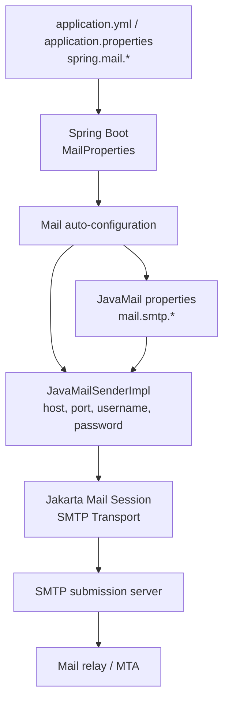

# `spring.mail.properties.*`: Truyền thuộc tính cho Jakarta Mail trong Spring Boot

Khi gửi email bằng Spring Boot, ứng dụng thường chỉ cấu hình `spring.mail.host`, `spring.mail.port`, `spring.mail.username` và `spring.mail.password`. Nhưng SMTP còn có nhiều hành vi cần điều khiển: **SMTP AUTH, STARTTLS, implicit TLS, thời gian chờ kết nối, thời gian đọc/ghi, địa chỉ envelope sender và cơ chế xác thực**. Các thiết lập này không phải tất cả đều có một thuộc tính `spring.mail.*` chuyên biệt. Thay vào đó, Spring Boot cung cấp không gian cấu hình:

```properties
spring.mail.properties.*
```

Mục đích của nó là **chuyển các thuộc tính của Jakarta Mail vào `JavaMailSenderImpl`/mail `Session`**. Ví dụ, khi cấu hình:

```properties
spring.mail.properties[mail.smtp.starttls.enable]=true
```

Spring Boot đưa khóa `mail.smtp.starttls.enable` với giá trị `true` vào tập properties của Jakarta Mail. Khi SMTP transport hoạt động, chính nó diễn giải khóa này để quyết định có yêu cầu nâng cấp kết nối bằng STARTTLS hay không.

Điểm quan trọng nhất: **Spring Boot chịu trách nhiệm bind và truyền cấu hình; Jakarta Mail SMTP provider chịu trách nhiệm hiểu các khóa `mail.smtp.*`**. Viết sai tên thuộc tính có thể không gây lỗi ngay lúc ứng dụng khởi động, nhưng hành vi SMTP sẽ không như dự kiến.

## 1. Vị trí của `spring.mail.properties.*` trong hệ thống

Một luồng gửi email tiêu biểu:



Các trách nhiệm cần phân biệt:

1. **Spring Boot externalized configuration** đọc YAML, `.properties`, biến môi trường hoặc nguồn cấu hình khác, rồi bind vào `MailProperties`.
2. **Mail auto-configuration** có thể tạo `JavaMailSenderImpl` khi ứng dụng có những dependency và điều kiện cấu hình thích hợp, đồng thời chưa có bean sender do ứng dụng tự cung cấp.
3. **`JavaMailSenderImpl`** giữ SMTP endpoint, thông tin đăng nhập và `javaMailProperties`; nó là lớp triển khai `JavaMailSender` dựa trên Jakarta Mail.
4. **Jakarta Mail `Session` và SMTP transport** nhận các properties để quyết định cách kết nối, xác thực, mã hóa và giao tiếp với server.
5. **SMTP server** mới quyết định có hỗ trợ, yêu cầu hoặc từ chối từng hành vi SMTP theo chính sách thực tế.

`spring.mail.properties.*` không phải một giao thức riêng của Spring và cũng không phải tập biến môi trường được gửi thẳng lên SMTP server. Đây là **đường truyền cấu hình nội bộ** từ Spring Boot đến thư viện mail đang chạy trong JVM.

### Ví dụ phân biệt hai tầng

| Thuộc tính | Thuộc tầng nào? | Công dụng |
| --- | --- | --- |
| `spring.mail.host` | Spring Boot | Xác định SMTP host mà sender kết nối |
| `spring.mail.port` | Spring Boot | Xác định cổng SMTP |
| `spring.mail.username` | Spring Boot | Cung cấp tài khoản cho sender |
| `spring.mail.password` | Spring Boot | Cung cấp bí mật đăng nhập cho sender |
| `spring.mail.protocol` | Spring Boot | Chọn transport protocol, thường là `smtp` |
| `spring.mail.default-encoding` | Spring Boot | Encoding mặc định dùng khi tạo thông điệp |
| `spring.mail.test-connection` | Spring Boot | Yêu cầu kiểm thử kết nối mail khi khởi tạo theo cơ chế Boot |
| **`spring.mail.properties[mail.smtp.auth]`** | Boot truyền xuống Jakarta Mail | Bật cơ chế SMTP AUTH |
| **`spring.mail.properties[mail.smtp.starttls.enable]`** | Boot truyền xuống Jakarta Mail | Cho phép STARTTLS |
| **`spring.mail.properties[mail.smtp.timeout]`** | Boot truyền xuống Jakarta Mail | Giới hạn thời gian đọc phản hồi SMTP |

Không viết `spring.mail.auth=true` với kỳ vọng Spring Boot tự hiểu đây là lệnh bật SMTP AUTH, vì thuộc tính được SMTP provider sử dụng là **`mail.smtp.auth`** và cần được đưa vào namespace `spring.mail.properties`.

## 2. Ví dụ Spring Boot: Cấu hình SMTP trên cổng 587

Để dùng cấu hình mail auto-configuration trong ứng dụng Spring Boot:

```groovy
// build.gradle
dependencies {
    implementation 'org.springframework.boot:spring-boot-starter-mail'
}
```

Ví dụ `application.yml` cho SMTP submission dùng STARTTLS:

```yaml
spring:
  mail:
    host: smtp.provider.example
    port: 587
    protocol: smtp
    username: ${SMTP_USERNAME}
    password: ${SMTP_PASSWORD}
    default-encoding: UTF-8
    properties:
      "[mail.smtp.auth]": "true"
      "[mail.smtp.starttls.enable]": "true"
      "[mail.smtp.starttls.required]": "true"
      "[mail.smtp.ssl.checkserveridentity]": "true"
      "[mail.smtp.connectiontimeout]": "5000"
      "[mail.smtp.timeout]": "10000"
      "[mail.smtp.writetimeout]": "10000"
```

Trong ví dụ này:

- `host` và `port` trỏ tới **SMTP submission server**, không phải MX của từng người nhận.
- `username` và `password` được lấy từ cấu hình bí mật của môi trường chạy.
- `mail.smtp.auth=true` yêu cầu SMTP transport sử dụng xác thực.
- `mail.smtp.starttls.enable=true` cho phép nâng cấp SMTP sang TLS.
- `mail.smtp.starttls.required=true` yêu cầu STARTTLS được hỗ trợ, tránh âm thầm tiếp tục gửi theo dạng không mã hóa khi server không cung cấp STARTTLS.
- `mail.smtp.ssl.checkserveridentity=true` yêu cầu kiểm tra tên máy chủ trong chứng chỉ TLS.
- Ba giá trị timeout có đơn vị là **mili giây (ms)**.

Các khóa trong dấu ngoặc vuông `"[mail.smtp.*]"` là cách viết rõ ràng khi cấu hình một `Map<String, String>` của Spring Boot trong YAML. Dấu ngoặc vuông bảo vệ **nguyên tên khóa có dấu chấm**; dấu ngoặc kép là cú pháp YAML để key chứa dấu `[` và `]` được phân tích chính xác.

Trong `MailProperties`, phần `properties` là map chuỗi. Vì vậy có thể dùng giá trị dạng chuỗi `"true"`, `"5000"`. Jakarta Mail diễn giải giá trị tương ứng theo ý nghĩa của từng khóa.

### Cùng một cấu hình trong `application.properties`

```properties
spring.mail.host=smtp.provider.example
spring.mail.port=587
spring.mail.protocol=smtp
spring.mail.username=${SMTP_USERNAME}
spring.mail.password=${SMTP_PASSWORD}
spring.mail.default-encoding=UTF-8

spring.mail.properties[mail.smtp.auth]=true
spring.mail.properties[mail.smtp.starttls.enable]=true
spring.mail.properties[mail.smtp.starttls.required]=true
spring.mail.properties[mail.smtp.ssl.checkserveridentity]=true
spring.mail.properties[mail.smtp.connectiontimeout]=5000
spring.mail.properties[mail.smtp.timeout]=10000
spring.mail.properties[mail.smtp.writetimeout]=10000
```

Cả hai ví dụ đều nhằm tạo cùng các khóa Jakarta Mail:

```properties
mail.smtp.auth=true
mail.smtp.starttls.enable=true
mail.smtp.starttls.required=true
mail.smtp.ssl.checkserveridentity=true
mail.smtp.connectiontimeout=5000
mail.smtp.timeout=10000
mail.smtp.writetimeout=10000
```

Đây là **dạng properties được chuyển cho Jakarta Mail**, không phải những dòng phải khai báo độc lập tại cấp root của file cấu hình Spring Boot.

## 3. Vì sao YAML có thể viết theo nhiều dạng?

Spring Boot hỗ trợ các quy tắc binding từ nguồn cấu hình vào `Map`. Với khóa dạng `mail.smtp.timeout`, người phát triển có thể bắt gặp nhiều cách trình bày, chẳng hạn:

```yaml
# Cách 1: khai báo key có dấu chấm và dấu ngoặc vuông tường minh.
spring:
  mail:
    properties:
      "[mail.smtp.timeout]": "10000"
```

hoặc:

```yaml
# Cách 2: diễn đạt bằng các cấp lồng nhau.
spring:
  mail:
    properties:
      mail:
        smtp:
          timeout: "10000"
```

Các cấu trúc dạng lồng nhau có thể được trình bind của Spring Boot flatten thành property names; tuy nhiên việc giữ nguyên các dấu chấm và các ký tự đặc biệt của **map key** cần được hiểu theo quy tắc binding của phiên bản Boot đang dùng. Với `spring.mail.properties` và các khóa Jakarta Mail có tên đầy đủ, **cách 1 diễn đạt ý định trực tiếp hơn**: key được mong đợi chính xác là `mail.smtp.timeout`.

Trong file `.properties`, dạng phổ biến khác là:

```properties
spring.mail.properties.mail.smtp.timeout=10000
```

Vì `spring.mail.properties` là map chuỗi, key bên trong thường được ghép thành `mail.smtp.timeout`. Dù vậy, cách dấu ngoặc vuông `spring.mail.properties[mail.smtp.timeout]` mô tả ranh giới map key rõ ràng và giúp tránh nhầm `mail.smtp.timeout` với một chuỗi cấp object phải được Spring Boot định nghĩa sẵn.

### Cấu hình nào là của Jakarta Mail?

Không phải mọi khóa đặt dưới `spring.mail.properties` đều được SMTP transport nhận biết. Ví dụ:

```yaml
spring:
  mail:
    properties:
      "[mail.smtp.timeout]": "10000"     # SMTP provider biết khóa này.
      "[mail.smtp.randomFlag]": "hello" # Không phải khóa chuẩn để cấu hình SMTP timeout.
```

Spring Boot có thể chuyển cả hai chuỗi vào map, nhưng SMTP provider **không nhất thiết hiểu hoặc cảnh báo** về `mail.smtp.randomFlag`. Do đó các lỗi đánh máy như `mail.smtp.starttls.enabel` có thể khiến chức năng không được bật như mong đợi, dù YAML hợp lệ và ứng dụng vẫn khởi động.

## 4. Danh mục thuộc tính SMTP thường sử dụng

Các khóa dưới đây thuộc Jakarta Mail SMTP transport; khi khai báo qua Spring Boot cần thêm tiền tố `spring.mail.properties` như ở phần trên.

| Khóa Jakarta Mail | Tác dụng | Ví dụ giá trị |
| --- | --- | --- |
| `mail.smtp.auth` | Cho SMTP transport thực hiện xác thực khi kết nối | `true` |
| `mail.smtp.starttls.enable` | Cho phép nâng cấp kết nối qua lệnh STARTTLS | `true` |
| `mail.smtp.starttls.required` | Không tiếp tục nếu không thể dùng STARTTLS | `true` |
| `mail.smtp.ssl.enable` | Dùng TLS ngay khi bắt đầu kết nối (implicit TLS) | `true` |
| `mail.smtp.ssl.checkserveridentity` | Kiểm tra danh tính hostname trong chứng chỉ TLS | `true` |
| `mail.smtp.connectiontimeout` | Timeout khi mở kết nối TCP, tính bằng ms | `5000` |
| `mail.smtp.timeout` | Timeout khi đọc từ SMTP socket, tính bằng ms | `10000` |
| `mail.smtp.writetimeout` | Timeout khi ghi vào SMTP socket, tính bằng ms | `10000` |
| `mail.smtp.from` | Chọn envelope sender (`MAIL FROM`) nếu transport hỗ trợ | `bounces@shop.example` |
| `mail.smtp.auth.mechanisms` | Giới hạn/chọn các cơ chế SMTP AUTH | `XOAUTH2` trong trường hợp provider hỗ trợ |
| `mail.smtp.sendpartial` | Tùy chính sách transport, cho phép gửi đến recipient đã chấp nhận dù recipient khác bị từ chối | `true` hoặc `false` |
| `mail.smtp.localhost` | Tên client dùng trong `EHLO`/HELO trong một số cấu hình transport | `app.shop.example` |
| `mail.smtp.quitwait` | Có đợi phản hồi từ `QUIT` trước khi đóng kết nối hay không | `true` hoặc `false` |

Những thuộc tính này chỉ có hiệu lực **khi SMTP transport cụ thể nhận biết chúng**. Nhiều ứng dụng chỉ cần một tập nhỏ: AUTH, STARTTLS/TLS và timeout. Các tính năng như `sendpartial` hay lựa chọn cơ chế AUTH cần có nhu cầu rõ ràng vì chúng làm thay đổi hành vi khi lỗi.

### `connectiontimeout`, `timeout`, `writetimeout` khác nhau

```text
Ứng dụng ── kết nối TCP ──> SMTP server
          ^ connectiontimeout

Ứng dụng <── phản hồi SMTP ── SMTP server
          ^ timeout (đọc dữ liệu)

Ứng dụng ── ghi DATA ──> SMTP server
          ^ writetimeout (ghi dữ liệu)
```

- **`mail.smtp.connectiontimeout`** giới hạn thời gian đợi kết nối mạng được thiết lập.
- **`mail.smtp.timeout`** giới hạn thời gian chờ dữ liệu từ socket, ví dụ phản hồi của server.
- **`mail.smtp.writetimeout`** giới hạn thời gian một thao tác ghi SMTP bị kẹt.

Chúng là timeout **ở tầng transport**, không phải cam kết rằng toàn bộ lời gọi `mailSender.send()` kết thúc trong một tổng thời gian cố định. Thời gian có thể bao gồm DNS, nhiều kết nối, lệnh SMTP và cơ chế khác; nhiều timeout khác nhau có thể xảy ra ở các bước khác nhau.

Nhiều phiên bản SMTP provider có mặc định không đặt timeout chặt chẽ. Vì vậy, khai báo giá trị hữu hạn là biện pháp vận hành hữu ích nếu ứng dụng cần tránh request/worker treo quá lâu. Chọn timeout dựa trên mạng, kích thước thư và khả năng của SMTP provider; đặt quá thấp có thể gây timeout giả, nhất là khi đính kèm file lớn.

### `mail.smtp.from` khác với header `From:`

Ví dụ:

```yaml
spring:
  mail:
    properties:
      "[mail.smtp.from]": "bounces@shop.example"
```

Ứng dụng vẫn có thể đặt header:

```java
helper.setFrom("orders@shop.example");
```

Khi transport sử dụng `mail.smtp.from`, lệnh `MAIL FROM` có thể dùng `bounces@shop.example`, trong khi người dùng nhìn thấy `From: orders@shop.example`. Điều này phục vụ việc **thu thập DSN/bounce**. Không tự viết header `Return-Path:` để thay thế cấu hình envelope; nhà cung cấp SMTP cũng có thể ghi lại envelope sender theo chính sách của họ.

## 5. STARTTLS trên 587 và implicit TLS trên 465

Một lỗi phổ biến là dùng `mail.smtp.starttls.enable` và `mail.smtp.ssl.enable` như thể chúng có cùng tác dụng. Cả hai đều liên quan đến TLS nhưng **thời điểm bắt đầu TLS khác nhau**.

### Cổng 587: SMTP submission với STARTTLS

```yaml
spring:
  mail:
    host: smtp.provider.example
    port: 587
    properties:
      "[mail.smtp.auth]": "true"
      "[mail.smtp.starttls.enable]": "true"
      "[mail.smtp.starttls.required]": "true"
      "[mail.smtp.ssl.checkserveridentity]": "true"
```

Ở cổng 587, client thường kết nối SMTP trước, dùng `EHLO` để biết server có hỗ trợ `STARTTLS`, gửi `STARTTLS`, thực hiện TLS handshake, rồi gửi `EHLO` lại. Đặt `required=true` phù hợp khi chính sách yêu cầu **không được gửi credential và email nếu STARTTLS không khả dụng**.

### Cổng 465: SMTP submission qua implicit TLS

```yaml
spring:
  mail:
    host: smtp.provider.example
    port: 465
    properties:
      "[mail.smtp.auth]": "true"
      "[mail.smtp.ssl.enable]": "true"
      "[mail.smtp.ssl.checkserveridentity]": "true"
```

Ở cổng 465, client thực hiện TLS handshake **ngay từ đầu**. Không nên chỉ đổi port từ 587 sang 465 rồi giữ cơ chế STARTTLS mà không cấu hình implicit TLS tương ứng.

| Tiêu chí | Submission 587 | Submission 465 |
| --- | --- | --- |
| Cơ chế TLS phổ biến | STARTTLS | Implicit TLS |
| Thuộc tính trọng tâm | `mail.smtp.starttls.enable`, `required` | `mail.smtp.ssl.enable` |
| SMTP AUTH | Thường cần, tùy provider | Thường cần, tùy provider |
| Xác thực chứng chỉ | Cần kiểm tra đúng server/certificate | Cần kiểm tra đúng server/certificate |

Hãy ưu tiên tài liệu SMTP chính thức của nhà cung cấp cho host, cổng, kiểu bảo vệ, cơ chế AUTH và chính sách sender. `mail.smtp.ssl.trust=*` hoặc tắt xác thực hostname để che lỗi TLS là biện pháp nguy hiểm vì có thể khiến ứng dụng tin máy chủ giả mạo.

## 6. SMTP AUTH và sự khác biệt giữa credential với cấu hình transport

Thông thường Spring Boot dùng:

```yaml
spring:
  mail:
    username: ${SMTP_USERNAME}
    password: ${SMTP_PASSWORD}
    properties:
      "[mail.smtp.auth]": "true"
```

`spring.mail.username` và `spring.mail.password` chỉ **cung cấp dữ liệu đăng nhập**. Khóa `mail.smtp.auth=true` mới yêu cầu SMTP transport thực hiện bước xác thực. Nếu thiếu AUTH mà server yêu cầu, phía gửi có thể nhận lỗi như `530 Authentication required` khi thử submit thư.

Những thông tin sau không đồng nhất:

| Khái niệm | Ví dụ | Ý nghĩa |
| --- | --- | --- |
| SMTP username | `service-mail-42` | Tài khoản dùng trong AUTH |
| SMTP password/token | secret ở runtime | Credential dùng trong AUTH |
| Header `From:` | `billing@shop.example` | Địa chỉ người gửi hiển thị |
| SMTP envelope `MAIL FROM` | `bounces@shop.example` | Địa chỉ reverse-path của giao dịch |
| `Reply-To:` | `support@shop.example` | Địa chỉ người dùng được gợi ý trả lời |

SMTP AUTH thành công chỉ cho biết tài khoản **được server xác thực**. Nó không có nghĩa nhà cung cấp cho phép dùng mọi địa chỉ `From:`, hay người nhận sẽ chấp nhận thư. Nếu server trả `553 Sender not authorized` sau AUTH, cần kiểm tra quyền gửi và verified domain, không vội kết luận password sai.

### Khi nhà cung cấp dùng OAuth2/XOAUTH2

Trong một số hạ tầng, password truyền thống không được phép dùng cho SMTP AUTH. Khi provider và Jakarta Mail SMTP transport hỗ trợ SASL XOAUTH2, có thể cần:

```yaml
spring:
  mail:
    username: ${SMTP_USERNAME}
    password: ${SMTP_ACCESS_TOKEN}
    properties:
      "[mail.smtp.auth]": "true"
      "[mail.smtp.auth.mechanisms]": "XOAUTH2"
```

Đây là **minh họa phần cấu hình SMTP transport**, không phải toàn bộ giải pháp OAuth2. Access token phải được cấp đúng danh tính, phạm vi và audience, được làm mới trước khi hết hạn và bảo vệ như secret. Với sender singleton được sử dụng lâu dài, không thể giả định token tĩnh trong `spring.mail.password` luôn còn hiệu lực. Đừng ép XOAUTH2 nếu SMTP provider không hỗ trợ.

## 7. Đọc lại cấu hình được chuyển xuống Jakarta Mail

Khi ứng dụng Spring Boot đã khởi tạo `JavaMailSenderImpl`, có thể kiểm tra các thuộc tính được sender lưu để hỗ trợ chẩn đoán. Ví dụ minh họa:

```java
import java.util.Properties;

import org.springframework.mail.javamail.JavaMailSenderImpl;

public final class SmtpConfigurationInspector {

    private SmtpConfigurationInspector() {
    }

    public static void printSafeTransportSummary(JavaMailSenderImpl sender) {
        Properties props = sender.getJavaMailProperties();

        System.out.println("host=" + sender.getHost());
        System.out.println("port=" + sender.getPort());
        System.out.println("protocol=" + sender.getProtocol());
        System.out.println("smtp.auth=" + props.getProperty("mail.smtp.auth"));
        System.out.println(
                "smtp.starttls.enable=" +
                props.getProperty("mail.smtp.starttls.enable"));
        System.out.println(
                "smtp.timeout=" + props.getProperty("mail.smtp.timeout"));

        // Cố ý không in sender.getPassword() hoặc toàn bộ Properties.
    }
}
```

Hàm trên chỉ là **ví dụ quan sát thủ công trong môi trường phát triển**; không nên in log cấu hình lặp lại trong production. Nếu cần kiểm tra, hãy chỉ chọn các khóa không chứa credential hoặc token. Đừng log toàn bộ map `spring.mail.properties` vì ứng dụng có thể đưa thông tin nhạy cảm vào những thuộc tính khác.

Nếu muốn quan sát bean do Spring Boot tạo, có thể inject `JavaMailSender` và kiểm tra kiểu triển khai:

```java
import org.springframework.mail.javamail.JavaMailSender;
import org.springframework.mail.javamail.JavaMailSenderImpl;

public class MailInfo {
    public static boolean usesJakartaSender(JavaMailSender sender) {
        return sender instanceof JavaMailSenderImpl;
    }
}
```

Trong ứng dụng có sender tùy biến, nhiều bean hoặc JNDI mail session, không nên khẳng định Boot đã tạo một `JavaMailSenderImpl` từ YAML nếu chưa kiểm tra cấu hình thực tế. Các điều kiện auto-configuration có thể không còn đúng khi đã có bean mail sender được khai báo thủ công.

### So sánh với cấu hình `JavaMailSenderImpl` thuần

Nếu không dùng Spring Boot auto-configuration, người phát triển có thể cấu hình Jakarta Mail properties trực tiếp:

```java
import java.util.Properties;

import org.springframework.mail.javamail.JavaMailSenderImpl;

JavaMailSenderImpl sender = new JavaMailSenderImpl();
sender.setHost("smtp.provider.example");
sender.setPort(587);
sender.setUsername(smtpUsername); // Lấy từ secret/config runtime
sender.setPassword(smtpPassword);

Properties props = new Properties();
props.put("mail.smtp.auth", "true");
props.put("mail.smtp.starttls.enable", "true");
props.put("mail.smtp.starttls.required", "true");
props.put("mail.smtp.ssl.checkserveridentity", "true");
props.put("mail.smtp.connectiontimeout", "5000");
props.put("mail.smtp.timeout", "10000");
props.put("mail.smtp.writetimeout", "10000");
sender.setJavaMailProperties(props);
```

Ở đây `smtpUsername` và `smtpPassword` là các biến đã được ứng dụng lấy từ nguồn cấu hình bảo mật; ví dụ là đoạn khởi tạo trong ngữ cảnh có sẵn biến, không phải một class Java độc lập. Nó cho thấy `spring.mail.properties.*` thực chất giúp **không phải viết thủ công các dòng `props.put(...)`** khi dùng Spring Boot.

## 8. Gửi email từ service: các properties ảnh hưởng thế nào?

Một service nghiệp vụ có thể không cần biết trực tiếp về `mail.smtp.starttls.enable` hay `mail.smtp.timeout`. Nó chỉ dùng `JavaMailSender`:

```java
package com.example.mail;

import org.springframework.beans.factory.annotation.Value;
import org.springframework.mail.SimpleMailMessage;
import org.springframework.mail.javamail.JavaMailSender;
import org.springframework.stereotype.Service;

@Service
public class OrderMailService {

    private final JavaMailSender mailSender;
    private final String fromAddress;

    public OrderMailService(
            JavaMailSender mailSender,
            @Value("${app.mail.from}") String fromAddress) {
        this.mailSender = mailSender;
        this.fromAddress = fromAddress;
    }

    public void sendReadyNotification(String recipient, String orderId) {
        SimpleMailMessage message = new SimpleMailMessage();
        message.setFrom(fromAddress);
        message.setTo(recipient);
        message.setSubject("Order " + orderId + " is ready");
        message.setText("Your order " + orderId + " is ready for pickup.");
        mailSender.send(message);
    }
}
```

Và cấu hình ứng dụng:

```yaml
app:
  mail:
    from: notifications@shop.example
```

Lúc gọi `mailSender.send(...)`:

1. Sender dùng `host`, `port`, `username`, `password` đã được Spring cấu hình.
2. SMTP transport đọc các properties `mail.smtp.*` từ mail `Session` để quyết định cách kết nối, TLS, AUTH và timeout.
3. Thông điệp được submit theo SMTP; server có thể chấp nhận hoặc từ chối các lệnh.
4. Sau khi relay chấp nhận, việc chuyển tiếp đến máy chủ nhận có thể tiếp tục bất đồng bộ qua các MTA.

Các thiết lập trong `spring.mail.properties.*` ảnh hưởng đến **kết nối và giao dịch gửi**, không thay đổi mặc định nội dung body thành HTML, không biến `SimpleMailMessage` thành MIME attachment và không bảo đảm delivery đến inbox. Với HTML/attachment, sử dụng `MimeMessage`/`MimeMessageHelper`, nhưng vẫn dùng cùng transport properties.

## 9. `spring.mail.test-connection`: xác minh được gì?

Spring Boot có thuộc tính:

```yaml
spring:
  mail:
    test-connection: true
```

Khi mail connection validation được cấu hình và các điều kiện auto-configuration phù hợp, Boot cố gắng kiểm tra kết nối mail khi ứng dụng khởi động. Điều này có thể giúp phát hiện sớm host/port, kết nối, TLS hoặc xác thực không hoạt động.

Tuy nhiên:

- Kiểm tra kết nối **không gửi một email thực sự đến mailbox** của người nhận.
- Kiểm tra thành công không bảo đảm header `From:`, quyền gửi tới một miền hoặc chính sách nội dung sẽ được chấp nhận ở giao dịch `MAIL FROM`, `RCPT TO` và `DATA`.
- Một sự cố mạng/SMTP provider tạm thời lúc startup có thể khiến ứng dụng không khởi động được theo cách mong muốn khi bật kiểm tra.
- Khi ứng dụng dùng mail sender/Session tùy biến, kết quả phụ thuộc cách bean và auto-configuration đang được thiết lập.

Trong môi trường phát triển hoặc hệ thống yêu cầu xác nhận mail relay trước khi phục vụ nghiệp vụ, tính năng này có thể hữu ích. Với một hệ thống mà email chỉ là tính năng phụ, cần cân nhắc hậu quả của việc biến tình trạng SMTP lúc khởi động thành điều kiện khởi động toàn bộ ứng dụng.

## 10. Lỗi thường gặp khi truyền thuộc tính Jakarta Mail

### 10.1. Đặt thuộc tính ở sai cấp

```yaml
# Sai ý định: đây không phải cấu hình JavaMail Session qua Boot.
spring:
  mail:
    smtp:
      auth: true
```

Muốn truyền khóa `mail.smtp.auth` cho Jakarta Mail:

```yaml
spring:
  mail:
    properties:
      "[mail.smtp.auth]": "true"
```

Nếu thiếu `properties`, khả năng cao SMTP transport không có `mail.smtp.auth=true` như kỳ vọng. Khi server yêu cầu AUTH, ứng dụng có thể gặp lỗi xác thực hoặc bị từ chối relay.

### 10.2. Dùng thiếu tiền tố `mail.smtp.`

```yaml
# Không đúng tên khóa được SMTP transport chờ.
spring:
  mail:
    properties:
      "[smtp.starttls.enable]": "true"
```

Cần `mail.smtp.starttls.enable`:

```yaml
spring:
  mail:
    properties:
      "[mail.smtp.starttls.enable]": "true"
```

Spring Boot không tự thêm `mail.` vào các khóa tùy ý bên trong map.

### 10.3. Đổi port nhưng giữ nguyên kiểu TLS

Ví dụ chuyển từ 587 sang 465 mà vẫn chỉ bật STARTTLS:

```yaml
spring:
  mail:
    port: 465
    properties:
      "[mail.smtp.starttls.enable]": "true"
```

Nếu server 465 yêu cầu implicit TLS, hãy dùng `mail.smtp.ssl.enable=true` theo tài liệu provider. Lỗi handshake/timeout khi nhầm mode TLS không đồng nghĩa username/password sai.

### 10.4. `starttls.enable=true` nhưng không yêu cầu TLS

Nếu `mail.smtp.starttls.required` không bật, transport có thể tiếp tục kết nối không TLS khi server không quảng bá STARTTLS, tùy thư viện và tình trạng phiên. Với submission mang credential, việc **bắt buộc TLS** và kiểm tra danh tính server là yêu cầu cần cân nhắc theo chính sách bảo mật.

### 10.5. Không khai báo timeout

Để mặc định có thể khiến lệnh gửi chờ rất lâu khi server hoặc mạng gặp sự cố. Nên khai báo giới hạn kết nối, đọc và ghi phù hợp. Lưu ý timeout trong JavaMail là **ms**, không phải giây.

### 10.6. Nhầm `mail.smtp.from` với `spring.mail.username`

`mail.smtp.from` chọn reverse-path cho giao dịch SMTP; `spring.mail.username` là danh tính đăng nhập SMTP AUTH. Hai giá trị có thể khác nhau. `mail.smtp.from` không đổi tự động header `From:` do ứng dụng đặt qua `helper.setFrom(...)`.

### 10.7. Khai báo `mail.smtps.*` nhưng vẫn dùng giao thức `smtp`

Jakarta Mail có các tập thuộc tính gắn với transport protocol. Ví dụ nhiều thuộc tính `mail.smtp.*` áp dụng cho protocol `smtp`; khi dùng protocol `smtps`, các thuộc tính tương ứng có thể nằm dưới `mail.smtps.*`. Với ứng dụng Spring Boot thông thường, giữ `spring.mail.protocol=smtp` và dùng `mail.smtp.ssl.enable=true` trên port 465 là cách cấu hình implicit TLS phổ biến.

Đừng tự chuyển `spring.mail.protocol` sang `smtps` rồi giả định toàn bộ các khóa `mail.smtp.*` còn áp dụng giống hệt. Cần cấu hình nhất quán theo SMTP provider và transport đang sử dụng.

### 10.8. Tạo bean `JavaMailSender` thủ công rồi tưởng Boot vẫn áp mọi properties

Khi ứng dụng tự khai báo `JavaMailSender`, mail auto-configuration của Spring Boot có thể không tạo sender mặc định. Các property `spring.mail.*` vì vậy không nhất thiết được áp vào bean tự viết.

Nếu tự quản lý `JavaMailSenderImpl`, hãy cấu hình đầy đủ host, port, username, password và JavaMail Properties cho bean đó; hoặc dùng Boot auto-configuration khi nó phù hợp. Khi debug, kiểm tra sender thực tế được inject, không chỉ kiểm tra YAML.

### 10.9. Đặt giá trị bí mật trong `spring.mail.properties` rồi dump toàn bộ map

Một số provider có property bổ sung chứa thông tin truy cập. Dù được bind hợp lệ, việc in cả `getJavaMailProperties()` hoặc bật debug sâu có thể lộ credential/token. Chỉ log các thông số kỹ thuật cần thiết, che bí mật và giới hạn quyền xem log.

## 11. Chẩn đoán theo giai đoạn SMTP

Lỗi khi gửi mail có thể phát sinh ở nhiều lớp. Bảng sau giúp liên hệ hiện tượng với cấu hình nên kiểm tra:

| Hiện tượng | Thuộc tính/điểm cần xem | Lý do |
| --- | --- | --- |
| `Connection refused` | `spring.mail.host`, `port`, network/firewall | Chưa thiết lập được TCP, chưa tới AUTH |
| Kết nối treo lâu | `mail.smtp.connectiontimeout`, `timeout`, `writetimeout` | Có thể thiếu giới hạn ở bước kết nối/đọc/ghi |
| TLS handshake/PKIX failure | Mode STARTTLS/implicit TLS, chứng chỉ và hostname | Sai cổng/TLS hoặc chain chứng chỉ không hợp lệ |
| Server không hỗ trợ STARTTLS | `mail.smtp.starttls.enable`, `required` | Nếu bắt buộc TLS, phải dừng gửi thay vì hạ cấp |
| `530 Authentication required` | `mail.smtp.auth`, username/password | Có thể chưa AUTH trước lệnh gửi |
| `535 5.7.x` | Credential, AUTH mechanism, chính sách account | AUTH bị server từ chối |
| AUTH pass nhưng `553 Sender unauthorized` | `From:`, envelope sender, quyền domain | Tài khoản được xác thực nhưng không có quyền gửi từ địa chỉ đó |
| `550` ở `RCPT TO` | Recipient, quyền relay, chính sách đích | Không phải lỗi cú pháp YAML hay timeout mặc định |
| `552` khi gửi nội dung | Kích thước thư và chính sách server | MIME/attachment có thể quá lớn |
| `send()` thành công nhưng có bounce sau đó | Relay/DSN/provider event | Lỗi xuất hiện ở hop sau khi ứng dụng đã submit |

Những ngoại lệ Spring thường gặp:

- `MailAuthenticationException`: lỗi được ghi nhận ở bước xác thực mail.
- `MailSendException`: lỗi khi thực hiện gửi, có thể bao gồm SMTP reply, network, TLS, timeout hoặc nhiều nguyên nhân khác.
- `MailParseException`: vấn đề tạo/phân tích nội dung hoặc địa chỉ email.

Không suy ra cứ gặp `MailSendException` là password sai, cũng không suy ra mọi `5xx` là máy chủ SMTP sập. Khi cần phân loại chính xác, xem cause chain, mã SMTP (nếu có), lệnh bị từ chối và log từ provider.

### Bật debug có kiểm soát

Jakarta Mail có khả năng xuất debug thông qua `mail.debug`, ví dụ:

```yaml
# Chỉ cân nhắc trong môi trường chẩn đoán được kiểm soát.
spring:
  mail:
    properties:
      "[mail.debug]": "true"
```

Debug có thể giúp nhìn thấy giao tiếp SMTP, nhưng cũng có thể đưa hostname, username, địa chỉ recipient hoặc nội dung liên quan đến phiên gửi vào log. Một số chế độ trace chi tiết còn có nguy cơ lộ thông tin AUTH. Chỉ bật trong phạm vi có kiểm soát, không chia sẻ raw logs khi chưa loại bỏ thông tin nhạy cảm, và **không log password hoặc access token**.

Đối với lỗi TLS, không khắc phục bằng cách tắt xác minh chứng chỉ hoặc đặt trust all. Cần xác định server thực tế, certificate chain và cách thiết lập TLS theo cổng.

## 12. Cấu hình theo môi trường và quản lý secret

Môi trường phát triển, kiểm thử và production có thể dùng SMTP endpoint khác nhau. `spring.mail.properties.*` cho phép mỗi môi trường chọn đúng hành vi transport mà không phải sửa logic gửi thư.

Ví dụ tách cấu hình:

```yaml
# application.yml: cấu hình chung.
spring:
  mail:
    default-encoding: UTF-8
    properties:
      "[mail.smtp.connectiontimeout]": "5000"
      "[mail.smtp.timeout]": "10000"
      "[mail.smtp.writetimeout]": "10000"
```

```yaml
# application-prod.yml: submission bảo mật.
spring:
  mail:
    host: smtp.provider.example
    port: 587
    username: ${SMTP_USERNAME}
    password: ${SMTP_PASSWORD}
    properties:
      "[mail.smtp.auth]": "true"
      "[mail.smtp.starttls.enable]": "true"
      "[mail.smtp.starttls.required]": "true"
      "[mail.smtp.ssl.checkserveridentity]": "true"
```

Lưu ý cấu hình ở profile có thể **ghi đè** các giá trị ở profile chung; khi dùng nhiều nguồn thuộc tính, hãy kiểm tra thứ tự ưu tiên và giá trị hiệu lực. Các khóa map cụ thể sẽ được bind theo thứ tự nguồn cấu hình. Đừng coi bất kỳ file profile nào là bằng chứng duy nhất nếu có biến môi trường, command-line args hoặc secret store ghi đè.

Trong local development có thể dùng SMTP capture/test server (ví dụ endpoint riêng ở `localhost:1025`) nếu hệ thống cung cấp; môi trường đó có thể không cần AUTH hoặc TLS. Cấu hình như vậy chỉ phù hợp server kiểm thử do nhóm quản lý, **không áp dụng cho SMTP public**.

### Nguyên tắc bảo vệ thông tin nhạy cảm

1. Không commit SMTP password, app password hay OAuth token vào `application.yml`, tài liệu hoặc screenshot.
2. Lưu secret trong môi trường/secret manager được quản lý theo quyền truy cập.
3. Tách credential test và production; dùng tài khoản dịch vụ có quyền cần thiết.
4. Khi xoay vòng secret, xác nhận các instance đang dùng phiên bản mới trước khi thu hồi credential cũ.
5. Không đưa `spring.mail.password` hoặc tất cả `spring.mail.properties` vào thông báo exception trả ra ngoài.
6. Quan sát quota, lỗi AUTH và giới hạn gửi để phát hiện cấu hình sai hoặc dấu hiệu lạm dụng.

## 13. Ba tình huống minh họa

### Tình huống A: Có username/password nhưng server vẫn nói "Authentication required"

Ứng dụng cấu hình:

```yaml
spring:
  mail:
    host: smtp.provider.example
    port: 587
    username: ${SMTP_USERNAME}
    password: ${SMTP_PASSWORD}
```

Nếu SMTP transport không được bật AUTH phù hợp và server yêu cầu xác thực, nó có thể từ chối gửi thư với `530 Authentication required`. Cần thêm `spring.mail.properties[mail.smtp.auth]=true`, kết hợp STARTTLS/TLS theo yêu cầu provider. Không chỉ thay `From:` hoặc tăng timeout.

### Tình huống B: Gửi được trên 587 nhưng lỗi ngay khi chuyển sang 465

Sau khi đổi `spring.mail.port: 465`, ứng dụng giữ nguyên `mail.smtp.starttls.enable=true` và không bật implicit TLS. Server 465 có thể đợi TLS handshake ngay khi TCP kết nối, trong khi client lại đợi SMTP banner. Kết quả là timeout hoặc lỗi protocol.

Giải pháp là dùng cấu hình 465 với `mail.smtp.ssl.enable=true` và kiểm tra chứng chỉ, hoặc quay lại cổng 587 với STARTTLS theo cấu hình nhà cung cấp.

### Tình huống C: Ứng dụng khởi động bình thường nhưng khi gửi bị treo

Thiếu timeout có thể làm một lời gọi gửi chờ rất lâu khi network/server không phản hồi. Đặt giới hạn cho connect/read/write ở `spring.mail.properties` giúp ứng dụng có tín hiệu lỗi thay vì chờ không giới hạn theo hành vi transport.

Sau khi có timeout, hệ thống cần quyết định retry thận trọng: nếu timeout xảy ra **sau khi server đã nhận xong `DATA`** nhưng trước khi client thấy phản hồi, trạng thái phát thư có thể chưa rõ. Gửi lại cùng notification ngay có nguy cơ tạo thư trùng; nên dùng queue/correlation ID và provider events khi có.

## 14. Câu hỏi tự kiểm tra

**1. `spring.mail.properties.*` có phải một bộ thuộc tính SMTP riêng do Spring Framework định nghĩa không?**

Không. Đây là kênh cấu hình Spring Boot truyền các khóa thích hợp xuống Jakarta Mail `Session`/SMTP transport. Tên property `mail.smtp.*` và ý nghĩa của nó do Jakarta Mail SMTP provider xác định.

**2. Vì sao `spring.mail.properties[mail.smtp.timeout]` có dấu ngoặc vuông?**

Để nói rõ rằng `mail.smtp.timeout` là **một key hoàn chỉnh trong map** `spring.mail.properties`, với các dấu chấm được giữ nguyên trong key.

**3. `spring.mail.password` có tự thay cho `mail.smtp.auth=true` không?**

Không nên giả định như vậy. Username/password cung cấp credential; `mail.smtp.auth=true` điều khiển việc SMTP transport dùng xác thực.

**4. Vì sao phải dùng `mail.smtp.starttls.required=true` nếu muốn bắt buộc TLS trên cổng 587?**

Vì `starttls.enable` cho phép nâng cấp khi có hỗ trợ; `required` bổ sung yêu cầu không tiếp tục khi STARTTLS không khả dụng theo cơ chế transport.

**5. Muốn dùng cổng 465, có phải chỉ cần sửa `spring.mail.port` không?**

Không. Nếu endpoint 465 dùng implicit TLS, phải cấu hình `mail.smtp.ssl.enable=true` và xác minh server theo TLS.

**6. Tại sao viết nhầm `mail.smtp.starttls.enabel` có thể khó phát hiện?**

Vì Boot có thể đưa chuỗi bất kỳ vào map; SMTP provider không nhất thiết báo lỗi cho một khóa lạ. Hãy dùng đúng tên khóa và xác nhận hành vi gửi thực tế.

**7. `mail.smtp.from` có tự thay đổi `From:` người nhận nhìn thấy không?**

Không. Nó tác động đến envelope sender của SMTP transport khi được hỗ trợ; header `From:` là nội dung riêng của email.

**8. `spring.mail.test-connection=true` có bảo đảm email vào inbox không?**

Không. Đây là kiểm thử kết nối sender, không phải xác nhận việc phát thư cuối cùng hoặc chống spam của miền đích.

**9. Có nên bật `mail.debug=true` thường trực trên production không?**

Không nên. Chỉ bật khi có nhu cầu chẩn đoán và có kiểm soát log, vì metadata và dữ liệu nhạy cảm có thể bị ghi lại.

## Kết luận

`spring.mail.properties.*` là **cầu nối cấu hình giữa Spring Boot và Jakarta Mail**: Spring Boot đọc các cặp khóa/giá trị và chuyển chúng đến `JavaMailSenderImpl`/`Session`, còn SMTP transport diễn giải các khóa như `mail.smtp.auth`, `mail.smtp.starttls.enable`, `mail.smtp.ssl.enable` và `mail.smtp.timeout`. Hãy đặt đúng tên khóa, chọn đúng chế độ TLS cho cổng 587 hoặc 465, cấu hình timeout hữu hạn, bảo vệ username/password/token và kiểm tra sender thực tế khi có bean tùy biến. Cấu hình chính xác giúp ứng dụng kết nối và submit thư an toàn hơn; việc email được chuyển đến inbox còn phụ thuộc relay, MTA đích và chính sách nhận thư.
