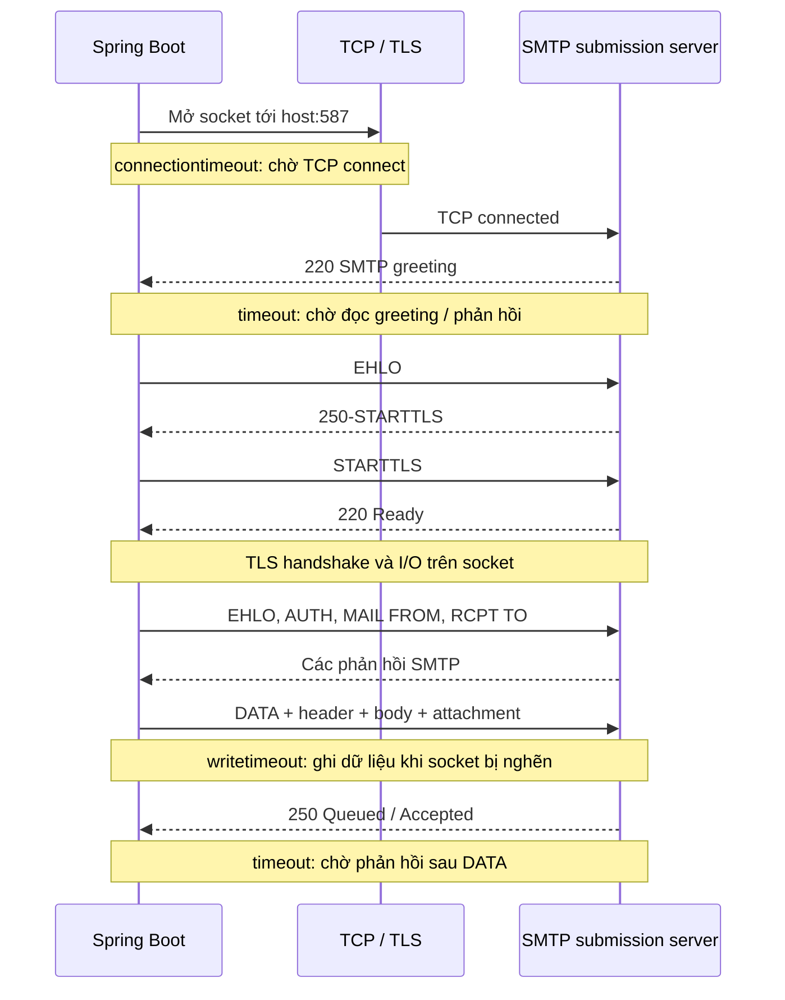
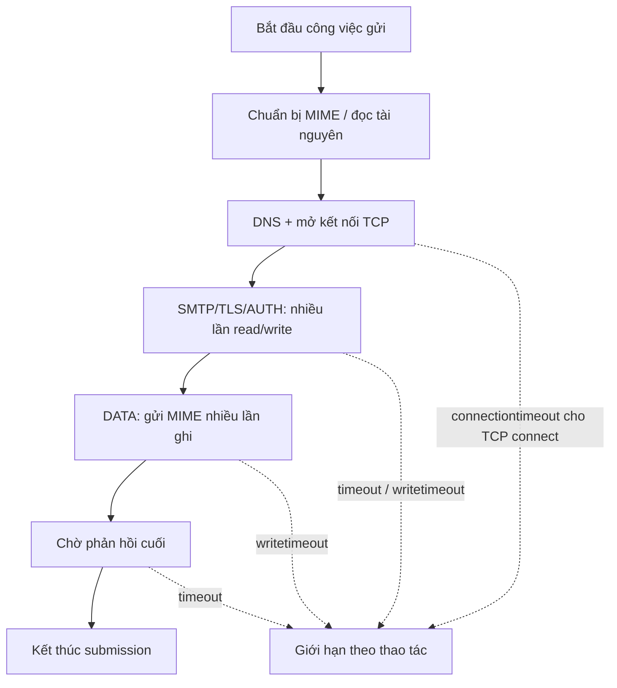
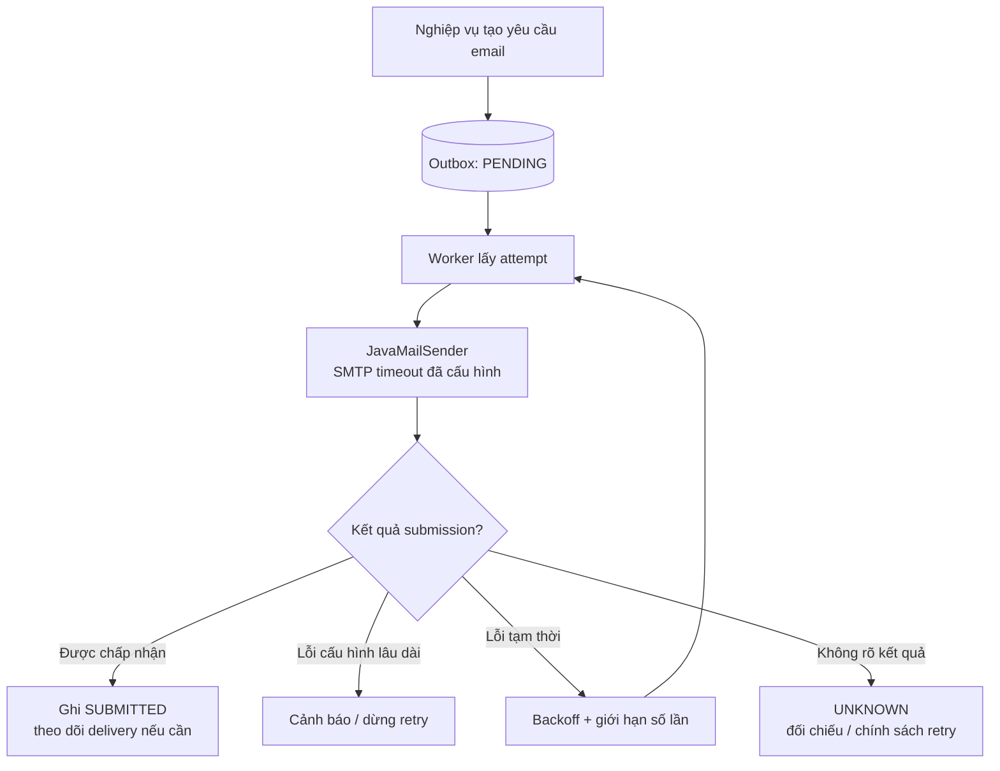

# Cấu hình timeout qua thuộc tính mail.smtp.*

Một dịch vụ Spring Boot gửi email xác nhận đơn hàng bằng `JavaMailSender.send(...)`. Khi máy chủ SMTP chậm phản hồi hoặc kết nối mạng bị gián đoạn, lời gọi có thể bị treo rất lâu. Nếu thao tác gửi đang chạy trực tiếp trong HTTP request, người dùng sẽ chờ; nếu nó chạy trong worker, một tác vụ gửi bị kẹt có thể giữ thread và khiến hàng đợi thông báo ngày càng dài.

Để giới hạn thời gian chờ ở tầng giao tiếp mạng, **Jakarta Mail SMTP transport** cung cấp ba thuộc tính quan trọng:

- **`mail.smtp.connectiontimeout`**: giới hạn thời gian chờ thiết lập kết nối TCP.
- **`mail.smtp.timeout`**: giới hạn thời gian chờ đọc dữ liệu từ kết nối SMTP.
- **`mail.smtp.writetimeout`**: giới hạn thời gian một thao tác ghi vào kết nối có thể bị chặn.

Trong **Spring Framework Mail**, các thuộc tính này được chuyển vào Jakarta Mail thông qua cấu hình `spring.mail.properties` hoặc `JavaMailSenderImpl.getJavaMailProperties()`. Chúng giải quyết những vấn đề **khác nhau**: có thể kết nối được nhưng không nhận được phản hồi, hoặc có thể đọc phản hồi tốt nhưng bị kẹt khi truyền một email có tệp đính kèm lớn.

Bài học giải thích ý nghĩa chính xác của từng timeout, cách cấu hình trong Spring Boot, khác biệt giữa `smtp` và `smtps`, cách lựa chọn giá trị theo môi trường, cách nhận diện lỗi và những giới hạn cần lưu ý khi gửi email trong hệ thống production.

## 1. Timeout nằm ở đâu trong luồng gửi email?

Giả sử ứng dụng dùng SMTP submission trên cổng 587 với STARTTLS:



Trong một lần gửi, ứng dụng có thể trải qua **nhiều lần đọc và ghi**, không phải chỉ một thao tác mạng duy nhất. Vì vậy một timeout 10 giây **không có nghĩa toàn bộ email chắc chắn gửi xong trong 10 giây**.

### Phân biệt ba câu hỏi

| Câu hỏi thực tế | Thuộc tính liên quan | Ví dụ |
|---|---|---|
| “Mở được kết nối TCP tới SMTP server không?” | `mail.smtp.connectiontimeout` | Firewall âm thầm bỏ gói TCP; kết nối không hoàn tất. |
| “Đã kết nối rồi, server có gửi phản hồi tiếp không?” | `mail.smtp.timeout` | Server chấp nhận kết nối nhưng không trả lời `EHLO` hoặc `DATA`. |
| “Ứng dụng đang gửi dữ liệu, socket có tiếp tục ghi được không?” | `mail.smtp.writetimeout` | Đường mạng nghẽn, server ngừng đọc dữ liệu, buffer gửi đầy. |

**Đơn vị của cả ba thuộc tính là mili-giây (ms).** Giá trị `5000` nghĩa là **5 giây**, không phải 5 phút. Trong triển khai SMTP transport thông dụng của Jakarta Mail, các timeout không được cấu hình có mặc định là **chờ vô hạn**; đó là lý do nên đặt giá trị tường minh khi ứng dụng yêu cầu giới hạn thời gian chờ.

## 2. `mail.smtp.connectiontimeout`: chờ thiết lập kết nối

### 2.1. Thời điểm được áp dụng

`mail.smtp.connectiontimeout` kiểm soát thời gian chờ khi transport cố gắng **mở kết nối TCP** đến SMTP host và port.

Ví dụ:

```properties
mail.smtp.connectiontimeout=5000
```

Nếu kết nối không hoàn tất trong khoảng thời gian cho phép, tầng socket có thể phát sinh một ngoại lệ như `SocketTimeoutException: Connect timed out`, sau đó được bọc trong ngoại lệ của Jakarta Mail và Spring Mail.

Những tình huống thường liên quan:

- Kết nối đi qua firewall hoặc network ACL đang loại bỏ gói tin.
- Địa chỉ IP đích không phản hồi.
- Tuyến mạng hoặc endpoint SMTP đang gặp sự cố.
- Nhà cung cấp mail không thể tiếp nhận kết nối mới kịp thời.

### 2.2. Điều nó không giới hạn

Connection timeout **không** phải:

- Giới hạn tổng thời gian gửi email.
- Thời gian chờ SMTP banner `220` **sau khi TCP đã kết nối**.
- Thời gian tải body hoặc tệp đính kèm lên server.
- Thời gian nhà cung cấp chuyển thư từ SMTP submission tới hộp thư người nhận.

Việc **phân giải DNS** cũng có thể xảy ra trước khi socket kết nối. Tùy JVM, hệ điều hành, resolver và mạng, thời gian phân giải tên miền không nhất thiết chịu đúng giới hạn `connectiontimeout`. Nếu ứng dụng cần một **deadline đầu-cuối**, phải quản lý thời gian ở lớp workflow ngoài các timeout của transport.

### 2.3. Connection refused không giống connect timeout

Giả sử ứng dụng kết nối tới `smtp.example.com:587`:

- **Connection refused**: thiết bị đích hoặc mạng từ chối kết nối tương đối nhanh. Điều này có thể do không có tiến trình lắng nghe trên port, firewall chủ động từ chối hoặc endpoint sai.
- **Connection timed out**: yêu cầu kết nối không được hoàn tất trong thời gian chờ.

Cùng là lỗi không mở được kết nối, nhưng hướng điều tra khác nhau. Không nên xem mọi `MailSendException` là “SMTP server phản hồi chậm”.

## 3. `mail.smtp.timeout`: chờ đọc phản hồi SMTP

### 3.1. TCP kết nối thành công chưa có nghĩa SMTP hoạt động

Một SMTP server có thể chấp nhận TCP nhưng chậm gửi:

```text
Client: TCP connected
Server: [không gửi 220 greeting trong một thời gian dài]
```

Hoặc server phản hồi các lệnh ban đầu nhưng bị kẹt sau `DATA`:

```text
C: DATA
S: 354 Start mail input
C: [header, body và MIME attachment]
C: .
S: [không gửi 250 hoặc lỗi SMTP]
```

`mail.smtp.timeout` áp dụng cho **thao tác đọc trên socket**; ở Java socket, đây là kiểu giới hạn tương ứng `SO_TIMEOUT`. Nếu trong khoảng thời gian cho phép không có dữ liệu đọc cần thiết để thao tác tiếp tục, lời gọi đọc có thể thất bại do timeout.

```properties
mail.smtp.timeout=10000
```

Ví dụ này cho phép chờ đọc tối đa khoảng 10 giây cho **một thao tác đọc bị chặn**, không phải đồng hồ 10 giây cho toàn bộ giao dịch SMTP.

### 3.2. Những giai đoạn có thể chịu ảnh hưởng

- Đợi lời chào SMTP `220` sau khi socket đã mở.
- Đợi `250` sau `EHLO`.
- Đợi phản hồi cho `STARTTLS` và những thao tác I/O liên quan.
- Đợi phản hồi sau bước xác thực SMTP AUTH.
- Đợi phản hồi `MAIL FROM`, `RCPT TO`, `DATA` hoặc kết thúc dữ liệu.
- Đợi câu trả lời cuối của server sau khi đã gửi phần MIME.

Trong một số kết nối TLS, thao tác bắt tay hoặc giao tiếp TLS cũng cần đọc dữ liệu từ socket. Cấu hình timeout có thể ảnh hưởng đến các bước đó, nhưng **không nên tuyên bố `mail.smtp.timeout` là một deadline tuyệt đối cho toàn bộ TLS handshake**; cách triển khai socket, JVM và provider vẫn có vai trò.

### 3.3. Vì sao tổng thời gian vẫn có thể lớn hơn read timeout?

Giả sử `mail.smtp.timeout=10000` và server mất 8 giây để trả lời mỗi lệnh:

```text
EHLO       : 8 giây
STARTTLS   : 8 giây
EHLO lần 2 : 8 giây
AUTH       : 8 giây
MAIL FROM  : 8 giây
RCPT TO    : 8 giây
DATA       : 8 giây
Final 250  : 8 giây
```

Mỗi lần đọc đều có dữ liệu trước thời hạn 10 giây, nên **tổng phiên có thể vượt một phút** mà vẫn không bị lỗi read timeout. Đây là lý do phân biệt **timeout mỗi thao tác** với **deadline cả công việc**.

## 4. `mail.smtp.writetimeout`: chờ ghi dữ liệu vào kết nối

### 4.1. Khi nào thao tác ghi bị chặn?

Một email không chỉ có vài dòng văn bản. Email HTML có thể mang nhiều MIME part, hình inline và PDF, sau mã hóa base64 kích thước có thể tăng đáng kể. Khi client gửi một lượng dữ liệu lớn, tầng socket có thể bị chặn nếu:

- Server dừng hoặc giảm tốc độ đọc.
- Đường truyền bị nghẽn và TCP send buffer đầy.
- Mạng giữa ứng dụng và server trở nên không ổn định.
- Thiết bị trung gian cản trở việc truyền dữ liệu.

```properties
mail.smtp.writetimeout=10000
```

Thuộc tính này hướng tới **thời gian chờ khi ghi vào socket**, không phải kích thước file cho phép, tốc độ truyền tối thiểu hoặc một đồng hồ đếm ngược cho toàn bộ email.

### 4.2. Cơ chế triển khai đáng chú ý

Với SMTP provider thông dụng của Jakarta Mail/Angus Mail, write timeout được thực hiện bằng cách **lên lịch đóng socket nếu thao tác ghi không hoàn tất đúng hạn**. Cách triển khai này có thể dùng một `ScheduledExecutorService` hoặc luồng theo kết nối, tạo **chi phí tài nguyên bổ sung** khi số lượng kết nối đồng thời lớn.

Hệ quả thực tế:

1. Không nên để `writetimeout` vô hạn trong hệ thống có nguy cơ nghẽn mạng kéo dài.
2. Không nên đặt quá thấp khiến một đoạn ghi hợp lệ trên kết nối chậm bị hủy.
3. Khi gửi hàng trăm email song song, cần xem xét đồng thời **pool worker, giới hạn kết nối và tài nguyên thread**; timeout không thay thế giới hạn đồng thời.
4. Một socket bị đóng do write timeout có thể xuất hiện dưới dạng `SocketException` hoặc lỗi I/O bị bọc, không nhất thiết có chuỗi `Write timed out` dễ nhận diện.

### 4.3. Không có tốc độ gửi bảo đảm

Giả sử một email có attachment 15 MiB, gửi qua kết nối rất chậm nhưng mỗi thao tác ghi nhỏ vẫn hoàn tất trong giới hạn. `writetimeout` có thể không xảy ra dù **toàn bộ quá trình truyền mất nhiều phút**. Nó không thực thi chính sách “email phải hoàn thành trong 30 giây”.

Muốn giới hạn **thời gian tổng của tác vụ**, ứng dụng cần một deadline và chính sách hủy/đối chiếu riêng. Khi một tác vụ bị hủy bên ngoài, cũng không được mặc định rằng lệnh SMTP đã hoàn tác; server có thể đã tiếp nhận email trước lúc client ngừng chờ.

## 5. Cấu hình ba timeout trong Spring Boot

### 5.1. Dependency và cấu hình cơ bản

Với Spring Boot dùng Gradle:

```groovy
dependencies {
    implementation 'org.springframework.boot:spring-boot-starter-mail'
}
```

Ví dụ `application.yml` cho SMTP submission cổng **587 + STARTTLS**:

```yaml
spring:
  mail:
    host: ${MAIL_HOST}
    port: 587
    protocol: smtp
    username: ${MAIL_USERNAME}
    password: ${MAIL_PASSWORD}
    default-encoding: UTF-8
    properties:
      "[mail.smtp.auth]": true
      "[mail.smtp.starttls.enable]": true
      "[mail.smtp.starttls.required]": true
      "[mail.smtp.ssl.checkserveridentity]": true
      "[mail.smtp.connectiontimeout]": 5000
      "[mail.smtp.timeout]": 10000
      "[mail.smtp.writetimeout]": 10000
```

Ở đây:

- `spring.mail.host`, `port`, `username`, `password` và `protocol` cấu hình sender do Spring Boot tạo.
- **`spring.mail.properties`** là map chứa những thuộc tính mà Spring Boot chuyển cho Jakarta Mail.
- Dấu ngoặc vuông quanh các khóa **`[mail.smtp.*]`** là cú pháp Spring Boot Binder dành cho khóa map cần giữ nguyên dấu chấm. Khi dùng YAML, khóa được đặt trong dấu ngoặc kép như ví dụ.
- `5000` là 5 giây; `10000` là 10 giây.
- `mail.smtp.starttls.required=true` yêu cầu nâng cấp TLS thành công trước khi gửi tiếp.
- `mail.smtp.ssl.checkserveridentity=true` yêu cầu kiểm tra danh tính TLS theo hostname.

Đây là **các giá trị minh họa**; chúng không phải mặc định của Spring Boot hay giới hạn mà mọi nhà cung cấp SMTP yêu cầu.

Biến môi trường `MAIL_HOST`, `MAIL_USERNAME` và `MAIL_PASSWORD` phải được cung cấp trong môi trường chạy. Mật khẩu hoặc token xác thực không nên được ghi cứng trong repository, source Java hoặc log. Cần dùng đúng cơ chế SMTP AUTH mà nhà cung cấp hỗ trợ.

### 5.2. Cấu hình dạng YAML lồng nhau

Một cách viết khác thường gặp:

```yaml
spring:
  mail:
    properties:
      mail:
        smtp:
          connectiontimeout: 5000
          timeout: 10000
          writetimeout: 10000
```

Trong Spring Boot, điều cần đạt được là map thuộc tính cuối cùng chứa **đúng ba khóa Jakarta Mail**:

```properties
mail.smtp.connectiontimeout=5000
mail.smtp.timeout=10000
mail.smtp.writetimeout=10000
```

Cách sử dụng **khóa map có ngoặc vuông** ở ví dụ đầu giúp ý nghĩa của từng khóa rõ ràng, đặc biệt khi dự án có nhiều cấp cấu hình. Đừng viết nhầm thành `spring.mail.connectiontimeout`, `spring.mail.timeout` hoặc `spring.mail.writetimeout` rồi cho rằng đây là các cấu hình chuẩn của Spring Boot.

### 5.3. Cấu hình qua `application.properties`

Với file properties:

```properties
spring.mail.host=${MAIL_HOST}
spring.mail.port=587
spring.mail.protocol=smtp
spring.mail.username=${MAIL_USERNAME}
spring.mail.password=${MAIL_PASSWORD}
spring.mail.properties.mail.smtp.auth=true
spring.mail.properties.mail.smtp.starttls.enable=true
spring.mail.properties.mail.smtp.starttls.required=true
spring.mail.properties.mail.smtp.ssl.checkserveridentity=true
spring.mail.properties.mail.smtp.connectiontimeout=5000
spring.mail.properties.mail.smtp.timeout=10000
spring.mail.properties.mail.smtp.writetimeout=10000
```

Trong file `.properties`, cú pháp được biểu diễn trực tiếp bằng các dấu chấm. Trong YAML, để tránh nhầm khóa map khi cần giữ nguyên dấu chấm, nên dùng dạng `"[mail.smtp.timeout]"` như ví dụ `application.yml` ở trên.

### 5.4. Không phải timeout HTTP, database hoặc scheduler

Ba thuộc tính trên là timeout **ở SMTP transport**:

| Cấu hình | Phạm vi |
|---|---|
| `mail.smtp.connectiontimeout` | Socket connect tới SMTP host. |
| `mail.smtp.timeout` | Socket read trong phiên SMTP. |
| `mail.smtp.writetimeout` | Socket write trong phiên SMTP. |
| `spring.mvc.async.request-timeout` | Xử lý request bất đồng bộ trong một số ngữ cảnh Spring MVC; không trực tiếp đặt SMTP socket timeout. |
| `spring.transaction.default-timeout` | Timeout giao dịch do transaction manager quản lý; không thay thế socket timeout SMTP. |
| Timeout ở HTTP client | Gọi HTTP API/webhook, không chi phối Jakarta Mail SMTP transport. |

Không nên chỉ cấu hình timeout cho HTTP request rồi cho rằng thread gọi `JavaMailSender.send(...)` chắc chắn đã ngừng ghi dữ liệu lên SMTP socket khi request hết hạn.

## 6. `smtp`, `smtps` và namespace của timeout

Timeout cần gắn đúng **transport Jakarta Mail** đang được sử dụng.

### 6.1. `protocol=smtp` với STARTTLS trên 587

```yaml
spring:
  mail:
    protocol: smtp
    port: 587
    properties:
      "[mail.smtp.starttls.enable]": true
      "[mail.smtp.starttls.required]": true
      "[mail.smtp.connectiontimeout]": 5000
      "[mail.smtp.timeout]": 10000
      "[mail.smtp.writetimeout]": 10000
```

Đây là kiểu phổ biến với dịch vụ SMTP submission.

### 6.2. `protocol=smtp` với implicit TLS trên 465

Transport vẫn là `smtp`, nhưng yêu cầu TLS ngay khi mở kết nối:

```yaml
spring:
  mail:
    protocol: smtp
    port: 465
    properties:
      "[mail.smtp.ssl.enable]": true
      "[mail.smtp.ssl.checkserveridentity]": true
      "[mail.smtp.connectiontimeout]": 5000
      "[mail.smtp.timeout]": 10000
      "[mail.smtp.writetimeout]": 10000
```

Vì tên transport vẫn là `smtp`, **prefix timeout tiếp tục là `mail.smtp.*`**. Cần khai báo thêm AUTH/credential nếu máy chủ yêu cầu.

### 6.3. `protocol=smtps` với implicit TLS trên 465

Một lựa chọn khác là dùng transport `smtps`:

```yaml
spring:
  mail:
    protocol: smtps
    port: 465
    properties:
      "[mail.smtps.auth]": true
      "[mail.smtps.ssl.checkserveridentity]": true
      "[mail.smtps.connectiontimeout]": 5000
      "[mail.smtps.timeout]": 10000
      "[mail.smtps.writetimeout]": 10000
```

Ở đây, **`mail.smtp.timeout` không phải khóa timeout mà `smtps` transport tìm kiếm**. Khi thay đổi `spring.mail.protocol` từ `smtp` sang `smtps`, phải đối chiếu các thuộc tính theo **`mail.smtps.*`** tương ứng; tránh trường hợp cấu hình trông đầy đủ nhưng transport vẫn dùng giá trị mặc định.

| Transport | Cổng ví dụ | Bảo mật | Namespace timeout |
|---|---:|---|---|
| `smtp` | 587 | STARTTLS | `mail.smtp.*` |
| `smtp` | 465 | Implicit TLS nếu bật `ssl.enable` | `mail.smtp.*` |
| `smtps` | 465 | Implicit TLS | `mail.smtps.*` |
| `smtp` | 1025 | Plain TCP trên SMTP catcher cô lập | `mail.smtp.*` |

Số cổng **không tự quyết định** tiền tố thuộc tính: prefix phụ thuộc **tên transport**, trong khi cơ chế TLS phụ thuộc cả transport và các thuộc tính/cổng của server.

## 7. Cấu hình timeout bằng JavaMailSenderImpl

Trong đa số ứng dụng Spring Boot, dùng `spring.mail.properties` là đủ. Khi phải cấu hình sender bằng Java, có thể thiết lập thuộc tính qua `JavaMailSenderImpl`.

```java
import java.util.Properties;

import org.springframework.mail.javamail.JavaMailSenderImpl;

public final class MailSenderFactory {

    private MailSenderFactory() {}

    public static JavaMailSenderImpl createStartTlsSender(
            String host,
            String username,
            String password) {

        JavaMailSenderImpl sender = new JavaMailSenderImpl();
        sender.setHost(host);
        sender.setPort(587);
        sender.setProtocol("smtp");
        sender.setUsername(username);
        sender.setPassword(password);
        sender.setDefaultEncoding("UTF-8");

        Properties props = sender.getJavaMailProperties();
        props.put("mail.smtp.auth", "true");
        props.put("mail.smtp.starttls.enable", "true");
        props.put("mail.smtp.starttls.required", "true");
        props.put("mail.smtp.ssl.checkserveridentity", "true");

        props.put("mail.smtp.connectiontimeout", "5000");
        props.put("mail.smtp.timeout", "10000");
        props.put("mail.smtp.writetimeout", "10000");

        return sender;
    }
}
```

Trong JavaMail `Properties`, giá trị dạng `String` là lựa chọn rõ ràng để biểu diễn các cấu hình transport. Spring Boot sẽ tự bind thuộc tính từ YAML/properties khi dùng auto-configuration; không cần viết factory này chỉ để đặt ba timeout.

Nếu ứng dụng tự khai báo bean `JavaMailSender`, Spring Boot có thể **không tự tạo bean mặc định** nữa. Khi đó ứng dụng phải bảo đảm sender tự tạo có đủ host, protocol, TLS, AUTH, charset và timeout. Tránh tạo nhiều sender rồi tưởng cấu hình `spring.mail.*` chắc chắn được áp cho tất cả.

### Gửi email từ service

```java
import org.springframework.mail.SimpleMailMessage;
import org.springframework.mail.javamail.JavaMailSender;
import org.springframework.stereotype.Service;

@Service
public class NotificationMailService {

    private final JavaMailSender mailSender;

    public NotificationMailService(JavaMailSender mailSender) {
        this.mailSender = mailSender;
    }

    public void sendReceipt(String recipient, String orderId) {
        SimpleMailMessage message = new SimpleMailMessage();
        message.setFrom("orders@example.com");
        message.setTo(recipient);
        message.setSubject("Xác nhận đơn hàng " + orderId);
        message.setText("Đơn hàng " + orderId + " đã được ghi nhận.");

        mailSender.send(message);
    }
}
```

**Service gửi không cần đọc timeout từ YAML hay gọi `Thread.sleep`.** Các timeout tác động tại tầng Jakarta Mail transport bên dưới `JavaMailSender`. Tách cấu hình transport khỏi logic nội dung giúp đổi môi trường gửi mà không sửa code nghiệp vụ.

## 8. Các giá trị timeout nên chọn như thế nào?

Không có một bộ ba con số đúng cho mọi hệ thống. Timeout phù hợp phụ thuộc:

- Độ trễ mạng từ ứng dụng tới SMTP server.
- SMTP server ở cùng mạng nội bộ, cùng vùng cloud hay ở nhà cung cấp bên ngoài.
- Tải thực tế của hệ thống gửi, số kết nối đồng thời, tần suất gửi.
- Email văn bản ngắn hay nhiều MIME part/attachment lớn.
- SLA của người dùng hoặc worker.
- Cách ứng dụng retry, xếp hàng và theo dõi trạng thái.

### Các cấu hình minh họa

| Môi trường | Connect | Read | Write | Diễn giải |
|---|---:|---:|---:|---|
| Local với SMTP catcher trên cùng máy | 2.000 ms | 5.000 ms | 5.000 ms | Giúp phát hiện nhanh cấu hình local sai hoặc SMTP catcher chưa chạy. |
| Staging kết nối provider bên ngoài | 5.000 ms | 10.000 ms | 10.000 ms | Mức khởi đầu để quan sát độ trễ trong kiểm thử tích hợp. |
| Production gửi email giao dịch nhỏ | 5.000 ms | 10.000–20.000 ms | 10.000–20.000 ms | Phải đo thực tế trước khi cố định vào SLA. |
| Production có attachment lớn | Tùy khoảng cách mạng | Tùy phản hồi SMTP | Cân nhắc rộng hơn theo đặc tính đường truyền | Cần xem giới hạn message và lưu lượng, không chỉ nâng timeout. |

Các con số trong bảng là **đề xuất minh họa**, không phải mặc định từ RFC, Spring Boot, Jakarta Mail hay yêu cầu của một SMTP provider cụ thể.

### 8.1. Không đặt timeout quá nhỏ

Một giá trị `mail.smtp.timeout=500` có thể phù hợp trong test lỗi có chủ đích nhưng rất dễ làm SMTP thật thất bại khi mạng có độ trễ hoặc nhà cung cấp đang tải cao. Timeout quá ngắn tạo:

- Nhiều lỗi giả do các thao tác hợp lệ chưa hoàn tất.
- Lượng retry tăng và làm tình trạng nghẽn tệ hơn.
- Rủi ro **gửi trùng** khi server đã chấp nhận thư nhưng ứng dụng mất kết nối trước khi đọc được phản hồi.
- Khó phân biệt sự cố mạng thoáng qua với lỗi dữ liệu nghiệp vụ.

### 8.2. Không đặt timeout quá lớn

Timeout quá lớn có thể giữ thread của ứng dụng trong thời gian dài khi server/mạng đã gặp sự cố. Nếu ứng dụng gửi trực tiếp trong HTTP request, người dùng sẽ chờ; nếu trong worker, những tác vụ bị kẹt có thể chiếm hết số worker khả dụng.

Một giải pháp thực tế là kết hợp **timeout mạng có giới hạn + hàng đợi công việc + giới hạn đồng thời + retry có điều kiện**, thay vì chỉ chọn một con số cực lớn để tránh mọi lỗi.

### 8.3. Thời gian xử lý người dùng khác thời gian xử lý mail

Giả sử API đăng ký tài khoản cần phản hồi trong 1 giây nhưng gửi email có thể mất 15 giây. Không nên buộc timeout SMTP là 1 giây chỉ để cố khiến thao tác mail “theo kịp” HTTP request. Thiết kế phù hợp có thể là:

1. Lưu dữ liệu đăng ký và ý định gửi email trong cùng một quy trình bền vững.
2. Trả kết quả nghiệp vụ cho người dùng theo SLA.
3. Worker xử lý email qua `JavaMailSender` với timeout phù hợp.
4. Ghi nhận lỗi và retry theo chính sách, cập nhật trạng thái giao hàng nếu cần.

Đó là sự khác biệt giữa **SLA của HTTP request** và **chính sách giao tiếp SMTP**.

## 9. Timeout không phải tổng thời gian tối đa của `send()`

Đây là giới hạn quan trọng nhất cần hiểu:

> **Ba thuộc tính `mail.smtp.*timeout` không tạo ra một deadline duy nhất cho toàn bộ lời gọi gửi email.**

Giả sử:

```text
connectiontimeout =  5 giây
timeout           = 10 giây
writetimeout      = 10 giây
```

Không thể suy ra:

```text
Tổng thời gian send <= 5 + 10 + 10 = 25 giây   (SAI)
```

Vì:

1. Có **nhiều lần đọc** phản hồi SMTP.
2. Có **nhiều lần ghi**, đặc biệt với attachment lớn.
3. DNS lookup, TLS handshake, tạo MIME và đọc file có thể đóng góp thời gian riêng.
4. Một số thao tác tiến triển chậm nhưng vẫn hoàn tất từng lần trong giới hạn.
5. Tầng OS/JVM, socket và provider có thể có hành vi khác nhau trong những tình huống lỗi.

Một mô hình đúng hơn:



Nếu cần deadline nghiệp vụ, có thể đặt **thời hạn xử lý cho job** bên ngoài SMTP transport. Nhưng cần nhận thức rằng **hủy `Future` hoặc interrupt thread không nhất thiết lập tức đóng socket đang chặn**. Và khi job hết hạn, trạng thái gửi có thể là **không rõ**, vì SMTP server đã nhận thư nhưng ứng dụng chưa thấy `250`. Thiết kế retry phải tính đến khả năng đó.

## 10. Timeout ảnh hưởng thế nào đến tính đúng đắn của nghiệp vụ?

### 10.1. Lỗi trước khi server chấp nhận thư

Ví dụ `connectiontimeout` xảy ra trước khi mở được TCP socket. Ứng dụng chưa có bằng chứng server đã tiếp nhận email; hệ thống có thể xem đây là một lỗi attempt kết nối và retry theo quy tắc vận hành.

Tuy nhiên, đừng đánh đồng mọi timeout với connect timeout: với lỗi **đọc phản hồi** sau khi đã gửi phần `DATA`, tình huống khác hoàn toàn.

### 10.2. Lỗi đọc sau khi đã gửi xong DATA

```text
Client -> Server: DATA
Server -> Client: 354 Start mail input
Client -> Server: [gửi toàn bộ MIME message]
Client -> Server: .
Server: đã nhận và đưa thư vào hàng đợi
Client: không nhận được phản hồi 250 do network timeout
```

Ứng dụng có thể gặp `SocketTimeoutException: Read timed out` nhưng **email thực tế đã được server tiếp nhận**. Gửi lại nguyên email ngay có thể khiến người nhận thấy hai bản.

Đây là bài toán **ambiguous submission**: client chưa xác định được kết quả cuối của lần gửi. Cần:

- Lưu `attemptId`, `notificationId` và thời điểm gửi.
- Ghi nhận phân loại `UNKNOWN` hoặc `SUBMISSION_UNCERTAIN` khi không chắc server đã chấp nhận.
- Nếu provider có message ID/query API/idempotency key, dùng chúng để đối chiếu.
- Thiết kế retry theo chính sách, nhận thức rằng SMTP thuần **không tự bảo đảm exactly-once**.
- Với nghiệp vụ rất nhạy cảm về gửi trùng, cần thiết kế luồng riêng và đánh đổi rõ giữa mất thông báo và gửi lặp.

### 10.3. Write timeout giữa khi truyền thư

Nếu kết nối bị đóng khi đang truyền `DATA`, thường chưa có phản hồi chấp nhận cuối. Nhưng từ góc nhìn ứng dụng, **không phải mọi lỗi I/O đều chứng minh chắc chắn server không làm gì với thông điệp**. Cần lưu thời điểm, giai đoạn nếu biết và log đã làm sạch; không nên kết luận “an toàn retry tuyệt đối” chỉ dựa trên tên exception.

### 10.4. Timeout không xử lý bounce bất đồng bộ

Một email có thể được SMTP submission chấp nhận, rồi sau vài phút bị máy chủ đích từ chối vì địa chỉ không tồn tại hoặc chính sách nhận. Lúc đó, cả ba timeout đều không liên quan đến kết quả cuối cùng.

Muốn theo dõi **delivery**, ứng dụng cần xử lý bounce/DSN hoặc webhook sự kiện do provider cung cấp. `JavaMailSender.send(...)` và các timeout của nó chỉ theo dõi phần mà ứng dụng biết trong quá trình submission.

## 11. Bắt lỗi và phân loại trong Spring Mail

Spring Mail có các ngoại lệ như `MailAuthenticationException`, `MailSendException` và lớp cha `MailException`. Chúng có thể bọc những ngoại lệ từ Jakarta Mail, Java socket hoặc TLS.

Ví dụ minh họa ranh giới xử lý:

```java
import org.springframework.mail.MailAuthenticationException;
import org.springframework.mail.MailException;
import org.springframework.mail.MailSendException;
import org.springframework.mail.SimpleMailMessage;
import org.springframework.mail.javamail.JavaMailSender;
import org.springframework.stereotype.Service;

@Service
public class AccountMailSender {

    private final JavaMailSender mailSender;
    private final MailAttemptRepository attempts;

    public AccountMailSender(
            JavaMailSender mailSender,
            MailAttemptRepository attempts) {
        this.mailSender = mailSender;
        this.attempts = attempts;
    }

    public void sendVerification(
            String notificationId,
            String recipient,
            String verificationLink) {

        SimpleMailMessage message = new SimpleMailMessage();
        message.setFrom("security@example.com");
        message.setTo(recipient);
        message.setSubject("Xác minh tài khoản");
        message.setText("Mở liên kết xác minh: " + verificationLink);

        try {
            mailSender.send(message);
            attempts.markSubmitted(notificationId);
        } catch (MailAuthenticationException ex) {
            attempts.markConfigurationError(notificationId);
            throw ex;
        } catch (MailSendException ex) {
            // Chưa kết luận có thể retry an toàn từ tên exception.
            attempts.markNeedsInvestigation(notificationId);
            throw ex;
        } catch (MailException ex) {
            attempts.markNeedsInvestigation(notificationId);
            throw ex;
        }
    }
}
```

`MailAttemptRepository` trong ví dụ là abstraction **do ứng dụng tự định nghĩa**; các phương thức `markSubmitted`, `markConfigurationError` và `markNeedsInvestigation` là ví dụ nghiệp vụ, không có sẵn trong Spring Mail. Với hệ thống cần độ tin cậy cao, lưu ý định gửi và trạng thái attempt trong outbox/worker có giao dịch riêng, thay vì xử lý duy nhất trong một HTTP request.

Quan trọng:

1. **`MailAuthenticationException`** thường hướng tới cấu hình tài khoản/cơ chế xác thực; retry y nguyên với cùng mật khẩu sai không có ích.
2. **`MailSendException`** bao quát nhiều lỗi gửi; một `SocketTimeoutException` có thể xuất hiện ở chuỗi nguyên nhân hoặc thông tin lỗi riêng từng message.
3. Không nên parse chuỗi exception như `"Read timed out"` để làm **bằng chứng duy nhất** rằng email chưa được chấp nhận.
4. Không lưu nguyên link xác minh chứa token, password hoặc nội dung email nhạy cảm trong log hoặc sự kiện lỗi.
5. Thành công ở `send(...)` là kết quả submission mà transport quan sát được, **không phải `DELIVERED` ở hộp thư người nhận**.

### 11.1. Thông tin nào hữu ích khi ghi log?

| Trường | Vì sao cần |
|---|---|
| `notificationId` / `attemptId` | Đối chiếu lần gửi mà không phải log nội dung thư. |
| SMTP host, port, protocol | Xác định kết nối tới endpoint nào. |
| Profile môi trường | Phân biệt local, staging và production. |
| Timeout đã cấu hình | Biết giới hạn mà lần gửi thực sự sử dụng. |
| Loại exception và nguyên nhân gốc | Phân biệt kết nối, đọc, ghi, TLS, AUTH và lỗi dữ liệu. |
| Thời lượng attempt và kết quả | Theo dõi độ trễ, timeout rate và bất thường. |
| Provider message ID, nếu có | Đối chiếu sự kiện chuyển phát về sau. |

Không ghi **password, bearer token, SMTP AUTH exchange, nội dung OTP, link xác minh chứa token** hoặc attachment vào log. Khi bật SMTP debug của Jakarta Mail để điều tra, phải kiểm soát mức truy cập và thời gian bật vì trace có thể chứa thông tin nhạy cảm.

## 12. Thiết kế worker và retry cùng timeout

Timeout là một phần của **khả năng phục hồi**, không phải toàn bộ giải pháp.



Một số nguyên tắc:

- **Giới hạn đồng thời**: mỗi lần gửi có thể giữ một kết nối và tài nguyên mạng. Không để số worker tăng vô hạn chỉ vì SMTP chậm.
- **Exponential backoff + jitter**: tránh nhiều worker cùng retry ngay khi provider gặp sự cố.
- **Phân loại lỗi**: lỗi mạng tạm thời khác với lỗi xác thực sai hoặc bị từ chối vĩnh viễn.
- **Deadline của job**: riêng với socket timeouts; cần lưu lịch sử và trạng thái khi bị gián đoạn.
- **Idempotency và đối chiếu**: giúp giảm gửi trùng, nhưng SMTP thông thường không cấp cơ chế exactly-once cho nghiệp vụ.
- **Giới hạn số lần và thời gian retry**: tránh retry vô tận một email đã lỗi lâu dài.
- **Quản lý nguồn attachment**: file phải tồn tại/đọc được khi worker chạy, không chỉ lúc HTTP request tải file lên.

Lưu ý **`@Async` không phải hàng đợi bền vững**. Nó giúp đưa công việc sang executor khác nhưng không tự lưu job qua restart, không tự retry có kiểm soát và không giải quyết tính không chắc chắn khi SMTP server đã nhận thư nhưng client bị timeout.

## 13. Chẩn đoán từng loại timeout

### 13.1. Những triệu chứng dễ gặp

| Triệu chứng | Nhóm nguyên nhân cần kiểm tra | Hướng điều tra |
|---|---|---|
| `Connect timed out` | TCP connect không hoàn tất | Host/port, DNS, firewall, security group, VPN, outbound policy. |
| `Connection refused` | Endpoint chủ động từ chối kết nối | Server có lắng nghe đúng port? Network ACL có trả reset? |
| `Read timed out` sau khi kết nối | SMTP server không trả phản hồi kịp | Kiểm tra giai đoạn `EHLO`, `AUTH`, `DATA`, TLS, độ trễ server. |
| Lỗi socket đóng khi gửi MIME lớn | Có thể là write timeout, reset, đứt mạng | Kiểm tra `writetimeout`, kích thước MIME, quota, log server và network. |
| `SSLHandshakeException` | TLS certificate/trust/hostname/version | Kiểm tra đúng port và kiểu TLS, CA/truststore, hostname; không tắt xác thực chứng chỉ. |
| `530 Must issue STARTTLS first` | Server yêu cầu nâng cấp TLS | Bật `starttls.enable` và `required` trên endpoint phù hợp. |
| `535 Authentication failed` | Sai tài khoản, token, AUTH mechanism | Kiểm tra quyền gửi và cơ chế xác thực; tăng timeout thường không giải quyết. |
| `552 5.3.4` | Message quá lớn theo giới hạn server | Kiểm tra MIME/base64 và hạn mức, không chỉ kích thước file gốc. |
| `250` đã nhận nhưng người dùng không thấy thư | Lọc spam, chậm phát, bounce sau submission | Theo dõi DSN/webhook và tình trạng provider. |

**Không phải lỗi mang chữ “timeout” đều do cùng một thuộc tính.** Cần xác định lỗi xảy ra trong kết nối TCP, đọc SMTP, ghi MIME, TLS hay ở tầng application/job.

### 13.2. Một quy trình điều tra thực tế

1. **Xác nhận cấu hình hiệu lực**: môi trường/profile, `spring.mail.protocol`, host, port và các property `mail.smtp.*` hoặc `mail.smtps.*`.
2. **Xác nhận đường mạng** từ chính host/container chạy ứng dụng; máy lập trình viên kết nối được không đủ chứng minh production kết nối được.
3. **Phân loại giai đoạn xảy ra lỗi** dựa trên exception và telemetry an toàn.
4. **Đối chiếu loại TLS**: cổng 587 thường STARTTLS, 465 thường implicit TLS; điều chỉnh theo thông số thực của provider.
5. **Kiểm tra AUTH và chính sách provider** nếu lỗi xuất hiện sau khi kết nối thành công.
6. **Đo phân phối độ trễ** theo từng provider, loại email và khoảng thời gian; không chọn timeout chỉ từ một lần gửi.
7. **Điều chỉnh timeout và chính sách retry**, sau đó quan sát tỷ lệ lỗi/độ trễ để đánh giá tác động.

Nếu ứng dụng chạy sau proxy, service mesh hoặc NAT gateway, cần tính thêm chính sách idle timeout và outbound rules của những tầng đó. Các cơ chế mạng trung gian có thể cắt kết nối bất kể JavaMail đang dùng timeout nào.

### 13.3. Sự khác nhau giữa timeout và SMTP error code

Timeout thường là **lỗi I/O hoặc kết nối**: máy khách không nhận được phản hồi cần thiết kịp thời. Một mã SMTP như `421`, `451`, `535` hoặc `552` lại là **phản hồi hợp lệ do server gửi về**, nêu nguyên nhân theo giao thức.

Ví dụ:

```text
S: 451 4.3.0 Temporary server failure
```

Ứng dụng đã nhận được dữ liệu trả lời, nên đây không phải “read timeout” chỉ vì việc gửi thất bại. Ngược lại:

```text
C: DATA
S: 354 Start mail input
C: [gửi dữ liệu và kết thúc DATA]
S: [không có phản hồi cho tới khi socket read timeout]
```

Ở trường hợp thứ hai, không có mã SMTP cuối cùng để xác định server đã chấp nhận hay từ chối. Việc xử lý retry vì thế cần thận trọng hơn.

## 14. Thử nghiệm hành vi timeout

Để học và kiểm chứng trong dự án, có thể phân biệt ba nhóm thử nghiệm:

| Nhóm | Cách mô phỏng | Điều cần quan sát |
|---|---|---|
| Connect timeout | Điểm đích không phản hồi TCP hoặc lỗi mạng được kiểm soát | Thời gian từ lúc mở kết nối đến khi nhận ngoại lệ. |
| Read timeout | SMTP server thử nghiệm nhận kết nối nhưng trì hoãn greeting hoặc câu trả lời một lệnh | Ngoại lệ khi không có phản hồi đọc đúng hạn. |
| Write timeout | SMTP server thử nghiệm nhận kết nối nhưng ngừng đọc trong khi ứng dụng gửi nội dung đủ lớn | Ghi có thể bị chặn, socket bị đóng theo timeout. |

Một SMTP catcher đơn giản thường giúp kiểm tra **nội dung email**, nhưng không nhất thiết có tính năng mô phỏng đầy đủ mọi lỗi mạng. Nếu muốn kiểm thử timeout có kiểm soát, có thể dùng một SMTP test server hoặc network fault proxy trong môi trường thử nghiệm và đưa ra kịch bản trễ có thể lặp lại.

Không nên phụ thuộc vào server SMTP thật của bên thứ ba để cố ý gây lỗi kết nối hoặc làm nghẽn dịch vụ. Việc mô phỏng lỗi thuộc về môi trường được phép kiểm soát.

### 14.1. Đo tổng thời gian gửi

Một ví dụ nhỏ để đo **thời lượng thực tế** của một attempt:

```java
import org.springframework.mail.MailException;

long startNanos = System.nanoTime();
try {
    mailSender.send(message);
    // Ghi trạng thái submission được chấp nhận.
} catch (MailException ex) {
    // Ghi trạng thái thất bại/không rõ tùy nguyên nhân.
    throw ex;
} finally {
    long elapsedMillis =
            (System.nanoTime() - startNanos) / 1_000_000L;
    metrics.recordSmtpAttemptDuration(elapsedMillis);
}
```

Ở ví dụ này, `message` là một đối tượng mail đã được tạo và `metrics` là thành phần đo lường của ứng dụng, không phải API chuẩn có sẵn mang tên như vậy. `System.nanoTime()` phù hợp để đo **thời lượng** của thao tác trong tiến trình.

Kết quả đo bao gồm nhiều công đoạn mà `send(...)` thực hiện. Nó giúp đánh giá phân phối độ trễ thực tế thay vì mặc định rằng tổng thời gian bằng một timeout đã cấu hình.

### 14.2. Đo những chỉ số nào?

- **SMTP attempt duration**: p50, p95, p99 theo provider và loại email.
- **Connect/read/write timeout counts**: chỉ phân loại khi exception/cause và telemetry đủ tin cậy.
- **Authentication/TLS failure rate**: lỗi cấu hình và bảo mật khác timeout thuần.
- **Attempts retried** và **unknown outcomes**: giúp nhận ra tác động khi retry bị động.
- **Queue wait time** và **worker utilization**: cho biết SMTP chậm có gây nghẽn hệ thống hay không.
- **Submission acceptance rate**: khác với tỷ lệ phát thành công đến hộp thư.

Giới hạn số nhãn (cardinality) trong hệ thống metrics. Tránh dùng địa chỉ email người nhận, toàn bộ exception message hoặc token làm label của metric.

## 15. Các sai lầm cấu hình thường gặp

### 15.1. Chỉ đặt một timeout

```yaml
spring:
  mail:
    properties:
      "[mail.smtp.connectiontimeout]": 5000
```

Ví dụ này chỉ giới hạn TCP connect. Sau khi kết nối được, **read hoặc write có thể chờ quá lâu** nếu chúng không có timeout tương ứng. Nên đánh giá đủ ba thuộc tính theo đặc điểm ứng dụng.

### 15.2. Nhầm ms với giây

```properties
mail.smtp.timeout=5
```

Giá trị **5 ms** là rất nhỏ đối với mạng thông thường. Muốn 5 giây, dùng **`5000`**.

### 15.3. Nhầm `smtp` với `smtps`

`spring.mail.protocol=smtps` nhưng chỉ cấu hình `mail.smtp.timeout` sẽ không tác động đến cấu hình read timeout mà `smtps` transport cần theo namespace của nó. Nếu sử dụng transport `smtps`, dùng `mail.smtps.timeout`, `mail.smtps.connectiontimeout` và `mail.smtps.writetimeout`.

### 15.4. Timeout bằng tổng thời gian gửi?

Không. Các socket timeout áp cho loại thao tác I/O, không định nghĩa một giới hạn tổng cố định của `send()`. Cần deadline ở lớp tác vụ và quy tắc xử lý kết quả không chắc chắn nếu nghiệp vụ yêu cầu.

### 15.5. Dùng timeout để sửa lỗi TLS hoặc AUTH

Tăng `mail.smtp.timeout` không sửa được host/port sai, thiếu STARTTLS, chứng chỉ không tin cậy hay mật khẩu SMTP bị từ chối. Cần đọc loại exception và cấu hình bảo mật.

### 15.6. Retry mọi timeout không giới hạn

Read timeout sau `DATA` có thể xảy ra dù thư đã được server chấp nhận. Retry nguyên email có thể tạo thư trùng. Phải giới hạn retry, lưu lịch sử attempt và đối chiếu khi có thể.

### 15.7. Cấu hình “đúng” ở local rồi sao chép nguyên vào production

Local SMTP catcher có thể dùng port 1025, không AUTH/TLS và độ trễ thấp. Production có port 587/465, TLS, AUTH, quota và độ trễ khác. Cần profile riêng cho giá trị vận hành, nhưng phải giữ các nguyên tắc chung về timeout hữu hạn và xử lý lỗi.

## 16. Bài tập tự thực hành

### Bài 1 — Xác định timeout tương ứng

Một ứng dụng kết nối `smtp.example.com:587` gặp lần lượt các tình huống:

1. Không thiết lập được TCP trước 5 giây.
2. Kết nối thành công nhưng không nhận được lời chào `220`.
3. Server trả lời mọi lệnh bình thường, nhưng dừng đọc khi client gửi một tệp PDF lớn.

Hãy xác định thuộc tính `mail.smtp.*` nào trực tiếp liên quan đến từng tình huống và giải thích tại sao.

### Bài 2 — Viết YAML cho production

Cho yêu cầu:

- Protocol `smtp`, port 587, STARTTLS bắt buộc.
- Kết nối TCP tối đa 4 giây.
- Chờ đọc tối đa 12 giây mỗi thao tác.
- Chờ ghi tối đa 15 giây mỗi thao tác.
- Kiểm tra hostname TLS, dùng biến môi trường cho credential.

Hãy viết `application-prod.yml` tương ứng, dùng các khóa map `"[mail.smtp.*]"` để truyền thuộc tính chính xác cho Jakarta Mail.

### Bài 3 — Vì sao 25 giây là kết luận sai?

Một dịch vụ dùng `connectiontimeout=5000`, `timeout=10000`, `writetimeout=10000`. Đồng nghiệp khẳng định “tổng gửi email không thể vượt 25 giây”.

Hãy đưa một chuỗi các lệnh SMTP mà server trả lời mỗi lần sau 8 giây để chứng minh điều này không đúng.

### Bài 4 — Chuyển sang `smtps`

Service đang dùng `protocol=smtp`, cổng 587 và ba khóa `mail.smtp.*timeout`. Nhà cung cấp chuyển endpoint sang cổng 465 với implicit TLS; nhóm vận hành chọn `protocol=smtps`.

Hãy xác định những khóa timeout, AUTH và TLS identity-check cần thay đổi namespace, đồng thời giải thích vì sao chỉ đổi port là không đủ.

### Bài 5 — Timeout sau DATA

Ứng dụng đã gửi xong một email xác nhận. Ngay sau đó xảy ra read timeout khi chờ `250`, nhưng SMTP provider có thể đã đưa thư vào hàng đợi.

Hãy đề xuất trạng thái nghiệp vụ phù hợp, dữ liệu cần lưu để đối chiếu, chiến lược retry và cách tránh khẳng định “email chắc chắn chưa được gửi”.

### Bài 6 — HTTP request bị chặn

Một REST API nhận yêu cầu đặt hàng, sau đó gọi trực tiếp `mailSender.send(...)`. Khi nhà cung cấp SMTP chậm, API vượt SLA và có nhiều request đồng thời.

Hãy chỉ ra lợi ích của ba socket timeout, những giới hạn còn lại của chúng, và cách sử dụng outbox/worker để giảm ảnh hưởng đến trải nghiệm người dùng.

## 17. Ghi nhớ và tài liệu tham khảo

Trong **Spring Boot / Spring Framework Mail**, ba thuộc tính Jakarta Mail cần biết là:

| Thuộc tính | Tác dụng | Đơn vị |
|---|---|---|
| `mail.smtp.connectiontimeout` | TCP connect timeout | Millisecond |
| `mail.smtp.timeout` | Socket read timeout | Millisecond |
| `mail.smtp.writetimeout` | Socket write timeout | Millisecond |

Với `smtp` transport, đặt chúng trong `spring.mail.properties` dưới các khóa tương ứng. Với `smtps` transport, dùng namespace `mail.smtps.*`. Đối với ứng dụng gửi email thật, hãy kết hợp timeout với **TLS, SMTP AUTH, giới hạn đồng thời, retry có kiểm soát và lưu trạng thái gửi**.

Quan trọng nhất, **các socket timeout không phải deadline tổng cho `send()`, và một timeout không bảo đảm SMTP server chưa nhận email**. Khi cần độ tin cậy, phải phân biệt lỗi kết nối, lỗi đọc/ghi, lỗi xác thực, kết quả submission không rõ và sự kiện chuyển phát bất đồng bộ.

**Tài liệu nên tham khảo khi triển khai:**

- **Spring Boot Reference — Sending Email:** `spring.mail.*`, cấu hình timeout qua `spring.mail.properties` và kiểm tra kết nối.
- **Spring Framework Reference — Email:** `JavaMailSender`, `JavaMailSenderImpl`, `SimpleMailMessage` và MIME mail.
- **Jakarta Mail / Angus Mail — SMTP Transport Properties:** `mail.smtp.connectiontimeout`, `timeout`, `writetimeout` cùng các thuộc tính `mail.smtps.*`.
- **Java SE Socket API:** khái niệm connect timeout và `SO_TIMEOUT` cho thao tác đọc trên socket.
- **RFC 5321 — Simple Mail Transfer Protocol:** lệnh SMTP, phản hồi và luồng chuyển phát.
- **RFC 3207 — SMTP Service Extension for Secure SMTP over TLS:** STARTTLS.

Từ những nguyên tắc này, ứng dụng Spring có thể đưa ra **giới hạn thời gian chờ hợp lý và có thể quan sát**, đồng thời giữ đúng trách nhiệm của từng lớp: Jakarta Mail bảo vệ các thao tác mạng, Spring Mail xây dựng/gửi thông điệp, và workflow nghiệp vụ chịu trách nhiệm về retry, trạng thái và trải nghiệm người dùng.
