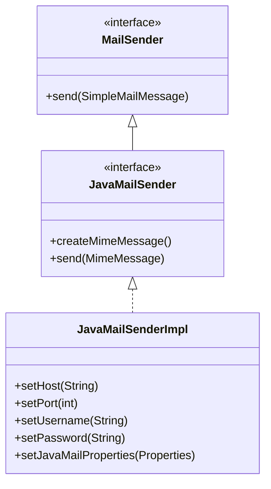
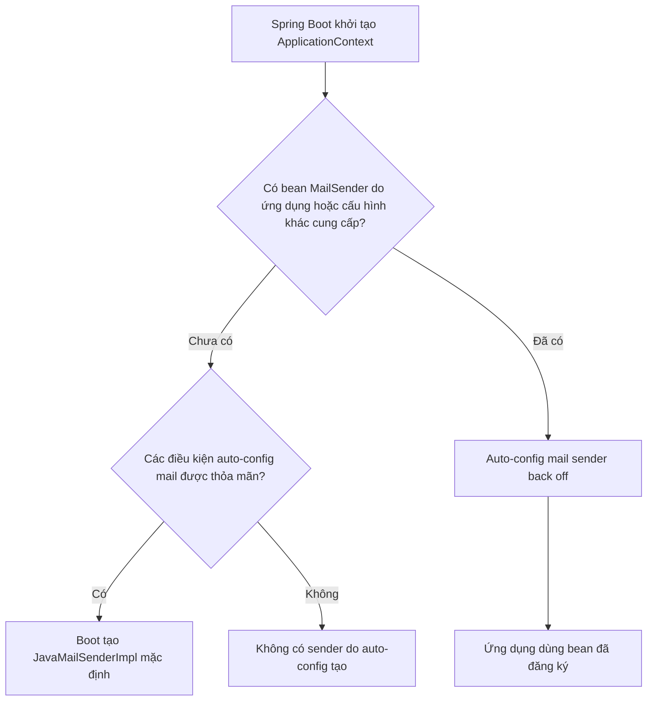

# Ghi đè auto-config bằng bean JavaMailSender riêng

Trong ứng dụng Spring Boot, thêm `spring-boot-starter-mail` và khai báo `spring.mail.*` thường đủ để Spring Boot tạo một bean `JavaMailSender`. Cơ chế này phù hợp khi ứng dụng dùng một SMTP server với cấu hình thông thường. Tuy nhiên, đôi khi hệ thống cần tự kiểm soát việc xây dựng sender: dùng nhiều tài khoản SMTP, gắn cấu hình transport chuyên biệt, dùng một Jakarta Mail `Session` có sẵn, hoặc thay transport bằng implementation được kiểm soát trong môi trường kiểm thử.

Khi đó, ta có thể **khai báo bean `JavaMailSender` riêng**. Đây là một trường hợp Spring Boot auto-configuration **back off**: nếu ứng dụng đã cung cấp bean phù hợp, Spring Boot thường không tạo bean mail sender mặc định. Hiểu đúng cơ chế này giúp tránh lỗi hai bean cạnh tranh, tưởng rằng thuộc tính `spring.mail.*` vẫn tự áp dụng, hoặc vô tình bỏ mất TLS, timeout và charset khi chuyển từ auto-config sang cấu hình thủ công.

Bài học giải thích cách ghi đè auto-config bằng một bean `JavaMailSender`, cách giữ lại các giá trị từ `MailProperties`, cách inject đúng trong service, trường hợp nhiều sender, xử lý các cấu hình đặc biệt và quan sát điều kiện auto-configuration. Các ví dụ sử dụng Java 21, Spring Boot 3.x, Spring Framework 6.x và Jakarta Mail.

## 1. Trước tiên, auto-configuration của Spring Boot làm gì?

Khi có các thư viện mail thích hợp trên classpath và điều kiện cấu hình được thỏa mãn, Spring Boot có thể tạo bean kiểu `JavaMailSenderImpl` — implementation của interface `JavaMailSender` dựa trên Jakarta Mail.

Với một ứng dụng đơn giản:

```groovy
dependencies {
    implementation 'org.springframework.boot:spring-boot-starter-mail'
}
```

và cấu hình:

```yaml
spring:
  mail:
    host: localhost
    port: 1025
    default-encoding: UTF-8
    properties:
      "[mail.smtp.auth]": "false"

app:
  mail:
    from: demo@example.test
```

service có thể inject:

```java
import org.springframework.mail.javamail.JavaMailSender;
import org.springframework.stereotype.Service;

@Service
public class DemoMailService {
    private final JavaMailSender mailSender;

    public DemoMailService(JavaMailSender mailSender) {
        this.mailSender = mailSender;
    }
}
```

Nếu auto-config được kích hoạt, ứng dụng thường nhận một `JavaMailSenderImpl` đã có host, port và các thuộc tính tương ứng. Với môi trường thử nghiệm, SMTP giả lập như Mailpit có thể lắng nghe ở `localhost:1025` và hiển thị thư qua giao diện web ở `localhost:8025`.

Không nên hiểu rằng **chỉ cần dependency là sender chắc chắn xuất hiện**: auto-config còn phụ thuộc các điều kiện về classpath, bean hiện có và cấu hình như SMTP host hoặc mail session theo đường cấu hình được hỗ trợ.

### 1.1. Các interface liên quan



Trong Spring Framework Mail:

- `MailSender` là abstraction gửi email text đơn giản bằng `SimpleMailMessage`.
- `JavaMailSender` mở rộng `MailSender` để gửi MIME, HTML và attachment.
- `JavaMailSenderImpl` là implementation phổ biến kết nối SMTP qua Jakarta Mail.

Khi tự tạo bean kiểu `JavaMailSenderImpl`, bean đó vẫn có thể inject ở nơi yêu cầu `MailSender` hoặc `JavaMailSender`.

## 2. Cơ chế "back off" khi có bean MailSender riêng

Các auto-configuration của Spring Boot thường có điều kiện kiểu `@ConditionalOnMissingBean`. Trong cấu hình mail của các bản Spring Boot 3.x thông dụng, `MailSenderAutoConfiguration` có điều kiện **chỉ tiếp tục khi context chưa có bean `MailSender`**. `JavaMailSender` kế thừa `MailSender`, vì vậy một bean `JavaMailSender` do ứng dụng tự đăng ký đáp ứng điều kiện có bean mail sender và làm đường tạo bean mặc định của Boot nhường chỗ.

Ví dụ tối giản:

```java
package com.example.mail.config;

import org.springframework.context.annotation.Bean;
import org.springframework.context.annotation.Configuration;
import org.springframework.mail.javamail.JavaMailSender;
import org.springframework.mail.javamail.JavaMailSenderImpl;

@Configuration(proxyBeanMethods = false)
public class CustomMailConfiguration {

    @Bean
    JavaMailSender mailSender() {
        JavaMailSenderImpl sender = new JavaMailSenderImpl();
        sender.setHost("localhost");
        sender.setPort(1025);
        sender.setDefaultEncoding("UTF-8");
        return sender;
    }
}
```

Nếu ứng dụng quét/đăng ký được cấu hình này, bean `mailSender` do ứng dụng sở hữu sẽ được sử dụng khi service inject `JavaMailSender`. Spring Boot không cần tạo thêm `JavaMailSenderImpl` mặc định cho cùng mục đích.

**Điểm rất quan trọng:** đây không phải thao tác "ghi đè định nghĩa bean trùng tên" theo nghĩa bật `spring.main.allow-bean-definition-overriding=true`. Cơ chế chuẩn là **auto-config thấy bean đã có rồi rút lui**. Không cần bật cho phép ghi đè bean definition chỉ để tự khai báo sender.



### 2.1. Tên bean có bắt buộc là mailSender?

Không. Việc back off chủ yếu được xác định từ **kiểu bean và điều kiện auto-config**, không phải bắt buộc phải đặt tên bean `mailSender`.

Ví dụ:

```java
@Bean("outboundEmailSender")
JavaMailSender outboundEmailSender() {
    JavaMailSenderImpl sender = new JavaMailSenderImpl();
    sender.setHost("localhost");
    sender.setPort(1025);
    return sender;
}
```

Bean tên `outboundEmailSender` vẫn có kiểu `JavaMailSender`. Service inject theo kiểu `JavaMailSender` thường sẽ nhận được bean này nếu nó là ứng viên duy nhất.

Tên bean lại trở nên quan trọng khi ứng dụng dùng `@Qualifier`, injection theo tên, hoặc khi có nhiều bean cùng kiểu.

### 2.2. Vì sao một bean MailSender đơn giản có thể làm JavaMailSender biến mất?

Giả sử ứng dụng đăng ký một implementation riêng chỉ thực hiện interface `MailSender`:

```java
@Bean
MailSender simpleOnlyMailSender() {
    return new CustomTextMailSender();
}
```

Trong đó `CustomTextMailSender` là lớp **do ứng dụng tự định nghĩa**. Khi bean `MailSender` đó hiện diện, auto-configuration có thể back off, nhưng bean tùy chỉnh **không phải `JavaMailSender`**. Service cần `MimeMessage`/`JavaMailSender` khi đó có thể gặp lỗi thiếu bean.

Điều này dẫn đến quy tắc: **nếu ứng dụng có chỗ inject `JavaMailSender`, hãy khai báo một bean đúng interface `JavaMailSender` hoặc một implementation của nó**. Không nên cho rằng Boot sẽ âm thầm tạo thêm `JavaMailSender` chỉ vì bean custom của bạn thiếu khả năng MIME.

### 2.3. Phân biệt bean override và property override

| Yêu cầu | Giải pháp nên cân nhắc | Có cần bean riêng? |
|---|---|---|
| Đổi SMTP host/port | `spring.mail.host` / `spring.mail.port` | Thường không |
| Bật STARTTLS, đặt socket timeout | `spring.mail.properties[...]` | Thường không |
| Đổi username/password theo môi trường | Environment variables hoặc secret manager | Thường không |
| Đổi charset mặc định | `spring.mail.default-encoding` | Thường không |
| Chọn nhiều provider khác nhau theo loại thư | Nhiều sender và routing service | Thường có |
| Sử dụng Jakarta Mail Session được tạo ngoài Spring Boot | Cấu hình JNDI có sẵn hoặc sender riêng tùy ràng buộc | Tùy trường hợp |
| Tạo transport tùy chỉnh/test-specific sender | Bean custom theo profile/test configuration | Có thể |
| Muốn “ghi đè tên bean mailSender” | Dùng back off qua bean đúng kiểu | Không cần bật bean-definition-overriding |

Nếu chỉ muốn đổi host hoặc timeout, một bean custom thường tạo thêm trách nhiệm bảo trì mà không đem lại lợi ích. Chỉ chuyển sang bean riêng khi cần kiểm soát vượt ngoài khả năng cấu hình thông thường.

## 3. Vấn đề dễ bỏ sót: spring.mail.* không tự áp dụng cho bean custom

Khi Boot tạo bean mặc định, Boot đọc `MailProperties` và áp dụng các giá trị tương ứng. Khi **bạn tự tạo `JavaMailSenderImpl`**, Spring chỉ quản lý vòng đời bean đó. Nó **không tự gọi `setHost`, `setPassword` hoặc `setJavaMailProperties` lên bean custom của bạn** chỉ vì file `application.yml` đang có `spring.mail.*`.

Ví dụ cấu hình:

```yaml
spring:
  mail:
    host: smtp.example.test
    port: 587
    username: ${SMTP_USERNAME}
    password: ${SMTP_PASSWORD}
    default-encoding: UTF-8
    properties:
      "[mail.smtp.auth]": "true"
      "[mail.smtp.starttls.enable]": "true"
      "[mail.smtp.starttls.required]": "true"
      "[mail.smtp.connectiontimeout]": "5000"
      "[mail.smtp.timeout]": "10000"
      "[mail.smtp.writetimeout]": "10000"
```

Nếu bean custom chỉ làm:

```java
@Bean
JavaMailSender mailSender() {
    return new JavaMailSenderImpl();
}
```

thì host, port, credentials, STARTTLS và timeout trong YAML **không tự chảy vào đối tượng đó**. Implementation còn có các giá trị mặc định của riêng nó; kết nối có thể hướng sai máy chủ hoặc thiếu bảo mật mong đợi.

Để giữ lại cấu hình từ Spring Boot, bạn có thể inject một đối tượng `MailProperties` đã được bind từ `spring.mail.*` rồi áp dụng giá trị rõ ràng.

## 4. Tạo bean JavaMailSender riêng và giữ MailProperties

### 4.1. Cấu hình đầy đủ

Đây là ví dụ thực hành khi ứng dụng cần tự sở hữu bean nhưng vẫn giữ cấu hình externalized của Spring Boot:

```java
package com.example.mail.config;

import java.util.Properties;

import org.springframework.boot.autoconfigure.mail.MailProperties;
import org.springframework.boot.context.properties.EnableConfigurationProperties;
import org.springframework.context.annotation.Bean;
import org.springframework.context.annotation.Configuration;
import org.springframework.mail.javamail.JavaMailSender;
import org.springframework.mail.javamail.JavaMailSenderImpl;

@Configuration(proxyBeanMethods = false)
@EnableConfigurationProperties(MailProperties.class)
public class CustomMailConfiguration {

    @Bean
    JavaMailSender mailSender(MailProperties mailProperties) {
        if (mailProperties.getHost() == null
                || mailProperties.getHost().isBlank()) {
            throw new IllegalStateException(
                    "spring.mail.host is required by CustomMailConfiguration");
        }

        JavaMailSenderImpl sender = new JavaMailSenderImpl();
        sender.setHost(mailProperties.getHost());

        if (mailProperties.getPort() != null) {
            sender.setPort(mailProperties.getPort());
        }
        if (mailProperties.getProtocol() != null) {
            sender.setProtocol(mailProperties.getProtocol());
        }
        if (mailProperties.getUsername() != null) {
            sender.setUsername(mailProperties.getUsername());
        }
        if (mailProperties.getPassword() != null) {
            sender.setPassword(mailProperties.getPassword());
        }
        if (mailProperties.getDefaultEncoding() != null) {
            sender.setDefaultEncoding(
                    mailProperties.getDefaultEncoding().name());
        }

        Properties transport = new Properties();
        transport.putAll(mailProperties.getProperties());

        // Bổ sung giá trị mặc định chỉ nếu cấu hình chưa chỉ định.
        transport.putIfAbsent("mail.smtp.connectiontimeout", "5000");
        transport.putIfAbsent("mail.smtp.timeout", "10000");
        transport.putIfAbsent("mail.smtp.writetimeout", "10000");

        sender.setJavaMailProperties(transport);
        return sender;
    }
}
```

Giải thích các quyết định trong ví dụ:

1. `@Configuration` đăng ký class cấu hình trong Spring context.
2. `@Bean` đăng ký chính bean mà ứng dụng muốn sử dụng.
3. Kiểu trả về `JavaMailSender` làm khả năng hỗ trợ MIME rõ ràng ở ranh giới dependency injection.
4. `MailProperties` chứa các giá trị Spring Boot bind từ `spring.mail.*`.
5. `setHost`, `setPort`, `setUsername`, `setPassword`, `setProtocol` và `setDefaultEncoding` được áp dụng tường minh.
6. `setJavaMailProperties` nhận các thuộc tính chi tiết của Jakarta Mail như `mail.smtp.auth` và `mail.smtp.starttls.required`.
7. `putIfAbsent` chỉ thêm timeout khi môi trường chưa cung cấp, tránh vô tình ghi đè các giá trị đã được vận hành chỉ định.

**Tại sao có `@EnableConfigurationProperties(MailProperties.class)`?** Khi bean `MailSender` riêng làm auto-config mail rút lui, không nên giả định chính auto-config đó vẫn đăng ký bean `MailProperties` cho bạn. Annotation này bảo đảm đối tượng cấu hình được đăng ký/bind trong cấu hình tự quản lý. Nếu hệ thống đã có một nơi khác đăng ký `MailProperties`, Spring Boot có cơ chế quản lý configuration properties phù hợp; quan trọng là tránh phụ thuộc vào side effect của auto-config đã back off.

Ví dụ cố ý yêu cầu `spring.mail.host`. Nó phục vụ **kiểu SMTP host-based**, chưa có nhánh sử dụng mail session từ JNDI. Nếu ứng dụng dùng JNDI Session, nên làm rõ nhánh cấu hình riêng, thay vì để bean này âm thầm lấy giá trị mặc định không phù hợp.

### 4.2. Đọc cấu hình từ môi trường

Một cấu hình production minh họa:

```yaml
spring:
  mail:
    host: ${SMTP_HOST}
    port: ${SMTP_PORT:587}
    protocol: smtp
    username: ${SMTP_USERNAME}
    password: ${SMTP_PASSWORD}
    default-encoding: UTF-8
    properties:
      "[mail.smtp.auth]": "true"
      "[mail.smtp.starttls.enable]": "true"
      "[mail.smtp.starttls.required]": "true"
      "[mail.smtp.connectiontimeout]": "5000"
      "[mail.smtp.timeout]": "10000"
      "[mail.smtp.writetimeout]": "10000"

app:
  mail:
    from: ${MAIL_FROM}
```

Các giá trị mật khẩu phải đến từ secret manager, environment variables hoặc cơ chế quản lý bí mật có kiểm soát truy cập. Đừng commit password vào source hoặc log cấu hình sau khi bind. Trên SMTP submission cổng 587, STARTTLS phải được server hỗ trợ và cấu hình buộc nâng cấp theo chính sách bảo mật. Với implicit TLS cổng 465, cần cấu hình SSL tương ứng, không đơn thuần đổi số cổng.

**Lưu ý:** `MailProperties` chứa cả những cấu hình khác như `jndi-name` và `test-connection` tùy phiên bản Boot. Ví dụ tự quản lý bên trên **không sao chép mọi nhánh của auto-config mặc định**, mà thực hiện hợp đồng SMTP host-based cụ thể. Đây là trách nhiệm quan trọng khi tự định nghĩa bean: biết chính xác phần nào đã được giữ lại và phần nào cần tự xây dựng nếu có yêu cầu.

### 4.3. Nếu chỉ cần custom timeout hoặc charset thì sao?

Thông thường không cần tự tạo bean chỉ vì muốn thay ba timeout:

```yaml
spring:
  mail:
    host: ${SMTP_HOST}
    port: 587
    properties:
      "[mail.smtp.connectiontimeout]": "5000"
      "[mail.smtp.timeout]": "10000"
      "[mail.smtp.writetimeout]": "10000"
```

Boot có thể áp dụng những thuộc tính này khi tạo `JavaMailSenderImpl` mặc định. Hãy giữ auto-config nếu nhu cầu được giải quyết chỉ bằng external configuration. Một bean tự xây dựng phù hợp hơn khi bạn cần **thay đổi cách tạo hoặc chọn sender**, không chỉ thay một giá trị SMTP.

## 5. Sử dụng bean riêng trong service

Khi bean được đăng ký thành công, service inject như bình thường:

```java
package com.example.mail.service;

import jakarta.mail.MessagingException;
import jakarta.mail.internet.MimeMessage;

import org.springframework.beans.factory.annotation.Value;
import org.springframework.mail.javamail.JavaMailSender;
import org.springframework.mail.javamail.MimeMessageHelper;
import org.springframework.stereotype.Service;

@Service
public class NotificationMailService {

    private final JavaMailSender mailSender;
    private final String fromAddress;

    public NotificationMailService(
            JavaMailSender mailSender,
            @Value("${app.mail.from}") String fromAddress) {
        this.mailSender = mailSender;
        this.fromAddress = fromAddress;
    }

    public void sendWelcome(String recipient) throws MessagingException {
        MimeMessage message = mailSender.createMimeMessage();
        MimeMessageHelper helper =
                new MimeMessageHelper(message, true, "UTF-8");

        helper.setFrom(fromAddress);
        helper.setTo(recipient);
        helper.setSubject("Chào mừng bạn");
        helper.setText(
                "Tài khoản của bạn đã được tạo.",
                "<p>Tài khoản của bạn đã được <strong>tạo</strong>.</p>");

        mailSender.send(message);
    }
}
```

Trong trường hợp chỉ gửi text thuần, một service cũng có thể inject `MailSender` và gửi `SimpleMailMessage`. Bean `JavaMailSenderImpl` triển khai cả hai interface nên không bắt buộc hai bean riêng.

**Phân biệt cấu hình với hành vi:** việc thay bean không làm thay đổi ý nghĩa của `send()`. Phương thức trả về bình thường cho thấy lần gửi hoàn tất theo transport đang sử dụng; nó không chứng minh email đã đến inbox hoặc được đọc. Ngoài ra, Spring Mail không tự cung cấp hàng đợi bền vững, retry dài hạn hoặc bảo đảm exactly-once chỉ nhờ một bean custom.

## 6. Thêm hành vi riêng: áp dụng cấu hình có kiểm soát

### 6.1. Cấu hình theo profile

Thực tế thường cần mail sender khác nhau ở môi trường local và production:

```java
package com.example.mail.config;

import org.springframework.context.annotation.Bean;
import org.springframework.context.annotation.Configuration;
import org.springframework.context.annotation.Profile;
import org.springframework.mail.javamail.JavaMailSender;
import org.springframework.mail.javamail.JavaMailSenderImpl;

@Configuration(proxyBeanMethods = false)
@Profile("local")
class LocalMailConfiguration {

    @Bean
    JavaMailSender localMailSender() {
        JavaMailSenderImpl sender = new JavaMailSenderImpl();
        sender.setHost("localhost");
        sender.setPort(1025);
        sender.setDefaultEncoding("UTF-8");
        return sender;
    }
}
```

Với profile `local` đang hoạt động, bean này sẽ được đăng ký. Nếu profile khác không đăng ký bean custom nào và mail auto-config có đủ cấu hình, Spring Boot có thể dùng sender mặc định. Đây là cách dùng profile hợp lý khi local cần một SMTP fake, nhưng production vẫn muốn giữ auto-config.

Tuy nhiên, nếu cả bean local và bean production cùng được kích hoạt do cấu hình profile chồng lấn, injection có thể trở nên mơ hồ. Cần tổ chức profile và điều kiện của các cấu hình rõ ràng.

### 6.2. Thêm thuộc tính vận hành cho sender custom

Trong bean custom, bạn có thể áp dụng timeout, charset, protocol và giới hạn cấu hình từ một nguồn tập trung. Các thuộc tính Jakarta Mail có tiền tố `mail.smtp.*` thường được đặt trong `Properties`:

```java
Properties transport = new Properties();
transport.setProperty("mail.smtp.auth", "true");
transport.setProperty("mail.smtp.starttls.enable", "true");
transport.setProperty("mail.smtp.starttls.required", "true");
transport.setProperty("mail.smtp.connectiontimeout", "5000");
transport.setProperty("mail.smtp.timeout", "10000");
transport.setProperty("mail.smtp.writetimeout", "10000");

sender.setJavaMailProperties(transport);
```

Những dòng này là **một phần của phương thức tạo bean** sau khi đã thiết lập host, port, username/password. Chúng không tự tạo TLS certificate, không xác minh domain From và không thay thế chính sách bảo vệ credential. Nếu hệ thống cho phép đổi các giá trị đó qua `spring.mail.properties`, nên dùng nguồn đó thay vì cứng hóa mọi giá trị vào Java.

### 6.3. Có nên tự tạo subclass JavaMailSenderImpl?

Có thể tạo một subclass nếu có một điểm mở rộng được API hỗ trợ thật sự, nhưng không nên subclass chỉ để chèn log chứa email hoặc dựng lại logic SMTP. Với nhu cầu metrics/tracing, thường dễ kiểm soát hơn khi dùng một **service/gateway bao quanh** `JavaMailSender`:

```text
BusinessService
    |
    v
MailDeliveryGateway (metrics / policy / retry coordination)
    |
    v
JavaMailSender
    |
    v
Jakarta Mail / SMTP
```

Cách tách lớp này giữ SMTP implementation đơn giản và tránh lẫn việc quan sát, retry, lưu trạng thái vào bean cấu hình. Nếu tự dựng wrapper triển khai `JavaMailSender`, cần triển khai đủ các phương thức interface và hiểu tác động tới `JavaMailSenderImpl`; đa số trường hợp không cần đi xa như vậy.

## 7. Nhiều JavaMailSender trong cùng ApplicationContext

Một ứng dụng có thể cần:

- Sender giao dịch dùng nhà cung cấp SMTP A cho xác nhận đơn hàng và thông báo bảo mật.
- Sender chiến dịch dùng nhà cung cấp SMTP B cho những thư thông tin được người nhận cho phép.

Khi đó, ứng dụng có thể tạo **hai bean `JavaMailSender`**. Sự tồn tại của một trong hai đã đủ để auto-config mặc định back off theo điều kiện bean; Spring Boot **không tự tạo thêm “sender thứ ba”** chỉ vì bạn định nghĩa nhiều bean.

### 7.1. Cấu hình nhiều bean theo tên

Ví dụ factory giúp hai bean có chung các thiết lập quan trọng:

```java
package com.example.mail.config;

import java.util.Properties;

import org.springframework.beans.factory.annotation.Value;
import org.springframework.context.annotation.Bean;
import org.springframework.context.annotation.Configuration;
import org.springframework.context.annotation.Primary;
import org.springframework.mail.javamail.JavaMailSender;
import org.springframework.mail.javamail.JavaMailSenderImpl;

@Configuration(proxyBeanMethods = false)
public class MultiSenderConfiguration {

    @Bean("transactionalMailSender")
    @Primary
    JavaMailSender transactionalMailSender(
            @Value("${app.mail.transactional.host}") String host,
            @Value("${app.mail.transactional.username}") String username,
            @Value("${app.mail.transactional.password}") String password) {
        return smtpSender(host, username, password);
    }

    @Bean("campaignMailSender")
    JavaMailSender campaignMailSender(
            @Value("${app.mail.campaign.host}") String host,
            @Value("${app.mail.campaign.username}") String username,
            @Value("${app.mail.campaign.password}") String password) {
        return smtpSender(host, username, password);
    }

    private static JavaMailSender smtpSender(
            String host, String username, String password) {
        JavaMailSenderImpl sender = new JavaMailSenderImpl();
        sender.setHost(host);
        sender.setPort(587);
        sender.setUsername(username);
        sender.setPassword(password);
        sender.setDefaultEncoding("UTF-8");

        Properties properties = new Properties();
        properties.setProperty("mail.smtp.auth", "true");
        properties.setProperty("mail.smtp.starttls.enable", "true");
        properties.setProperty("mail.smtp.starttls.required", "true");
        properties.setProperty("mail.smtp.connectiontimeout", "5000");
        properties.setProperty("mail.smtp.timeout", "10000");
        properties.setProperty("mail.smtp.writetimeout", "10000");
        sender.setJavaMailProperties(properties);
        return sender;
    }
}
```

Đây là ví dụ hai provider cùng dùng cổng 587 và STARTTLS. Nếu từng provider có cổng, giao thức, TLS hoặc giới hạn riêng, **không áp dụng factory một cách máy móc**. Có thể tạo một nhóm `@ConfigurationProperties` riêng cho từng sender, xác thực giá trị và giữ secret ở nguồn quản lý phù hợp.

Cấu hình ứng dụng:

```yaml
app:
  mail:
    transactional:
      host: ${TRANSACTIONAL_SMTP_HOST}
      username: ${TRANSACTIONAL_SMTP_USERNAME}
      password: ${TRANSACTIONAL_SMTP_PASSWORD}
    campaign:
      host: ${CAMPAIGN_SMTP_HOST}
      username: ${CAMPAIGN_SMTP_USERNAME}
      password: ${CAMPAIGN_SMTP_PASSWORD}
```

Với các thuộc tính tùy chỉnh như `app.mail.transactional.*`, mã cấu hình phải **chủ động bind và áp dụng** chúng. Chúng không phải namespace `spring.mail.*` chuẩn.

### 7.2. Chọn sender bằng Qualifier

Service gửi thông báo giao dịch:

```java
package com.example.mail.service;

import org.springframework.beans.factory.annotation.Qualifier;
import org.springframework.mail.javamail.JavaMailSender;
import org.springframework.stereotype.Service;

@Service
public class TransactionalNotificationService {

    private final JavaMailSender mailSender;

    public TransactionalNotificationService(
            @Qualifier("transactionalMailSender")
            JavaMailSender mailSender) {
        this.mailSender = mailSender;
    }
}
```

Service gửi chiến dịch dùng:

```java
public CampaignMailService(
        @Qualifier("campaignMailSender") JavaMailSender mailSender) {
    this.mailSender = mailSender;
}
```

Đoạn `CampaignMailService` là **một constructor minh họa**, cần đặt trong một class tương ứng khi sử dụng.

`@Primary` đánh dấu sender ưu tiên khi inject theo kiểu mà không có qualifier cụ thể. `@Qualifier` chọn đúng bean theo tên/qualifier. **`@Primary` không quyết định auto-config có back off hay không**; nó chỉ giúp Spring chọn ứng viên injection giữa các bean cùng kiểu.

### 7.3. Những lỗi thường gặp khi có nhiều sender

| Hiện tượng | Nguyên nhân khả dĩ | Hướng xử lý |
|---|---|---|
| `NoUniqueBeanDefinitionException` | Nhiều `JavaMailSender`, injection không xác định | Dùng `@Qualifier` hoặc một `@Primary` phù hợp |
| Thư đi sai provider | Service inject sender mặc định/primary không như dự kiến | Dùng qualifier tường minh và test cấu hình |
| Sender thứ hai không có TLS | Factory hoặc cấu hình riêng bỏ sót thuộc tính | Áp dụng cấu hình đầy đủ, kiểm tra từng bean |
| Tưởng Boot tự tạo bean mặc định bên cạnh hai bean custom | Không hiểu điều kiện back off | Đăng ký toàn bộ sender cần thiết bằng cấu hình riêng |
| Trộn sender marketing với giao dịch | Không có ranh giới nghiệp vụ/routing rõ ràng | Thiết kế service chọn sender theo loại thông báo |

Khi có nhiều tài khoản, rate limit và bounce/suppression cũng có thể được quản lý theo provider, domain và loại thư. Chỉ thêm hai bean không tự tạo ra cơ chế routing, quota hay failover an toàn.

## 8. Dùng Jakarta Mail Session bên ngoài auto-config

Trong môi trường application server, `jakarta.mail.Session` có thể được container tạo sẵn và công bố qua JNDI. Spring Boot có hỗ trợ đường cấu hình mail session theo điều kiện của phiên bản; nếu đã dùng cơ chế `spring.mail.jndi-name` phù hợp thì có thể **không cần bean riêng**.

Khi phải tích hợp thủ công, `JavaMailSenderImpl` có API `setSession(Session)`:

```java
import jakarta.mail.Session;
import org.springframework.mail.javamail.JavaMailSenderImpl;

JavaMailSenderImpl sender = new JavaMailSenderImpl();
sender.setSession(existingJakartaMailSession);
```

Trong đó `existingJakartaMailSession` là đối tượng thực tế lấy từ container/JNDI hoặc được một component khác cấu hình. Không có biến này tự xuất hiện nếu chưa có cơ chế lookup/session bean.

Khi tự cung cấp Session, cần hiểu **ai sở hữu host, port, AUTH, TLS và credentials**. Các setter của `JavaMailSenderImpl` và cấu hình trong `Session` có thể tương tác theo thứ tự/ưu tiên của implementation. Không trộn nhiều nguồn cấu hình khi chưa xác định giá trị hiệu lực.

Ngoài ra, Spring Boot 3.x dùng namespace `jakarta.mail.*`. Những ví dụ cũ dùng `javax.mail.Session` thuộc thế hệ thư viện trước, không thể sao chép vào cùng classpath mà mong hoạt động nguyên vẹn.

## 9. Cách chẩn đoán vì sao auto-config tạo hoặc không tạo sender

Khi ứng dụng khởi động, không nên đoán hành vi auto-config chỉ qua tên file YAML. Spring Boot có cơ chế báo cáo điều kiện của từng auto-configuration.

### 9.1. Bật condition evaluation report

Trong môi trường phát triển, có thể chạy ứng dụng với tùy chọn debug:

```bash
java -jar app.jar --debug
```

Spring Boot sẽ đưa báo cáo điều kiện auto-config vào log theo cấu hình logging. Tìm các phần liên quan đến `MailSenderAutoConfiguration` và configuration class tương ứng để biết vì sao nó match hoặc không match.

Những lý do thường gặp:

- Có bean `MailSender` do ứng dụng tạo, khiến điều kiện thiếu bean không còn thỏa mãn.
- Chưa có các class Jakarta Mail/Spring Mail cần thiết trên classpath.
- Chưa có cấu hình cần thiết để Boot chọn đường mail sender mặc định.
- Điều kiện của nhánh JNDI hoặc nhánh SMTP host không phù hợp.
- Auto-configuration bị exclude một cách tường minh.

Nếu ứng dụng có Spring Boot Actuator và endpoint điều kiện được cấu hình/cho phép phù hợp, có thể xem thông tin qua `/actuator/conditions` trong môi trường được bảo vệ. Không công khai endpoint chẩn đoán nội bộ trên Internet.

### 9.2. Phân biệt bốn lỗi khởi động điển hình

**A. Không tìm thấy bean JavaMailSender**

Ví dụ:

```text
No qualifying bean of type
'org.springframework.mail.javamail.JavaMailSender' available
```

Nguyên nhân có thể là cấu hình custom không được component scan/import, một bean chỉ triển khai `MailSender` đã khiến Boot back off, hoặc điều kiện tạo sender mặc định không đủ.

**B. Có nhiều bean cùng kiểu**

```text
NoUniqueBeanDefinitionException:
expected single matching bean but found 2
```

Đây là vấn đề lựa chọn dependency. Chỉ định `@Qualifier` hoặc `@Primary` rõ ràng, tránh xử lý bằng cách bật bean-definition-overriding.

**C. Đăng ký trùng tên bean**

Một bean custom tên `mailSender` và một bean khác cùng tên từ hai cấu hình ứng dụng có thể gây lỗi trùng bean definition. Cơ chế auto-config back off không giải quyết xung đột giữa **hai cấu hình tự sở hữu**. Đổi tên hợp lý hoặc loại bỏ cấu hình trùng, không bật override bừa bãi để che lỗi.

**D. Có sender nhưng không kết nối được SMTP**

Ví dụ `MailSendException` báo lỗi connect hoặc timeout ngay lần gửi đầu. Kiểm tra bean custom có thật sự áp dụng `host`, `port`, `username`, `password`, `mail.smtp.auth`, TLS và timeout hay không. Đừng mặc nhiên giả định YAML được bind lên bean tự tạo.

### 9.3. Kiểm tra cấu hình hiệu lực của JavaMailSenderImpl

Trong một bài thử có quyền truy cập Spring context, có thể quan sát một số thuộc tính **không nhạy cảm**:

```java
import org.springframework.context.ApplicationContext;
import org.springframework.mail.javamail.JavaMailSender;
import org.springframework.mail.javamail.JavaMailSenderImpl;

JavaMailSender sender = context.getBean(JavaMailSender.class);

if (sender instanceof JavaMailSenderImpl impl) {
    System.out.println("SMTP host: " + impl.getHost());
    System.out.println("SMTP port: " + impl.getPort());
    System.out.println("Mail protocol: " + impl.getProtocol());
}
```

Ở đây `context` là một `ApplicationContext` lấy từ test hoặc thành phần đã được Spring cung cấp; đoạn code không phải một chương trình độc lập có biến `context` sẵn. Không log password, Session authentication object hoặc toàn bộ `JavaMailProperties` trong production vì có thể chứa dữ liệu nhạy cảm.

Nếu có nhiều sender, lấy bean theo tên:

```java
JavaMailSender sender = context.getBean(
        "transactionalMailSender", JavaMailSender.class);
```

Việc quan sát giá trị tại runtime giúp xác nhận loại bean và cấu hình thực tế, thay vì chỉ nhìn `application.yml`.

## 10. Kiểm thử cấu hình custom mà không gửi email thật

Với cấu hình bean, kiểm thử hiệu quả nhất tập trung vào **bean nào được tạo**, **thuộc tính nào đã được áp dụng**, rồi mới đến integration test SMTP. Không cần gửi email Internet thật chỉ để chứng minh `@Bean` hoạt động.

### 10.1. Kiểm thử khởi tạo ApplicationContext

Ví dụ JUnit và Spring Boot Test:

```java
package com.example.mail.config;

import static org.assertj.core.api.Assertions.assertThat;

import org.junit.jupiter.api.Test;
import org.springframework.beans.factory.annotation.Autowired;
import org.springframework.boot.test.context.SpringBootTest;
import org.springframework.context.ApplicationContext;
import org.springframework.mail.javamail.JavaMailSender;
import org.springframework.mail.javamail.JavaMailSenderImpl;

@SpringBootTest(properties = {
        "spring.mail.host=localhost",
        "spring.mail.port=1025",
        "spring.mail.default-encoding=UTF-8",
        "spring.mail.properties[mail.smtp.auth]=false",
        "spring.mail.properties[mail.smtp.connectiontimeout]=2500"
})
class CustomMailConfigurationTest {

    @Autowired
    ApplicationContext context;

    @Test
    void customSenderIsRegisteredAndUsesProperties() {
        String[] names =
                context.getBeanNamesForType(JavaMailSender.class);
        assertThat(names).containsExactly("mailSender");

        JavaMailSender sender = context.getBean(JavaMailSender.class);
        assertThat(sender).isInstanceOf(JavaMailSenderImpl.class);

        JavaMailSenderImpl impl = (JavaMailSenderImpl) sender;
        assertThat(impl.getHost()).isEqualTo("localhost");
        assertThat(impl.getPort()).isEqualTo(1025);
        assertThat(impl.getJavaMailProperties()
                .getProperty("mail.smtp.connectiontimeout"))
                .isEqualTo("2500");
    }
}
```

Điều kiện của ví dụ: `CustomMailConfiguration` phải được application test scan/import, và test context không đăng ký thêm sender khác. Assertion `containsExactly("mailSender")` phù hợp **ví dụ một sender**; nếu ứng dụng có nhiều sender hợp lệ thì cần điều chỉnh kỳ vọng.

Test này chỉ tạo context và đọc properties. Nó không kết nối SMTP, không gửi thư thật. Nếu đang dùng `spring.mail.test-connection=true` và auto-configuration validation tương ứng được kích hoạt, Spring Boot có thể chủ động thử kết nối khi khởi động; trong unit/context test nên giữ việc kiểm thử kết nối có chủ đích.

### 10.2. Integration test qua SMTP giả lập

Để kiểm tra adapter thật và cấu hình custom:

1. Khởi động Mailpit hoặc SMTP test server tương tự.
2. Dùng profile test chứa `spring.mail.host=localhost`, `port=1025`.
3. Inject `JavaMailSender` và gửi một `SimpleMailMessage` hoặc `MimeMessage`.
4. Quan sát thư qua giao diện/API thử nghiệm, kiểm tra From, To, Subject và nội dung UTF-8.
5. Giả lập SMTP server không sẵn sàng để xem timeout/lỗi transport, nếu test yêu cầu.

Ví dụ dùng Docker trong môi trường phát triển:

```bash
docker run --rm --name mailpit -p 1025:1025 -p 8025:8025 axllent/mailpit
```

Nếu ứng dụng chạy trong container khác, `localhost` trỏ vào chính container ứng dụng; cần dùng tên service/DNS của mạng container để kết nối SMTP test server.

### 10.3. Những gì kiểm thử cấu hình chưa chứng minh

| Kiểm thử | Được xác nhận | Chưa được xác nhận |
|---|---|---|
| Đọc bean từ context | Spring đăng ký bean phù hợp, injection hoạt động | SMTP thực sự chấp nhận thư |
| So sánh host/port/properties | Các giá trị mong muốn đã được áp dụng | Mạng/TLS/credential production hợp lệ |
| Gửi qua SMTP giả lập | Serialization và đường kết nối test hoạt động | Domain production được xác minh, thư đến inbox Internet |
| Gửi qua provider sandbox | Cấu hình và cơ chế SMTP/API với provider phù hợp | Tất cả địa chỉ bên ngoài đều nhận thư |
| Nhận event delivery/bounce | Theo dõi hậu xử lý từ provider | Người nhận thực sự đã đọc nội dung |

Nên giữ thông tin production credentials ngoài test và tránh dùng hộp thư khách hàng thật trong kiểm thử tự động.

## 11. Lỗi khi triển khai bean riêng và cách sửa

### 11.1. Bean tùy chỉnh không được quét

Class có `@Configuration` nhưng nằm ngoài package scan, hoặc chưa được import. Spring không biết đến bean nên có thể dùng auto-config mặc định hoặc báo thiếu sender tùy điều kiện. Đặt class trong package ứng dụng được scan, hoặc import cấu hình một cách tường minh.

### 11.2. Tạo JavaMailSenderImpl nhưng bỏ qua MailProperties

Một `new JavaMailSenderImpl()` không tự lấy host, TLS và credential từ `application.yml`. Hãy gắn thủ công các giá trị cần thiết hoặc inject `MailProperties` đã được bind.

### 11.3. Quên @EnableConfigurationProperties

Nếu bạn inject `MailProperties` từ một bean custom và trông chờ auto-config đã back off vẫn đăng ký nó, context có thể thiếu `MailProperties`. Đăng ký configuration properties rõ ràng bằng `@EnableConfigurationProperties(MailProperties.class)` trong cấu hình tự quản lý.

### 11.4. Tưởng @Primary thay thế auto-config

`@Primary` chỉ giải quyết ưu tiên injection khi nhiều bean phù hợp. Việc back off là điều kiện trên auto-configuration và bean đã có. Không dùng `@Primary` để chữa cấu hình duplicate sai.

### 11.5. Dùng spring.main.allow-bean-definition-overriding để xử lý lỗi

Cho phép ghi đè bean definition có thể khiến một cấu hình silently thay thế cấu hình khác theo thứ tự đăng ký, làm kết quả khó dự đoán. Khi viết sender riêng, ưu tiên cơ chế back off chuẩn và sửa tên/ownership của các bean trùng.

### 11.6. Có MailSender nhưng thiếu JavaMailSender

Một fake/wrapper chỉ triển khai `MailSender` có thể khiến Boot không tạo sender mặc định, còn service MIME vẫn đòi `JavaMailSender`. Cung cấp bean đúng kiểu hoặc thay đổi cách injection đúng nhu cầu.

### 11.7. Sao chép sai cấu hình bảo mật

Nếu chuyển cấu hình Boot sang Java mà quên `mail.smtp.starttls.required`, bật AUTH không đúng hoặc bỏ timeout, triển khai custom có thể có hành vi khác trước. Những tham số bảo mật cần được đặt trong cấu hình nguồn và áp dụng nhất quán.

### 11.8. Nhầm SMTP 465 với 587

STARTTLS thường dùng cổng 587; implicit TLS thường dùng cổng 465. Không chỉ đổi port mà giữ nguyên cấu hình TLS không phù hợp. Cần kiểm tra hợp đồng nhà cung cấp.

### 11.9. Mở kết nối SMTP trong @Bean để chứng minh cấu hình

Gọi `sender.testConnection()` ngay trong phương thức `@Bean` có thể khiến ứng dụng không khởi động được khi SMTP provider gặp sự cố tạm thời. Có thể chủ động chọn fail-fast cho một số hệ thống, nhưng cần quyết định rõ trong thiết kế vận hành. Bản thân việc tạo `JavaMailSenderImpl` thông thường không cần gửi email ngay lúc context khởi động.

### 11.10. Thêm retry trực tiếp vào setter/factory của bean

Bean cấu hình chịu trách nhiệm tạo transport. Retry theo loại thông báo, deadline, deduplication và trạng thái người nhận thuộc tầng delivery workflow. Một bean singleton được tạo đúng vẫn không bảo đảm thông báo không mất nếu JVM dừng.

## 12. Kịch bản thực tế: chuyển từ mặc định sang bean riêng

Giả sử ứng dụng trước đây dùng:

```yaml
spring:
  mail:
    host: smtp.old-provider.test
    port: 587
    username: ${SMTP_USERNAME}
    password: ${SMTP_PASSWORD}
    properties:
      "[mail.smtp.auth]": "true"
      "[mail.smtp.starttls.enable]": "true"
      "[mail.smtp.starttls.required]": "true"
```

Ban đầu Spring Boot tự tạo `JavaMailSenderImpl`. Sau đó nhóm phát triển cần bổ sung timeout cố định nếu chưa được cấu hình, bảo đảm charset UTF-8 và có chỗ mở rộng cho nhiều provider.

Một lộ trình thay đổi:

**Bước 1 — Xác định bean hiện tại.** Quan sát bean kiểu `JavaMailSender` và cấu hình hiệu lực ở môi trường test. Ghi rõ host, port, protocol, encoding, TLS, AUTH, timeout.

**Bước 2 — Chọn ownership.** Tạo một `@Configuration` do ứng dụng sở hữu, khai báo `@Bean JavaMailSender` và đăng ký `MailProperties` tường minh nếu cần bind.

**Bước 3 — Giữ cấu hình quan trọng.** Áp dụng host, port, credentials, charset và toàn bộ `spring.mail.properties`. Bổ sung timeout bằng `putIfAbsent` hoặc chính sách cấu hình rõ ràng. Tránh hardcode secret.

**Bước 4 — Xác minh Spring Boot back off.** Chạy context test/condition report để chắc chắn chỉ có sender dự kiến. Không bật bean-definition-overriding như giải pháp mặc định.

**Bước 5 — Thử SMTP trong môi trường kiểm soát.** Gửi một mail text và một mail MIME tới SMTP giả lập, kiểm tra người gửi, người nhận, nội dung Unicode và các lỗi timeout có thể tái hiện.

**Bước 6 — Nếu cần nhiều sender, mở rộng có chủ đích.** Tạo bean riêng từng provider, dùng `@Qualifier` trong service, gắn chính sách route và quota cho đúng loại thư.

**Bước 7 — Giữ ranh giới độ tin cậy.** Outbox, retry, giám sát, bounce, suppression và idempotency là trách nhiệm delivery workflow. Không suy ra những khả năng này chỉ từ việc bean custom đã được tạo.

## 13. Bài thực hành

### Phần A — Quan sát auto-configuration trước khi ghi đè

Tạo ứng dụng Spring Boot có `spring-boot-starter-mail` và `spring.mail.host=localhost`. Inject `JavaMailSender` vào một service và ghi nhận kiểu bean thực tế trong test. Bật condition report để tìm `MailSenderAutoConfiguration`.

### Phần B — Thêm bean JavaMailSender riêng

Đăng ký `@Configuration` và một `@Bean JavaMailSender` trả về `JavaMailSenderImpl`. Đặt host/port tới SMTP giả lập. Khởi động lại ứng dụng và xác nhận service vẫn inject được sender, còn Boot không tạo thêm bean mặc định.

### Phần C — Giữ lại cấu hình application.yml

Di chuyển host, port, encoding, TLS và timeout sang `spring.mail.*`. Dùng `@EnableConfigurationProperties(MailProperties.class)` và code áp dụng cấu hình vào bean custom. Chứng minh bằng context test rằng thay đổi `spring.mail.port` làm bean có port mới mà không sửa Java.

### Phần D — Thêm sender thứ hai

Tạo `transactionalMailSender` và `campaignMailSender`. Dùng `@Qualifier` để chọn sender đúng trong từng service. Thử bỏ qualifier để quan sát trường hợp nhiều bean không có lựa chọn mặc định và giải quyết bằng qualifier hoặc primary phù hợp.

### Phần E — Khám phá ba trường hợp lỗi

1. Khai báo một `MailSender` fake nhưng service yêu cầu `JavaMailSender`; giải thích vì sao bean MIME có thể bị thiếu.
2. Tạo bean custom nhưng bỏ `setJavaMailProperties`; quan sát khác biệt của TLS/timeout so với YAML.
3. Cấu hình host không tồn tại rồi gọi `send()` trong integration test có timeout; phân biệt lỗi transport với lỗi đăng ký bean.

### Phần F — Mô tả ranh giới trách nhiệm

Thiết kế sơ đồ cho một ứng dụng tạo đơn hàng, ghi outbox rồi dùng worker gửi email. Đặt `JavaMailSender` ở tầng transport, không dùng nó như nơi lưu trạng thái giao hàng hoặc retry vô hạn. Nêu rõ rằng việc SMTP relay chấp nhận email không đồng nghĩa người nhận đã đọc.

## 14. Tổng kết cơ chế cần nắm

Khi ứng dụng tự định nghĩa bean `JavaMailSender`, Spring Boot có thể **nhường quyền tạo mail sender** theo điều kiện `@ConditionalOnMissingBean`. Đây là cơ chế mở rộng bình thường của Spring Boot, không yêu cầu bật ghi đè bean definition. Tên bean không nhất thiết là `mailSender`, nhưng kiểu bean và điều kiện auto-config phải phù hợp.

Khi đã tự sở hữu bean, bạn cũng tự chịu trách nhiệm về **host, port, protocol, authentication, TLS, timeout và charset**. Các giá trị `spring.mail.*` chỉ có hiệu lực trên bean custom khi code chủ động đọc và áp dụng chúng, chẳng hạn qua `MailProperties` đã được đăng ký/bind. Nếu có nhiều sender, `@Qualifier` và `@Primary` giải quyết bài toán chọn bean cho service; chúng không thay thế cơ chế back off.

Một triển khai hoàn chỉnh cần quan sát bean thực tế trong ApplicationContext, xác minh cấu hình trên SMTP test server và giữ riêng delivery workflow cho retry, trạng thái, chống gửi trùng và sự kiện sau khi gửi. Nắm rõ các ranh giới đó giúp ghi đè Spring Boot mail auto-configuration một cách có chủ đích mà vẫn giữ được độ an toàn và khả năng vận hành.
