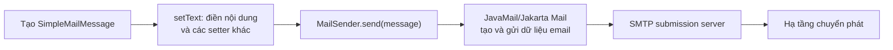
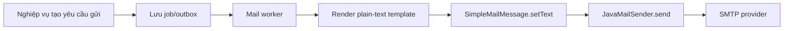

# Thiết lập nội dung văn bản thuần trong Spring Framework Mail

Khi gửi email xác nhận đăng ký, thông báo trạng thái đơn hàng, mã xác minh hoặc nhắc lịch, ứng dụng Spring không nhất thiết phải tạo HTML. Trong nhiều tình huống, **văn bản thuần (plain text)** là lựa chọn phù hợp: nội dung dễ đọc, không phụ thuộc trình duyệt hay bộ dựng HTML của ứng dụng email, thuận tiện cho thông báo ngắn và dễ kiểm soát cách hiển thị.

Trong **Spring Framework Mail**, cách đơn giản nhất để thiết lập nội dung loại này là tạo một `SimpleMailMessage` và gọi:

```java
message.setText("Xin chào! Tài khoản của bạn đã được tạo.");
```

Phương thức `setText(...)` nhận một `String` Java làm **phần thân (body)** của email. Nó không đặt tiêu đề thư, không chỉ định người nhận và cũng không tự thực hiện kết nối SMTP. Những thành phần đó được thiết lập bằng các setter khác và được gửi đi qua `MailSender`/`JavaMailSender`.

Nội dung bài học tập trung vào cách dùng `SimpleMailMessage.setText(...)` đúng mục đích, soạn văn bản nhiều dòng, giữ tiếng Việt và Unicode, phân biệt text/plain với HTML, quản lý mẫu thư và tổ chức luồng gửi email trong ứng dụng Spring.

## 1. Văn bản thuần là gì?

Một email có phần thân `text/plain` chứa các ký tự được diễn giải như **văn bản**, không yêu cầu mail client hiển thị thẻ HTML hoặc áp dụng CSS.

Ví dụ nội dung người nhận nhìn thấy:

```text
Xin chào Minh,

Đơn hàng DH-2026-081 đã được xác nhận.
Tổng thanh toán: 320.000 ₫

Bạn có thể xem chi tiết trong tài khoản của mình.

Trân trọng,
Đội ngũ hỗ trợ
```

Đây là một chuỗi ký tự có những dấu xuống dòng và dòng trống. Khi gửi dưới dạng text/plain, người nhận nhìn thấy các dòng văn bản này (cách xuống dòng hoặc ngắt dài có thể khác tùy thiết bị và ứng dụng đọc thư).

Ngược lại, nếu đặt chuỗi sau vào một email text/plain:

```html
<h2>Đơn hàng đã xác nhận</h2>
<p>Xin chào <strong>Minh</strong>!</p>
```

mail client sẽ thường hiển thị **nguyên các ký tự thẻ HTML**. Chúng không tự biến thành tiêu đề lớn hoặc chữ đậm. Để hiển thị HTML như giao diện, phải tạo MIME part `text/html`, thường thông qua `MimeMessageHelper.setText(html, true)`.

Tương tự, chuỗi Markdown như `**Quan trọng**`, `# Tiêu đề` hoặc `[Xem đơn hàng](https://example.org)` vẫn chỉ là văn bản khi gửi dưới dạng text/plain. Một số mail client tự phát hiện đường link và biến thành liên kết có thể nhấn, nhưng không có bảo đảm rằng chúng diễn giải Markdown.

### Vì sao plain text vẫn hữu ích?

| Ưu điểm | Ý nghĩa trong email thực tế |
|---|---|
| Ít phụ thuộc môi trường hiển thị | Đọc được trên nhiều mail client và công cụ dòng lệnh |
| Nội dung dễ tạo | Không cần template HTML, CSS hoặc tài nguyên ảnh |
| Phù hợp thông báo ngắn | OTP, trạng thái nghiệp vụ, cảnh báo hệ thống |
| Dễ có phiên bản trợ năng | Bản text có thể hữu ích khi người dùng không muốn hoặc không thể dùng HTML |
| Không phụ thuộc tải ảnh ngoài | Nội dung chính có sẵn trong phần thân thư |
| Dễ lưu, tra cứu và kiểm tra | Dữ liệu chủ yếu là chuỗi ký tự và xuống dòng |

Plain text **không tự bảo đảm email được phát thành công, không tự ngăn thư rác và không thay thế mã hóa dữ liệu nhạy cảm**. Khả năng phát thư còn phụ thuộc hạ tầng SMTP, cấu hình miền gửi, uy tín người gửi và chính sách phía nhận.

## 2. `SimpleMailMessage` và `setText(...)`

`SimpleMailMessage` là đối tượng biểu diễn email đơn giản trong Spring, với các trường như người gửi, người nhận, tiêu đề, ngày gửi và **nội dung văn bản thuần**.

Ví dụ nhỏ nhất có thông tin thực tế:

```java
import org.springframework.mail.SimpleMailMessage;

SimpleMailMessage message = new SimpleMailMessage();
message.setFrom("notifications@example.org");
message.setTo("customer@example.net");
message.setSubject("Xác nhận tài khoản");
message.setText("Xin chào! Tài khoản của bạn đã được tạo.");
```

Đoạn code trên **chỉ tạo một đối tượng thư**, chưa gửi thư. Để gửi qua SMTP server đã cấu hình:

```java
mailSender.send(message);
```

Ở đây, `mailSender` là bean triển khai `MailSender` hoặc `JavaMailSender` của Spring; trong ứng dụng dùng Spring Boot mail starter, nó thường là bean `JavaMailSender` được cấu hình từ `spring.mail.*`.

### Các setter thường dùng

| Phương thức | Nội dung thiết lập | Ví dụ |
|---|---|---|
| `setFrom(String)` | Địa chỉ người gửi hiển thị | `notifications@example.org` |
| `setTo(String...)` | Một hoặc nhiều người nhận trực tiếp | `customer@example.net` |
| `setCc(String...)` | Người nhận bản sao công khai | `team@example.org` |
| `setBcc(String...)` | Người nhận bản sao ẩn | `audit@example.org` |
| `setReplyTo(String)` | Địa chỉ đề nghị nhận phản hồi | `support@example.org` |
| `setSubject(String)` | Tiêu đề thư | `Xác nhận tài khoản` |
| **`setText(String)`** | **Phần thân text/plain** | `Đơn hàng đã xác nhận.` |
| `setSentDate(Date)` | Thời điểm phát hành thông điệp do bên gửi khai báo | `new Date()` |

`setText(...)` chỉ kiểm soát body. Nếu muốn đổi `From` hoặc `Subject`, bạn phải đặt các trường tương ứng. Không chèn các dòng `Subject: ...` hoặc `To: ...` vào đầu chuỗi body với hy vọng chúng trở thành email header; chúng sẽ chỉ là một phần nội dung được người nhận đọc thấy.

### `setText(...)` khác `send(...)`

Hai phương thức thuộc hai giai đoạn:



`setText(...)` là thao tác trong bộ nhớ; nó không gọi mạng hay kiểm tra người nhận có tồn tại. `send(...)` mới thực hiện giao tiếp gửi email, và phương thức có thể ném lỗi thuộc họ `MailException` khi không gửi được.

Ngay cả khi `send(...)` kết thúc bình thường, điều đó thường chỉ nghĩa là máy chủ submission đã **chấp nhận email để xử lý tiếp**; chưa bảo đảm thư đã đến inbox cuối cùng hoặc người nhận đã đọc.

## 3. Thiết lập nội dung nhiều dòng

Email text/plain trở nên dễ đọc hơn khi được chia thành các đoạn rõ ràng. Trong Java, có hai cách thông dụng: ký tự xuống dòng trong một chuỗi hoặc **text block**.

### Cách 1: ghép các dòng bằng `\n`

```java
String body = "Xin chào Minh,\n"
        + "\n"
        + "Đơn hàng của bạn đã được xác nhận.\n"
        + "Mã đơn hàng: DH-081\n"
        + "Tổng thanh toán: 320.000 ₫\n"
        + "\n"
        + "Cảm ơn bạn đã sử dụng dịch vụ.\n"
        + "Đội ngũ hỗ trợ";

message.setText(body);
```

Trong chuỗi Java, `\n` biểu diễn ký tự xuống dòng. Hai lần xuống dòng liên tiếp tạo một **dòng trống** để tách đoạn. Cách này phù hợp với chương trình dùng Java cũ hoặc nội dung chỉ vài dòng.

### Cách 2: Java text block cho mẫu thư dài

Với Java 17+ (hoặc các phiên bản Java hỗ trợ text block), có thể viết:

```java
String body = """
        Xin chào Minh,

        Đơn hàng của bạn đã được xác nhận.
        Mã đơn hàng: DH-081
        Tổng thanh toán: 320.000 ₫

        Cảm ơn bạn đã sử dụng dịch vụ.
        Đội ngũ hỗ trợ
        """;

message.setText(body);
```

Text block giúp nhìn gần giống nội dung email thực tế khi đọc source code. Java xử lý phần thụt đầu dòng dùng để căn lề mã; những dấu xuống dòng và khoảng trắng bên trong nội dung vẫn có thể ảnh hưởng kết quả. Hãy đặt những khoảng trắng có ý nghĩa một cách chủ động, đặc biệt với biểu mẫu có cột hoặc chữ ký.

### Không cần tự thay `\n` thành `\r\n`

SMTP sử dụng quy tắc dòng ở tầng truyền tải. Khi đặt nội dung cho `SimpleMailMessage`, ứng dụng nên cung cấp một chuỗi Java bình thường, dùng `\n` cho các dòng nếu cần, để Jakarta Mail xử lý biểu diễn MIME/SMTP phù hợp.

Việc chèn cứng `\r\n` ở mọi vị trí không phải điều kiện để `setText(...)` hoạt động. Nếu dữ liệu được đọc từ nhiều hệ điều hành, có thể chuẩn hóa xuống dòng ở **tầng nội dung** khi cần; tránh biến đổi bừa làm mất format mà người dùng đã chủ đích nhập.

### Dấu cách, thụt đầu dòng và ngắt dòng dài

Ứng dụng đọc thư có thể hiển thị text/plain bằng phông chữ và chiều rộng khác nhau; client có thể tự ngắt dòng dài. Vì vậy:

- Viết các đoạn ngắn, có dòng trống giữa các khối.
- Tránh dựng bảng nhiều cột phụ thuộc tuyệt đối vào khoảng trắng nếu email hướng tới thiết bị di động.
- Viết URL đầy đủ trên dòng riêng khi đường dẫn quan trọng; một số client có thể tự biến URL thành liên kết có thể nhấn.
- Không dựa vào CSS, màu sắc, chữ in đậm, gạch đầu dòng HTML hoặc layout responsive trong body text/plain.
- Đối với các danh sách, các ký hiệu đơn giản như `-` và số thứ tự thường dễ đọc.

Ví dụ bố cục văn bản không cần HTML:

```text
Thông tin đơn hàng
------------------
Mã đơn:     DH-081
Trạng thái: Đã xác nhận

Các bước tiếp theo:
1. Chúng tôi chuẩn bị đơn hàng.
2. Bạn sẽ nhận thông báo khi giao hàng.

Hỗ trợ: support@example.org
```

Đây là định dạng phục vụ con người đọc, không phải cấu trúc dữ liệu mà máy có thể phân tích chắc chắn. Khi trao đổi giữa các hệ thống, nên dùng API hoặc định dạng dữ liệu chuyên dụng thay vì cố phân tích body email.

## 4. Tiếng Việt, Unicode và charset

Nội dung văn bản thuần **không giới hạn ở ASCII**. Tên người dùng, địa chỉ và thông báo có thể chứa tiếng Việt: `Đã xác nhận`, `Cảm ơn bạn`, `320.000 ₫`.

Trong Java, `String` chứa các ký tự Unicode. Tuy nhiên, khi thư được chuyển thành thông điệp email, dữ liệu cần được mã hóa thành byte theo một **charset** và một phương pháp `Content-Transfer-Encoding` phù hợp.

Ví dụ biểu diễn MIME (chỉ minh họa, header thực tế có thể khác):

```text
MIME-Version: 1.0
Content-Type: text/plain; charset=UTF-8
Content-Transfer-Encoding: quoted-printable

Xin ch=C3=A0o b=E1=BA=A1n!
```

Đây vẫn là **email plain text**. `quoted-printable` chỉ là cách mã hóa byte để truyền qua email; người nhận có client phù hợp sẽ thấy nội dung `Xin chào bạn!`, không phải các chuỗi `=C3=...`.

### Đặt UTF-8 cho Spring Boot Mail

Trong `application.yml` có thể khai báo:

```yaml
spring:
  mail:
    default-encoding: UTF-8
```

Thuộc tính `spring.mail.default-encoding` được dùng bởi cơ chế gửi thư trong Spring Boot/Jakarta Mail khi xây dựng thông điệp. Trong ứng dụng Spring Framework thuần dùng `JavaMailSenderImpl`, có thể đặt:

```java
JavaMailSenderImpl sender = new JavaMailSenderImpl();
sender.setDefaultEncoding("UTF-8");
```

Đặt encoding giúp giảm rủi ro việc môi trường phát triển và môi trường triển khai dùng mặc định khác nhau. Thêm vào đó, cần bảo đảm **nguồn dữ liệu** (file template, database, API) cũng sử dụng mã hóa phù hợp. Nếu văn bản đã bị giải mã sai từ đầu, việc chọn UTF-8 khi gửi không tự phục hồi được ký tự đã hỏng.

### Khi nào dùng `MimeMessageHelper` với UTF-8?

Nếu cần kiểm soát rõ MIME message, thay vì `SimpleMailMessage` có thể sử dụng:

```java
MimeMessage mimeMessage = mailSender.createMimeMessage();
MimeMessageHelper helper = new MimeMessageHelper(
        mimeMessage, false, "UTF-8");

helper.setFrom("notifications@example.org");
helper.setTo("customer@example.net");
helper.setSubject("Đơn hàng đã xác nhận");
helper.setText("Xin chào bạn! Đơn hàng đã được xác nhận.", false);

mailSender.send(mimeMessage);
```

Lưu ý tham số `false` của `setText(body, false)`: nó có nghĩa **nội dung không phải HTML**, tức nên được biểu diễn dưới dạng text/plain. Cách này vẫn là email văn bản thuần, dù thông điệp được tạo bằng `MimeMessage`.

## 5. Cấu hình Spring Boot để gửi simple mail

Một ứng dụng Spring Boot dùng Spring Mail thường thêm mail starter.

Với Gradle:

```groovy
dependencies {
    implementation 'org.springframework.boot:spring-boot-starter-mail'
}
```

Với Maven:

```xml
<dependency>
    <groupId>org.springframework.boot</groupId>
    <artifactId>spring-boot-starter-mail</artifactId>
</dependency>
```

Tiếp theo, cấu hình SMTP submission server do tổ chức hoặc nhà cung cấp email cấp. Ví dụ **cổng 587 và STARTTLS bắt buộc**:

```yaml
spring:
  mail:
    host: ${SMTP_HOST}
    port: 587
    protocol: smtp
    username: ${SMTP_USERNAME}
    password: ${SMTP_PASSWORD}
    default-encoding: UTF-8
    properties:
      "[mail.smtp.auth]": true
      "[mail.smtp.starttls.enable]": true
      "[mail.smtp.starttls.required]": true
      "[mail.smtp.ssl.checkserveridentity]": true
      "[mail.smtp.connectiontimeout]": 5000
      "[mail.smtp.timeout]": 10000
      "[mail.smtp.writetimeout]": 10000

app:
  mail:
    from: ${MAIL_FROM}
```

Ý nghĩa những nhóm cấu hình chính:

| Nhóm | Vai trò |
|---|---|
| `host`, `port`, `protocol` | Chọn SMTP server và cách kết nối |
| `username`, `password` | Danh tính SMTP AUTH theo yêu cầu server |
| `default-encoding` | Charset mặc định khi tạo nội dung mail |
| `mail.smtp.starttls.enable` | Cho phép nâng cấp SMTP sang TLS |
| `mail.smtp.starttls.required` | Không tiếp tục nếu STARTTLS không thành công |
| `mail.smtp.ssl.checkserveridentity` | Kiểm tra hostname trong chứng chỉ TLS |
| Các timeout | Giới hạn thời gian tạo kết nối, đọc và ghi |
| `app.mail.from` | Thuộc tính do **ứng dụng tự định nghĩa** cho địa chỉ gửi |

Các biến môi trường `SMTP_HOST`, `SMTP_USERNAME`, `SMTP_PASSWORD` và `MAIL_FROM` phải được cung cấp qua nơi quản lý cấu hình/secret phù hợp. Không đặt mật khẩu thật trong repository hoặc xuất toàn bộ SMTP AUTH transcript ra log.

Nếu nhà cung cấp yêu cầu **cổng 465 với implicit TLS**, phải thay `port: 465` và bật `"[mail.smtp.ssl.enable]": true` theo chính sách của họ, thay vì tái sử dụng mặc định cách bắt đầu STARTTLS của cổng 587. Cấu hình email text/plain không làm thay đổi quy tắc chọn cổng hay xác thực.

### Test cục bộ bằng SMTP sink

Trong môi trường phát triển, có thể trỏ Spring đến một SMTP sink như Mailpit. Ví dụ nếu công cụ đang lắng nghe ở `localhost:1025`:

```yaml
# application-local.yml — chỉ dùng trong môi trường thử nghiệm được kiểm soát
spring:
  mail:
    host: localhost
    port: 1025
    protocol: smtp
    default-encoding: UTF-8
    properties:
      "[mail.smtp.auth]": false
      "[mail.smtp.starttls.enable]": false

app:
  mail:
    from: local@example.test
```

Cấu hình local không TLS/không AUTH này không thích hợp cho SMTP server công cộng. Nếu ứng dụng chạy trong container khác với SMTP sink, `localhost` là container của ứng dụng; khi đó cần dùng hostname service có thể phân giải trong mạng container.

## 6. Một dịch vụ Spring gửi email văn bản thuần

Ví dụ một `@Service` dùng `JavaMailSender` để gửi thông báo xác nhận đơn hàng. `JavaMailSender` mở rộng khả năng gửi mail của Spring và được Spring Boot cung cấp khi mail starter và cấu hình phù hợp được kích hoạt.

```java
package com.example.notification;

import java.math.BigDecimal;
import java.text.NumberFormat;
import java.util.Locale;
import org.springframework.beans.factory.annotation.Value;
import org.springframework.mail.SimpleMailMessage;
import org.springframework.mail.javamail.JavaMailSender;
import org.springframework.stereotype.Service;

@Service
public class OrderConfirmationMailService {

    private final JavaMailSender mailSender;
    private final String fromAddress;

    public OrderConfirmationMailService(
            JavaMailSender mailSender,
            @Value("${app.mail.from}") String fromAddress) {
        this.mailSender = mailSender;
        this.fromAddress = fromAddress;
    }

    public void sendConfirmation(
            String recipient,
            String customerName,
            String orderCode,
            BigDecimal totalAmount) {

        String displayName = customerName == null
                || customerName.isBlank()
                ? "bạn"
                : customerName.strip().replaceAll("\\s+", " ");

        String total = NumberFormat
                .getCurrencyInstance(Locale.forLanguageTag("vi-VN"))
                .format(totalAmount);

        String body = """
                Xin chào %s,

                Đơn hàng %s của bạn đã được xác nhận.
                Tổng thanh toán: %s

                Chúng tôi sẽ thông báo khi đơn hàng được bàn giao.
                Nếu cần hỗ trợ, vui lòng liên hệ support@example.org.

                Trân trọng,
                Đội ngũ cửa hàng
                """.formatted(displayName, orderCode, total);

        SimpleMailMessage message = new SimpleMailMessage();
        message.setFrom(fromAddress);
        message.setTo(recipient);
        message.setSubject("Xác nhận đơn hàng " + orderCode);
        message.setText(body);

        mailSender.send(message);
    }
}
```

Trong dịch vụ trên:

1. `@Value("${app.mail.from}")` đọc địa chỉ người gửi đã cấu hình. Đây là **header From**, không phải SMTP host.
2. `SimpleMailMessage` giữ dữ liệu thư trong bộ nhớ; mỗi lần gửi tạo một đối tượng mới, tránh trộn dữ liệu giữa các request.
3. `NumberFormat` định dạng số tiền cho người đọc; giá trị hiển thị có thể phụ thuộc locale.
4. Text block tạo nội dung có đoạn, dòng trống và chữ ký rõ ràng.
5. `setSubject(...)` đặt tiêu đề; **`setText(body)` đặt nội dung text/plain**.
6. `mailSender.send(message)` gửi email qua SMTP transport đã cấu hình, không làm nội dung văn bản biến thành HTML.

Mẫu này dùng Java text block và `String.formatted(...)`, phù hợp với Java 17+. Khi làm việc với Java phiên bản cũ, có thể thay bằng chuỗi nối với `\n` và `String.format(...)` tương ứng.

Phần `orderCode`, `recipient` và `totalAmount` trong ví dụ được giả định đã qua kiểm tra nghiệp vụ. Trong triển khai thực tế, cần xác thực dữ liệu, giới hạn độ dài và định dạng các chuỗi được phép xuất hiện trong email. Nếu `orderCode` đến trực tiếp từ input người dùng, không đưa chuỗi tùy ý chứa xuống dòng vào tiêu đề mà chưa được kiểm soát.

### Vì sao mỗi lần gửi tạo một SimpleMailMessage mới?

`SimpleMailMessage` là một đối tượng **có thể thay đổi**. Nếu dùng một bean singleton rồi gọi `setTo(...)`, `setSubject(...)`, `setText(...)` trong nhiều request chạy đồng thời, nội dung của các người nhận có thể chồng chéo.

Ví dụ cách **không nên làm**:

```java
// Không dùng chung một SimpleMailMessage mutable để đổi dữ liệu mỗi request.
private final SimpleMailMessage sharedMessage = new SimpleMailMessage();

public void send(String to, String body) {
    sharedMessage.setTo(to);
    sharedMessage.setText(body);
    mailSender.send(sharedMessage);
}
```

Nếu hai thread thay đổi `sharedMessage` cùng lúc, nội dung và người nhận của email có thể không thuộc cùng một request. Hãy tạo **message mới cho mỗi lần gửi**, hoặc dùng `new SimpleMailMessage(template)` để sao chép cấu hình mẫu rồi điền trường riêng.

## 7. Sử dụng mẫu thư văn bản thuần

Khi một ứng dụng có hàng chục loại thông báo, không nên đặt tất cả nội dung thành các chuỗi rải rác trong controller hoặc service nghiệp vụ. Có thể quản lý **text template** riêng theo loại email và ngôn ngữ.

Ví dụ file `src/main/resources/mail/order-confirmed.txt`:

```text
Xin chào {customerName},

Đơn hàng {orderCode} đã được xác nhận.
Tổng thanh toán: {total}.

Bạn có thể xem trạng thái đơn hàng trong tài khoản của mình.

Trân trọng,
Đội ngũ hỗ trợ
```

Đây chỉ là **một mẫu nội dung text tự định nghĩa**, không phải cú pháp mặc định của Spring Mail. Ứng dụng cần một cơ chế đọc file template và thay các placeholder `{customerName}`, `{orderCode}`, `{total}` bằng dữ liệu thực.

Ví dụ dịch vụ render đơn giản:

```java
public String renderOrderConfirmation(
        String template,
        String customerName,
        String orderCode,
        String total) {

    return template
            .replace("{customerName}", customerName)
            .replace("{orderCode}", orderCode)
            .replace("{total}", total);
}
```

Cách `String.replace(...)` này chỉ phù hợp với template nhỏ, được **ứng dụng kiểm soát**, không có cú pháp phức tạp và không cần escaping theo ngữ cảnh. Với template đa ngôn ngữ hoặc nhiều điều kiện, có thể dùng một template engine hoặc cơ chế quản lý nội dung rõ ràng hơn. Khi đó nội dung render ra vẫn phải được gửi bằng `setText(renderedText)` nếu mục tiêu là text/plain.

### Một rủi ro của phương pháp replace liên tiếp

Nếu dữ liệu người dùng chứa chuỗi giống placeholder (ví dụ tên khách hàng là `"{orderCode}"`), các lần `replace(...)` tiếp theo có thể vô tình sửa cả dữ liệu vừa được chèn. Với những hệ thống cần tính chính xác, nên dùng template engine thay thế placeholder **một lần dựa trên cấu trúc template**, hoặc dùng `String.formatted(...)` trên một khuôn mẫu cố định của ứng dụng.

Đối với nội dung phải bảo đảm nguồn gốc và tính toàn vẹn, nên lưu **template ID/version** cùng thông tin của job. Khi template được cập nhật giữa lúc tạo job và lúc gửi, hệ thống cần biết sẽ render theo bản mới nhất hay bản đã chốt của job.

### Mẫu thư có giá trị động và xuống dòng

Các quy tắc trình bày hữu ích:

- Mỗi email nên có một **hành động hoặc thông tin chính** dễ thấy ở đoạn đầu.
- Tách từng đoạn bằng một dòng trống; tránh toàn bộ thông tin nằm trên một dòng dài.
- Định dạng ngày, giờ và số tiền theo locale/múi giờ mong muốn trước khi chèn vào body.
- Khi gửi đường dẫn, dùng URL đáng tin cậy do hệ thống tạo; đừng ghép hostname tùy ý từ input người nhận.
- Giữ thông tin hỗ trợ và chữ ký nhất quán giữa các template.
- Nếu có nội dung người dùng nhập dài hoặc nhiều dòng, quyết định rõ có giữ nguyên xuống dòng, giới hạn độ dài hoặc đưa vào một khối trích dẫn.

## 8. Phân biệt nội dung, tiêu đề và địa chỉ người nhận

Nhiều lỗi soạn email đến từ việc nhầm `setText` với các setter header:

```java
SimpleMailMessage message = new SimpleMailMessage();

message.setFrom("orders@example.org");            // From header
message.setTo("customer@example.net");             // To header
message.setReplyTo("support@example.org");         // Reply-To header
message.setSubject("Đơn hàng đã xác nhận");         // Subject header
message.setText("Cảm ơn bạn đã đặt hàng!");         // Plain-text body
```

Không đặt dữ liệu địa chỉ hoặc tiêu đề dưới dạng dòng văn bản trong `setText(...)` để thay thế header:

```java
// Đây vẫn chỉ là body, KHÔNG tạo To/Subject thật.
message.setText("""
        To: customer@example.net
        Subject: Đơn hàng đã xác nhận

        Cảm ơn bạn đã đặt hàng!
        """);
```

Nếu thiếu `setTo(...)` hoặc `setSubject(...)` tương ứng, việc có những dòng `To:`, `Subject:` nằm trong body không giúp SMTP biết người nhận hay metadata thư.

### Người nhận nhiều địa chỉ

`SimpleMailMessage` hỗ trợ nhiều người nhận:

```java
message.setTo("customer1@example.net", "customer2@example.net");
message.setCc("accounting@example.org");
message.setBcc("audit@example.org");
```

Tuy nhiên, với email chứa dữ liệu riêng của từng khách hàng, thường cần **tạo thông điệp riêng cho từng người nhận**. Gửi cùng một body tới nhiều người trong `To` có thể để lộ địa chỉ và thông tin cá nhân không cần thiết.

Địa chỉ `Bcc` là cơ chế ẩn danh sách người nhận trong nội dung hiển thị nhưng không thay thế việc quản lý phân quyền, mục đích gửi và quy định bảo vệ dữ liệu.

## 9. `SimpleMailMessage` khác gì `MimeMessage`?

`SimpleMailMessage` là lựa chọn rất hợp lý khi **chỉ cần email văn bản thuần**. Khi yêu cầu vượt ra ngoài nội dung text đơn giản, `MimeMessage` và `MimeMessageHelper` cho phép tạo MIME đa phần.

| Nhu cầu | `SimpleMailMessage` | `MimeMessage` + `MimeMessageHelper` |
|---|---|---|
| Body text/plain | `setText(body)` | `setText(body, false)` |
| Subject/To/From/Reply-To | Có | Có |
| Tiếng Việt/Unicode | Có, cần encoding SMTP phù hợp | Có, có thể chỉ rõ charset khi dựng MIME |
| HTML | Không có API HTML riêng | `setText(html, true)` |
| Đồng thời text/plain và text/html | Không | `setText(plain, html)` |
| Attachment | Không | `addAttachment(...)` |
| Ảnh nội tuyến CID | Không | `addInline(...)` |
| Header MIME tùy chỉnh | Không phải điểm mạnh | Có thể thao tác trực tiếp trên `MimeMessage` |
| Sự đơn giản | Rất phù hợp với thông báo ngắn | Phù hợp yêu cầu trình bày hoặc MIME phức tạp |

### Ví dụ tạo cùng một body text/plain bằng MimeMessageHelper

```java
import jakarta.mail.internet.MimeMessage;
import org.springframework.mail.javamail.MimeMessageHelper;

MimeMessage mimeMessage = mailSender.createMimeMessage();
MimeMessageHelper helper = new MimeMessageHelper(
        mimeMessage, false, "UTF-8");

helper.setFrom("notifications@example.org");
helper.setTo("customer@example.net");
helper.setSubject("Thông báo");
helper.setText("Xin chào!\nTác vụ của bạn đã hoàn tất.", false);

mailSender.send(mimeMessage);
```

Tham số `false` truyền vào constructor helper ở trên là lựa chọn **không tạo multipart**; còn tham số `false` ở `setText(body, false)` là lựa chọn **không dùng HTML**. Chúng là hai tham số của hai API khác nhau, tình cờ cùng dùng giá trị boolean.

Nếu muốn gửi **cả text/plain và text/html** để client chọn phiên bản phù hợp:

```java
MimeMessage mimeMessage = mailSender.createMimeMessage();
MimeMessageHelper helper = new MimeMessageHelper(
        mimeMessage, true, "UTF-8");

helper.setFrom("notifications@example.org");
helper.setTo("customer@example.net");
helper.setSubject("Thông báo");
helper.setText(
        "Đơn hàng đã được xác nhận.",
        "<p><strong>Đơn hàng</strong> đã được xác nhận.</p>");

mailSender.send(mimeMessage);
```

Phiên bản này tạo email có lựa chọn hiển thị text và HTML. Nó không còn là một `SimpleMailMessage` thuần túy, dù vẫn cung cấp nội dung văn bản thuần cho những client không hiển thị HTML.

**Lưu ý phiên bản:** ví dụ dùng import `jakarta.mail` (Spring Framework 6+, Spring Boot 3+). Các dự án Spring Framework 5/Spring Boot 2 thường sử dụng import `javax.mail`; cần dùng đúng dependency của dự án.

## 10. Gửi nội dung liên kết, mã xác nhận và thông tin quan trọng

### Liên kết trong text/plain

Để người nhận mở trang xác nhận, có thể đặt URL trực tiếp:

```text
Xin chào,

Bạn có yêu cầu đặt lại mật khẩu.

Mở liên kết sau để tiếp tục:
https://example.org/reset/abc123

Liên kết chỉ có hiệu lực trong 15 phút.
Nếu bạn không thực hiện yêu cầu, hãy bỏ qua email này.
```

Nhiều mail client sẽ tự nhận diện URL. Tuy nhiên, **không có cú pháp liên kết có nhãn như HTML** trong plain text; nên dùng URL dễ nhận biết và đủ ngữ cảnh.

Token trong URL đặt lại mật khẩu là thông tin nhạy cảm. Hệ thống cần tạo token có độ ngẫu nhiên phù hợp, có thời hạn, giới hạn việc sử dụng và chỉ gửi đến người nhận có quyền. Tránh ghi URL chứa token vào log nghiệp vụ công khai. Không tạo link với hostname tùy ý từ `Host` header của request nếu chưa được kiểm soát.

### OTP hoặc mã xác minh

Ví dụ nội dung ngắn:

```text
Mã xác minh của bạn: 482913

Mã có hiệu lực trong 5 phút.
Không chia sẻ mã này với người khác.

Nếu bạn không yêu cầu mã, hãy bỏ qua email.
```

Điểm cần nhớ không nằm ở định dạng có màu sắc hay không, mà ở **tính chính xác của mã, thời hạn, người nhận, mục đích xác minh và giới hạn số lần thử**. Plain text giúp nội dung mã dễ sao chép, nhưng không làm email trở thành kênh bảo mật đầu cuối.

### Thông báo có nội dung nhập từ người dùng

Nếu cần đưa ghi chú hoặc tên người dùng vào email, hãy coi dữ liệu đó là dữ liệu không đáng tin cậy:

- Kiểm tra giới hạn độ dài và tập ký tự phù hợp trước khi render.
- Xem xét có cho phép ký tự xuống dòng trong tên hoặc mã đơn hàng hay không.
- Không để văn bản người dùng tự nhận là lệnh quản trị hoặc thay đổi ý nghĩa thông báo giao dịch.
- Không đưa dữ liệu người dùng chưa xử lý vào **header** (From/To/Subject); nguy cơ ở header khác với việc chỉ hiển thị nội dung trong body.
- Không tự gắn HTML do người dùng nhập vào email text/plain với kỳ vọng nó được render an toàn dưới mọi tình huống; nếu sau này đổi sang HTML phải escape đúng ngữ cảnh.

## 11. Một số lỗi thường gặp

| Hiện tượng | Nguyên nhân có thể | Cách xử lý |
|---|---|---|
| Email hiện `<b>...` thay vì chữ đậm | Chuỗi HTML được gửi như plain text | Nếu cần HTML, dùng `MimeMessageHelper.setText(html, true)` |
| Email hiện nguyên `**Quan trọng**` | Markdown không được diễn giải trong text/plain | Viết văn bản rõ ràng hoặc chuyển sang email HTML khi cần |
| Các đoạn văn dính liền nhau | Body không chứa ký tự xuống dòng hoặc dòng trống | Sử dụng `\n`, text block hoặc template có xuống dòng |
| Nhiều dấu cách bị thay đổi khi hiển thị | Mail client có cách wrap/hiển thị riêng | Tránh layout cần độ rộng cột tuyệt đối |
| Ký tự tiếng Việt bị lỗi | Sai charset ở nguồn, template hoặc lúc tạo MIME | Dùng UTF-8 nhất quán và cấu hình `default-encoding` |
| `Subject` hoặc người nhận không đúng | Đặt text trong body thay vì header, hoặc dữ liệu đầu vào sai | Dùng `setSubject`/`setTo` với dữ liệu đã kiểm soát |
| Nội dung của hai khách hàng bị trộn | Dùng chung một `SimpleMailMessage` mutable giữa các thread | Tạo message mới cho mỗi lần gửi |
| Exception khi `send(...)` | SMTP auth/TLS/network/policy hoặc dữ liệu thư không hợp lệ | Xem nguyên nhân trong `MailException` và log SMTP đã được lọc |
| `send(...)` không báo lỗi nhưng người nhận chưa thấy thư | MSA chấp nhận nhưng chưa delivery, bị delay/bounce/spam | Kiểm tra provider events, queue/bounce và phía nhận |
| Thư quá dài, khó đọc trên điện thoại | Các đoạn không được chia nhỏ, URL hoặc bảng text quá rộng | Rút ngắn dòng, chia đoạn, tối ưu thông tin chính |
| Bản text/plain thiếu thông tin so với HTML | Hai phiên bản được render từ nguồn không nhất quán | Dùng cùng dữ liệu nghiệp vụ và cùng logic tạo nội dung |

### Nếu `setText(...)` đã chạy nhưng không nhận email?

Không nên kết luận body là nguyên nhân duy nhất. Hãy phân biệt:

1. **Tạo đối tượng:** có giá trị `From`, `To`, `Subject` và `Text` hợp lệ không?
2. **Kết nối SMTP:** ứng dụng có truy cập đúng host/port, sử dụng TLS và AUTH như provider yêu cầu không?
3. **Submission:** server trả kết quả gì sau khi nhận thông điệp?
4. **Delivery:** hệ thống gửi có phát thư đến server đích hay báo bounce/hoãn gửi?
5. **Hiển thị:** email có nằm ở spam/quarantine hoặc bị client cắt/ẩn một phần nội dung không?

`setText(...)` giúp chuẩn bị body, không có trách nhiệm tự gửi hay xác nhận thư đã tới người nhận.

## 12. Thiết kế và vận hành simple mail trong ứng dụng

### Gửi email ở tầng dịch vụ

Controller nên gọi một dịch vụ email riêng thay vì tự khởi tạo SMTP client và ghép body ở nhiều nơi. Dịch vụ có thể:

1. Nhận dữ liệu nghiệp vụ đã được xác thực và phân quyền.
2. Chọn mẫu thư đúng mục đích và locale.
3. Render chuỗi plain text.
4. Tạo một `SimpleMailMessage` mới.
5. Đặt sender/recipient/subject/body.
6. Gọi `mailSender.send(...)` hoặc chuyển thành job để xử lý bất đồng bộ.

Điều này giúp giữ các template nhất quán, hạn chế lặp lại cấu hình và dễ quan sát lỗi theo từng loại thông báo.

### Gửi bất đồng bộ và queue

Với thông báo quan trọng hoặc số lượng lớn, có thể ghi yêu cầu gửi vào **queue hoặc transactional outbox**, rồi để worker gửi sau:



Job nên có `jobId`, người nhận, mã mẫu thư, dữ liệu cần render, trạng thái và số lần thử gửi. Không ghi SMTP password hoặc token xác thực vào queue payload. Nếu dữ liệu nghiệp vụ có thể đổi khi worker chạy, cần xác định rõ dùng dữ liệu chốt tại thời điểm tạo job hay dữ liệu mới nhất.

### Xử lý lỗi gửi

Spring Mail có các ngoại lệ thuộc họ `MailException`, ví dụ lỗi xác thực, truyền gửi hoặc server. Có thể xử lý ở ranh giới worker/service để ghi log và quyết định retry:

```java
import org.springframework.mail.MailException;

try {
    mailSender.send(message);
    // Đã hoàn thành bước gửi theo phản hồi SMTP.
} catch (MailException ex) {
    // Ghi jobId và mã lỗi cần thiết; không ghi password/body nhạy cảm.
    // Quyết định retry dựa vào loại lỗi và chính sách của provider.
    throw ex;
}
```

Không retry vô hạn mọi lỗi. Lỗi tạm thời (mất mạng, server bận, một số phản hồi SMTP `4xx`) có thể cần backoff. Lỗi xác thực, địa chỉ sai hoặc vi phạm chính sách (`5xx` trong nhiều trường hợp) thường cần sửa nguyên nhân.

Lưu ý: nếu MSA đã chấp nhận thư nhưng kết nối mất trước khi ứng dụng đọc được phản hồi, retry có thể khiến người nhận nhận **hai bản email**. SMTP không tự bảo đảm exactly-once; với các tác vụ quan trọng, nên quản lý `jobId`, số lần thử và trạng thái nhà cung cấp để giảm rủi ro trùng.

### Khả năng đọc và quyền riêng tư

Plain text dễ xem trên nhiều thiết bị, nhưng vẫn cần tuân thủ cách truyền thông tin của hệ thống. Không đưa mật khẩu, dữ liệu cá nhân không cần thiết, token lâu hạn hoặc thông tin tài chính chi tiết vào email chỉ vì body đơn giản. Kiểm tra quyền người nhận trước khi gọi `setTo(...)`.

Đừng ghi toàn bộ nội dung email chứa thông tin nhạy cảm vào log debug. Nếu cần quan sát, có thể log `jobId`, tên template, địa chỉ người nhận được bảo vệ phù hợp, trạng thái submission và mã lỗi đã lọc.

## 13. Ví dụ hoàn chỉnh: một email nhắc lịch

Để thấy toàn bộ cách tạo body bằng `setText(...)`, xét email nhắc lịch có đầy đủ thông tin nhưng không cần HTML:

```java
import java.time.ZonedDateTime;
import java.time.format.DateTimeFormatter;
import java.util.Locale;
import org.springframework.mail.SimpleMailMessage;

ZonedDateTime appointmentTime = /* thời điểm lịch hẹn đã được xác định */;

String formattedTime = appointmentTime.format(
        DateTimeFormatter.ofPattern("HH:mm, dd/MM/yyyy", Locale.forLanguageTag("vi-VN")));

String body = """
        Xin chào,

        Đây là email nhắc lịch hẹn của bạn.

        Thời gian: %s
        Địa điểm: Tầng 2, văn phòng tiếp nhận

        Vui lòng có mặt trước giờ hẹn 10 phút.
        Nếu cần thay đổi lịch, liên hệ support@example.org.

        Trân trọng,
        Bộ phận tiếp nhận
        """.formatted(formattedTime);

SimpleMailMessage message = new SimpleMailMessage();
message.setFrom("reminders@example.org");
message.setTo("customer@example.net");
message.setSubject("Nhắc lịch hẹn");
message.setText(body);

mailSender.send(message);
```

Ví dụ này giả định `appointmentTime` đã được lấy từ dữ liệu nghiệp vụ với múi giờ chính xác. Với email gửi cho người dùng ở nhiều múi giờ, nên hiển thị **thời gian và múi giờ rõ ràng**, ví dụ `15:00 (UTC+07:00)`, tránh chỉ ghi một giờ địa phương mà người nhận không biết quy chiếu.

Nội dung text/plain cũng có thể chứa danh sách hoặc phần thông tin phân cách bằng ký tự, nhưng hãy ưu tiên cách viết dễ đọc, có thứ tự và không phụ thuộc layout tuyệt đối.

## 14. Câu hỏi thường gặp

**`SimpleMailMessage.setText(...)` có tự gửi email không?** Không. Nó chỉ gán chuỗi body cho đối tượng. Phải gọi `mailSender.send(message)` để nộp thông điệp tới SMTP server.

**Có thể gán tiếng Việt trực tiếp vào `setText(...)` không?** Có. Java `String` hỗ trợ Unicode. Hãy bảo đảm nguồn dữ liệu và cấu hình tạo MIME sử dụng UTF-8 nhất quán để giảm lỗi hiển thị.

**`setText(...)` mặc định là HTML hay text/plain?** Với `SimpleMailMessage`, nội dung là **văn bản thuần**. Để gửi HTML, dùng `MimeMessage`/`MimeMessageHelper` và đánh dấu nội dung là HTML.

**Có thể xuống dòng trong `setText(...)` không?** Có. Dùng `\n` trong chuỗi hoặc Java text block. Mail client có thể ngắt lại những dòng dài để phù hợp kích thước màn hình.

**Có thể gửi file đính kèm bằng `SimpleMailMessage` không?** Không có API attachment tương ứng trên loại message này. Với attachment hoặc ảnh inline, cần `MimeMessage` và `MimeMessageHelper`.

**Gửi text/plain có bắt buộc đặt `Content-Type` bằng tay không?** Thông thường không. Spring/Jakarta Mail xử lý chuyển đổi `SimpleMailMessage` thành thông điệp email có MIME metadata phù hợp. Việc cấu hình charset nên thực hiện qua sender khi cần.

**Nếu muốn gửi một email có cả text/plain và HTML thì sao?** Dùng `MimeMessageHelper.setText(plainText, htmlText)` để tạo hai phiên bản thay thế cho cùng thông điệp.

**Có cần mã hóa base64 thủ công trước khi gọi `setText(...)` không?** Không. Bạn cung cấp chuỗi văn bản bình thường; thư viện MIME chọn và áp dụng cách biểu diễn chuyển tải phù hợp. Base64/quoted-printable là chi tiết tầng email, không phải thứ cần thêm vào body.

**Có thể dùng `SimpleMailMessage` làm một bean singleton để gửi mọi email không?** Không nên nếu thay recipient/subject/body theo request. Đối tượng mutable có thể bị ghi đè giữa các luồng; hãy tạo bản mới cho từng lần gửi.

**Nếu người nhận thấy URL không bấm được thì sao?** Một số mail client tự linkify URL nhưng không phải tất cả. Bạn có thể đặt URL rõ ràng trên một dòng riêng; nếu yêu cầu giao diện có nút bấm, cần phiên bản HTML.

**Email không đến người nhận có phải do body text/plain?** Không thể kết luận như vậy. Cần kiểm tra SMTP submission, TLS/AUTH, chính sách provider, bounce, spam và việc xử lý của phía nhận.

**Thêm `setText(...)` có thể thay đổi `Subject` không?** Không. `setText` chỉ gán body; subject phải đặt qua `setSubject`.

## 15. Tài liệu kỹ thuật liên quan

- **Spring Framework Mail — `SimpleMailMessage`:** API biểu diễn email đơn giản, bao gồm `setText`, `setFrom`, `setTo` và `setSubject`.
- **Spring Framework Mail — `MailSender` và `JavaMailSender`:** API gửi thư và cách Spring tích hợp với Jakarta Mail.
- **Spring Framework Mail — `MimeMessageHelper`:** phương án nâng cao khi cần HTML, cả plain text và HTML, hoặc attachment.
- **Spring Boot Mail:** `spring.mail.*` và `spring.mail.default-encoding` cho cấu hình SMTP và charset.
- **RFC 2045–2049 (MIME):** các nguyên tắc kiểu nội dung `text/plain`, charset và content transfer encoding.
- **RFC 5322 (Internet Message Format):** khái niệm header và body của một thông điệp email.

---

**Ghi nhớ khi triển khai:** `SimpleMailMessage.setText(String)` nhận **nguyên phần thân văn bản thuần**, gồm các ký tự tiếng Việt, xuống dòng và đoạn văn do ứng dụng tạo. Dùng `setSubject`, `setTo`, `setFrom` cho những trường tương ứng; tạo message mới cho mỗi email; cấu hình SMTP/TLS/UTF-8 đúng cách rồi gọi `JavaMailSender.send(...)`. Khi cần HTML, nhiều phiên bản nội dung hoặc file đính kèm, chuyển sang `MimeMessage` và `MimeMessageHelper`.
