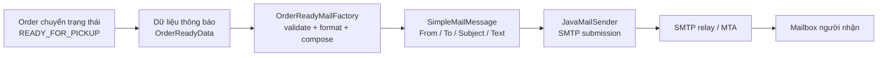

# Tạo message từ dữ liệu nghiệp vụ với Spring Framework Mail

Khi một ứng dụng Spring gửi email thông báo, nội dung thư thường không phải chuỗi viết sẵn. Nó được **tạo từ dữ liệu nghiệp vụ**: mã đơn hàng, tên người nhận, trạng thái thanh toán, thời hạn đặt lịch, địa điểm nhận hàng, số tiền hoặc một sự kiện vừa diễn ra. Với email **văn bản thuần (simple mail)**, Spring Framework Mail cung cấp `SimpleMailMessage` để biểu diễn thông điệp; `JavaMailSender` chịu trách nhiệm gửi nó thông qua SMTP transport.

Ví dụ, khi đơn hàng `ORD-2026-184` chuyển sang trạng thái `READY_FOR_PICKUP`, hệ thống muốn gửi:

```text
From: notifications@shop.example
To: alice@company.example
Subject: Đơn hàng ORD-2026-184 đã sẵn sàng

Xin chào Alice,

Đơn hàng ORD-2026-184 đã sẵn sàng để nhận.
Địa điểm: Quầy nhận hàng Quận 1
Hạn nhận: 17:00 ngày 15/11/2026 (Asia/Ho_Chi_Minh)

Nếu cần hỗ trợ, vui lòng phản hồi email này.
```

Đây là một **thông điệp được kết xuất từ dữ liệu đơn hàng**, chứ không phải một email hard-code cho Alice. Thách thức chính là ánh xạ đúng dữ liệu, định dạng phù hợp với người đọc, bảo đảm địa chỉ và nội dung được kiểm soát, rồi giao thư cho sender mà không làm lẫn logic gửi mail vào logic nghiệp vụ.

## 1. Luồng từ dữ liệu nghiệp vụ đến thông điệp email

Một cách tổ chức dễ bảo trì là tách **ba trách nhiệm**:

1. **Nguồn dữ liệu nghiệp vụ:** sự kiện hoặc dữ liệu đã được hệ thống xác nhận, ví dụ `OrderReadyData`.
2. **Bộ tạo thông điệp (composer/factory):** nhận dữ liệu nghiệp vụ và tạo một `SimpleMailMessage` mới, chứa người gửi, người nhận, tiêu đề, nội dung và tùy chọn `Reply-To`.
3. **Dịch vụ gửi:** nhận message đã tạo và gọi `JavaMailSender.send(...)`.



Luồng này giúp kiểm tra nội dung thư mà **không cần kết nối SMTP**. Khi đổi câu chữ, thời gian hoặc ngôn ngữ của thông báo, phần thay đổi tập trung ở composer. Khi đổi SMTP provider, code tạo nội dung vẫn giữ nguyên.

### Nguồn dữ liệu phải phản ánh sự kiện thực tế

Ví dụ đơn hàng chỉ được gửi thông báo “đã sẵn sàng” sau khi nghiệp vụ xác nhận trạng thái tương ứng. Một bộ tạo message **không nên tự truy vấn lại database để quyết định đơn hàng đã sẵn sàng hay chưa**; nó nhận đầu vào đã chuẩn hóa từ lớp nghiệp vụ.

Điều này đặc biệt hữu ích với queue/outbox: khi worker gửi thư chạy muộn vài phút, dữ liệu snapshot trong job cho biết **đúng thông tin cần thông báo tại thời điểm sự kiện được phát sinh**. Nếu luôn đọc lại dữ liệu hiện tại, nội dung email có thể lệch khỏi sự kiện ban đầu.

## 2. `SimpleMailMessage` chứa những gì?

`org.springframework.mail.SimpleMailMessage` là kiểu thông điệp **text thuần** trong Spring Framework Mail. Nó cung cấp các setter để mô tả những trường phổ biến:

| Thuộc tính | Phương thức | Nguồn dữ liệu thích hợp |
| --- | --- | --- |
| Người gửi | `setFrom(String)` | Địa chỉ được cấu hình và nhà cung cấp SMTP cho phép gửi |
| Người nhận chính | `setTo(String...)` | Địa chỉ email đã được nghiệp vụ xác nhận |
| Người nhận bản sao | `setCc(String...)` | Nhóm/người thực sự cần nhận bản sao công khai |
| Người nhận bản sao kín | `setBcc(String...)` | Nhu cầu nghiệp vụ có kiểm soát riêng tư |
| Địa chỉ trả lời | `setReplyTo(String)` | Hộp thư hỗ trợ hoặc bộ phận xử lý phản hồi |
| Chủ đề | `setSubject(String)` | Tên sự kiện + mã tham chiếu đã được kiểm soát |
| Nội dung | `setText(String)` | Văn bản được kết xuất từ dữ liệu nghiệp vụ |
| Ngày gửi | `setSentDate(Date)` | Thời điểm gửi nếu ứng dụng có yêu cầu rõ ràng |

Ví dụ tối thiểu:

```java
import org.springframework.mail.SimpleMailMessage;

SimpleMailMessage message = new SimpleMailMessage();
message.setFrom("notifications@shop.example");
message.setTo("alice@company.example");
message.setReplyTo("support@shop.example");
message.setSubject("Đơn hàng ORD-2026-184 đã sẵn sàng");
message.setText("Đơn hàng của bạn đã sẵn sàng để nhận.");
```

Lệnh trên **chỉ tạo object trong bộ nhớ**. Nó chưa mở kết nối SMTP và cũng chưa gửi email; thao tác gửi xảy ra khi gọi `mailSender.send(message)`.

`SimpleMailMessage` không dùng để tạo email HTML có thẻ `<b>`, ``, attachment hoặc inline image theo MIME. Muốn dùng các tính năng đó, tạo `MimeMessage` với `MimeMessageHelper`. Nếu truyền HTML vào `setText`, người nhận thường nhìn thấy các ký tự HTML như văn bản thông thường.

## 3. Ánh xạ trường nghiệp vụ sang email

Giả sử ứng dụng có đối tượng nghiệp vụ:

```text
Order:
  id: ORD-2026-184
  status: READY_FOR_PICKUP
  customer.email: alice@company.example
  customer.displayName: Alice
  pickup.locationName: Quầy nhận hàng Quận 1
  pickup.deadline: 2026-11-15T10:00:00Z
  pickup.timeZone: Asia/Ho_Chi_Minh
```

Các dữ liệu này **không ánh xạ một-một** thành thuộc tính cùng tên trong email. Phải có quy tắc:

| Dữ liệu nghiệp vụ | Trường email | Cách xử lý |
| --- | --- | --- |
| `customer.email` | `To` | Kiểm tra không rỗng, định dạng địa chỉ hợp lệ và quyền gửi thông báo |
| `customer.displayName` | Dòng chào trong `Text` | Chuẩn hóa ký tự và có fallback nếu thiếu tên |
| `order.id` | `Subject` và `Text` | Giới hạn ký tự, tránh dữ liệu không mong muốn đi vào subject |
| `order.status` | Chọn **loại** thông báo | Chỉ phát sự kiện đúng trạng thái; không in mã kỹ thuật thô khi không cần |
| `pickup.locationName` | `Text` | Dùng tên địa điểm đã được hệ thống chấp nhận |
| `pickup.deadline` | `Text` | Đổi `Instant` sang múi giờ điểm nhận, định dạng dễ đọc |
| Cấu hình `app.mail.from` | `From` | Dùng sender đã được xác minh/được SMTP provider cho phép |
| Cấu hình `app.mail.reply-to` | `Reply-To` | Hộp thư thực sự được quản lý để nhận câu hỏi |

Đừng gửi toàn bộ entity `Order` qua `toString()`. Entity có thể chứa địa chỉ nhà, lịch sử thanh toán, nội dung nội bộ, token hoặc trạng thái chưa được chuẩn hóa. **Chỉ chọn những trường cần thiết cho thông báo cụ thể**.

### Đối tượng dữ liệu dành riêng cho email

Với Java 21, một `record` có thể làm snapshot đầu vào:

```java
package com.example.mail;

import java.time.Instant;
import java.time.ZoneId;

public record OrderReadyData(
        String orderId,
        String recipientEmail,
        String recipientName,
        String pickupLocation,
        Instant pickupDeadline,
        ZoneId pickupZone
) {
}
```

Object này **không nhất thiết là JPA entity**. Nó là dữ liệu cần thiết để tạo một thông điệp đơn hàng đã sẵn sàng. Việc chọn trường cụ thể giúp giới hạn thông tin được dùng, đơn giản hóa kiểm tra và làm rõ giao diện giữa các lớp.

Trong hệ thống gửi bất đồng bộ, nếu record được serialize vào queue, phải có cơ chế serialize phù hợp với `Instant` và `ZoneId` hoặc lưu dạng chuẩn (`ISO-8601`, zone ID). Đừng giả định mọi queue có thể serialize Java record tự động theo cùng cách.

## 4. Tạo message mới từ một đối tượng nghiệp vụ

Sau đây là ví dụ hoàn chỉnh về **bộ tạo simple mail**, không yêu cầu SMTP để xây dựng message. Nó chỉ nhận dữ liệu và trả về `SimpleMailMessage`.

```java
package com.example.mail;

import java.time.ZonedDateTime;
import java.time.format.DateTimeFormatter;
import java.util.Locale;
import java.util.Objects;

import jakarta.mail.internet.AddressException;
import jakarta.mail.internet.InternetAddress;

import org.springframework.beans.factory.annotation.Value;
import org.springframework.mail.SimpleMailMessage;
import org.springframework.stereotype.Component;

@Component
public class OrderReadyMailFactory {

    private static final Locale VIETNAMESE =
            Locale.forLanguageTag("vi-VN");

    private static final DateTimeFormatter DEADLINE_FORMAT =
            DateTimeFormatter.ofPattern(
                    "HH:mm 'ngày' dd/MM/yyyy", VIETNAMESE);

    private final String fromAddress;
    private final String replyToAddress;

    public OrderReadyMailFactory(
            @Value("${app.mail.from}") String fromAddress,
            @Value("${app.mail.reply-to}") String replyToAddress) {
        this.fromAddress = validateAddress(fromAddress);
        this.replyToAddress = validateAddress(replyToAddress);
    }

    public SimpleMailMessage create(OrderReadyData data) {
        Objects.requireNonNull(data, "orderReadyData");

        String orderId = requiredSingleLine(data.orderId(), "orderId");
        if (!orderId.matches("[A-Za-z0-9-]{1,40}")) {
            throw new IllegalArgumentException("Invalid orderId");
        }

        String recipient = validateAddress(data.recipientEmail());
        String name = optionalSingleLine(data.recipientName(), "bạn");
        String location = requiredSingleLine(
                data.pickupLocation(), "pickupLocation");

        Objects.requireNonNull(data.pickupDeadline(), "pickupDeadline");
        Objects.requireNonNull(data.pickupZone(), "pickupZone");

        ZonedDateTime localDeadline = data.pickupDeadline()
                .atZone(data.pickupZone());

        String formattedDeadline = DEADLINE_FORMAT.format(localDeadline);

        String text = """
                Xin chào %s,

                Đơn hàng %s đã sẵn sàng để nhận.
                Địa điểm: %s
                Hạn nhận: %s (%s)

                Nếu cần hỗ trợ, vui lòng phản hồi email này.
                """.formatted(
                name,
                orderId,
                location,
                formattedDeadline,
                data.pickupZone().getId());

        SimpleMailMessage message = new SimpleMailMessage();
        message.setFrom(fromAddress);
        message.setReplyTo(replyToAddress);
        message.setTo(recipient);
        message.setSubject("Đơn hàng " + orderId + " đã sẵn sàng");
        message.setText(text);
        return message;
    }

    private static String validateAddress(String rawAddress) {
        String value = requiredSingleLine(rawAddress, "email");
        try {
            InternetAddress address = new InternetAddress(value, true);
            address.validate();
            if (!value.equals(address.getAddress())) {
                throw new IllegalArgumentException(
                        "Expected one bare email address");
            }
            return value;
        } catch (AddressException exception) {
            throw new IllegalArgumentException(
                    "Invalid email address", exception);
        }
    }

    private static String requiredSingleLine(String raw, String field) {
        if (raw == null || raw.isBlank()) {
            throw new IllegalArgumentException(field + " is required");
        }
        String value = raw.trim();
        if (value.codePoints().anyMatch(Character::isISOControl)) {
            throw new IllegalArgumentException(
                    field + " contains control characters");
        }
        return value;
    }

    private static String optionalSingleLine(
            String raw, String fallback) {
        if (raw == null || raw.isBlank()) {
            return fallback;
        }
        return requiredSingleLine(raw, "recipientName");
    }
}
```

Ví dụ trên cố ý giữ **việc tạo message không có tác dụng phụ**. Method `create(...)` không truy vấn database, không mở kết nối SMTP, không cập nhật trạng thái đơn hàng và không tự quyết định khi nào nghiệp vụ phải phát sự kiện.

Những lựa chọn đáng chú ý:

1. **Dùng địa chỉ From/Reply-To từ cấu hình** thay vì cho mỗi đơn hàng tùy ý chọn người gửi.
2. **Xác thực địa chỉ theo cú pháp** bằng `InternetAddress` và chỉ chấp nhận một địa chỉ thuần. Đây không phải phép thử hộp thư thực sự tồn tại hoặc nhận mail được.
3. **Kiểm soát các trường một dòng** để dữ liệu bất thường không phá bố cục hoặc tràn vào subject. Ở đây `orderId` còn được ràng buộc với định dạng nghiệp vụ minh họa; ứng dụng thực tế dùng quy tắc ID của chính hệ thống.
4. **Định dạng thời hạn từ `Instant` và múi giờ rõ ràng**, tránh nhầm giữa thời điểm UTC với thời gian địa phương.
5. **Tạo `new SimpleMailMessage()` cho mỗi lần gọi**, không tái sử dụng message có thể thay đổi giữa các request.
6. **Tạo plain text rõ ràng** với lời chào, sự kiện, dữ liệu cần hành động và hướng hỗ trợ; không đưa dữ liệu kỹ thuật không cần thiết ra email.

Lưu ý: `Character.isISOControl` kiểm soát ký tự điều khiển, nhưng không phải giải pháp tổng quát để chuẩn hóa mọi dữ liệu Unicode, URL hoặc văn bản do người dùng cung cấp. Với nội dung đến từ nguồn không tin cậy, ứng dụng vẫn cần quy tắc độ dài, chuẩn hóa và chính sách dữ liệu thích hợp.

### Vì sao cần định dạng theo múi giờ?

Giả sử deadline trong database là:

```text
2026-11-15T10:00:00Z
```

Địa điểm nhận hàng có `ZoneId.of("Asia/Ho_Chi_Minh")`. Lúc đó deadline theo giờ Việt Nam là:

```text
17:00 ngày 15/11/2026 (Asia/Ho_Chi_Minh)
```

Nếu chỉ gọi `Instant.toString()`, email hiển thị giờ UTC khiến người dùng dễ hiểu nhầm. Nếu gọi `LocalDateTime.now()` mà không có timezone rõ ràng, kết quả phụ thuộc cấu hình máy chủ. **Thời điểm nghiệp vụ nên được giữ dưới dạng `Instant` hoặc kiểu có timezone rõ ràng**, sau đó định dạng tại ranh giới hiển thị.

Trong hệ thống đa quốc gia, dữ liệu có thể chứa locale và timezone của từng người nhận hoặc địa điểm. Bộ tạo thư cần định dạng ngày giờ/số tiền theo ngữ cảnh đó, thay vì luôn dùng `vi-VN`. Ví dụ dùng tiếng Việt và múi giờ điểm nhận để minh họa cách làm.

## 5. Gửi message bằng `JavaMailSender`

Sau khi có factory tạo message, lớp gửi thư chỉ cần lấy thông điệp và giao cho SMTP transport:

```java
package com.example.mail;

import org.springframework.mail.SimpleMailMessage;
import org.springframework.mail.javamail.JavaMailSender;
import org.springframework.stereotype.Service;

@Service
public class OrderReadyNotificationSender {

    private final OrderReadyMailFactory factory;
    private final JavaMailSender mailSender;

    public OrderReadyNotificationSender(
            OrderReadyMailFactory factory,
            JavaMailSender mailSender) {
        this.factory = factory;
        this.mailSender = mailSender;
    }

    public void send(OrderReadyData data) {
        SimpleMailMessage message = factory.create(data);
        mailSender.send(message);
    }
}
```

Phần này chỉ thực hiện **composition → send**. `JavaMailSender` là interface của Spring; với Spring Boot có starter mail và cấu hình phù hợp, một bean sender có thể được auto-configure. Để dùng trong ứng dụng Spring Framework thuần, phải cung cấp bean `JavaMailSender` hoặc `JavaMailSenderImpl` tương ứng.

Ví dụ cấu hình Spring Boot:

```groovy
// build.gradle
dependencies {
    implementation 'org.springframework.boot:spring-boot-starter-mail'
}
```

```yaml
# application.yml
spring:
  mail:
    host: smtp.provider.example
    port: 587
    username: ${SMTP_USERNAME}
    password: ${SMTP_PASSWORD}
    default-encoding: UTF-8
    properties:
      "[mail.smtp.auth]": "true"
      "[mail.smtp.starttls.enable]": "true"
      "[mail.smtp.starttls.required]": "true"
      "[mail.smtp.ssl.checkserveridentity]": "true"
      "[mail.smtp.connectiontimeout]": "5000"
      "[mail.smtp.timeout]": "10000"
      "[mail.smtp.writetimeout]": "10000"

app:
  mail:
    from: notifications@shop.example
    reply-to: support@shop.example
```

Ở ví dụ này, `spring.mail.username` và `spring.mail.password` dành cho **đăng nhập vào SMTP server**; `app.mail.from` và `app.mail.reply-to` là các thuộc tính **tự định nghĩa của ứng dụng**. Chúng không tự động thay đổi username SMTP, envelope sender hoặc quyền gửi của tài khoản.

Ứng dụng cần dùng địa chỉ `From:` được SMTP provider cho phép. Khi muốn một envelope sender riêng cho bounce, phải dùng cấu hình SMTP transport/provider tương ứng, không suy ra rằng `message.setFrom(...)` tự quyết định mọi địa chỉ nhận DSN.

## 6. Khi nào nên tạo message: ngay trong request hay sau sự kiện?

Cùng một factory có thể được sử dụng trong nhiều luồng. Điều khác nhau là **khi nào gọi sender**.

### Cách đơn giản: gửi ngay sau thao tác nghiệp vụ

```java
orderService.markReady(orderId);
OrderReadyData data = orderQuery.getReadyNotificationData(orderId);
notificationSender.send(data);
```

Đây là một sơ đồ code mang tính khái niệm. Nó dễ hiểu nhưng đặt kết nối SMTP vào đường xử lý request; nếu provider chậm hoặc lỗi, thời gian đáp ứng và cách báo kết quả nghiệp vụ sẽ bị ảnh hưởng. Ngoài ra, thời điểm commit transaction cần được xem xét: có thể thư đã gửi nhưng giao dịch dữ liệu lại rollback sau đó.

### Cách tách rời: tạo một notification job

```text
1. Đơn hàng chuyển sang READY_FOR_PICKUP.
2. Trong cùng transaction, lưu trạng thái nghiệp vụ và bản ghi outbox.
3. Transaction commit thành công.
4. Worker đọc outbox, tạo SimpleMailMessage từ snapshot dữ liệu.
5. Worker submit thư qua JavaMailSender.
6. Ghi kết quả submit, lỗi và lịch retry nếu cần.
```

Đây là mô hình **transactional outbox** thường dùng khi thông báo phải gắn với sự kiện đã commit. Outbox là một lựa chọn kiến trúc, không phải thành phần mặc định do `SimpleMailMessage` tự quản lý.

Ví dụ dữ liệu outbox dạng khái niệm:

```json
{
  "eventId": "order-ready-ORD-2026-184-v1",
  "eventType": "ORDER_READY_FOR_PICKUP",
  "recipientEmail": "alice@company.example",
  "recipientName": "Alice",
  "orderId": "ORD-2026-184",
  "pickupLocation": "Quầy nhận hàng Quận 1",
  "pickupDeadline": "2026-11-15T10:00:00Z",
  "pickupZone": "Asia/Ho_Chi_Minh",
  "state": "PENDING"
}
```

Không lưu nguyên object JPA đã liên kết lazy loading vào job để worker truy cập ngoài transaction. Snapshot chỉ nên chứa trường cần cho thông báo, có định dạng rõ, xử lý version khi cấu trúc dữ liệu thay đổi và có chính sách retention.

### Vì sao không gửi ngay trong một transaction chưa commit?

Giả sử:

```text
BEGIN TRANSACTION
  UPDATE order -> READY_FOR_PICKUP
  SMTP sends success
  Database error -> ROLLBACK
END
```

Khách hàng đã nhận email “đơn hàng sẵn sàng” nhưng database lại quay về trạng thái cũ. SMTP không tham gia vào transaction database theo cách giao dịch hai pha thông thường. Do đó, **commit trước khi gửi** hoặc dùng outbox có thể giúp tính nhất quán nghiệp vụ rõ ràng hơn.

Không dùng `@Async` như một bảo đảm message không bị mất: nếu tiến trình dừng sau commit nhưng trước khi async task thực hiện, công việc gửi có thể mất nếu không có durable queue/outbox.

## 7. Tạo subject và body từ dữ liệu nghiệp vụ

Một subject tốt nêu rõ hành động và đủ ngắn để đọc trên thiết bị di động:

```text
Đơn hàng ORD-2026-184 đã sẵn sàng
Thanh toán ORD-2026-184 đã được xác nhận
Lịch hẹn của bạn được chuyển sang 09:30 ngày 20/11
```

Một body plain text nên có:

1. **Lời chào** (nếu có tên đáng tin).
2. **Sự kiện chính** mà người nhận cần biết.
3. **Dữ liệu hành động được**: mã đơn hàng, nơi đến, thời gian hoặc hướng dẫn.
4. **Bước tiếp theo**, nếu cần.
5. **Cách liên hệ hỗ trợ** hoặc một câu kết phù hợp.

Không đưa người nhận vào các chuỗi kỹ thuật như `READY_FOR_PICKUP`, `PAYMENT_CAPTURED`, `shipment_internal_state=3` nếu họ không có ngữ cảnh để hiểu. Ánh xạ trạng thái kỹ thuật thành ngôn ngữ người dùng là trách nhiệm của tầng tạo thông điệp.

### Tránh ghép nội dung tùy ý

Ví dụ dễ gây vấn đề:

```java
message.setSubject("Thông báo: " + arbitraryUserInput);
message.setText("Đơn hàng: " + order.toString());
```

`arbitraryUserInput` có thể chứa newline, ký tự điều khiển, văn bản rất dài hoặc dữ liệu giả header. `order.toString()` có thể làm lộ thông tin nội bộ. Thay vào đó, hãy dùng giá trị đã xác minh theo schema, lọc/giới hạn dữ liệu và **chỉ kết xuất các trường đã được phép xuất hiện trong email**.

Với body plain text, nếu dữ liệu người dùng cần xuất hiện nguyên văn (ví dụ ghi chú giao hàng), nên tách nó thành đoạn được gắn nhãn rõ ràng, giới hạn độ dài và xử lý ký tự điều khiển theo chính sách. Nếu một ngày chuyển sang HTML, phải thêm việc escape/encode HTML phù hợp; không tái sử dụng trực tiếp chuỗi plain text như HTML không được kiểm soát.

### Định dạng tiền, ngày và số lượng

Ngoài đơn hàng lấy tại quầy, email nghiệp vụ có thể chứa số tiền:

```java
import java.math.BigDecimal;
import java.text.NumberFormat;
import java.util.Currency;
import java.util.Locale;

Locale locale = Locale.forLanguageTag("vi-VN");
NumberFormat priceFormat = NumberFormat.getCurrencyInstance(locale);
priceFormat.setCurrency(Currency.getInstance("VND"));

String amountText = priceFormat.format(new BigDecimal("1250000"));
```

Giữ số tiền trong nghiệp vụ bằng `BigDecimal` hoặc mô hình money có currency rõ ràng; chỉ chuyển sang chuỗi hiển thị ở lúc tạo message. Không dùng `double` để làm tròn tiền tùy ý hoặc nối trực tiếp số thập phân chưa định dạng vào email.

Quy tắc làm tròn, số chữ số phần lẻ và cách hiển thị theo currency cần được thống nhất với nghiệp vụ kế toán/thanh toán. `NumberFormat` chỉ là công cụ định dạng, không quyết định số tiền hợp lệ.

## 8. Template đơn giản và đa ngôn ngữ

Với vài loại email text thuần, viết nội dung bằng Java text block có thể đủ. Khi hệ thống có hàng chục loại thông báo, nhiều ngôn ngữ hoặc cần người biên tập cập nhật câu chữ, nên tách template khỏi code gửi.

Một phương án của Spring là dùng **`MessageSource`** với resource bundles:

```properties
# messages_vi.properties
mail.orderReady.subject=Đơn hàng {0} đã sẵn sàng
mail.orderReady.greeting=Xin chào {0},
mail.orderReady.body=Đơn hàng {0} đã sẵn sàng để nhận tại {1}.
```

```properties
# messages_en.properties
mail.orderReady.subject=Order {0} is ready for pickup
mail.orderReady.greeting=Hello {0},
mail.orderReady.body=Order {0} is ready for pickup at {1}.
```

Ví dụ gọi `MessageSource`:

```java
import java.util.Locale;
import org.springframework.context.MessageSource;

Locale recipientLocale = Locale.forLanguageTag("vi-VN");

String subject = messageSource.getMessage(
        "mail.orderReady.subject",
        new Object[] { orderId },
        recipientLocale);

String greeting = messageSource.getMessage(
        "mail.orderReady.greeting",
        new Object[] { recipientName },
        recipientLocale);
```

Ví dụ trên giả định `messageSource`, `orderId` và `recipientName` đã được cung cấp trong service/factory tương ứng. `MessageSource` giúp lựa chọn câu chữ theo locale; nó không tự gửi email, không tự tạo recipient và cũng không xử lý việc phát thư qua SMTP.

Với văn bản tiếng Việt trong `.properties`, cần bảo đảm bộ tải resource và charset được cấu hình phù hợp trong phiên bản Spring đang dùng. Với Spring Boot, có thể chỉ định encoding cho message bundles:

```yaml
spring:
  messages:
    basename: messages
    encoding: UTF-8
```

Nếu thông báo dài có nhiều đoạn/nội dung điều kiện, có thể dùng một template engine cho plain text hoặc một mô hình view được thiết kế rõ ràng. Ngay cả khi dùng template engine, **địa chỉ `From/To`, subject và body phải được xử lý theo các quy tắc riêng của chúng**; không cho phép template do người dùng không tin cậy tự định nghĩa recipients.

### Fallback ngôn ngữ

Nếu không biết locale người nhận, có thể dùng ngôn ngữ mặc định của ứng dụng. Khi chuyển locale, nhớ định dạng **ngày giờ, số tiền, đơn vị và văn bản** một cách nhất quán. Một email có body tiếng Anh nhưng thời hạn theo múi giờ máy chủ không rõ sẽ gây khó hiểu dù bản dịch câu chữ đúng.

## 9. Kiểm thử bộ tạo message mà không cần SMTP

Điểm lợi lớn nhất của việc tách factory là có thể kiểm tra nội dung bằng một **đối tượng `SimpleMailMessage` thuần**, không phụ thuộc network.

Ví dụ JUnit 5 (minh họa một test cho quy tắc nghiệp vụ):

```java
package com.example.mail;

import static org.junit.jupiter.api.Assertions.assertEquals;
import static org.junit.jupiter.api.Assertions.assertTrue;

import java.time.Instant;
import java.time.ZoneId;

import org.junit.jupiter.api.Test;
import org.springframework.mail.SimpleMailMessage;

class OrderReadyMailFactoryTest {

    @Test
    void createsVietnamesePlainTextFromBusinessSnapshot() {
        OrderReadyMailFactory factory = new OrderReadyMailFactory(
                "notifications@shop.example",
                "support@shop.example");

        OrderReadyData data = new OrderReadyData(
                "ORD-2026-184",
                "alice@company.example",
                "Alice",
                "Quầy nhận hàng Quận 1",
                Instant.parse("2026-11-15T10:00:00Z"),
                ZoneId.of("Asia/Ho_Chi_Minh"));

        SimpleMailMessage message = factory.create(data);

        assertEquals("notifications@shop.example", message.getFrom());
        assertEquals("support@shop.example", message.getReplyTo());
        assertEquals("alice@company.example", message.getTo()[0]);
        assertEquals(
                "Đơn hàng ORD-2026-184 đã sẵn sàng",
                message.getSubject());
        assertTrue(message.getText().contains(
                "17:00 ngày 15/11/2026 (Asia/Ho_Chi_Minh)"));
    }
}
```

Test này minh họa những **kết quả nhìn thấy** của việc tạo message: recipient, subject, sender, reply-to và timezone. Nó không đòi hỏi SMTP server thực sự. Dữ liệu test cố định cho phép đánh giá thay đổi template mà không phụ thuộc ngày/giờ chạy test.

Tại tầng sender, nếu cần xác minh message được chuyển đến `JavaMailSender` đúng lúc, có thể dùng mock sender và `ArgumentCaptor<SimpleMailMessage>` thay vì gửi thư thật. Kiểm thử tích hợp SMTP riêng có thể dùng mail capture/test server do nhóm quản lý để quan sát message được submit. Không gửi email thử đến địa chỉ khách hàng thật.

Trong một luồng gửi thông báo quan trọng, có thể mở rộng test ở cấp nghiệp vụ để xác nhận rằng **chỉ sự kiện đã commit, đúng trạng thái và đúng recipient** tạo job gửi. Đây là kiểm tra riêng so với việc assert subject của factory.

## 10. Quản lý lỗi, trạng thái gửi và retry

`JavaMailSender.send(...)` có thể ném `MailException` nếu gặp lỗi tạo/gửi thông điệp hoặc không được SMTP server chấp nhận. Khi gửi từ dữ liệu nghiệp vụ, hệ thống cần quyết định **trạng thái của notification** dựa trên kết quả submit, thay vì coi một lời gọi là bằng chứng đã phát tới inbox.

| Trạng thái ứng dụng minh họa | Ý nghĩa |
| --- | --- |
| `PENDING` | Đã tạo notification job, chưa submit qua SMTP |
| `SUBMITTED` | SMTP relay đã chấp nhận thao tác gửi trong lượt submit |
| `RETRY_SCHEDULED` | Có lỗi tạm thời được xác định, đã đặt lịch thử lại |
| `PERMANENT_FAILURE` | Có lỗi vĩnh viễn được xác nhận (địa chỉ hoặc chính sách) |
| `UNKNOWN` | Không xác định relay đã nhận hay chưa, ví dụ timeout ở thời điểm nhạy cảm |
| `DELIVERED` | Có bằng chứng delivery theo nguồn nhà cung cấp/giám sát, nếu hệ thống theo dõi được |

Ví dụ một phản hồi SMTP `535` ở AUTH có thể do credential sai; retry hàng trăm lần không khắc phục được. Lỗi `451` ở bước chuyển thư có thể tạm thời và phù hợp với backoff. Timeout sau `DATA` lại có thể tạo **trạng thái không chắc chắn**: server đã nhận thư nhưng ứng dụng không thấy phản hồi, nên gửi lại ngay có nguy cơ trùng.

### `send()` thành công không đồng nghĩa người nhận đã đọc email

```text
Tạo SimpleMailMessage
  -> JavaMailSender.send()
  -> SMTP submission server nhận
  -> Relay/MTA chuyển tiếp
  -> MX/MDA miền người nhận nhận và phát vào mailbox
  -> Người dùng mở email
```

Các bước cuối có thể xảy ra **sau** khi `send()` trả về. Lỗi phát thư muộn thường được đưa qua DSN/bounce hoặc webhook/provider event, nếu hạ tầng hỗ trợ. Vì thế một hệ thống cần báo cáo trạng thái cuối cùng phải bổ sung cơ chế theo dõi delivery; `SimpleMailMessage` không có API tự xác nhận người dùng đã đọc mail.

### Chống gửi trùng khi một sự kiện bị xử lý nhiều lần

Ví dụ một event `ORDER_READY_FOR_PICKUP` có thể bị consumer nhận lại do queue retry, worker crash hoặc request nghiệp vụ được gọi lại. Nếu mỗi lần đều gửi email, khách hàng sẽ nhận nhiều thư giống nhau.

Một hướng xử lý là tạo **idempotency key** từ danh tính sự kiện + loại thông báo + người nhận:

```text
notificationKey =
    eventId + ":" + templateType + ":" + recipientIdentity
```

Trong database, có thể đặt unique constraint trên key của notification job để không tạo trùng job từ cùng một sự kiện. Tuy nhiên, sự tồn tại của unique constraint **không biến SMTP thành giao thức exactly-once**: nếu worker đã gửi nhưng chết trước khi ghi trạng thái `SUBMITTED`, lần retry có thể gửi lại. Hệ thống cần chính sách chấp nhận rủi ro, đối chiếu provider ID nếu có hoặc giải pháp idempotency phía nhà cung cấp.

Phần factory vẫn chỉ tạo message; việc đảm bảo idempotency thuộc notification workflow, không nên đặt trong `SimpleMailMessage`.

## 11. Địa chỉ, quyền riêng tư và nội dung nhạy cảm

Dữ liệu nghiệp vụ thường chứa thông tin cá nhân. Cần giới hạn email chỉ chứa thông tin cần dùng để người nhận hành động.

### Kiểm tra địa chỉ nhận

`InternetAddress.validate()` có thể giúp phát hiện một số lỗi cú pháp. Nó **không xác minh** recipient sở hữu mailbox đó, không bảo đảm domain có MX và không bảo đảm email sẽ được chấp nhận. Các kiểm soát bổ sung có thể gồm:

- Email đã được người dùng xác minh cho tài khoản trong luồng phù hợp.
- Recipient thuộc đúng khách hàng/đơn hàng mà người gửi có quyền thông báo.
- Trạng thái consent/subscription được xét nếu đây là email marketing.
- Danh sách unsubscribe/bounce suppression được áp dụng ở lớp quản lý notification khi phù hợp.
- Địa chỉ thuộc môi trường thử nghiệm khi chạy development/staging.

Không gửi thông tin đơn hàng cá nhân đến một địa chỉ chỉ vì nó có cú pháp hợp lệ.

### Không đưa dữ liệu bí mật vào subject

Subject thường được hiển thị trên màn hình khóa, danh sách thông báo hoặc lịch sử email. Không nên đưa OTP, access token, mật khẩu, số thẻ, thông tin y tế hoặc dữ liệu nhạy cảm không cần thiết vào subject. Ngay cả body email cũng là kênh có thể được chuyển tiếp và lưu trữ lâu dài; cần tuân theo chính sách phân loại dữ liệu của hệ thống.

### Không log toàn bộ email khi gặp lỗi

Một bản log vận hành có thể chứa:

```json
{
  "notificationId": "order-ready-ORD-2026-184-v1",
  "template": "ORDER_READY_FOR_PICKUP",
  "recipientDomain": "company.example",
  "state": "SUBMITTED",
  "smtpProvider": "smtp.provider.example"
}
```

Đây là schema minh họa, không phải log Spring tự sinh. Không log password SMTP, token, toàn bộ body hoặc mọi địa chỉ khách hàng vào log truy cập rộng. Khi debug, che phần định danh cá nhân theo chính sách bảo mật.

## 12. Các sai sót thường gặp khi tạo `SimpleMailMessage`

### 12.1. Tạo message trong một biến dùng chung

```java
// Không nên đặt trong singleton service:
private final SimpleMailMessage reusable = new SimpleMailMessage();
```

Nếu nhiều request cùng gọi `reusable.setTo(...)`, `setSubject(...)`, `setText(...)`, nội dung giữa các email có thể lẫn nhau vì `SimpleMailMessage` là object có thể thay đổi. **Tạo message mới cho mỗi email**; có thể dùng bản mẫu có giá trị cố định rồi tạo bản sao phù hợp, nhưng cần tránh chia sẻ đối tượng mutable giữa các luồng.

### 12.2. Dùng giá trị nghiệp vụ chưa kiểm soát làm header

```java
message.setSubject("Thông báo " + untrustedInput);
```

Subject phải giới hạn độ dài và loại bỏ ký tự điều khiển ngoài ý muốn. Nếu đưa chuỗi chứa CR/LF hoặc ký tự đặc biệt vào trường header, thư viện có thể từ chối hoặc nội dung không hiển thị như dự kiến. Với dữ liệu bắt buộc giữ nguyên dấu xuống dòng, hãy đưa nó vào body theo quy tắc trình bày, không đưa vào subject.

### 12.3. Gửi nguyên mã trạng thái nghiệp vụ

```text
Your order is now: READY_FOR_PICKUP
```

Mã nội bộ thích hợp cho logic, nhưng email cho người dùng nên viết ngôn ngữ dễ hiểu, ví dụ “Đơn hàng đã sẵn sàng để nhận”. Đừng hiển thị stack trace, tên queue, mã enum hoặc thông tin kỹ thuật không cần thiết.

### 12.4. Không xử lý dữ liệu tùy chọn

Một số người dùng không có tên hiển thị, ghi chú nhận hàng hoặc thời hạn. Nối trực tiếp trường null có thể tạo email `Xin chào null` hoặc `Hạn nhận: null`. Với trường bắt buộc, cần báo lỗi dữ liệu. Với trường tùy chọn, định nghĩa fallback hoặc ẩn dòng tương ứng theo nghiệp vụ.

### 12.5. Dùng timezone của server làm timezone hiển thị

Email ghi `10:00` nhưng không có múi giờ khiến khách không biết thời hạn. Định dạng dựa trên timezone của địa điểm hoặc người nhận, chỉ rõ thông tin cần thiết. Tránh phụ thuộc timezone mặc định của máy chạy ứng dụng.

### 12.6. Gửi SMTP trực tiếp trong transaction nghiệp vụ

Nếu SMTP đã nhận thư nhưng transaction rollback, email có thể thông báo một trạng thái chưa xảy ra. Nếu tính đúng đắn quan trọng, cần tổ chức phát sau commit hoặc transactional outbox, có kế hoạch xử lý lỗi và retry.

### 12.7. Gộp nhiều khách hàng trong `To` hoặc `Cc`

Khi gửi thông báo cá nhân, việc gộp địa chỉ có thể lộ thông tin khách hàng cho nhau. Nên tạo message riêng cho từng người nhận. `Bcc` có công dụng cụ thể nhưng không tự giải quyết tất cả vấn đề theo dõi trạng thái và cá nhân hóa.

### 12.8. Tạo HTML rồi dùng `SimpleMailMessage`

```java
message.setText("<h1>Đơn hàng đã sẵn sàng</h1>");
```

Với simple mail, đây là **text thuần**. Người nhận có thể thấy nguyên thẻ `<h1>`. Khi cần HTML hoặc attachment, dùng `MimeMessage` và `MimeMessageHelper` thay vì cố gắng đưa MIME markup vào `setText`.

### 12.9. Xem `send()` không ném exception là đã phát tới mailbox

`JavaMailSender.send()` thành công thường chỉ xác nhận kết quả submit qua transport ở thời điểm đó. Thư vẫn có thể bị bounce ở hop sau, bị đưa vào spam hoặc bị chặn theo chính sách của máy chủ nhận. Muốn theo dõi kết quả phát, cần dữ liệu từ MTA/provider.

## 13. Ba tình huống minh họa

### Tình huống A: Gửi thông báo đơn hàng đã sẵn sàng

Dữ liệu:

```text
orderId: ORD-2026-184
recipientName: Alice
recipientEmail: alice@company.example
pickupLocation: Quầy nhận hàng Quận 1
pickupDeadline: 2026-11-15T10:00:00Z
pickupZone: Asia/Ho_Chi_Minh
```

Bộ tạo email chọn sender của hệ thống, dùng tên Alice để chào, đưa mã đơn hàng vào subject và chuyển deadline sang giờ Việt Nam. Kết quả là thư plain text đã minh họa đầu bài. Khi chuyển SMTP provider, chỉ cần sửa cấu hình sender; cách chuyển dữ liệu nghiệp vụ thành câu chữ không cần thay đổi.

### Tình huống B: Một đơn hàng bị hủy sau khi thông báo được tạo

Giả sử đơn hàng chuyển trạng thái `READY_FOR_PICKUP`, tạo job gửi mail, rồi sau đó bị hủy trước khi worker thực sự gửi. Có hai lựa chọn nghiệp vụ khác nhau:

- **Gửi sự kiện đã xảy ra:** thông báo rằng tại thời điểm đó đơn hàng đã sẵn sàng, sau đó gửi tiếp thư “đã hủy” nếu cần.
- **Gửi theo trạng thái hiện tại:** kiểm tra lại trạng thái trước khi phát, hủy hoặc cập nhật job cũ nếu đơn hàng đã thay đổi.

Hai cách có ý nghĩa khác nhau; phải được thiết kế rõ. Factory không nên tự quyết định chính sách này khi nó chỉ có nhiệm vụ dựng nội dung. Hệ thống quản lý notification cần quyết định event nào còn hợp lệ để gửi.

### Tình huống C: Một worker retry sau khi mất kết nối

Worker tạo `SimpleMailMessage` và gửi, nhưng xảy ra timeout khi chờ phản hồi SMTP. Không thể kết luận chắc relay chưa nhận thư. Nếu worker tạo lại và gửi ngay, khách có thể nhận hai email.

Cần lưu notification ID, trạng thái `UNKNOWN` khi thích hợp, đối chiếu thông tin từ provider và có retry policy kiểm soát. **Factory tạo ra cùng nội dung không đồng nghĩa SMTP bảo đảm exactly-once**.

## 14. Câu hỏi tự kiểm tra

**1. `SimpleMailMessage` nhận dữ liệu nghiệp vụ trực tiếp hay phải có một bộ chuyển đổi?**

Nó chỉ có các trường của email. Ứng dụng tự quyết định cách chuyển đối tượng nghiệp vụ thành recipient, subject và body; một factory/composer giúp quy tắc này được tập trung và dễ thử nghiệm.

**2. Vì sao nên tạo một `SimpleMailMessage` mới cho mỗi email?**

Vì message có thể thay đổi. Dùng chung giữa nhiều request/luồng có nguy cơ lẫn địa chỉ nhận, subject và body.

**3. Vì sao không thể chỉ gọi `order.toString()` làm body?**

Vì entity chứa dữ liệu kỹ thuật hoặc nhạy cảm, định dạng khó đọc và không có quy tắc rõ về trường nào được phép gửi cho khách.

**4. Vì sao nên định dạng `Instant` theo timezone?**

Vì thời điểm UTC khác giờ địa phương. Deadline cần hiển thị theo timezone có ý nghĩa với người nhận hoặc địa điểm sử dụng dịch vụ.

**5. Khi gửi email cá nhân cho nhiều khách hàng, có nên đặt tất cả vào `To` không?**

Thông thường không. Điều đó có thể lộ danh sách người nhận; tạo thư riêng cũng giúp tùy biến nội dung và theo dõi trạng thái.

**6. `SimpleMailMessage.setText(...)` có tự hiển thị HTML không?**

Không. Nó dành cho text thuần; muốn HTML/attachment dùng `MimeMessage` với helper phù hợp.

**7. `mailSender.send(...)` thành công có nghĩa người nhận đã đọc không?**

Không. Nó chỉ là kết quả gửi qua transport tại thời điểm gọi; delivery và trạng thái đã đọc là những vấn đề riêng.

**8. Vì sao nên lưu notification job cùng transaction nghiệp vụ?**

Để hạn chế tình huống trạng thái nghiệp vụ đã commit nhưng yêu cầu gửi bị mất, hoặc thư được gửi trước khi transaction rollback. Transactional outbox là một cách làm khi có yêu cầu độ tin cậy này.

**9. Vì sao validate email bằng cú pháp chưa đủ?**

Vì địa chỉ đúng cú pháp chưa chắc tồn tại, thuộc về đúng người hoặc được phép nhận loại thông báo này.

## Kết luận

**Tạo message từ dữ liệu nghiệp vụ** là quá trình biến một snapshot sự kiện thành những trường email có ý nghĩa: `From`, `To`, `Reply-To`, `Subject` và `Text`. Trong Spring Framework Mail, `SimpleMailMessage` phù hợp với **thư văn bản thuần**; `JavaMailSender` phụ trách submit qua SMTP. Tách bộ tạo thư khỏi logic nghiệp vụ và kết nối SMTP giúp định dạng ngày giờ, kiểm soát dữ liệu đầu vào, áp dụng template/locale, kiểm thử độc lập và xử lý các thay đổi về hạ tầng gửi. Nếu cần tính tin cậy, bổ sung outbox, trạng thái theo notification, chính sách retry/idempotency và dữ liệu delivery từ provider; **một message được tạo đúng mới chỉ là bước đầu của quá trình gửi email**.
