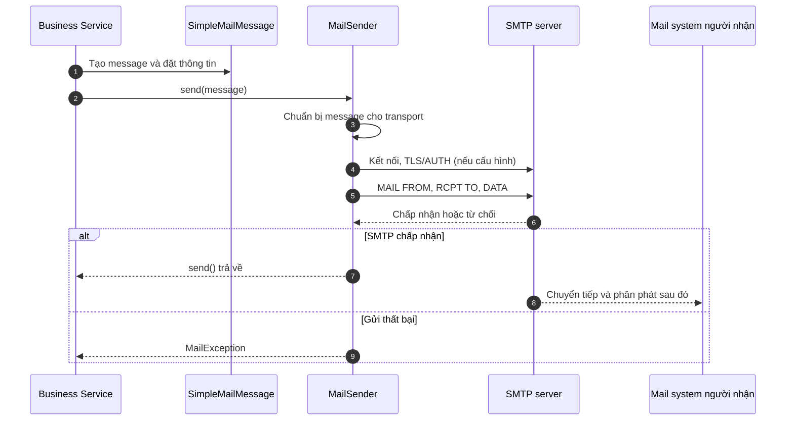
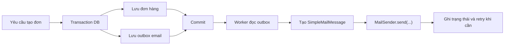

# Gửi message qua MailSender

Trong **Spring Framework Mail**, cách đơn giản nhất để gửi một email văn bản là tạo đối tượng `SimpleMailMessage`, điền địa chỉ người gửi, người nhận, tiêu đề và nội dung, rồi gọi **`MailSender.send(...)`**. Cách làm này phù hợp với thông báo đăng ký, cảnh báo vận hành, nhắc lịch, gửi đường dẫn xác nhận hoặc những email không cần HTML và tệp đính kèm.

Ví dụ cốt lõi:

```java
SimpleMailMessage message = new SimpleMailMessage();
message.setFrom("no-reply@example.org");
message.setTo("user@example.net");
message.setSubject("Chào mừng bạn");
message.setText("Tài khoản của bạn đã sẵn sàng.");

mailSender.send(message);
```

Để sử dụng đúng trong ứng dụng Spring, cần hiểu **`MailSender` là giao diện**, **`SimpleMailMessage` là dữ liệu thông điệp dạng đơn giản**, còn triển khai của sender mới thực hiện kết nối và trao đổi với máy chủ SMTP. Lời gọi `send(...)` cũng có một ranh giới quan trọng: gửi tới SMTP thành công chưa có nghĩa email đã xuất hiện trong hộp thư đến của người nhận.

## 1. MailSender nằm ở đâu trong Spring Mail?

`org.springframework.mail.MailSender` là giao diện gửi email đơn giản của Spring, có hai phương thức chính:

```java
void send(SimpleMailMessage simpleMessage) throws MailException;

void send(SimpleMailMessage... simpleMessages) throws MailException;
```

Các thành phần liên quan:

| Thành phần | Trách nhiệm |
|---|---|
| `MailSender` | Hợp đồng gửi một hoặc nhiều `SimpleMailMessage`. |
| `SimpleMailMessage` | Đối tượng Java chứa thông tin email văn bản thuần: sender, recipient, subject, text... |
| `JavaMailSender` | Giao diện mở rộng `MailSender`, bổ sung khả năng tạo và gửi `MimeMessage`. |
| `JavaMailSenderImpl` | Triển khai phổ biến, dùng Jakarta Mail để kết nối SMTP. |
| `MailException` | Ngoại lệ runtime của Spring báo sự cố chuẩn bị hoặc gửi email. |
| Máy chủ SMTP | Tiếp nhận hoặc từ chối thông điệp, rồi có thể chuyển tiếp tới hệ thống nhận. |

Quan hệ giao diện:

```text
        MailSender
         /     \
        /       \ send(SimpleMailMessage)
       v         v
  JavaMailSender (extends MailSender)
         |
         v
  JavaMailSenderImpl
         |
         v
    Jakarta Mail / SMTP
```

Đây là sơ đồ mô tả quan hệ ở mức khái niệm: `JavaMailSender` **kế thừa** `MailSender`, còn `JavaMailSenderImpl` thực hiện hợp đồng gửi qua Jakarta Mail. Trong Spring Boot, bean mail sender được tự động cấu hình thường là một triển khai `JavaMailSender`, nên bạn vẫn có thể **inject kiểu `MailSender`** vào những service chỉ cần gửi email text.

**Nguyên tắc lựa chọn API:** nếu service chỉ gửi `SimpleMailMessage`, khai báo dependency ở kiểu `MailSender` thường đã đủ. Khi cần HTML, MIME multipart, ảnh inline hoặc file đính kèm, chuyển sang API `JavaMailSender` và `MimeMessageHelper`.

## 2. Luồng gửi một SimpleMailMessage



Trong một lời gọi gửi đồng bộ điển hình:

1. **Ứng dụng quyết định gửi:** nghiệp vụ xác định người nhận và nội dung, ví dụ sau khi tạo tài khoản.
2. **Tạo message:** mã Java tạo `SimpleMailMessage` và đặt các trường.
3. **Gọi sender:** `MailSender.send(message)` nhận thông điệp cần gửi.
4. **Transport gửi SMTP:** triển khai như `JavaMailSenderImpl` dùng cấu hình host, port, TLS và authentication để giao tiếp với máy chủ SMTP.
5. **Trả kết quả:** nếu không gặp lỗi trong quá trình gửi, lời gọi kết thúc bình thường; nếu gặp sự cố, Spring ném một `MailException` phù hợp.
6. **Quá trình phía sau:** máy chủ đã nhận thư có thể chuyển tiếp, xếp hàng, lọc hoặc phát sinh bounce về sau.

Các bước xây dựng `SimpleMailMessage` **không mở kết nối SMTP**. Việc giao tiếp mạng xảy ra khi sender thực hiện gửi hoặc khi ứng dụng chủ động thử kết nối qua cơ chế khác.

## 3. Chuẩn bị môi trường gửi mail

### 3.1. Dùng Spring Boot

Trong ứng dụng Spring Boot, dependency thông dụng là starter dành cho email:

```groovy
// build.gradle
dependencies {
    implementation 'org.springframework.boot:spring-boot-starter-mail'
}
```

Starter cung cấp các thư viện để tích hợp Spring Mail và Jakarta Mail. Khi các điều kiện tự động cấu hình phù hợp và thông tin SMTP được cung cấp, Spring Boot có thể đăng ký `JavaMailSender` để injection vào ứng dụng.

Ví dụ `application.yml` cho SMTP submission dùng **cổng 587 + STARTTLS**:

```yaml
spring:
  mail:
    host: smtp.example.net
    port: 587
    username: ${SMTP_USERNAME}
    password: ${SMTP_PASSWORD}
    default-encoding: UTF-8
    properties:
      "[mail.smtp.auth]": true
      "[mail.smtp.starttls.enable]": true
      "[mail.smtp.starttls.required]": true
      "[mail.smtp.connectiontimeout]": 5000
      "[mail.smtp.timeout]": 5000
      "[mail.smtp.writetimeout]": 5000

app:
  mail:
    from: no-reply@example.org
```

Đây là cấu hình **minh họa**; địa chỉ `smtp.example.net` cần thay bằng máy chủ thực tế và cách thiết lập TLS phải theo yêu cầu của nhà cung cấp.

- `spring.mail.host` / `port`: xác định endpoint SMTP.
- `spring.mail.username` / `password`: thông tin đăng nhập, trong ví dụ lấy từ biến môi trường.
- `mail.smtp.auth`: bật xác thực SMTP trong cấu hình này.
- `mail.smtp.starttls.enable` và `required`: yêu cầu đường truyền SMTP được nâng cấp qua STARTTLS trước khi gửi dữ liệu nhạy cảm.
- Các thuộc tính timeout: giới hạn thời gian chờ kết nối, đọc và ghi dữ liệu.
- `app.mail.from`: property do ứng dụng tự định nghĩa. Spring Boot **không tự áp dụng** property này làm `From` cho tất cả message; service phải đọc và sử dụng nó.

Không đưa mật khẩu SMTP vào source code, file được commit hoặc log. Một số dịch vụ yêu cầu app password, token hoặc cơ chế đăng nhập riêng; cần dùng thông tin được nhà cung cấp hỗ trợ.

### 3.2. Dùng Spring Framework thuần

Khi không sử dụng Spring Boot auto-configuration, có thể tự đăng ký `JavaMailSenderImpl`:

```java
import java.util.Properties;
import org.springframework.context.annotation.Bean;
import org.springframework.context.annotation.Configuration;
import org.springframework.mail.MailSender;
import org.springframework.mail.javamail.JavaMailSenderImpl;

@Configuration
public class MailConfiguration {

    @Bean
    public MailSender mailSender() {
        JavaMailSenderImpl sender = new JavaMailSenderImpl();
        sender.setHost("smtp.example.net");
        sender.setPort(587);
        sender.setUsername(System.getenv("SMTP_USERNAME"));
        sender.setPassword(System.getenv("SMTP_PASSWORD"));
        sender.setDefaultEncoding("UTF-8");

        Properties properties = sender.getJavaMailProperties();
        properties.put("mail.smtp.auth", "true");
        properties.put("mail.smtp.starttls.enable", "true");
        properties.put("mail.smtp.starttls.required", "true");
        properties.put("mail.smtp.connectiontimeout", "5000");
        properties.put("mail.smtp.timeout", "5000");

        return sender;
    }
}
```

Ví dụ đăng ký bean dưới kiểu `MailSender` vì service chỉ cần gửi plain text. Nếu cùng ứng dụng còn phải gửi HTML hoặc attachment, nên công bố bean với kiểu `JavaMailSender` hoặc `JavaMailSenderImpl` để những thành phần cần API nâng cao vẫn injection được.

## 4. Tạo SimpleMailMessage và đặt các trường

`SimpleMailMessage` là một đối tượng có thể thay đổi (*mutable*). Các phương thức setter biểu diễn những thông tin quen thuộc của email:

| API | Ý nghĩa | Ví dụ |
|---|---|---|
| `setFrom(String)` | Địa chỉ người gửi hiển thị trong header `From`. | `no-reply@example.org` |
| `setReplyTo(String)` | Địa chỉ nhận trả lời khi người dùng bấm Reply. | `support@example.org` |
| `setTo(String...)` | Một hoặc nhiều người nhận chính. | `user@example.net` |
| `setCc(String...)` | Người nhận bản sao công khai. | `manager@example.net` |
| `setBcc(String...)` | Người nhận bản sao kín. | `audit@example.net` |
| `setSubject(String)` | Tiêu đề thông điệp. | `Xác nhận đăng ký` |
| `setText(String)` | Phần nội dung văn bản thuần. | `Tài khoản đã sẵn sàng.` |
| `setSentDate(Date)` | Ngày gửi được thể hiện trên thông điệp. | `new Date()` |

Ví dụ có nhiều người nhận:

```java
SimpleMailMessage message = new SimpleMailMessage();

message.setFrom("no-reply@example.org");
message.setReplyTo("support@example.org");

message.setTo("alice@example.net", "bob@example.net");
message.setCc("teamlead@example.net");
message.setBcc("audit@example.net");

message.setSubject("Thông báo từ hệ thống");
message.setText("""
        Chào các bạn,

        Báo cáo tuần đã được cập nhật.
        Vui lòng kiểm tra hệ thống nội bộ.

        Trân trọng.
        """);

mailSender.send(message);
```

**Lưu ý về người nhận:** `To`, `Cc` và `Bcc` có mục đích hiển thị và quyền riêng tư khác nhau. Người nhận `Bcc` thường được đưa vào phong bì SMTP nhưng không xuất hiện trong header `Bcc` được phân phát tới những người nhận khác. Không nên dùng `To` hoặc `Cc` cho danh sách email mà các người nhận không được phép nhìn thấy lẫn nhau.

### Tên hiển thị và cú pháp địa chỉ

`SimpleMailMessage` nhận các giá trị địa chỉ qua `String`. Khi chỉ gửi thông báo tự động, cách dễ bảo trì nhất là dùng địa chỉ thuần như `no-reply@example.org`. Nếu cần kiểm soát chính xác tên hiển thị Unicode, parsing địa chỉ phức tạp hoặc các header MIME nâng cao, `MimeMessageHelper` có các API chuyên dụng như `setFrom(address, personal)`.

Điều quan trọng là **`setFrom(...)` đặt thông tin người gửi trong message**. Nó không tự bảo đảm ứng dụng có quyền sử dụng địa chỉ đó với SMTP provider. Một số nhà cung cấp chỉ cho gửi từ các địa chỉ hoặc domain đã xác minh.

### `From` và envelope sender không nhất thiết giống nhau

Ở tầng SMTP còn có lệnh `MAIL FROM` chỉ định **envelope sender**, thường liên quan đến thông báo lỗi phân phát (*bounce*). Header `From` của email được người nhận nhìn thấy và envelope sender là hai lớp thông tin khác nhau. Với Jakarta Mail SMTP provider, cấu hình `mail.smtp.from` có thể chỉ định envelope sender riêng.

Ví dụ, header `From: no-reply@example.org` vẫn có thể đi cùng envelope sender `bounces@example.org`. Khi chuẩn bị gửi thư, cần biết nhà cung cấp email sử dụng và xác minh miền gửi theo cách nào.

## 5. Ví dụ service Spring gửi email chào mừng

Giả sử ứng dụng cần gửi một email văn bản sau khi tạo tài khoản. Service có thể phụ thuộc trực tiếp vào giao diện `MailSender` và đọc địa chỉ From từ cấu hình.

```java
import org.springframework.beans.factory.annotation.Value;
import org.springframework.mail.MailSender;
import org.springframework.mail.SimpleMailMessage;
import org.springframework.stereotype.Service;

@Service
public class WelcomeEmailService {

    private final MailSender mailSender;
    private final String from;

    public WelcomeEmailService(
            MailSender mailSender,
            @Value("${app.mail.from}") String from
    ) {
        this.mailSender = mailSender;
        this.from = from;
    }

    public void sendWelcomeEmail(String recipient, String displayName) {
        SimpleMailMessage message = new SimpleMailMessage();

        message.setFrom(from);
        message.setTo(recipient);
        message.setSubject("Chào mừng bạn đến với ứng dụng");

        String safeName = (displayName == null || displayName.isBlank())
                ? "bạn"
                : displayName;

        message.setText("""
                Xin chào %s,

                Tài khoản của bạn đã được tạo thành công.
                Bạn có thể đăng nhập và bắt đầu sử dụng dịch vụ.

                Trân trọng,
                Đội ngũ ứng dụng
                """.formatted(safeName));

        mailSender.send(message);
    }
}
```

Mỗi lần gọi `sendWelcomeEmail(...)`, service **tạo một `SimpleMailMessage` mới** rồi mới đặt recipient và body. Đây là một chi tiết thiết kế quan trọng: bean `WelcomeEmailService` có thể được nhiều request dùng đồng thời, còn message là đối tượng mutable nên không nên giữ làm một field chung để sửa và gửi lại.

Đoạn mã trên giả định `recipient` đã được nghiệp vụ kiểm tra ở mức phù hợp trước khi gọi service. Trong một hệ thống thật, cần kiểm tra input cần thiết và tránh đưa dữ liệu không tin cậy vào header bằng các phép nối chuỗi tùy tiện.

### Gọi service từ nghiệp vụ

```java
import org.springframework.stereotype.Service;

@Service
public class RegistrationService {

    private final AccountRepository accountRepository;
    private final WelcomeEmailService welcomeEmailService;

    public RegistrationService(
            AccountRepository accountRepository,
            WelcomeEmailService welcomeEmailService
    ) {
        this.accountRepository = accountRepository;
        this.welcomeEmailService = welcomeEmailService;
    }

    public void register(String email, String name) {
        accountRepository.createAccount(email, name);

        welcomeEmailService.sendWelcomeEmail(email, name);
    }
}
```

`AccountRepository` ở đây là thành phần nghiệp vụ giả định, được đưa vào để làm rõ vị trí gọi gửi mail. Với ứng dụng có transaction, cách gọi trực tiếp như trên cần được đánh giá theo thời điểm commit và chính sách xử lý lỗi; phần cuối bài sẽ trình bày lựa chọn bền vững hơn.

## 6. Gọi `MailSender.send(...)` thực sự làm gì?

Trong service:

```java
mailSender.send(message);
```

Phương thức này nhận **một `SimpleMailMessage`**. Với triển khai SMTP thông dụng, Spring chuyển dữ liệu từ message sang thông điệp dùng cho transport rồi thực hiện gửi qua mail server đã cấu hình.

Một phiên SMTP điển hình, lược bỏ phần handshake và xác thực:

```text
C: MAIL FROM:<no-reply@example.org>
S: 250 Sender OK

C: RCPT TO:<user@example.net>
S: 250 Recipient OK

C: DATA
S: 354 End data with <CRLF>.<CRLF>

C: From: no-reply@example.org
C: To: user@example.net
C: Subject: Welcome
C:
C: Your account is ready.
C: .
S: 250 Message queued
```

Đoạn này chỉ minh họa. Trên hệ thống thực, client SMTP còn có bước mở kết nối, `EHLO`, TLS, AUTH, các header bổ sung và cách mã hóa phù hợp.

Mốc cần ghi nhớ:

- **`250` sau `RCPT TO`**: máy chủ chấp nhận người nhận ở bước đó; chưa xác nhận đã nhận toàn bộ nội dung.
- **`250` sau `DATA`**: máy chủ chấp nhận thông điệp để xử lý tiếp.
- **`send(...)` trả về không có ngoại lệ**: phía ứng dụng đã hoàn tất thao tác gửi tới SMTP theo cách sender báo cáo.
- **Đã tới Inbox hay chưa**: phụ thuộc các hệ thống mail phía sau, bounce, lọc thư rác và chính sách của người nhận.

`MailSender` không cung cấp trực tiếp một kết quả kiểu “người dùng đã đọc thư”. Nếu bài toán cần delivery tracking, phải tích hợp các sự kiện hoặc log của hệ thống cung cấp email.

### Gửi đồng bộ và độ trễ

Với `JavaMailSenderImpl` thông dụng, lời gọi `send(...)` là **đồng bộ**. Luồng gọi phải chờ việc gửi đến SMTP hoàn tất hoặc xảy ra lỗi. Nếu gọi từ một HTTP controller:

```text
HTTP request
    |
    v
RegistrationService
    |
    v
WelcomeEmailService
    |
    v
MailSender.send(...)
    |
    +---- Chờ kết quả từ SMTP
    |
    v
HTTP response
```

Thời gian phản hồi HTTP có thể tăng khi SMTP chậm. Các timeout trong cấu hình gửi mail giúp giới hạn thời gian chờ nhưng **không biến thao tác thành bất đồng bộ**.

## 7. Phân biệt SimpleMailMessage và MimeMessage

`MailSender.send(SimpleMailMessage)` là API gọn cho nội dung **text/plain**. Khi yêu cầu biểu diễn vượt khả năng của `SimpleMailMessage`, phải dùng API MIME phù hợp.

| Nhu cầu | `SimpleMailMessage` + `MailSender` | `MimeMessage` + `JavaMailSender` |
|---|---|---|
| Email văn bản thuần | Phù hợp | Cũng hỗ trợ |
| Tiêu đề, From, To, Cc, Bcc, Reply-To | Hỗ trợ | Hỗ trợ |
| Body HTML được render | Không có API chuyên dụng | Có, qua `MimeMessageHelper` |
| Hai phiên bản plain text và HTML | Không | Có, qua MIME alternative |
| Ảnh inline dùng `cid:...` | Không | Có |
| Tệp đính kèm | Không | Có |
| Cấu trúc nhiều MIME part | Không | Có |

Nếu đặt:

```java
message.setText("<strong>Xin chào!</strong>");
```

trên `SimpleMailMessage`, các ký tự `<strong>` sẽ được xem như **văn bản**, không phải HTML để render. Để gửi HTML:

```java
MimeMessage mime = javaMailSender.createMimeMessage();
MimeMessageHelper helper = new MimeMessageHelper(
        mime,
        false,
        "UTF-8"
);

helper.setTo("user@example.net");
helper.setFrom("no-reply@example.org");
helper.setSubject("Thông báo");
helper.setText("<strong>Xin chào!</strong>", true);

javaMailSender.send(mime);
```

Ví dụ MIME này chỉ để chỉ rõ **khi nào cần đổi API**. Đối với bài toán gửi văn bản đơn giản, giữ `MailSender` và `SimpleMailMessage` là đủ.

## 8. Gửi nhiều message với varargs

`MailSender` hỗ trợ overload:

```java
mailSender.send(firstMessage, secondMessage);
```

Một tình huống là gửi hai thông báo có mục đích khác nhau:

```java
SimpleMailMessage customer = new SimpleMailMessage();
customer.setFrom("no-reply@example.org");
customer.setTo("customer@example.net");
customer.setSubject("Đơn hàng đã được nhận");
customer.setText("Cảm ơn bạn. Chúng tôi đã nhận đơn hàng.");

SimpleMailMessage operations = new SimpleMailMessage();
operations.setFrom("no-reply@example.org");
operations.setTo("ops@example.org");
operations.setSubject("Có đơn hàng mới");
operations.setText("Vui lòng kiểm tra hệ thống quản trị.");

mailSender.send(customer, operations);
```

Cách gọi này thuận tiện khi triển khai sender hỗ trợ gửi nhiều message trong một lần gọi. Nhưng có những giới hạn cần hiểu:

1. **Varargs không tạo một transaction nguyên tử cho email.** Một message có thể đã được máy chủ chấp nhận trước khi message khác bị lỗi.
2. **Không nên giả định mọi người nhận đều có cùng kết quả.** Lỗi theo người nhận hoặc theo thông điệp có thể khác nhau.
3. **Không có nghĩa provider chỉ mở một kết nối trong mọi trường hợp.** Điều này phụ thuộc implementation và cách quản lý transport.
4. **Không có nghĩa email đã được gửi bất đồng bộ hoặc được đưa vào queue bền vững.**

Một số triển khai của Spring cung cấp thông tin về các message gửi thất bại trong ngoại lệ chuyên biệt, nhưng mã nghiệp vụ vẫn cần chuẩn bị để xử lý khả năng **thành công một phần**. Với yêu cầu phải theo dõi trạng thái từng email, nên quản lý mỗi yêu cầu gửi bằng một ID và trạng thái riêng.

### Gửi cùng một nội dung đến nhiều người

Có hai cách có ý nghĩa khác nhau:

- **Một message, nhiều người nhận:** gọi `message.setTo("a@example.net", "b@example.net")` rồi `send(message)`. Các người nhận có thể thấy nhau trong header `To`.
- **Nhiều message riêng biệt:** tạo một `SimpleMailMessage` cho từng recipient rồi gửi riêng hoặc dùng overload varargs. Dễ cá nhân hóa nội dung, giữ riêng header và theo dõi trạng thái theo người nhận.

Không dùng nhiều địa chỉ `To` nếu danh sách người nhận cần được giữ bí mật hoặc email phải được cá nhân hóa riêng.

## 9. Tái sử dụng nội dung mẫu an toàn

Một email đơn giản có thể lặp lại các trường `From` hoặc `Subject`. `SimpleMailMessage` có **copy constructor**, giúp tạo bản sao từ một mẫu:

```java
SimpleMailMessage template = new SimpleMailMessage();
template.setFrom("no-reply@example.org");
template.setReplyTo("support@example.org");
template.setSubject("Thông báo tài khoản");

SimpleMailMessage first = new SimpleMailMessage(template);
first.setTo("alice@example.net");
first.setText("Xin chào Alice, tài khoản đã được cập nhật.");

SimpleMailMessage second = new SimpleMailMessage(template);
second.setTo("bob@example.net");
second.setText("Xin chào Bob, tài khoản đã được cập nhật.");

mailSender.send(first, second);
```

Điểm hay của cách này là **mỗi thông điệp gửi vẫn có instance riêng**. Tránh mã dạng:

```java
// Cách làm không an toàn khi service dùng chung giữa các request:
private final SimpleMailMessage sharedMessage = new SimpleMailMessage();

// Request A: sharedMessage.setTo("alice@example.net");
// Request B: sharedMessage.setTo("bob@example.net");
// Request A: mailSender.send(sharedMessage);
```

Vì `SimpleMailMessage` mutable, hai luồng có thể ghi đè người nhận hoặc nội dung của nhau. Với service singleton, hãy dùng template không bị thay đổi sau khi khởi tạo và **copy** nó trước khi cá nhân hóa, hoặc đơn giản tạo một message mới ở mỗi lần gửi.

Khi dùng template, cũng cần đảm bảo không mang thông tin của người dùng trước sang người dùng sau, ví dụ `Bcc`, nội dung hoặc tiêu đề chứa dữ liệu cá nhân.

## 10. Lỗi gửi mail và `MailException`

`MailSender.send(...)` khai báo `MailException`. Đây là **unchecked exception** trong Spring, nên Java không bắt buộc method phải viết `throws MailException`.

Những loại lỗi thường gặp:

| Nhóm lỗi | Ví dụ nguyên nhân | Hướng xử lý |
|---|---|---|
| Cấu hình sai | Host, port, TLS hoặc tài khoản không đúng | Sửa cấu hình và bí mật trước khi thử lại. |
| `MailAuthenticationException` | SMTP AUTH thất bại | Kiểm tra credential, quyền tài khoản hoặc cơ chế auth. |
| `MailSendException` | Lỗi ở quá trình gửi hoặc transport | Xem cause, SMTP reply và tình trạng kết nối. |
| Lỗi dữ liệu message | Địa chỉ không hợp lệ hoặc thông tin thiếu | Kiểm tra input và quy tắc tạo message. |
| Tạm thời không kết nối được | Timeout, lỗi DNS nhất thời, server gián đoạn | Có thể retry giới hạn với backoff. |
| SMTP từ chối người nhận | Địa chỉ bị từ chối hoặc không được relay | Xử lý theo mã phản hồi và chính sách server; tránh retry vô hạn. |

Ví dụ bắt ngoại lệ ở ranh giới ứng dụng:

```java
import org.springframework.mail.MailException;
import org.springframework.mail.MailSender;
import org.springframework.mail.SimpleMailMessage;

public void sendNotification(MailSender sender, String recipient) {
    SimpleMailMessage message = new SimpleMailMessage();
    message.setFrom("no-reply@example.org");
    message.setTo(recipient);
    message.setSubject("Thông báo");
    message.setText("Bạn có thông báo mới.");

    try {
        sender.send(message);
        // Chỉ ghi nhận SMTP send hoàn tất theo sender.
    } catch (MailException ex) {
        // Ghi trạng thái thất bại hoặc chuyển cho cơ chế retry.
        // Không log credential SMTP hoặc nội dung thư nhạy cảm.
        throw ex;
    }
}
```

Bắt `MailException` mà không ghi nhận hoặc xử lý gì sẽ làm nghiệp vụ tưởng rằng email đã được gửi. Trái lại, retry vô hạn mọi ngoại lệ cũng không đúng: sai mật khẩu hay địa chỉ bị từ chối vĩnh viễn sẽ không được khắc phục bằng việc gửi liên tục.

### Một lỗi khó: không biết server đã nhận mail chưa

Giả sử client gửi hết `DATA` nhưng kết nối bị mất ngay trước khi nó đọc được phản hồi cuối. Có thể SMTP server **đã chấp nhận** email, dù ứng dụng thấy lỗi mạng.

Khi tự động retry, email có nguy cơ **được gửi trùng**. Với thông báo quan trọng, cần định danh yêu cầu gửi, ghi lại từng lần thử, đặt chính sách retry có giới hạn và xử lý trường hợp trạng thái không chắc chắn. `MailSender` không tự cung cấp bảo đảm gửi đúng một lần.

### Không suy luận delivery từ kết quả `send(...)`

Một số bước thường bị nhầm:

```text
mailSender.send(...) trả về
    ↓
Máy chủ SMTP đã xử lý thao tác gửi
    ↓
Hệ thống gửi tiếp đến miền người nhận
    ↓
Mail server nhận có thể accept, defer hoặc reject
    ↓
Mail client có thể đặt ở Inbox hoặc Spam
    ↓
Người nhận có thể đọc hoặc không đọc thư
```

Để biết thư **delivered**, **bounced** hoặc **complained**, hệ thống cần nguồn sự kiện/trạng thái từ nhà cung cấp mail hoặc hạ tầng vận hành, không chỉ kết quả một lời gọi Java.

## 11. Đặt việc gửi mail vào luồng nghiệp vụ

Khi nghiệp vụ yêu cầu tính nhất quán, thời điểm gọi `send(...)` rất quan trọng.

Ví dụ, đặt lệnh gửi mail trong transaction lưu đơn hàng:

```text
Bắt đầu transaction DB
    ↓
Lưu đơn hàng
    ↓
MailSender.send(...)
    ↓
Commit transaction DB
```

Nếu email đã được SMTP chấp nhận nhưng transaction DB **rollback**, người nhận có thể nhận thông báo về một đơn hàng không được lưu thành công. Ngược lại, gửi sau commit nhưng ứng dụng dừng trước khi gửi có thể khiến người dùng không nhận được email.

Một kiến trúc bền vững hơn cho thông báo quan trọng là **transactional outbox**:



Worker tạo `SimpleMailMessage` từ bản ghi outbox rồi gửi. Cách này giảm nguy cơ nghiệp vụ đã commit nhưng yêu cầu gửi bị mất, đồng thời cho phép HTTP request trả về sớm. Tuy nhiên, cần xử lý idempotency và trạng thái gửi chưa chắc chắn để hạn chế trùng email.

Nếu email không quan trọng bằng tính đơn giản của ứng dụng, gọi trực tiếp `MailSender.send(...)` vẫn có thể là quyết định phù hợp. Cần chọn có chủ đích dựa trên độ trễ, khả năng mất thông báo và yêu cầu retry.

## 12. Kiểm tra gửi mail trong môi trường phát triển

Để học cách dùng `MailSender` mà không gửi email thực, có thể dùng **SMTP server bắt thư** như Mailpit hoặc GreenMail. Các công cụ này nhận email tại endpoint thử nghiệm và cho phép quan sát nội dung/header mà không cần chuyển tiếp ra Internet.

Ví dụ khi một SMTP server thử nghiệm lắng nghe ở `localhost:1025` và không yêu cầu AUTH/TLS:

```yaml
# application-dev.yml
spring:
  mail:
    host: localhost
    port: 1025
    default-encoding: UTF-8
    properties:
      "[mail.smtp.auth]": false
      "[mail.smtp.starttls.enable]": false

app:
  mail:
    from: no-reply@example.org
```

Lưu ý cấu hình `localhost` chỉ dùng được khi ứng dụng và SMTP test server có cách truy cập mạng phù hợp. Nếu chạy bằng container, `localhost` bên trong container là chính container đó, không phải máy host; cần chọn hostname/mạng tương ứng.

Một luồng thử nghiệm thủ công:

1. Khởi chạy SMTP test server trong môi trường phát triển.
2. Cấu hình `spring.mail.host` và `port` tới server thử nghiệm.
3. Gọi nghiệp vụ tạo `SimpleMailMessage`.
4. Mở giao diện hoặc hộp thư thử nghiệm để xem `From`, `To`, `Subject` và body.
5. Kiểm tra log ứng dụng nếu `send(...)` phát sinh ngoại lệ.

Điều này giúp quan sát **đúng hành vi gửi của ứng dụng** mà không cần dùng tài khoản SMTP thật trong môi trường phát triển.

## 13. Những lỗi thường gặp khi gửi qua MailSender

| Triệu chứng | Khả năng liên quan | Điều cần xem |
|---|---|---|
| Spring báo không tìm thấy bean `MailSender` | Chưa có starter/cấu hình SMTP hoặc chưa đăng ký implementation | Kiểm tra bean `JavaMailSender`/`MailSender` và cấu hình khởi tạo. |
| SMTP authentication failed | Sai username/password hoặc cơ chế auth | Secret, tài khoản, TLS và quy định của nhà cung cấp. |
| Kết nối timeout | Host/port không truy cập được, firewall hoặc dịch vụ gặp sự cố | DNS, route, timeout và endpoint SMTP. |
| Email có chữ `<b>` hiển thị nguyên văn | `SimpleMailMessage` là text/plain | Dùng `MimeMessage` nếu cần HTML. |
| Gửi không lỗi nhưng Inbox trống | Email có thể bị delay, bounce hoặc spam | Log/email event phía dịch vụ gửi và hộp thư nhận. |
| Gửi một lần nhưng có hai email | Nghiệp vụ gọi hai lần hoặc retry sau trạng thái không chắc chắn | Mã sự kiện, log, yêu cầu gửi và chính sách retry. |
| Người nhận nhìn thấy danh sách email khác | Đưa nhiều recipient vào `To` hoặc `Cc` | Kiểm tra quyền riêng tư và cách chia thông điệp. |
| Dữ liệu người nhận bị lẫn | Tái sử dụng một `SimpleMailMessage` mutable giữa nhiều request | Tạo message mới hoặc copy template trước mỗi lần gửi. |
| Lỗi dấu tiếng Việt | Charset của body/header không nhất quán | Default encoding, quá trình tạo nội dung và nguồn MIME thực nhận. |
| `From` bị server từ chối | Domain/địa chỉ chưa được phép gửi | Kiểm tra xác thực miền và chính sách SMTP provider. |

### Một tình huống phân tích

Giả sử service gọi `mailSender.send(message)` và không có ngoại lệ, nhưng người dùng báo không thấy thư xác nhận. Cần xử lý theo các lớp:

1. Xác định ứng dụng đã gọi service gửi mail đúng số lần và với đúng recipient.
2. Xem log/thông tin giao dịch SMTP để biết provider có chấp nhận message.
3. Nếu provider đã chấp nhận, kiểm tra trạng thái queue, delivery, bounce hoặc suppression từ hệ thống gửi.
4. Kiểm tra người nhận có thấy thư trong Spam, mục quảng cáo hoặc bị mail gateway chặn hay không.

Không nên mặc định lỗi nằm ở `SimpleMailMessage` chỉ vì người dùng không thấy email. **Tạo message**, **SMTP chấp nhận** và **phân phát cuối cùng** là những giai đoạn khác nhau.

## 14. Các câu hỏi thường gặp

**Có cần gọi `saveChanges()` trước khi gửi `SimpleMailMessage` không?**  
Không. `SimpleMailMessage` không phải `MimeMessage` và không có vòng đời cập nhật MIME header theo cách đó. Bạn chỉ cần đặt dữ liệu rồi gọi `MailSender.send(...)`; triển khai sender đảm nhiệm các bước truyền tải.

**Có cần gọi `mailSender.createMimeMessage()` không?**  
Không. Phương thức `createMimeMessage()` thuộc `JavaMailSender` dành cho email MIME. Với text thuần, tạo `new SimpleMailMessage()` là đủ.

**Có thể gửi tiếng Việt bằng `SimpleMailMessage` không?**  
Có. Chuỗi Java có thể chứa Unicode. Hãy cấu hình encoding phù hợp (thường là UTF-8) trong sender và bảo đảm dữ liệu nguồn không bị đọc sai mã. Hệ thống mail tạo MIME text part với charset/transfer encoding tương ứng.

**`send(message)` trả về một đối tượng kết quả hay message ID không?**  
Không. Phương thức trong `MailSender` có kiểu trả về `void`. Khi cần message ID, queue ID hoặc delivery event, bạn phải lấy từ tầng mail phù hợp hoặc cơ chế logging/event của provider.

**Có thể bỏ qua `From` không?**  
Một số transport/provider có thể suy ra sender từ cấu hình, nhưng hành vi phụ thuộc hệ thống và có thể bị từ chối. Với thông báo nghiệp vụ, nên đặt địa chỉ `From` rõ ràng, được nhà cung cấp cho phép sử dụng.

**Gửi nhiều message qua `send(messages...)` có nhanh hơn gọi lặp từng lần không?**  
Tùy implementation, kết nối và nhà cung cấp. Overload varargs chủ yếu cung cấp **cách biểu diễn một yêu cầu gửi nhiều message** trong API; không phải cam kết về hiệu năng, tính nguyên tử hoặc độ tin cậy.

**Tôi có nên bắt ngoại lệ rồi luôn trả HTTP 200 không?**  
Chỉ khi API/ nghiệp vụ có hợp đồng rõ rằng email được xử lý bất đồng bộ và yêu cầu đã được ghi bền vững. Nếu gửi trực tiếp thất bại mà không có cơ chế lưu và gửi lại, việc trả thành công có thể che giấu lỗi với người dùng và đội vận hành.

## 15. Ghi nhớ

Một thao tác gửi email văn bản qua Spring Framework Mail được xây dựng từ ba phần:

```java
SimpleMailMessage message = new SimpleMailMessage();
// Điền From, To, Subject, Text.
mailSender.send(message);
```

- **`SimpleMailMessage`** là cấu trúc dữ liệu cho email văn bản đơn giản; mỗi lần gửi độc lập nên có một instance riêng.
- **`MailSender`** là giao diện có `send(SimpleMailMessage)` và `send(SimpleMailMessage...)`; trong ứng dụng thông thường `JavaMailSenderImpl` thực hiện công việc SMTP.
- **`MailSender.send(...)` là lời gọi đồng bộ trong triển khai phổ biến**, có thể làm chậm request khi SMTP chậm; timeout và kiến trúc queue cần được cân nhắc.
- **`MailException`** báo lỗi trong thao tác gửi, nhưng không phải mọi lỗi phân phát sau khi SMTP chấp nhận đều trở thành ngoại lệ ở ứng dụng.
- **`SimpleMailMessage` chỉ phù hợp với text/plain**. HTML, ảnh inline và attachment cần `MimeMessage`/`MimeMessageHelper`.
- **Nhiều message trong một lời gọi không tạo tính nguyên tử** và có thể có kết quả từng phần; hệ thống quan trọng cần trạng thái riêng cho mỗi yêu cầu gửi.
- **SMTP chấp nhận thư chưa phải xác nhận Inbox**. Khi cần độ tin cậy, phải theo dõi gửi, retry, bounce và kết quả phân phát ở các tầng phù hợp.

Với ứng dụng chỉ cần gửi thông báo chữ đơn giản, `MailSender` kết hợp `SimpleMailMessage` giúp code ngắn gọn và phân tách rõ trách nhiệm. Khi hiểu ranh giới giữa việc **chuẩn bị nội dung**, **gửi tới SMTP** và **phân phát ở hệ thống nhận**, bạn có thể mở rộng luồng gửi mail mà vẫn kiểm soát được lỗi và tác dụng phụ.
