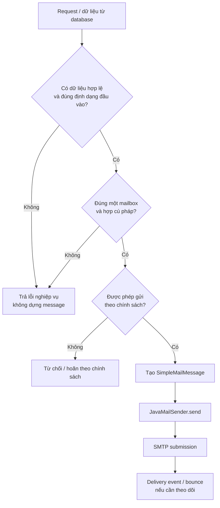
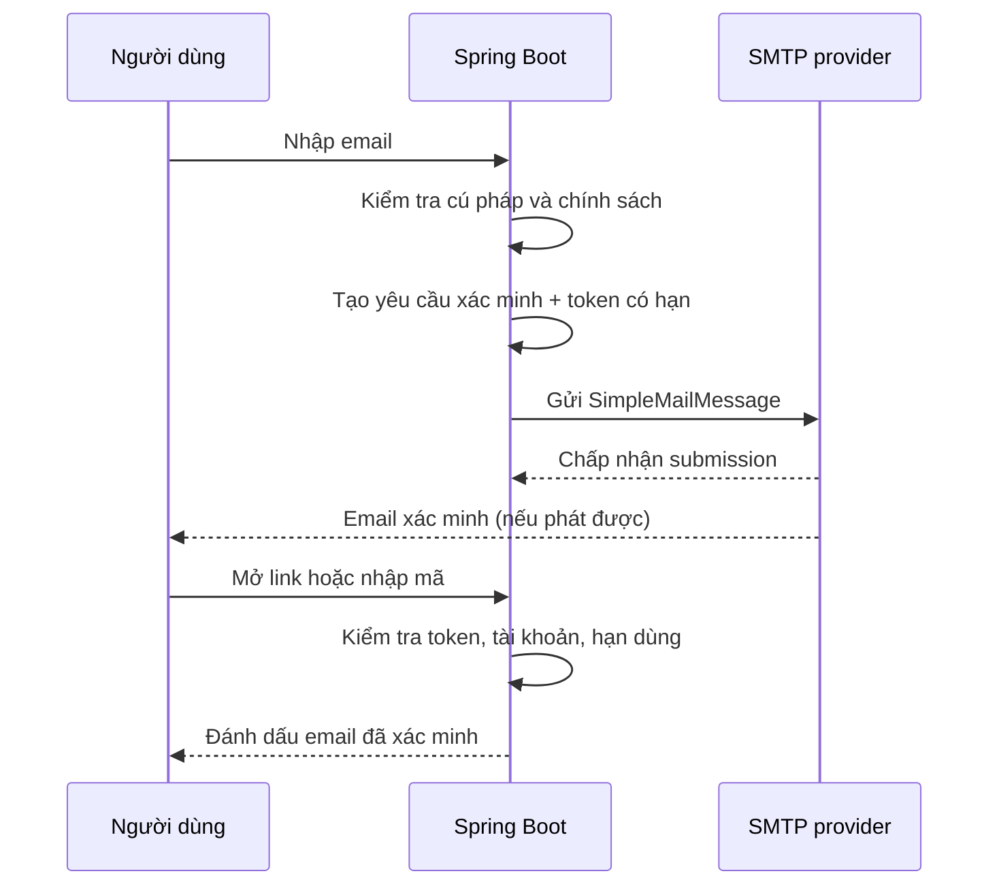

# Kiểm tra địa chỉ trước khi tạo message

Một ứng dụng Spring Boot gửi email xác nhận đăng ký bằng `JavaMailSender`. Người dùng nhập `an@example.net`, hệ thống dựng `SimpleMailMessage`, đặt người nhận rồi gọi `send(...)`. Quy trình này có vẻ đơn giản, nhưng điều gì xảy ra nếu giá trị nhập là chuỗi trống, một danh sách địa chỉ không được phép, có ký tự xuống dòng, hoặc chứa một tên hiển thị thay vì một địa chỉ email thuần?

**Kiểm tra địa chỉ trước khi tạo message** là bước bảo vệ ranh giới giữa dữ liệu đầu vào của nghiệp vụ và dữ liệu mà hệ thống email sẽ dùng để chuyển phát. Bước này giúp trả lỗi sớm, thống nhất chính sách người nhận, hạn chế gửi nhầm và giảm những thất bại có thể phát hiện trước khi tạo đối tượng mail. Trong chương **Simple mail** của **Spring Framework Mail**, đối tượng `SimpleMailMessage` phù hợp khi gửi văn bản thuần và không cần cấu trúc MIME phức tạp. Dù API đơn giản, nó không thay thế được việc kiểm tra địa chỉ của ứng dụng.

Điểm cần ghi nhớ ngay từ đầu: **địa chỉ hợp lệ về cú pháp không đồng nghĩa hộp thư tồn tại, thuộc về đúng người hoặc chắc chắn nhận được thư**. Những kết luận đó thuộc các lớp kiểm tra và xác nhận khác nhau.

## 1. Địa chỉ email đi qua những lớp kiểm tra nào?

Xét dữ liệu đầu vào:

```json
{
  "email": "an@example.net",
  "purpose": "ACCOUNT_VERIFICATION"
}
```

Ứng dụng có thể cần trả lời nhiều câu hỏi trước khi gửi:

| Lớp | Câu hỏi | Ví dụ |
|---|---|---|
| **Dữ liệu đầu vào** | Có giá trị không, có ký tự điều khiển hoặc vượt giới hạn ứng dụng không? | `null`, `""`, `"an@example.net\r\nBcc:..."`. |
| **Cú pháp mailbox** | Có đúng **một** địa chỉ email được chấp nhận theo chính sách ứng dụng không? | `an@example.net` khác `an@example.net,other@example.org`. |
| **Quy tắc sản phẩm** | Địa chỉ này có được dùng cho chức năng đó không? | Chỉ gửi thông báo nội bộ đến miền được phép, hoặc chặn danh sách suppression. |
| **Quyền sở hữu/đồng ý** | Người dùng đã xác minh địa chỉ và có đồng ý nhận loại thư tương ứng chưa? | Link xác nhận, mã xác minh, lựa chọn nhận email marketing. |
| **Chuyển phát** | Hệ thống mail có chấp nhận và phát thư được không? | SMTP phản hồi `2xx`/`4xx`/`5xx`, DSN/bounce, provider event. |

Một bộ kiểm tra đầu vào thông thường tập trung vào **ba lớp đầu**. Xác minh quyền sở hữu và kết quả chuyển phát là các luồng bất đồng bộ hoặc luồng nghiệp vụ riêng.



Thiết kế này giúp tách **lỗi dữ liệu mà người dùng có thể sửa ngay** khỏi **lỗi mạng và chuyển phát** cần hệ thống theo dõi, xử lý lại hoặc báo trạng thái.

## 2. Phân biệt địa chỉ thuần, tên hiển thị và danh sách người nhận

Địa chỉ email trong ứng dụng thường được lưu ở dạng **addr-spec**:

```text
an@example.net
```

Trong header Internet Message Format, một mailbox còn có thể có **tên hiển thị**:

```text
Nguyễn Văn An <an@example.net>
```

Phân biệt:

- **`an@example.net`**: địa chỉ email được dùng để định tuyến.
- **`Nguyễn Văn An`**: tên hiển thị phục vụ người đọc.
- **`Nguyễn Văn An <an@example.net>`**: biểu diễn địa chỉ có tên hiển thị trong header; nó không nhất thiết là định dạng đầu vào mà một trường `emailAddress` của API muốn nhận.

Nếu API yêu cầu **một địa chỉ email thuần**, nên coi giá trị `"Nguyễn Văn An <an@example.net>"` là **không đúng hợp đồng đầu vào**, ngay cả khi thư viện email có thể phân tích nó thành mailbox hợp lệ.

Tương tự:

```text
an@example.net,bob@example.org
```

Đây là **danh sách hai địa chỉ**, không phải một địa chỉ. Một trường dành cho một người nhận không được vô tình biến thành cơ chế gửi tới nhiều người chỉ vì thư viện hiểu dấu phẩy là dấu tách.

### Header To khác với SMTP RCPT TO

Trong một lần gửi, header của message có thể hiển thị:

```text
To: Nguyễn Văn An <an@example.net>
```

Trong khi SMTP sử dụng lệnh phong bì:

```text
RCPT TO:<an@example.net>
```

Tên hiển thị không tham gia định tuyến SMTP. Cũng không nên coi nội dung header `To:` là bằng chứng duy nhất về danh sách người nhận thực tế: hệ thống còn có `Cc`, `Bcc` và danh sách recipient của phong bì SMTP.

Với **`SimpleMailMessage`**, các setter thường nhận chuỗi địa chỉ. Nếu cần tên hiển thị Unicode cho `From`/`To` hoặc header MIME phong phú, hãy cân nhắc **`MimeMessage` + `MimeMessageHelper`** thay vì cố tự ghép `Tên <email>` thành một chuỗi.

## 3. Kiểm tra cú pháp email: cần hiểu những gì?

Một địa chỉ email thông dụng có dạng:

```text
local-part@domain
```

Ví dụ:

```text
an@example.net
linh.nguyen@example.org
orders+invoice@example.com
```

### 3.1. Local-part không chỉ có chữ và số

Phần trước `@` có thể chứa một số dấu hợp lệ như dấu chấm, dấu cộng, gạch dưới và các ký tự khác theo văn phạm email. **Dấu cộng không mặc nhiên là lỗi**: `orders+invoice@example.com` là dạng địa chỉ hợp lệ và thường được dùng cho phân loại thư.

Một số địa chỉ hợp lệ theo các đặc tả Internet Message Format có cú pháp hiếm gặp, chẳng hạn *quoted local-part*. Vì vậy regex quá đơn giản có thể **từ chối địa chỉ hợp lệ**, trong khi regex quá thoáng có thể **chấp nhận giá trị không đúng hợp đồng**.

Không nên dựa vào các quy tắc như:

- “Địa chỉ phải kết thúc bằng `.com`”.
- “Tên miền phải có đúng một dấu chấm”.
- “Không được có dấu `+`”.
- “Chỉ chấp nhận chữ thường”.
- “Regex khớp thì hộp thư chắc chắn tồn tại”.

Ứng dụng có thể chủ động dùng **chính sách định dạng hẹp hơn RFC** vì nhu cầu sản phẩm, nhưng cần công bố đó là *giới hạn sản phẩm*, không phải kết luận mọi định dạng khác đều sai theo chuẩn email.

### 3.2. Tên miền và local-part có quy tắc khác nhau

**Domain** có hệ thống tên miền riêng. Domain trong email không phân biệt chữ hoa/thường theo cách DNS xử lý, và có thể cần quy đổi **IDN** (*Internationalized Domain Names*) sang dạng ASCII tương thích nếu sản phẩm hỗ trợ tên miền quốc tế hóa.

**Local-part** thuộc về hệ thống nhận. Theo mô hình SMTP truyền thống, không nên tự ý chuyển toàn bộ local-part sang chữ thường vì có thể làm thay đổi địa chỉ đích trên một số hệ thống, dù nhiều dịch vụ thực tế xử lý không phân biệt hoa/thường.

Ví dụ:

```text
Sales@example.net
sales@example.net
```

Không nên mặc định hai địa chỉ trên luôn là cùng một mailbox trong mọi hệ thống. Nếu cần chuẩn hóa cho mục đích so sánh hoặc chống trùng, ứng dụng phải có chính sách rõ ràng thay vì tự hạ chữ thường toàn bộ địa chỉ.

### 3.3. Địa chỉ Unicode là một trường hợp riêng

So sánh:

```text
Nguyễn Văn An <an@example.net>     // Tên hiển thị Unicode, địa chỉ ASCII
nguyễn@example.net                 // Local-part chứa Unicode
```

Trường hợp thứ nhất có thể được thể hiện trong header qua encoding MIME. Trường hợp thứ hai thuộc phạm vi **Email Address Internationalization (EAI)** và có thể cần **SMTPUTF8** trên đường gửi.

Nếu bài toán **Simple mail** của ứng dụng hiện chỉ hỗ trợ địa chỉ ASCII, hãy nêu rõ chính sách đó và từ chối giá trị có Unicode trong addr-spec. Khi cần hỗ trợ EAI, phải xem xét toàn bộ chuỗi từ validation, thư viện mail, SMTP provider, các máy chủ trung gian tới hệ thống nhận. **Chỉ thêm charset UTF-8 cho body không tự làm địa chỉ Unicode có thể chuyển phát được.**

## 4. Vì sao phải kiểm tra trước khi tạo SimpleMailMessage?

Ví dụ cơ bản:

```java
SimpleMailMessage message = new SimpleMailMessage();
message.setTo(rawEmail);
message.setSubject("Xác nhận tài khoản");
message.setText("Vui lòng xác nhận địa chỉ email của bạn.");
mailSender.send(message);
```

Nếu `rawEmail` đến từ request chưa được kiểm tra, ứng dụng sẽ chuyển dữ liệu không tin cậy vào message. Việc một setter **không lập tức ném lỗi** không có nghĩa dữ liệu đã hợp lệ; một số lỗi chỉ xuất hiện khi message được chuyển thành dữ liệu gửi đi hoặc khi máy chủ SMTP xử lý.

Thứ tự nên dùng:

```text
rawEmail từ request/database
    ↓
Kiểm tra bắt buộc, kiểm soát ký tự điều khiển
    ↓
Kiểm tra cú pháp đúng một địa chỉ
    ↓
Kiểm tra chính sách người nhận và quyền gửi
    ↓
Tạo SimpleMailMessage
    ↓
setTo / setFrom / setSubject / setText
    ↓
JavaMailSender.send(...)
```

Nhờ đó:

1. Trả lỗi sớm, có ý nghĩa: “Địa chỉ email không hợp lệ”, thay vì để người dùng thấy stack trace ở tầng mail.
2. Giảm lãng phí thao tác tạo và gửi email khi dữ liệu rõ ràng sai.
3. Tách chính sách dữ liệu khỏi cấu hình SMTP.
4. Tránh vô tình nhận một danh sách địa chỉ trong trường dành cho **một người**.
5. Kiểm soát các tình huống dữ liệu độc hại nhắm vào header hoặc quy trình gửi.
6. Đảm bảo cùng một quy tắc được áp dụng trước khi lưu địa chỉ, trước khi đổi email và trước khi yêu cầu gửi thư.

Việc tạo message vẫn là thao tác nhẹ, nên **giá trị chính nằm ở ranh giới trách nhiệm và tính đúng đắn**, không phải tiết kiệm vài phép gán Java.

## 5. Dùng Jakarta Mail InternetAddress để kiểm tra cú pháp

Trong hệ sinh thái Spring Mail, **`jakarta.mail.internet.InternetAddress`** là một API phù hợp để phân tích/kiểm tra cú pháp mailbox. Nó hiểu nhiều quy tắc địa chỉ email tốt hơn một regex tự viết.

Ví dụ đơn giản:

```java
import jakarta.mail.internet.AddressException;
import jakarta.mail.internet.InternetAddress;

public boolean hasValidMailboxSyntax(String input) {
    try {
        InternetAddress address = new InternetAddress(input, true);
        address.validate();
        return true;
    } catch (AddressException | NullPointerException ex) {
        return false;
    }
}
```

Đây chỉ là **ví dụ cấp nhập môn về cú pháp**. Khi muốn API nhận chính xác **một địa chỉ thuần**, cần bổ sung kiểm tra đầu vào và kiểu dữ liệu, bởi vì:

- `InternetAddress` có thể xử lý cả cú pháp địa chỉ với **tên hiển thị**, comment hoặc cấu trúc danh sách trong một số phương thức parse.
- `validate()` chỉ kiểm tra một phần các quy tắc cú pháp theo triển khai của thư viện; không chứng minh hộp thư có thật.
- Không phải mọi trường hợp không mong muốn về chính sách sản phẩm đều bị thư viện coi là sai cú pháp.
- Cần kiểm soát các ký tự điều khiển trước khi truyền dữ liệu vào chuỗi header/địa chỉ.

### 5.1. Kiểm tra đúng một địa chỉ thuần

Một lớp validator ví dụ cho ứng dụng **chủ động chỉ nhận một addr-spec ASCII**:

```java
package com.example.mail;

import jakarta.mail.internet.AddressException;
import jakarta.mail.internet.InternetAddress;

import java.nio.charset.StandardCharsets;

public final class RecipientEmailValidator {

    private RecipientEmailValidator() {}

    public static String requireSingleAsciiAddress(String raw) {
        if (raw == null) {
            throw new IllegalArgumentException("Email address is required");
        }

        // Chính sách UI của ví dụ: chỉ loại bỏ khoảng trắng ở hai đầu.
        String value = raw.strip();
        if (value.isEmpty()) {
            throw new IllegalArgumentException("Email address is blank");
        }

        if (value.codePoints().anyMatch(Character::isISOControl)) {
            throw new IllegalArgumentException(
                    "Email address contains control characters");
        }

        // Quyết định sản phẩm: luồng simple mail này chỉ hỗ trợ
        // addr-spec ASCII. Không áp dụng nếu sản phẩm hỗ trợ SMTPUTF8.
        if (!StandardCharsets.US_ASCII.newEncoder().canEncode(value)) {
            throw new IllegalArgumentException(
                    "Only ASCII email addresses are supported");
        }

        try {
            InternetAddress[] parsed = InternetAddress.parse(value, true);
            if (parsed.length != 1) {
                throw new IllegalArgumentException(
                        "Exactly one email address is required");
            }

            InternetAddress mailbox = parsed[0];
            mailbox.validate();

            // Không nhận tên hiển thị, group hoặc cấu trúc mà việc parse
            // đã biến đổi thành addr-spec khác với chuỗi người dùng nhập.
            if (mailbox.isGroup()
                    || mailbox.getPersonal() != null
                    || !value.equals(mailbox.getAddress())) {
                throw new IllegalArgumentException(
                        "A plain email address is required");
            }

            return value;
        } catch (AddressException ex) {
            throw new IllegalArgumentException(
                    "Invalid email address syntax", ex);
        }
    }
}
```

Ý nghĩa của từng bước:

| Bước | Quyết định |
|---|---|
| Kiểm tra `null`/trống | Không tạo message nếu thiếu recipient. |
| `strip()` | Loại khoảng trắng **hai đầu** theo chính sách của form; không sửa nội dung local-part. |
| Kiểm tra ký tự điều khiển | Loại bỏ CR, LF, NUL và các ký tự điều khiển khác trước khi tạo header. |
| Chính sách ASCII | Giới hạn phạm vi luồng gửi minh họa; nếu cần EAI phải thiết kế riêng. |
| `InternetAddress.parse(value, true)` | Phân tích địa chỉ với chế độ strict; phát hiện một số lỗi định dạng. |
| `parsed.length == 1` | Không cho một input chứa hai mailbox. |
| `validate()` | Kiểm tra cú pháp mailbox theo Jakarta Mail. |
| `isGroup()`/`getPersonal()`/so sánh `getAddress()` | Chỉ chấp nhận chuỗi email thuần theo hợp đồng của API. |
| Trả về `value` | Tạo ra một giá trị đã qua kiểm tra để đi tiếp vào nghiệp vụ. |

**Giới hạn của ví dụ:** lớp này thực thi một **chính sách đầu vào cụ thể** chứ không chứng minh mọi địa chỉ được RFC cho phép đều được hỗ trợ. Nó cũng không kiểm tra MX, quyền sở hữu hoặc kết quả chuyển phát. Nếu môi trường của dự án vẫn dùng **`javax.mail`** thay cho **`jakarta.mail`** trong một phiên bản Spring/Jakarta cũ, imports cần phù hợp phiên bản; ví dụ ở đây dành cho hệ sinh thái Spring Boot 3 / Jakarta Mail.

### 5.2. Vì sao không chỉ dùng `value.contains("@")`?

Kiểm tra `contains("@")` sẽ chấp nhận những chuỗi rõ ràng không phù hợp:

```text
@
an@@example.net
 an@example.net, attacker@example.org
```

Đồng thời nó không giải quyết:

- Khoảng trắng ở nơi không phù hợp.
- Giá trị chứa tên hiển thị hoặc nhiều địa chỉ.
- Quy tắc quoting của local-part.
- Ký tự điều khiển và chính sách sản phẩm.
- Ranh giới giữa địa chỉ ASCII thông thường và địa chỉ EAI.

Sử dụng thư viện phân tích cú pháp cộng với quy tắc đầu vào rõ ràng giúp code dễ bảo trì hơn.

## 6. Bean Validation ở API layer có đủ không?

Trong REST API Spring Boot, có thể dùng **Jakarta Bean Validation** để từ chối dữ liệu sai định dạng ngay khi nhận request.

Ví dụ DTO:

```java
import jakarta.validation.constraints.Email;
import jakarta.validation.constraints.NotBlank;
import jakarta.validation.constraints.Size;

public record SendVerificationRequest(
        @NotBlank
        @Email
        @Size(max = 254)
        String email
) {}
```

Với Spring Boot, nếu dự án cần Bean Validation và chưa có dependency tương ứng:

```groovy
dependencies {
    implementation 'org.springframework.boot:spring-boot-starter-validation'
    implementation 'org.springframework.boot:spring-boot-starter-mail'
}
```

Và controller sử dụng:

```java
import jakarta.validation.Valid;
import org.springframework.http.ResponseEntity;
import org.springframework.web.bind.annotation.PostMapping;
import org.springframework.web.bind.annotation.RequestBody;
import org.springframework.web.bind.annotation.RequestMapping;
import org.springframework.web.bind.annotation.RestController;

@RestController
@RequestMapping("/api/account")
public class VerificationController {

    private final VerificationService verificationService;

    public VerificationController(VerificationService verificationService) {
        this.verificationService = verificationService;
    }

    @PostMapping("/send-verification")
    public ResponseEntity<Void> send(
            @Valid @RequestBody SendVerificationRequest request) {
        verificationService.requestVerification(request.email());
        return ResponseEntity.accepted().build();
    }
}
```

`VerificationService` trong ví dụ là service do ứng dụng tự định nghĩa để kiểm tra chính sách, tạo yêu cầu gửi bền vững và phát email. Controller `202 Accepted` minh họa một API **nhận yêu cầu xử lý**; không có nghĩa thư đã phát tới mailbox. Nếu service chỉ gửi đồng bộ hoặc không dùng queue, cần lựa chọn HTTP status theo hợp đồng thực tế của API.

**Chú ý về `@Email`:**

1. `@Email` xác nhận định dạng theo **Bean Validation provider** được sử dụng, không tương đương việc kiểm tra đầy đủ mọi quy tắc RFC.
2. `@Email` không thay `@NotBlank`; bản thân constraint email có thể chấp nhận `null` theo cách các constraint chuẩn vận hành.
3. `@Size(max = 254)` là ví dụ **giới hạn chính sách ký tự của API**. Giới hạn SMTP được tính theo **octet** trên cấu trúc giao thức; không đánh đồng số ký tự Java với số byte truyền đi.
4. `@Email` không bắt buộc đầu vào là đúng **một addr-spec theo hợp đồng sản phẩm** trong mọi triển khai.
5. Hãy tiếp tục sử dụng validator nghiệp vụ trước khi tạo `SimpleMailMessage`, nhất là khi dữ liệu có thể đến từ database, message broker hoặc job nội bộ mà không đi qua controller.

Bean Validation hợp với kiểm tra sớm ở **ranh giới HTTP**; validator nghiệp vụ giúp thực thi cùng một chính sách ở **mọi đường vào**.

## 7. Tích hợp validator vào luồng Simple mail

### 7.1. Cấu hình Spring Boot

Để gửi email qua SMTP submission với STARTTLS:

```yaml
spring:
  mail:
    host: ${MAIL_HOST}
    port: 587
    username: ${MAIL_USERNAME}
    password: ${MAIL_PASSWORD}
    protocol: smtp
    properties:
      "[mail.smtp.auth]": true
      "[mail.smtp.starttls.enable]": true
      "[mail.smtp.starttls.required]": true
      "[mail.smtp.ssl.checkserveridentity]": true
      "[mail.smtp.connectiontimeout]": 5000
      "[mail.smtp.timeout]": 10000
      "[mail.smtp.writetimeout]": 10000

app:
  mail:
    from: ${MAIL_FROM}
```

Những thuộc tính này là cấu hình ví dụ cho provider hỗ trợ **SMTP submission cổng 587 + STARTTLS**. Với provider dùng implicit TLS ở cổng 465, phải cấu hình lại đúng kiểu kết nối. Credential cần được cấp từ biến môi trường hoặc hệ thống quản lý bí mật, không hardcode vào repository.

### 7.2. Kiểm tra địa chỉ rồi mới tạo SimpleMailMessage

```java
package com.example.mail;

import org.springframework.beans.factory.annotation.Value;
import org.springframework.mail.SimpleMailMessage;
import org.springframework.mail.javamail.JavaMailSender;
import org.springframework.stereotype.Service;

@Service
public class VerificationMailService {

    private final JavaMailSender mailSender;
    private final String fromAddress;

    public VerificationMailService(
            JavaMailSender mailSender,
            @Value("${app.mail.from}") String fromAddress) {
        this.mailSender = mailSender;
        // "From" cũng cần có nguồn đáng tin cậy và hợp lệ.
        this.fromAddress =
                RecipientEmailValidator.requireSingleAsciiAddress(fromAddress);
    }

    public void sendVerification(String rawRecipient, String verificationLink) {
        // 1. Đảm bảo dữ liệu đúng định dạng trước khi dựng message.
        String recipient =
                RecipientEmailValidator.requireSingleAsciiAddress(rawRecipient);

        // 2. Ở đây ứng dụng còn có thể kiểm tra quyền gửi,
        // trạng thái tài khoản và suppression policy.

        // 3. Chỉ sau khi hợp lệ mới tạo message.
        SimpleMailMessage message = new SimpleMailMessage();
        message.setFrom(fromAddress);
        message.setTo(recipient);
        message.setSubject("Xác nhận địa chỉ email");
        message.setText(
                "Vui lòng mở liên kết sau để xác nhận: " + verificationLink);

        // 4. Bàn giao tới SMTP transport.
        mailSender.send(message);
    }
}
```

Trong ví dụ này:

- `rawRecipient` có thể đến từ form, database hoặc một yêu cầu gửi.
- `requireSingleAsciiAddress(...)` tách việc kiểm tra địa chỉ khỏi việc tạo message.
- `fromAddress` được xác định từ cấu hình tin cậy và kiểm tra khi tạo service.
- `SimpleMailMessage` chỉ chứa văn bản thuần; việc tạo message sau validation giúp mục đích mỗi bước rõ ràng.
- `JavaMailSender.send(...)` thực hiện submission, nhưng **không xác nhận người dùng đã đọc email**.

Đây là **luồng gửi tối thiểu** để minh họa thứ tự xử lý. Với email xác minh thật, `verificationLink` phải chứa token đủ ngẫu nhiên, có thời hạn, ràng buộc với tài khoản hoặc yêu cầu tương ứng, chỉ dùng được theo chính sách và được tạo bởi service bảo mật của ứng dụng. Không log nguyên link chứa token. Với quy trình quy mô lớn, có thể lưu yêu cầu gửi trong outbox và gửi qua worker.

### 7.3. Có nên kiểm tra địa chỉ ngay trước mỗi lần gửi?

**Có**, nếu dữ liệu trước đó không có bảo đảm đã được kiểm tra theo cùng một hợp đồng hoặc có thể bị thay đổi. Tuy nhiên, không cần lặp lại hàng loạt phép kiểm tra tốn kém hoặc thao tác mạng mỗi lần.

Một cách tổ chức tốt:

1. Kiểm tra khi người dùng tạo/cập nhật địa chỉ.
2. Lưu dạng dữ liệu có cấu trúc (chẳng hạn một trường `email_address` riêng).
3. Xác nhận quyền sở hữu khi nghiệp vụ yêu cầu.
4. Trước khi tạo email, kiểm tra những điều kiện **vẫn có thể thay đổi**: tài khoản có được phép gửi không, địa chỉ có thuộc danh sách suppression không, người dùng có hủy nhận email marketing không.
5. Validator cú pháp có thể được dùng lại tại ranh giới gửi để bảo vệ những đường dữ liệu cũ hoặc ngoài HTTP.

Nếu hệ thống có type/value object `EmailAddress` được dựng duy nhất qua validator đáng tin cậy, lớp gửi có thể nhận trực tiếp type đó. Điểm then chốt là **bất biến hợp lệ phải được bảo toàn**, không phải cứ ở mọi nơi đều bắt buộc parse lại một chuỗi.

## 8. Kiểm tra nhiều người nhận To, Cc, Bcc

`SimpleMailMessage` có thể đặt nhiều địa chỉ cho `To`, `Cc` và `Bcc`. Với đầu vào dạng danh sách, cần xác thực **từng phần tử** theo cùng chính sách, đồng thời kiểm tra giới hạn số lượng người nhận.

Ví dụ hàm kiểm tra mảng người nhận:

```java
import java.util.LinkedHashSet;
import java.util.List;

public final class RecipientLists {
    private RecipientLists() {}

    public static String[] validatedRecipients(List<String> rawRecipients) {
        if (rawRecipients == null || rawRecipients.isEmpty()) {
            throw new IllegalArgumentException("At least one recipient is required");
        }
        if (rawRecipients.size() > 20) {
            throw new IllegalArgumentException("Too many recipients");
        }

        LinkedHashSet<String> checked = new LinkedHashSet<>();
        for (String raw : rawRecipients) {
            String value =
                    RecipientEmailValidator.requireSingleAsciiAddress(raw);
            if (!checked.add(value)) {
                throw new IllegalArgumentException("Duplicate recipient");
            }
        }
        return checked.toArray(String[]::new);
    }
}
```

Ở đây, mức 20 người nhận là **chính sách sản phẩm minh họa**. Việc dùng `LinkedHashSet` giữ thứ tự nhập và ngăn **chuỗi trùng y hệt nhau**. Nó **không** khẳng định địa chỉ khác nhau về chữ hoa/thường, alias hay dấu cộng đều là mailbox khác nhau hoặc giống nhau. Nếu nghiệp vụ cần đối chiếu alias, hãy có quy tắc do chính sách sản phẩm/provider xác nhận, tránh tự chuẩn hóa làm chuyển nhầm thư.

Áp dụng:

```java
String[] recipients = RecipientLists.validatedRecipients(input.recipients());

SimpleMailMessage message = new SimpleMailMessage();
message.setFrom("notifications@example.com");
message.setTo(recipients);
message.setSubject("Thông báo chung");
message.setText("Nội dung thông báo.");
mailSender.send(message);
```

**Lưu ý quyền riêng tư:** khi dùng `To` hoặc `Cc`, người nhận thường có thể nhìn thấy địa chỉ những người khác trong header. Không dùng một message với tất cả địa chỉ để gửi nội dung cá nhân hoặc hóa đơn riêng. Khi cần email cá nhân hóa, hãy tạo **mỗi người nhận một message**. `Bcc` có thể che địa chỉ với các người nhận khác nhưng không thay thế thiết kế quyền riêng tư, quản lý consent hoặc theo dõi kết quả theo người nhận.

## 9. Bảo mật: CRLF injection, địa chỉ ngoài phạm vi và dữ liệu không tin cậy

### 9.1. Header injection

Nếu ứng dụng tự ghép header bằng chuỗi và chấp nhận ký tự xuống dòng trong dữ liệu người dùng, kẻ tấn công có thể thử chèn thêm trường nhận thư:

```text
Người dùng nhập:
an@example.net\r\nBcc: attacker@example.org
```

Nếu dữ liệu bị đưa vào raw header không an toàn, phần `Bcc` có thể được diễn giải thành người nhận mới. Đây là lý do:

- Từ chối CR, LF và ký tự điều khiển trong trường địa chỉ.
- Không tự ghép header `To:`, `Cc:`, `Bcc:`.
- Sử dụng các setter có kiểu dữ liệu và thư viện phân tích cú pháp.
- Không cho phép input một địa chỉ biến thành nhiều recipient ngoài dự kiến.

Mức độ bảo vệ thực tế còn phụ thuộc thư viện, phiên bản và cách sử dụng API. **Không coi một setter hay một regex là lớp bảo vệ duy nhất** khi đầu vào không tin cậy.

### 9.2. Không biến chức năng gửi email thành open relay

Một endpoint như:

```text
POST /send-email
{
  "to": "arbitrary@example.net",
  "subject": "...",
  "body": "..."
}
```

nếu mở cho người dùng bất kỳ và gửi trực tiếp có thể bị lạm dụng để phát tán thư rác, kể cả khi mọi địa chỉ đều **hợp cú pháp**. Bảo vệ cần nằm ở lớp nghiệp vụ:

- Xác thực và phân quyền người yêu cầu.
- Hạn chế **mục đích gửi**: email xác minh, hóa đơn, nhắc lịch, hỗ trợ v.v.
- Kiểm soát người nhận được phép dựa trên hành động/tài khoản liên quan.
- Giới hạn tốc độ, quota, chống gửi lặp và giám sát bất thường.
- Không để client tự chọn địa chỉ `From` hoặc nội dung tuỳ ý khi chính sách không cho phép.
- Với email marketing, kiểm soát sự đồng ý, hủy đăng ký và danh sách loại trừ.

**Địa chỉ hợp lệ về cú pháp chỉ là điều kiện kỹ thuật đầu tiên**, không phải giấy phép để gửi thư.

### 9.3. Domain allowlist và denylist

Một hệ thống nội bộ có thể quy định chỉ gửi tới `@example.com` hoặc các miền đối tác được phép. Nếu có kiểm tra này, phải phân tích đúng **domain từ địa chỉ đã được parse**, không dùng:

```java
email.endsWith("example.com")
```

vì cách kiểm tra chuỗi đơn giản có thể dẫn đến sai chính sách khi xử lý subdomain, khoảng trắng hoặc giá trị không phải addr-spec. Hãy thực hiện kiểm tra miền sau bước parse cú pháp, xác định rõ có chấp nhận subdomain không và so sánh tên miền theo cách DNS phù hợp.

Ví dụ nếu chỉ cho phép miền chính xác `example.com`, một cách minh họa sau khi validator đã xác nhận dạng email ASCII thông thường là tách domain tại dấu `@` cuối cùng và so sánh bằng `equalsIgnoreCase`. Với ứng dụng cần hỗ trợ đầy đủ các dạng quoted local-part, literal address hoặc EAI, nên dùng parser/chính sách địa chỉ chuyên dụng phù hợp thay vì giả định phép tách đơn giản là đủ.

### 9.4. Không log địa chỉ và token một cách tùy tiện

Địa chỉ email là dữ liệu có thể liên quan tới cá nhân. Khi cần quan sát lỗi validation:

- Ghi nhận mã lỗi như `EMAIL_MISSING`, `EMAIL_SYNTAX_INVALID`, `RECIPIENT_NOT_ALLOWED`.
- Dùng correlation ID/notification ID để đối chiếu sự kiện.
- Chỉ ghi domain hoặc dạng địa chỉ đã được che nếu phù hợp yêu cầu vận hành.
- Tránh đưa nguyên địa chỉ người nhận, liên kết có token xác minh, OTP hoặc nội dung thư vào log công khai.
- Hạn chế lưu lâu những thông tin không cần cho điều tra và hỗ trợ người dùng.

## 10. Những kiểm tra không nên coi là bằng chứng hộp thư tồn tại

### 10.1. DNS MX có đủ không?

Tra cứu DNS có thể cung cấp tín hiệu về **khả năng nhận mail của tên miền**, nhưng không chứng minh một hộp thư cụ thể tồn tại. Một miền không có MX cũng **không tự động đồng nghĩa không thể nhận email**: SMTP có quy tắc fallback tới bản ghi địa chỉ theo điều kiện của giao thức. Ngược lại, một miền công bố **Null MX** có thể chủ động tuyên bố không nhận email.

Ngoài ra:

- DNS có thể thay đổi sau khi kiểm tra.
- Truy vấn DNS có thể thất bại tạm thời.
- Tên miền có MX hợp lệ vẫn có thể từ chối người nhận cụ thể.
- Cổng lọc email hoặc chính sách nhận có thể từ chối thư dù DNS bình thường.

Với luồng Simple mail thông dụng, không nên **chặn mọi lần gửi dựa trên một truy vấn MX đơn giản**. Nếu sản phẩm cần kiểm tra DNS, phải xử lý timeout, cache, retry và trạng thái “không rõ kết quả”.

### 10.2. Gửi lệnh SMTP VRFY hoặc thử RCPT TO có đáng tin không?

Không thể coi đó là phép kiểm tra phổ quát. Nhiều máy chủ vô hiệu hóa `VRFY`, trả lời chung chung, hạn chế probing, sử dụng catch-all hoặc từ chối tiết lộ thông tin hộp thư để chống thu thập địa chỉ.

Việc tự động mở phiên SMTP để “thử” từng địa chỉ có thể làm tăng lưu lượng không cần thiết và bị coi là hành vi thu thập địa chỉ. Không nên triển khai xác minh hộp thư bằng SMTP probing như bước bắt buộc của một form đăng ký thông thường.

### 10.3. Xác minh quyền sở hữu bằng email

Với chức năng đăng ký hoặc đổi địa chỉ email, cách thông dụng là **gửi liên kết hoặc mã xác minh**:



Ứng dụng chỉ đánh dấu `verified=true` sau khi người dùng **chứng minh quyền truy cập đến email** bằng cách hoàn tất quy trình xác minh. Việc `JavaMailSender.send(...)` không ném lỗi, hay việc provider báo `delivered`, không tự chứng minh người dùng sở hữu địa chỉ.

Tùy loại thông báo, **có thể phải gửi thư xác minh trước khi địa chỉ được đánh dấu verified**. Vì vậy không nên đặt một điều kiện chung “email phải verified mới được gửi mọi loại email”, rồi vô tình khiến chính email xác minh cũng không gửi được.

## 11. Phân loại lỗi để xử lý đúng

Một quy trình gửi mail có thể gặp ba nhóm lỗi chính:

| Nhóm | Xảy ra khi nào? | Ví dụ | Cách xử lý |
|---|---|---|---|
| **Validation** | Trước khi tạo message | Địa chỉ trống, chứa hai mailbox, không đúng chính sách | Trả lỗi đầu vào hoặc ngừng yêu cầu gửi, không thử SMTP. |
| **SMTP submission** | Khi gọi `JavaMailSender.send(...)` | Lỗi xác thực, timeout, `550`/`553` tại chặng gửi | Ghi nguyên nhân có kiểm soát, phân loại retry và thông báo phù hợp. |
| **Delivery bất đồng bộ** | Sau khi SMTP server đã tiếp nhận | Bounce, DSN, provider event `deferred`/`failed` | Đối chiếu với attempt/người nhận và cập nhật trạng thái chuyển phát. |

Kể cả với địa chỉ đã parse thành công, máy chủ SMTP vẫn có thể từ chối vì địa chỉ không tồn tại hoặc chính sách chống spam. **Validator không thể thay thế phản hồi SMTP và event chuyển phát.**

### 11.1. Phân biệt lỗi người dùng sửa được và lỗi hệ thống

Khi email không đúng cú pháp, nên trả thông báo trung tính, chẳng hạn:

```text
Địa chỉ email không đúng định dạng.
Vui lòng kiểm tra và nhập lại.
```

Khi server SMTP tạm thời không sẵn sàng:

```text
Chưa thể gửi email lúc này.
Yêu cầu của bạn đã được ghi nhận để xử lý lại.
```

Thông điệp thứ hai **chỉ đúng nếu hệ thống thực sự đã ghi bền vững yêu cầu** để thử lại. Nếu chưa có hàng đợi/outbox, không nên thông báo rằng hệ thống đã tự lưu và sẽ gửi lại.

### 11.2. Đừng sử dụng exception của mail làm validator chính

Kiểu code sau có vấn đề:

```java
try {
    message.setTo(rawEmail);
    mailSender.send(message);
} catch (Exception ex) {
    return "Email không hợp lệ";
}
```

Vì exception có thể đến từ mật khẩu SMTP, DNS, TLS, firewall, quota, server quá tải hoặc message quá lớn. Gộp tất cả thành “email không hợp lệ” khiến người dùng sửa địa chỉ vô ích và làm mất khả năng giám sát sự cố.

Hãy tách kiểm tra cú pháp khỏi bước gửi và phân loại `MailException` dựa vào ngữ cảnh, nguyên nhân gốc và phản hồi của server khi có.

## 12. Kiểm thử tư duy bằng các trường hợp đầu vào

Đối với validator ví dụ `requireSingleAsciiAddress`, hãy dự đoán kết quả:

| Giá trị nhập | Kỳ vọng theo chính sách ví dụ | Lý do |
|---|---|---|
| `an@example.net` | Chấp nhận nếu parser cho qua | Một addr-spec ASCII thông dụng. |
| ` orders+invoice@example.org ` | Loại khoảng trắng hai đầu rồi kiểm tra | Dấu `+` ở local-part không phải lỗi. |
| `""` hoặc chuỗi chỉ có khoảng trắng | Từ chối | Không có địa chỉ. |
| `an@@example.net` | Từ chối | Không đúng cấu trúc địa chỉ thông thường. |
| `an@example.net,bob@example.org` | Từ chối | Hai địa chỉ trong trường dành cho một recipient. |
| `An <an@example.net>` | Từ chối | API đang nhận addr-spec thuần, không nhận tên hiển thị. |
| `an@example.net\r\nBcc: x@example.org` | Từ chối | Chứa ký tự điều khiển; nguy cơ header injection nếu xử lý sai. |
| `nguyễn@example.net` | Từ chối trong ví dụ | Luồng hiện quy định ASCII-only; hỗ trợ SMTPUTF8 cần thiết kế riêng. |
| `an@example.invalid` | Có thể qua cú pháp | Đúng định dạng không bảo đảm miền có thể chuyển phát. |

**Đây là bảng kỳ vọng của chính sách ứng dụng minh họa**, không phải danh sách chứng minh mọi chuỗi hợp lệ/bất hợp lệ theo tất cả RFC. Địa chỉ email có nhiều biến thể; nếu sản phẩm cần tương thích rộng, hãy xác định tập định dạng được chấp nhận rồi kiểm thử theo tập đó.

### Bài tập 1 — Validator và chính sách

Viết một service dùng `RecipientEmailValidator.requireSingleAsciiAddress(...)` để chỉ tạo `SimpleMailMessage` sau khi đầu vào hợp lệ. Nếu yêu cầu chỉ được gửi tới domain `example.com`, hãy thêm kiểm tra **domain chính xác** sau bước parse và giải thích vì sao `endsWith("example.com")` không phải kiểm tra đủ an toàn.

### Bài tập 2 — Hai đường vào

Ứng dụng có REST endpoint và một scheduled job cùng gửi email. Controller có `@Email` nhưng scheduled job đọc địa chỉ từ database cũ. Bạn sẽ đặt validator ở những tầng nào để bảo đảm cả hai luồng đều dùng chính sách giống nhau?

### Bài tập 3 — Danh sách người nhận

Cho dữ liệu:

```json
[
  "an@example.net",
  "linh@example.net",
  "an@example.net"
]
```

Hãy lựa chọn có cho phép địa chỉ trùng không, thông báo lỗi như thế nào và tại sao không nên tự hạ chữ thường local-part để chống trùng khi chưa có quy tắc của hệ thống nhận.

### Bài tập 4 — Địa chỉ hợp lệ nhưng không nhận được mail

`an@example.net` vượt qua validator, `send(...)` hoàn thành bình thường, nhưng vài phút sau provider thông báo bounce. Phân biệt vai trò của **kiểm tra cú pháp**, **SMTP submission** và **delivery status**; thiết kế nơi lưu trạng thái phù hợp cho từng giai đoạn.

### Bài tập 5 — Xác minh quyền sở hữu

Đăng ký tài khoản yêu cầu email phải được xác minh. Hãy thiết kế quy trình gửi link xác minh, thời hạn token, trạng thái chưa xác minh/đã xác minh và giới hạn gửi lại. Vì sao không được tự đánh dấu `verified=true` chỉ vì SMTP đã chấp nhận thư?

## 13. Ghi nhớ và tài liệu tham khảo

Khi dùng **`SimpleMailMessage`** trong Spring Framework Mail, nên tuân theo thứ tự:

1. **Kiểm tra dữ liệu đầu vào và cú pháp địa chỉ**: không `null`, không trống, không ký tự điều khiển, đúng một mailbox theo chính sách.
2. **Kiểm tra chính sách nghiệp vụ**: người yêu cầu có quyền gửi, địa chỉ được phép, giới hạn tốc độ và suppression/consent phù hợp.
3. **Chỉ sau đó tạo message** bằng `SimpleMailMessage` và điền `From`, `To`, `Subject`, `Text`.
4. **Gọi `JavaMailSender.send(...)`**, xử lý lỗi submission riêng và theo dõi delivery nếu nghiệp vụ yêu cầu.
5. **Xác minh quyền sở hữu email bằng quy trình độc lập**, không suy ra từ syntax check, DNS hoặc phản hồi SMTP `250`.

Các tài liệu nền tảng để đọc sâu:

- **Spring Framework Reference — Email:** `MailSender`, `JavaMailSender` và `SimpleMailMessage`.
- **Spring Framework API — SimpleMailMessage:** các setter `setFrom`, `setTo`, `setCc`, `setBcc`, `setSubject` và `setText`.
- **Jakarta Mail API — InternetAddress:** parse, strict mode, `validate()` và cách biểu diễn mailbox.
- **Jakarta Bean Validation:** `@Email`, `@NotBlank`, `@Size` và giới hạn của kiểm tra ở DTO.
- **RFC 5321 — Simple Mail Transfer Protocol:** định tuyến và quy tắc địa chỉ ở tầng SMTP.
- **RFC 5322 — Internet Message Format:** cú pháp mailbox và header email.
- **RFC 6531 / RFC 6532:** địa chỉ và header email quốc tế hóa (SMTPUTF8/EAI).
- **RFC 7505 — A “Null MX” No Service Resource Record for Domains That Accept No Mail:** miền chủ động thông báo không nhận email.

**Kiểm tra địa chỉ trước khi tạo message giúp ứng dụng chủ động xử lý dữ liệu sai và giảm nguy cơ gửi nhầm.** Nó không chứng minh địa chỉ tồn tại hay thư sẽ đến nơi. Khi phân biệt đúng *cú pháp*, *chính sách người nhận*, *xác minh quyền sở hữu* và *kết quả chuyển phát*, luồng Simple mail trở nên dễ bảo trì, dễ quan sát và an toàn hơn.
