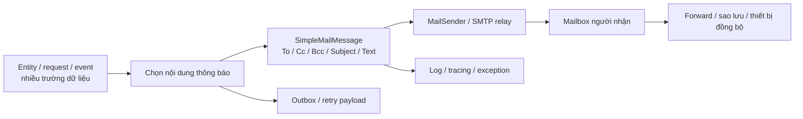

# Giữ nội dung không chứa dữ liệu nhạy cảm ngoài ý muốn

Trong **Spring Framework Mail**, việc gửi một email văn bản thuần rất đơn giản: tạo `SimpleMailMessage`, đặt người gửi, người nhận, tiêu đề và nội dung, sau đó gọi `MailSender.send(...)`. Chính sự đơn giản này dễ khiến lập trình viên đưa thẳng dữ liệu từ entity, request hoặc log vào email. Một dòng như `message.setText(order.toString())` có thể làm lộ địa chỉ, số điện thoại, thông tin thanh toán hoặc token mà người viết không chủ định gửi.

Email là một kênh thông báo có giá trị, nhưng nội dung sau khi gửi thường tồn tại ở nhiều nơi: mailbox của người nhận, mail relay, bản sao lưu, thiết bị đồng bộ và thư được chuyển tiếp. Ứng dụng **không thể thu hồi đáng tin cậy** một bí mật đã đưa vào email. Vì vậy, an toàn nội dung cần được quyết định **trước** khi dựng `SimpleMailMessage`, không chờ đến khi mail provider chấp nhận thư.

Bài này trình bày một quy trình thực hành để chỉ gửi **những dữ liệu cần thiết, được phép và phù hợp với người nhận**. Trọng tâm là thư text đơn giản trong Spring Framework Mail: `MailSender`, `SimpleMailMessage`, thiết kế template, kiểm soát người nhận, bảo vệ log/outbox và kiểm thử chống lộ dữ liệu ngoài ý muốn. Ví dụ dùng Spring Boot 3.x, Java 21 và Jakarta Mail; tư duy thiết kế cũng áp dụng cho Spring Framework thuần.

## 1. “Không chứa dữ liệu nhạy cảm ngoài ý muốn” nghĩa là gì?

Không phải tất cả email đều phải hoàn toàn vô danh. Địa chỉ email người nhận tự nó có thể là dữ liệu cá nhân. Một email xác nhận đơn hàng có thể cần mã đơn hàng hoặc trạng thái xử lý để hữu ích; thư đặt lại mật khẩu có thể phải mang liên kết có token ngắn hạn. Điểm quan trọng là **mỗi thông tin xuất hiện đều có lý do rõ ràng và đã được thiết kế để đi qua email**.

Một nội dung được coi là an toàn hơn khi đáp ứng đồng thời:

1. **Có mục đích:** thông tin thực sự giúp người nhận hoàn thành một tác vụ hoặc hiểu thông báo.
2. **Đúng người nhận:** người gửi đã xác định được hộp thư được phép nhận nội dung đó.
3. **Tối thiểu:** không chứa thêm thuộc tính chỉ vì chúng đã có sẵn trong entity hoặc DTO.
4. **Đúng ngữ cảnh:** mức chi tiết phù hợp loại thông báo và độ nhạy cảm của dữ liệu.
5. **Có thời hạn/quyền truy cập khi cần:** dữ liệu nhạy cảm được giữ sau xác thực trong ứng dụng; liên kết có token phải được bảo vệ theo chính sách.
6. **Không rò rỉ ở nơi phụ trợ:** log, queue, outbox, tracing và exception không ghi thêm nội dung nhạy cảm ngoài ý muốn.

Ví dụ cùng một sự kiện “đơn hàng đã được tiếp nhận”:

| Nội dung | Có nên xuất hiện trong email? | Lý do |
|---|---|---|
| “Đơn hàng của bạn đã được tiếp nhận.” | Thường có | Đủ để thông báo sự kiện |
| Mã tham chiếu công khai dành cho khách hàng | Có thể, theo chính sách | Hỗ trợ tra cứu, nhưng không được tự cấp quyền truy cập chỉ bằng mã |
| Liên kết tới trang đơn hàng yêu cầu đăng nhập | Thường phù hợp | Cho người dùng tự xem chi tiết sau xác thực |
| Toàn bộ entity `Order` ở dạng JSON | Không | Chứa trường nội bộ và dễ thay đổi khi model mở rộng |
| Số thẻ thanh toán đầy đủ / CVV | Không | Không cần thiết cho thông báo |
| Access token hoặc session cookie của ứng dụng | Không | Có thể cấp quyền truy cập ngoài ý muốn |
| Địa chỉ giao hàng đầy đủ | Chỉ khi nghiệp vụ thực sự cần và đã đánh giá | Dữ liệu cá nhân, dễ lộ qua chuyển tiếp |
| Stack trace / chuỗi kết nối database | Không | Thông tin nội bộ, có thể chứa secret |

Mục tiêu là **data minimization**: giảm dữ liệu có mặt trong email xuống mức cần thiết, ngay cả khi ứng dụng có khả năng truy cập nhiều thông tin hơn.

## 2. Những nơi một email text đơn giản có thể làm lộ dữ liệu

Nguy cơ không chỉ nằm trong `setText()`. Thông tin có thể xuất hiện ở nhiều trường và hệ thống:



| Vị trí | Rủi ro phổ biến | Ví dụ |
|---|---|---|
| `To` / `Cc` / `Bcc` | Gửi nhầm người hoặc tiết lộ danh sách người nhận | Đưa toàn bộ khách hàng vào To |
| `From` / `Reply-To` | Hiển thị sai danh tính, trả lời về mailbox không kiểm soát | Cho caller tự chọn From |
| `Subject` | Lộ thông tin ngay trên màn hình khóa/thông báo push | “Kết quả xét nghiệm của Nguyễn…” |
| `Text` | Đưa dữ liệu bí mật vào nội dung chính | In toàn bộ JSON user hoặc token |
| URL trong text | Token hoặc tham số truy vấn có quyền truy cập | Link chứa session token |
| Outbox / message broker | Lưu bản sao bí mật trong thời gian dài | Serialize nguyên entity để retry |
| Log / APM / tracing | Tạo bản sao ở hệ thống quan sát rộng quyền hơn | Ghi `message.toString()` |
| SMTP relay / mailbox | Nội dung lưu ngoài vùng kiểm soát ứng dụng | Mailbox bị chia sẻ hoặc thư được forward |

Một email có thể **không lộ gì trong `setText()` nhưng vẫn lộ ở `Subject` hoặc danh sách người nhận**. Cần kiểm soát toàn bộ thông điệp và dữ liệu phục vụ thao tác gửi.

## 3. Xác định mức độ nhạy cảm trước khi viết template

Để quyết định trường nào được gửi, nên phân loại dữ liệu theo mức độ và mục đích sử dụng. Ví dụ một ứng dụng học tập/đặt hàng có thể chia như sau:

| Nhóm dữ liệu | Ví dụ | Chính sách gợi ý qua email |
|---|---|---|
| Nội dung công khai | Tên sản phẩm, hướng dẫn chung, thời gian bảo trì hệ thống | Có thể đưa trực tiếp nếu không sai ngữ cảnh |
| Thông tin cá nhân cơ bản | Tên, email, mã đơn hàng, lịch học | Chỉ gửi khi thực sự cần và đúng người nhận |
| Thông tin nhạy cảm | Địa chỉ nhà, thông tin sức khỏe, tài chính, dữ liệu khách hàng khác | Hạn chế trong email; ưu tiên xem sau khi đăng nhập |
| Bí mật xác thực | Mật khẩu, mật khẩu hash, refresh token, session token, API key | Không đưa vào email thông báo thông thường |
| Dữ liệu vận hành nội bộ | Stack trace, database URL, secret cấu hình, internal IDs/notes | Không đưa vào thư gửi người dùng |
| Token có mục đích hẹp | Link đặt lại mật khẩu, link xác nhận email | Chỉ trong workflow đã thiết kế, token một lần/ngắn hạn, giới hạn phạm vi và không ghi log |

Phân loại phải dựa trên chính sách của hệ thống, yêu cầu pháp lý áp dụng và kỳ vọng của người dùng. Ví dụ việc gửi mã OTP qua email có thể là một phần của sản phẩm; khi đó mã cần được xem là **bí mật tạm thời được phép gửi riêng cho workflow xác thực**, có hạn dùng, giới hạn số lần thử và không được xuất hiện trong log hay thông báo khác. Không nên biến quy tắc “tránh bí mật” thành một lời cấm tuyệt đối làm mất chức năng cần thiết.

### 3.1. Email không phải một kho lưu giữ bí mật được kiểm soát hoàn toàn

Khi email rời ứng dụng:

- Người nhận có thể đọc nó từ nhiều thiết bị.
- Provider có thể lưu trữ bản sao, tạo backup hoặc xử lý thư để lọc spam.
- Người nhận có thể chuyển tiếp hoặc chụp ảnh màn hình.
- Nội dung có thể xuất hiện trong preview trên màn hình khóa.
- Email có thể được quản trị viên mailbox hoặc người có quyền truy cập tài khoản đọc.

TLS khi kết nối từ ứng dụng tới SMTP server giúp bảo vệ **một chặng truyền** theo cấu hình. Nó **không tự tạo mã hóa đầu cuối (end-to-end encryption)** cho nội dung qua mọi relay và khi nằm trong mailbox. Những thông tin chỉ nên xem sau khi xác thực nên đặt trong hệ thống của bạn và gửi thông báo hoặc liên kết tới trang phù hợp.

## 4. Không đưa thẳng entity, request hay exception vào email

Đây là lỗi thường gặp khi code gửi mail được viết quá gần domain model:

```java
// Ví dụ KHÔNG NÊN làm.
SimpleMailMessage mail = new SimpleMailMessage();
mail.setTo(account.getEmail());
mail.setSubject("Thông tin tài khoản");
mail.setText(account.toString());  // Rất dễ chứa trường nhạy cảm!
mailSender.send(mail);
```

Nếu `Account.toString()` được IDE hoặc Lombok sinh tự động, nó có thể in toàn bộ trường của entity. Một thay đổi sau này, chẳng hạn thêm `passwordHash`, `recoveryToken`, `phoneNumber` hoặc `internalNote`, có thể khiến dữ liệu mới xuất hiện trong email mà không ai sửa code gửi thư.

Các mẫu tương tự cần tránh:

```java
// Không truyền model nghiệp vụ nguyên vẹn sang renderer.
mail.setText(objectMapper.writeValueAsString(customer));

// Không gửi nguyên request nếu request có mật khẩu hoặc token.
mail.setText(registrationRequest.toString());

// Không đưa stack trace ra email gửi khách hàng.
mail.setText(exception.toString());

// Không đưa toàn bộ nội dung log làm body của thông báo đại trà.
mail.setText(debugLog);
```

Tất cả đều làm cho **hợp đồng nội dung** phụ thuộc vào cấu trúc dữ liệu ngoài phạm vi email. Khi object thay đổi, email thay đổi theo mà không qua bước xét chọn trường.

### 4.1. Chọn trường bằng allowlist thay vì cố xóa blacklist

Cách an toàn hơn là định nghĩa chính xác những giá trị được phép đi vào từng template:

```text
Sự kiện nghiệp vụ (nhiều trường)
        ↓
EmailIntent / ApprovedVariables
        ↓
Template cụ thể, phiên bản rõ ràng
        ↓
SimpleMailMessage
        ↓
MailSender.send(...)
```

Ví dụ:

| Template | Giá trị cho phép | Giá trị không có trong hợp đồng |
|---|---|---|
| `account-setting-changed` | Loại thay đổi đã phân loại, thời điểm nếu cần, hướng dẫn đăng nhập | Mật khẩu, hash, recovery token, IP thô |
| `order-accepted` | Trạng thái, mã tham chiếu công khai, link trang đơn hàng | Payment credential, ghi chú nội bộ, JSON entity |
| `course-enrollment` | Tên khóa học được công khai, trạng thái đăng ký | Access token, dữ liệu cá nhân khác |
| `system-maintenance` | Thời gian và phạm vi dịch vụ bị ảnh hưởng | Stack trace, host nội bộ, cấu hình server |

Khi một template có danh sách trường được phép rõ ràng, việc thêm thuộc tính mới vào entity không tự làm email chứa thêm dữ liệu.

### 4.2. Vì sao regex xóa chuỗi nhạy cảm chưa đủ?

Một lựa chọn dễ nghĩ tới là render toàn bộ object rồi dùng regex thay mật khẩu/địa chỉ. Cách này không đáng tin cậy:

- Các trường có thể được đổi tên (`password` thành `credential`).
- Dữ liệu có thể được mã hóa hoặc nằm trong JSON lồng nhiều cấp.
- Một mẫu regex không nhận diện được mọi token hoặc số tài khoản.
- Hành vi xóa nhầm có thể làm nội dung không còn đúng nghiệp vụ.
- Một trường nhạy cảm mới sẽ lọt qua nếu chưa có quy tắc tương ứng.

Redaction có ích như **lớp bảo vệ bổ sung cho log**, nhưng với email gửi người dùng, nên chọn dữ liệu bằng allowlist ngay từ đầu.

## 5. Thiết kế mẫu SimpleMailMessage với dữ liệu đã chọn

Giả sử hệ thống phát sinh một sự kiện thay đổi cài đặt bảo mật. Event ở tầng nghiệp vụ có thể chứa nhiều thông tin nội bộ để phục vụ audit; email chỉ cần thông báo rằng thay đổi đã diễn ra, hướng dẫn người nhận kiểm tra lại nếu họ không thực hiện.

### 5.1. Event có dữ liệu mà email không được phép sử dụng

```java
package com.example.mail;

import java.time.Instant;
import java.util.UUID;

public record AccountSecurityEvent(
        UUID accountId,
        String verifiedEmail,
        ChangeType changeType,
        Instant occurredAt,
        String ipAddress,
        String sessionToken,
        String internalAuditNote
) {
    public enum ChangeType {
        PASSWORD_CHANGED,
        TWO_FACTOR_ENABLED,
        RECOVERY_OPTIONS_UPDATED
    }
}
```

Event có `ipAddress`, `sessionToken` và `internalAuditNote`, nhưng những trường này **không thuộc nội dung thông báo**. Không truyền toàn bộ event tới một template engine có khả năng render mọi field rồi hy vọng người biên soạn template nhớ không dùng đến.

### 5.2. Tạo nội dung từ tập giá trị được cho phép

```java
package com.example.mail;

import java.time.ZoneId;
import java.time.format.DateTimeFormatter;
import java.util.Locale;

import org.springframework.beans.factory.annotation.Value;
import org.springframework.mail.MailSender;
import org.springframework.mail.SimpleMailMessage;
import org.springframework.stereotype.Service;

@Service
public class SecurityNoticeMailService {

    private static final DateTimeFormatter TIME_FORMAT =
            DateTimeFormatter.ofPattern("dd/MM/yyyy HH:mm", Locale.forLanguageTag("vi-VN"))
                    .withZone(ZoneId.of("Asia/Ho_Chi_Minh"));

    private final MailSender sender;
    private final String fromAddress;

    public SecurityNoticeMailService(
            MailSender sender,
            @Value("${app.mail.from}") String fromAddress) {
        this.sender = sender;
        this.fromAddress = fromAddress;
    }

    public void sendSecurityChangeNotice(AccountSecurityEvent event) {
        // Điều kiện tiền đề: email này đã được liên kết và xác minh
        // cho tài khoản tương ứng theo workflow nghiệp vụ.
        String description = switch (event.changeType()) {
            case PASSWORD_CHANGED -> "mật khẩu đăng nhập";
            case TWO_FACTOR_ENABLED -> "xác thực hai bước";
            case RECOVERY_OPTIONS_UPDATED -> "phương thức khôi phục tài khoản";
        };

        String occurredAt = TIME_FORMAT.format(event.occurredAt());

        SimpleMailMessage message = new SimpleMailMessage();
        message.setFrom(fromAddress);
        message.setTo(event.verifiedEmail());
        message.setSubject("Thông báo thay đổi bảo mật tài khoản");
        message.setText("""
                Một thay đổi về %s đã được ghi nhận lúc %s.

                Nếu bạn không thực hiện thay đổi này, hãy mở trực tiếp
                ứng dụng và kiểm tra mục Bảo mật tài khoản hoặc liên hệ hỗ trợ.

                Đây là thông báo tự động.
                """.formatted(description, occurredAt));

        sender.send(message);
    }
}
```

Trong thiết kế này:

1. `changeType` là **enum hữu hạn**, được ánh xạ sang mô tả an toàn. Không đưa một chuỗi tùy ý do người dùng nhập thành nội dung bảo mật.
2. `occurredAt` được trình bày theo múi giờ đã lựa chọn. Thời gian cũng có thể là dữ liệu nhạy cảm trong một số nghiệp vụ; chỉ đưa vào khi cần.
3. Email không chứa `accountId`, `ipAddress`, `sessionToken` hoặc `internalAuditNote`.
4. Hướng dẫn người nhận tự mở ứng dụng qua cách đã biết, giảm khả năng gửi nhầm một URL có token hoặc domain không đáng tin cậy.
5. `MailSender` chỉ chịu trách nhiệm thao tác gửi; việc email đã được xác minh và quyền nhận thông báo phải được kiểm tra **trước đó** ở workflow nghiệp vụ.

Đoạn code không tự kiểm chứng email tồn tại hoặc đúng chủ tài khoản. Nó minh họa **cách dựng nội dung tối thiểu**, trong một hệ thống đã có quy trình xác minh và cập nhật địa chỉ nhận đáng tin cậy.

### 5.3. Không để String.format vô tình trở thành cửa vào dữ liệu mới

`String.format(...)` hoặc `formatted(...)` không tự chọn trường nào được phép gửi. Nếu sau này thay `description` bằng `event.toString()` thì rủi ro quay trở lại. Điều giúp mẫu an toàn là **hợp đồng trường cho phép và cách tạo giá trị**, không phải riêng cú pháp format.

Với template engine, nên đưa vào một DTO riêng:

```java
public record SecurityNoticeTemplateData(
        String safeChangeDescription,
        String formattedOccurredAt
) {}
```

Renderer chỉ được truy cập hai trường này. Không truyền entity hoặc `Map<String, Object>` chứa tất cả property rồi mong template chỉ đọc những phần cần thiết. Nếu template cần thêm dữ liệu, hãy thay đổi DTO một cách tường minh, có người chịu trách nhiệm kiểm tra ý nghĩa.

## 6. Kiểm soát tiêu đề: Subject cũng có thể làm lộ dữ liệu

Thông báo email trên màn hình khóa hoặc danh sách hộp thư thường hiển thị **Subject** trước body. Vì thế, ngay cả khi nội dung chính an toàn, một tiêu đề quá cụ thể vẫn làm lộ thông tin.

Ví dụ:

| Subject không nên dùng rộng rãi | Subject ít tiết lộ hơn |
|---|---|
| “Mật khẩu tạm thời của bạn: 123456” | “Hướng dẫn truy cập tài khoản” |
| “Chi tiết kết quả khám của [họ tên]” | “Bạn có thông báo mới trong tài khoản” |
| “Số dư tài khoản của bạn còn…” | “Thông báo mới từ dịch vụ” |
| “Đơn hàng [địa chỉ đầy đủ] đã được giao” | “Đơn hàng của bạn đã được cập nhật” |
| “Lỗi DB với connection string…” | “Cảnh báo hệ thống cần kiểm tra” |

Đừng đưa mật khẩu, OTP, token, thông tin sức khỏe/tài chính hoặc nội dung riêng tư vào Subject. Với các workflow dùng mã xác thực qua email, nên đặt mã trong phần nội dung theo thiết kế bảo mật; tính năng hiển thị/auto-fill của các email client cần được cân nhắc theo sản phẩm, nhưng không vì vậy mà chấp nhận đưa credential dài hạn vào subject.

### 6.1. Không dùng dữ liệu tùy ý làm Subject

Ví dụ cần tránh:

```java
mail.setSubject("Lỗi khi xử lý: " + exception.getMessage());
```

Exception có thể chứa email, ID khách hàng, URL có token, đường dẫn nội bộ hoặc cấu hình kết nối. Subject còn có thể bị đưa vào dashboard, push notification và thiết bị di động. Nếu cần phân biệt sự cố, dùng mã nội bộ được cho phép:

```java
mail.setSubject("Cảnh báo xử lý yêu cầu");
mail.setText("Yêu cầu có mã tham chiếu an toàn cần được kiểm tra trong hệ thống.");
```

Mã tham chiếu cũng cần được xem xét: nó không nên tự cấp quyền truy cập, mang bí mật hoặc để lộ chuỗi ID có ý nghĩa nhạy cảm.

## 7. Đúng nội dung nhưng sai người nhận vẫn là rò rỉ

Quyền đọc nội dung email phụ thuộc nhiều vào **địa chỉ nhận**. Một body được kiểm soát cẩn thận vẫn là sự cố nếu gửi cho người không được phép.

Các tình huống thường gặp:

- Tài khoản vừa thay email nhưng job nền vẫn dùng địa chỉ cũ đã bị người khác sở hữu.
- Một API cho phép caller truyền bất kỳ recipient nào mà không kiểm tra quyền.
- Lấy email từ form chưa được xác minh rồi gửi nội dung tài khoản.
- Tạo một message với danh sách khách hàng trong `To`, làm lộ toàn bộ địa chỉ.
- Tạo `Cc` vô tình kèm người quản lý/đối tác không cần biết thông tin.
- Reuse `SimpleMailMessage` mutable giữa nhiều thread, thay người nhận nhưng giữ text của yêu cầu trước.

### 7.1. Quy trình xác định người nhận

Với thông báo tài khoản:

1. Lấy recipient từ hồ sơ hoặc workflow đã xác minh, không lấy thẳng từ một tham số tùy ý của request.
2. Kiểm tra trạng thái hiện hành: tài khoản còn hiệu lực, địa chỉ đã xác minh, loại thông báo được phép.
3. Nếu email được tạo bất đồng bộ, xác định chính sách khi địa chỉ bị đổi trong lúc chờ gửi: đóng băng recipient đã xác minh tại thời điểm event hay kiểm tra lại trước khi gửi, tùy nghiệp vụ.
4. Tách từng recipient thành một ý định gửi độc lập nếu nội dung có dữ liệu cá nhân hoặc cần theo dõi retry riêng.
5. Không gửi dữ liệu của người A trong nội dung thư tới địa chỉ thuộc người B chỉ vì một ID hoặc tham số đã bị truyền nhầm.

### 7.2. To, Cc và Bcc

`SimpleMailMessage` hỗ trợ:

```java
mail.setTo("alice@example.test");
mail.setCc("manager@example.test");
mail.setBcc("audit@example.test");
```

Nhưng **việc API cho phép thêm người nhận không có nghĩa mọi người đều được phép xem nội dung**. Cc thường hiển thị công khai cho những người nhận khác. Bcc thường không xuất hiện trong header phát cho họ, nhưng bản thân người nhận Bcc vẫn có thể đọc toàn bộ body. Không dùng Bcc như một cơ chế kiểm soát phân quyền nội dung.

Với thư gửi nhiều khách hàng, mặc định hợp lý là **một thông điệp cho một người nhận**, đặc biệt khi có mã tham chiếu riêng hoặc dữ liệu cá nhân. Việc gửi một mail tới danh sách người nhận khác nhau không tự bảo đảm tính riêng tư ngay cả khi Bcc được dùng đúng.

## 8. Kiểm soát đường liên kết, mã xác thực và token

Email thông báo thường muốn hướng người nhận về ứng dụng. Có hai loại liên kết cần phân biệt:

**Liên kết thông thường** dẫn tới một trang yêu cầu đăng nhập:

```text
https://app.example.test/account/security
```

**Liên kết có token** có thể cấp một quyền cụ thể, ví dụ xác nhận địa chỉ email hoặc đặt lại mật khẩu:

```text
https://app.example.test/reset-password?token=<opaque-one-time-token>
```

Trong trường hợp thứ hai, token chính là một dạng **bearer credential tạm thời**. Nếu người khác lấy được token trước khi nó hết hạn và chưa được sử dụng, họ có thể thực hiện thao tác được token cho phép.

Khi nghiệp vụ bắt buộc gửi link có token:

1. Tạo token đủ ngẫu nhiên bằng nguồn sinh số ngẫu nhiên mật mã phù hợp.
2. Hạn chế quyền token vào **một hành động và một tài khoản**.
3. Đặt hạn dùng ngắn, giới hạn số lần sử dụng và vô hiệu hóa sau khi dùng thành công.
4. Lưu dạng hash/token verifier theo thiết kế phù hợp khi có thể; không ghi token nguyên văn vào log, tracing, lỗi hay analytics.
5. Tạo URL từ domain HTTPS cố định/được phê duyệt; không lấy hostname trực tiếp từ header `Host` không đáng tin cậy.
6. Xem xét rò rỉ qua browser history, referrer, công cụ đo lường và email security link scanner; endpoint tiêu thụ token cần thiết kế an toàn.
7. Không dùng token xác nhận như session token dài hạn hoặc access token tổng quát.

Ví dụ, trong thư thay đổi bảo mật không cần người nhận thực hiện ngay thao tác, có thể **không gửi link có token nào cả** mà chỉ hướng dẫn đăng nhập vào ứng dụng. Nếu là email xác nhận, token có thể là một phần cần thiết của workflow nhưng phải được bảo vệ riêng.

### 8.1. Tránh dán URL từ request không tin cậy

Ví dụ không an toàn:

```java
// Host được lấy từ request mà chưa được xác minh.
String link = request.getScheme() + "://" + request.getServerName()
        + "/confirm?token=" + token;
```

Nếu ứng dụng hoặc reverse proxy không cấu hình host validation chính xác, một request có host không mong muốn có thể làm email chứa link trỏ tới domain do kẻ khác kiểm soát.

Thay vào đó, ứng dụng cần có **public base URL được cấu hình và kiểm soát**, chẳng hạn `https://app.example.test`, cùng kiểm tra chặt các phần đường dẫn/tham số. Với thông báo không cần token, link đến trang yêu cầu đăng nhập thường an toàn hơn.

## 9. Dữ liệu trong email không phải HTML, nhưng vẫn cần ràng buộc đầu vào

`SimpleMailMessage.setText(String)` đặt phần text thuần. Một chuỗi:

```java
mail.setText("<strong>Xin chào</strong>");
```

thường được hiển thị dưới dạng văn bản chứa dấu `<` và `>` trong mail client, thay vì được render như HTML. Điều này giảm một lớp rủi ro HTML injection, nhưng **không tự loại bỏ thông tin nhạy cảm** hoặc những chuỗi gây hiểu nhầm.

Vẫn cần:

- Giới hạn độ dài từng trường.
- Không đưa dữ liệu không kiểm soát vào Subject, From, Reply-To hoặc recipient list.
- Dùng tên/mô tả nghiệp vụ đã được chọn thay cho toàn bộ user input.
- Kiểm soát CR/LF và ký tự điều khiển trong các giá trị header do ứng dụng cung cấp.
- Tránh nội dung đánh lừa người đọc như tên miền gần giống hoặc link không rõ nguồn.
- Đặt charset UTF-8 đúng để tránh tên/tiếng Việt bị lỗi hiển thị.

Đừng tự ghép raw SMTP header vào `setText()` rồi mong `JavaMailSender` xử lý như header. API dành cho text body; header phải được đặt qua những setter có ý nghĩa tương ứng.

### 9.1. Vì sao Subject và Text cần chính sách khác nhau?

`Text` có thể có nhiều dòng, còn `Subject` là một trường header. Nếu Subject được tạo từ một giá trị do người dùng cung cấp, không nên cho phép newline hoặc control character không hợp lệ; có thể tạo hiểu nhầm và làm khó xử lý header.

Ví dụ một chính sách giới hạn Subject:

```java
package com.example.mail;

public final class MailSubjectPolicy {

    private MailSubjectPolicy() {}

    public static String requireSafeSubject(String value) {
        if (value == null || value.isBlank() || value.length() > 120) {
            throw new IllegalArgumentException("Invalid mail subject");
        }
        for (int i = 0; i < value.length(); i++) {
            if (Character.isISOControl(value.charAt(i))) {
                throw new IllegalArgumentException(
                        "Control character in mail subject");
            }
        }
        return value;
    }
}
```

Đây là **chính sách minh họa** cho header, không phải bộ kiểm tra mọi ngôn ngữ và mọi trường hợp Unicode. Trong hệ thống nhiều ngôn ngữ, cần quyết định giới hạn theo code point/byte và kiểm soát chiều dài tiêu đề được mã hóa. Với thông báo bảo mật, hướng đơn giản là dùng Subject cố định theo template, tránh đưa input người dùng vào header.

## 10. Không đưa nội dung thư vào log, tracing và exception

Rủi ro rò rỉ không dừng ở email gửi cho khách hàng. Ngay cả khi recipient đúng, hệ thống logging có thể vô tình tạo thêm một bản sao chứa đầy đủ dữ liệu cá nhân.

Ví dụ nên tránh:

```java
// Các ví dụ KHÔNG NÊN làm trong log production.
logger.info("Sending mail: {}", message);
logger.debug("Body: {}", message.getText());
logger.error("Mail failed for {}: {}", message.getTo(), message.getText());
```

`SimpleMailMessage.toString()` hoặc những bộ formatter/logging chung có thể làm lộ các trường của thông điệp. Exception từ transport cũng có thể chứa địa chỉ và thông báo SMTP. Do đó, không log object email nguyên vẹn hoặc toàn bộ exception detail ở mức truy cập rộng rãi.

### 10.1. Log theo định danh và sự kiện an toàn

Ưu tiên log thông tin vận hành đủ để điều tra:

```json
{
  "event": "mail.send_attempt",
  "notificationId": "7609c04a-d235-43f8-8b8c-2f609dcc5f75",
  "templateId": "account-security-changed",
  "attempt": 1,
  "transport": "primary-smtp",
  "result": "ACCEPTED_BY_RELAY",
  "durationMs": 310
}
```

Khi xảy ra lỗi:

```json
{
  "event": "mail.send_attempt",
  "notificationId": "7609c04a-d235-43f8-8b8c-2f609dcc5f75",
  "templateId": "account-security-changed",
  "attempt": 2,
  "result": "TEMPORARY_FAILURE",
  "errorCategory": "SMTP_4XX"
}
```

Mã thông báo có thể dùng để tra cứu bản ghi có phân quyền trong database; log phổ biến không cần chứa text, subject, email đầy đủ, token hoặc secret.

**Lưu ý:** chỉ log exception type/message đã được xử lý an toàn. Một mã SMTP/loại lỗi có thể hữu ích, nhưng thông điệp lỗi raw của provider đôi khi chứa thông tin người nhận hoặc nội dung không thích hợp để ghi lại.

### 10.2. Metrics không dùng dữ liệu cá nhân làm label

Metric hữu ích:

```text
mail_delivery_attempts_total{template="account-security-changed",outcome="accepted"}
mail_delivery_attempts_total{template="account-security-changed",outcome="retry"}
mail_outbox_due_count
mail_oldest_due_age_seconds
```

Không dùng email address, token hoặc notification ID làm label metric Prometheus: chúng có **cardinality cao** và có thể đưa dữ liệu cá nhân sang hệ thống monitoring. Để điều tra một thông báo cụ thể, dùng ID trong log có quyền truy cập phù hợp.

### 10.3. Tracing và HTTP error response

Nếu controller gọi service gửi email, không nên trả lỗi cho API client với nguyên `MailException.getMessage()`, vì lỗi có thể chứa host, account hoặc địa chỉ nhận. Có thể chuyển thành mã lỗi ứng dụng cùng correlation ID, và chỉ lưu chẩn đoán chi tiết ở vùng vận hành được kiểm soát.

Với OpenTelemetry/APM, không tự đưa `message.getText()`, URL có token hoặc header `Authorization` vào span attributes. Trace tag nên dùng `templateId`, mã lỗi chuẩn hóa và tên provider mức tổng quát.

## 11. Outbox và retry cũng là nơi lưu dữ liệu nhạy cảm

Trong hệ thống cần gửi đáng tin cậy, ứng dụng có thể lưu yêu cầu gửi vào database outbox hoặc message broker trước khi worker gọi `MailSender`. Nếu outbox lưu toàn bộ email body hoặc entity chứa thông tin riêng tư, dữ liệu đó sẽ tồn tại thêm trong:

- Cơ sở dữ liệu sản xuất và bản sao lưu.
- Bản sao CDC, data warehouse hoặc hệ thống phân tích nếu pipeline thu thập.
- Dead-letter queue và các bản ghi gửi lỗi.
- Dữ liệu debug/support được export.
- Lịch sử retry, log của worker hoặc dashboard.

Vì vậy **bảo vệ email cần bắt đầu từ payload của hàng đợi**, không chỉ từ message ở thời điểm gửi.

### 11.1. Lưu một intent tối thiểu thay vì entity đầy đủ

Ví dụ outbox intent cho thông báo cài đặt bảo mật:

```json
{
  "notificationId": "7609c04a-d235-43f8-8b8c-2f609dcc5f75",
  "templateId": "account-security-changed",
  "templateVersion": 2,
  "recipientReference": "account-42",
  "eventType": "TWO_FACTOR_ENABLED",
  "occurredAt": "2026-11-12T08:30:00Z"
}
```

Ý tưởng:

1. `templateId` xác định chính xác loại email.
2. `eventType` là enum được phép hiển thị sau ánh xạ, không phải raw event.
3. `recipientReference` là khóa tra cứu có phân quyền; worker phải quyết định cách lấy địa chỉ nhận đã xác minh.
4. `templateVersion` giúp việc gửi lại dùng cách diễn đạt đã phê duyệt nếu có yêu cầu tái lập.
5. Payload không chứa session token, password hash hay ghi chú audit.

**Ranh giới cần quyết định:** Nếu worker tra cứu thông tin người nhận tại thời điểm gửi, địa chỉ có thể đã đổi. Nếu outbox lưu địa chỉ chụp lại tại thời điểm tạo intent, email cá nhân đó nằm trong database lâu hơn. Cách lựa chọn phụ thuộc nghiệp vụ và chính sách lưu trữ; điều cần tránh là vô tình mở rộng payload không kiểm soát.

### 11.2. Nếu phải lưu nội dung đã render

Một số nghiệp vụ cần lưu phiên bản email đúng như đã được tạo để phục vụ audit hoặc retry. Khi đó:

- Chỉ lưu **nội dung đã qua allowlist**, không phải entity gốc.
- Mã hóa dữ liệu at rest theo yêu cầu và quản lý khóa an toàn.
- Giới hạn quyền truy cập của ứng dụng, worker, nhân viên hỗ trợ và pipeline phân tích.
- Xác định thời hạn lưu và chính sách xóa phù hợp; không mặc định giữ vô hạn.
- Chặn secret vào debug dump, backup hoặc error message không được kiểm soát.
- Không sử dụng cơ sở dữ liệu outbox như nơi lưu mật khẩu, API key hoặc session.

Tương tự, dead-letter queue dùng để xử lý thất bại cần hạn chế quyền truy cập vì nó có thể chứa những thông điệp đáng lẽ phải gửi cho người dùng.

## 12. MailException không phải lý do để phát tán dữ liệu nội bộ

Trong Spring Mail, các lỗi như `MailParseException`, `MailAuthenticationException` và `MailSendException` có vai trò khác nhau:

| Loại lỗi | Ý nghĩa chính | Cách ứng dụng nên phản ứng |
|---|---|---|
| `MailParseException` | Thông điệp/header không thể dựng hoặc phân tích hợp lệ | Xem dữ liệu đầu vào và template; không gửi bản debug qua email cho khách |
| `MailAuthenticationException` | Không xác thực được với SMTP | Cảnh báo cấu hình/secret cho người vận hành; không đưa credential vào thông báo |
| `MailSendException` | Lỗi thực thi gửi, kết nối hoặc phản hồi SMTP | Phân loại nguyên nhân; retry có kiểm soát, lưu trạng thái |

Ví dụ không nên viết:

```java
try {
    mailSender.send(message);
} catch (MailException ex) {
    SimpleMailMessage alert = new SimpleMailMessage();
    alert.setTo("all-users@example.test");
    alert.setSubject("Mail error");
    alert.setText(ex.toString());
    mailSender.send(alert);
}
```

Đoạn này có nhiều vấn đề: gửi thông tin lỗi tới danh sách không phù hợp, có thể tiết lộ địa chỉ/host/secret, tái sử dụng chính hạ tầng đang lỗi để gửi cảnh báo, và có nguy cơ tạo vòng lỗi. Cảnh báo vận hành nên qua hệ thống monitoring hoặc kênh nội bộ được phân quyền, với dữ liệu đã chuẩn hóa.

Nếu cần retry `MailSendException`, vẫn phải phân biệt SMTP `4xx`, `5xx`, lỗi kết nối và trường hợp SMTP có thể đã nhận DATA nhưng client mất phản hồi. **Không thử lại một cách vô hạn** và không đính kèm body email vào log retry.

## 13. Tổ chức cấu hình Spring Mail và bảo vệ bí mật SMTP

Không chỉ nội dung email, cấu hình transport cũng có bí mật: username, password, token SMTP hoặc credential provider.

Với Spring Boot:

```groovy
dependencies {
    implementation 'org.springframework.boot:spring-boot-starter-mail'
}
```

Ví dụ cấu hình STARTTLS:

```yaml
spring:
  mail:
    host: ${SMTP_HOST}
    port: ${SMTP_PORT:587}
    username: ${SMTP_USERNAME}
    password: ${SMTP_PASSWORD}
    default-encoding: UTF-8
    properties:
      "[mail.smtp.auth]": "true"
      "[mail.smtp.starttls.enable]": "true"
      "[mail.smtp.starttls.required]": "true"
      "[mail.smtp.connectiontimeout]": "5000"
      "[mail.smtp.timeout]": "10000"
      "[mail.smtp.writetimeout]": "10000"

app:
  mail:
    from: ${MAIL_FROM}
```

Các biến môi trường ở đây mang tính minh họa. Trong production, quản lý secret qua cơ chế có kiểm soát, phân quyền tối thiểu và xoay vòng khi cần. Không đưa `SMTP_PASSWORD` vào source control, log startup, endpoint debug hoặc nội dung thư.

Thiết lập TLS đúng mode của nhà cung cấp, xác minh certificate và đặt timeout hữu hạn. **TLS chỉ bảo vệ một phần quá trình truyền; nó không làm cho nội dung email trở thành nơi lưu trữ an toàn cho mọi loại bí mật.**

Nếu dùng implicit TLS cổng 465, cần cấu hình SSL phù hợp theo provider, không chỉ thay port trong cấu hình STARTTLS 587.

## 14. Thông báo lỗi nên hướng người dùng về ứng dụng

Trong nhiều trường hợp, email không cần chứa chi tiết nhạy cảm mà vẫn hữu ích:

**Trường hợp thay đổi bảo mật:** “Một thiết lập bảo mật của tài khoản vừa được cập nhật. Nếu không phải bạn, hãy mở ứng dụng và liên hệ hỗ trợ.”

**Trường hợp có hóa đơn mới:** “Hóa đơn mới đã sẵn sàng. Đăng nhập vào tài khoản để xem hoặc tải hóa đơn.”

**Trường hợp cần xem thông tin sức khỏe/tài chính:** “Bạn có thông báo mới trong tài khoản. Vui lòng đăng nhập để xem chi tiết.”

**Trường hợp lỗi hệ thống:** “Yêu cầu của bạn đang được xử lý chậm hơn dự kiến. Bạn có thể kiểm tra trạng thái trong ứng dụng.”

Điểm chung là email **thông báo sự kiện**, còn dữ liệu chi tiết được đặt sau lớp đăng nhập và kiểm tra quyền. Điều đó cũng giảm tác động nếu hộp thư bị chuyển tiếp hoặc hiển thị trên thiết bị dùng chung.

Không nên dùng cụm “đăng nhập để xem” để che giấu mọi nội dung, vì email quá mơ hồ có thể giảm giá trị hoặc gây hiểu nhầm là phishing. Nên cung cấp đủ ngữ cảnh công khai, tên dịch vụ và cách truy cập rõ ràng, đồng thời tránh tạo link đáng ngờ hoặc thúc giục người dùng tiết lộ mật khẩu.

## 15. Kiểm thử chống lộ dữ liệu ngoài ý muốn

Một test chỉ xác nhận `MailSender.send()` được gọi một lần chưa đủ để ngăn lộ thông tin. Ta cần kiểm tra **nội dung thực sự được yêu cầu gửi**, đặc biệt khi domain event có những trường nhạy cảm.

### 15.1. Tạo fake MailSender để bắt thông điệp

```java
package com.example.mail;

import java.util.ArrayList;
import java.util.List;

import org.springframework.mail.MailSender;
import org.springframework.mail.SimpleMailMessage;

public final class CapturingMailSender implements MailSender {

    private final List<SimpleMailMessage> sent = new ArrayList<>();

    @Override
    public void send(SimpleMailMessage message) {
        sent.add(new SimpleMailMessage(message));
    }

    @Override
    public void send(SimpleMailMessage... messages) {
        for (SimpleMailMessage message : messages) {
            send(message);
        }
    }

    public List<SimpleMailMessage> sent() {
        return List.copyOf(sent);
    }
}
```

Fake này dành cho test đơn luồng. Nó sao chép message lúc gửi để việc sửa đối tượng gốc sau đó không làm sai dữ liệu được quan sát.

### 15.2. Test một event có thông tin bí mật

```java
package com.example.mail;

import static org.junit.jupiter.api.Assertions.assertEquals;
import static org.junit.jupiter.api.Assertions.assertFalse;
import static org.junit.jupiter.api.Assertions.assertTrue;

import java.time.Instant;
import java.util.UUID;

import org.junit.jupiter.api.Test;
import org.springframework.mail.SimpleMailMessage;

class SecurityNoticeMailServiceTest {

    @Test
    void sendsOnlyApprovedDetails() {
        CapturingMailSender sender = new CapturingMailSender();
        SecurityNoticeMailService service =
                new SecurityNoticeMailService(
                        sender, "noreply@example.test");

        AccountSecurityEvent event = new AccountSecurityEvent(
                UUID.randomUUID(),
                "learner@example.test",
                AccountSecurityEvent.ChangeType.TWO_FACTOR_ENABLED,
                Instant.parse("2026-11-12T08:30:00Z"),
                "198.51.100.10",
                "secret-session-token-do-not-email",
                "Internal-only audit information"
        );

        service.sendSecurityChangeNotice(event);

        assertEquals(1, sender.sent().size());
        SimpleMailMessage mail = sender.sent().get(0);

        assertEquals("learner@example.test", mail.getTo()[0]);
        assertEquals(
                "Thông báo thay đổi bảo mật tài khoản", mail.getSubject());
        assertTrue(mail.getText().contains("xác thực hai bước"));
        assertFalse(mail.getText().contains(event.sessionToken()));
        assertFalse(mail.getText().contains(event.internalAuditNote()));
        assertFalse(mail.getText().contains(event.ipAddress()));
        assertFalse(mail.getSubject().contains(event.sessionToken()));
    }
}
```

Test này minh họa một nguyên tắc: **chủ động đưa dữ liệu bí mật giả vào event để xác nhận chúng không xuất hiện trong output**. Nó không chứng minh mọi trường mới trong tương lai đều an toàn; một DTO/template với allowlist rõ ràng giúp giảm nhu cầu chạy theo từng tên field nhạy cảm.

Đừng sử dụng dữ liệu cá nhân thật hoặc credential thật trong test. Chuỗi canary như `secret-session-token-do-not-email` là dữ liệu thử nghiệm do test kiểm soát.

### 15.3. Kiểm thử ranh giới bổ sung

| Tình huống | Cần kiểm tra |
|---|---|
| Entity thêm trường mới `apiKey` | Template không có quyền tự lấy trường mới |
| Người nhận thay đổi email | Quy tắc xác minh và quyền gửi vẫn đúng |
| Subject có nội dung người dùng cung cấp | Không lộ bí mật, không có ký tự điều khiển không hợp lệ |
| Gửi hàng loạt | Không lộ danh sách To/Cc giữa các khách hàng |
| MailSendException chứa recipient | Log/error response không chứa địa chỉ và nội dung nhạy cảm |
| Retry sau khi worker restart | Outbox không trở thành nơi lưu secret ngoài chính sách |
| Thông báo chứa link xác nhận | Token đúng phạm vi/hạn dùng, không lọt vào log |
| Mail server giả lập nhận thư | Raw header và text phản ánh đúng thông điệp được phép |

Với integration test, dùng SMTP giả lập như Mailpit để xác nhận serialization và đường gửi, nhưng không đưa secrets thật vào server test. Unit test nội dung và integration test SMTP trả lời **hai câu hỏi khác nhau**: ứng dụng tạo nội dung gì, và đường truyền thử nghiệm có hoạt động không.

## 16. Quy trình xử lý khi phát hiện email đã lộ thông tin

Nếu một thông điệp đã được gửi nhầm kèm dữ liệu nhạy cảm, không thể chỉ sửa template rồi giả định sự cố biến mất. Các bước ứng phó nên đi theo kế hoạch vận hành và chính sách an toàn thông tin của tổ chức:

1. **Ngăn phát sinh thêm:** dừng job/template đang lỗi hoặc đóng băng hàng outbox liên quan.
2. **Xác định phạm vi:** thông báo nào, người nhận nào, khoảng thời gian nào và loại dữ liệu gì đã có trong nội dung.
3. **Không nhân rộng sự cố trong quá trình điều tra:** giới hạn log và quyền đọc, tránh forward nguyên email chứa bí mật qua những kênh không cần thiết.
4. **Vô hiệu hóa hoặc xoay vòng bí mật bị ảnh hưởng:** token, API key hoặc credential nếu có thể đã bị lộ.
5. **Áp dụng quy trình thông báo/đánh giá pháp lý phù hợp** nếu sự cố ảnh hưởng dữ liệu cá nhân hay dữ liệu thuộc diện bảo vệ.
6. **Sửa nguyên nhân:** thay truyền entity nguyên vẹn bằng allowlist, bổ sung test nội dung và giới hạn quan sát.
7. **Kiểm tra những nơi lưu bản sao:** outbox, DLQ, log, tracing, backup và hệ thống hỗ trợ theo quyền và chính sách lưu giữ hiện hành.

Đừng trông chờ việc “recall email” xóa được mọi bản sao. Kể cả khi một dịch vụ mail có tính năng thu hồi trong một số điều kiện, nội dung có thể đã được đọc, đồng bộ hoặc chuyển tiếp.

## 17. Bài thực hành: từ email chứa quá nhiều dữ liệu đến template tối thiểu

Giả sử ứng dụng có một `UserAccount` gồm email, tên, mã tài khoản, password hash, refresh token, số điện thoại, địa chỉ và trạng thái xác thực. Sau khi người dùng bật xác thực hai bước, hệ thống cần gửi email thông báo.

### Phần A — Nhận diện các đường rò rỉ

Xem code ban đầu:

```java
SimpleMailMessage mail = new SimpleMailMessage();
mail.setFrom("noreply@example.test");
mail.setTo(userAccount.getEmail());
mail.setSubject("Thông tin tài khoản: " + userAccount.getId());
mail.setText(userAccount.toString());
mailSender.send(mail);
```

Hãy chỉ ra dữ liệu nào có thể bị lộ trong Subject và Text, những nguồn nhận bản sao có thể có sau khi gửi và vì sao `toString()` không phải hợp đồng nội dung ổn định.

### Phần B — Chuyển sang allowlist

Định nghĩa template `account-security-changed` chỉ chứa:

- Tiêu đề cố định “Thông báo thay đổi bảo mật tài khoản”.
- Mô tả an toàn dựa trên enum loại thay đổi.
- Thời điểm thay đổi nếu chính sách nghiệp vụ cho phép.
- Hướng dẫn truy cập ứng dụng trực tiếp để kiểm tra lại.

Không đưa password hash, token, số điện thoại, địa chỉ hoặc raw audit event vào template. Dùng `SimpleMailMessage` với một recipient đã xác minh.

### Phần C — Chống gửi nhầm

Giả lập tình huống địa chỉ email đã thay đổi nhưng event gửi thư được xếp hàng từ trước. Chọn chính sách lấy địa chỉ theo thời điểm event hay thời điểm gửi, rồi giải thích lý do theo yêu cầu nghiệp vụ và quyền truy cập. Kiểm tra tránh lộ danh sách khách hàng qua To/Cc.

### Phần D — Kiểm thử với fake MailSender

Tạo `CapturingMailSender`, dùng event có `sessionToken` và `internalAuditNote` chứa canary, rồi xác nhận Subject/Text không chứa chúng. Bổ sung kiểm tra log/exception không ghi toàn bộ message khi provider gửi lỗi.

### Phần E — Mở rộng sang workflow có token

Thiết kế email xác nhận địa chỉ: token được phép xuất hiện **chỉ** trong liên kết xác nhận, có quyền hạn hẹp và thời gian sống ngắn. Trình bày cách lưu hash token và kiểm soát log, thời hạn, số lần dùng, host của URL; so sánh với email thông báo thông thường không cần token.

### Phần F — Outbox và khả năng khôi phục

Thiết kế payload outbox chỉ chứa `notificationId`, `templateId`, `recipientReference` và tập biến đã được duyệt. Mô tả cách worker dựng `SimpleMailMessage`, gửi với `MailSender`, phân loại lỗi và xóa/lưu dữ liệu theo retention. Chứng minh việc retry không làm xuất hiện thêm thông tin nhạy cảm.

## 18. Những nguyên tắc áp dụng được ngay

Khi viết một email text đơn giản trong Spring Framework Mail, hãy bắt đầu bằng **hợp đồng nội dung**: người nhận cần biết điều gì, trường nào được phép xuất hiện và trường nào phải nằm trong ứng dụng sau lớp xác thực. Dùng template/DTO **allowlist**, tạo `SimpleMailMessage` mới cho mỗi lần gửi, kiểm tra đúng recipient, giữ Subject tối thiểu và không truyền nguyên entity, request hoặc exception vào `setText()`.

Sau khi email được dựng đúng, tiếp tục bảo vệ dữ liệu ở **log, tracing, outbox, retry và provider**. Sử dụng TLS và credential đúng cách, nhưng nhớ rằng chúng không biến mailbox thành kho lưu bí mật đầu cuối. Với token bắt buộc phải gửi, thiết kế quyền hạn, hạn dùng, dùng một lần và cơ chế không ghi log ngay từ workflow.

Giữ nội dung không chứa dữ liệu nhạy cảm ngoài ý muốn là một **thuộc tính của thiết kế dữ liệu và quyền truy cập**, không phải một tùy chọn tự động của `MailSender`. Khi mọi trường xuất hiện trong email đều có lý do nghiệp vụ rõ ràng, ứng dụng sẽ dễ kiểm thử, dễ vận hành và ít bị ảnh hưởng hơn khi message bị chuyển tiếp, gửi nhầm hoặc lưu ở những nơi ngoài dự kiến.
