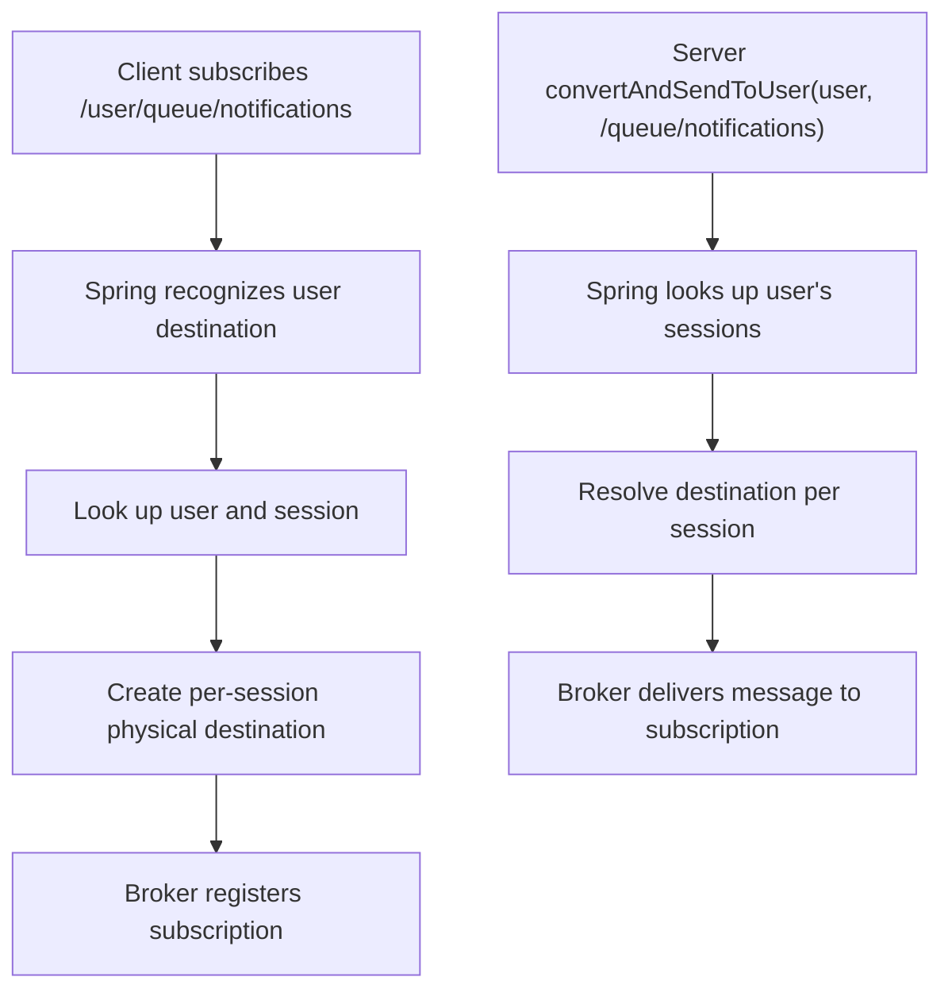

# User Destinations and Translating /user to Per-Session Destinations

## 1. What problem do user destinations solve?

In a WebSocket/STOMP application, the server often needs to send private notifications to a single user: order status, private messages, account updates, or processing results. If sent to a shared destination such as `/topic/notifications`, every client subscribed to that destination could receive the message.

Spring Messaging provides **user destinations** for routing by authenticated user. The application works with a logical destination starting with `/user`; Spring looks up the user's active sessions and translates the logical destination into a physical destination bound to each session. As a result, the application does not have to construct destination names with session IDs manually.

There are two common usage directions:

1. A client subscribes to a destination such as `/user/queue/notifications`. Spring translates that subscription to a private destination for the current session.
2. The server sends to a user with `SimpMessagingTemplate.convertAndSendToUser(...)`. Spring finds the user's sessions and routes the message to the corresponding physical destinations.

Physical destinations are an internal implementation detail. Clients and business code should use the logical `/user/...` destination.

## 2. Distinguishing destination types

A STOMP configuration typically has three prefix groups:

| Prefix | Role | Example |
|---|---|---|
| `/app` | Messages sent by clients to `@MessageMapping` methods of the application. | `/app/chat` |
| `/topic`, `/queue` | Destinations handled by the message broker. | `/topic/news`, `/queue/notifications` |
| `/user` | Logical destination for a user; Spring resolves it into per-session destinations. | `/user/queue/notifications` |

The prefixes have distinct responsibilities. `/app` lets Spring route inbound messages to controllers; `/topic` and `/queue` are the broker's destination space; `/user` tells Spring to locate the user and appropriate sessions before the broker handles the target destination.

For example, Alice's client subscribes to `/user/queue/notifications`. Spring recognizes this as a user destination and maps it to a physical destination used only by Alice's session subscription. If Alice opens another tab and that tab also subscribes to the same logical destination, the new tab has its own session and its own physical destination.

## 3. Configuring user destinations

You can declare the WebSocket endpoint, application prefix, broker prefix, and user destination prefix in one configuration:

```java
import org.springframework.context.annotation.Configuration;
import org.springframework.messaging.simp.config.MessageBrokerRegistry;
import org.springframework.web.socket.config.annotation.EnableWebSocketMessageBroker;
import org.springframework.web.socket.config.annotation.StompEndpointRegistry;
import org.springframework.web.socket.config.annotation.WebSocketMessageBrokerConfigurer;

@Configuration
@EnableWebSocketMessageBroker
public class WebSocketConfig implements WebSocketMessageBrokerConfigurer {

    @Override
    public void registerStompEndpoints(StompEndpointRegistry registry) {
        registry.addEndpoint("/ws");
    }

    @Override
    public void configureMessageBroker(MessageBrokerRegistry registry) {
        registry.setApplicationDestinationPrefixes("/app");
        registry.enableSimpleBroker("/topic", "/queue");
        registry.setUserDestinationPrefix("/user");
    }
}
```

In this example:

- Clients connect over STOMP via the `/ws` endpoint.
- Clients send messages to `/app/...`; Spring strips the application prefix and locates the matching `@MessageMapping` method.
- The broker handles destinations starting with `/topic` or `/queue`.
- Spring recognizes logical destinations starting with `/user` and resolves them by user/session.

`/user` is the user destination prefix; the remainder such as `/queue/notifications` is the target destination used after resolution. The prefix must be consistent between server configuration and client subscriptions. If the application has customized the prefix, use the configured value instead of the `/user` default.

## 4. Client subscribing to a user destination

The client subscribes using the logical destination. Example with STOMP.js:

```javascript
client.onConnect = () => {
    client.subscribe("/user/queue/notifications", (frame) => {
        const notification = JSON.parse(frame.body);
        console.log("Notification:", notification);
    });
};

client.activate();
```

The client does not need to know the session ID or the physical destination generated by Spring. Every time a session subscribes to `/user/queue/notifications`, Spring resolves the destination for that session. When the user reconnects, the new session may be assigned a new physical destination; the client simply re-subscribes to the logical destination after connecting.

Do not hard-code internal destinations with session suffixes or manually append session IDs to URLs. That approach depends on Spring's internal implementation details and easily breaks when users open multiple tabs, reconnect, or change configuration.

## 5. Server sending a message to a user

Use `SimpMessagingTemplate.convertAndSendToUser` when the server wants to proactively send a message to a user with the matching principal name:

```java
import org.springframework.messaging.simp.SimpMessagingTemplate;
import org.springframework.stereotype.Service;

@Service
public class NotificationService {

    private final SimpMessagingTemplate messagingTemplate;

    public NotificationService(SimpMessagingTemplate messagingTemplate) {
        this.messagingTemplate = messagingTemplate;
    }

    public void notifyUser(String username, Notification notification) {
        messagingTemplate.convertAndSendToUser(
                username,
                "/queue/notifications",
                notification
        );
    }
}
```

An example payload can be a Java 17 record:

```java
public record Notification(String title, String message) {
}
```

If Alice has the principal name `alice`, the call:

```java
notificationService.notifyUser(
        "alice",
        new Notification("Order updated", "Your order has shipped.")
);
```

instructs Spring to send the message to Alice's subscribed sessions on the corresponding user destination. Alice's client has subscribed to `/user/queue/notifications` and can therefore receive the message.

Key points to remember:

- The first parameter is the user name according to `Principal.getName()`, not the string `"/user/alice"`.
- The destination parameter is the target portion after the user, such as `"/queue/notifications"`; do not add the user name or the `/user` prefix to this parameter.
- The user name must match the principal that Spring recorded for the WebSocket sessions. If the application uses a custom authentication system, ensure the handshake attaches the right `Principal`.
- By default, the message is sent to all active sessions of that user. If the user is logged in across multiple tabs or devices, each matching session can receive the message.

## 6. Using @SendToUser in a message handler

When you need to reply directly to the sender of a message, you can use `@SendToUser`:

```java
import org.springframework.messaging.handler.annotation.MessageMapping;
import org.springframework.messaging.simp.annotation.SendToUser;
import org.springframework.stereotype.Controller;

@Controller
public class PrivateMessageController {

    @MessageMapping("/echo")
    @SendToUser("/queue/replies")
    public String echo(String payload) {
        return "Server received: " + payload;
    }
}
```

The client sends a STOMP message to `/app/echo`. Spring routes the message to the `echo` method, then sends the return value to the sender's `/user/queue/replies` user destination. The client needs to subscribe to `/user/queue/replies` to receive the reply.

By default, `@SendToUser` has `broadcast = true`: the reply is sent to all sessions of the corresponding user. If you only want to reply to the exact session that sent the message, set `broadcast = false`:

```java
@MessageMapping("/echo")
@SendToUser(value = "/queue/replies", broadcast = false)
public String echoForThisSession(String payload) {
    return "Reply for this session: " + payload;
}
```

This is useful when a user is logged in across multiple tabs but an action only needs a reply on the originating tab. For a message handler that has a session context without an authenticated user, `@SendToUser` with `broadcast = false` can also route the reply back to the sending session. Do not use this mechanism as a substitute for user authentication.

## 7. How does Spring translate /user into per-session destinations?

Spring uses user destination handling components to map logical destinations to physical destinations:

1. The client sends a STOMP `SUBSCRIBE` frame to `/user/queue/notifications`.
2. Spring recognizes the `/user` user destination prefix.
3. Spring determines the subscription's user and session from the message information.
4. The user destination resolver creates a physical destination bound to the corresponding session.
5. The broker registers the subscription at that physical destination.

For server-side sending:

1. The application calls `convertAndSendToUser("alice", "/queue/notifications", payload)`.
2. The template creates a message sent to Alice's logical user destination.
3. Spring looks up active sessions associated with principal Alice.
4. The resolver produces an appropriate physical destination for each session.
5. The broker forwards the message to the matching subscriptions.

Overview diagram:



The specific physical destination name may contain session information or an internal identifier fragment. Do not rely on that name format in business code, log parsers, or clients. The stable contract the application should use is the logical user destination.

## 8. One user with multiple sessions

A single principal can have multiple WebSocket sessions, for example:

- The user opens the same application in two tabs.
- The user logs in on both a laptop and a phone.
- The application has multiple WebSocket connections for the same account.

When the client in each session subscribes to the same user destination, Spring tracks the sessions associated with that user. With `convertAndSendToUser`, Spring sends by default to all matching sessions of the user. This suits notifications that should appear across all online devices.

Choose the sending approach according to business requirements:

| Need | How to use |
|---|---|
| Notify all active sessions of a user | `convertAndSendToUser(username, destination, payload)`. |
| Reply to an action across all sessions of a user | `@SendToUser(destination)` default broadcast. |
| Reply only to the session that sent the message | `@SendToUser(value = destination, broadcast = false)`. |
| Public announcement to many users | Shared destination such as `/topic/...`, do not use user destinations. |

Do not confuse sending to all sessions of one user with broadcasting to all users. User destinations remain scoped to a principal; shared destinations like `/topic/news` are the distribution model for subscriptions on the same destination.

## 9. Relationship with the broker and queue configuration

The name `/queue` is commonly used for private messages, but actual queue semantics depend on the broker:

- **Spring's simple broker** handles subscriptions in memory and supports configured destination prefixes. It does not provide full point-to-point queue semantics like a dedicated message broker; the name `/queue` by itself does not create a queue with special semantics.
- **Broker relay** forwards messages to an external broker. Storage capabilities, queue distribution, acknowledgements, and durability depend on the broker and its configuration.
- User destinations are Spring's user/session resolution layer. After resolution, the message is still routed through the configured broker.

Therefore, choose between the simple broker and a broker relay based on requirements for load, persistence, scalability, and delivery semantics. Do not infer that using the `/queue` prefix automatically guarantees message delivery or stores messages when the user is offline.

## 10. Offline users, reconnects, and multiple servers

User destinations are resolved based on the sessions Spring can recognize at processing time. If there are no matching sessions, the message does not automatically become a stored notification for the user to read upon logging back in. For notifications that must be delivered after offline periods, the application should persist business data to a database or durable queue system and reload it when the user connects.

In multi-instance application deployments, a user's session may connect to a different instance from the one processing the send command. Each instance may only know about local sessions. Spring supports configuring broadcasts for the user registry and unresolved user destinations so instances coordinate to locate sessions. When deploying a cluster, configure appropriate broadcast destinations with the broker relay and ensure all instances participate in that mechanism. Otherwise, one instance may fail to find a session residing on another instance.

Also account for reconnects: the old session closes and a new session is created. The client must re-subscribe to the user destination after STOMP connects successfully; do not keep physical destinations from the previous connection.

## 11. Securing user destinations

User destinations help route by principal, but they do not perform full authorization on their own. The application still needs to protect the message flow:

1. **Authenticate connections.** Attach a trusted user identity to `Principal` during HTTP/WebSocket authentication.
2. **Use the server-side principal.** When calling `convertAndSendToUser`, take the username from the authenticated identity or validated business data. Do not take a recipient name from the client and send directly without checking permissions.
3. **Restrict SUBSCRIBE and SEND.** Configure Spring Security so users can only subscribe to destinations they are permitted to access and only send to permitted application destinations.
4. **Do not treat destinations as secrets.** Having a session suffix on a destination does not replace authorization. Every sensitive operation must still verify permissions on the server.
5. **Check permissions at the business layer.** One user must not be allowed to send notifications to another account just because they know the username or destination name.

## 12. Common mistakes and debugging

**Client subscribes to `/queue/notifications` instead of `/user/queue/notifications`.** In that case, the subscription bypasses the user destination resolver. Check whether the destination the client subscribed to includes the right user prefix.

**Server passes `"/user/alice/queue/notifications"` to `convertAndSendToUser`.** This API takes the username separately in the first parameter and the destination portion in the second parameter. Use `convertAndSendToUser("alice", "/queue/notifications", payload)`.

**Username does not match principal.** `convertAndSendToUser` looks up the user by the identity Spring knows. Compare the passed value with `Principal.getName()`, paying attention to case differences, tenant prefixes, or username normalization.

**User has multiple tabs but only one tab should receive the reply.** `@SendToUser` defaults to broadcasting to all sessions of the user. Set `broadcast = false` if only the sending session should receive the reply.

**No messages when the user is offline.** User destinations are not a persistent store. Persist notifications that need later delivery in the persistence layer and reload them when the user logs in.

**Works on a single instance but fails in a cluster.** Check the user registry and broadcast destination configuration for unresolved messages; confirm that instances connect to the same broker and use compatible settings.

**Destination is not handled by the broker.** Check whether the broker prefixes in `enableSimpleBroker` or the broker relay configuration include the physical destinations generated by Spring.

When debugging, check in order:

1. Confirm that the STOMP session is connected and the principal has the expected name.
2. Confirm that the client subscribed to the right logical destination, e.g., `/user/queue/notifications`.
3. Confirm that the server uses the right username and destination suffix when calling `convertAndSendToUser`.
4. Enable appropriate logging for Spring Messaging and inspect user destination resolution, the session registry, and the broker.
5. If running multiple instances, check registry/broadcast and broker relay across all instances.

## 13. Usage summary

- Clients subscribe to `/user/queue/...`; Spring automatically translates it into a physical destination bound to the session.
- The server sends to a user with `convertAndSendToUser(username, "/queue/...", payload)`.
- Use `@SendToUser` to return results to the sender; set `broadcast = false` when only the current session should receive it.
- The username must match the `Principal.getName()` managed by Spring.
- Physical destinations are an internal detail; the application should use logical destinations.
- User destinations support routing to active sessions; storing offline notifications and securing access permissions remain the application's responsibility.

Properly understanding the translation from `/user` to per-session destinations helps applications send private messages without manually managing session-specific destinations, while correctly handling cases where a single user has multiple connections or runs across multiple instances.