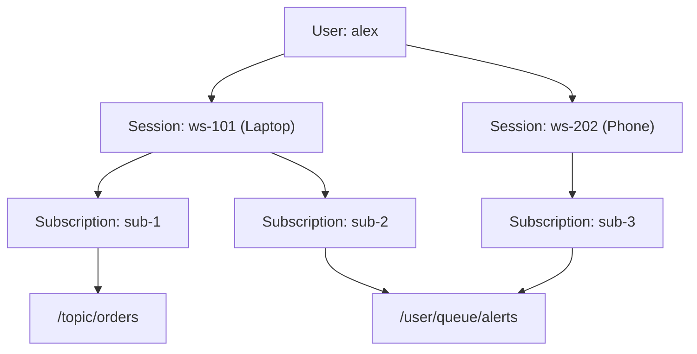

# SimpUserRegistry and Tracking Users, Sessions, and Subscriptions

In a Spring STOMP application, a single user can open multiple connections at the same time: multiple browser tabs, multiple devices, or an application reconnecting. Each connection has its own STOMP session, and each session can register multiple subscriptions. When you want to know who is connected, how many sessions they have, and which session is subscribed to which destination, Spring provides the `SimpUserRegistry` model.

`SimpUserRegistry` is an API for querying the current state of connected users. It is not a persistent user datastore, nor is it an authentication or authorization mechanism. With Spring-managed STOMP configuration, `DefaultSimpUserRegistry` updates state based on STOMP session and subscription lifecycle events.

## 1. The User → Session → Subscription model

Three concepts to distinguish:

- **User (`SimpUser`):** a user identity provided by the session's `Principal`. The user name is the key for lookup in the registry.
- **Session (`SimpSession`):** an active STOMP connection of a user. A user can have multiple sessions.
- **Subscription (`SimpSubscription`):** a registration to receive messages within a session. A subscription has its own ID and destination.

Example of a user logged in on a laptop and a phone:



In this example:

- The registry has one user, `alex`.
- The user has two sessions.
- The two sessions have a total of three subscriptions.
- A single destination can be subscribed to from multiple sessions.

Therefore, `getUserCount()` counts the number of users tracked by the registry, not the number of WebSocket connections or the number of subscriptions. To count sessions, sum the element counts in `getSessions()`; to count subscriptions, iterate over sessions or use `findSubscriptions()`.

## 2. Core APIs

The interfaces reside in the `org.springframework.messaging.simp.user` package:

| Type | Method | Meaning |
|---|---|---|
| `SimpUserRegistry` | `getUser(name)` | Look up a user by name; returns `null` if not connected |
| `SimpUserRegistry` | `getUsers()` | Get a snapshot of currently connected users |
| `SimpUserRegistry` | `getUserCount()` | Count the number of users in the registry |
| `SimpUserRegistry` | `findSubscriptions(matcher)` | Find subscriptions matching a condition |
| `SimpUser` | `getName()` | Unique user name in the registry |
| `SimpUser` | `getSessions()` | Sessions of the user |
| `SimpUser` | `getSession(sessionId)` | Look up a session by ID |
| `SimpSession` | `getId()` | Session ID |
| `SimpSession` | `getSubscriptions()` | Subscriptions within the session |
| `SimpSubscription` | `getId()` | Subscription ID |
| `SimpSubscription` | `getDestination()` | Destination the client subscribed to |
| `SimpSubscription` | `getSession()` | Session containing the subscription |

Query example:

```java
SimpUser user = userRegistry.getUser("alex");

if (user != null) {
    System.out.println("User: " + user.getName());
    System.out.println("Sessions: " + user.getSessions().size());

    for (SimpSession session : user.getSessions()) {
        System.out.println("Session: " + session.getId());

        for (SimpSubscription subscription : session.getSubscriptions()) {
            System.out.println(
                    subscription.getId() + " -> "
                    + subscription.getDestination()
            );
        }
    }
}
```

`getUsers()` returns a snapshot (a copy of the collection) at the moment of the call. That collection does not mutate automatically when users connect or disconnect afterward. Query results are suitable for admin screens, metrics, and point-in-time diagnostics; do not retain a snapshot long-term as live state.

`findSubscriptions` accepts a `SimpSubscriptionMatcher`, which is a functional interface with a `match` method. You can pass a lambda to filter by destination:

```java
Set<SimpSubscription> subscriptions =
        userRegistry.findSubscriptions(subscription ->
                "/topic/orders".equals(subscription.getDestination()));

for (SimpSubscription subscription : subscriptions) {
    SimpSession session = subscription.getSession();

    System.out.printf(
            "user=%s, session=%s, subscription=%s%n",
            session.getUser().getName(),
            session.getId(),
            subscription.getId()
    );
}
```

The result above counts matching subscriptions. If the same user subscribes to `/topic/orders` from three sessions, the result can contain three subscriptions. To count unique users, group by user name.

## 3. How does Spring update the registry?

`DefaultSimpUserRegistry` is the default implementation. It listens to STOMP events published by Spring WebSocket to update users, sessions, and subscriptions. Basic flow:

1. Client sends STOMP `CONNECT`. Spring publishes `SessionConnectEvent` to indicate the start request.
2. Broker replies `CONNECTED`. Spring publishes `SessionConnectedEvent`; the registry creates or locates the corresponding user and adds the session.
3. Client sends `SUBSCRIBE`. Spring publishes `SessionSubscribeEvent`; the registry records the subscription's ID and destination within the session.
4. Client sends `UNSUBSCRIBE`. Spring publishes `SessionUnsubscribeEvent`; the registry removes that subscription.
5. Client sends `DISCONNECT` or the WebSocket session closes. Spring publishes `SessionDisconnectEvent`; the registry removes the session and removes the user if the user has no remaining sessions.

Distinguish `SessionConnectEvent` from `SessionConnectedEvent`. The first event indicates that the CONNECT frame was received; the second is published after the broker responds CONNECTED, when the STOMP session has been established. The default registry uses `SessionConnectedEvent` to start tracking the user/session.

A connection without a `Principal` does not create a `SimpUser` in `DefaultSimpUserRegistry`. Therefore, the registry primarily reflects users with an identity attached to the session. An anonymous WebSocket session can still use certain user destinations under specific rules, but it does not appear as an authenticated user in the registry.

### Tracking lifecycle with ApplicationContext events

You can listen to these events to log, update metrics, or integrate with a custom presence system. There is no need to re-implement a registry just to count sessions; Spring already manages this state.

`StompLifecycleListener.java`:

```java
@Component
public class StompLifecycleListener {

    private static final Logger log =
            LoggerFactory.getLogger(StompLifecycleListener.class);

    @EventListener
    public void onConnected(SessionConnectedEvent event) {
        StompHeaderAccessor accessor =
                StompHeaderAccessor.wrap(event.getMessage());

        Principal user = event.getUser();
        String userName = (user != null) ? user.getName() : "anonymous";

        log.info(
                "STOMP connected: user={}, session={}",
                userName,
                accessor.getSessionId()
        );
    }

    @EventListener
    public void onSubscribe(SessionSubscribeEvent event) {
        StompHeaderAccessor accessor =
                StompHeaderAccessor.wrap(event.getMessage());

        log.debug(
                "STOMP subscribe: session={}, subscription={}, destination={}",
                accessor.getSessionId(),
                accessor.getSubscriptionId(),
                accessor.getDestination()
        );
    }

    @EventListener
    public void onUnsubscribe(SessionUnsubscribeEvent event) {
        StompHeaderAccessor accessor =
                StompHeaderAccessor.wrap(event.getMessage());

        log.debug(
                "STOMP unsubscribe: session={}, subscription={}",
                accessor.getSessionId(),
                accessor.getSubscriptionId()
        );
    }

    @EventListener
    public void onDisconnect(SessionDisconnectEvent event) {
        log.info(
                "STOMP disconnected: session={}, closeStatus={}",
                event.getSessionId(),
                event.getCloseStatus()
        );
    }
}
```

Key imports:

```java
import java.security.Principal;

import org.slf4j.Logger;
import org.slf4j.LoggerFactory;
import org.springframework.context.event.EventListener;
import org.springframework.stereotype.Component;
import org.springframework.messaging.simp.stomp.StompHeaderAccessor;
import org.springframework.web.socket.messaging.SessionConnectedEvent;
import org.springframework.web.socket.messaging.SessionDisconnectEvent;
import org.springframework.web.socket.messaging.SessionSubscribeEvent;
import org.springframework.web.socket.messaging.SessionUnsubscribeEvent;
```

`SessionDisconnectEvent` can be published multiple times for the same session, such as when WebSocket closing and a DISCONNECT frame both trigger cleanup. If a listener updates custom data, handle it idempotently: processing the same session ID repeatedly should not skew counters or create duplicate records.

`SessionSubscribeEvent` and `SessionUnsubscribeEvent` reflect received STOMP frames. They are useful for auditing and metrics. Do not assume that logging the event replaces the actual outcome in the broker or replaces subscription authorization rules.

## 4. Example: querying presence and subscriptions

When enabling the STOMP message broker with `@EnableWebSocketMessageBroker`, the application can inject `SimpUserRegistry` by interface. Prefer the interface so code does not depend on a specific implementation.

`SubscriptionView.java`:

```java
public record SubscriptionView(
        String sessionId,
        String subscriptionId,
        String destination
) {}
```

`UserPresence.java`:

```java
public record UserPresence(
        String userName,
        int sessionCount,
        List<SubscriptionView> subscriptions
) {}
```

`PresenceQueryService.java`:

```java
@Service
public class PresenceQueryService {

    private final SimpUserRegistry userRegistry;

    public PresenceQueryService(SimpUserRegistry userRegistry) {
        this.userRegistry = userRegistry;
    }

    public UserPresence findUser(String userName) {
        SimpUser user = userRegistry.getUser(userName);

        if (user == null) {
            return new UserPresence(userName, 0, List.of());
        }

        List<SubscriptionView> subscriptions = user.getSessions().stream()
                .flatMap(session -> session.getSubscriptions().stream()
                        .map(subscription -> new SubscriptionView(
                                session.getId(),
                                subscription.getId(),
                                subscription.getDestination()
                        )))
                .toList();

        return new UserPresence(
                user.getName(),
                user.getSessions().size(),
                subscriptions
        );
    }

    public int countConnectedUsers() {
        return userRegistry.getUserCount();
    }

    public int countSubscriptions(String destination) {
        return userRegistry.findSubscriptions(subscription ->
                destination.equals(subscription.getDestination())
        ).size();
    }
}
```

Key imports:

```java
import java.util.List;

import org.springframework.messaging.simp.user.SimpSession;
import org.springframework.messaging.simp.user.SimpSubscription;
import org.springframework.messaging.simp.user.SimpUser;
import org.springframework.messaging.simp.user.SimpUserRegistry;
import org.springframework.stereotype.Service;
```

The example uses Java 17 so `record` and `Stream.toList()` can be used. If the project uses an older Java version, replace records with regular classes/DTOs and replace `toList()` with `collect(Collectors.toList())`.

This service is suitable as a data source for an internal admin page or metrics. If exposed via an HTTP endpoint, protect the endpoint with admin permissions because user names, session IDs, and subscription destinations are internal operational information. Do not expose presence data to arbitrary clients.

## 5. Relationship with user destinations

`SimpUserRegistry` is especially helpful for understanding how Spring routes messages to a user who may have multiple open sessions.

Clients typically subscribe to a logical destination:

```javascript
stompClient.subscribe("/user/queue/notifications", frame => {
    showNotification(JSON.parse(frame.body));
});
```

The server sends to a user by `Principal` name:

`Notification.java`:

```java
public record Notification(String title, String body) {}
```

`NotificationService.java`:

```java
@Service
public class NotificationService {

    private final SimpMessagingTemplate messagingTemplate;

    public NotificationService(SimpMessagingTemplate messagingTemplate) {
        this.messagingTemplate = messagingTemplate;
    }

    public void notifyUser(String userName, Notification payload) {
        messagingTemplate.convertAndSendToUser(
                userName,
                "/queue/notifications",
                payload
        );
    }
}
```

Key imports:

```java
import org.springframework.messaging.simp.SimpMessagingTemplate;
import org.springframework.stereotype.Service;
```

On the server side, the destination parameter is `/queue/notifications`; do not manually prepend `/user/{username}` to this parameter. `SimpMessagingTemplate` uses Spring's user destination mechanism to translate the logical destination into session-specific actual destinations. If the user has multiple sessions, all sessions subscribed to that destination can receive the message.

A message-handling method can also use `@SendToUser`:

```java
@Controller
public class PrivateMessageController {

    private final ProfileService profileService;
    private final TabService tabService;

    public PrivateMessageController(
            ProfileService profileService,
            TabService tabService
    ) {
        this.profileService = profileService;
        this.tabService = tabService;
    }

    @MessageMapping("/profile.refresh")
    @SendToUser("/queue/profile")
    public ProfileView refreshProfile(Principal principal) {
        return profileService.load(principal.getName());
    }

    @MessageMapping("/tab.refresh")
    @SendToUser(destinations = "/queue/tab-result", broadcast = false)
    public TabResult refreshCurrentTab() {
        return tabService.refresh();
    }
}
```

Types `ProfileService`, `TabService`, `ProfileView`, and `TabResult` are business components of the application, injected via constructor as shown above.

By default `@SendToUser` sends to all sessions of the user subscribed to the corresponding destination. Set `broadcast = false` when you only want to send back to the session that sent the inbound message, such as a reply tied to a specific tab. For a session without an authenticated user, `@SendToUser` also operates scoped to the current session.

There is no need to manually iterate over `SimpUserRegistry` and send individual messages to each session in normal cases. Use `convertAndSendToUser` or `@SendToUser`; Spring already provides `UserDestinationMessageHandler` and `UserDestinationResolver` to resolve user destinations.

## 6. Simple broker vs. broker relay in multi-server environments

The default implementation `DefaultSimpUserRegistry` tracks the state of the current application server. When running a single instance, this is usually sufficient.

When running multiple application servers, a user may connect to node A while a task executes on node B. Node B's local registry may not know about the session on node A. When using a STOMP broker relay to a shared broker, you can enable registry broadcast and unresolved user destination broadcast:

```java
@Configuration
@EnableWebSocketMessageBroker
public class WebSocketConfig implements WebSocketMessageBrokerConfigurer {

    @Override
    public void configureMessageBroker(MessageBrokerRegistry registry) {
        registry.setApplicationDestinationPrefixes("/app");

        registry.enableStompBrokerRelay("/topic", "/queue")
                .setUserRegistryBroadcast("/topic/simp-user-registry")
                .setUserDestinationBroadcast(
                        "/topic/unresolved-user-destination"
                );
    }

    @Override
    public void registerStompEndpoints(StompEndpointRegistry registry) {
        registry.addEndpoint("/ws");
    }
}
```

The two settings serve different purposes:

- `setUserRegistryBroadcast(...)` broadcasts local registry information and receives broadcasts from other nodes. `MultiServerUserRegistry` combines the local registry with remote registries.
- `setUserDestinationBroadcast(...)` broadcasts user destination messages that the current node could not resolve, giving other nodes a chance to handle them if the user is connected there.

The broadcast destinations are internal channels between nodes. Broker permissions must be configured so regular clients cannot read or write these destinations. All nodes must share the same broker and compatible configuration.

The `setUserRegistryBroadcast` and `setUserDestinationBroadcast` methods in the example above belong to the STOMP broker relay configuration. Do not copy that configuration as-is onto `enableSimpleBroker(...)`: the simple broker is an in-memory broker per application server and does not share registries across nodes.

A multi-server registry is presence data distributed via broadcast, not a synchronous transactional database. When a node or broker experiences disruption, remote information may not be updated immediately. If business logic requires login history, durable online status, or exact auditing, persist business events to a dedicated datastore.

## 7. Distinguishing SimpUserRegistry and SubscriptionRegistry

The two registries have similar names but serve two different responsibilities:

| Component | Tracks | Purpose |
|---|---|---|
| `SimpUserRegistry` | Users, sessions, subscriptions bound to users | Presence, session lookup, subscription inspection, user destinations |
| `SubscriptionRegistry` | Subscriptions used by the broker to route messages | Finding sessions that should receive a message by destination and headers |

The simple broker uses `SubscriptionRegistry` to determine which subscriptions should receive a message sent to a given destination. `DefaultSimpUserRegistry` maintains the user/session/subscription structure for identity-based lookup. Both components relate to the same STOMP subscriptions, yet they are not the same object and should not be substituted for one another.

If you need to know "which users are connected and what are they subscribed to?", use `SimpUserRegistry`. If you need to understand or customize how the broker finds subscribers to deliver messages, that falls under the broker and `SubscriptionRegistry`.

## 8. Security and limitations when using the registry

- **Identity comes from the server-side Principal:** the registry obtains user names from the `Principal` attached to the STOMP session. Authenticate at the HTTP handshake or STOMP inbound channel according to the application's security architecture. Do not trust usernames sent by clients in payloads or headers.
- **User names must be stable and unique:** `Principal.getName()` is used to group sessions of the same user. If two different accounts share the same principal name, the registry may treat them as one user.
- **The registry is not authorization:** the fact that `getUser(name)` returns a user does not prove the caller is permitted to read that user's data. Authorization must still rely on Principal and message authorization.
- **The registry is not persistent data:** when the application server stops, sessions are lost and the registry is rebuilt. To keep history, write to a database or a separate audit system.
- **Snapshots can go stale immediately after retrieval:** connects/disconnects can happen while the application is iterating over results. Use snapshots for point-in-time observation, not as business synchronization locks.
- **Do not expose session IDs:** session IDs, usernames, and subscription lists can reveal internal structure. Only allow administrative roles to view this data.
- **Handle repeated disconnects:** custom listeners must be idempotent because `SessionDisconnectEvent` can repeat.
- **Anonymous sessions:** sessions without a Principal are not counted in the authenticated user count of `DefaultSimpUserRegistry`. Do not use `getUserCount()` as the count of all WebSocket connections.

## 9. Verifying behavior

You can verify registry behavior through a STOMP integration test scenario or a running test environment:

1. Log in as the same user and open two WebSocket/STOMP sessions. Verify `getUserCount()` increases by one user and `getSessions()` has two sessions.
2. Subscribe to `/topic/orders` from both sessions. Verify there are two corresponding subscriptions.
3. Unsubscribe from one session. Verify that subscription disappears while the other session's remains intact.
4. Disconnect the first session. Verify the user still has one session.
5. Disconnect the final session. Verify `getUser(userName)` returns `null`.
6. Connect a session without a Principal. Verify that session is not counted in the authenticated user count.
7. In a multi-node deployment, connect the user to node A and send a user destination message from node B. Verify registry broadcast and unresolved destination broadcast are configured properly.

Values can change immediately after an assertion if tests run asynchronously. In integration tests, wait with a bounded timeout until the expected state appears rather than assuming events and the registry update synchronously within the same client command.

## References

- [Spring Framework 6.2 — User Destinations](https://docs.spring.io/spring-framework/reference/6.2/web/websocket/stomp/user-destination.html)
- [Spring Framework 6.2 — Application Context Events](https://docs.spring.io/spring-framework/reference/6.2/web/websocket/stomp/application-context-events.html)
- [SimpUserRegistry — API 6.2](https://docs.spring.io/spring-framework/docs/6.2.12/javadoc-api/org/springframework/messaging/simp/user/SimpUserRegistry.html)
- [SimpUser — API 6.2](https://docs.spring.io/spring-framework/docs/6.2.12/javadoc-api/org/springframework/messaging/simp/user/SimpUser.html)
- [SimpSession — API 6.2](https://docs.spring.io/spring-framework/docs/6.2.18/javadoc-api/org/springframework/messaging/simp/user/SimpSession.html)
- [SimpSubscription — API 6.2](https://docs.spring.io/spring-framework/docs/6.2.12/javadoc-api/org/springframework/messaging/simp/user/SimpSubscription.html)
- [MultiServerUserRegistry — API 6.2](https://www.springframework.org/spring/docs/6.2.7/javadoc-api/org/springframework/messaging/simp/user/MultiServerUserRegistry.html)
