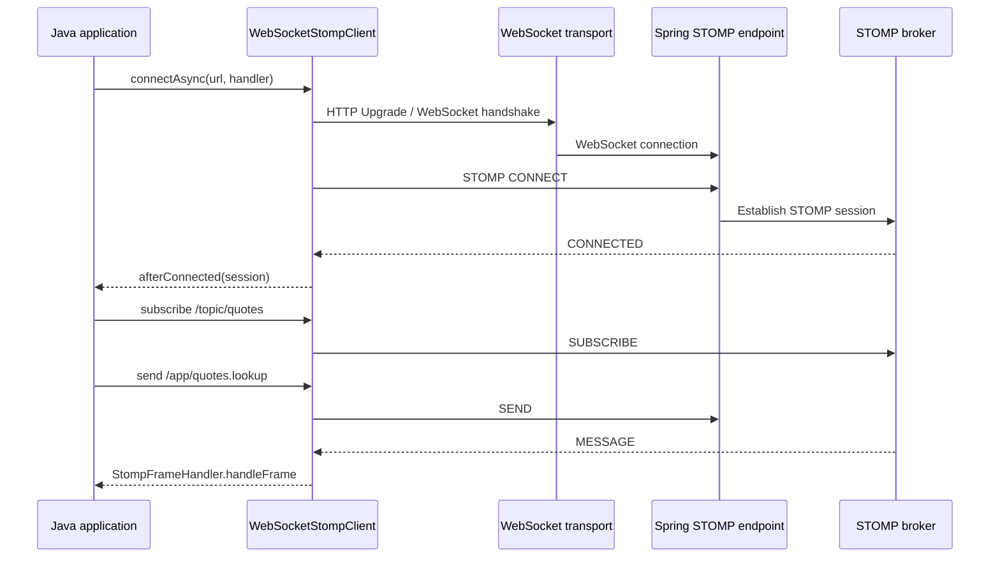

# WebSocketStompClient and WebSocket Transport Configuration

In Spring Messaging, `WebSocketStompClient` is a STOMP client running over a WebSocket transport. It enables a Java application to connect to a Spring application's STOMP endpoint or a compatible STOMP server, send messages, subscribe to destinations, and receive frames asynchronously.

Two layers must be separated during the connection process:

- **WebSocket transport** opens a bidirectional connection to the endpoint, performs the HTTP Upgrade, and transfers data over WebSocket.
- **STOMP session** exchanges `CONNECT`, `CONNECTED`, `SUBSCRIBE`, `SEND`, `MESSAGE`, and `DISCONNECT` frames over the established connection.

WebSocket only provides a data transport channel. STOMP adds message structure, destinations, subscriptions, headers, and receipts. `WebSocketStompClient` manages the STOMP layer on top of a provided `WebSocketClient`.

## 1. Client architecture

Key components:

| Component | Role |
|---|---|
| `WebSocketClient` | Opens the WebSocket connection and provides the transport for STOMP |
| `StandardWebSocketClient` | Adapter using the Jakarta WebSocket API (JSR-356) |
| `SockJsClient` | SockJS client capable of using WebSocket and HTTP fallback transports |
| `WebSocketStompClient` | Encodes/decodes STOMP, manages connections, and creates `StompSession` |
| `StompSessionHandler` | Receives callbacks on connection, on errors, or when receiving session-level frames |
| `StompSession` | Sends messages, subscribes, unsubscribes, and disconnects |
| `MessageConverter` | Converts Java payloads to wire data and vice versa |
| `TaskScheduler` | Schedules STOMP heartbeats and tracks receipt timeouts |

Connection flow:



The WebSocket URL is the connection endpoint, for example `ws://localhost:8080/stomp`. A STOMP destination is a logical address inside the session, for example `/app/quotes.lookup` or `/topic/quotes`. Do not append the destination to the connection URL.

## 2. Choosing the WebSocket transport

`WebSocketStompClient` accepts an implementation of `WebSocketClient` in its constructor.

### StandardWebSocketClient

`StandardWebSocketClient` uses the Jakarta WebSocket API (JSR-356). This is the standard choice when the runtime provides a `WebSocketContainer` implementation.

```java
WebSocketClient transport = new StandardWebSocketClient();
WebSocketStompClient stompClient = new WebSocketStompClient(transport);
```

When running a standalone Java client, a Jakarta WebSocket client implementation must be present at runtime. Having only the API interfaces without a provider is not enough to open a connection. In a Spring Boot application, verify the runtime container and actual dependencies rather than assuming every starter automatically provides a client provider.

### SockJsClient when fallback is needed

Some proxies, firewalls, or corporate networks disallow WebSocket Upgrade or close long-lived WebSocket connections. If the server has SockJS enabled, the Java client can use `SockJsClient` to try configured transports.

```java
List<Transport> transports = List.of(
        new WebSocketTransport(new StandardWebSocketClient()),
        new RestTemplateXhrTransport()
);

WebSocketClient transport = new SockJsClient(transports);
WebSocketStompClient stompClient = new WebSocketStompClient(transport);
```

Key imports:

```java
import java.util.List;

import org.springframework.web.socket.client.WebSocketClient;
import org.springframework.web.socket.client.standard.StandardWebSocketClient;
import org.springframework.web.socket.messaging.WebSocketStompClient;
import org.springframework.web.socket.sockjs.client.RestTemplateXhrTransport;
import org.springframework.web.socket.sockjs.client.SockJsClient;
import org.springframework.web.socket.sockjs.client.Transport;
import org.springframework.web.socket.sockjs.client.WebSocketTransport;
```

The example above declares WebSocket first and an XHR transport as a fallback option. The Java SockJS client supports WebSocket, XHR streaming, and XHR polling. The server must also enable SockJS for the corresponding endpoint:

```java
@Override
public void registerStompEndpoints(StompEndpointRegistry registry) {
    registry.addEndpoint("/stomp").withSockJS();
}
```

When using SockJS, the client URL is the base HTTP(S) URL of the SockJS endpoint, for example `http://localhost:8080/stomp` or `https://example.com/stomp`. `SockJsClient` automatically performs the initial info step and selects an appropriate transport. For a plain WebSocket endpoint, use `ws://` or `wss://` and do not add `.withSockJS()` on the server.

`RestTemplateXhrTransport` uses `SimpleAsyncTaskExecutor` by default to execute receive requests. If creating many concurrent connections, configure a bounded `TaskExecutor` for the XHR transport to control the thread count. SockJS broadens transport compatibility, but it does not replace CORS configuration, authentication, timeouts, or resource limits on the server and reverse proxy.

## 3. Configuring WebSocketStompClient

The example below uses Spring Framework 6.1+ and Java 17+. The client uses JSON to exchange DTOs, a dedicated scheduler for heartbeats/receipts, and an inbound message size limit.

`StompClientConfiguration.java`:

```java
@Configuration
public class StompClientConfiguration {

    @Bean
    public ThreadPoolTaskScheduler stompClientTaskScheduler() {
        ThreadPoolTaskScheduler scheduler = new ThreadPoolTaskScheduler();
        scheduler.setPoolSize(2);
        scheduler.setThreadNamePrefix("stomp-client-heartbeat-");
        return scheduler;
    }

    @Bean
    public WebSocketStompClient webSocketStompClient(
            TaskScheduler stompClientTaskScheduler
    ) {
        WebSocketClient transport = new StandardWebSocketClient();
        WebSocketStompClient client = new WebSocketStompClient(transport);

        client.setMessageConverter(new MappingJackson2MessageConverter());
        client.setTaskScheduler(stompClientTaskScheduler);
        client.setDefaultHeartbeat(new long[] {10_000, 10_000});
        client.setReceiptTimeLimit(15_000);
        client.setInboundMessageSizeLimit(64 * 1024);

        return client;
    }
}
```

Key imports:

```java
import org.springframework.context.annotation.Bean;
import org.springframework.context.annotation.Configuration;
import org.springframework.messaging.converter.MappingJackson2MessageConverter;
import org.springframework.scheduling.TaskScheduler;
import org.springframework.scheduling.concurrent.ThreadPoolTaskScheduler;
import org.springframework.web.socket.client.WebSocketClient;
import org.springframework.web.socket.client.standard.StandardWebSocketClient;
import org.springframework.web.socket.messaging.WebSocketStompClient;
```

Configuration explanation:

- `MappingJackson2MessageConverter` converts Java DTOs to JSON and converts received JSON into the Java type requested by the frame handler. If only sending/receiving plain text, `StringMessageConverter` can be used.
- `setTaskScheduler` provides the scheduler for heartbeats and receipt tracking. When a scheduler is configured, the client's default heartbeat value switches from `0,0` to `10000,10000` if not customized.
- `setDefaultHeartbeat(new long[] {10_000, 10_000})` sets the desired interval for sending and receiving heartbeats in milliseconds. The final values are negotiated with the server/broker side.
- `setReceiptTimeLimit(15_000)` sets the receipt timeout; the default value is 15 seconds.
- `setInboundMessageSizeLimit(64 * 1024)` sets the buffer limit for incoming STOMP messages. The default is 64 KB.

Starting from Spring Framework 6.2, `setOutboundMessageSizeLimit(Integer)` was added to limit the size of outgoing STOMP messages. If a message exceeds the limit, the client splits the message into multiple frames for the receiving side to reassemble. This method does not exist in 6.1 versions, so only add the following line when the actual dependency is 6.2 or newer:

```java
client.setOutboundMessageSizeLimit(64 * 1024);
```

`WebSocketStompClient` implements `SmartLifecycle`. When managed as a Spring bean, it automatically starts and stops the transport following the ApplicationContext lifecycle by default. You can set `setAutoStartup(false)` and call `start()`/`stop()` if the application needs to control when the client opens. When only wanting to close a single STOMP connection, call `session.disconnect()` on the corresponding session.

## 4. Asynchronous connection and session handling

Starting from Spring Framework 6.0, prefer `connectAsync(...)`. The `connect(...)` overloads returning `ListenableFuture` have been deprecated since 6.0 and are marked for removal in a future version.

`connectAsync` completes when the STOMP session has received the `CONNECTED` frame, not merely when the HTTP Upgrade succeeds. Callbacks can be registered using `StompSessionHandler`:

```java
String url = "ws://localhost:8080/stomp";

stompClient.connectAsync(url, new QuoteSessionHandler())
        .whenComplete((session, error) -> {
            if (error != null) {
                log.error("Cannot establish STOMP session", error);
                return;
            }

            log.info("STOMP session ready: {}", session.getSessionId());
        });
```

Do not call `get()` or `join()` immediately on the startup thread just to wait for the connection. Handle success/failure via callbacks or `CompletableFuture` chaining. `afterConnected` is invoked after STOMP CONNECTED is received; this is the appropriate place to register necessary subscriptions.

### Separating HTTP handshake headers and STOMP CONNECT headers

Spring provides an overload accepting both `WebSocketHttpHeaders` and `StompHeaders`:

```java
WebSocketHttpHeaders handshakeHeaders = new WebSocketHttpHeaders();
handshakeHeaders.add("X-Client-Version", "1.0");

StompHeaders connectHeaders = new StompHeaders();
connectHeaders.add("client-id", "quote-monitor");

stompClient.connectAsync(
        url,
        handshakeHeaders,
        connectHeaders,
        new QuoteSessionHandler()
);
```

The two header groups are sent at two different stages:

- `WebSocketHttpHeaders` belong to the HTTP Upgrade handshake.
- `StompHeaders` belong to the STOMP `CONNECT` frame after the WebSocket is open.

If sending an authentication token, you must determine whether the server verifies the token during the handshake or in the STOMP inbound channel and place the header at the right stage. Putting a header in one location does not automatically cause Spring Security to read it in the other. For browsers, the WebSocket API does not allow arbitrarily setting all HTTP handshake headers; web applications typically use protected cookies or a STOMP CONNECT authentication mechanism explicitly handled by the server.

## 5. Subscribing and receiving payloads

Each subscription requires a `StompFrameHandler`. The handler declares the desired payload type via `getPayloadType`; the message converter converts the payload to that type.

`QuoteRequest.java`:

```java
public record QuoteRequest(String symbol) {}
```

`QuoteUpdate.java`:

```java
public record QuoteUpdate(String symbol, BigDecimal price) {}
```

`QuoteSessionHandler.java`:

```java
public class QuoteSessionHandler extends StompSessionHandlerAdapter {

    private static final Logger log =
            LoggerFactory.getLogger(QuoteSessionHandler.class);

    @Override
    public void afterConnected(
            StompSession session,
            StompHeaders connectedHeaders
    ) {
        session.subscribe("/topic/quotes", new StompFrameHandler() {
            @Override
            public Type getPayloadType(StompHeaders headers) {
                return QuoteUpdate.class;
            }

            @Override
            public void handleFrame(StompHeaders headers, Object payload) {
                QuoteUpdate quote = (QuoteUpdate) payload;
                log.info("Received quote: {} = {}", quote.symbol(), quote.price());
            }
        });

        session.send("/app/quotes.lookup", new QuoteRequest("ACME"));
    }

    @Override
    public void handleFrame(StompHeaders headers, Object payload) {
        // Session-level STOMP ERROR frame.
        log.error("STOMP server returned ERROR: {}", payload);
    }

    @Override
    public void handleTransportError(
            StompSession session,
            Throwable exception
    ) {
        log.warn("STOMP transport error for session {}",
                session.getSessionId(), exception);
    }

    @Override
    public void handleException(
            StompSession session,
            StompCommand command,
            StompHeaders headers,
            byte[] payload,
            Throwable exception
    ) {
        log.error("Cannot handle STOMP frame {}", command, exception);
    }
}
```

Key imports:

```java
import java.lang.reflect.Type;
import java.math.BigDecimal;

import org.slf4j.Logger;
import org.slf4j.LoggerFactory;
import org.springframework.messaging.simp.stomp.StompCommand;
import org.springframework.messaging.simp.stomp.StompFrameHandler;
import org.springframework.messaging.simp.stomp.StompHeaders;
import org.springframework.messaging.simp.stomp.StompSession;
import org.springframework.messaging.simp.stomp.StompSessionHandlerAdapter;
```

The example assumes the server has configured the application prefix `/app`, broker prefix `/topic`, and has a handler for `/app/quotes.lookup`. The client subscribes to `/topic/quotes` before sending the request so it does not miss early results.

`StompSession.subscribe` returns a subscription handle. You can keep the handle to cancel that exact subscription when no longer needed:

```java
StompSession.Subscription subscription = session.subscribe(
        "/topic/quotes",
        quoteFrameHandler
);

// When no longer needed:
subscription.unsubscribe();
```

Call `session.disconnect()` when ending the session. There is no need to shut down the entire `WebSocketStompClient` if the application still has other sessions that need to stay active.

## 6. Heartbeats and receipts

### STOMP heartbeat

A heartbeat is a frame operating at the STOMP layer. It helps both sides detect an idle or lost connection. It differs from a WebSocket Ping/Pong control frame: a STOMP heartbeat is represented by heartbeat data in the STOMP stream.

`WebSocketStompClient` only sends a heartbeat when no other messages have been sent during the negotiated interval. If application messages are sent continuously, standalone heartbeats may not appear. With a broker relay, ensure heartbeats to the broker are not masked by messages handled solely at application destinations. Heartbeat configuration must be supported on both the client and the server/broker.

Each connection may create its own heartbeat tasks. When simulating thousands of clients on a single machine for benchmarking, the scheduler and volume of heartbeat tasks can become significant overhead. Heartbeats can be disabled in benchmarks if the goal is measuring raw throughput, but they should not be arbitrarily disabled in production environments.

### STOMP receipt

Receipts allow the client to request confirmation that the broker has processed a SEND or SUBSCRIBE frame. Enable automatic receipts for subsequent operations:

```java
session.setAutoReceipt(true);

Receiptable receipt = session.subscribe(
        "/topic/quotes",
        quoteFrameHandler
);

receipt.addReceiptTask(() -> log.info("Broker processed SUBSCRIBE"));
receipt.addReceiptLostTask(() -> log.warn("SUBSCRIBE receipt timed out"));
```

The client must configure a `TaskScheduler` to track receipt timeouts. A receipt confirms the broker has processed the frame according to the protocol; it does not prove that downstream consumer business logic has finished processing the message or that data has been committed to a database.

## 7. Message size and buffers

A STOMP message can be split across multiple WebSocket messages/frames at the transport layer. The client needs a buffer to reassemble the complete STOMP message before converting the payload.

- The default inbound limit of `WebSocketStompClient` is 64 KB. If the total size of a received STOMP message exceeds the limit, the client raises `StompConversionException`.
- The inbound limit can be increased when the application genuinely needs large payloads, but memory impact should be evaluated when many concurrent connections exist.
- The outbound limit was added in Spring Framework 6.2. When enabled, messages larger than the limit are split into multiple STOMP frames; the receiving side must support frame reassembly.
- If no outbound limit is set, the client does not proactively split STOMP messages based on this property.

Do not use increasing message limits to mask an oversized payload design. For large data, consider sending metadata or an ID over STOMP and fetching the content over HTTP/object storage.

## 8. Error handling, closing connections, and reconnecting

Distinguish three error categories:

| Error category | Where observed | Examples |
|---|---|---|
| Initial connection failure | Future from `connectAsync` completes exceptionally | HTTP 401/403, wrong endpoint, TLS error, unable to open WebSocket |
| Transport error after connecting | `handleTransportError` | Network loss, proxy closes socket, broker relay disconnects |
| STOMP or frame-handling error | `handleFrame` for ERROR frames and `handleException` for callback errors | Broker returns ERROR, converter or frame handler throws exception |

`WebSocketStompClient` creates a connection and manages a STOMP session; do not assume it automatically implements your application's reconnect policy. If reconnection is needed, the application must schedule retries with backoff, an attempt limit or stop condition, and re-register subscriptions after `afterConnected` runs. Avoid immediate tight-loop retries when the server is failing, as this can create heavier load.

Upon disconnect, the server may remove old subscriptions. After reconnecting, create new subscriptions and restore necessary state. Do not hold onto an old `StompSession` and continue sending messages after the transport has been lost.

## 9. Testing and diagnostics

An integration test scenario should verify:

1. WebSocket handshake succeeds to the right endpoint.
2. STOMP CONNECT receives CONNECTED before the application uses the session.
3. Client subscribes to a destination and receives payloads of the expected type.
4. Client sends a DTO through the message converter and the server receives the right JSON/fields.
5. Receipt success and receipt timeout are handled when auto-receipt is enabled.
6. Heartbeats work when the connection is idle and both server and client are configured.
7. Oversized messages produce the expected error.
8. Disconnection is reported via callback, reconnection creates a new session, and subscriptions are re-registered.
9. During shutdown, the session is disconnected and the client lifecycle is stopped properly.

Common symptoms:

| Symptom | Causes to check |
|---|---|
| HTTP 404 on handshake | Wrong endpoint path or reverse proxy not forwarding Upgrade |
| HTTP 401/403 | Cookie/token/Origin or handshake authentication policy |
| WebSocket opens but STOMP does not reach CONNECTED | Broker prefix, STOMP CONNECT headers, or broker relay |
| Messages not received | Subscribed to wrong destination, subscribed after server already emitted event, or broker not routing |
| Payload conversion error | Content-Type, converter, type returned by getPayloadType, JSON structure |
| Idle connection closed | Heartbeat not negotiated, proxy/load balancer timeout |
| SockJS fallback fails | Server did not enable SockJS, XHR transport blocked, or CORS misconfigured |
| Message too large error | Inbound buffer limit or WebSocket server/proxy limit |

## 10. Configuration choices by scenario

| Scenario | Choice |
|---|---|
| Java service connecting to a server supporting direct WebSocket | `StandardWebSocketClient` + `WebSocketStompClient` |
| Network has proxies blocking WebSocket and server supports SockJS | `SockJsClient` with WebSocket and XHR transports |
| JSON payload is a DTO | `MappingJackson2MessageConverter` |
| Payload is plain text only | `StringMessageConverter` |
| Need connection liveness checks | `TaskScheduler` and STOMP heartbeats |
| Need confirmation broker processed SEND/SUBSCRIBE | STOMP receipts and receipt callbacks |
| Large payloads | Set appropriate inbound limit; outbound limit when using Spring 6.2+ |
| Need reconnection | Manage retry/backoff and resubscribe at the application layer |

## References

- [Spring Framework 6.2 — STOMP Client](https://docs.spring.io/spring-framework/reference/6.2/web/websocket/stomp/client.html)
- [Spring Framework 6.2 — WebSocket API](https://docs.spring.io/spring-framework/reference/6.2/web/websocket/server.html)
- [WebSocketStompClient — Spring Framework 6.2 Javadoc](https://docs.spring.io/spring-framework/docs/6.2.0/javadoc-api/org/springframework/web/socket/messaging/WebSocketStompClient.html)
- [StompSessionHandlerAdapter — Spring Framework 6.2 Javadoc](https://docs.spring.io/spring-framework/docs/6.2.6/javadoc-api/org/springframework/messaging/simp/stomp/StompSessionHandlerAdapter.html)
- [SockJsClient — Spring Framework 6.2 Javadoc](https://docs.spring.io/spring-framework/docs/6.2.18/javadoc-api/org/springframework/web/socket/sockjs/client/SockJsClient.html)
- [MappingJackson2MessageConverter — Spring Framework 6.2 Javadoc](https://docs.spring.io/spring-framework/docs/6.2.6/javadoc-api/org/springframework/messaging/converter/MappingJackson2MessageConverter.html)
