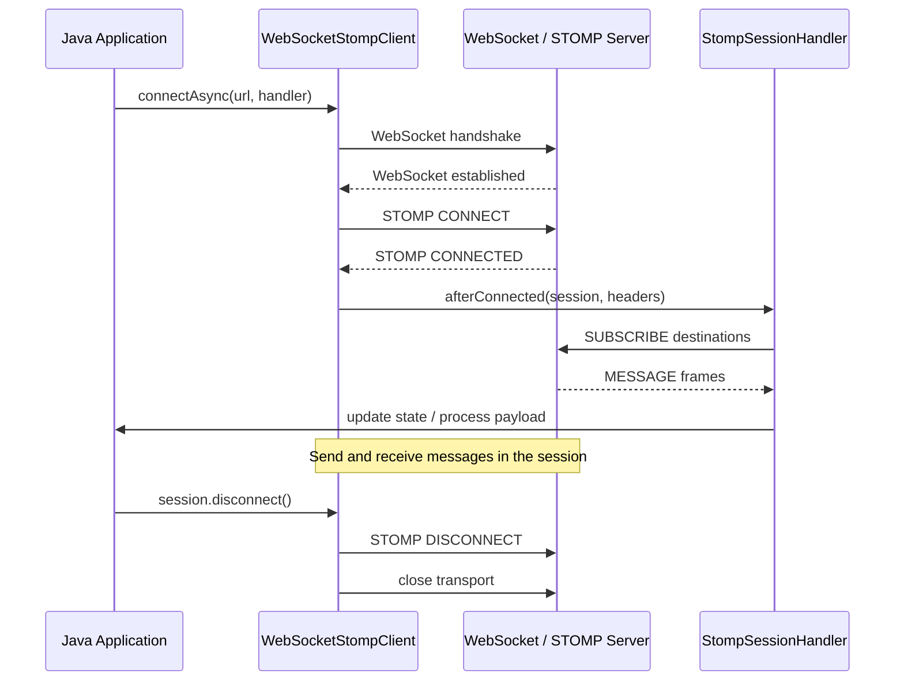

# StompSessionHandler and the STOMP Connection Lifecycle

## 1. Role of StompSessionHandler

Spring Framework provides a STOMP client for Java applications to connect to a server over WebSocket or TCP. For the WebSocket transport, the central class is `WebSocketStompClient`. When connecting, the application passes a `StompSessionHandler` to receive notifications about STOMP session state and errors occurring during communication.

`StompSessionHandler` is the client-side contract, located in package `org.springframework.messaging.simp.stomp`. It extends `StompFrameHandler`, so in addition to lifecycle callbacks, the handler can also receive STOMP `ERROR` frames sent back by the broker. The handler is not a server-side controller and does not manage the lifecycle of the entire `WebSocketStompClient`.

In real applications, you typically extend `StompSessionHandlerAdapter` rather than implementing the interface directly. The adapter provides empty default methods, allowing you to override only the callbacks meaningful to the application.

## 2. Callbacks and API contract

| Method | When invoked | Typical responsibilities |
| --- | --- | --- |
| `afterConnected(session, connectedHeaders)` | After transport connects and the client receives the STOMP `CONNECTED` frame | Store the current session, register subscriptions, initialize application state |
| `getPayloadType(headers)` | When the Java type for the payload of a received frame needs to be determined | Choose the target type so MessageConverter can decode the payload |
| `handleFrame(headers, payload)` | When a frame is routed to this handler; on a session handler, typically used for STOMP `ERROR` | Record errors sent by the broker and inspect headers/payload |
| `handleException(session, command, headers, payload, exception)` | When an error occurs during frame processing, such as payload decoding or an exception thrown from a subscription's StompFrameHandler | Log, raise alerts, mark message processing failure |
| `handleTransportError(session, exception)` | When a transport-layer error occurs, such as I/O, encode/decode errors, or connection loss | Mark session as disconnected and trigger recovery flow |

The callbacks above have distinct scopes. Distinguishing them helps avoid treating a broker error as a network error or missing message decoding errors.

### 2.1. afterConnected

`afterConnected` only runs when the STOMP session is ready: the WebSocket or TCP transport is connected and the broker has returned a `CONNECTED` frame in response to the client's `CONNECT` frame. A successful WebSocket handshake only confirms the transport layer; it does not prove the STOMP session has been established.

Parameters:

- `session`: the `StompSession` object representing the newly established STOMP session.
- `connectedHeaders`: headers in the `CONNECTED` frame, which may contain the STOMP version and negotiated heartbeat info.

This is the appropriate place to register necessary destinations. Once the server confirms the connection, the client can start sending commands and receiving messages. If the application needs to know a subscription has been processed by the broker, request a STOMP receipt and wait for the receipt callback; calling `subscribe` only sends the subscription frame.

### 2.2. getPayloadType and handleFrame

`StompSessionHandler` extends `StompFrameHandler`, which consists of two methods:

```java
Type getPayloadType(StompHeaders headers);

void handleFrame(StompHeaders headers, Object payload);
```

`getPayloadType` specifies the desired Java type of the payload so Spring's MessageConverter can convert the data. For example, if the broker sends JSON representing `Notification`, return `Notification.class`.

`handleFrame` receives the headers and the converted payload. For a handler attached at the session level, these two methods mainly serve to handle `ERROR` frames sent by the broker. Each subscription created with `session.subscribe(...)` can have its own `StompFrameHandler` to handle `MESSAGE` frames for that destination.

`StompSessionHandlerAdapter` defaults the error frame payload type to `String` and leaves `handleFrame` empty. Therefore, if you want to observe error content from the broker, you must override `handleFrame`. If not overridden, error frames may be received without the application recording their contents.

### 2.3. handleException

This callback handles exceptions arising during STOMP frame processing, for example:

- MessageConverter cannot convert the payload into the Java type requested by `getPayloadType`.
- A subscription's `StompFrameHandler.handleFrame` throws an unhandled exception.
- Message-processing logic encounters an error reading data or converting types.

Parameters include the session, the associated STOMP command if any, headers, the raw `byte[]` payload, and the exception. The raw payload is useful for diagnosing conversion errors, but may contain personal data or secrets; log it only after applying data filtering policies.

### 2.4. handleTransportError

This callback is for transport-layer errors, such as I/O, STOMP encoding/decoding errors, or a lost connection. When a connection is lost rather than closed normally via `StompSession.disconnect()`, Spring passes a `ConnectionLostException` into this callback.

Not every application error should be treated as a transport error. For example, a broker sending an `ERROR` frame is a protocol/application error; malformed JSON payload type is a frame-handling error; a reset socket is a transport error. Each type requires a different recovery strategy.

### 2.5. StompSessionHandlerAdapter

The adapter pre-implements the methods of `StompSessionHandler` and `StompFrameHandler`:

- `afterConnected`, `handleException`, `handleTransportError`, and `handleFrame` do nothing by default.
- `getPayloadType` returns `String.class` by default, the expected payload type for STOMP ERROR frames.

Therefore, extending the adapter does not mean errors are handled automatically. The application must override the appropriate callbacks to record or react to errors.

## 3. Lifecycle of a STOMP session

A STOMP session can be viewed as the following sequence of states:



Main steps:

1. **Create the client and configure transport.** Choose `StandardWebSocketClient` for standard WebSocket or `SockJsClient` when SockJS fallback is needed.
2. **Open the transport connection.** The client performs an HTTP Upgrade/WebSocket handshake or TCP connection, depending on the client type.
3. **Send STOMP CONNECT.** Once the transport is ready, the client sends a `CONNECT` or `STOMP` frame with required headers.
4. **Receive STOMP CONNECTED.** The server/broker confirms the STOMP session and may negotiate protocol version and heartbeats.
5. **Invoke afterConnected.** The handler receives a usable `StompSession`. This is the milestone to begin sending commands, subscribing to destinations, and setting up callbacks.
6. **Exchange messages.** The client sends via `session.send`, subscribes via `session.subscribe`, and receives frames through `StompFrameHandler` instances.
7. **Close session or handle errors.** The application can call `session.disconnect()`; if the transport disconnects, the handler receives a transport error.
8. **Reconnect when needed.** The client must execute the application's reconnect strategy. A new session gets a new session ID and must re-create all subscriptions.

A WebSocket may remain open while STOMP CONNECT has not succeeded. Therefore, do not mark the application state as "connected" based solely on WebSocket-layer callbacks or logs.

## 4. Configuring WebSocketStompClient

Example configuring a client with a Jackson converter and a scheduler for heartbeats/receipts:

```java
import org.springframework.messaging.converter.MappingJackson2MessageConverter;
import org.springframework.scheduling.concurrent.ThreadPoolTaskScheduler;
import org.springframework.web.socket.client.standard.StandardWebSocketClient;
import org.springframework.web.socket.messaging.WebSocketStompClient;

public final class StompClientFactory {

    private StompClientFactory() {
    }

    public static WebSocketStompClient createClient(
            ThreadPoolTaskScheduler scheduler) {

        var webSocketClient = new StandardWebSocketClient();
        var stompClient = new WebSocketStompClient(webSocketClient);

        stompClient.setMessageConverter(
                new MappingJackson2MessageConverter());
        stompClient.setTaskScheduler(scheduler);
        stompClient.setReceiptTimeLimit(15_000);

        return stompClient;
    }
}
```

Initialize the scheduler when creating the application:

```java
import org.springframework.scheduling.concurrent.ThreadPoolTaskScheduler;

ThreadPoolTaskScheduler scheduler = new ThreadPoolTaskScheduler();
scheduler.setPoolSize(1);
scheduler.setThreadNamePrefix("stomp-scheduler-");
scheduler.initialize();
```

In a Spring application, declare the scheduler and client as beans so Spring manages their lifecycles. If instantiating manually in Java as shown in the example, the application must shut down the scheduler upon termination to release threads. `WebSocketStompClient` implements `SmartLifecycle`; for Spring-managed beans, start/stop lifecycles can be coordinated with the ApplicationContext.

Configuration points to understand:

- **WebSocketClient:** selects the transport. `StandardWebSocketClient` uses standard WebSocket; `SockJsClient` can use WebSocket or HTTP fallback transports.
- **MessageConverter:** determines how outgoing payloads are serialized and incoming payloads are deserialized. JSON DTOs need an appropriate JSON converter; plain strings can use `StringMessageConverter`.
- **TaskScheduler:** supports heartbeat tasks and receipt deadline tracking. Without a configured scheduler, you cannot rely on the client's scheduling mechanisms for those features.
- **Receipt time limit:** how long the client waits for a receipt before considering it lost. The default is 15 seconds; only customize when justified by latency and broker characteristics.
- **Message size:** inbound messages default to a 64 KB limit. You can use `setInboundMessageSizeLimit` and `setOutboundMessageSizeLimit` to set appropriate limits. Large outbound STOMP messages may be split into partial WebSocket messages; the receiver must reassemble them. Inbound messages exceeding the limit trigger `StompConversionException`.

Converter configuration must align with the server's payload contract. If the server sends JSON while the client uses a string-only converter, or the two sides disagree on data types, conversion errors may be routed to `handleException`.

## 5. Connecting and obtaining StompSession

Since Spring Framework 6.0, you can use `connectAsync`, which returns a `CompletableFuture<StompSession>`. The future completes when the STOMP connection is ready, after receiving the `CONNECTED` frame.

```java
import java.util.concurrent.CompletableFuture;

import org.springframework.messaging.simp.stomp.StompSession;
import org.springframework.web.socket.messaging.WebSocketStompClient;

public final class StompConnector {

    private final WebSocketStompClient client;

    public StompConnector(WebSocketStompClient client) {
        this.client = client;
    }

    public CompletableFuture<StompSession> connect(
            String url,
            NotificationSessionHandler handler) {

        return client.connectAsync(url, handler);
    }
}
```

You can observe connection results using the future:

```java
connector.connect(url, handler)
        .whenComplete((session, error) -> {
            if (error != null) {
                System.err.println("STOMP connect failed: " + error);
                return;
            }

            System.out.println(
                    "STOMP session ready: " + session.getSessionId());
        });
```

Choose a single place responsible for registering subscriptions. If `afterConnected` already registers subscriptions, the `whenComplete` callback should only record the outcome or update UI state. Subscribing to the same destination in both places creates duplicate subscriptions.

Overloads of `connectAsync` also allow passing WebSocket handshake headers and STOMP CONNECT headers. The two header types belong to two distinct stages:

- `WebSocketHttpHeaders` apply to the HTTP handshake, such as cookies or HTTP authentication headers allowed by the server.
- `StompHeaders` apply to the STOMP CONNECT frame, such as login/passcode if the broker uses STOMP authentication.

Do not place credentials in query strings or logs. Only send credentials over a TLS-protected transport (`wss://`) and following the server/broker's authentication mechanism.

## 6. Example handler managing subscriptions and errors

Suppose the broker sends JSON notifications with the structure:

```java
public record Notification(
        String id,
        String title,
        String message
) {
}
```

Handler:

```java
import java.lang.reflect.Type;
import java.util.function.Consumer;

import org.springframework.messaging.simp.stomp.StompCommand;
import org.springframework.messaging.simp.stomp.StompFrameHandler;
import org.springframework.messaging.simp.stomp.StompHeaders;
import org.springframework.messaging.simp.stomp.StompSession;
import org.springframework.messaging.simp.stomp.StompSessionHandlerAdapter;

public final class NotificationSessionHandler
        extends StompSessionHandlerAdapter {

    private static final System.Logger LOG =
            System.getLogger(NotificationSessionHandler.class.getName());

    private final Consumer<Notification> notificationConsumer;

    private volatile StompSession.Subscription subscription;

    public NotificationSessionHandler(
            Consumer<Notification> notificationConsumer) {
        this.notificationConsumer = notificationConsumer;
    }

    @Override
    public void afterConnected(
            StompSession session,
            StompHeaders connectedHeaders) {

        LOG.log(System.Logger.Level.INFO,
                "STOMP connected: sessionId={0}",
                session.getSessionId());

        session.setAutoReceipt(true);

        this.subscription = session.subscribe(
                "/topic/notifications",
                new StompFrameHandler() {
                    @Override
                    public Type getPayloadType(StompHeaders headers) {
                        return Notification.class;
                    }

                    @Override
                    public void handleFrame(
                            StompHeaders headers,
                            Object payload) {
                        notificationConsumer.accept(
                                (Notification) payload);
                    }
                });

        this.subscription.addReceiptTask(() ->
                LOG.log(System.Logger.Level.INFO,
                        "Notification subscription confirmed"));

        this.subscription.addReceiptLostTask(() ->
                LOG.log(System.Logger.Level.WARNING,
                        "Notification subscription receipt timed out"));
    }

    @Override
    public void handleFrame(StompHeaders headers, Object payload) {
        // StompSessionHandler also receives broker STOMP ERROR frames.
        LOG.log(System.Logger.Level.ERROR,
                "Broker STOMP ERROR: {0}", payload);
    }

    @Override
    public void handleException(
            StompSession session,
            StompCommand command,
            StompHeaders headers,
            byte[] payload,
            Throwable exception) {

        LOG.log(System.Logger.Level.ERROR,
                "STOMP frame processing failed; command=" + command,
                exception);
    }

    @Override
    public void handleTransportError(
            StompSession session,
            Throwable exception) {

        LOG.log(System.Logger.Level.WARNING,
                "STOMP transport error for session "
                        + (session != null ? session.getSessionId() : "unknown"),
                exception);
    }

    public void unsubscribe() {
        StompSession.Subscription current = this.subscription;
        if (current != null) {
            current.unsubscribe();
            this.subscription = null;
        }
    }
}
```

This is a client component example; it requires Spring Messaging/WebSocket, Jackson if using JSON, a broker with destination `/topic/notifications`, and an application-provided `Consumer`. Each `public` type can be placed in its own file.

In the example:

1. `afterConnected` receives the ready session and subscribes to `/topic/notifications`.
2. `getPayloadType` tells the converter to convert the payload into `Notification`.
3. The subscription's `handleFrame` receives business messages.
4. Receipt callbacks indicate whether the broker processed the SUBSCRIBE frame or the receipt timed out.
5. The session handler's `handleFrame` receives session-level `ERROR` frames.
6. `handleException` receives exceptions from frame processing.
7. `handleTransportError` receives transport-layer errors.
8. `unsubscribe` cancels the current subscription when the application no longer needs to receive messages.

Keep callbacks short and avoid running slow queries or expensive processing directly on the message-receiving thread. Offload payloads to an executor or application queue, while bounding the queue to prevent unbounded memory growth when consumers are slow.

## 7. StompSession and subscription management

`StompSession` is the API for interacting with a connected STOMP session:

| API | Purpose |
| --- | --- |
| `getSessionId()` | Get the current session ID |
| `isConnected()` | Check the session's connection state |
| `send(destination, payload)` | Send a message to a destination |
| `subscribe(destination, handler)` | Subscribe to a destination and get a `Subscription` handle |
| `setAutoReceipt(true)` | Automatically add receipt headers to subsequent send/subscribe operations |
| `disconnect()` | Send STOMP DISCONNECT and proactively close the session |

The subscription handle can be retained to unsubscribe:

```java
StompSession.Subscription subscription =
        session.subscribe("/topic/orders", orderFrameHandler);

// When messages are no longer needed:
subscription.unsubscribe();
```

A subscription belongs to the session that created it. Once the session is lost or closed, do not continue using old handles. After reconnecting, call `subscribe` on the new `StompSession` and store the new handles.

If a session needs multiple destinations, store them in a per-session registry so they can be managed and unsubscribed cleanly. Avoid re-subscribing on every UI refresh or every service callback execution. A state flag or map keyed by destination can ensure only one needed subscription is created per session.

## 8. Heartbeats and receipts

### 8.1. Heartbeat

A heartbeat is a small signal indicating the STOMP connection is still active even when no business messages are flowing. To enable heartbeats for `WebSocketStompClient`, configure a `TaskScheduler`; you can customize the two default 10-second intervals:

- Outgoing inactivity interval before the client emits a heartbeat.
- Incoming inactivity interval before the client considers the connection dead and closes it.

Actual intervals also depend on heartbeat negotiation between client and server per STOMP. The client only sends heartbeats when no other messages are being sent. Hence, heartbeats are not business messages and cannot prove the server has processed application commands.

When using an external broker, note that messages targeting internal application destinations may count as activity on the client without being forwarded to the broker. Configure an appropriate scheduler on the broker relay side when the architecture requires heartbeats to the broker in that scenario.

Each connection may create its own heartbeat tasks. When running high-load tests with thousands of clients on one machine, weigh scheduler overhead and test goals before enabling heartbeats for all simulated connections.

### 8.2. Receipt

A receipt confirms at the STOMP layer that the server/broker has processed a frame requesting a receipt. It is useful when needing to know a SEND or SUBSCRIBE command was accepted by the broker. A receipt does not confirm that server-side business logic finished or that an end user processed the message.

Automatic receipts can be enabled:

```java
session.setAutoReceipt(true);
StompSession.Receiptable receipt =
        session.send("/app/orders", orderCommand);

receipt.addReceiptTask(() ->
        System.out.println("Broker confirmed SEND"));

receipt.addReceiptLostTask(() ->
        System.err.println("Receipt was not received in time"));
```

Or request a receipt manually via header for a specific operation. Both `send` and `subscribe` return a `Receiptable` to register success or lost callbacks. A `TaskScheduler` must be configured to track receipt deadlines; the default deadline is 15 seconds.

The broker must support receipts as required by the application. If the broker does not support them or responds slower than the deadline, the receipt-lost callback may be invoked. Do not interpret a receipt timeout as proof that the message was definitely not processed: the frame may have reached the broker while the response was lost in transit. For business commands needing retries, use a request ID/idempotency key to avoid duplicate execution.

## 9. Reconnection and session recovery

Spring does not automatically reconnect STOMP clients when a connection is lost. A server-side broker relay may automatically reconnect its system connection to the broker, but connected WebSocket clients require their own reconnect logic. Heartbeats detect an unresponsive connection; they do not open a new session.

A recovery procedure should include these steps:

1. Detect connection failure via `handleTransportError` or an error from the initial connection future.
2. Mark the current session as unusable; stop sending messages through the old session.
3. Wait before retrying. Use bounded exponential backoff with jitter so many clients do not reconnect simultaneously.
4. Create a new connection with `connectAsync`.
5. Wait for the `CONNECTED` frame; in `afterConnected`, store the new session and re-create all subscriptions.
6. Resynchronize application data using snapshots, sequence numbers, or a replay mechanism if the system must guarantee no missed events.
7. If the application is shutting down or the user explicitly logs out, cancel retries and close resources.

Example retry delay calculation:

```java
static long retryDelayMillis(int attempt) {
    long base = 500L;
    long max = 30_000L;
    int exponent = Math.min(attempt, 10);
    long exponential = Math.min(max, base * (1L << exponent));

    // Random jitter between 0..25% of wait time.
    long jitter = java.util.concurrent.ThreadLocalRandom.current()
            .nextLong(Math.max(1L, exponential / 4L));

    return exponential + jitter;
}
```

This is only a delay calculation helper. The reconnect coordinator needs additional state to ensure:

- Only one reconnection attempt is pending or running at a time.
- No retries occur after the user explicitly disconnects.
- Retry tasks are cancelled upon application shutdown.
- Old sessions/subscriptions are not retained after switching to a new session.
- There is an attempt limit or circuit-breaker mechanism when the server is down for an extended period.
- Authentication errors or misconfigurations are not retried indefinitely; distinguish transient errors from errors requiring intervention.

Each reconnect creates a new STOMP session. Old subscriptions do not automatically appear on the new session. Re-subscribing in `afterConnected` is a centralized way for every successful connection to establish the same set of subscriptions. Ensure this callback does not accidentally subscribe twice on the same session.

### 9.1. Snapshots and events after reconnect

When a connection drops, the client may miss messages during the offline period. Re-subscribing to destinations only delivers messages from the time the new subscription takes effect.

If the application requires consistency, attach a sequence/version to events and snapshots. Upon reconnecting, the client can:

- Request the current snapshot and replace stale state.
- Send the last processed sequence so the server replays missing events.
- Deduplicate events by event ID or sequence.
- Detect sequence gaps and trigger resynchronization.

Do not assume STOMP sessions automatically queue messages for offline clients. Storage/replay capability depends on the broker and application design.

## 10. Closing connections and releasing resources

When the application proactively ends a session:

```java
if (session != null && session.isConnected()) {
    session.disconnect();
}
```

You can unsubscribe from destinations before disconnecting if controlled unsubscription is needed. Closing a session differs from stopping the entire `WebSocketStompClient`: a single client may manage multiple sessions, so only call `stop()` when intending to stop the client component and you own its lifecycle.

In a Spring application, let the ApplicationContext manage `WebSocketStompClient` and `TaskScheduler` beans. When instantiating them manually, close sessions, stop the client if needed, and shut down the scheduler during cleanup. Do not call `System.exit` to handle an ordinary connection error.

`StompSessionHandler` has no separate callback named `afterDisconnected`. Therefore, do not write cleanup logic relying on such a callback. You can place cleanup where the application calls `disconnect`, handle `ConnectionLostException` in `handleTransportError`, or use lifecycle state of an application-managed component. On the server side, Spring provides application events such as `SessionConnectEvent`, `SessionConnectedEvent`, and `SessionDisconnectEvent`; those are server-side events, not client handler callbacks. `SessionDisconnectEvent` may be published multiple times for the same session, so server listeners must be idempotent.

## 11. Distinguishing error categories

| Symptom | Where handled | Investigation path |
| --- | --- | --- |
| Unable to open WebSocket or connect future fails | Future from `connectAsync` and transport logs | URL, TLS, HTTP status, proxy, handshake headers, server availability |
| STOMP CONNECT rejected by broker | STOMP ERROR or connection error depending on timing | CONNECT headers, credentials, STOMP version, access permissions |
| Broker sends ERROR frame during session | `StompSessionHandler`'s `handleFrame` | Error message, destination, broker ACL, command payload |
| JSON fails to decode or subscription handler throws exception | `handleException` | Content-Type, MessageConverter, payload schema, handler code |
| Socket closes abnormally or connection drops | `handleTransportError` | Network, idle timeout, proxy, server restart, heartbeat |
| Not receiving messages after reconnect | `afterConnected` logic and subscription registry | Were subscriptions re-created, receipts, destinations, resync |
| Receipt lost | receipt-lost callback | Whether broker supports receipts, scheduler, timeout, network delay |
| Inbound payload exceeds limit | `handleException` with conversion error | `inboundMessageSizeLimit`, payload size, transport fragmentation |

Do not merely log an exception and ignore it. Record the error type, session ID, destination or STOMP command when available, timestamp, and correlation ID. Do not log passcodes, tokens, cookies, or full sensitive payloads.

## 12. Testing lifecycle and errors

A meaningful test suite should verify protocol milestones rather than merely invoking callbacks directly:

1. **Successful connection:** verify `afterConnected` runs only after the client receives `CONNECTED`.
2. **Subscriptions:** verify the handler creates the exact subscriptions once per session.
3. **Message reception:** verify `getPayloadType` selects the right DTO and the subscription's `handleFrame` receives the decoded payload.
4. **Broker ERROR:** send a simulated ERROR frame and verify the session handler records its contents.
5. **Decoding error:** send a payload with wrong schema/Content-Type and verify the error is routed to `handleException`.
6. **Transport error:** close the socket abnormally and verify `handleTransportError` is processed.
7. **Receipts:** verify the success callback and receipt-lost callback in respective scenarios; use a broker supporting receipts.
8. **Reconnect:** drop the connection, let the client create a new session, and verify subscriptions are restored exactly once.
9. **Shutdown:** verify retries are cancelled, the session is closed, and the scheduler is released.

You can unit test the handler using a mock `StompSession` to verify behavior inside `afterConnected`, but integration tests against a real STOMP server are needed to verify handshake, CONNECTED, converters, receipts, and transport. Mocks do not prove a broker supports a protocol feature.

## 13. Common implementation mistakes

- **Marking connected as soon as WebSocket handshake finishes:** STOMP CONNECT/CONNECTED can still fail. Only update STOMP session state after `afterConnected` or when the connection future completes.
- **Assuming the Adapter logs errors automatically:** default methods are empty. Override callbacks and integrate appropriate logging/metrics.
- **Handling only handleException:** STOMP ERROR frames are delivered via `handleFrame`; transport errors go through `handleTransportError`.
- **Not overriding handleFrame:** the default adapter ignores ERROR frames, making broker causes hard to observe.
- **Using the same handler to receive every MESSAGE:** subscription messages are processed by the `StompFrameHandler` passed to `subscribe`; the session handler primarily receives session-level ERROR frames.
- **Reconnecting without re-subscribing:** a new session does not inherit subscriptions from the previous session.
- **Creating duplicate subscriptions:** often happens when subscribing in both `afterConnected` and the future callback, or when retries are uncoordinated.
- **Running heavy work inside callbacks:** slows down the frame-receiving thread, causing backlogs and timeouts. Offload heavy work to a bounded executor.
- **Ignoring heartbeat/receipt timeouts:** dead connections or slow brokers may not be detected promptly.
- **Retrying every error indefinitely:** authentication errors, wrong destinations, or converter misconfigurations will not heal by waiting longer.
- **Treating receipts as business confirmation:** receipts confirm protocol-level frame processing; if business confirmation is needed, the server must send a separate business response.

## 14. Implementation checklist

- [ ] Choose the right transport and `ws://` or `wss://` endpoint.
- [ ] Configure MessageConverter matching payloads.
- [ ] Configure TaskScheduler if using heartbeats or receipts.
- [ ] Use `afterConnected` as the milestone when the STOMP session is ready.
- [ ] Create subscriptions and track handles per session.
- [ ] Override `handleFrame` to observe STOMP ERROR frames.
- [ ] Distinguish `handleException` from `handleTransportError`.
- [ ] Limit message sizes and validate payloads.
- [ ] Use TLS and manage credentials securely.
- [ ] Design reconnection with backoff, jitter, and retry cancellation on shutdown.
- [ ] Re-create subscriptions and synchronize data after reconnecting.
- [ ] Close session, client, and scheduler according to lifecycle ownership.

## Official references

- [Spring Framework — STOMP Client](https://docs.spring.io/spring-framework/reference/web/websocket/stomp/client.html): configuring WebSocketStompClient, connecting, handlers, subscriptions, heartbeats, receipts, and message limits.
- [StompSessionHandler Javadoc](https://docs.spring.io/spring-framework/docs/current/javadoc-api/org/springframework/messaging/simp/stomp/StompSessionHandler.html): client lifecycle and error-handling callback contract.
- [StompSessionHandlerAdapter Javadoc](https://docs.spring.io/spring-framework/docs/current/javadoc-api/org/springframework/messaging/simp/stomp/StompSessionHandlerAdapter.html): default adapter behavior.
- [StompSession Javadoc](https://docs.spring.io/spring-framework/docs/current/javadoc-api/org/springframework/messaging/simp/stomp/StompSession.html): API for sending, subscribing, unsubscribing, receipts, and disconnecting.
- [Spring Framework — Application Context Events](https://docs.spring.io/spring-framework/reference/web/websocket/stomp/application-context-events.html): server-side STOMP events and behavior when a session disconnects.

**Remember:** `afterConnected` confirms the STOMP session has received CONNECTED; `handleFrame` handles ERROR frames; `handleException` is for frame-processing errors; `handleTransportError` is for connection errors. Every reconnect creates a new session, so the application must re-create subscriptions and resynchronize necessary state.
