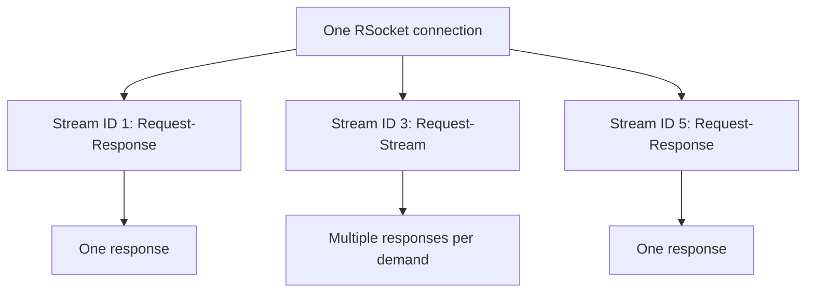

# TCP or WebSocket Transport and Connection Multiplexing

RSocket is a binary, bidirectional messaging protocol running over a byte-stream transport. Spring supports RSocket over TCP and WebSocket. A key capability of RSocket is **multiplexing**: many independent requests/responses or streams can share a single physical connection. Each interaction is identified by its own stream ID, allowing frames from multiple streams to interleave on the same connection.

Three layers must be distinguished:

- **Transport** is responsible for moving bytes/frames between endpoints. TCP and WebSocket are two choices at this layer.
- **RSocket protocol** defines SETUP, stream IDs, interaction models, flow control, keepalive, errors, and metadata.
- **Spring Messaging** provides high-level APIs such as RSocketRequester, RSocketMessageHandler, and @MessageMapping so applications work with objects instead of handling binary frames manually.

RSocket over WebSocket is still the RSocket protocol. It does not become STOMP just because both use WebSocket as a transport.

## 1. TCP and WebSocket in RSocket

Both TCP and WebSocket can carry RSocket frames, but their framing and deployment environments differ.

| Criterion | RSocket over TCP | RSocket over WebSocket |
|---|---|---|
| How connections open | Direct TCP connection to host and port | HTTP Upgrade to WebSocket at a URI |
| Example address | localhost:7000 | ws://localhost:8080/rsocket or wss://api.example.com/rsocket |
| Suitable environment | Service-to-service, internal networks, backend | Browser clients, frontends, and WebSocket-capable infrastructure |
| RSocket framing | Needs length prefix to delimit frames on a byte stream | WebSocket message boundaries already preserve frame boundaries, so no RSocket length prefix is needed |
| Protection layer | Can use TLS per transport configuration | Uses TLS via wss://; must also configure authentication and Origin checks |
| Network infrastructure | Firewalls/load balancers must allow TCP ports | Proxies/load balancers must support HTTP Upgrade and WebSocket timeouts |

TCP is a byte stream with no built-in message boundaries. Therefore, RSocket prepends a 24-bit length field before each frame so the receiver knows exactly where a frame ends. With WebSocket, each WebSocket message already has message boundaries, so RSocket omits that length field. This is a framing difference, not a difference in request or stream semantics.

WebSocket itself still typically runs over TCP. Choosing WebSocket does not eliminate TCP at the network layer; it adds an HTTP handshake and message-framing layer compatible with browsers and HTTP infrastructure.

### When to Choose Which Transport?

**TCP** is well suited when two backend applications control their network and can open dedicated ports. It avoids HTTP Upgrade and has a direct connection model, though it requires proper firewall, TLS, service discovery, and TCP load-balancing setup.

**WebSocket** is well suited when clients run in browsers or networks only permit traffic through HTTP/HTTPS infrastructure. It can share the same host/port as a web server with a mapping path. In return, proxies must support Upgrade, long-lived connection timeouts, and Origin policies.

Neither transport creates multiplexing on its own. Multiplexing is a property of the RSocket protocol and is preserved whether RSocket runs over TCP or WebSocket.

## 2. Configuring an RSocket Server in Spring Boot

When using Spring Boot, the common dependency is the RSocket starter:

```gradle
dependencies {
    implementation("org.springframework.boot:spring-boot-starter-rsocket")
}
```

Spring Boot auto-configures Spring Messaging infrastructure and an RSocketMessageHandler to route requests to controllers with @MessageMapping. Boot also provides RSocketRequester.Builder and RSocketStrategies with JSON/CBOR codecs when the corresponding dependencies are present.

### Standalone TCP Server

Example application.properties:

```properties
spring.rsocket.server.transport=tcp
spring.rsocket.server.port=7000
```

The server opens an RSocket TCP listener on port 7000. Clients must connect to this exact host/port.

### WebSocket Attached to a WebFlux Server

For a WebFlux application running on Reactor Netty, RSocket can be mounted onto the existing web server:

```properties
spring.rsocket.server.transport=websocket
spring.rsocket.server.mapping-path=/rsocket
```

With this approach, RSocket is served at path /rsocket on the WebFlux web server; no separate RSocket port is configured. Direct integration into the web server is currently supported with Reactor Netty.

If you want to run a standalone RSocket WebSocket server instead of attaching to a WebFlux server, configure transport and port according to the corresponding embedded server model. Client configuration must match the transport type and server address.

## 3. Connecting Clients with RSocketRequester

Spring provides RSocketRequester to issue requests using Java objects. The builder has two common connection methods:

```java
RSocketRequester tcpRequester =
        RSocketRequester.builder()
                .tcp("localhost", 7000);

RSocketRequester websocketRequester =
        RSocketRequester.builder()
                .websocket(URI.create("ws://localhost:8080/rsocket"));
```

Key imports:

```java
import java.net.URI;
import reactor.core.publisher.Flux;
import reactor.core.publisher.Mono;

import org.springframework.messaging.rsocket.RSocketRequester;
import org.springframework.stereotype.Service;
```

The tcp(host, port) and websocket(uri) methods create a requester capable of executing multiple concurrent requests over a shared connection. The actual connection is established when the first request runs; the application does not need to open a new socket per request.

In Spring Boot, RSocketRequester.Builder is a prototype bean. Each injection point receives a separate instance because the builder holds configuration state. You can create one requester in a service constructor and reuse it across concurrent requests:

```java
@Service
public class QuoteClient {

    private final RSocketRequester requester;

    public QuoteClient(RSocketRequester.Builder builder) {
        this.requester = builder.tcp("localhost", 7000);
    }

    public Mono<Quote> findQuote(String symbol) {
        return requester.route("quote.by-symbol")
                .data(new QuoteRequest(symbol))
                .retrieveMono(Quote.class);
    }

    public Flux<Quote> watchQuotes(String symbol) {
        return requester.route("quote.stream")
                .data(new QuoteRequest(symbol))
                .retrieveFlux(Quote.class);
    }

    public Mono<Void> refreshQuote(String symbol) {
        return requester.route("quote.refresh")
                .data(new QuoteRequest(symbol))
                .send();
    }
}
```

In this example, the requester is reused. Do not create a new requester inside every findQuote or watchQuotes call, as that defeats connection sharing and increases handshakes/connections.

Switching from TCP to WebSocket only requires changing how the requester is created:

```java
public QuoteClient(RSocketRequester.Builder builder) {
    this.requester = builder.websocket(
            URI.create("wss://api.example.com/rsocket")
    );
}
```

A wss:// address uses TLS for WebSocket. Enabling TLS does not automatically authenticate users at the application layer; the server still needs authentication and authorization mechanisms.

### DTOs and Server-Side Responder

Put each public record in its own Java file (QuoteRequest.java, Quote.java, QuoteUpdate.java, QuoteCommand.java, and QuoteEvent.java). Import BigDecimal in files containing monetary price fields:

Example payload types:

```java
import java.math.BigDecimal;

public record QuoteRequest(String symbol) {}

public record Quote(String symbol, BigDecimal price) {}

public record QuoteUpdate(String symbol, BigDecimal price) {}

public record QuoteCommand(String symbol, String action) {}

public record QuoteEvent(String symbol, String event) {}
```

A server-side controller can declare the matching routes:

```java
@Controller
public class QuoteRSocketController {

    private final QuoteService quoteService;

    public QuoteRSocketController(QuoteService quoteService) {
        this.quoteService = quoteService;
    }

    @MessageMapping("quote.by-symbol")
    public Mono<Quote> findQuote(QuoteRequest request) {
        return quoteService.findQuote(request.symbol());
    }

    @MessageMapping("quote.stream")
    public Flux<Quote> watchQuotes(QuoteRequest request) {
        return quoteService.watchQuotes(request.symbol());
    }

    @MessageMapping("quote.refresh")
    public Mono<Void> refreshQuote(QuoteRequest request) {
        return quoteService.refresh(request.symbol());
    }
}
```

Main controller imports:

```java
import org.springframework.messaging.handler.annotation.MessageMapping;
import org.springframework.stereotype.Controller;
import reactor.core.publisher.Flux;
import reactor.core.publisher.Mono;
```

Spring Boot auto-configures RSocketMessageHandler to detect controllers and handle @MessageMapping. Routes are metadata on RSocket requests, not HTTP URL paths. The service in the example represents application business logic.

## 4. SETUP and Connection-Level Information

Once client and server open the transport, the client sends an RSocket SETUP frame to start the protocol session. SETUP carries connection-scoped parameters, including protocol version, keepalive, data MIME type, metadata MIME type, and optionally setup data or setup metadata.

In Spring, some of this information can be configured through the builder:

```java
RSocketRequester requester = RSocketRequester.builder()
        .dataMimeType(MimeTypeUtils.TEXT_PLAIN)
        .setupData("quote-monitor/1.0")
        .tcp("localhost", 7000);
```

Imports:

```java
import org.springframework.util.MimeTypeUtils;
```

Meaning:

- dataMimeType defines the payload data format for the connection.
- metadataMimeType defines the metadata format, such as composite metadata.
- setupData sends connection-level initialization data.
- setupMetadata sends additional connection-level metadata.
- setupRoute sets a route in SETUP metadata if the application needs to handle a route upon connection opening.

Data and metadata can have different formats. Each request's route is typically sent in the metadata of the first frame on that stream, not in the transport URL.

Do not hardcode secrets in source code or public setup data. When authentication metadata is needed, use time-limited tokens transmitted over a secure channel and verified on the server. SETUP metadata is connection-level data; per-request metadata can carry request-specific context.

## 5. Multiplexing: Multiple Streams Over One Connection

RSocket separates the physical connection from logical streams:

- A **connection** is the TCP or WebSocket transport session between two endpoints.
- A **stream** is an independent interaction such as request-response or request-stream.
- Each stream has a unique stream ID within the connection.
- Frames from multiple streams can interleave on the same transport.

Example of a client concurrently sending two request-response calls and one request-stream:



Stream IDs are assigned by the side initiating the request. Clients start with odd IDs 1, 3, 5...; servers start with even IDs 2, 4, 6... Stream ID 0 is reserved for connection-level operations such as SETUP and KEEPALIVE. IDs must be unique to the initiator within the scope of the connection.

Both sides can initiate requests after SETUP succeeds. Hence an RSocket connection does not lock client/server roles across every request: either side can act as requester or responder on different streams.

Frames within the same stream are processed in order. Frames from different streams can interleave, for example:

1. Client sends a request on stream 1.
2. Client sends a request-stream on stream 3.
3. Server returns a payload for stream 3.
4. Server returns a response for stream 1.
5. Server continues sending payloads for stream 3 while the requester still has demand.

There is no need to open a separate TCP socket or WebSocket per stream. RSocket uses stream IDs to demultiplex frames back to the right interaction.

## 6. Multiplexing with the Interaction Models

RSocket has four primary interaction styles. Spring's RSocketRequester infers the interaction type from the request's input and output cardinality.

| Interaction | Input | Output | Spring usage |
|---|---|---|---|
| Request-Response | One payload | One response | data(value).retrieveMono(Type.class) |
| Request-Stream | One payload | Multiple responses | data(value).retrieveFlux(Type.class) |
| Fire-and-Forget | One payload | No response | data(value).send() |
| Request-Channel | A stream of payloads | A stream of responses | data(Flux).retrieveFlux(Type.class) |

### Request-Response

One request and one response. Suitable for looking up a single object:

```java
Mono<Quote> quote = requester.route("quote.by-symbol")
        .data(new QuoteRequest("ACME"))
        .retrieveMono(Quote.class);
```

### Request-Stream

One initial request and a stream of responses:

```java
Flux<QuoteUpdate> updates = requester.route("quote.stream")
        .data(new QuoteRequest("ACME"))
        .retrieveFlux(QuoteUpdate.class);
```

### Fire-and-Forget

Sends one payload and expects no response:

```java
Mono<Void> sent = requester.route("quote.refresh")
        .data(new QuoteRequest("ACME"))
        .send();
```

Mono<Void> only signals that the send operation completed on the requester side; it does not prove that the business handler finished processing or committed data.

### Request-Channel

Both sides exchange payload streams within the same interaction. The client sends a Flux and receives a Flux:

Request-channel example:

```java
Flux<QuoteCommand> commands = Flux.just(
        new QuoteCommand("ACME", "SUBSCRIBE"),
        new QuoteCommand("ACME", "SET_ALERT")
);

Flux<QuoteEvent> events = requester.route("quote.channel")
        .data(commands, QuoteCommand.class)
        .retrieveFlux(QuoteEvent.class);
```

Request-Channel is useful when both sides need to emit multiple messages over time. Streams still retain independent flow control and cancellation.

## 7. Flow Control and Backpressure

Multiplexing lets multiple streams share a connection, yet that does not mean a responder may push unbounded data into memory or network buffers.

With Request-Stream and Request-Channel, RSocket applies Reactive Streams demand:

1. The requester declares an initial item count in the request frame.
2. When it needs more items, the requester sends REQUEST_N to add demand.
3. The responder must honor demand and not emit more items than requested.
4. When a subscriber cancels its subscription, cancellation propagates to the corresponding stream.

In Spring, Flux and Mono express demand and cancellation. Example:

```java
Flux<QuoteUpdate> updates = requester.route("quote.stream")
        .data(new QuoteRequest("ACME"))
        .retrieveFlux(QuoteUpdate.class)
        .take(100);
```

take(100) cancels upstream after receiving 100 elements. Cancelling one stream does not necessarily close the entire RSocket connection; other streams on the same connection can keep running.

Backpressure is stream-level flow control. It does not replace system-wide resource limits: the server still needs limits on connection counts, concurrent streams, payload sizes, request rates, and processing times.

## 8. How Multiplexing Works Beneath the Transport

The RSocket protocol wraps each interaction in frames whose headers contain a stream ID and frame type. Important frames include:

| Frame | Scope | Purpose |
|---|---|---|
| SETUP | Connection | Initializes protocol session and connection parameters |
| KEEPALIVE | Connection | Detects whether connection is still alive |
| REQUEST_RESPONSE | Stream | Requests a single response |
| REQUEST_FNF | Stream | Sends one-way |
| REQUEST_STREAM | Stream | Requests a response stream |
| REQUEST_CHANNEL | Stream | Opens a bidirectional stream |
| REQUEST_N | Stream | Signals additional demand |
| CANCEL | Stream | Cancels an interaction |
| PAYLOAD | Stream | Carries interaction data |
| ERROR | Connection or stream | Reports connection- or interaction-level error |
| METADATA_PUSH | Connection | Sends metadata notification not tied to a specific request |

The transport does not dictate stream IDs. The exact same frame and stream ID model is used over both TCP and WebSocket. The difference lies in how frames are packed onto the transport:

- TCP needs a length prefix to delimit frames on a byte stream.
- WebSocket already preserves message boundaries, so no RSocket length prefix is needed.
- WebSocket messages still wrap RSocket frames; WebSocket does not replace RSocket's headers or stream IDs.

RSocket Java uses Project Reactor and Reactor Netty for TCP/WebSocket transports. Spring provides a higher-level API so applications do not manually parse frames or manage stream IDs.

## 9. Benefits and Limitations of Multiplexing

### Benefits

- **Fewer connections:** many requests can share one transport connection, reducing handshakes and socket resources.
- **Concurrent interactions:** many independent streams can await responses or transfer data simultaneously.
- **Bidirectional:** both client and server can initiate requests over the same connection.
- **Per-stream flow control:** demand and cancellation apply individually per stream.
- **Clear logical structure:** each request/stream has its own ID, lifecycle, and error handling.

### Limitations to Understand

Multiplexing does not create dedicated bandwidth per stream. All streams on a connection still share bandwidth, CPU, memory, and the connection's failure domain.

With TCP, packet loss at the TCP layer can delay delivery of subsequent bytes on the connection, even when frames for other streams are ready. Therefore, RSocket-level multiplexing does not completely eliminate TCP head-of-line blocking.

If one stream sends very large payloads or consumes excessive CPU, it can contend for resources with other streams. Enforce frame/payload limits, use backpressure, separate connections for workloads with differing characteristics when needed, and monitor latency per interaction type.

A dead connection affects every active stream on that connection. RSocket offers an optional session resumption feature, yet resumption requires configuration and state on both sides; it does not exist automatically just by using TCP or WebSocket.

## 10. Keeping Connections Alive and Handling Reconnects

RSocket SETUP negotiates keepalive interval and maximum lifetime. Both sides send KEEPALIVE frames to detect silent or dead transports. Choose intervals matching proxies, load balancers, mobile networks, and failure-detection needs.

When a connection is lost:

- Active streams on that connection can terminate with errors.
- Applications must handle onError and decide which requests may be retried.
- Do not blindly retry every request. Fire-and-Forget or requests with side effects may already have been processed before the disconnect.
- When retrying, use an idempotency key or request ID to avoid executing business logic twice.
- Session resumption is a separate protocol mechanism requiring state retention configuration; retrying by opening a new connection is not equivalent to resuming a session.

RSocketConnector can be configured via the builder when keepalive, resume, interceptors, or lower-level options are needed:

```java
RSocketRequester requester = RSocketRequester.builder()
        .rsocketConnector(connector -> {
            // Configure RSocketConnector when the application needs
            // custom keepalive, resumption, or interceptors.
        })
        .tcp("localhost", 7000);
```

Do not change keepalive or resume parameters based solely on a sample value. Cross-check timeouts on server, client, proxies, and brokers before choosing settings.

## 11. Diagnosing Transport Issues

| Symptom | Check |
|---|---|
| Connection refused on TCP | Host/port, server transport, firewalls, service binding |
| WebSocket handshake 404 | mapping-path, URL, WebFlux/Reactor Netty |
| WebSocket handshake 400/403 | Upgrade headers, Origin, authentication, proxies |
| Connection opens yet SETUP is rejected | Protocol version, MIME types, setup metadata, server configuration |
| Request timeout | Slow server processing, stream emitting no response, network latency, keepalive |
| Only some streams fail | Route, payload, metadata, or stream-specific business errors |
| All streams fail together | Transport connection closed, KEEPALIVE timeout, or connection-level ERROR |
| Stream data backs up | Low subscriber demand, slow processing, missing backpressure, or oversized buffers |
| Unexpectedly many connections | Creating new RSocketRequester instances repeatedly instead of reusing one |

When logging, record correlation ID, route, stream interaction type, processing duration, and connection state. Avoid logging full payloads or authentication tokens.

## 12. Testing Multiplexing

An integration test should create one shared RSocketRequester and issue multiple concurrent requests. Imports used in the example:

```java
import java.time.Duration;
import reactor.core.publisher.Mono;
```

```java
Mono<Quote> first = requester.route("quote.by-symbol")
        .data(new QuoteRequest("ACME"))
        .retrieveMono(Quote.class);

Mono<Quote> second = requester.route("quote.by-symbol")
        .data(new QuoteRequest("BETA"))
        .retrieveMono(Quote.class);

Mono.zip(first, second)
        .doOnNext(tuple -> {
            log.info("First: {}", tuple.getT1());
            log.info("Second: {}", tuple.getT2());
        })
        .block(Duration.ofSeconds(5));
```

zip subscribes to both Monos, allowing both requests to be issued on the shared requester. In tests, you can verify the server processes them independently and results are never mixed up.

Additional scenarios:

1. Send multiple concurrent Request-Responses over a single requester.
2. Open a Request-Stream and a Request-Response simultaneously.
3. Cancel an active Flux and confirm that stream ends while other requests continue.
4. Generate high load to test backpressure and stream limits.
5. Break the transport while multiple streams are active to verify errors propagate to the proper publishers.
6. Run the same scenario over TCP and WebSocket to compare behavior, latency, and infrastructure needs.
7. Verify server/client share the same data MIME type and metadata MIME type.

Using block in examples is only appropriate in tests or command-line tools. In WebFlux request paths or reactive services, return Mono/Flux to the caller instead of blocking on event-loop threads.

## References

- [Spring Framework 6.2 — RSocket](https://docs.spring.io/spring-framework/reference/6.2/rsocket.html)
- [Spring Framework 6.2 — RSocketRequester.Builder Javadoc](https://docs.spring.io/spring-framework/docs/6.2.0-M4/javadoc-api/org/springframework/messaging/rsocket/RSocketRequester.Builder.html)
- [Spring Boot — RSocket Support](https://docs.spring.io/spring-boot/reference/messaging/rsocket.html)
- [RSocket Protocol Specification](https://github.com/rsocket/rsocket/blob/master/Protocol.md)
