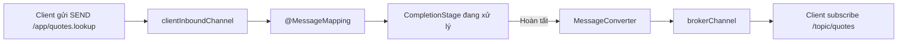

# Trả kết quả bất đồng bộ theo kiểu được phiên bản Spring hỗ trợ

Trong ứng dụng STOMP, một phương thức gắn `@MessageMapping` nhận thông điệp từ client và có thể trả về một payload. Nếu xử lý cần gọi dịch vụ bên ngoài, truy vấn dữ liệu hoặc thực hiện công việc mất thời gian, phương thức có thể trả về một kiểu bất đồng bộ mà Spring Messaging nhận biết. Spring chờ kết quả hoàn tất rồi mới chuyển payload thành thông điệp gửi tới broker.

Điểm cần nhớ là kiểu trả về phải nằm trong hợp đồng mà phiên bản Spring Messaging đang dùng hỗ trợ. Với STOMP annotated controllers, tài liệu Spring liệt kê `ListenableFuture`, `CompletableFuture` và `CompletionStage`. Từ Spring Framework 6.0, nhánh hỗ trợ `ListenableFuture` đã deprecated để chuyển sang `CompletableFuture`. Vì vậy, code mới nên ưu tiên `CompletableFuture` hoặc công khai kiểu trừu tượng `CompletionStage`.

## 1. Luồng xử lý

Một phương thức đồng bộ phải hoàn thành công việc trước khi trả payload. Với kiểu bất đồng bộ, phương thức tạo hoặc nhận một future/stage, trả đối tượng đó cho Spring, rồi công việc hoàn tất ở thời điểm sau.

1. Client gửi STOMP `SEND` đến destination ứng dụng, ví dụ `/app/quotes.lookup`.
2. Spring định tuyến thông điệp đến phương thức `@MessageMapping("/quotes.lookup")`.
3. Phương thức trả về `CompletionStage<QuoteResult>` mà chưa cần chờ công việc hoàn tất.
4. Khi stage hoàn tất thành công, Spring lấy payload, chuyển đổi bằng `MessageConverter` và gửi thông điệp qua `brokerChannel`.
5. Broker chuyển thông điệp đến các client đã subscribe destination đầu ra.



Giá trị trả về vẫn là payload của một thông điệp STOMP. Client không nhận một HTTP response và cũng không bị giữ kết nối SEND cho đến khi công việc hoàn tất. Client nên subscribe destination nhận kết quả trước khi gửi yêu cầu.

## 2. Các kiểu trả về được hỗ trợ

| Kiểu trả về | Cách dùng | Ghi chú |
|---|---|---|
| `CompletableFuture<T>` | Phù hợp cho code mới cần tạo và kết hợp tác vụ bất đồng bộ | Kiểu của JDK; có các phép nối tiếp như `thenApply`, `thenCompose` và xử lý lỗi |
| `CompletionStage<T>` | Phù hợp khi muốn công khai hợp đồng bất đồng bộ mà không ràng buộc người gọi vào một implementation | Spring chuyển stage sang `CompletableFuture` để tiếp tục xử lý |
| `ListenableFuture<T>` | Chủ yếu để duy trì tích hợp cũ | Kiểu của Spring đã deprecated từ Framework 6.0; ưu tiên chuyển sang `CompletableFuture` |

Không nên suy luận rằng mọi kiểu có chữ “Future” đều được chấp nhận. Tài liệu STOMP annotated controllers nêu rõ các kiểu ở bảng trên. Các kiểu trả về thuộc cơ chế khác, chẳng hạn `DeferredResult` hoặc `Callable` của Spring MVC, có hợp đồng riêng. Tương tự, không lấy danh sách kiểu reactive của WebFlux để mặc định áp dụng cho STOMP controller.

Nếu service hoặc client thư viện đã trả về `CompletionStage<T>`, có thể trả stage đó trực tiếp hoặc kết hợp bằng các toán tử của `CompletionStage`. Tránh bọc một stage bên trong một stage khác; dùng `thenCompose` khi bước tiếp theo cũng trả về stage.

## 3. Ví dụ với Spring Framework và Java 17+

Ví dụ sau nhận yêu cầu tra cứu báo giá, thực hiện công việc trên một executor riêng và phát kết quả tới `/topic/quotes`. Giá trong ví dụ là dữ liệu minh họa.

### Cấu hình STOMP và executor

`WebSocketConfig.java`:

```java
@Configuration
@EnableWebSocketMessageBroker
public class WebSocketConfig implements WebSocketMessageBrokerConfigurer {

    @Override
    public void configureMessageBroker(MessageBrokerRegistry registry) {
        registry.setApplicationDestinationPrefixes("/app");
        registry.enableSimpleBroker("/topic", "/queue");
    }

    @Override
    public void registerStompEndpoints(StompEndpointRegistry registry) {
        registry.addEndpoint("/ws");
    }

    @Bean("stompTaskExecutor")
    public ThreadPoolTaskExecutor stompTaskExecutor() {
        ThreadPoolTaskExecutor executor = new ThreadPoolTaskExecutor();
        executor.setCorePoolSize(4);
        executor.setMaxPoolSize(12);
        executor.setQueueCapacity(200);
        executor.setThreadNamePrefix("stomp-work-");
        executor.setWaitForTasksToCompleteOnShutdown(true);
        return executor;
    }
}
```

Executor có số thread và hàng đợi hữu hạn để giới hạn lượng công việc đồng thời. Các con số chỉ là giá trị minh họa; ứng dụng cần điều chỉnh theo thời gian xử lý, tài nguyên và tải thực tế.

### DTO trao đổi dữ liệu

Đặt mỗi record public trong một file riêng:

`QuoteRequest.java`:

```java
public record QuoteRequest(String symbol) {}
```

`QuoteResult.java`:

```java
public record QuoteResult(
        String symbol,
        BigDecimal price,
        Instant quotedAt
) {}
```

`ErrorMessage.java`:

```java
public record ErrorMessage(String code, String message) {}
```

### Service trả về CompletionStage

`QuoteService.java`:

```java
@Service
public class QuoteService {

    private final Executor executor;

    public QuoteService(
            @Qualifier("stompTaskExecutor") Executor executor
    ) {
        this.executor = executor;
    }

    public CompletionStage<QuoteResult> findQuote(QuoteRequest request) {
        return CompletableFuture.supplyAsync(() -> {
            if (request == null
                    || request.symbol() == null
                    || request.symbol().isBlank()) {
                throw new IllegalArgumentException("symbol is required");
            }

            String symbol = request.symbol()
                    .trim()
                    .toUpperCase(Locale.ROOT);

            // Dữ liệu cố định để minh họa; thay bằng lời gọi service/repository thật.
            return new QuoteResult(
                    symbol,
                    new BigDecimal("123.45"),
                    Instant.now()
            );
        }, executor);
    }
}
```

`supplyAsync` đưa tác vụ vào executor và trả về `CompletableFuture` ngay. Giá trị đó có thể được trả trực tiếp vì `CompletableFuture` triển khai `CompletionStage`. Trong ứng dụng thật, phần thân tác vụ có thể gọi repository hoặc một client bên ngoài.

### STOMP controller

`QuoteController.java`:

```java
@Controller
public class QuoteController {

    private final QuoteService quoteService;

    public QuoteController(QuoteService quoteService) {
        this.quoteService = quoteService;
    }

    @MessageMapping("/quotes.lookup")
    @SendTo("/topic/quotes")
    public CompletionStage<QuoteResult> lookup(QuoteRequest request) {
        return quoteService.findQuote(request);
    }

    @MessageExceptionHandler
    @SendToUser("/queue/errors")
    public ErrorMessage handleFailure(Exception exception) {
        // Không gửi stack trace hoặc thông tin nội bộ cho client.
        return new ErrorMessage(
                "PROCESSING_FAILED",
                "Không thể xử lý yêu cầu báo giá."
        );
    }
}
```

Với cấu hình trên:

- Client gửi payload JSON đến `/app/quotes.lookup`.
- Client subscribe `/topic/quotes` để nhận kết quả.
- Lỗi xử lý được chuyển thành payload riêng gửi đến user qua `/queue/errors`.
- `@SendTo` phát kết quả đến destination đã chỉ định. Nếu bỏ annotation, Spring dùng destination mặc định theo quy tắc của STOMP annotated controller.
- Dùng `@SendToUser` cho dữ liệu chỉ người gửi được nhận; tránh phát dữ liệu riêng tư lên topic dùng chung.

## 4. Kết hợp các tác vụ bất đồng bộ

Khi service đã trả về một stage, không cần tạo thêm thread chỉ để bọc nó. Có thể biến đổi kết quả bằng `thenApply`:

```java
public CompletionStage<QuoteResult> findQuote(String symbol) {
    return marketClient.fetchQuote(symbol)
            .thenApply(this::toQuoteResult);
}
```

Nếu bước kế tiếp cũng trả về stage, dùng `thenCompose` để làm phẳng chuỗi bất đồng bộ:

```java
public CompletionStage<QuoteResult> findQuote(String accountId) {
    return accountService.find(accountId)
            .thenCompose(account ->
                    marketClient.fetchQuote(account.symbol()))
            .thenApply(this::toQuoteResult);
}
```

Hai ví dụ trên giả định các kiểu dữ liệu và phương thức client tương ứng đã tồn tại. `thenApply` biến đổi một kết quả đã có; `thenCompose` nối một bước trả về stage khác. Không gọi `get()` hoặc `join()` ngay trong controller để chờ kết quả, vì như vậy sẽ chặn thread xử lý thông điệp và làm mất lợi ích của cách trả về bất đồng bộ.

## 5. Chọn executor đúng cách

Khi gọi `CompletableFuture.supplyAsync(task)` mà không truyền executor, Java dùng common ForkJoinPool. Điều này có thể phù hợp với một số tác vụ CPU ngắn, nhưng không nên mặc định dùng cho công việc blocking như JDBC, gọi HTTP đồng bộ hoặc đọc file.

- Với công việc blocking, dùng executor có giới hạn thread và hàng đợi; đặt timeout cho lời gọi bên dưới.
- Với công việc CPU-bound, chọn pool theo số lõi và thời gian xử lý; tránh tạo thread cho từng thông điệp.
- Khi một continuation cần chạy bất đồng bộ trên pool đã chọn, dùng dạng `thenApplyAsync(fn, executor)` hoặc `thenComposeAsync(fn, executor)`.
- `thenApply` không tự tạo thread mới; continuation thường chạy trên thread hoàn tất stage trước đó hoặc thread đăng ký continuation nếu stage đã hoàn tất.
- Theo dõi thời gian chờ hàng đợi, thời gian xử lý, số tác vụ đang chạy và số lần từ chối tác vụ. Hàng đợi đầy cần được xử lý như tình trạng quá tải, không nên chuyển sang một hàng đợi vô hạn.

Trả về `CompletableFuture` không tự biến một lời gọi blocking thành non-blocking. Nếu tác vụ bên trong gọi JDBC đồng bộ, một thread của executor vẫn bị chiếm cho đến khi truy vấn kết thúc. Lợi ích là thread nhận thông điệp STOMP có thể tiếp tục xử lý thông điệp khác.

## 6. Xử lý lỗi và thời gian chờ

Một stage có thể hoàn tất bình thường hoặc hoàn tất exceptional. Có thể xử lý lỗi tại service bằng `exceptionally` hoặc `handle` nếu muốn chuyển lỗi thành một kết quả nghiệp vụ. Nếu để lỗi truyền lên, Spring Messaging đưa lỗi của quá trình hoàn tất bất đồng bộ qua cơ chế xử lý exception của message handler; `@MessageExceptionHandler` hoặc `@ControllerAdvice` có thể tạo payload lỗi phù hợp.

Cần phân biệt hai trường hợp:

- **Lỗi nghiệp vụ:** ví dụ mã yêu cầu không hợp lệ hoặc bản ghi không tồn tại. Trả mã lỗi ổn định và thông điệp có thể hiển thị cho client.
- **Lỗi hạ tầng:** ví dụ timeout, dịch vụ bên ngoài không phản hồi hoặc executor từ chối tác vụ. Ghi log kèm correlation ID, trả thông báo chung cho client và giữ chi tiết kỹ thuật ở phía server.

Có thể đặt giới hạn thời gian cho một future, ví dụ dùng `orTimeout` trên `CompletableFuture` trong Java 17. Timeout ở future chỉ hoàn tất future bằng lỗi; nó không đảm bảo hủy được truy vấn JDBC hoặc request đã gửi đến hệ thống bên ngoài. Muốn dừng công việc thật sự, client bên dưới phải hỗ trợ timeout hoặc cancellation.

## 7. Destination, bảo mật và tương quan yêu cầu

`@SendTo("/topic/quotes")` gửi kết quả đến một topic mà nhiều subscriber có thể cùng nhận. Đây là lựa chọn phù hợp cho dữ liệu công khai hoặc sự kiện dùng chung. Với dữ liệu riêng của người gửi, dùng `@SendToUser` hoặc định tuyến riêng có kiểm soát quyền truy cập.

STOMP không tự tạo quan hệ request-response ở tầng ứng dụng chỉ vì controller trả về một future. Khi một client gửi nhiều yêu cầu đồng thời, các kết quả có thể hoàn tất theo thứ tự khác với thứ tự gửi. Nếu cần ghép kết quả với yêu cầu, hãy đưa `requestId` hoặc correlation ID vào request và response. Không dùng một biến mutable dùng chung trong controller để lưu “yêu cầu hiện tại”.

Luôn kiểm tra quyền truy cập và dữ liệu đầu vào trước khi thực hiện công việc. Không đưa exception message, SQL, token, dữ liệu tài khoản hoặc stack trace vào payload gửi ra client.

## 8. Lỗi thường gặp

| Sai sót | Hậu quả | Cách sửa |
|---|---|---|
| Gọi `future.join()` hoặc `get()` trong `@MessageMapping` | Thread nhận message phải chờ; xử lý trở lại đồng bộ | Trả future/stage trực tiếp |
| Dùng `supplyAsync` không có executor cho tác vụ blocking | Công việc tranh chấp common pool và khó kiểm soát tải | Truyền executor có giới hạn |
| Dùng `ListenableFuture` cho code mới | Dựa vào API đã deprecated từ Spring 6.0 | Chọn `CompletableFuture` hoặc `CompletionStage` |
| Cho rằng mọi `Future<T>` đều được hỗ trợ | Handler có thể không nhận kiểu trả về đó | Đối chiếu danh sách được tài liệu đúng phiên bản hỗ trợ |
| Dùng `@SendTo` cho dữ liệu riêng tư | Mọi subscriber của topic có thể nhận dữ liệu | Dùng user destination và kiểm tra quyền |
| Không có correlation ID khi gửi song song | Client khó ghép response với request | Truyền ID qua payload hoặc header |
| Không đặt timeout và giới hạn executor | Tác vụ treo hoặc quá tải làm cạn tài nguyên | Đặt timeout, queue hữu hạn và theo dõi từ chối |

## 9. Cách kiểm tra

Khi kiểm thử một endpoint STOMP bất đồng bộ, nên xác nhận các hành vi sau:

1. Client subscribe destination đầu ra trước khi gửi yêu cầu.
2. Phương thức controller trả về stage mà không gọi `get()` hoặc `join()`.
3. Khi stage hoàn tất thành công, client nhận đúng payload đã được serialize tại destination `@SendTo`.
4. Khi stage hoàn tất exceptional, exception handler tạo payload lỗi theo hợp đồng đã định.
5. Gửi nhiều yêu cầu đồng thời và xác nhận correlation ID vẫn ghép đúng kết quả.
6. Mô phỏng tác vụ chậm và executor đầy để xác nhận timeout, log và hành vi quá tải.
7. Xác nhận thông điệp riêng tư chỉ đến đúng user, không phát lên topic chung.

## 10. Ghi chú tương thích phiên bản

Tài liệu Spring Framework cho STOMP annotated controllers nêu `ListenableFuture`, `CompletableFuture` và `CompletionStage` là các kiểu trả về bất đồng bộ. Javadoc của Spring Framework 6.1 mô tả `CompletableFutureReturnValueHandler` hỗ trợ cả `CompletableFuture` và `CompletionStage`; API `ListenableFuture` được đánh dấu deprecated từ 6.0.

Khi nâng cấp Spring Boot hoặc ghi đè dependency, hãy kiểm tra phiên bản thực tế của artifact `spring-messaging` được Gradle resolve. Không chỉ dựa vào phiên bản ghi trong tài liệu cũ hoặc ví dụ trên mạng. Hợp đồng của Spring Framework và các kiểu Java mà dự án biên dịch được phải cùng phiên bản.

## Tài liệu tham khảo

- [Spring Framework — Annotated Controllers (STOMP)](https://docs.spring.io/spring-framework/reference/web/websocket/stomp/handle-annotations.html)
- [Spring Framework 6.1 — AsyncHandlerMethodReturnValueHandler](https://docs.spring.io/spring-framework/docs/6.1.21/javadoc-api/org/springframework/messaging/handler/invocation/AsyncHandlerMethodReturnValueHandler.html)
- [Spring Framework 6.1 — CompletableFutureReturnValueHandler](https://docs.spring.io/spring-framework/docs/6.1.21/javadoc-api/org/springframework/messaging/handler/invocation/CompletableFutureReturnValueHandler.html)
- [Java 17 — CompletableFuture](https://docs.oracle.com/en/java/javase/17/docs/api/java.base/java/util/concurrent/CompletableFuture.html)
- [Java 17 — CompletionStage](https://docs.oracle.com/en/java/javase/17/docs/api/java.base/java/util/concurrent/CompletionStage.html)
