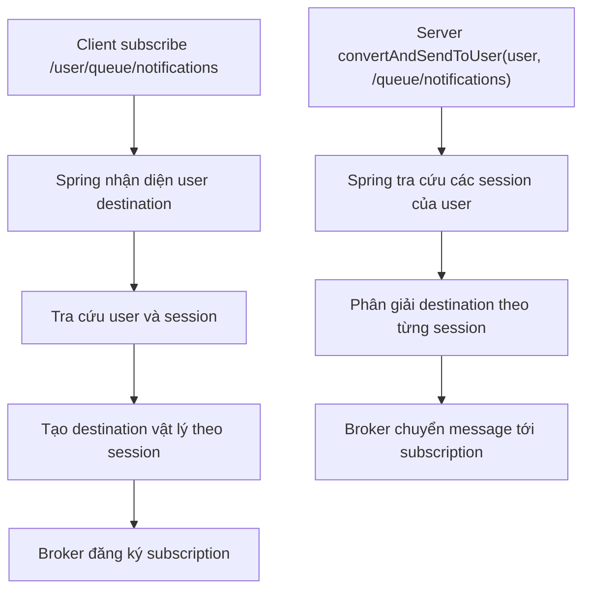

# User destination và chuyển từ /user sang đích theo phiên

## 1. User destination giải quyết vấn đề gì?

Trong ứng dụng WebSocket/STOMP, server thường cần gửi thông báo riêng cho một người dùng: trạng thái đơn hàng, tin nhắn riêng, cập nhật tài khoản hoặc kết quả xử lý. Nếu gửi tới một destination chung như `/topic/notifications`, mọi client đang subscribe destination đó đều có thể nhận message.

Spring Messaging cung cấp **user destination** để định tuyến theo người dùng đã được xác thực. Ứng dụng làm việc với một destination logic bắt đầu bằng `/user`; Spring tra cứu các phiên đang hoạt động của người dùng rồi chuyển destination logic thành destination vật lý gắn với từng phiên. Nhờ vậy, ứng dụng không cần tự tạo tên destination theo session id.

Có hai chiều sử dụng phổ biến:

1. Client subscribe một destination như `/user/queue/notifications`. Spring chuyển subscription đó sang destination riêng của session hiện tại.
2. Server gửi tới một người dùng bằng `SimpMessagingTemplate.convertAndSendToUser(...)`. Spring tìm các session của người dùng và chuyển message tới destination vật lý tương ứng.

Destination vật lý là chi tiết triển khai nội bộ. Client và code nghiệp vụ nên sử dụng destination logic `/user/...`.

## 2. Phân biệt các loại destination

Một cấu hình STOMP thường có ba nhóm prefix:

| Prefix | Vai trò | Ví dụ |
|---|---|---|
| `/app` | Message client gửi vào các method `@MessageMapping` của ứng dụng. | `/app/chat` |
| `/topic`, `/queue` | Destination do message broker xử lý. | `/topic/news`, `/queue/notifications` |
| `/user` | Destination logic dành cho người dùng; Spring phân giải thành destination theo session. | `/user/queue/notifications` |

Các prefix có trách nhiệm khác nhau. `/app` giúp Spring định tuyến message đầu vào tới controller; `/topic` và `/queue` là vùng destination của broker; `/user` yêu cầu Spring tìm người dùng và session thích hợp trước khi broker xử lý destination đích.

Ví dụ, client Alice subscribe `/user/queue/notifications`. Spring nhận diện đây là user destination và ánh xạ nó thành một destination vật lý chỉ subscription của session Alice sử dụng. Nếu Alice mở thêm một tab và tab đó cũng subscribe cùng destination logic, tab mới có session riêng và destination vật lý riêng.

## 3. Cấu hình user destination

Có thể khai báo endpoint WebSocket, application prefix, broker prefix và user destination prefix trong một cấu hình:

```java
import org.springframework.context.annotation.Configuration;
import org.springframework.messaging.simp.config.MessageBrokerRegistry;
import org.springframework.web.socket.config.annotation.EnableWebSocketMessageBroker;
import org.springframework.web.socket.config.annotation.StompEndpointRegistry;
import org.springframework.web.socket.config.annotation.WebSocketMessageBrokerConfigurer;

@Configuration
@EnableWebSocketMessageBroker
public class WebSocketConfig implements WebSocketMessageBrokerConfigurer {

    @Override
    public void registerStompEndpoints(StompEndpointRegistry registry) {
        registry.addEndpoint("/ws");
    }

    @Override
    public void configureMessageBroker(MessageBrokerRegistry registry) {
        registry.setApplicationDestinationPrefixes("/app");
        registry.enableSimpleBroker("/topic", "/queue");
        registry.setUserDestinationPrefix("/user");
    }
}
```

Trong ví dụ này:

- Client kết nối STOMP qua endpoint `/ws`.
- Client gửi message tới `/app/...`; Spring loại application prefix và tìm method `@MessageMapping` tương ứng.
- Broker xử lý các destination bắt đầu bằng `/topic` hoặc `/queue`.
- Spring nhận diện các destination logic bắt đầu bằng `/user` và phân giải chúng theo user/session.

`/user` là user destination prefix; phần còn lại như `/queue/notifications` là destination đích được dùng sau khi phân giải. Prefix phải thống nhất giữa cấu hình server và cách client subscribe. Nếu ứng dụng đã tùy chỉnh prefix, hãy dùng giá trị đã cấu hình thay vì mặc định `/user`.

## 4. Client subscribe user destination

Client subscribe bằng destination logic. Ví dụ với STOMP.js:

```javascript
client.onConnect = () => {
    client.subscribe("/user/queue/notifications", (frame) => {
        const notification = JSON.parse(frame.body);
        console.log("Notification:", notification);
    });
};

client.activate();
```

Client không cần biết session id hoặc destination vật lý mà Spring tạo ra. Mỗi lần một session subscribe `/user/queue/notifications`, Spring phân giải destination theo session đó. Khi người dùng kết nối lại, session mới có thể được gán destination vật lý mới; client chỉ cần subscribe lại destination logic sau khi kết nối.

Không nên hard-code destination nội bộ có hậu tố session hoặc tự ghép session id vào URL. Cách đó phụ thuộc vào chi tiết triển khai của Spring và dễ sai khi người dùng mở nhiều tab, reconnect hoặc thay đổi cấu hình.

## 5. Server gửi message tới một người dùng

Dùng `SimpMessagingTemplate.convertAndSendToUser` khi server muốn chủ động gửi message tới người dùng có tên principal tương ứng:

```java
import org.springframework.messaging.simp.SimpMessagingTemplate;
import org.springframework.stereotype.Service;

@Service
public class NotificationService {

    private final SimpMessagingTemplate messagingTemplate;

    public NotificationService(SimpMessagingTemplate messagingTemplate) {
        this.messagingTemplate = messagingTemplate;
    }

    public void notifyUser(String username, Notification notification) {
        messagingTemplate.convertAndSendToUser(
                username,
                "/queue/notifications",
                notification
        );
    }
}
```

Ví dụ payload có thể là một record Java 17:

```java
public record Notification(String title, String message) {
}
```

Nếu Alice có principal name là `alice`, lời gọi:

```java
notificationService.notifyUser(
        "alice",
        new Notification("Order updated", "Your order has shipped.")
);
```

yêu cầu Spring gửi message tới các session đang đăng ký của Alice trên user destination tương ứng. Phía client của Alice đã subscribe `/user/queue/notifications` nên có thể nhận được message.

Các điểm cần nhớ:

- Tham số đầu tiên là tên người dùng theo `Principal.getName()`, không phải chuỗi `"/user/alice"`.
- Tham số destination là phần đích phía sau user, ví dụ `"/queue/notifications"`; không thêm tên user hoặc prefix `/user` vào tham số này.
- Tên người dùng phải khớp với principal mà Spring ghi nhận cho các WebSocket session. Nếu ứng dụng dùng hệ thống xác thực riêng, cần bảo đảm quá trình handshake gắn đúng `Principal`.
- Mặc định, message được gửi tới các session đang hoạt động của người dùng đó. Nếu người dùng đăng nhập ở nhiều tab hoặc thiết bị, mỗi session phù hợp có thể nhận message.

## 6. Dùng @SendToUser trong message handler

Khi cần trả lời trực tiếp cho người đã gửi message, có thể dùng `@SendToUser`:

```java
import org.springframework.messaging.handler.annotation.MessageMapping;
import org.springframework.messaging.simp.annotation.SendToUser;
import org.springframework.stereotype.Controller;

@Controller
public class PrivateMessageController {

    @MessageMapping("/echo")
    @SendToUser("/queue/replies")
    public String echo(String payload) {
        return "Server received: " + payload;
    }
}
```

Client gửi STOMP message tới `/app/echo`. Spring định tuyến message tới method `echo`, sau đó gửi giá trị trả về tới user destination `/user/queue/replies` của người gửi. Client cần subscribe `/user/queue/replies` để nhận phản hồi.

Mặc định, `@SendToUser` có `broadcast = true`: phản hồi được gửi tới các session của người dùng tương ứng. Nếu chỉ muốn phản hồi về đúng session đã gửi message, đặt `broadcast = false`:

```java
@MessageMapping("/echo")
@SendToUser(value = "/queue/replies", broadcast = false)
public String echoForThisSession(String payload) {
    return "Reply for this session: " + payload;
}
```

Điều này hữu ích khi một người dùng đăng nhập ở nhiều tab nhưng một thao tác chỉ cần phản hồi ở tab khởi tạo. Với message handler có ngữ cảnh session nhưng không có người dùng đã xác thực, `@SendToUser` với `broadcast = false` cũng có thể định tuyến phản hồi về session gửi message. Không dùng cơ chế này để thay thế xác thực người dùng.

## 7. Spring chuyển /user thành destination theo session như thế nào?

Spring dùng các thành phần xử lý user destination để ánh xạ destination logic sang destination vật lý:

1. Client gửi frame STOMP `SUBSCRIBE` tới `/user/queue/notifications`.
2. Spring nhận diện user destination prefix `/user`.
3. Spring xác định user và session của subscription từ thông tin message.
4. User destination resolver tạo destination vật lý gắn với session tương ứng.
5. Broker đăng ký subscription tại destination vật lý đó.

Với chiều gửi từ server:

1. Ứng dụng gọi `convertAndSendToUser("alice", "/queue/notifications", payload)`.
2. Template tạo message gửi tới user destination logic của Alice.
3. Spring tra cứu các session đang gắn với principal Alice.
4. Resolver tạo một destination vật lý phù hợp cho từng session.
5. Broker chuyển message tới các subscription tương ứng.

Sơ đồ khái quát:



Tên destination vật lý cụ thể có thể chứa thông tin session hoặc một phần định danh nội bộ. Không dựa vào định dạng tên đó trong code nghiệp vụ, log parser hoặc client. Hợp đồng ổn định mà ứng dụng nên sử dụng là user destination logic.

## 8. Một người dùng có nhiều session

Một principal có thể có nhiều WebSocket session, chẳng hạn:

- Người dùng mở cùng ứng dụng trong hai tab.
- Người dùng đăng nhập trên laptop và điện thoại.
- Ứng dụng có nhiều kết nối WebSocket cho cùng một tài khoản.

Khi client ở mỗi session subscribe cùng user destination, Spring theo dõi các session gắn với người dùng đó. Với `convertAndSendToUser`, Spring mặc định gửi tới các session phù hợp của người dùng. Điều này phù hợp với thông báo cần xuất hiện trên mọi thiết bị đang trực tuyến.

Chọn cách gửi theo yêu cầu nghiệp vụ:

| Nhu cầu | Cách dùng |
|---|---|
| Thông báo tới mọi session đang hoạt động của người dùng | `convertAndSendToUser(username, destination, payload)`. |
| Trả lời thao tác ở mọi session của người dùng | `@SendToUser(destination)` mặc định broadcast. |
| Chỉ trả lời session đã gửi message | `@SendToUser(value = destination, broadcast = false)`. |
| Thông báo công khai cho nhiều người dùng | Destination chung như `/topic/...`, không dùng user destination. |

Đừng nhầm việc gửi tới mọi session của một user với việc broadcast tới mọi user. User destination vẫn giới hạn phạm vi theo principal; destination chung như `/topic/news` mới là kiểu phân phối cho các subscription cùng destination.

## 9. Quan hệ với broker và cấu hình queue

Tên `/queue` thường được dùng cho message riêng, nhưng ý nghĩa queue thực tế còn phụ thuộc broker:

- **Simple broker của Spring** xử lý subscription trong bộ nhớ và hỗ trợ các destination prefix được cấu hình. Nó không cung cấp đầy đủ ngữ nghĩa queue point-to-point như một message broker chuyên dụng; tên `/queue` tự nó không tạo ra hàng đợi có semantics riêng.
- **Broker relay** chuyển message tới broker bên ngoài. Khả năng lưu trữ, phân phối queue, acknowledgement và độ bền phụ thuộc broker cùng cấu hình của nó.
- User destination là lớp phân giải user/session của Spring. Sau khi được phân giải, message vẫn được chuyển qua broker được cấu hình.

Vì vậy, hãy chọn simple broker hay broker relay theo yêu cầu về tải, lưu trữ, khả năng mở rộng và semantics giao nhận. Không nên suy luận rằng dùng prefix `/queue` là đã có bảo đảm giao message hoặc lưu message khi người dùng offline.

## 10. Người dùng offline, reconnect và nhiều máy chủ

User destination được phân giải dựa trên các session mà Spring có thể nhận diện tại thời điểm xử lý. Nếu không có session phù hợp, message không tự động trở thành thông báo lưu trữ để người dùng đọc khi đăng nhập lại. Với thông báo cần giao sau khi offline, ứng dụng nên lưu dữ liệu nghiệp vụ vào database hoặc hệ thống hàng đợi bền vững, rồi tải lại khi người dùng kết nối.

Trong triển khai nhiều instance ứng dụng, session của một người dùng có thể kết nối vào instance khác với instance đang xử lý lệnh gửi. Mỗi instance có thể chỉ biết các session cục bộ. Spring hỗ trợ cấu hình broadcast cho user registry và các user destination chưa phân giải để các instance phối hợp tìm session. Khi triển khai cluster, cần cấu hình các broadcast destination phù hợp với broker relay và bảo đảm các instance cùng tham gia cơ chế đó. Nếu không, một instance có thể không tìm thấy session nằm trên instance khác.

Cũng cần tính đến reconnect: session cũ bị đóng và session mới được tạo. Client phải subscribe lại user destination sau khi STOMP kết nối thành công; không giữ destination vật lý từ kết nối trước.

## 11. Bảo mật user destination

User destination giúp định tuyến theo principal nhưng không tự thực hiện toàn bộ việc phân quyền. Ứng dụng vẫn cần bảo vệ message flow:

1. **Xác thực kết nối.** Gắn danh tính người dùng đáng tin cậy vào `Principal` trong quá trình xác thực HTTP/WebSocket.
2. **Dùng principal từ server.** Khi gọi `convertAndSendToUser`, lấy username từ danh tính đã xác thực hoặc dữ liệu nghiệp vụ đã được kiểm tra. Không lấy tên người nhận từ client rồi gửi thẳng mà không kiểm tra quyền.
3. **Giới hạn SUBSCRIBE và SEND.** Cấu hình Spring Security để người dùng chỉ subscribe destination mà họ được phép truy cập và chỉ gửi tới các application destination được cho phép.
4. **Không xem destination là bí mật.** Việc destination có hậu tố session không thay thế authorization. Mỗi thao tác nhạy cảm vẫn phải kiểm tra quyền trên server.
5. **Kiểm tra quyền ở tầng nghiệp vụ.** Một người dùng không được gửi thông báo tới tài khoản khác chỉ vì họ biết username hoặc tên destination.

## 12. Lỗi thường gặp và cách debug

**Client subscribe `/queue/notifications` thay vì `/user/queue/notifications`.** Khi đó subscription không đi qua user destination resolver. Kiểm tra destination client đã subscribe có chứa đúng user prefix hay chưa.

**Server truyền `"/user/alice/queue/notifications"` vào `convertAndSendToUser`.** API này nhận username riêng ở tham số đầu tiên và phần destination ở tham số thứ hai. Dùng `convertAndSendToUser("alice", "/queue/notifications", payload)`.

**Username không khớp principal.** `convertAndSendToUser` tra cứu user theo danh tính Spring biết được. So sánh giá trị truyền vào với `Principal.getName()`, chú ý khác biệt chữ hoa/chữ thường, tenant hoặc cách chuẩn hóa username.

**Người dùng có nhiều tab nhưng chỉ muốn một tab nhận phản hồi.** `@SendToUser` mặc định broadcast tới các session của user. Đặt `broadcast = false` nếu chỉ cần session gửi message nhận phản hồi.

**Không có message khi người dùng offline.** User destination không phải kho lưu trữ. Lưu thông báo cần giao sau vào persistence layer và tải lại khi user đăng nhập.

**Hoạt động trên một instance nhưng lỗi khi chạy cluster.** Kiểm tra user registry và cấu hình broadcast destination cho message chưa phân giải; xác nhận các instance kết nối cùng broker và dùng cấu hình tương thích.

**Destination không được broker xử lý.** Kiểm tra broker prefix trong `enableSimpleBroker` hoặc cấu hình broker relay có bao gồm destination vật lý được Spring tạo ra hay không.

Khi debug, nên kiểm tra theo thứ tự:

1. Xác nhận STOMP session đã kết nối và principal có đúng tên.
2. Xác nhận client đã subscribe đúng destination logic, ví dụ `/user/queue/notifications`.
3. Xác nhận server dùng đúng username và destination suffix khi gọi `convertAndSendToUser`.
4. Bật log phù hợp cho Spring Messaging và kiểm tra việc phân giải user destination, session registry và broker.
5. Nếu chạy nhiều instance, kiểm tra broadcast/registry và broker relay trên tất cả instance.

## 13. Tóm tắt cách dùng

- Client subscribe `/user/queue/...`; Spring tự chuyển thành destination vật lý gắn với session.
- Server gửi tới người dùng bằng `convertAndSendToUser(username, "/queue/...", payload)`.
- Dùng `@SendToUser` để trả kết quả về người gửi; đặt `broadcast = false` khi chỉ session hiện tại cần nhận.
- Username phải khớp với `Principal.getName()` mà Spring quản lý.
- Destination vật lý là chi tiết nội bộ; ứng dụng nên dùng destination logic.
- User destination hỗ trợ định tuyến tới session đang hoạt động; lưu trữ thông báo offline và bảo mật quyền truy cập vẫn là trách nhiệm của ứng dụng.

Hiểu đúng bước chuyển từ `/user` sang destination theo session giúp ứng dụng gửi message riêng mà không tự quản lý session-specific destination, đồng thời xử lý đúng trường hợp một người dùng có nhiều kết nối hoặc chạy trên nhiều instance.