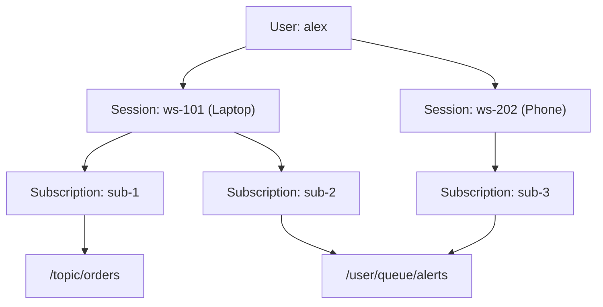

# SimpUserRegistry và theo dõi người dùng, phiên, subscription

Trong ứng dụng Spring STOMP, một người dùng có thể mở nhiều kết nối cùng lúc: nhiều tab trình duyệt, nhiều thiết bị hoặc một ứng dụng đang kết nối lại. Mỗi kết nối có một session STOMP riêng và mỗi session có thể đăng ký nhiều subscription. Muốn biết ai đang kết nối, họ có bao nhiêu session và session nào đang subscribe destination nào, Spring cung cấp mô hình `SimpUserRegistry`.

`SimpUserRegistry` là API để truy vấn trạng thái hiện tại của các người dùng đang kết nối. Nó không phải kho dữ liệu người dùng lâu dài, cũng không phải cơ chế xác thực hoặc phân quyền. Với cấu hình STOMP do Spring quản lý, `DefaultSimpUserRegistry` cập nhật trạng thái dựa trên các sự kiện vòng đời của STOMP session và subscription.

## 1. Mô hình User → Session → Subscription

Ba khái niệm cần phân biệt:

- **User (`SimpUser`):** một danh tính người dùng do `Principal` của session cung cấp. Tên người dùng là khóa để tra cứu trong registry.
- **Session (`SimpSession`):** một kết nối STOMP đang hoạt động của user. Một user có thể có nhiều session.
- **Subscription (`SimpSubscription`):** một đăng ký nhận thông điệp bên trong một session. Subscription có ID và destination riêng.

Ví dụ một người dùng đăng nhập trên laptop và điện thoại:



Trong ví dụ này:

- Registry có một user là `alex`.
- User có hai session.
- Hai session có tổng cộng ba subscription.
- Một destination có thể được subscribe từ nhiều session.

Do đó, `getUserCount()` đếm số user đang được registry theo dõi, không phải số WebSocket connection hay số subscription. Muốn đếm session, hãy cộng số phần tử trong `getSessions()`; muốn đếm subscription, hãy duyệt các session hoặc dùng `findSubscriptions()`.

## 2. Các API chính

Các interface nằm trong package `org.springframework.messaging.simp.user`:

| Kiểu | Phương thức | Ý nghĩa |
|---|---|---|
| `SimpUserRegistry` | `getUser(name)` | Tìm user theo tên; trả về `null` nếu không được kết nối |
| `SimpUserRegistry` | `getUsers()` | Lấy snapshot các user hiện đang kết nối |
| `SimpUserRegistry` | `getUserCount()` | Đếm số user trong registry |
| `SimpUserRegistry` | `findSubscriptions(matcher)` | Tìm subscription thỏa điều kiện |
| `SimpUser` | `getName()` | Tên user duy nhất trong registry |
| `SimpUser` | `getSessions()` | Các session của user |
| `SimpUser` | `getSession(sessionId)` | Tìm một session theo ID |
| `SimpSession` | `getId()` | ID session |
| `SimpSession` | `getSubscriptions()` | Các subscription trong session |
| `SimpSubscription` | `getId()` | ID subscription |
| `SimpSubscription` | `getDestination()` | Destination mà client subscribe |
| `SimpSubscription` | `getSession()` | Session chứa subscription |

Ví dụ truy vấn:

```java
SimpUser user = userRegistry.getUser("alex");

if (user != null) {
    System.out.println("User: " + user.getName());
    System.out.println("Sessions: " + user.getSessions().size());

    for (SimpSession session : user.getSessions()) {
        System.out.println("Session: " + session.getId());

        for (SimpSubscription subscription : session.getSubscriptions()) {
            System.out.println(
                    subscription.getId() + " -> "
                    + subscription.getDestination()
            );
        }
    }
}
```

`getUsers()` trả về một snapshot (bản sao tập hợp) tại thời điểm gọi. Tập hợp đó không tự thay đổi khi có người dùng kết nối hoặc ngắt kết nối sau đó. Các kết quả truy vấn phù hợp cho màn hình quản trị, metric và chẩn đoán tức thời; không nên giữ snapshot lâu dài như trạng thái sống.

`findSubscriptions` nhận một `SimpSubscriptionMatcher`, là functional interface có phương thức `match`. Có thể truyền lambda để lọc theo destination:

```java
Set<SimpSubscription> subscriptions =
        userRegistry.findSubscriptions(subscription ->
                "/topic/orders".equals(subscription.getDestination()));

for (SimpSubscription subscription : subscriptions) {
    SimpSession session = subscription.getSession();

    System.out.printf(
            "user=%s, session=%s, subscription=%s%n",
            session.getUser().getName(),
            session.getId(),
            subscription.getId()
    );
}
```

Kết quả trên đếm subscription khớp điều kiện. Nếu cùng một user subscribe `/topic/orders` từ ba session, kết quả có thể có ba subscription. Muốn đếm user duy nhất, cần gom theo tên user.

## 3. Spring cập nhật registry như thế nào?

`DefaultSimpUserRegistry` là implementation mặc định. Nó lắng nghe các sự kiện STOMP do Spring WebSocket phát ra để cập nhật user, session và subscription. Luồng cơ bản:

1. Client gửi STOMP `CONNECT`. Spring phát `SessionConnectEvent` để báo yêu cầu bắt đầu.
2. Broker trả `CONNECTED`. Spring phát `SessionConnectedEvent`; registry tạo hoặc tìm user tương ứng rồi thêm session.
3. Client gửi `SUBSCRIBE`. Spring phát `SessionSubscribeEvent`; registry ghi nhận ID và destination của subscription trong session.
4. Client gửi `UNSUBSCRIBE`. Spring phát `SessionUnsubscribeEvent`; registry bỏ subscription đó.
5. Client gửi `DISCONNECT` hoặc WebSocket session đóng. Spring phát `SessionDisconnectEvent`; registry bỏ session và xóa user nếu user không còn session nào.

Cần phân biệt `SessionConnectEvent` và `SessionConnectedEvent`. Event đầu tiên báo frame CONNECT đã được nhận; event thứ hai được phát sau khi broker phản hồi CONNECTED, khi STOMP session đã được thiết lập. Registry mặc định dùng `SessionConnectedEvent` để bắt đầu ghi nhận user/session.

Một kết nối chưa có `Principal` không tạo thành một `SimpUser` trong `DefaultSimpUserRegistry`. Vì vậy, registry chủ yếu phản ánh các user có danh tính được gắn vào session. Một WebSocket session ẩn danh vẫn có thể sử dụng một số user destination theo quy tắc riêng, nhưng không xuất hiện như một user đã xác thực trong registry.

### Theo dõi lifecycle bằng ApplicationContext events

Có thể lắng nghe các event để ghi log, cập nhật metric hoặc tích hợp với một hệ thống presence riêng. Không cần tự viết lại registry chỉ để đếm session; Spring đã quản lý trạng thái này.

`StompLifecycleListener.java`:

```java
@Component
public class StompLifecycleListener {

    private static final Logger log =
            LoggerFactory.getLogger(StompLifecycleListener.class);

    @EventListener
    public void onConnected(SessionConnectedEvent event) {
        StompHeaderAccessor accessor =
                StompHeaderAccessor.wrap(event.getMessage());

        Principal user = event.getUser();
        String userName = (user != null) ? user.getName() : "anonymous";

        log.info(
                "STOMP connected: user={}, session={}",
                userName,
                accessor.getSessionId()
        );
    }

    @EventListener
    public void onSubscribe(SessionSubscribeEvent event) {
        StompHeaderAccessor accessor =
                StompHeaderAccessor.wrap(event.getMessage());

        log.debug(
                "STOMP subscribe: session={}, subscription={}, destination={}",
                accessor.getSessionId(),
                accessor.getSubscriptionId(),
                accessor.getDestination()
        );
    }

    @EventListener
    public void onUnsubscribe(SessionUnsubscribeEvent event) {
        StompHeaderAccessor accessor =
                StompHeaderAccessor.wrap(event.getMessage());

        log.debug(
                "STOMP unsubscribe: session={}, subscription={}",
                accessor.getSessionId(),
                accessor.getSubscriptionId()
        );
    }

    @EventListener
    public void onDisconnect(SessionDisconnectEvent event) {
        log.info(
                "STOMP disconnected: session={}, closeStatus={}",
                event.getSessionId(),
                event.getCloseStatus()
        );
    }
}
```

Các import chính:

```java
import java.security.Principal;

import org.slf4j.Logger;
import org.slf4j.LoggerFactory;
import org.springframework.context.event.EventListener;
import org.springframework.stereotype.Component;
import org.springframework.messaging.simp.stomp.StompHeaderAccessor;
import org.springframework.web.socket.messaging.SessionConnectedEvent;
import org.springframework.web.socket.messaging.SessionDisconnectEvent;
import org.springframework.web.socket.messaging.SessionSubscribeEvent;
import org.springframework.web.socket.messaging.SessionUnsubscribeEvent;
```

`SessionDisconnectEvent` có thể được phát nhiều lần cho cùng một session, chẳng hạn khi quá trình đóng WebSocket và frame DISCONNECT cùng kích hoạt cleanup. Nếu listener cập nhật dữ liệu riêng, hãy xử lý theo cách idempotent: xử lý lặp cùng một session ID không làm tăng/giảm bộ đếm sai hoặc tạo bản ghi trùng.

`SessionSubscribeEvent` và `SessionUnsubscribeEvent` phản ánh frame STOMP được nhận. Chúng hữu ích cho audit và metric. Không nên giả định rằng việc ghi log event đã thay thế được kết quả thực tế của broker hoặc thay thế các quy tắc phân quyền subscription.

## 4. Ví dụ: truy vấn presence và subscription

Khi bật STOMP message broker bằng `@EnableWebSocketMessageBroker`, ứng dụng có thể inject `SimpUserRegistry` theo interface. Nên dùng interface để code không phụ thuộc vào implementation cụ thể.

`SubscriptionView.java`:

```java
public record SubscriptionView(
        String sessionId,
        String subscriptionId,
        String destination
) {}
```

`UserPresence.java`:

```java
public record UserPresence(
        String userName,
        int sessionCount,
        List<SubscriptionView> subscriptions
) {}
```

`PresenceQueryService.java`:

```java
@Service
public class PresenceQueryService {

    private final SimpUserRegistry userRegistry;

    public PresenceQueryService(SimpUserRegistry userRegistry) {
        this.userRegistry = userRegistry;
    }

    public UserPresence findUser(String userName) {
        SimpUser user = userRegistry.getUser(userName);

        if (user == null) {
            return new UserPresence(userName, 0, List.of());
        }

        List<SubscriptionView> subscriptions = user.getSessions().stream()
                .flatMap(session -> session.getSubscriptions().stream()
                        .map(subscription -> new SubscriptionView(
                                session.getId(),
                                subscription.getId(),
                                subscription.getDestination()
                        )))
                .toList();

        return new UserPresence(
                user.getName(),
                user.getSessions().size(),
                subscriptions
        );
    }

    public int countConnectedUsers() {
        return userRegistry.getUserCount();
    }

    public int countSubscriptions(String destination) {
        return userRegistry.findSubscriptions(subscription ->
                destination.equals(subscription.getDestination())
        ).size();
    }
}
```

Các import chính:

```java
import java.util.List;

import org.springframework.messaging.simp.user.SimpSession;
import org.springframework.messaging.simp.user.SimpSubscription;
import org.springframework.messaging.simp.user.SimpUser;
import org.springframework.messaging.simp.user.SimpUserRegistry;
import org.springframework.stereotype.Service;
```

Ví dụ dùng Java 17 nên có thể dùng `record` và `Stream.toList()`. Nếu dự án dùng Java cũ hơn, thay record bằng class/DTO thông thường và thay `toList()` bằng `collect(Collectors.toList())`.

Service này phù hợp làm nguồn dữ liệu cho trang quản trị nội bộ hoặc metric. Nếu đưa ra HTTP endpoint, cần bảo vệ endpoint bằng quyền quản trị vì tên user, session ID và destination subscription là thông tin vận hành nội bộ. Không mở dữ liệu presence cho mọi client.

## 5. Liên hệ với user destination

`SimpUserRegistry` đặc biệt hữu ích khi cần hiểu cách Spring định tuyến thông điệp đến một user có thể đang mở nhiều session.

Client thường subscribe destination logic:

```javascript
stompClient.subscribe("/user/queue/notifications", frame => {
    showNotification(JSON.parse(frame.body));
});
```

Server gửi đến user theo tên `Principal`:

`Notification.java`:

```java
public record Notification(String title, String body) {}
```

`NotificationService.java`:

```java
@Service
public class NotificationService {

    private final SimpMessagingTemplate messagingTemplate;

    public NotificationService(SimpMessagingTemplate messagingTemplate) {
        this.messagingTemplate = messagingTemplate;
    }

    public void notifyUser(String userName, Notification payload) {
        messagingTemplate.convertAndSendToUser(
                userName,
                "/queue/notifications",
                payload
        );
    }
}
```

Import chính:

```java
import org.springframework.messaging.simp.SimpMessagingTemplate;
import org.springframework.stereotype.Service;
```

Ở phía server, tham số destination là `/queue/notifications`; không tự thêm `/user/{username}` vào tham số này. `SimpMessagingTemplate` dùng cơ chế user destination của Spring để chuyển destination logic thành destination thực tế riêng cho session. Nếu user có nhiều session, các session đang subscribe destination đó có thể đều nhận thông điệp.

Một message-handling method cũng có thể dùng `@SendToUser`:

```java
@Controller
public class PrivateMessageController {

    private final ProfileService profileService;
    private final TabService tabService;

    public PrivateMessageController(
            ProfileService profileService,
            TabService tabService
    ) {
        this.profileService = profileService;
        this.tabService = tabService;
    }

    @MessageMapping("/profile.refresh")
    @SendToUser("/queue/profile")
    public ProfileView refreshProfile(Principal principal) {
        return profileService.load(principal.getName());
    }

    @MessageMapping("/tab.refresh")
    @SendToUser(destinations = "/queue/tab-result", broadcast = false)
    public TabResult refreshCurrentTab() {
        return tabService.refresh();
    }
}
```

Các kiểu `ProfileService`, `TabService`, `ProfileView` và `TabResult` là thành phần nghiệp vụ của ứng dụng, được inject qua constructor như ví dụ trên.

Mặc định `@SendToUser` gửi đến các session của user đang subscribe destination tương ứng. Đặt `broadcast = false` khi chỉ muốn gửi về session đã gửi message đầu vào, ví dụ phản hồi gắn với một tab cụ thể. Với session không có user đã xác thực, `@SendToUser` cũng hoạt động theo phạm vi session hiện tại.

Không cần tự duyệt `SimpUserRegistry` rồi gửi từng message đến từng session trong trường hợp thông thường. Hãy dùng `convertAndSendToUser` hoặc `@SendToUser`; Spring đã có `UserDestinationMessageHandler` và `UserDestinationResolver` để giải quyết user destination.

## 6. Simple broker và broker relay trong môi trường nhiều máy chủ

Implementation mặc định `DefaultSimpUserRegistry` theo dõi trạng thái của application server hiện tại. Khi chạy một instance, đây thường là đủ.

Khi chạy nhiều application server, một user có thể kết nối vào node A trong khi một tác vụ được xử lý ở node B. Registry cục bộ của node B có thể không biết session trên node A. Khi dùng STOMP broker relay đến một broker dùng chung, có thể bật broadcast registry và broadcast user destination chưa phân giải:

```java
@Configuration
@EnableWebSocketMessageBroker
public class WebSocketConfig implements WebSocketMessageBrokerConfigurer {

    @Override
    public void configureMessageBroker(MessageBrokerRegistry registry) {
        registry.setApplicationDestinationPrefixes("/app");

        registry.enableStompBrokerRelay("/topic", "/queue")
                .setUserRegistryBroadcast("/topic/simp-user-registry")
                .setUserDestinationBroadcast(
                        "/topic/unresolved-user-destination"
                );
    }

    @Override
    public void registerStompEndpoints(StompEndpointRegistry registry) {
        registry.addEndpoint("/ws");
    }
}
```

Hai cấu hình có mục đích khác nhau:

- `setUserRegistryBroadcast(...)` phát thông tin registry cục bộ và nhận broadcast từ node khác. `MultiServerUserRegistry` kết hợp registry cục bộ với các registry từ xa.
- `setUserDestinationBroadcast(...)` phát những message user destination chưa được node hiện tại giải quyết, để node khác có cơ hội xử lý nếu user đang kết nối ở đó.

Các destination broadcast là kênh nội bộ giữa các node. Cần cấu hình quyền trên broker để client thông thường không thể đọc hoặc ghi các destination này. Tất cả node cần dùng chung broker và cấu hình tương thích.

Các phương thức `setUserRegistryBroadcast` và `setUserDestinationBroadcast` ở ví dụ trên thuộc cấu hình STOMP broker relay. Không sao chép nguyên cấu hình đó vào `enableSimpleBroker(...)`: simple broker là broker trong bộ nhớ của từng application server và không tự chia sẻ registry giữa các node.

Registry nhiều máy chủ là dữ liệu presence phân tán qua broadcast, không phải một cơ sở dữ liệu giao dịch đồng bộ. Khi node hoặc broker bị gián đoạn, thông tin từ xa có thể chưa được cập nhật tức thời. Nếu nghiệp vụ cần lịch sử đăng nhập, trạng thái online lâu dài hoặc kiểm toán chính xác, hãy lưu sự kiện nghiệp vụ vào kho dữ liệu riêng.

## 7. Phân biệt SimpUserRegistry và SubscriptionRegistry

Hai registry có tên gần giống nhau nhưng phục vụ hai nhiệm vụ khác nhau:

| Thành phần | Theo dõi | Mục đích |
|---|---|---|
| `SimpUserRegistry` | User, session, subscription gắn với user | Presence, tra cứu session, kiểm tra subscription, user destination |
| `SubscriptionRegistry` | Các subscription mà broker dùng để định tuyến message | Tìm session cần nhận message theo destination và header |

Simple broker dùng `SubscriptionRegistry` để xác định message gửi đến destination nào phải được chuyển cho subscription nào. `DefaultSimpUserRegistry` duy trì cấu trúc user/session/subscription phục vụ tra cứu theo danh tính. Hai thành phần có liên quan đến cùng các STOMP subscription nhưng không phải một object và không nên thay thế lẫn nhau.

Nếu cần biết “có những user nào đang kết nối và họ subscribe gì?”, dùng `SimpUserRegistry`. Nếu cần hiểu hoặc tùy biến cách broker tìm các subscriber để gửi message, đó là phạm vi của broker và `SubscriptionRegistry`.

## 8. Bảo mật và giới hạn khi dùng registry

- **Danh tính đến từ Principal phía server:** registry lấy tên user từ `Principal` gắn với STOMP session. Xác thực ở HTTP handshake hoặc STOMP inbound channel theo kiến trúc bảo mật của ứng dụng. Không tin username do client tự gửi trong payload hoặc header.
- **Tên user phải ổn định và duy nhất:** `Principal.getName()` được dùng để nhóm các session của cùng user. Nếu hai tài khoản khác nhau có cùng tên principal, registry có thể coi chúng là một user.
- **Registry không phải authorization:** việc `getUser(name)` trả về một user không chứng minh người đang gọi được phép đọc dữ liệu của user đó. Phân quyền vẫn phải dựa trên Principal và message authorization.
- **Registry không phải dữ liệu bền vững:** khi application server dừng, session mất và registry được tạo lại. Muốn lưu lịch sử, hãy ghi vào database hoặc hệ thống audit riêng.
- **Snapshot có thể cũ ngay sau khi lấy:** kết nối/ngắt kết nối có thể xảy ra trong lúc ứng dụng đang duyệt kết quả. Dùng snapshot cho quan sát tức thời, không dùng làm khóa đồng bộ nghiệp vụ.
- **Không công khai session ID:** session ID, username và danh sách subscription có thể giúp suy luận cấu trúc nội bộ. Chỉ cho phép vai trò quản trị xem dữ liệu này.
- **Xử lý disconnect lặp:** listener tùy chỉnh phải idempotent vì `SessionDisconnectEvent` có thể lặp.
- **Anonymous session:** session không có Principal không được tính vào số user đã xác thực trong `DefaultSimpUserRegistry`. Không dùng `getUserCount()` làm số lượng mọi WebSocket connection.

## 9. Kiểm tra hành vi

Có thể kiểm tra registry qua một kịch bản STOMP integration test hoặc môi trường chạy thử:

1. Đăng nhập cùng một user và mở hai WebSocket/STOMP session. Xác nhận `getUserCount()` tăng một user và `getSessions()` có hai session.
2. Subscribe `/topic/orders` từ cả hai session. Xác nhận có hai subscription tương ứng.
3. Unsubscribe từ một session. Xác nhận subscription đó biến mất, session còn lại vẫn được giữ.
4. Disconnect session thứ nhất. Xác nhận user vẫn còn một session.
5. Disconnect session cuối cùng. Xác nhận `getUser(userName)` trả về `null`.
6. Kết nối một session không có Principal. Xác nhận session đó không được tính vào số user đã xác thực.
7. Với triển khai nhiều node, kết nối user vào node A và gửi message user destination từ node B. Xác nhận registry broadcast và unresolved destination broadcast được cấu hình đúng.

Các giá trị có thể thay đổi ngay sau khi assertion nếu test chạy bất đồng bộ. Trong integration test, nên chờ có giới hạn đến khi trạng thái mong đợi xuất hiện thay vì giả định event và registry luôn được cập nhật đồng bộ ngay trong cùng một lệnh client.

## Tài liệu tham khảo

- [Spring Framework 6.2 — User Destinations](https://docs.spring.io/spring-framework/reference/6.2/web/websocket/stomp/user-destination.html)
- [Spring Framework 6.2 — Application Context Events](https://docs.spring.io/spring-framework/reference/6.2/web/websocket/stomp/application-context-events.html)
- [SimpUserRegistry — API 6.2](https://docs.spring.io/spring-framework/docs/6.2.12/javadoc-api/org/springframework/messaging/simp/user/SimpUserRegistry.html)
- [SimpUser — API 6.2](https://docs.spring.io/spring-framework/docs/6.2.12/javadoc-api/org/springframework/messaging/simp/user/SimpUser.html)
- [SimpSession — API 6.2](https://docs.spring.io/spring-framework/docs/6.2.18/javadoc-api/org/springframework/messaging/simp/user/SimpSession.html)
- [SimpSubscription — API 6.2](https://docs.spring.io/spring-framework/docs/6.2.12/javadoc-api/org/springframework/messaging/simp/user/SimpSubscription.html)
- [MultiServerUserRegistry — API 6.2](https://www.springframework.org/spring/docs/6.2.7/javadoc-api/org/springframework/messaging/simp/user/MultiServerUserRegistry.html)
