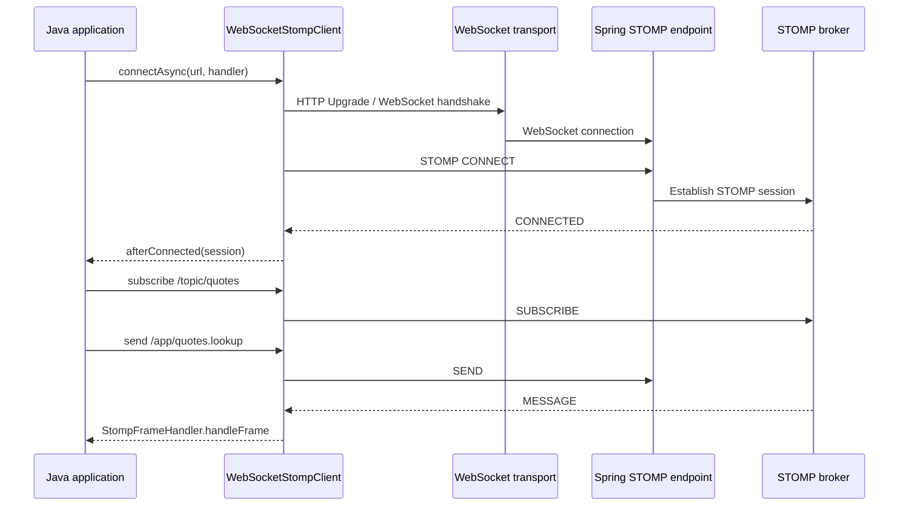

# WebSocketStompClient và thiết lập WebSocket transport

Trong Spring Messaging, `WebSocketStompClient` là client STOMP chạy trên transport WebSocket. Nó giúp một ứng dụng Java kết nối tới endpoint STOMP của ứng dụng Spring hoặc một STOMP server tương thích, gửi message, subscribe destination và nhận frame bất đồng bộ.

Cần tách hai lớp trong quá trình kết nối:

- **WebSocket transport** mở kết nối hai chiều tới endpoint, thực hiện HTTP Upgrade và chuyển dữ liệu qua WebSocket.
- **STOMP session** trao đổi các frame `CONNECT`, `CONNECTED`, `SUBSCRIBE`, `SEND`, `MESSAGE` và `DISCONNECT` trên kết nối đã mở.

WebSocket chỉ cung cấp kênh truyền dữ liệu. STOMP bổ sung cấu trúc message, destination, subscription, header và receipt. `WebSocketStompClient` quản lý cả phần STOMP trên một `WebSocketClient` được cung cấp.

## 1. Kiến trúc client

Các thành phần chính:

| Thành phần | Vai trò |
|---|---|
| `WebSocketClient` | Mở kết nối WebSocket và cung cấp transport cho STOMP |
| `StandardWebSocketClient` | Adapter dùng Jakarta WebSocket API (JSR-356) |
| `SockJsClient` | Client SockJS, có thể dùng WebSocket và các transport HTTP fallback |
| `WebSocketStompClient` | Mã hóa/giải mã STOMP, quản lý kết nối và tạo `StompSession` |
| `StompSessionHandler` | Nhận callback khi kết nối, khi có lỗi hoặc khi nhận frame cấp session |
| `StompSession` | Gửi message, subscribe, unsubscribe và disconnect |
| `MessageConverter` | Chuyển payload Java thành dữ liệu truyền đi và ngược lại |
| `TaskScheduler` | Lập lịch STOMP heartbeat và theo dõi receipt timeout |

Luồng kết nối:



URL WebSocket là endpoint kết nối, ví dụ `ws://localhost:8080/stomp`. Destination STOMP là địa chỉ logic bên trong session, ví dụ `/app/quotes.lookup` hoặc `/topic/quotes`. Không ghép destination vào URL kết nối.

## 2. Chọn WebSocket transport

`WebSocketStompClient` nhận một đối tượng triển khai `WebSocketClient` trong constructor.

### StandardWebSocketClient

`StandardWebSocketClient` dùng Jakarta WebSocket API (JSR-356). Đây là lựa chọn tiêu chuẩn khi runtime có sẵn một implementation của `WebSocketContainer`.

```java
WebSocketClient transport = new StandardWebSocketClient();
WebSocketStompClient stompClient = new WebSocketStompClient(transport);
```

Khi chạy Java client độc lập, cần có implementation Jakarta WebSocket client ở runtime. Chỉ có API interface mà không có provider thì chưa đủ để mở kết nối. Trong ứng dụng Spring Boot, hãy kiểm tra runtime container và dependency thực tế thay vì giả định mọi starter đều tự cung cấp client provider.

### SockJsClient khi cần fallback

Một số proxy, firewall hoặc mạng doanh nghiệp không cho phép WebSocket Upgrade hoặc đóng kết nối WebSocket dài hạn. Nếu server đã bật SockJS, client Java có thể dùng `SockJsClient` để thử các transport được cấu hình.

```java
List<Transport> transports = List.of(
        new WebSocketTransport(new StandardWebSocketClient()),
        new RestTemplateXhrTransport()
);

WebSocketClient transport = new SockJsClient(transports);
WebSocketStompClient stompClient = new WebSocketStompClient(transport);
```

Các import chính:

```java
import java.util.List;

import org.springframework.web.socket.client.WebSocketClient;
import org.springframework.web.socket.client.standard.StandardWebSocketClient;
import org.springframework.web.socket.messaging.WebSocketStompClient;
import org.springframework.web.socket.sockjs.client.RestTemplateXhrTransport;
import org.springframework.web.socket.sockjs.client.SockJsClient;
import org.springframework.web.socket.sockjs.client.Transport;
import org.springframework.web.socket.sockjs.client.WebSocketTransport;
```

Ví dụ trên khai báo WebSocket trước và XHR transport làm phương án thay thế. Java SockJS client hỗ trợ WebSocket, XHR streaming và XHR polling. Server cũng phải bật SockJS cho đúng endpoint:

```java
@Override
public void registerStompEndpoints(StompEndpointRegistry registry) {
    registry.addEndpoint("/stomp").withSockJS();
}
```

Khi dùng SockJS, URL client là URL HTTP(S) gốc của SockJS endpoint, ví dụ `http://localhost:8080/stomp` hoặc `https://example.com/stomp`. `SockJsClient` tự thực hiện bước thông tin ban đầu và chọn transport phù hợp. Với endpoint WebSocket thuần, dùng `ws://` hoặc `wss://` và không thêm `.withSockJS()` ở server.

`RestTemplateXhrTransport` mặc định dùng `SimpleAsyncTaskExecutor` để chạy các request nhận dữ liệu. Nếu tạo nhiều kết nối đồng thời, hãy cấu hình một `TaskExecutor` có giới hạn cho XHR transport để kiểm soát số thread. SockJS mở rộng khả năng tương thích transport, nhưng không thay thế cấu hình CORS, xác thực, timeout hoặc giới hạn tài nguyên ở server và reverse proxy.

## 3. Cấu hình WebSocketStompClient

Ví dụ dưới đây dùng Spring Framework 6.1+ và Java 17+. Client dùng JSON để trao đổi DTO, một scheduler riêng cho heartbeat/receipt và giới hạn kích thước message đầu vào.

`StompClientConfiguration.java`:

```java
@Configuration
public class StompClientConfiguration {

    @Bean
    public ThreadPoolTaskScheduler stompClientTaskScheduler() {
        ThreadPoolTaskScheduler scheduler = new ThreadPoolTaskScheduler();
        scheduler.setPoolSize(2);
        scheduler.setThreadNamePrefix("stomp-client-heartbeat-");
        return scheduler;
    }

    @Bean
    public WebSocketStompClient webSocketStompClient(
            TaskScheduler stompClientTaskScheduler
    ) {
        WebSocketClient transport = new StandardWebSocketClient();
        WebSocketStompClient client = new WebSocketStompClient(transport);

        client.setMessageConverter(new MappingJackson2MessageConverter());
        client.setTaskScheduler(stompClientTaskScheduler);
        client.setDefaultHeartbeat(new long[] {10_000, 10_000});
        client.setReceiptTimeLimit(15_000);
        client.setInboundMessageSizeLimit(64 * 1024);

        return client;
    }
}
```

Các import chính:

```java
import org.springframework.context.annotation.Bean;
import org.springframework.context.annotation.Configuration;
import org.springframework.messaging.converter.MappingJackson2MessageConverter;
import org.springframework.scheduling.TaskScheduler;
import org.springframework.scheduling.concurrent.ThreadPoolTaskScheduler;
import org.springframework.web.socket.client.WebSocketClient;
import org.springframework.web.socket.client.standard.StandardWebSocketClient;
import org.springframework.web.socket.messaging.WebSocketStompClient;
```

Giải thích cấu hình:

- `MappingJackson2MessageConverter` chuyển DTO Java sang JSON và chuyển JSON nhận được thành kiểu Java mà frame handler yêu cầu. Nếu chỉ gửi/nhận văn bản thuần, có thể dùng `StringMessageConverter`.
- `setTaskScheduler` cung cấp scheduler cho heartbeat và receipt tracking. Khi cấu hình scheduler, giá trị heartbeat mặc định của client được chuyển từ `0,0` sang `10000,10000` nếu chưa được tùy chỉnh.
- `setDefaultHeartbeat(new long[] {10_000, 10_000})` đặt khoảng thời gian mong muốn cho heartbeat gửi và nhận theo milliseconds. Giá trị cuối cùng được thương lượng với phía server/broker.
- `setReceiptTimeLimit(15_000)` đặt thời gian chờ receipt; giá trị mặc định là 15 giây.
- `setInboundMessageSizeLimit(64 * 1024)` đặt giới hạn buffer STOMP message nhận vào. Mặc định là 64 KB.

Từ Spring Framework 6.2, có thêm `setOutboundMessageSizeLimit(Integer)` để giới hạn kích thước STOMP message gửi đi. Nếu message vượt giới hạn, client chia message thành nhiều frame để phía nhận ghép lại. Phương thức này không có trong các phiên bản 6.1, vì vậy chỉ thêm dòng sau khi dependency thực tế là 6.2 trở lên:

```java
client.setOutboundMessageSizeLimit(64 * 1024);
```

`WebSocketStompClient` triển khai `SmartLifecycle`. Khi được quản lý như Spring bean, nó mặc định tự start và stop transport theo lifecycle của ApplicationContext. Có thể điều chỉnh `setAutoStartup(false)` và gọi `start()`/`stop()` nếu ứng dụng cần kiểm soát thời điểm mở client. Khi chỉ muốn đóng một kết nối STOMP, gọi `session.disconnect()` trên session tương ứng.

## 4. Kết nối bất đồng bộ và xử lý session

Từ Spring Framework 6.0, ưu tiên `connectAsync(...)`. Các overload `connect(...)` trả `ListenableFuture` đã deprecated từ 6.0 và được đánh dấu để loại bỏ trong phiên bản tương lai.

`connectAsync` hoàn tất khi STOMP session đã nhận frame `CONNECTED`, không chỉ khi HTTP Upgrade thành công. Có thể đăng ký callback bằng `StompSessionHandler`:

```java
String url = "ws://localhost:8080/stomp";

stompClient.connectAsync(url, new QuoteSessionHandler())
        .whenComplete((session, error) -> {
            if (error != null) {
                log.error("Cannot establish STOMP session", error);
                return;
            }

            log.info("STOMP session ready: {}", session.getSessionId());
        });
```

Không gọi `get()` hoặc `join()` ngay trên luồng khởi tạo chỉ để chờ kết nối. Hãy xử lý thành công/thất bại qua callback hoặc chuỗi `CompletableFuture`. `afterConnected` được gọi sau khi STOMP CONNECTED được nhận; đây là nơi phù hợp để đăng ký các subscription cần thiết.

### Tách HTTP handshake headers và STOMP CONNECT headers

Spring có overload nhận cả `WebSocketHttpHeaders` và `StompHeaders`:

```java
WebSocketHttpHeaders handshakeHeaders = new WebSocketHttpHeaders();
handshakeHeaders.add("X-Client-Version", "1.0");

StompHeaders connectHeaders = new StompHeaders();
connectHeaders.add("client-id", "quote-monitor");

stompClient.connectAsync(
        url,
        handshakeHeaders,
        connectHeaders,
        new QuoteSessionHandler()
);
```

Hai nhóm header được gửi ở hai giai đoạn khác nhau:

- `WebSocketHttpHeaders` thuộc HTTP Upgrade handshake.
- `StompHeaders` thuộc frame STOMP `CONNECT` sau khi WebSocket đã mở.

Nếu gửi token xác thực, phải xác định server kiểm tra token ở handshake hay trong STOMP inbound channel rồi đặt header đúng giai đoạn. Việc đưa header vào một trong hai vị trí không tự khiến Spring Security đọc nó ở vị trí còn lại. Với trình duyệt, WebSocket API không cho tùy ý đặt mọi HTTP handshake header; ứng dụng web thường dùng cookie đã được bảo vệ hoặc cơ chế xác thực STOMP CONNECT được server xử lý rõ ràng.

## 5. Subscribe và nhận payload

Mỗi lần subscribe cần một `StompFrameHandler`. Handler khai báo kiểu payload mong muốn qua `getPayloadType`; message converter sẽ chuyển payload theo kiểu đó.

`QuoteRequest.java`:

```java
public record QuoteRequest(String symbol) {}
```

`QuoteUpdate.java`:

```java
public record QuoteUpdate(String symbol, BigDecimal price) {}
```

`QuoteSessionHandler.java`:

```java
public class QuoteSessionHandler extends StompSessionHandlerAdapter {

    private static final Logger log =
            LoggerFactory.getLogger(QuoteSessionHandler.class);

    @Override
    public void afterConnected(
            StompSession session,
            StompHeaders connectedHeaders
    ) {
        session.subscribe("/topic/quotes", new StompFrameHandler() {
            @Override
            public Type getPayloadType(StompHeaders headers) {
                return QuoteUpdate.class;
            }

            @Override
            public void handleFrame(StompHeaders headers, Object payload) {
                QuoteUpdate quote = (QuoteUpdate) payload;
                log.info("Received quote: {} = {}", quote.symbol(), quote.price());
            }
        });

        session.send("/app/quotes.lookup", new QuoteRequest("ACME"));
    }

    @Override
    public void handleFrame(StompHeaders headers, Object payload) {
        // STOMP ERROR frame ở cấp session.
        log.error("STOMP server returned ERROR: {}", payload);
    }

    @Override
    public void handleTransportError(
            StompSession session,
            Throwable exception
    ) {
        log.warn("STOMP transport error for session {}",
                session.getSessionId(), exception);
    }

    @Override
    public void handleException(
            StompSession session,
            StompCommand command,
            StompHeaders headers,
            byte[] payload,
            Throwable exception
    ) {
        log.error("Cannot handle STOMP frame {}", command, exception);
    }
}
```

Các import chính:

```java
import java.lang.reflect.Type;
import java.math.BigDecimal;

import org.slf4j.Logger;
import org.slf4j.LoggerFactory;
import org.springframework.messaging.simp.stomp.StompCommand;
import org.springframework.messaging.simp.stomp.StompFrameHandler;
import org.springframework.messaging.simp.stomp.StompHeaders;
import org.springframework.messaging.simp.stomp.StompSession;
import org.springframework.messaging.simp.stomp.StompSessionHandlerAdapter;
```

Ví dụ giả định server đã cấu hình application prefix `/app`, broker prefix `/topic` và có handler cho `/app/quotes.lookup`. Client subscribe `/topic/quotes` trước khi gửi request để không bỏ lỡ kết quả đến sớm.

`StompSession.subscribe` trả về một handle subscription. Có thể giữ handle để hủy đúng subscription khi không còn cần:

```java
StompSession.Subscription subscription = session.subscribe(
        "/topic/quotes",
        quoteFrameHandler
);

// Khi không còn cần nhận:
subscription.unsubscribe();
```

Gọi `session.disconnect()` khi kết thúc session. Không cần đóng toàn bộ `WebSocketStompClient` nếu ứng dụng vẫn còn các session khác cần hoạt động.

## 6. Heartbeat và receipt

### STOMP heartbeat

Heartbeat là frame hoạt động ở tầng STOMP. Nó giúp hai phía phát hiện kết nối im lặng hoặc đã mất. Nó khác WebSocket Ping/Pong control frame: heartbeat STOMP được biểu diễn bằng dữ liệu heartbeat trong luồng STOMP.

`WebSocketStompClient` chỉ gửi heartbeat khi không có message khác được gửi trong khoảng thời gian đã thương lượng. Nếu message ứng dụng liên tục được gửi, heartbeat riêng có thể không xuất hiện. Với broker relay, cần đảm bảo heartbeat tới broker không bị che khuất bởi các message chỉ được xử lý ở application destination. Cấu hình heartbeat cần được hỗ trợ ở cả client và server/broker.

Mỗi kết nối có thể tạo tác vụ heartbeat riêng. Khi mô phỏng hàng nghìn client trên cùng một máy để benchmark, scheduler và lượng tác vụ heartbeat có thể trở thành chi phí đáng kể. Có thể tắt heartbeat trong bài benchmark nếu mục tiêu là đo thông lượng thuần, nhưng không nên tắt tùy tiện ở môi trường production.

### STOMP receipt

Receipt cho phép client yêu cầu xác nhận rằng broker đã xử lý một frame SEND hoặc SUBSCRIBE. Bật tự động receipt cho các thao tác tiếp theo:

```java
session.setAutoReceipt(true);

Receiptable receipt = session.subscribe(
        "/topic/quotes",
        quoteFrameHandler
);

receipt.addReceiptTask(() -> log.info("Broker processed SUBSCRIBE"));
receipt.addReceiptLostTask(() -> log.warn("SUBSCRIBE receipt timed out"));
```

Client phải cấu hình `TaskScheduler` để theo dõi receipt timeout. Receipt xác nhận broker đã xử lý frame theo giao thức; nó không chứng minh nghiệp vụ phía consumer đã xử lý xong message hoặc dữ liệu đã được commit vào database.

## 7. Kích thước message và buffer

Một STOMP message có thể được chia qua nhiều WebSocket message/frame ở tầng transport. Client cần buffer để ghép lại STOMP message hoàn chỉnh trước khi chuyển đổi payload.

- Inbound limit mặc định của `WebSocketStompClient` là 64 KB. Nếu tổng kích thước STOMP message nhận vượt giới hạn, client phát sinh `StompConversionException`.
- Có thể tăng inbound limit khi ứng dụng thật sự cần payload lớn, nhưng nên đánh giá tác động bộ nhớ khi có nhiều kết nối đồng thời.
- Outbound limit được thêm từ Spring Framework 6.2. Khi bật, message lớn hơn giới hạn được chia thành nhiều STOMP frame; phía nhận cần hỗ trợ ghép frame.
- Nếu không đặt outbound limit, client không chủ động chia STOMP message theo thuộc tính này.

Không dùng việc tăng giới hạn message để che giấu thiết kế payload quá lớn. Với dữ liệu lớn, cân nhắc truyền metadata hoặc ID qua STOMP rồi tải nội dung qua HTTP/object storage.

## 8. Xử lý lỗi, đóng kết nối và reconnect

Cần phân biệt ba nhóm lỗi:

| Nhóm lỗi | Nơi quan sát | Ví dụ |
|---|---|---|
| Kết nối ban đầu thất bại | Future từ `connectAsync` hoàn tất exceptional | HTTP 401/403, endpoint sai, TLS lỗi, không mở được WebSocket |
| Lỗi transport sau khi kết nối | `handleTransportError` | Mất mạng, proxy đóng socket, broker relay ngắt |
| Lỗi STOMP hoặc xử lý frame | `handleFrame` cho ERROR frame và `handleException` cho lỗi callback | Broker trả ERROR, converter hoặc frame handler ném exception |

`WebSocketStompClient` tạo một kết nối và quản lý STOMP session; không nên giả định nó tự thực hiện chính sách reconnect của ứng dụng. Nếu cần reconnect, ứng dụng phải lên lịch thử lại với backoff, giới hạn số lần hoặc điều kiện dừng, và đăng ký lại các subscription sau khi `afterConnected` chạy. Tránh retry vòng lặp tức thời khi server đang lỗi vì có thể tạo tải lớn hơn.

Khi disconnect, server có thể xóa subscription cũ. Sau khi kết nối lại, hãy tạo subscription mới và phục hồi trạng thái cần thiết. Không giữ một `StompSession` cũ rồi tiếp tục gửi message sau khi transport đã mất.

## 9. Kiểm thử và chẩn đoán

Một kịch bản kiểm thử tích hợp nên xác nhận:

1. WebSocket handshake thành công tới đúng endpoint.
2. STOMP CONNECT nhận được CONNECTED trước khi ứng dụng dùng session.
3. Client subscribe destination và nhận được payload đúng kiểu.
4. Client gửi DTO qua message converter và server nhận đúng JSON/field.
5. Receipt thành công và receipt timeout được xử lý khi bật auto receipt.
6. Heartbeat hoạt động khi kết nối idle và server/client cùng cấu hình.
7. Kích thước message vượt giới hạn tạo lỗi như dự kiến.
8. Mất kết nối được báo qua callback, reconnect tạo session mới và đăng ký lại subscription.
9. Khi shutdown, session được disconnect và client lifecycle được dừng đúng cách.

Một số dấu hiệu thường gặp:

| Triệu chứng | Nguyên nhân nên kiểm tra |
|---|---|
| HTTP 404 khi handshake | Sai endpoint path hoặc reverse proxy chưa chuyển tiếp Upgrade |
| HTTP 401/403 | Cookie/token/Origin hoặc chính sách xác thực handshake |
| WebSocket mở nhưng STOMP không CONNECTED | Broker prefix, STOMP CONNECT header hoặc broker relay |
| Không nhận message | Subscribe sai destination, subscribe sau khi server đã phát event, hoặc broker không route |
| Lỗi chuyển đổi payload | Content-Type, converter, kiểu do getPayloadType trả về, cấu trúc JSON |
| Kết nối idle bị đóng | Heartbeat chưa thương lượng, proxy/load balancer timeout |
| SockJS fallback thất bại | Server chưa bật SockJS, XHR transport bị chặn hoặc CORS chưa đúng |
| Lỗi message quá lớn | Inbound buffer limit hoặc giới hạn của WebSocket server/proxy |

## 10. Lựa chọn cấu hình theo tình huống

| Tình huống | Lựa chọn |
|---|---|
| Java service kết nối server hỗ trợ WebSocket trực tiếp | `StandardWebSocketClient` + `WebSocketStompClient` |
| Mạng có proxy chặn WebSocket và server hỗ trợ SockJS | `SockJsClient` với WebSocket và XHR transports |
| Payload JSON là DTO | `MappingJackson2MessageConverter` |
| Payload chỉ là text | `StringMessageConverter` |
| Cần kiểm tra kết nối sống | `TaskScheduler` và STOMP heartbeat |
| Cần xác nhận broker xử lý SEND/SUBSCRIBE | STOMP receipt và receipt callbacks |
| Có payload lớn | Đặt inbound limit phù hợp; outbound limit khi dùng Spring 6.2+ |
| Cần reconnect | Tự quản lý retry/backoff và resubscribe ở tầng ứng dụng |

## Tài liệu tham khảo

- [Spring Framework 6.2 — STOMP Client](https://docs.spring.io/spring-framework/reference/6.2/web/websocket/stomp/client.html)
- [Spring Framework 6.2 — WebSocket API](https://docs.spring.io/spring-framework/reference/6.2/web/websocket/server.html)
- [WebSocketStompClient — Spring Framework 6.2 Javadoc](https://docs.spring.io/spring-framework/docs/6.2.0/javadoc-api/org/springframework/web/socket/messaging/WebSocketStompClient.html)
- [StompSessionHandlerAdapter — Spring Framework 6.2 Javadoc](https://docs.spring.io/spring-framework/docs/6.2.6/javadoc-api/org/springframework/messaging/simp/stomp/StompSessionHandlerAdapter.html)
- [SockJsClient — Spring Framework 6.2 Javadoc](https://docs.spring.io/spring-framework/docs/6.2.18/javadoc-api/org/springframework/web/socket/sockjs/client/SockJsClient.html)
- [MappingJackson2MessageConverter — Spring Framework 6.2 Javadoc](https://docs.spring.io/spring-framework/docs/6.2.6/javadoc-api/org/springframework/messaging/converter/MappingJackson2MessageConverter.html)
