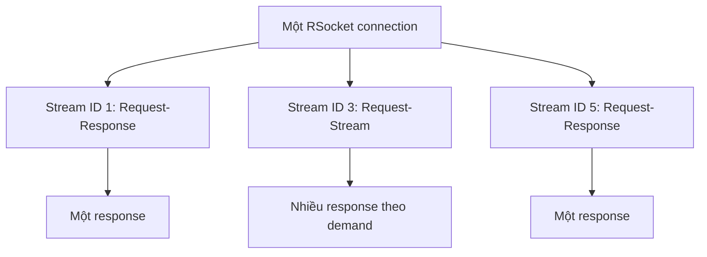

# Transport TCP hoặc WebSocket và multiplexing trên kết nối

RSocket là giao thức messaging nhị phân, hai chiều, chạy trên một transport dạng byte stream. Spring hỗ trợ RSocket trên TCP và WebSocket. Điểm quan trọng của RSocket là **multiplexing**: nhiều request/response hoặc stream độc lập có thể cùng sử dụng một kết nối vật lý. Mỗi tương tác được nhận diện bằng stream ID riêng, nên các frame của nhiều luồng có thể xen kẽ trên cùng connection.

Cần phân biệt ba lớp:

- **Transport** chịu trách nhiệm chuyển byte/frame giữa hai đầu. TCP và WebSocket là hai lựa chọn ở lớp này.
- **RSocket protocol** định nghĩa SETUP, stream ID, các kiểu tương tác, flow control, keepalive, error và metadata.
- **Spring Messaging** cung cấp API cấp cao như RSocketRequester, RSocketMessageHandler và @MessageMapping để ứng dụng làm việc với object thay vì tự xử lý frame nhị phân.

RSocket over WebSocket vẫn là RSocket protocol. Nó không phải STOMP chỉ vì cùng dùng WebSocket làm transport.

## 1. TCP và WebSocket trong RSocket

Cả TCP và WebSocket đều có thể mang RSocket frame, nhưng cách đóng gói và môi trường triển khai khác nhau.

| Tiêu chí | RSocket over TCP | RSocket over WebSocket |
|---|---|---|
| Cách mở kết nối | Kết nối TCP trực tiếp tới host và port | HTTP Upgrade thành WebSocket tại một URI |
| Địa chỉ ví dụ | localhost:7000 | ws://localhost:8080/rsocket hoặc wss://api.example.com/rsocket |
| Môi trường phù hợp | Service-to-service, mạng nội bộ, backend | Browser client, frontend và hạ tầng đã hỗ trợ WebSocket |
| RSocket framing | Cần length prefix để tách frame trên byte stream | WebSocket message boundary đã giữ ranh giới frame nên không cần length prefix RSocket |
| Tầng bảo vệ | Có thể dùng TLS theo cấu hình transport | Dùng TLS qua wss://; còn phải cấu hình xác thực và Origin phù hợp |
| Hạ tầng mạng | Firewall/load balancer phải cho phép TCP port | Proxy/load balancer phải hỗ trợ HTTP Upgrade và WebSocket timeout |

TCP là byte stream, không có ranh giới message sẵn có. Vì vậy, RSocket đặt một trường độ dài 24-bit trước mỗi frame để bên nhận biết chính xác frame kết thúc ở đâu. Với WebSocket, mỗi WebSocket message đã có ranh giới message, nên RSocket không thêm trường độ dài này. Đây là khác biệt ở framing, không phải khác biệt về semantics của request hay stream.

WebSocket bản thân vẫn thường chạy trên TCP. Chọn WebSocket không loại bỏ TCP ở tầng mạng; nó thêm handshake HTTP và lớp message framing phù hợp với trình duyệt và các hạ tầng HTTP.

### Khi nào chọn transport nào?

**TCP** phù hợp khi hai ứng dụng backend kiểm soát được mạng và có thể mở port riêng. Nó tránh HTTP Upgrade và có mô hình kết nối trực tiếp, nhưng cần cấu hình rõ firewall, TLS, service discovery và load balancing cho TCP.

**WebSocket** phù hợp khi client chạy trong trình duyệt hoặc hệ thống mạng chỉ cho phép kết nối qua hạ tầng HTTP/HTTPS. Có thể dùng cùng host/port với web server và một mapping path. Đổi lại, cần bảo đảm proxy hỗ trợ Upgrade, timeout của kết nối dài hạn và chính sách Origin.

Không có transport nào tự tạo ra multiplexing. Multiplexing là đặc tính của RSocket protocol và được giữ nguyên khi RSocket chạy trên TCP hoặc WebSocket.

## 2. Cấu hình RSocket server trong Spring Boot

Nếu dùng Spring Boot, dependency thông dụng là starter RSocket:

```gradle
dependencies {
    implementation("org.springframework.boot:spring-boot-starter-rsocket")
}
```

Spring Boot tự cấu hình Spring Messaging infrastructure và một RSocketMessageHandler để xử lý các request đến controller có @MessageMapping. Boot cũng cung cấp RSocketRequester.Builder và RSocketStrategies với các codec JSON/CBOR khi dependency tương ứng có mặt.

### Server TCP độc lập

Ví dụ application.properties:

```properties
spring.rsocket.server.transport=tcp
spring.rsocket.server.port=7000
```

Server mở một RSocket TCP listener tại port 7000. Client phải kết nối đúng host/port này.

### WebSocket gắn vào WebFlux server

Với ứng dụng WebFlux chạy trên Reactor Netty, có thể gắn RSocket vào web server hiện có:

```properties
spring.rsocket.server.transport=websocket
spring.rsocket.server.mapping-path=/rsocket
```

Khi dùng cách này, RSocket được phục vụ tại path /rsocket trên WebFlux web server; không cấu hình một RSocket port độc lập. Tích hợp trực tiếp vào web server hiện được hỗ trợ với Reactor Netty.

Nếu muốn chạy một RSocket WebSocket server độc lập thay vì gắn vào WebFlux server, hãy cấu hình transport và port theo mô hình embedded server tương ứng. Cấu hình client phải khớp loại transport và địa chỉ server đang mở.

## 3. Kết nối client bằng RSocketRequester

Spring cung cấp RSocketRequester để tạo request bằng object Java. Builder có hai phương thức thường dùng:

```java
RSocketRequester tcpRequester =
        RSocketRequester.builder()
                .tcp("localhost", 7000);

RSocketRequester websocketRequester =
        RSocketRequester.builder()
                .websocket(URI.create("ws://localhost:8080/rsocket"));
```

Import chính:

```java
import java.net.URI;
import reactor.core.publisher.Flux;
import reactor.core.publisher.Mono;

import org.springframework.messaging.rsocket.RSocketRequester;
import org.springframework.stereotype.Service;
```

Các phương thức tcp(host, port) và websocket(uri) tạo một requester có thể thực hiện nhiều request đồng thời trên một connection dùng chung. Việc kết nối thực tế được thiết lập khi request đầu tiên được thực thi; ứng dụng không cần tự mở một socket mới cho mỗi request.

Với Spring Boot, RSocketRequester.Builder là prototype bean. Mỗi nơi inject builder sẽ nhận một instance riêng, vì builder có trạng thái cấu hình. Có thể tạo một requester trong constructor service rồi tái sử dụng requester đó cho các request đồng thời:

```java
@Service
public class QuoteClient {

    private final RSocketRequester requester;

    public QuoteClient(RSocketRequester.Builder builder) {
        this.requester = builder.tcp("localhost", 7000);
    }

    public Mono<Quote> findQuote(String symbol) {
        return requester.route("quote.by-symbol")
                .data(new QuoteRequest(symbol))
                .retrieveMono(Quote.class);
    }

    public Flux<Quote> watchQuotes(String symbol) {
        return requester.route("quote.stream")
                .data(new QuoteRequest(symbol))
                .retrieveFlux(Quote.class);
    }

    public Mono<Void> refreshQuote(String symbol) {
        return requester.route("quote.refresh")
                .data(new QuoteRequest(symbol))
                .send();
    }
}
```

Trong ví dụ này, requester được tái sử dụng. Không tạo requester mới trong mỗi lần gọi findQuote hoặc watchQuotes, vì việc đó sẽ làm mất lợi ích chia sẻ connection và tăng số handshake/kết nối.

Đổi TCP sang WebSocket chỉ cần thay cách tạo requester:

```java
public QuoteClient(RSocketRequester.Builder builder) {
    this.requester = builder.websocket(
            URI.create("wss://api.example.com/rsocket")
    );
}
```

Địa chỉ wss:// dùng TLS cho WebSocket. Việc bật TLS không tự xác thực user ở tầng ứng dụng; server vẫn cần cơ chế authentication và authorization.

### DTO và responder phía server

Tách mỗi public record thành một file Java riêng (QuoteRequest.java, Quote.java, QuoteUpdate.java, QuoteCommand.java và QuoteEvent.java). Import BigDecimal trong các file có trường giá trị tiền:

Ví dụ các kiểu payload:

```java
import java.math.BigDecimal;

public record QuoteRequest(String symbol) {}

public record Quote(String symbol, BigDecimal price) {}

public record QuoteUpdate(String symbol, BigDecimal price) {}

public record QuoteCommand(String symbol, String action) {}

public record QuoteEvent(String symbol, String event) {}
```

Một controller phía server có thể khai báo các route tương ứng:

```java
@Controller
public class QuoteRSocketController {

    private final QuoteService quoteService;

    public QuoteRSocketController(QuoteService quoteService) {
        this.quoteService = quoteService;
    }

    @MessageMapping("quote.by-symbol")
    public Mono<Quote> findQuote(QuoteRequest request) {
        return quoteService.findQuote(request.symbol());
    }

    @MessageMapping("quote.stream")
    public Flux<Quote> watchQuotes(QuoteRequest request) {
        return quoteService.watchQuotes(request.symbol());
    }

    @MessageMapping("quote.refresh")
    public Mono<Void> refreshQuote(QuoteRequest request) {
        return quoteService.refresh(request.symbol());
    }
}
```

Các import chính cho controller:

```java
import org.springframework.messaging.handler.annotation.MessageMapping;
import org.springframework.stereotype.Controller;
import reactor.core.publisher.Flux;
import reactor.core.publisher.Mono;
```

Spring Boot auto-configures RSocketMessageHandler để phát hiện các controller và xử lý @MessageMapping. Route là metadata của RSocket request, không phải URL path HTTP. Service ở ví dụ là thành phần nghiệp vụ của ứng dụng.

## 4. SETUP và thông tin cấp connection

Khi client và server đã mở transport, client gửi frame RSocket SETUP để bắt đầu protocol session. SETUP mang các tham số áp dụng cho connection, gồm phiên bản protocol, keepalive, data MIME type, metadata MIME type và có thể có setup data hoặc setup metadata.

Trong Spring, có thể cấu hình một số thông tin đó qua builder:

```java
RSocketRequester requester = RSocketRequester.builder()
        .dataMimeType(MimeTypeUtils.TEXT_PLAIN)
        .setupData("quote-monitor/1.0")
        .tcp("localhost", 7000);
```

Các import:

```java
import org.springframework.util.MimeTypeUtils;
```

Ý nghĩa:

- dataMimeType xác định định dạng dữ liệu payload áp dụng cho connection.
- metadataMimeType xác định định dạng metadata, chẳng hạn composite metadata.
- setupData gửi thông tin khởi tạo ở cấp connection.
- setupMetadata gửi metadata bổ sung ở cấp connection.
- setupRoute thiết lập route trong metadata của SETUP nếu ứng dụng cần xử lý route lúc mở connection.

Data và metadata có thể có định dạng khác nhau. Route của từng request thường được gửi trong metadata của request đầu tiên trên stream đó, không phải trong URL transport.

Không đưa secret cố định vào source code hoặc setup data công khai. Nếu cần xác thực bằng metadata, dùng cơ chế token có thời hạn, truyền qua kênh bảo mật và xác minh ở server. SETUP metadata là dữ liệu cấp connection; metadata của request có thể mang thông tin theo từng request.

## 5. Multiplexing: nhiều stream trên một connection

RSocket phân biệt connection vật lý với stream logic:

- Một **connection** là transport session TCP hoặc WebSocket giữa hai đầu.
- Một **stream** là một tương tác độc lập như request-response hoặc request-stream.
- Mỗi stream có một stream ID duy nhất trong connection.
- Các frame thuộc nhiều stream có thể xen kẽ trên cùng transport.

Ví dụ client gửi đồng thời hai request-response và một request-stream:



Stream ID do bên khởi tạo request cấp. Client bắt đầu với ID lẻ 1, 3, 5...; server bắt đầu với ID chẵn 2, 4, 6... Stream ID 0 được dành cho thao tác ở cấp connection, chẳng hạn SETUP và KEEPALIVE. ID phải duy nhất đối với bên khởi tạo trong phạm vi connection.

Hai phía đều có thể khởi tạo request sau khi SETUP thành công. Vì vậy, một kết nối RSocket không có vai trò client/server cố định ở cấp mọi request: mỗi phía có thể vừa là requester vừa là responder trên các stream khác nhau.

Các frame của cùng một stream được xử lý theo thứ tự. Frame của những stream khác nhau có thể xen kẽ, ví dụ:

1. Client gửi request trên stream 1.
2. Client gửi request-stream trên stream 3.
3. Server trả payload cho stream 3.
4. Server trả response cho stream 1.
5. Server tiếp tục gửi payload cho stream 3 khi requester còn demand.

Không cần mở một TCP socket hoặc WebSocket riêng cho từng stream. RSocket dùng stream ID để ghép frame về đúng tương tác.

## 6. Multiplexing với các interaction model

RSocket có bốn kiểu tương tác chính. Spring RSocketRequester suy ra interaction type từ số lượng input và output của request.

| Interaction | Input | Output | Cách dùng Spring |
|---|---|---|---|
| Request-Response | Một payload | Một response | data(value).retrieveMono(Type.class) |
| Request-Stream | Một payload | Nhiều response | data(value).retrieveFlux(Type.class) |
| Fire-and-Forget | Một payload | Không có response | data(value).send() |
| Request-Channel | Một stream payload | Một stream response | data(Flux).retrieveFlux(Type.class) |

### Request-Response

Một request và một response. Phù hợp tra cứu một đối tượng:

```java
Mono<Quote> quote = requester.route("quote.by-symbol")
        .data(new QuoteRequest("ACME"))
        .retrieveMono(Quote.class);
```

### Request-Stream

Một request ban đầu và một luồng response:

```java
Flux<QuoteUpdate> updates = requester.route("quote.stream")
        .data(new QuoteRequest("ACME"))
        .retrieveFlux(QuoteUpdate.class);
```

### Fire-and-Forget

Gửi một payload và không yêu cầu response:

```java
Mono<Void> sent = requester.route("quote.refresh")
        .data(new QuoteRequest("ACME"))
        .send();
```

Mono<Void> chỉ báo thao tác gửi đã hoàn tất ở phía requester; nó không chứng minh handler nghiệp vụ đã xử lý xong hoặc đã commit dữ liệu.

### Request-Channel

Hai phía trao đổi stream payload trong cùng một interaction. Client gửi một Flux và nhận một Flux:

Ví dụ request-channel:

```java
Flux<QuoteCommand> commands = Flux.just(
        new QuoteCommand("ACME", "SUBSCRIBE"),
        new QuoteCommand("ACME", "SET_ALERT")
);

Flux<QuoteEvent> events = requester.route("quote.channel")
        .data(commands, QuoteCommand.class)
        .retrieveFlux(QuoteEvent.class);
```

Request-Channel hữu ích khi cả hai phía đều cần phát nhiều message theo thời gian. Các stream vẫn có flow control và cancellation riêng.

## 7. Flow control và backpressure

Multiplexing cho phép nhiều stream dùng chung connection, nhưng không có nghĩa responder được phép đẩy dữ liệu vô hạn vào bộ nhớ hoặc network buffer.

Với Request-Stream và Request-Channel, RSocket áp dụng Reactive Streams demand:

1. Requester khai báo lượng item ban đầu trong request frame.
2. Khi cần thêm item, requester gửi REQUEST_N để tăng demand.
3. Responder phải tôn trọng demand và không phát nhiều item hơn số lượng đã được yêu cầu.
4. Khi subscriber hủy subscription, cancellation được truyền tới stream tương ứng.

Trong Spring, Flux và Mono giúp biểu diễn demand và cancellation. Ví dụ:

```java
Flux<QuoteUpdate> updates = requester.route("quote.stream")
        .data(new QuoteRequest("ACME"))
        .retrieveFlux(QuoteUpdate.class)
        .take(100);
```

take(100) hủy upstream sau khi nhận đủ 100 phần tử. Việc hủy stream không nhất thiết đóng toàn bộ RSocket connection; những stream khác trên cùng connection có thể tiếp tục hoạt động.

Backpressure là flow control ở cấp stream. Nó không thay thế giới hạn tài nguyên toàn hệ thống: server vẫn cần giới hạn số connection, số stream đồng thời, kích thước payload, tốc độ request và thời gian xử lý.

## 8. Cách multiplexing hoạt động bên dưới transport

RSocket protocol đóng gói mỗi interaction thành các frame có header chứa stream ID và loại frame. Một số frame quan trọng:

| Frame | Phạm vi | Mục đích |
|---|---|---|
| SETUP | Connection | Khởi tạo protocol session và tham số kết nối |
| KEEPALIVE | Connection | Phát hiện connection còn hoạt động |
| REQUEST_RESPONSE | Stream | Yêu cầu một response |
| REQUEST_FNF | Stream | Gửi một chiều |
| REQUEST_STREAM | Stream | Yêu cầu stream response |
| REQUEST_CHANNEL | Stream | Mở stream hai chiều |
| REQUEST_N | Stream | Báo demand bổ sung |
| CANCEL | Stream | Hủy một interaction |
| PAYLOAD | Stream | Truyền dữ liệu của interaction |
| ERROR | Connection hoặc stream | Báo lỗi ở cấp connection hoặc interaction |
| METADATA_PUSH | Connection | Gửi metadata notification không gắn với một request cụ thể |

Transport không quyết định stream ID. Cùng một mô hình frame và stream ID được dùng trên cả TCP lẫn WebSocket. Khác biệt là cách đóng gói frame vào transport:

- TCP cần trường length prefix để xác định ranh giới frame trên byte stream.
- WebSocket đã giữ ranh giới message, nên không cần trường length prefix RSocket.
- WebSocket message vẫn chứa RSocket frame; WebSocket không thay thế header hay stream ID của RSocket.

RSocket Java dùng Project Reactor và Reactor Netty cho TCP/WebSocket transport. Spring cung cấp lớp API cao hơn để ứng dụng không phải tự parse frame hoặc quản lý stream ID.

## 9. Lợi ích và giới hạn của multiplexing

### Lợi ích

- **Giảm số kết nối:** nhiều request có thể chia sẻ một transport connection, giảm handshake và tài nguyên socket.
- **Tương tác đồng thời:** nhiều stream độc lập có thể đang chờ response hoặc truyền dữ liệu cùng lúc.
- **Hai chiều:** cả client và server có thể khởi tạo request trên cùng connection.
- **Flow control theo stream:** demand và cancellation áp dụng cho từng stream.
- **Tổ chức logic rõ ràng:** mỗi request/stream có ID, lifecycle và error riêng.

### Giới hạn cần hiểu

Multiplexing không tạo ra băng thông riêng cho mỗi stream. Tất cả stream trên một connection vẫn chia sẻ bandwidth, CPU, bộ nhớ và failure domain của connection.

Với TCP, mất gói ở tầng TCP có thể làm chậm việc giao byte tiếp theo trên connection, kể cả khi các frame thuộc stream khác đã sẵn sàng. Vì vậy, multiplexing ở tầng RSocket không loại bỏ hoàn toàn head-of-line blocking của TCP.

Nếu một stream gửi payload rất lớn hoặc tiêu thụ CPU quá nhiều, nó có thể cạnh tranh tài nguyên với các stream khác. Cần đặt giới hạn frame/payload, sử dụng backpressure, tách connection cho workload có đặc tính khác nhau khi cần và theo dõi latency theo loại interaction.

Một connection chết sẽ ảnh hưởng đến tất cả stream đang chạy trên connection đó. RSocket có tính năng session resumption tùy chọn, nhưng resumption cần cấu hình và state ở cả hai phía; không tự có chỉ vì dùng TCP hoặc WebSocket.

## 10. Giữ connection sống và xử lý reconnect

RSocket SETUP thương lượng keepalive interval và maximum lifetime. Hai phía gửi KEEPALIVE để phát hiện transport im lặng hoặc đã chết. Cần chọn thời gian phù hợp với proxy, load balancer, mạng di động và yêu cầu phát hiện lỗi.

Khi connection bị mất:

- Các stream đang chạy trên connection đó có thể kết thúc bằng lỗi.
- Ứng dụng cần xử lý onError và quyết định request nào được phép thử lại.
- Không tự retry mọi request một cách mù quáng. Fire-and-Forget hoặc request đã có side effect có thể đã được xử lý trước khi mất kết nối.
- Nếu retry, dùng idempotency key hoặc request ID để tránh thực hiện nghiệp vụ hai lần.
- Session resumption là cơ chế riêng của protocol và cần cấu hình state retention; retry tạo connection mới không tương đương resume session.

Có thể cấu hình RSocketConnector qua builder khi cần keepalive, resume, interceptor hoặc các tùy chọn cấp thấp hơn:

```java
RSocketRequester requester = RSocketRequester.builder()
        .rsocketConnector(connector -> {
            // Cấu hình RSocketConnector khi ứng dụng cần
            // keepalive, resumption hoặc interceptor riêng.
        })
        .tcp("localhost", 7000);
```

Không thay đổi thông số keepalive hoặc resume chỉ dựa trên một giá trị mẫu. Đối chiếu timeout của server, client, proxy và broker trước khi chọn cấu hình.

## 11. Chẩn đoán lỗi transport

| Triệu chứng | Kiểm tra |
|---|---|
| Connection refused khi dùng TCP | Host/port, server transport, firewall, service binding |
| WebSocket handshake 404 | mapping-path, URL, WebFlux/Reactor Netty |
| WebSocket handshake 400/403 | Upgrade headers, Origin, authentication, proxy |
| Kết nối mở nhưng SETUP bị từ chối | Protocol version, MIME type, setup metadata, cấu hình server |
| Request timeout | Server xử lý chậm, stream chưa có response, network latency, keepalive |
| Chỉ một số stream bị lỗi | Route, payload, metadata hoặc lỗi nghiệp vụ riêng của stream |
| Mọi stream cùng lỗi | Transport connection đóng, KEEPALIVE timeout hoặc connection-level ERROR |
| Dữ liệu stream bị dồn | Subscriber demand thấp, xử lý chậm, thiếu backpressure hoặc buffer quá lớn |
| Nhiều connection ngoài dự kiến | Tạo RSocketRequester mới liên tục thay vì tái sử dụng requester |

Khi log, nên ghi correlation ID, route, stream interaction type, thời gian xử lý và trạng thái connection. Tránh ghi toàn bộ payload hoặc token xác thực vào log.

## 12. Kiểm thử multiplexing

Một bài kiểm thử tích hợp nên tạo một RSocketRequester dùng chung rồi phát nhiều request đồng thời. Import dùng trong ví dụ:

```java
import java.time.Duration;
import reactor.core.publisher.Mono;
```

```java
Mono<Quote> first = requester.route("quote.by-symbol")
        .data(new QuoteRequest("ACME"))
        .retrieveMono(Quote.class);

Mono<Quote> second = requester.route("quote.by-symbol")
        .data(new QuoteRequest("BETA"))
        .retrieveMono(Quote.class);

Mono.zip(first, second)
        .doOnNext(tuple -> {
            log.info("First: {}", tuple.getT1());
            log.info("Second: {}", tuple.getT2());
        })
        .block(Duration.ofSeconds(5));
```

zip subscribe hai Mono, cho phép hai request được phát trên requester dùng chung. Trong test, có thể xác nhận server xử lý chúng độc lập và kết quả không bị ghép nhầm.

Bổ sung các tình huống:

1. Gửi nhiều Request-Response đồng thời trên một requester.
2. Mở một Request-Stream và một Request-Response cùng lúc.
3. Hủy một Flux đang chạy và xác nhận stream đó kết thúc trong khi request khác tiếp tục.
4. Tạo tải lớn để kiểm tra backpressure và giới hạn số stream.
5. Ngắt transport giữa lúc nhiều stream đang chạy để xác nhận lỗi được truyền đến đúng publisher.
6. Chạy cùng kịch bản trên TCP và WebSocket để so sánh behavior, latency và yêu cầu hạ tầng.
7. Kiểm tra server/client có cùng data MIME type và metadata MIME type.

Ví dụ dùng block chỉ phù hợp trong test hoặc chương trình command-line. Trong WebFlux request path hoặc service reactive, hãy trả Mono/Flux về caller thay vì block trên event-loop thread.

## Tài liệu tham khảo

- [Spring Framework 6.2 — RSocket](https://docs.spring.io/spring-framework/reference/6.2/rsocket.html)
- [Spring Framework 6.2 — RSocketRequester.Builder Javadoc](https://docs.spring.io/spring-framework/docs/6.2.0-M4/javadoc-api/org/springframework/messaging/rsocket/RSocketRequester.Builder.html)
- [Spring Boot — RSocket Support](https://docs.spring.io/spring-boot/reference/messaging/rsocket.html)
- [RSocket Protocol Specification](https://github.com/rsocket/rsocket/blob/master/Protocol.md)
