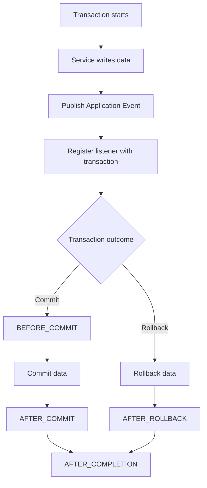

# TransactionalEventListener and Commit or Rollback Timing

## 1. Why Tie Events to a Transaction?

In Spring, a regular application event is published with `ApplicationEventPublisher.publishEvent(...)`. Listeners using `@EventListener` are normally invoked right away during event publication. This works well for reactions that can happen independently of whether data persistence succeeds.

However, many events are only meaningful once a transaction has completed. For example, after creating an order, the system may need to send a confirmation email, update a search index, or notify another service. If a listener runs immediately when `publishEvent(...)` is called, it could send a success notification even though the transaction later rolls back. Recipients would see an order that the database never saved.

`@TransactionalEventListener` solves the problem of **when a listener is invoked**. Spring registers the listener with the current transaction and invokes the method only in the chosen phase. As a result, a listener can react before commit, after commit, after rollback, or after transaction completion.

Key point to remember: `@TransactionalEventListener` does not start a transaction on its own and does not turn an in-memory event into a durably persisted message. It binds the handling of a Spring event to the lifecycle of the transaction active at the time the event is published.

## 2. Lifecycle of a Transactional Event

Suppose a service is executing inside a transaction and publishes an event:

```java
@Transactional
public void createOrder() {
    Order order = orderRepository.save(new Order());
    eventPublisher.publishEvent(new OrderCreatedEvent(order.getId()));
}
```

When `publishEvent(...)` is called, a transactional listener does not necessarily run immediately. If transaction synchronization is active, Spring registers a corresponding callback with that transaction. Only when the transaction reaches the selected phase does Spring invoke the listener.



The diagram illustrates the selectable phases. Each listener method runs only in its declared phase. `BEFORE_COMMIT` exists only on the commit branch; `AFTER_ROLLBACK` exists only on the rollback branch; `AFTER_COMPLETION` runs after the transaction finishes under either outcome.

## 3. The Four Phases of `@TransactionalEventListener`

The `phase` attribute takes values from `TransactionPhase`.

| Phase | Invocation Timing | Suitable Use Cases |
|---|---|---|
| `BEFORE_COMMIT` | After the main work finishes, before the transaction commits | Final validation checks, writing secondary data that must commit together with the primary data |
| `AFTER_COMMIT` | Only after the transaction commits successfully | Sending notifications, refreshing caches, or triggering follow-up work |
| `AFTER_ROLLBACK` | After the transaction rolls back | Recording failures, releasing external resources, or performing compensating actions |
| `AFTER_COMPLETION` | After the transaction ends, whether commit or rollback | Cleaning up resources or recording general completion outcomes |

### 3.1. `BEFORE_COMMIT`

```java
@Component
public class OrderValidationListener {

    @TransactionalEventListener(phase = TransactionPhase.BEFORE_COMMIT)
    public void validate(OrderCreatedEvent event) {
        // Check conditions that must hold before the order is committed.
    }
}
```

The listener runs while the transaction can still either commit or roll back. If the listener detects invalid data and throws an appropriate exception, that exception can cause the transaction to roll back. Therefore, this phase fits validation or database operations that belong in the same transaction.

Do not call external services with hard-to-reverse side effects in this phase. For example, if a listener sends an email and then the transaction rolls back, the sent email cannot automatically disappear.

### 3.2. `AFTER_COMMIT`

This is the default phase. The following two declarations have the same meaning:

```java
@TransactionalEventListener
public void sendConfirmation(OrderCreatedEvent event) {
    // Runs after the transaction commits successfully.
}
```

```java
@TransactionalEventListener(phase = TransactionPhase.AFTER_COMMIT)
public void sendConfirmation(OrderCreatedEvent event) {
    // Runs after the transaction commits successfully.
}
```

This phase fits when an action should only start after the primary data has been committed. For example, the system only sends a confirmation email after the order has been successfully persisted.

If the transaction rolls back, an `AFTER_COMMIT` listener does not run. That prevents sending success notifications for a failed operation.

An important detail: the `AFTER_COMMIT` callback runs after the commit has completed. Transaction resources may still be held and accessible during the callback, but there will be no further commit for the transaction that just ended. Therefore, if the listener needs to write new data, use a new transaction, typically `Propagation.REQUIRES_NEW`.

```java
@Component
public class OrderAuditListener {

    private final OrderAuditRepository auditRepository;

    public OrderAuditListener(OrderAuditRepository auditRepository) {
        this.auditRepository = auditRepository;
    }

    @TransactionalEventListener(phase = TransactionPhase.AFTER_COMMIT)
    @Transactional(propagation = Propagation.REQUIRES_NEW)
    public void record(OrderCreatedEvent event) {
        auditRepository.save(new OrderAudit(event.orderId(), "CREATED"));
    }
}
```

`REQUIRES_NEW` instructs Spring to open an independent transaction for the audit write. If you omit a new transaction when writing data is needed, the write may execute on already-completed resources with no subsequent commit to save the changes.

### 3.3. `AFTER_ROLLBACK`

```java
@Component
public class OrderRollbackListener {

    @TransactionalEventListener(phase = TransactionPhase.AFTER_ROLLBACK)
    public void handleFailure(OrderCreationRequestedEvent event) {
        // Record or handle the consequences of the rolled-back transaction.
    }
}
```

The listener runs only when the transaction rolls back. This is the right place to record a failed attempt or run compensating actions for external resources prepared earlier.

Do not assume that operations inside this listener participate in the rolled-back transaction. The old transaction has failed; if you need to save failure state to the database, explicitly open a new transaction.

### 3.4. `AFTER_COMPLETION`

```java
@TransactionalEventListener(phase = TransactionPhase.AFTER_COMPLETION)
public void releaseResource(OrderCreatedEvent event) {
    // Clean up after the transaction finishes.
}
```

This phase runs after the transaction finishes, regardless of whether the outcome was commit or rollback. It is useful for cleanup work that does not depend on the outcome. If logic needs to distinguish success from failure, choose `AFTER_COMMIT` or `AFTER_ROLLBACK` so the intent is clear in the configuration.

## 4. End-to-End Example from Event Publication to Commit

An event is usually a small object carrying the data needed by listeners. With modern Java, a `record` works well:

```java
import java.util.UUID;

public record OrderCreatedEvent(UUID orderId) {
}
```

Service saving the order and publishing the event inside the same `@Transactional` method:

```java
import org.springframework.context.ApplicationEventPublisher;
import org.springframework.stereotype.Service;
import org.springframework.transaction.annotation.Transactional;

import java.util.UUID;

@Service
public class OrderService {

    private final OrderRepository orderRepository;
    private final ApplicationEventPublisher eventPublisher;

    public OrderService(
            OrderRepository orderRepository,
            ApplicationEventPublisher eventPublisher) {
        this.orderRepository = orderRepository;
        this.eventPublisher = eventPublisher;
    }

    @Transactional
    public UUID createOrder(Order order) {
        Order savedOrder = orderRepository.save(order);
        eventPublisher.publishEvent(new OrderCreatedEvent(savedOrder.getId()));
        return savedOrder.getId();
    }
}
```

Listener registered to handle the event after commit:

```java
import org.springframework.stereotype.Component;
import org.springframework.transaction.event.TransactionPhase;
import org.springframework.transaction.event.TransactionalEventListener;

@Component
public class OrderNotificationListener {

    private final NotificationService notificationService;

    public OrderNotificationListener(NotificationService notificationService) {
        this.notificationService = notificationService;
    }

    @TransactionalEventListener(phase = TransactionPhase.AFTER_COMMIT)
    public void onOrderCreated(OrderCreatedEvent event) {
        notificationService.sendOrderConfirmation(event.orderId());
    }
}
```

The sequence occurs as follows:

1. Spring opens a transaction when `createOrder(...)` is invoked through the transaction proxy.
2. The repository saves the order inside that transaction.
3. The service publishes `OrderCreatedEvent`.
4. Spring registers an `AFTER_COMMIT` callback for the current transaction.
5. The service method returns; the transaction manager executes the commit.
6. If the commit succeeds, Spring invokes `onOrderCreated(...)`.
7. If the transaction rolls back, step 6 does not happen.

`@Transactional` works via proxying in standard setups. Therefore, calls must pass through the Spring-managed bean; an internal call from one method to another within the same object does not automatically trigger the transaction proxy the way a call from another bean does.

## 5. What Happens If There Is No Transaction?

By default, `@TransactionalEventListener` requires an active transaction at the time the event is published. If no suitable transaction is active, the listener will not be invoked. This behavior is intentional: a phase name like `AFTER_COMMIT` makes no sense if there is no transaction to commit.

You can change this behavior with `fallbackExecution = true`:

```java
@TransactionalEventListener(fallbackExecution = true)
public void handle(OrderCreatedEvent event) {
    // If there is no transaction, the listener is invoked via the fallback path.
}
```

When there is no transaction, the listener runs immediately via fallback instead of waiting for a transaction phase. Therefore, think carefully before enabling this option: the same event could be processed at two different times depending on whether the publisher has a transaction or not.

`fallbackExecution` does not create a new transaction. If the listener needs to perform database operations inside a transaction, declare a transaction on the listener method or call a service with an appropriate transaction.

An event published before a transaction begins does not automatically attach itself to a transaction opened later either. Spring can only register callbacks with a transaction that is active when the event is published.

## 6. How Transaction Boundaries Affect Listener Timing

A listener binds to the transaction active at the time the event is published. Therefore, you need to understand the propagation behavior of the publishing method.

- With `Propagation.REQUIRED`, the method normally joins an existing transaction. Published events attach to that transaction; `AFTER_COMMIT` listeners wait until the shared transaction commits.
- With `Propagation.REQUIRES_NEW`, Spring suspends the outer transaction and opens a new one. Events published in the new transaction attach to that new transaction. If the new transaction commits, listeners can run immediately after that commit, even if the outer transaction later rolls back.
- If there is no transaction and `fallbackExecution` is not enabled, transactional listeners are not invoked.

For example, an outer service is processing an order and calls a logging service using `REQUIRES_NEW`. If the logging service publishes an event, its `AFTER_COMMIT` callback depends on the logging service's independent transaction. Do not infer callback timing solely from the outer caller's transaction.

## 7. Testing Exact Commit and Rollback Timing

Testing `@TransactionalEventListener` requires creating real transaction boundaries. A test may call `publishEvent(...)` successfully and still not prove that the listener ran in the right phase.

### 7.1. Simple Approach: Let the Service Complete Its Own Transaction

In an integration test without `@Transactional` on the test method, calling the service opens and finishes the transaction according to the service's configuration. If the listener is synchronous, the `AFTER_COMMIT` callback finishes before the service call returns.

```java
@SpringBootTest
class OrderServiceIntegrationTest {

    @Autowired
    private OrderService orderService;

    @Autowired
    private OrderEventProbe probe;

    @BeforeEach
    void clearProbe() {
        probe.clear();
    }

    @Test
    void invokesListenerAfterSuccessfulCommit() {
        UUID orderId = orderService.createOrder(new Order());

        assertThat(probe.committedOrderIds()).contains(orderId);
    }
}
```

A probe is a small test bean that receives events in the exact phase to observe:

```java
@Component
public class OrderEventProbe {

    private final List<UUID> committedOrderIds = new CopyOnWriteArrayList<>();

    @TransactionalEventListener(phase = TransactionPhase.AFTER_COMMIT)
    public void onCommitted(OrderCreatedEvent event) {
        committedOrderIds.add(event.orderId());
    }

    public List<UUID> committedOrderIds() {
        return List.copyOf(committedOrderIds);
    }

    public void clear() {
        committedOrderIds.clear();
    }
}
```

The test snippet focuses on the commit boundary. In real projects, construct valid entities via their constructors or factories, and isolate probes between tests so leftover state from an earlier run does not leak.

### 7.2. Common Trap: `@Transactional` Tests Roll Back by Default

Spring Test normally opens a transaction for a `@Transactional` test method and rolls it back when the test finishes. If the service uses `REQUIRED`, the service joins the test's transaction. Consequently, `AFTER_COMMIT` listeners have not run during the test body; at the end of the test the transaction rolls back, so `AFTER_COMMIT` listeners never run either.

The following example cannot be used to prove an `AFTER_COMMIT` listener works:

```java
@Test
@Transactional
void misleadingTest() {
    orderService.createOrder(new Order());

    // The test transaction is still open.
    // AFTER_COMMIT has not run at the time of this assertion.
}
```

This is why a listener can work properly in production yet never be called in a test. The issue lies in the test-managed transaction, not necessarily in the listener.

### 7.3. Explicitly Committing the Test Transaction with `TestTransaction`

When you need to keep `@Transactional` on the test, you can end the transaction right inside the test body:

```java
@SpringBootTest
class OrderTransactionalEventTest {

    @Autowired
    private OrderService orderService;

    @Autowired
    private OrderEventProbe probe;

    @BeforeEach
    void clearProbe() {
        probe.clear();
    }

    @Test
    @Transactional
    void invokesAfterCommitWhenTestTransactionCommits() {
        UUID orderId = orderService.createOrder(new Order());

        assertThat(probe.committedOrderIds()).doesNotContain(orderId);

        TestTransaction.flagForCommit();
        TestTransaction.end();

        assertThat(probe.committedOrderIds()).contains(orderId);
    }
}
```

`TestTransaction.flagForCommit()` tells Spring Test to commit the managed transaction when it ends. `TestTransaction.end()` ends the transaction immediately at the call site; the `AFTER_COMMIT` callback runs during that completion. After `end()`, the test is no longer inside the transaction that just ended.

If you want to test `AFTER_ROLLBACK`, you can explicitly end the transaction with a rollback:

```java
@Test
@Transactional
void invokesAfterRollbackWhenTestTransactionRollsBack() {
    eventPublisher.publishEvent(new OrderCreatedEvent(UUID.randomUUID()));

    TestTransaction.flagForRollback();
    TestTransaction.end();

    assertThat(rollbackProbe.events()).hasSize(1);
}
```

This test needs a dedicated probe declared with `phase = TransactionPhase.AFTER_ROLLBACK`. You can also rely on Spring Test's default rollback, but when assertions need to check the callback inside the test, explicitly end the transaction before asserting.

### 7.4. Testing Rollback via a Business Failure

Another approach is calling a service that performs work inside a transaction and then throws a runtime exception. When the call passes through Spring's proxy, the transaction rolls back before the exception reaches the test.

```java
@Test
void invokesAfterRollbackWhenServiceFails() {
    assertThatThrownBy(() -> orderService.createOrderAndFail())
            .isInstanceOf(IllegalStateException.class);

    assertThat(rollbackProbe.events()).hasSize(1);
    assertThat(commitProbe.events()).isEmpty();
}
```

In this example, `createOrderAndFail()` must publish the event while the transaction is active and then throw the exception that rolls the transaction back. The test should not wrap the call in another transaction if the goal is to observe the service-managed transaction.

### 7.5. Using `TransactionTemplate` for Explicit Transaction Control

`TransactionTemplate` is useful when a test needs to start a transaction, publish an event, and choose commit or rollback within a single block of code:

```java
@Autowired
private PlatformTransactionManager transactionManager;

@Test
void invokesRollbackListener() {
    TransactionTemplate transaction = new TransactionTemplate(transactionManager);

    transaction.executeWithoutResult(status -> {
        eventPublisher.publishEvent(new OrderCreatedEvent(UUID.randomUUID()));
        status.setRollbackOnly();
    });

    assertThat(rollbackProbe.events()).hasSize(1);
    assertThat(commitProbe.events()).isEmpty();
}
```

`executeWithoutResult(...)` returns only after the transaction completes. Therefore, with synchronous listeners, the test can inspect the probe immediately after the call. This test should run without an enclosing outer transaction; otherwise `REQUIRED` may join the outer transaction and callbacks will only run when the outer transaction ends.

### 7.6. Distinguishing Event Publication Checks from Listener Execution Checks

An application event recorder can confirm that the service called `publishEvent(...)`. That does not prove the transactional listener ran in the intended phase. For example, the event may have been published, yet the transaction rolled back afterward; the `AFTER_COMMIT` listener will not run.

When testing the phase, observe the listener's outcome or a probe invoked by the listener. When testing event publication, observe the published event. These two goals are related but distinct.

## 8. Notes on Ordering and Asynchronous Execution

### 8.1. Ordering Among Multiple Listeners

If multiple listeners subscribe to the same event type and require a deterministic order, use `@Order`:

```java
@Component
public class FirstListener {

    @Order(1)
    @TransactionalEventListener(phase = TransactionPhase.AFTER_COMMIT)
    public void handle(OrderCreatedEvent event) {
        // Listener with higher priority order.
    }
}
```

Relying solely on bean declaration order or file order to infer listener order is unsafe. If ordering carries business significance, declare it explicitly and test that behavior.

### 8.2. Combining with `@Async`

Listener processing can be offloaded to an executor with `@Async` when the work is time-consuming and does not need to complete before the transactional call returns. In that setup, the transaction phase decides when the work is submitted; the listener body can run on a different thread.

Transaction context does not automatically propagate to the asynchronous thread. If the listener needs to write to the database, configure a transaction for that handler itself. Likewise, the test must wait for or synchronize with the asynchronous result rather than assuming the listener finished as soon as the service returned.

Do not use `@Async` just to hide an important side effect. You need ways to observe failures, handle retries, and deal with the process stopping between committing data and executing the asynchronous task.

## 9. Reliability Limits of Transactional Events

`@TransactionalEventListener` ensures callback timing aligns with the transaction in the current process. It does not provide a durable queue by itself. For example, the transaction can commit successfully and then the process crashes before the listener sends an email. In that case, the order data exists while the email may remain unsent.

If business requirements demand reliable message delivery, consider the **Transactional Outbox** pattern: write an outbox record in the same transaction as the business data, then have a separate process read and dispatch the message with retry and processed-status tracking. `BEFORE_COMMIT` can assist with writing auxiliary data in the same transaction, though the callback itself still does not replace a durable outbox.

Choose a mechanism based on the required level of guarantee:

- Only need an in-process reaction after commit and can tolerate losing a callback if the process crashes: `@TransactionalEventListener(AFTER_COMMIT)` may be suitable.
- Need secondary data written atomically with primary data: handle inside the transaction before commit, such as writing an outbox row.
- Need to send messages to another system with retry and recovery: use an outbox or an appropriate durable messaging mechanism.

## 10. Common Issues and How to Diagnose Causes

| Symptom | Common Cause | How to Check |
|---|---|---|
| Listener does not run | Event published without a transaction while `fallbackExecution` is `false` | Check where `publishEvent(...)` is called and which transaction is active at that point |
| `AFTER_COMMIT` does not run in tests | Test has `@Transactional` and Spring Test rolls back the transaction at the end | Remove the transaction from the test, or use `TestTransaction` to commit explicitly |
| `AFTER_COMMIT` runs but data written by the listener is not saved | Listener writes after the old transaction committed, with no new commit | Open a new transaction, typically with `Propagation.REQUIRES_NEW` |
| Listener runs before data is committed | Using regular `@EventListener` or choosing `BEFORE_COMMIT` | Check the annotation and the `phase` value |
| `AFTER_COMMIT` listener does not run after the service throws an exception | The transaction rolled back | Use `AFTER_ROLLBACK` if failure handling is needed |
| Callback runs at an unexpected time | Event was published inside a `REQUIRES_NEW` or nested transaction with its own boundary | Trace the transaction manager and propagation at the publication site |
| Test sees the event published but the listener probe has not received it | Test is observing publication while the callback waits for transaction completion | End the transaction before asserting and observe the listener directly |

When debugging, trace three things in order: where the event is published, which transaction surrounds that site, and which phase the listener registered for. These three facts determine whether the listener is registered and when the callback executes.

## 11. Checklist When Choosing a Phase

- Use `BEFORE_COMMIT` when work must finish before commit and can join the current transaction.
- Use `AFTER_COMMIT` when reacting only after the primary data has been committed.
- Use `AFTER_ROLLBACK` when reacting only after transaction failure.
- Use `AFTER_COMPLETION` for cleanup work that does not depend on commit or rollback.
- Verify that the event is published inside the exact transaction you intend to track.
- If publishing outside a transaction, enable `fallbackExecution` only when immediate execution at publish time is acceptable.
- If the listener writes data after commit, open a new transaction.
- When testing, create real commit/rollback boundaries and assert after the transaction ends.
- If losing messages on process crash is unacceptable, design an outbox or durable persistence mechanism.

`@TransactionalEventListener` aligns event handling timing with transaction outcomes. Choosing the right phase and testing real transaction boundaries prevents bugs such as sending notifications for rolled-back data, missing listeners in tests, or writing data after commit without a new transaction.
