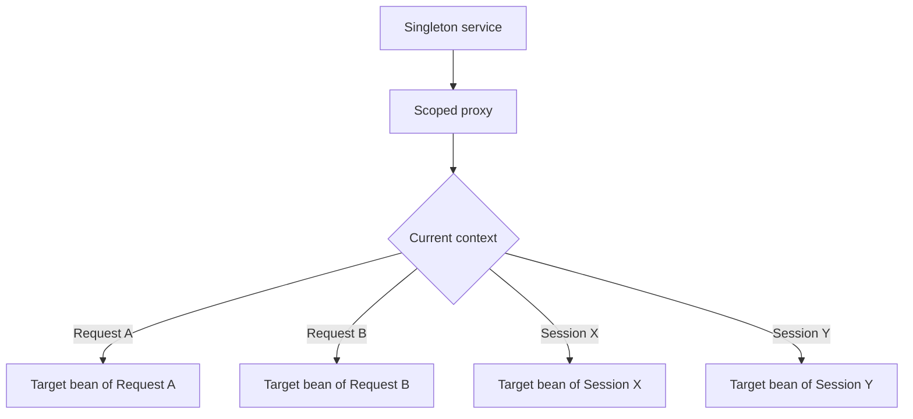

# Scoped Proxies and Context-Aware Bean Access

In Spring Web, some beans are only meaningful within the scope of an HTTP request, an HTTP session, or a web application. Meanwhile, services and controllers are typically singletons, created once in the application context and potentially used by multiple requests concurrently. If a singleton directly holds an instance with a shorter lifecycle, the bean may be created at the wrong time or share state mistakenly across requests.

A scoped proxy solves this problem by injecting a longer-lived proxy into the singleton bean. Whenever the singleton invokes a method on the proxy, Spring resolves the right target instance according to the active scope. As a result, a singleton service can access request-scoped or session-scoped beans without managing their lifecycles itself.

## 1. Why Are Scoped Proxies Needed?

Suppose an application has a singleton service that needs to read trace information specific to each request. If `RequestTrace` is a request-scoped bean and is injected directly into the singleton, Spring must resolve that bean when creating the singleton. At that moment, no HTTP request is active to provide a request-scoped instance, so context creation can fail with a scope-not-active error.

Even if an instance were created manually, holding a request-scoped object inside a singleton would also break the lifecycle: multiple requests could share the same object and see each other's state.

A scoped proxy introduces an intermediary layer:



The singleton holds a stable proxy. The proxy looks up the target bean for the scope when invoked. Therefore:

- Within the same request, calls to the proxy obtain the same request-scoped target.
- On another request, the proxy obtains a new target corresponding to the new request.
- With session scope, requests belonging to the same session share a target; different sessions have separate targets.
- When no matching scope is active, Spring cannot locate a target and throws a scope error.

## 2. Common Web Scopes

`WebApplicationContext` supports scopes tied to the Servlet environment:

| Scope | Target bean lifecycle | Sharing scope |
| --- | --- | --- |
| `request` | Within a single HTTP request | Components handling the same request |
| `session` | Within a single HTTP session | Multiple requests belonging to the same session |
| `application` | Within the `ServletContext` lifecycle | Entire web application tied to `ServletContext` |
| `websocket` | Within a single WebSocket session | Operations within the same WebSocket session |

These scopes require a web-aware application context and require the corresponding context to be active. A regular application context does not automatically provide request or session scope.

Also distinguish these from the two core scopes:

- `singleton`: one instance per Spring `ApplicationContext`.
- `prototype`: Spring creates a new instance each time the bean is requested from the container; after providing the instance, the container does not manage the full destruction lifecycle of that object.

`application` scope is not completely synonymous with `singleton`: a singleton is shared within one Spring application context, whereas an application-scoped bean is stored on `ServletContext` and can be shared across Spring web application contexts within the same web application.

## 3. Declaring Request-Scoped Beans

Request scope can be declared using `@RequestScope`:

```java
@Component
@RequestScope
public class RequestTrace {
    private final String id = UUID.randomUUID().toString();

    public String id() {
        return id;
    }
}
```

`@RequestScope` is a convenience annotation equivalent to `@Scope` using `WebApplicationContext.SCOPE_REQUEST`. This annotation configures a target-class scoped proxy by default, so the bean can be injected into a singleton.

It can also be declared explicitly:

```java
@Component
@Scope(
        value = WebApplicationContext.SCOPE_REQUEST,
        proxyMode = ScopedProxyMode.TARGET_CLASS)
public class RequestTrace {
    // State belonging only to the current request
}
```

When automatic proxying is not desired, `ScopedProxyMode.NO` can be used, but you must then ensure the bean is only accessed while the scope is active and is not injected directly into a singleton in a way that triggers eager resolution.

## 4. Declaring Session-Scoped Beans

Session scope fits data that needs to persist across multiple HTTP requests within the same user session, such as a shopping cart or the state of a multi-step workflow.

```java
@Component
@SessionScope
public class ShoppingCart {
    private final List<String> productIds = new ArrayList<>();

    public void add(String productId) {
        productIds.add(productId);
    }

    public List<String> productIds() {
        return List.copyOf(productIds);
    }
}
```

`@SessionScope` also defaults to a target-class scoped proxy. Spring looks up the target in the current session each time the proxy is invoked. Requests with the same session access the same shopping cart; different sessions have different shopping carts.

Do not store sensitive data or large objects arbitrarily in session. Session scope spans the user's session and can outlive a single request; consider serialization if sessions are stored out-of-process, replicated, or placed in a distributed session store.

## 5. `ScopedProxyMode` and Proxy Options

`@Scope` has a `proxyMode` attribute to determine how Spring creates the proxy:

| Value | Behavior | When appropriate |
| --- | --- | --- |
| `ScopedProxyMode.NO` | Does not create a scoped proxy | When the bean is looked up manually while the scope is active or does not need injection across scope boundaries |
| `ScopedProxyMode.INTERFACES` | Creates a proxy based on the interfaces implemented by the bean | When clients depend on an interface and you want a JDK dynamic proxy |
| `ScopedProxyMode.TARGET_CLASS` | Creates a proxy based on the target class via subclassing | When injecting by class or when the bean has no suitable interface |
| `ScopedProxyMode.DEFAULT` | Uses the default configured for component scanning; normally equivalent to no proxy unless configured otherwise | When following the global scoped proxy configuration |

Example of an interface-based proxy:

```java
public interface RequestIdentity {
    String id();
}

@Component
@Scope(value = WebApplicationContext.SCOPE_REQUEST,
       proxyMode = ScopedProxyMode.INTERFACES)
class DefaultRequestIdentity implements RequestIdentity {
    private final String id = UUID.randomUUID().toString();

    @Override
    public String id() {
        return id;
    }
}
```

The singleton should inject the interface:

```java
@Service
class RequestIdentityService {
    private final RequestIdentity requestIdentity;

    RequestIdentityService(RequestIdentity requestIdentity) {
        this.requestIdentity = requestIdentity;
    }

    String currentId() {
        return requestIdentity.id();
    }
}
```

With `INTERFACES`, do not inject `DefaultRequestIdentity` as a concrete class because a JDK proxy only implements the interface. If you want to inject by class, use `TARGET_CLASS` and keep the limitations of subclass-based proxies in mind.

## 6. Limitations of Class-Based and Interface-Based Proxies

A `TARGET_CLASS` proxy needs to subclass the target class. Therefore, the class cannot be `final`, and methods that need to be proxied should not be `final` or `private`. Constructors and class design must also be compatible with Spring's proxying mechanism.

An `INTERFACES` proxy relies on JDK dynamic proxies. Clients must invoke through an interface implemented by the proxy. You cannot cast this proxy to the concrete implementation class.

Some practical guidelines:

- Prefer injecting an interface when the application already has a natural abstraction.
- Use `TARGET_CLASS` when no suitable interface exists or existing APIs depend on the concrete class.
- Avoid `final` classes if a class-based proxy is needed.
- Do not rely on identity comparisons between the proxy and the target; the proxy and the target are two distinct objects.
- Do not assume `@PostConstruct` on the target has already run when the singleton is created. The target is usually created lazily on the first invocation of the proxy within a valid scope.

## 7. Injecting a Scoped Proxy into a Singleton Service

A singleton service can inject a request-scoped bean like a regular dependency:

```java
@Service
public class TraceService {
    private final RequestTrace requestTrace;

    public TraceService(RequestTrace requestTrace) {
        this.requestTrace = requestTrace;
    }

    public String currentRequestId() {
        return requestTrace.id();
    }
}
```

`TraceService` is created once. The `requestTrace` dependency injected into it is a scoped proxy. Each time `currentRequestId()` calls `id()`, the proxy finds the target corresponding to the current request.

A controller can call the service multiple times within the same request:

```java
@RestController
class TraceController {
    private final TraceService traceService;

    TraceController(TraceService traceService) {
        this.traceService = traceService;
    }

    @GetMapping("/trace")
    TraceView trace() {
        return new TraceView(
                traceService.currentRequestId(),
                traceService.currentRequestId());
    }
}

record TraceView(String first, String second) {
}
```

Both calls within the same request return the same ID. When the next request arrives, the proxy resolves a new target and a different ID.

## 8. Testing Request Scope with MockMvc

`MockMvc` dispatches requests through `DispatcherServlet`. During dispatch, Spring sets up the request context so web scopes can be accessed. This is the most natural way to test scoped proxies in an MVC application.

The test context needs a web application context:

```java
@SpringJUnitConfig(WebTestConfig.class)
@WebAppConfiguration
class RequestScopeTest {
    @Autowired
    private WebApplicationContext webApplicationContext;

    private MockMvc mockMvc;

    @BeforeEach
    void setUp() {
        mockMvc = MockMvcBuilders
                .webAppContextSetup(webApplicationContext)
                .build();
    }
}
```

With the `/trace` controller from the previous section, a test can verify that two accesses within the same request use the same target while an independent request uses a different target:

```java
@Autowired
private ObjectMapper objectMapper;

@Test
void usesOneRequestScopedTargetPerHttpRequest() throws Exception {
    String firstBody = mockMvc.perform(get("/trace"))
            .andExpect(status().isOk())
            .andReturn()
            .getResponse()
            .getContentAsString();

    TraceView first = objectMapper.readValue(firstBody, TraceView.class);
    assertThat(first.first()).isEqualTo(first.second());

    String secondBody = mockMvc.perform(get("/trace"))
            .andExpect(status().isOk())
            .andReturn()
            .getResponse()
            .getContentAsString();

    TraceView second = objectMapper.readValue(secondBody, TraceView.class);
    assertThat(second.first()).isEqualTo(second.second());
    assertThat(second.first()).isNotEqualTo(first.first());
}
```

The test does not need to create a request context manually. `DispatcherServlet` manages the context while handling each request. Two calls to `mockMvc.perform(...)` are two separate requests, so the request-scoped target is not shared.

## 9. Testing Session Scope Across Multiple Requests

To test session scope, the test needs to send multiple requests with the same `MockHttpSession`. Consider a singleton service injecting a `ShoppingCart` proxy:

```java
@Service
class CartService {
    private final ShoppingCart cart;

    CartService(ShoppingCart cart) {
        this.cart = cart;
    }

    int addAndGetSize(String productId) {
        cart.add(productId);
        return cart.productIds().size();
    }
}
```

A controller returns the item count after adding:

```java
@RestController
class CartController {
    private final CartService cartService;

    CartController(CartService cartService) {
        this.cartService = cartService;
    }

    @PostMapping("/cart/{productId}")
    int add(@PathVariable String productId) {
        return cartService.addAndGetSize(productId);
    }
}
```

A test retaining the same session across two requests:

```java
@Test
void reusesSessionScopedTargetOnlyWithinSameSession() throws Exception {
    MockHttpSession firstSession = new MockHttpSession();

    mockMvc.perform(post("/cart/BK-01").session(firstSession))
            .andExpect(status().isOk())
            .andExpect(content().string("1"));

    mockMvc.perform(post("/cart/PEN-02").session(firstSession))
            .andExpect(status().isOk())
            .andExpect(content().string("2"));

    MockHttpSession secondSession = new MockHttpSession();
    mockMvc.perform(post("/cart/ERASER-03").session(secondSession))
            .andExpect(status().isOk())
            .andExpect(content().string("1"));
}
```

The first two requests use the same session and thus the same `ShoppingCart` target; the third request uses a different session and gets a new target. When testing session scope, do not create a new `MockHttpSession` for each request if you want to simulate the same user.

## 10. Accessing Scope Directly Outside MVC Dispatch

A scoped proxy can only resolve its target when the corresponding scope is active. In a test that calls a service directly without going through `MockMvc` or `DispatcherServlet`, there is usually no request context. Calling a method on a request-scoped proxy at that point can throw `ScopeNotActiveException`.

Example of verifying behavior when there is no request:

```java
assertThatThrownBy(() -> traceService.currentRequestId())
        .isInstanceOf(ScopeNotActiveException.class);
```

If a test needs to call the service directly, you can set up a request context with `RequestContextHolder` and `ServletRequestAttributes`:

```java
MockHttpServletRequest request = new MockHttpServletRequest();
request.setSession(new MockHttpSession());

RequestAttributes previous = RequestContextHolder.getRequestAttributes();
RequestContextHolder.setRequestAttributes(
        new ServletRequestAttributes(request));

try {
    String requestId = traceService.currentRequestId();
    assertThat(requestId).isNotBlank();
} finally {
    RequestContextHolder.resetRequestAttributes();
    if (previous != null) {
        RequestContextHolder.setRequestAttributes(previous);
    }
}
```

Resetting in `finally` is critical because `RequestContextHolder` stores request attributes per thread. If a test leaves a context behind, a later test running on the same thread may inadvertently see the old request.

With session scope, the request needs a session. `request.setSession(new MockHttpSession())` or `request.getSession(true)` creates a session for the mock request. To test multiple requests in the same session in a manual test, use the same `MockHttpSession` across different `MockHttpServletRequest` instances.

## 11. `ObjectProvider` as Another Option

Scoped proxies are not always required. A singleton can inject `ObjectProvider<T>` or `ObjectFactory<T>` and ask the container for the target when needed:

```java
@Service
class TraceService {
    private final ObjectProvider<RequestTrace> requestTraceProvider;

    TraceService(ObjectProvider<RequestTrace> requestTraceProvider) {
        this.requestTraceProvider = requestTraceProvider;
    }

    String currentRequestId() {
        return requestTraceProvider.getObject().id();
    }
}
```

`getObject()` is called while request scope is active so Spring can resolve the right target. This makes the scoped dependency explicit in the service code.

Comparison of the two approaches:

| Approach | Advantages | Considerations |
| --- | --- | --- |
| Scoped proxy | Clients invoke the bean like a normal dependency; scope resolution is hidden in the proxy | Adds a proxy layer; requires understanding proxy modes and class/interface constraints |
| `ObjectProvider<T>` | Explicit target lookup at the exact point of use; easy to express optional dependencies | Clients must call `getObject()`; avoid storing the retrieved target in a singleton field |

Do not call `getObject()` during singleton initialization if no scope is active. The purpose of the provider is to defer lookup until a valid request or session exists.

## 12. Scoped Proxies Are Not Prototype Injection

A common design mistake is thinking that injecting a `prototype` bean into a singleton will create a new prototype each time the singleton calls a method. In fact, Spring resolves the dependency when creating the singleton; the prototype instance injected at that time is typically held in the singleton and reused.

If you need a new prototype for each usage, inject `ObjectProvider<PrototypeBean>`:

```java
@Component
@Scope(ConfigurableBeanFactory.SCOPE_PROTOTYPE)
class WorkContext {
}

@Service
class WorkService {
    private final ObjectProvider<WorkContext> provider;

    WorkService(ObjectProvider<WorkContext> provider) {
        this.provider = provider;
    }

    void run() {
        WorkContext context = provider.getObject();
        // Use the new instance for this run.
    }
}
```

Scoped proxies for request/session scope solve a similar lifecycle problem, except the target is chosen according to the active web context. Do not equate request scope with prototype: request scope guarantees that the same request accesses the same target, whereas prototype creates a new instance every time the container is asked for the bean.

## 13. Distinguishing `@SessionScope` from `@SessionAttributes`

These two mechanisms have similar names but different purposes:

- `@SessionScope` declares a Spring bean's lifecycle per HTTP session. The bean can be injected into singleton services via a scoped proxy.
- `@SessionAttributes` is a Spring MVC mechanism that stores certain controller model attributes across multiple requests in a conversational workflow. It does not turn a class into a session-scoped bean.

Example of `@SessionAttributes`:

```java
@Controller
@SessionAttributes("checkout")
class CheckoutController {
    @ModelAttribute("checkout")
    CheckoutForm checkout() {
        return new CheckoutForm();
    }

    @PostMapping("/checkout/finish")
    String finish(SessionStatus status) {
        status.setComplete();
        return "redirect:/checkout/done";
    }
}
```

`SessionStatus.setComplete()` ends storage of the model attributes managed by `@SessionAttributes`. It is not an operation to shut down an arbitrary session-scoped bean. Choose the mechanism based on whether you need a bean object living with the session or need to retain model attributes of a controller flow.

## 14. Scopes in Asynchronous Tasks

Request scope is tied to request attributes on the thread processing the request. When a controller submits a task to an `@Async` executor, the request context is not automatically propagated to the worker thread by default.

Therefore, do not hold a request-scoped proxy and access it inside a background task after the request completes. The proxy may fail to find request attributes on the worker thread and throw `ScopeNotActiveException`; even if the context is propagated manually, the request may already have finished before the task uses it.

Instead, read the needed values on the request thread and pass immutable data into the task:

```java
@RestController
class ExportController {
    private final RequestTrace requestTrace;
    private final ExportService exportService;

    ExportController(RequestTrace requestTrace, ExportService exportService) {
        this.requestTrace = requestTrace;
        this.exportService = exportService;
    }

    @PostMapping("/exports")
    ResponseEntity<Void> startExport() {
        String requestId = requestTrace.id();
        exportService.start(requestId);
        return ResponseEntity.accepted().build();
    }
}
```

The background task receives `requestId` as a regular parameter. It does not need to access the request-scoped bean after the HTTP request has completed.

## 15. Common Errors When Using Scoped Proxies

| Symptom | Possible cause | How to resolve |
| --- | --- | --- |
| Context fails to initialize with request scope | Singleton injects a request-scoped bean without a proxy or scope is not active | Use `@RequestScope`, `@Scope(..., proxyMode=...)`, or `ObjectProvider` |
| `ScopeNotActiveException` when calling a service | Code runs outside a request/session context | Call via MockMvc or set up `RequestContextHolder` in direct tests |
| Multiple requests share state | Bean is declared singleton or target is stored in another field | Check scope and never retain scoped targets outside the proxy |
| `ClassCastException` when injecting concrete class | Using `INTERFACES` proxy while injecting the implementation | Inject the interface or switch to `TARGET_CLASS` |
| Cannot create class-based proxy | Class or proxied methods are `final`/cannot be overridden | Use a subclassable class or proxy an interface |
| Session scope test always starts with empty state | Creating a new `MockHttpSession` for every request | Reuse the same session object for the same session |
| Request scope test retains state across two requests | State stored in a singleton instead of the request target | Put state in a request-scoped bean and test each request separately |
| Direct test leaks request context | Missing `RequestContextHolder` reset | Use `try/finally` and call `resetRequestAttributes()` |
| `@Async` cannot access request bean | Request context is absent on worker thread or request already ended | Pass required data into the task instead of accessing a scoped proxy |

## 16. Principles for Testing Scoped Proxies

1. Determine whether the bean belongs to request, session, or application scope and ensure the test uses a `WebApplicationContext`.
2. Use `@RequestScope` or `@SessionScope` when the bean needs to be injected into a singleton; these annotations create class-based scoped proxies by default.
3. Choose `INTERFACES` when clients depend on an interface; choose `TARGET_CLASS` when proxying by class and the class can be subclassed.
4. Test behavior through the injected service/controller rather than relying on internal bean names or proxy implementations.
5. Use MockMvc so Spring sets up the request context naturally on each dispatch.
6. For session scope, pass the same `MockHttpSession` across requests intended to simulate the same user.
7. When invoking services directly, set up and reset `RequestContextHolder` inside `try/finally`.
8. Use `ObjectProvider` if you want to defer target lookup and make the point of bean retrieval explicit.
9. Do not store a request-scoped/session-scoped target in a singleton field or use it after the scope ends.
10. For asynchronous tasks, pass required data via parameters rather than expecting the request context to propagate automatically to worker threads.

Scoped proxies allow short-lived beans to be used safely from a longer-lived singleton. The proxy acts as a stable access point, while Spring selects the target based on the current request or session. When tests create the right web context, execute requests via MockMvc, and manage session or request attributes explicitly, you can verify that each bean is accessed in the right context and does not leak state between requests.
