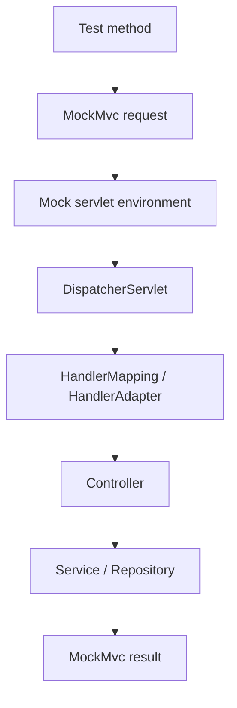
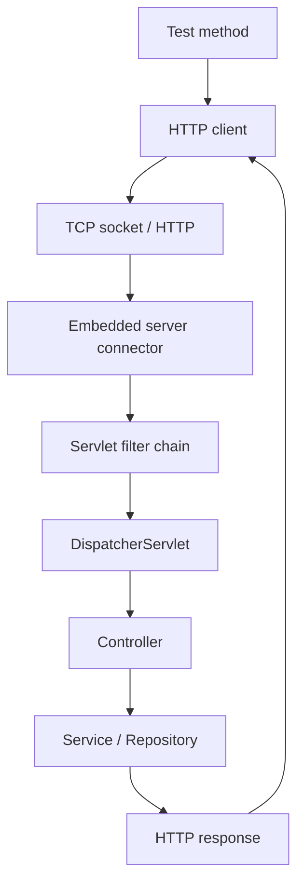

# Distinguishing Web Context Testing from Opening a Server Port

## 1. Having a WebApplicationContext Does Not Mean a Server Is Listening

In Spring MVC, a `WebApplicationContext` is an `ApplicationContext` augmented with the servlet web application context, including `ServletContext`. It holds web-serving beans such as controllers, handler mappings, handler adapters, message converters, view resolvers, and other web components.

A test can create a `WebApplicationContext`, load MVC configuration, and invoke controllers via `MockMvc` without opening sockets, binding a TCP port, or starting an embedded server. This is web context testing inside the test process.

Conversely, when Spring Boot starts an application with a web environment using a real port, an embedded server such as Tomcat, Jetty, or Undertow is started and bound to an address/port. Tests must send HTTP requests through a client to reach that server.

Both test styles can use the same controllers, services, and application configuration, yet they cross different boundaries:

- **Web context test** verifies web configuration and handling in a simulated servlet environment, typically via `MockMvc`.
- **Real-server test** verifies the application after an embedded server has opened a port, with requests passing through a real HTTP stack and network connection.

Do not infer that a server has opened a port merely because `WebApplicationContext` was created successfully or a controller was autowired successfully.

## 2. What Does `WebApplicationContext` Represent?

`WebApplicationContext` extends `ApplicationContext` and provides capabilities tied to a servlet environment. It can access `ServletContext`, web scopes such as request/session, and beans that participate in request handling.

In Spring MVC, `DispatcherServlet` uses the web application context to look up request-handling components. Common components include:

| Component | Role |
|---|---|
| `DispatcherServlet` | Front controller receiving servlet requests and coordinating handling |
| `HandlerMapping` | Locates the handler matching a request |
| `HandlerAdapter` | Invokes the selected handler |
| `HttpMessageConverter` | Reads request bodies and writes response bodies |
| `HandlerExceptionResolver` | Translates exceptions into appropriate responses |
| `Controller` | Executes web-layer logic and calls services |
| `ServletContext` | Provides the servlet context for the web application |

When a test creates a `WebApplicationContext`, it can verify that web beans are registered and collaborate properly. However, binding a socket is the responsibility of the web server, a different infrastructure layer.

## 3. Two Request Paths

### 3.1. MockMvc with a Web Application Context

With `MockMvc`, the test constructs requests using the simulated Servlet API. Requests pass through Spring MVC components in the same process, without going through TCP sockets or an embedded server's connector.



MockMvc can integrate servlet filters if the test setup registers them. Thus, a MockMvc test can verify the Spring Security filter chain, custom filters, mappings, binding, validation, exception handling, and response serialization. However, it does not test network ports, HTTP connectors, TLS handshakes, or the server accepting real connections.

### 3.2. HTTP Client Calling an Embedded Server

With a real-server test, Spring Boot starts the server and opens a port. The test uses an HTTP client to send requests over a socket; the server handles requests on threads belonging to the server runtime.



Real-server tests can verify connectors, port binding, HTTP parsing, server filter registration, cookies, redirects, and transport settings that MockMvc does not fully simulate. In exchange, they incur server startup time and require managing external data, threads, ports, and state.

## 4. Spring Boot `WebEnvironment.MOCK`

`@SpringBootTest` has a `webEnvironment` attribute. Its default value is `MOCK`.

```java
@SpringBootTest(webEnvironment = SpringBootTest.WebEnvironment.MOCK)
@AutoConfigureMockMvc
class ProductControllerWebTest {

    @Autowired
    private MockMvc mockMvc;

    @Test
    void returnsProduct() throws Exception {
        mockMvc.perform(get("/api/products/42"))
                .andExpect(status().isOk())
                .andExpect(content().contentTypeCompatibleWith(
                        MediaType.APPLICATION_JSON))
                .andExpect(jsonPath("$.id").value(42));
    }
}
```

In `MOCK` mode, Spring Boot creates a simulated web environment when the servlet API is present. `@AutoConfigureMockMvc` configures `MockMvc` so the test can send requests to Spring MVC. No embedded server is started to listen on a real HTTP port.

The test may still load most or all of the ApplicationContext, depending on annotations and configuration. That does not change the underlying nature: MockMvc requests are handled in a mock environment.

This mode fits verifying controllers, mappings, validation, serialization, exception handlers, filters added to MockMvc, and interactions with services/repositories in the test context.

## 5. Distinguishing `@WebMvcTest` from `@SpringBootTest(MOCK)`

Both approaches commonly use MockMvc and do not require opening a network port, yet their context scopes differ.

| Criterion | `@WebMvcTest` | `@SpringBootTest(MOCK)` + `@AutoConfigureMockMvc` |
|---|---|---|
| Context scope | MVC test slice; loads only selected web components and related auto-configuration | Typically loads the broader application `ApplicationContext` |
| Controllers | Can target specific controllers | Loaded according to application configuration |
| Services/repositories | Usually mocked or imported explicitly | Can use real beans if configured in the context |
| Startup time | Usually faster | Usually higher |
| Real server port | Not opened | Not opened in `MOCK` mode |
| Goal | Focused web-layer verification | Broad integration testing across many beans in a mock web environment |

Example of an MVC slice:

```java
@WebMvcTest(ProductController.class)
class ProductControllerSliceTest {

    @Autowired
    private MockMvc mockMvc;

    @MockitoBean
    private ProductService productService;

    @Test
    void returnsProductFromService() throws Exception {
        given(productService.findById(42L))
                .willReturn(new ProductResponse(42L, "Spring Guide"));

        mockMvc.perform(get("/api/products/42"))
                .andExpect(status().isOk())
                .andExpect(jsonPath("$.name").value("Spring Guide"));
    }
}
```

`@WebMvcTest` is not a real-server test. It creates a slice for testing the web layer. If custom security or MVC configuration is needed, import the required configuration and verify that the relevant filters are added to MockMvc.

`@MockitoBean` is available in recent Spring Framework versions. In older Spring Boot projects, tests may use `@MockBean` according to the version in use.

## 6. Using `WebApplicationContext` to Build MockMvc Explicitly

When you want direct control over how MockMvc is created, you can inject `WebApplicationContext` and use `webAppContextSetup(...)`:

```java
@SpringBootTest(webEnvironment = SpringBootTest.WebEnvironment.MOCK)
class ProductControllerContextTest {

    @Autowired
    private WebApplicationContext webApplicationContext;

    private MockMvc mockMvc;

    @BeforeEach
    void setUp() {
        mockMvc = MockMvcBuilders
                .webAppContextSetup(webApplicationContext)
                .build();
    }

    @Test
    void dispatchesRequestThroughConfiguredMvcContext() throws Exception {
        mockMvc.perform(get("/api/products"))
                .andExpect(status().isOk());
    }
}
```

`webAppContextSetup(...)` obtains the MVC configuration from the web application context. It lets you test web components loaded in the context such as controllers, mappings, converters, and exception resolvers.

If you want to test security filters with manual MockMvc construction, you can integrate Spring Security:

```java
mockMvc = MockMvcBuilders
        .webAppContextSetup(webApplicationContext)
        .apply(springSecurity())
        .build();
```

Configuring `springSecurity()` adds Spring Security to the MockMvc setup when the ApplicationContext has an appropriate security configuration. When using `@AutoConfigureMockMvc`, Spring Boot typically registers servlet filters in the context automatically; in that case there is no need to build another MockMvc instance unless the test has a specific reason.

Remember that `webAppContextSetup(...)` still issues mock servlet requests. Using a real `WebApplicationContext` from Spring is not synonymous with sending requests over a real network.

## 7. `standaloneSetup(...)` Also Does Not Open a Port

MockMvc also provides a way to build directly from a controller:

```java
MockMvc mockMvc = MockMvcBuilders
        .standaloneSetup(new ProductController(productService))
        .build();
```

`standaloneSetup(...)` does not require a `WebApplicationContext`. The test registers the controller and additional MVC components directly. This fits narrow tests with minimal dependence on application configuration.

Comparison:

| Builder | Configuration source | Requires WebApplicationContext? | Opens server? |
|---|---|---:|---:|
| `standaloneSetup(...)` | Controller and configuration supplied directly | No | No |
| `webAppContextSetup(...)` | Beans and configuration from the web context | Yes | No |
| `WebTestClient`'s `bindToServer()` | Running HTTP server at the configured URL | Not used to build mock MVC | Yes |

If a test needs to verify that real MVC configuration was loaded by component scanning and auto-configuration, `webAppContextSetup(...)` is usually more suitable. If you only need to check controller behavior with some mock dependencies, `standaloneSetup(...)` can suffice.

## 8. Spring Boot `WebEnvironment.RANDOM_PORT`

When a real server is needed, use `RANDOM_PORT`:

```java
@SpringBootTest(webEnvironment = SpringBootTest.WebEnvironment.RANDOM_PORT)
class ProductHttpIntegrationTest {

    @LocalServerPort
    private int port;

    @Autowired
    private TestRestTemplate restTemplate;

    @Test
    void servesProductOverHttp() {
        ResponseEntity<ProductResponse> response = restTemplate.getForEntity(
                "http://localhost:" + port + "/api/products/42",
                ProductResponse.class);

        assertThat(response.getStatusCode()).isEqualTo(HttpStatus.OK);
        assertThat(response.getBody()).isNotNull();
        assertThat(response.getBody().id()).isEqualTo(42L);
    }
}
```

Spring Boot starts the embedded web server and asks the operating system for an available port. `@LocalServerPort` receives the actual port after the server has started. `TestRestTemplate` sends HTTP requests over a real connection.

`RANDOM_PORT` avoids fixed-port conflicts when running multiple tests or when another service on a developer machine already uses the default port. This is usually the best choice for integration tests that need a real server.

If you want to use `WebTestClient` as the HTTP client, you can bind to the same port:

```java
WebTestClient client = WebTestClient.bindToServer()
        .baseUrl("http://localhost:" + port)
        .build();

client.get()
        .uri("/api/products/42")
        .exchange()
        .expectStatus().isOk()
        .expectBody()
        .jsonPath("$.id").isEqualTo(42);
```

`WebTestClient.bindToServer()` here is an HTTP client. It does not start the server; the server is managed by Spring Boot via `RANDOM_PORT`.

## 9. `WebEnvironment.DEFINED_PORT` and `WebEnvironment.NONE`

Spring Boot provides several web environment modes:

| Value | Main behavior | Opens a port? |
|---|---|---:|
| `MOCK` | Creates a simulated web environment if the servlet API is present; does not run an embedded server | No |
| `RANDOM_PORT` | Runs an embedded server on a random port | Yes |
| `DEFINED_PORT` | Runs an embedded server on the configured port, typically via `server.port` | Yes |
| `NONE` | Creates an `ApplicationContext` with no web environment | No |

Example using a configured port:

```java
@SpringBootTest(
        webEnvironment = SpringBootTest.WebEnvironment.DEFINED_PORT,
        properties = "server.port=9080")
class FixedPortIntegrationTest {

    @Autowired
    private TestRestTemplate restTemplate;

    @Test
    void respondsOnConfiguredPort() {
        ResponseEntity<String> response = restTemplate.getForEntity(
                "http://localhost:9080/actuator/health",
                String.class);

        assertThat(response.getStatusCode()).isEqualTo(HttpStatus.OK);
    }
}
```

`DEFINED_PORT` fits when you need to test fixed-port configuration or integrate with another component that expects a known port. It easily conflicts if another process already holds that port. In most automated tests, `RANDOM_PORT` is safer.

`NONE` is intended for tests that do not need a web stack—for example, service or batch contexts that do not require `ServletContext`, `DispatcherServlet`, or an HTTP server.

## 10. Why Opening a Port Is a Different Testing Boundary

When an embedded server opens a port, the application must complete several additional infrastructure steps:

- Create and configure the server connector.
- Bind a socket to an address/port.
- Accept and parse HTTP requests.
- Manage connections, thread pools, and timeouts.
- Apply TLS settings if using HTTPS.
- Pass requests through the filter chain and servlet infrastructure.
- Write responses through the HTTP stack and close or reuse connections.

MockMvc can verify MVC logic without these steps. Consequently, a passing MockMvc test does not prove that a port can be bound, that connectors work, or that TLS certificates are valid.

Conversely, a real-server test can catch misconfigurations in ports, context paths, compression, cookies, redirects, or connectors. However, it is generally slower and harder to isolate because it starts a server and manages external state.

## 11. Testing Filters and Spring Security in Both Modes

MockMvc can run servlet filters if those filters are registered in MockMvc. With `@AutoConfigureMockMvc`, the `addFilters` attribute enables adding filters from the ApplicationContext by default.

```java
@SpringBootTest(webEnvironment = SpringBootTest.WebEnvironment.MOCK)
@AutoConfigureMockMvc(addFilters = true)
class SecurityMockMvcTest {

    @Autowired
    private MockMvc mockMvc;

    @Test
    void rejectsAnonymousRequest() throws Exception {
        mockMvc.perform(get("/api/private"))
                .andExpect(status().isUnauthorized());
    }
}
```

If `addFilters = false` is set, requests bypass registered servlet filters. In that case, the test cannot use its result to claim that the Spring Security filter chain or custom filters protect the endpoint.

With real-server tests, requests pass through the filter chain registered in the server. This tests filter behavior in an environment closer to real runtime. Still, the test must send appropriate credentials and assert on actual policies; merely opening a server port does not prove authorization is configured correctly.

## 12. Transactions in MockMvc Tests vs Real-Server Tests

An important difference lies in the request-processing thread.

With synchronous MockMvc handling, requests are typically processed directly on the test thread. If the test has `@Transactional` and services/repositories participate in the same transaction manager on that thread, changes may belong to the test transaction and roll back when the test completes.

With `RANDOM_PORT` or `DEFINED_PORT`, requests are processed on an embedded server thread. The test method's transaction does not automatically propagate across a socket to the server thread. If a controller writes to the database and the server-side transaction commits, rolling back the test thread will not undo that data automatically.

| Case | Does the test transaction cover request changes? |
|---|---|
| MockMvc, synchronous request on the test thread participating in the test transaction | Possibly, if transaction propagation and transaction manager align |
| MockMvc async dispatch or work moved to another thread | Should not be assumed; check transactions on the processing thread |
| Real server with `RANDOM_PORT` | No; the server processes requests on a separate thread |
| `@Async` or message listeners | Test transaction does not propagate automatically to workers |

Therefore, real-server tests usually require explicit data cleanup by test id, a separate database/schema, or an appropriate fixture strategy. Do not simply add `@Transactional` to a test and assume every change made by a real HTTP request will be rolled back.

## 13. Context Caching and Server Lifecycle

The Spring TestContext Framework can cache the ApplicationContext for reuse across test classes with compatible configurations. In mock web tests, the context and web beans can be reused without a server socket.

With `RANDOM_PORT`, an embedded server belonging to a cached context may also remain running when the context is reused. Therefore:

- Do not assume every test method starts a brand-new server.
- Do not assume the port changes between test classes sharing a context.
- Do not hardcode the port when using `RANDOM_PORT`; retrieve it via `@LocalServerPort`.
- Use `@DirtiesContext` only when necessary to evict a context from the cache, because closing contexts can significantly increase test duration.
- Clean up business data and external resources according to their own ownership rather than relying on context shutdown.

`@DirtiesContext` closes the context and allows Spring to create a new context on next use. It does not replace cleanup of resources created manually outside the Spring container.

## 14. Choosing a Test Mode by Goal

| Goal | Appropriate approach | Reason |
|---|---|---|
| Verify controller mappings, validation, and JSON | `@WebMvcTest` + `MockMvc` | Fast, focused on the web layer |
| Verify multiple beans collaborating in MVC | `@SpringBootTest(MOCK)` + `@AutoConfigureMockMvc` | Loads application context without needing a server |
| Verify configuration from `WebApplicationContext` | `webAppContextSetup(...)` | Uses real MVC beans in the context |
| Verify an isolated controller | `standaloneSetup(...)` | Does not require initializing a full web context |
| Verify ports, connectors, HTTP transport | `@SpringBootTest(RANDOM_PORT)` + HTTP client | Requests go through a listening server |
| Verify a fixed port | `@SpringBootTest(DEFINED_PORT)` | Uses the configured port |
| Verify services without web | `@SpringBootTest(NONE)` or an appropriate test context | Does not initialize a web environment |

A practical strategy often combines multiple tiers. MVC slices check many controller branches quickly; integration tests with MockMvc verify bean and filter collaboration; a smaller number of real-server tests confirm the HTTP stack, ports, and transport. There is no need to run every business case through a real server when network boundaries are irrelevant to what is being verified.

## 15. Common Errors and How to Diagnose Them

| Symptom | Common cause | How to resolve |
|---|---|---|
| `WebApplicationContext` is created but cannot be called via URL | Test is in `MOCK` mode; no server port is open | Use MockMvc or switch to `RANDOM_PORT`/`DEFINED_PORT` |
| Connection refused | Server has not started, wrong port, or port was released | Obtain the port with `@LocalServerPort` after context startup |
| MockMvc test passes yet real deployment fails port binding | MockMvc does not open sockets or check connectors | Add real-server tests for critical server configuration |
| Security filters do not run in MockMvc | Filters were not added or `addFilters = false` | Enable filter registration or use `springSecurity()` when building manually |
| Database retains data after real-server test | Test transaction does not cover the request thread | Clean up data by test id or use a separate database/schema |
| Fixed port is already in use | Multiple tests or services share the same port | Use `RANDOM_PORT` unless testing a fixed port is required |
| Context startup is slow | Loading full context or using `@DirtiesContext` too broadly | Use slices for narrow tests and reuse contexts where appropriate |
| Test does not verify real TLS | Using MockMvc or HTTP client against a non-TLS environment | Use HTTPS real-server tests with an appropriate trust store/certificate |

When diagnosing, first identify whether the test uses `MOCK`, `RANDOM_PORT`, `DEFINED_PORT`, or `NONE`. Next, determine whether requests are sent via MockMvc or an HTTP client. These two facts show which boundaries the test has crossed and prevent confusing context configuration errors with server startup failures.

## 16. Checklist When Choosing `WebApplicationContext` vs a Real Server

- If you need to verify MVC beans, mappings, binding, or responses, start with `@WebMvcTest` or MockMvc.
- If you need full application configuration without sockets, use `@SpringBootTest(MOCK)` and `@AutoConfigureMockMvc`.
- If you need to use the exact beans from the web context, build MockMvc with `webAppContextSetup(...)`.
- If using `standaloneSetup(...)`, understand that the test only includes the components provided directly.
- If you need to verify ports, connectors, HTTP transport, or TLS, use `RANDOM_PORT` or `DEFINED_PORT` and an HTTP client.
- With `RANDOM_PORT`, retrieve the port via `@LocalServerPort`; do not hardcode ports.
- Confirm that filters are added to MockMvc if the test needs to verify filters.
- Do not infer from `authenticated()` or a successful status that a server has opened a port.
- With real-server tests, manage data committed on server threads and clean up after the test.
- Use `@DirtiesContext` deliberately because it closes the context and impacts test execution time.

`WebApplicationContext` describes Spring MVC's web context; it is not evidence that an HTTP server is listening. MockMvc enables testing the web layer in a simulated servlet environment. Only `RANDOM_PORT` or `DEFINED_PORT` starts an embedded server so an HTTP client can connect over the network. Choosing the right boundary keeps tests fast where appropriate while still providing separate evidence for server configuration when the application must serve real requests.
