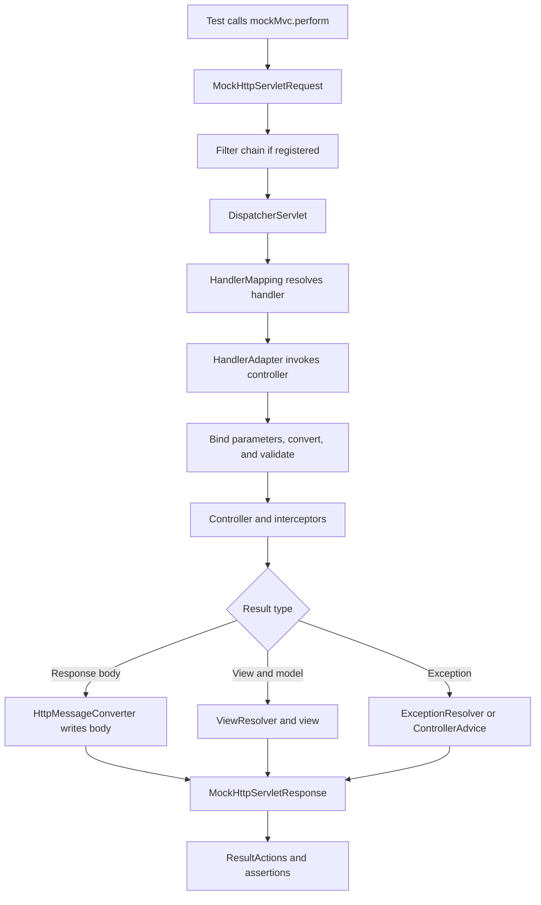

# MockMvc Runs the MVC Processing Chain Through Simulated Requests and Responses

`MockMvc` is a Spring Test tool used to test Spring MVC applications without starting a real web server. The test creates a simulated Servlet request, passes that request through `DispatcherServlet` and the configured MVC components, and then receives a simulated response to verify the status, headers, content, model, view, or error-handling result.

The key point is that `MockMvc` tests the processing flow at the Spring MVC layer. A request still goes through steps such as mapping the URL to a handler, invoking the controller, binding parameters, converting data, validation, interceptors, and exception handling if those components are present in the test configuration. The result is written to `MockHttpServletResponse`, after which the test uses Spring matchers to assert the behavior.

## 1. What Does MockMvc Test?

A unit test that calls a controller method directly only tests the logic of that method. It does not automatically test how Spring locates the controller by URL, selects the right handler method, binds query parameters or a JSON body, triggers validation, applies interceptors, or converts the return value into an HTTP response.

`MockMvc` dispatches the request through `DispatcherServlet`, so it can test multiple components of the Spring MVC chain together:

- `HandlerMapping` finds the handler matching the HTTP method and path.
- `HandlerAdapter` invokes the corresponding controller or handler.
- `HandlerMethodArgumentResolver` resolves values for parameters such as `@PathVariable`, `@RequestParam`, `@RequestHeader`, `@RequestBody`, and `Principal`.
- `HttpMessageConverter` converts request body data into an object and converts the returned object into a response body, such as JSON.
- Bean Validation is applied when parameters or objects are annotated for validation and the corresponding configuration is present.
- `HandlerInterceptor` runs pre- and post-handler callbacks according to the MVC configuration.
- `HandlerExceptionResolver` and `@ControllerAdvice` handle exceptions if registered.
- Configured `ViewResolver` and views can process view names and models in MVC applications that return HTML pages.
- Servlet filters participate if they are added to the MockMvc builder or integrated through an appropriate test configuration.

Thus, `MockMvc` is suitable for integration testing at the web layer: testing the application's HTTP behavior and the coordination between controllers and the Spring MVC infrastructure. It does not replace service or repository tests, nor does it prove that the application runs on a real servlet container.

## 2. Simulated Request and Response Processing Chain

When `mockMvc.perform(...)` is called, Spring Test builds a `MockHttpServletRequest` from the request builder, creates a simulated response, and dispatches the request through the `DispatcherServlet` configured for the test. After processing finishes, `ResultActions` lets you inspect the result.



The diagram shows the main processing groups. The exact order of interceptor callbacks and exception-handling steps depends on the MVC configuration and handler type. Filters run around the servlet if they are registered in the MockMvc filter chain.

The request and response here are Java objects simulating the Servlet API. The test does not open a socket, send bytes over the network, or require an HTTP port. That makes tests fast, repeatable, and easy to control in terms of input data. However, characteristics belonging to a real server—such as TLS, connector configuration, network timeouts, or container-specific behavior—lie outside the scope of `MockMvc`.

## 3. Core Components of MockMvc

| Component | Role |
| --- | --- |
| `MockMvc` | Entry point for performing requests and receiving MVC processing results |
| `MockHttpServletRequestBuilder` | Declares method, URL, parameters, headers, body, cookies, session, and other request details |
| `MockHttpServletRequest` | Simulated Servlet request created from the builder |
| `MockHttpServletResponse` | Stores status, headers, cookies, body, redirect, and response attributes |
| `ResultActions` | Provides `andExpect`, `andDo`, and `andReturn` after executing a request |
| `ResultMatcher` | Verifies a condition on the result, such as status or JSON path |
| `ResultHandler` | Performs an action on the result, such as logging the request/response |
| `MvcResult` | Holds the request, response, handler, exception, and details of the execution |

A test typically starts from `MockMvcRequestBuilders`, calls `perform`, and chains assertions:

```java
mockMvc.perform(get("/api/greetings").param("name", "Lan"))
        .andExpect(status().isOk())
        .andExpect(content().string("Hello Lan"));
```

`perform` executes the request and returns `ResultActions`. `andExpect` checks a condition; if a matcher fails, the test fails immediately at that assertion. Multiple matchers can be chained to verify status, headers, and body in the same request.

## 4. Two Ways to Set Up MockMvc

Spring Test provides two commonly used builders: `standaloneSetup` and `webAppContextSetup`. Choose a builder based on the scope of MVC infrastructure the test needs to verify.

### 4.1. `standaloneSetup`

`standaloneSetup` creates a minimal MVC configuration around the controllers passed directly to it. This approach is appropriate when you want to test a controller and how Spring MVC binds requests and writes responses without loading the entire application context.

```java
import org.junit.jupiter.api.BeforeEach;
import org.junit.jupiter.api.Test;
import org.springframework.test.web.servlet.MockMvc;
import org.springframework.test.web.servlet.setup.MockMvcBuilders;

import static org.springframework.test.web.servlet.request.MockMvcRequestBuilders.get;
import static org.springframework.test.web.servlet.result.MockMvcResultMatchers.content;
import static org.springframework.test.web.servlet.result.MockMvcResultMatchers.status;

class GreetingControllerTest {
    private MockMvc mockMvc;

    @BeforeEach
    void setUp() {
        mockMvc = MockMvcBuilders
                .standaloneSetup(new GreetingController())
                .build();
    }

    @Test
    void returnsGreeting() throws Exception {
        mockMvc.perform(get("/greeting").param("name", "Lan"))
                .andExpect(status().isOk())
                .andExpect(content().string("Hello Lan"));
    }
}
```

Corresponding controller:

```java
import org.springframework.web.bind.annotation.GetMapping;
import org.springframework.web.bind.annotation.RequestParam;
import org.springframework.web.bind.annotation.RestController;

@RestController
class GreetingController {
    @GetMapping("/greeting")
    String greeting(@RequestParam(defaultValue = "World") String name) {
        return "Hello " + name;
    }
}
```

The builder automatically registers the MVC infrastructure needed for controller tests. You can add `ControllerAdvice`, validators, message converters, argument resolvers, or interceptors via the builder's configuration methods when the test needs them. If a component is not registered, the result may differ from the actual application configuration.

### 4.2. `webAppContextSetup`

`webAppContextSetup` uses an already loaded `WebApplicationContext`. This approach is appropriate when you need to test a more realistic Spring MVC configuration, including scanned controllers, converters, formatters, interceptors, exception handlers, view resolvers, and other web beans registered in the context.

```java
import org.junit.jupiter.api.BeforeEach;
import org.junit.jupiter.api.Test;
import org.springframework.beans.factory.annotation.Autowired;
import org.springframework.test.context.ContextConfiguration;
import org.springframework.test.context.junit.jupiter.SpringExtension;
import org.springframework.test.context.web.WebAppConfiguration;
import org.springframework.test.web.servlet.MockMvc;
import org.springframework.test.web.servlet.setup.MockMvcBuilders;
import org.springframework.web.context.WebApplicationContext;
import org.junit.jupiter.api.extension.ExtendWith;

import static org.springframework.test.web.servlet.request.MockMvcRequestBuilders.get;
import static org.springframework.test.web.servlet.result.MockMvcResultMatchers.status;

@ExtendWith(SpringExtension.class)
@WebAppConfiguration
@ContextConfiguration(classes = WebTestConfig.class)
class GreetingWebContextTest {
    @Autowired
    private WebApplicationContext webApplicationContext;

    private MockMvc mockMvc;

    @BeforeEach
    void setUp() {
        mockMvc = MockMvcBuilders
                .webAppContextSetup(webApplicationContext)
                .build();
    }

    @Test
    void dispatchesRequestThroughConfiguredMvcContext() throws Exception {
        mockMvc.perform(get("/greeting"))
                .andExpect(status().isOk());
    }
}
```

In this example, `@WebAppConfiguration` creates a simulated web environment for `WebApplicationContext`, while `@ContextConfiguration` specifies the bean configuration. `WebTestConfig` must register MVC and the controllers under test. `@ContextHierarchy` can be used if the application genuinely has a root context and a separate context for `DispatcherServlet`.

### 4.3. Comparing the Two Builders

| Criterion | `standaloneSetup` | `webAppContextSetup` |
| --- | --- | --- |
| Controller source | Passed as controller instances directly | Retrieved from `WebApplicationContext` |
| Application context | Does not require loading the full context | Requires a web application context |
| MVC configuration | Minimal infrastructure set up by the builder plus test customizations | Uses the MVC configuration loaded in the context |
| Speed and scope | Lightweight, focused on the controller | Broader, tests coordination across multiple web beans |
| Suitable when | Testing controller mapping, binding, and responses with a compact setup | Testing integration with the application's actual MVC configuration |

Neither builder is universally better. If a test needs to prove that an interceptor or `ControllerAdvice` declared in the real application configuration is applied, `webAppContextSetup` is usually a better fit. If you only need to test a controller with an isolated and explicit setup, `standaloneSetup` keeps the test simple.

## 5. Creating Simulated Requests

Request builders simulate various HTTP methods and let you declare data that a browser or client normally sends. Common builders include `get`, `post`, `put`, `patch`, `delete`, `options`, `head`, and `multipart`.

### 5.1. Path Variables, Query Parameters, and Headers

```java
mockMvc.perform(get("/api/orders/{id}", 42)
                .param("includeItems", "true")
                .header("X-Request-Id", "req-123")
                .accept(MediaType.APPLICATION_JSON))
        .andExpect(status().isOk());
```

In the example above, `42` is bound to the path variable, `includeItems` is a query parameter, and `X-Request-Id` is a request header. `accept` declares the media type the client expects to receive.

`param` simulates a request parameter. For GET requests, this data typically corresponds to the query string; for other requests, it represents parameters already parsed by the Servlet API. If you need to verify exactly how the container parses a raw query string or form encoding, additional testing against a real server is required.

### 5.2. JSON Request Body

For endpoints that accept JSON, the test sets the content type and body on the request:

```java
String json = """
        {"productCode":"BK-01","quantity":2}
        """;

mockMvc.perform(post("/api/orders")
                .contentType(MediaType.APPLICATION_JSON)
                .accept(MediaType.APPLICATION_JSON)
                .content(json))
        .andExpect(status().isCreated())
        .andExpect(content().contentTypeCompatibleWith(MediaType.APPLICATION_JSON));
```

Spring MVC selects the appropriate `HttpMessageConverter` based on the content type and the `@RequestBody` parameter type. In projects using Jackson, the JSON converter typically converts the body into a DTO. Tests should send data representative of the HTTP contract, including missing fields, wrong types, or invalid values when binding errors need to be verified.

If you prefer not to write JSON strings manually, you can use `ObjectMapper` to serialize a request DTO:

```java
mockMvc.perform(post("/api/orders")
                .contentType(MediaType.APPLICATION_JSON)
                .content(objectMapper.writeValueAsBytes(command)))
        .andExpect(status().isCreated());
```

### 5.3. Form Parameters

For URL-encoded forms, declare the content type and parameters:

```java
mockMvc.perform(post("/login")
                .contentType(MediaType.APPLICATION_FORM_URLENCODED)
                .param("username", "lan")
                .param("password", "secret"))
        .andExpect(status().is3xxRedirection());
```

Spring MVC can bind these values to `@RequestParam` or a form object. If the application uses Spring Security, POST requests may require a CSRF token depending on the security configuration; in that case, the test needs to add the `csrf()` request post-processor from Spring Security Test.

### 5.4. Multipart and File Upload

Multipart requests can be created using `multipart()` and `MockMultipartFile`:

```java
MockMultipartFile file = new MockMultipartFile(
        "document",
        "notes.txt",
        MediaType.TEXT_PLAIN_VALUE,
        "hello".getBytes(StandardCharsets.UTF_8));

mockMvc.perform(multipart("/api/documents").file(file))
        .andExpect(status().isOk());
```

Simulated requests allow testing controllers that receive `MultipartFile`, process filenames, content types, and file contents. They do not test the multipart parser of a real servlet container or upload limits configured at a reverse proxy/server.

### 5.5. Session, Cookie, and Principal

Request builders also support sessions, session attributes, cookies, and user information:

```java
MockHttpSession session = new MockHttpSession();

mockMvc.perform(get("/account")
                .session(session)
                .sessionAttr("cartId", "cart-10")
                .cookie(new Cookie("theme", "dark")))
        .andExpect(status().isOk());
```

You can use `.principal(...)` to set the `Principal` for a request or use request post-processors provided by Spring Security Test to simulate an authenticated user. Distinguish between a principal set by the request builder and actual authentication established through the Spring Security filter chain; if you want to test authorization, configure the security filter chain in MockMvc.

## 6. Verifying Simulated Responses

After the request is processed, the simulated response holds whatever the servlet response received. Spring provides matchers for status, headers, cookies, content, JSON paths, redirects, forwards, models, views, and flash attributes.

```java
mockMvc.perform(get("/api/orders/42").accept(MediaType.APPLICATION_JSON))
        .andExpect(status().isOk())
        .andExpect(content().contentTypeCompatibleWith(MediaType.APPLICATION_JSON))
        .andExpect(header().exists("X-Request-Id"))
        .andExpect(jsonPath("$.id").value(42))
        .andExpect(jsonPath("$.status").value("CREATED"));
```

Commonly used matcher groups:

| Matcher | Purpose | Example |
| --- | --- | --- |
| `status()` | Verifies HTTP status | `status().isOk()`, `status().isNotFound()` |
| `header()` | Verifies response headers | `header().string("Cache-Control", "no-store")` |
| `content()` | Verifies body or content type | `content().string("Hello")` |
| `jsonPath()` | Verifies a value inside JSON | `jsonPath("$.items.length()").value(2)` |
| `cookie()` | Verifies cookies | `cookie().exists("SESSION")` |
| `redirectedUrl()` | Verifies redirect URL | `redirectedUrl("/login")` |
| `forwardedUrl()` | Verifies forwarded URL | `forwardedUrl("/WEB-INF/views/home.jsp")` |
| `view()` | Verifies view name | `view().name("home")` |
| `model()` | Verifies model attributes | `model().attributeExists("orders")` |
| `flash()` | Verifies flash attributes | `flash().attribute("message", "Saved")` |

When verifying JSON, assert the status, content type, and key body fields together. Checking status 200 alone is not enough to prove the response has the structure expected by clients.

## 7. Testing Controllers Returning JSON

The example below illustrates an endpoint that builds a greeting from a query parameter and returns JSON. Controller:

```java
@RestController
@RequestMapping("/api/greetings")
class GreetingApiController {
    @GetMapping
    GreetingResponse greeting(@RequestParam(defaultValue = "World") String name) {
        return new GreetingResponse("Hello " + name);
    }
}

record GreetingResponse(String message) {
}
```

Test with `standaloneSetup`:

```java
class GreetingApiControllerTest {
    private MockMvc mockMvc;

    @BeforeEach
    void setUp() {
        mockMvc = MockMvcBuilders
                .standaloneSetup(new GreetingApiController())
                .build();
    }

    @Test
    void returnsGreetingAsJson() throws Exception {
        mockMvc.perform(get("/api/greetings")
                        .param("name", "Lan")
                        .accept(MediaType.APPLICATION_JSON))
                .andExpect(status().isOk())
                .andExpect(content().contentTypeCompatibleWith(MediaType.APPLICATION_JSON))
                .andExpect(jsonPath("$.message").value("Hello Lan"));
    }
}
```

The example assumes the project has a Jackson JSON converter on the classpath. In tests running on Java versions prior to Java 16, replace `record` with a regular DTO that has a constructor and getter.

This test goes through request mapping, query parameter binding, controller invocation, and message conversion. It proves that JSON is written to the simulated response under the current builder configuration. If you need to verify a custom converter from the application, create MockMvc from a `WebApplicationContext` that includes that converter.

## 8. Testing Validation and Exception Handling

When a controller accepts a DTO annotated with `@Valid`, tests can send valid and invalid JSON to verify validation and how the application translates errors into responses.

```java
public record CreateUserRequest(
        @NotBlank String name,
        @Email String email) {
}

@RestController
class UserController {
    @PostMapping("/api/users")
    ResponseEntity<String> create(@Valid @RequestBody CreateUserRequest request) {
        return ResponseEntity.status(HttpStatus.CREATED).body(request.name());
    }
}
```

Test sending a body with a blank name:

```java
mockMvc.perform(post("/api/users")
                .contentType(MediaType.APPLICATION_JSON)
                .content("""{"name":" ","email":"not-an-email"}"""))
        .andExpect(status().isBadRequest());
```

The exact status depends on how the application handles `MethodArgumentNotValidException`. If `@ControllerAdvice` is present, the test should also verify the error body structure and error codes according to the API contract. With `standaloneSetup`, the required controller advice and validator must be registered; with `webAppContextSetup`, they must be present in the application context.

You can inspect resolved or unresolved exceptions via `MvcResult`:

```java
MvcResult result = mockMvc.perform(get("/api/missing"))
        .andExpect(status().isNotFound())
        .andReturn();

assertThat(result.getResolvedException()).isNotNull();
```

`getResolvedException()` indicates the exception handled by MVC during dispatch, if any. If you want to verify the response produced by an exception handler, assert the corresponding body, content type, and status.

## 9. Testing Views, Models, Redirects, and Flash Attributes

In view-returning MVC applications, controllers typically return a view name along with a model. `MockMvc` lets you verify view selection without necessarily rendering templates in a real servlet container.

```java
@Controller
class HomePageController {
    @GetMapping("/home")
    String home(Model model) {
        model.addAttribute("title", "Home page");
        return "home";
    }
}
```

Test:

```java
mockMvc.perform(get("/home"))
        .andExpect(status().isOk())
        .andExpect(view().name("home"))
        .andExpect(model().attribute("title", "Home page"));
```

For a successful POST operation, a controller may redirect and pass flash attributes:

```java
mockMvc.perform(post("/profile")
                .param("displayName", "Lan"))
        .andExpect(status().is3xxRedirection())
        .andExpect(redirectedUrl("/profile"))
        .andExpect(flash().attribute("message", "Profile updated"));
```

`forwardedUrl` checks an internal forward path; `redirectedUrl` checks the redirect URL set on the response. These are two different behaviors. Checking the view name and model verifies that the controller chose the right logical result, but it does not guarantee that a JSP or Thymeleaf template compiles and renders identically in the deployment environment.

## 10. Registering Filters and Spring Security

Filters operate at the Servlet layer, outside `DispatcherServlet`. If the application has custom filters or security filters, the test must ensure those filters participate in the request when the goal is to test filter behavior.

Filters can be added directly to the builder:

```java
mockMvc = MockMvcBuilders
        .webAppContextSetup(webApplicationContext)
        .addFilters(requestLoggingFilter, characterEncodingFilter)
        .build();
```

Filter registration order can affect results because filters are invoked sequentially in the chain. Use an order matching the application configuration.

With Spring Security, the security filter chain can be integrated into the MockMvc builder using the Spring Security Test configuration:

```java
mockMvc = MockMvcBuilders
        .webAppContextSetup(webApplicationContext)
        .apply(springSecurity())
        .build();
```

Tests can then use request post-processors to simulate a user and a CSRF token:

```java
mockMvc.perform(post("/api/profile")
                .with(user("lan").roles("USER"))
                .with(csrf()))
        .andExpect(status().isOk());
```

The `springSecurity()`, `user()`, and `csrf()` APIs come from Spring Security Test and require the corresponding test dependency. Without adding the security filter chain to MockMvc, a test may bypass authentication and authorization even though the real application enforces them.

## 11. Printing Request/Response Details and Retrieving MvcResult

When a test fails or you need to inspect the data being sent, `andDo(print())` can print the request and response:

```java
mockMvc.perform(get("/api/greetings").param("name", "Lan"))
        .andDo(print())
        .andExpect(status().isOk());
```

`print()` is useful when developing tests or diagnosing failures. In large test suites, enable this output only on tests where needed so logs do not become overly verbose.

If you need to access the result in Java, use `andReturn()`:

```java
MvcResult result = mockMvc.perform(get("/api/greetings").param("name", "Lan"))
        .andExpect(status().isOk())
        .andReturn();

String responseBody = result.getResponse().getContentAsString();
int statusCode = result.getResponse().getStatus();
```

Normally, prefer matchers so assertions are expressed clearly. `MvcResult` is useful when checking multiple interrelated properties, reading the response body for further processing, or inspecting async results.

## 12. Testing Asynchronous Requests

A controller may return a `Callable`, `DeferredResult`, or another async-supported type. The initial dispatch may finish once the request has started asynchronous processing while the final response is not yet ready. In that case, the test needs to verify that async processing started and then perform the subsequent dispatch with `asyncDispatch`.

```java
MvcResult mvcResult = mockMvc.perform(get("/api/report"))
        .andExpect(request().asyncStarted())
        .andReturn();

mockMvc.perform(asyncDispatch(mvcResult))
        .andExpect(status().isOk())
        .andExpect(content().string("report-ready"));
```

`asyncDispatch` continues processing the completed async result to produce the final response and allows asserting on it like a regular request. Do not assume the final response is immediately available after the first `perform` call. If the async work depends on external services, control those dependencies in the test to avoid unstable wait times.

## 13. MockMvc in Spring Boot

Spring Boot provides the `@AutoConfigureMockMvc` annotation to configure and inject `MockMvc` in the test context. This is a convenient option when the application already uses Boot's auto-configuration.

Web slice test:

```java
@WebMvcTest(GreetingApiController.class)
class GreetingApiControllerBootTest {
    @Autowired
    private MockMvc mockMvc;

    @Test
    void returnsGreeting() throws Exception {
        mockMvc.perform(get("/api/greetings").param("name", "Lan"))
                .andExpect(status().isOk());
    }
}
```

`@WebMvcTest` focuses on the MVC layer and typically loads only the controller and related web components. Controller dependencies such as services usually need to be replaced with mocks in the test context.

If you want to load the broader application and use the full integration configuration, you can combine `@SpringBootTest` with `@AutoConfigureMockMvc`:

```java
@SpringBootTest
@AutoConfigureMockMvc
class ApplicationWebIntegrationTest {
    @Autowired
    private MockMvc mockMvc;

    @Test
    void handlesHealthEndpoint() throws Exception {
        mockMvc.perform(get("/health"))
                .andExpect(status().isOk());
    }
}
```

`@WebMvcTest` has a narrower scope, typically runs faster, and suits controller tests. `@SpringBootTest` loads a broader application context and suits testing multiple beans working together. Both still use MockMvc to dispatch simulated requests; neither starts a real HTTP server on its own.

## 14. Limitations of MockMvc and When Real Server Tests Are Needed

MockMvc tests Spring MVC through a simulated Servlet API. It is very useful, but it does not cover everything that happens when deploying an application.

| Well Tested with MockMvc | Consider Additional Real Server Testing For |
| --- | --- |
| Request mapping and HTTP methods | Connector configuration, ports, and address binding |
| Path variables, query parameters, and request binding | How the container parses raw requests and protocol edge cases |
| Message converters and JSON responses | TLS, certificates, and HTTPS handshakes |
| Controller advice and exception mapping | Error pages or servlet-container-specific behavior |
| MVC interceptors and registered filters | Filter/container integrations not reproduced in the test |
| Redirect, forward, cookie, and session at the Servlet API level | Cookie behavior across proxies, domains, SameSite, and real browsers |
| Controller multipart handling via simulated requests | Multipart parsing and upload limits of the container/proxy |
| View/model results at the Spring MVC level | JSP compilation, template deployment, and container-dependent rendering |
| Async MVC flows within the test context | Timeouts, thread pools, and real load in the deployment environment |

If you need to verify that the application actually accepts HTTP requests over a network port, you can use `@SpringBootTest(webEnvironment = SpringBootTest.WebEnvironment.RANDOM_PORT)` and send requests with an HTTP client. Testing with Testcontainers or a production-like environment may also be necessary when behavior depends on databases, reverse proxies, or other infrastructure.

## 15. Common Errors When Setting Up MockMvc

| Symptom | Possible Cause | Resolution |
| --- | --- | --- |
| `404 Not Found` even though the controller has the method | Controller was not registered in the builder/context or URL does not match the mapping | Check `standaloneSetup`, component scan, and mappings |
| `415 Unsupported Media Type` | Request is missing or sets the wrong `Content-Type` | Set `.contentType(...)` matching the sent body |
| `400 Bad Request` when sending JSON | Malformed JSON, DTO binding failure, or failed validation | Inspect body, DTO, converters, and validation messages |
| `406 Not Acceptable` | No converter or representation matches `Accept` | Check `Accept`, message converters, and return type |
| JSON matcher cannot find field | Response is not JSON or field name differs from expected | Inspect content type and body using `andDo(print())` |
| Filter does not run | Filter was not registered in MockMvc | Use `.addFilters(...)` or the corresponding integration setup |
| Security test returns 401/403 | User not simulated, missing role, or missing CSRF token | Use appropriate Spring Security Test request post-processors |
| `@ControllerAdvice` does not handle exception | Advice was not loaded or registered in the standalone builder | Use a web context or `.setControllerAdvice(...)` |
| Async test reads body too early | `asyncDispatch` was not performed | Check `asyncStarted()` and dispatch the async result |
| View test cannot find template | Only view name is checked, or required view resolver/resource setup is missing | Check view configuration and use a real container if an actual template engine is needed |

When diagnosing, inspect the request and response first, then determine whether the issue lies in the request builder, MVC mapping, binding/conversion, filter/security, or assertion. A single status code is rarely enough to pinpoint the cause.

## 16. Principles for Organizing MockMvc Tests

1. Choose `standaloneSetup` when testing a controller with a compact configuration; choose `webAppContextSetup` when you need the MVC configuration loaded in the Spring context.
2. Build requests close to the HTTP contract: correct method, URL, parameters, headers, content type, accept header, and body.
3. Assert status, content type, and key response data rather than checking status alone.
4. Register filters and the security chain if the test goal includes those components.
5. Use matchers for views, models, redirects, flash attributes, and exceptions when testing server-rendered MVC applications.
6. For async requests, verify the async state and invoke `asyncDispatch` before asserting on the final response.
7. Keep tests independent of the network and external services by mocking dependencies at appropriate boundaries.
8. Add real-server tests for requirements involving the container, TLS, protocols, JSP deployment, or network infrastructure.

`MockMvc` enables testing requests and responses through Spring MVC's own dispatch chain inside a simulated Servlet environment. When builders, filters, and the application context are configured to match the intended test scope, tests can verify the HTTP behavior of controllers and web components quickly, clearly, and repeatably.
