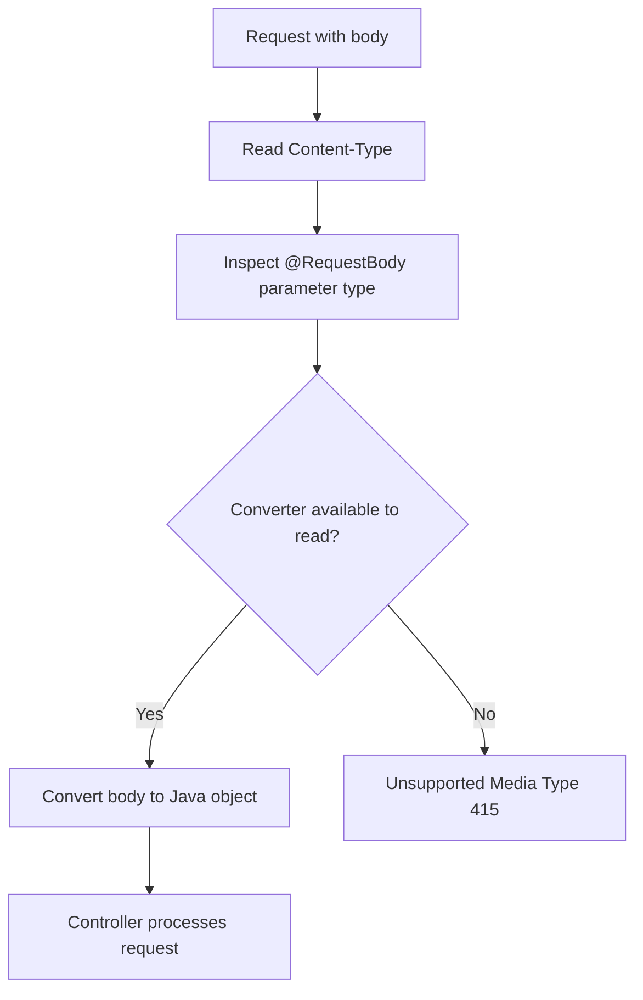
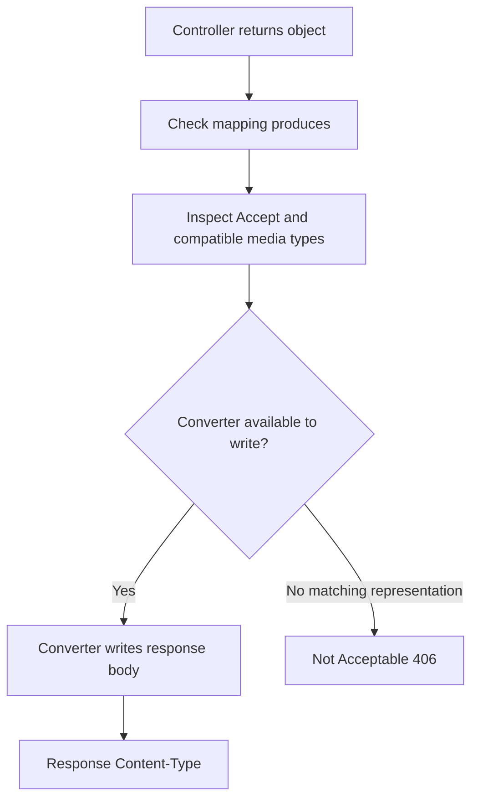

# Content-Type and Accept in Content Negotiation

In Spring MVC, the two HTTP headers `Content-Type` and `Accept` work together with content negotiation to determine what format incoming data has and what format the client wants in the response. When testing with `MockMvc`, configure both headers to match the endpoint contract so Spring selects the expected handler and `HttpMessageConverter`.

`Content-Type` describes the representation of a request body. `Accept` describes the representations a client accepts in the response. The two headers apply in opposite directions: sending JSON usually requires setting `Content-Type: application/json`; wanting JSON back usually requires setting `Accept: application/json`. Setting one header does not automatically substitute for the other.

## 1. What Is Content Negotiation?

Content negotiation is the process by which client and server agree on a data representation format for a request/response exchange. The same resource can be represented as JSON, XML, or another media type. The client advertises what it can receive via `Accept`; the server selects a representation compatible with the endpoint and configured converters.

For example, an API can accept JSON and return JSON:

```http
POST /api/products HTTP/1.1
Content-Type: application/json
Accept: application/json

{"name":"Notebook","price":12.5}
```

The server reads the request body according to `Content-Type`, converts JSON into a Java object, processes the request, and writes the response in a format matching `Accept` and the MVC configuration. The response may look like:

```http
HTTP/1.1 201 Created
Content-Type: application/json

{"id":42,"name":"Notebook","price":12.5}
```

In Spring MVC, content negotiation involves several components:

- `@RequestMapping`, `@GetMapping`, `@PostMapping`, and similar annotations can constrain media types using `consumes` and `produces`.
- `HttpMessageConverter` reads a request body into a Java object or writes a Java object out as a response body.
- `ContentNegotiationManager` and `ContentNegotiationStrategy` implementations help determine the desired media type for the response.
- `MockMvc` lets tests configure request headers and verify response headers/bodies without a real HTTP server.

## 2. Distinguishing `Content-Type` and `Accept`

| Header | Data direction | Meaning | Example |
| --- | --- | --- | --- |
| `Content-Type` | Request or response | Format of the body being carried in that message | `application/json` |
| `Accept` | Request | Response formats the client wants to receive | `application/json, application/xml` |

When sending a request with a JSON body:

```java
mockMvc.perform(post("/api/products")
        .contentType(MediaType.APPLICATION_JSON)
        .content("""{"name":"Notebook","price":12.5}"""));
```

`contentType(...)` sets the request's `Content-Type`. It tells Spring that the body should be read as JSON. If the endpoint accepts `@RequestBody CreateProductRequest`, Spring looks for a converter capable of reading that media type into the target Java type.

When expecting a JSON response:

```java
mockMvc.perform(get("/api/products/42")
        .accept(MediaType.APPLICATION_JSON));
```

`accept(...)` sets the request's `Accept` header. It tells Spring the client wants the response in JSON format. If the controller returns an object, Spring looks for a converter capable of writing that object as JSON.

A single request may need both headers:

```java
mockMvc.perform(post("/api/products")
        .contentType(MediaType.APPLICATION_JSON)
        .accept(MediaType.APPLICATION_JSON)
        .content("""{"name":"Notebook","price":12.5}"""))
        .andExpect(status().isCreated())
        .andExpect(content().contentTypeCompatibleWith(MediaType.APPLICATION_JSON));
```

In this example, the request body is JSON and the client also asks for a JSON response. If you send a body without `Content-Type`, Spring may be unable to pick a suitable converter. If you omit `Accept`, the client is generally treated as accepting any format the endpoint can return; when testing an explicit contract, set `Accept` explicitly.

## 3. Media Types and Common Formats

A media type has the structure `type/subtype`, optionally accompanied by parameters. For example:

```text
application/json
application/xml
text/plain
text/html
application/x-www-form-urlencoded
multipart/form-data
application/vnd.example.product+json
```

Some common media types in Spring MVC testing:

| Media type | Common purpose |
| --- | --- |
| `application/json` | JSON requests and responses for REST APIs |
| `application/xml` | XML requests or responses when the app has an XML converter |
| `text/plain` | Plain text content |
| `text/html` | HTML responses |
| `application/x-www-form-urlencoded` | Forms sending encoded key/value pairs |
| `multipart/form-data` | Forms with file uploads or multiple data parts |
| `application/octet-stream` | Binary data without an application-specific format |

Spring provides the `MediaType` class to express media types without repeating literal strings:

```java
MediaType.APPLICATION_JSON
MediaType.APPLICATION_XML
MediaType.TEXT_PLAIN
MediaType.TEXT_HTML
MediaType.APPLICATION_FORM_URLENCODED
MediaType.MULTIPART_FORM_DATA
```

You can create custom media types or parse a value from a string:

```java
MediaType vendorJson = MediaType.parseMediaType(
        "application/vnd.example.product+json");
```

Some APIs include media type parameters, such as `application/json;charset=UTF-8`. With modern JSON, UTF-8 is the recommended standard encoding; do not rely on every converter emitting the exact same charset parameter. When asserting responses, `contentTypeCompatibleWith(...)` is usually more resilient than exact `Content-Type` string comparison if parameters can differ.

## 4. `consumes` and `produces` in Mappings

Spring MVC lets you declare which media types a handler accepts and which media types it can produce:

- `consumes` constrains the representation of the request body, typically matched against `Content-Type`.
- `produces` constrains the representation of the response, typically matched against `Accept` and converter write capabilities.

Example of a controller that accepts and returns only JSON:

```java
import org.springframework.http.HttpStatus;
import org.springframework.http.MediaType;
import org.springframework.http.ResponseEntity;
import org.springframework.web.bind.annotation.PostMapping;
import org.springframework.web.bind.annotation.RequestBody;
import org.springframework.web.bind.annotation.RequestMapping;
import org.springframework.web.bind.annotation.RestController;

@RestController
@RequestMapping("/api/products")
class ProductController {
    @PostMapping(
            consumes = MediaType.APPLICATION_JSON_VALUE,
            produces = MediaType.APPLICATION_JSON_VALUE)
    ResponseEntity<ProductView> create(@RequestBody CreateProductRequest request) {
        ProductView result = new ProductView(42L, request.name(), request.price());
        return ResponseEntity.status(HttpStatus.CREATED).body(result);
    }
}

record CreateProductRequest(String name, double price) {
}

record ProductView(Long id, String name, double price) {
}
```

With this mapping, the request must have a `Content-Type` compatible with `application/json`. The response is declared as JSON. To serialize the record to JSON, the application needs a corresponding JSON message converter, usually auto-configured by Spring Boot when Jackson is on the classpath.

Multiple media types can be declared:

```java
@PostMapping(
        consumes = {
            MediaType.APPLICATION_JSON_VALUE,
            MediaType.APPLICATION_XML_VALUE
        },
        produces = {
            MediaType.APPLICATION_JSON_VALUE,
            MediaType.APPLICATION_XML_VALUE
        })
ResponseEntity<ProductView> create(@RequestBody CreateProductRequest request) {
    // Process data and return result
}
```

Declaring multiple values only allows the mapping to participate in selection for those media types. It does not automatically install missing converters. To read or write XML, the application still needs an XML-capable `HttpMessageConverter` and matching configuration.

## 5. Role of `HttpMessageConverter`

`HttpMessageConverter` is the mechanism Spring MVC uses to convert between HTTP messages and Java objects. When reading a request body, Spring inspects the request's content type and the target parameter type. When writing a response body, Spring inspects the object type, the requested media type, and the converters capable of writing that type.

Some common converters:

| Converter | Responsibility |
| --- | --- |
| `MappingJackson2HttpMessageConverter` | Reads/writes JSON using Jackson in applicable Spring versions |
| `StringHttpMessageConverter` | Reads/writes `String` content |
| `ByteArrayHttpMessageConverter` | Reads/writes byte arrays |
| `FormHttpMessageConverter` | Handles form and multipart data according to configured capabilities |
| XML converter | Reads/writes XML when the corresponding library and converter are present |

Reading a request body can be visualized as:



Writing a response body adds selection steps based on `Accept` and mapping `produces`:



Which converter is actually chosen depends on the parameter or return type, media type, MVC configuration, and libraries present in the application. Therefore, run tests under a configuration close to the application when the goal is to verify that the right converters are registered.

## 6. Setting Headers in MockMvc

`MockHttpServletRequestBuilder` provides two readable methods:

- `.contentType(MediaType)` sets the request's `Content-Type`.
- `.accept(MediaType...)` sets one or more `Accept` values.

Example testing an endpoint that accepts JSON and returns JSON:

```java
@WebMvcTest(ProductController.class)
class ProductControllerTest {
    @Autowired
    private MockMvc mockMvc;

    @Autowired
    private ObjectMapper objectMapper;

    @Test
    void createsProductUsingJson() throws Exception {
        CreateProductRequest request = new CreateProductRequest("Notebook", 12.5);

        mockMvc.perform(post("/api/products")
                        .contentType(MediaType.APPLICATION_JSON)
                        .accept(MediaType.APPLICATION_JSON)
                        .content(objectMapper.writeValueAsBytes(request)))
                .andExpect(status().isCreated())
                .andExpect(content().contentTypeCompatibleWith(MediaType.APPLICATION_JSON))
                .andExpect(jsonPath("$.id").value(42))
                .andExpect(jsonPath("$.name").value("Notebook"));
    }
}
```

In `@WebMvcTest`, the controller is loaded in the web slice. If the controller depends on a service, the test needs to provide a mock bean or suitable configuration for that dependency. `ObjectMapper` is normally auto-configured by Boot; if the project does not use Boot, supply a mapper in the test.

You can set headers directly using `.header(...)`, though `.contentType(...)` and `.accept(...)` express intent more clearly:

```java
mockMvc.perform(post("/api/products")
        .header(HttpHeaders.CONTENT_TYPE, "application/json")
        .header(HttpHeaders.ACCEPT, "application/json")
        .content("""{"name":"Notebook","price":12.5}"""));
```

Do not set `Content-Type` on a GET request with no body merely because you want to receive JSON. For such a request, `Accept: application/json` is the header directly governing response format. `Content-Type` is only needed when a message carries a body and its format must be described.

## 7. Verifying Response Content-Type and Body

After Spring selects a converter and builds the response, tests can check the response media type using `content()` or `header()`:

```java
mockMvc.perform(get("/api/products/42")
                .accept(MediaType.APPLICATION_JSON))
        .andExpect(status().isOk())
        .andExpect(content().contentTypeCompatibleWith(MediaType.APPLICATION_JSON))
        .andExpect(jsonPath("$.id").value(42));
```

Common matchers:

| Matcher | Meaning |
| --- | --- |
| `content().contentType(MediaType.APPLICATION_JSON)` | Compares the response media type against the matcher condition |
| `content().contentTypeCompatibleWith(MediaType.APPLICATION_JSON)` | Verifies the response media type is compatible with JSON, allowing compatible parameters |
| `content().string("...")` | Compares the response body as a string |
| `content().json("...")` | Compares JSON content |
| `jsonPath("$.field").value(...)` | Verifies a value inside the JSON response |
| `header().string(HttpHeaders.CONTENT_TYPE, ...)` | Directly checks the response header |

Example checking a JSON body structurally:

```java
mockMvc.perform(get("/api/products/42")
                .accept(MediaType.APPLICATION_JSON))
        .andExpect(content().json("""
                {
                  "id": 42,
                  "name": "Notebook",
                  "price": 12.5
                }
                """));
```

When only the media type matters, using `contentTypeCompatibleWith` keeps tests free of brittle dependencies on incidental parameters. When the contract requires an exact header value, verify it with `header().string(...)`.

## 8. 415 Unsupported Media Type Error

HTTP 415 typically occurs when the server rejects the request body's media type. In Spring MVC, this can happen when `Content-Type` does not match the `consumes` condition or when no converter can read the body for the required media type and Java type.

Suppose the endpoint accepts only JSON:

```java
@PostMapping(consumes = MediaType.APPLICATION_JSON_VALUE)
ProductView create(@RequestBody CreateProductRequest request) {
    return new ProductView(42L, request.name(), request.price());
}
```

A test sending `text/plain` will fail to match the `consumes` condition:

```java
@Test
void rejectsUnsupportedRequestMediaType() throws Exception {
    mockMvc.perform(post("/api/products")
                    .contentType(MediaType.TEXT_PLAIN)
                    .content("name=Notebook"))
            .andExpect(status().isUnsupportedMediaType());
}
```

Another mistake is sending a JSON body while forgetting `.contentType(MediaType.APPLICATION_JSON)`. If the mapping only accepts JSON, the request may be rejected due to a missing or incompatible `Content-Type`. Therefore, when testing POST/PUT/PATCH with a body, explicitly declare the body's media type.

Do not confuse 415 with malformed JSON syntax errors. If `Content-Type` is JSON and a converter was selected, yet the JSON content cannot be deserialized, Spring typically returns 400 Bad Request due to a message reading failure. 415 relates to an unsupported media type or converter; 400 usually relates to unreadable body content or invalid data.

## 9. 406 Not Acceptable Error

HTTP 406 occurs when the server cannot produce a response matching the media types accepted by the client. In Spring MVC, this can happen when `Accept` does not match the handler's `produces` or when no converter can write the return type in the requested media type.

Example of an endpoint returning only JSON:

```java
@GetMapping(
        value = "/{id}",
        produces = MediaType.APPLICATION_JSON_VALUE)
ProductView find(@PathVariable long id) {
    return new ProductView(id, "Notebook", 12.5);
}
```

A test requesting XML when the endpoint only provides JSON:

```java
@Test
void rejectsUnacceptableResponseMediaType() throws Exception {
    mockMvc.perform(get("/api/products/42")
                    .accept(MediaType.APPLICATION_XML))
            .andExpect(status().isNotAcceptable());
}
```

The exact outcome also depends on MVC configuration and converters. If the application has an XML converter registered and the handler permits XML, the request may be served instead of returning 406. Tests should reflect the real configuration the application intends to support.

## 10. Accept with Multiple Media Types and Quality Factors

`Accept` can list multiple media types separated by commas. The client can specify a quality factor `q` between 0 and 1 to indicate priority:

```http
Accept: application/xml;q=0.8, application/json;q=1.0
```

In this example, the client prefers JSON over XML. A higher `q` value gives higher priority to that media type. The default value when `q` is omitted is `1.0`.

You can configure this list in MockMvc:

```java
mockMvc.perform(get("/api/products/42")
        .header(HttpHeaders.ACCEPT,
                "application/xml;q=0.8, application/json;q=1.0"))
        .andExpect(status().isOk())
        .andExpect(content().contentTypeCompatibleWith(MediaType.APPLICATION_JSON));
```

Or parse the media type list to pass into the builder:

```java
MediaType[] acceptedTypes = MediaType.parseMediaTypes(
        "application/xml;q=0.8, application/json;q=1.0")
        .toArray(new MediaType[0]);

mockMvc.perform(get("/api/products/42").accept(acceptedTypes));
```

Wildcards are also common:

| `Accept` value | Meaning |
| --- | --- |
| `*/*` | Accepts any media type |
| `application/*` | Accepts any subtype under `application` |
| `application/json` | Explicitly specifies JSON |
| `application/*+json` | Accepts subtypes with the `+json` suffix, if supported by converters and configuration |

When multiple representations are supported, the selected outcome also depends on the mapping, media type specificity, quality factor, and converters capable of writing the response. Do not rely solely on the order of the `Accept` string to guess the result; write an assertion for the actual response `Content-Type`.

## 11. Distinguishing Form, JSON, and Multipart When Sending Requests

A common mistake is using the same body-building approach for every request type. Each format needs its corresponding `Content-Type` and appropriate request construction.

### JSON

```java
mockMvc.perform(post("/api/products")
        .contentType(MediaType.APPLICATION_JSON)
        .content("""{"name":"Notebook","price":12.5}"""));
```

### Form URL-encoded

```java
mockMvc.perform(post("/login")
        .contentType(MediaType.APPLICATION_FORM_URLENCODED)
        .param("username", "lan")
        .param("password", "secret"));
```

### Multipart file upload

```java
MockMultipartFile file = new MockMultipartFile(
        "document", "notes.txt", MediaType.TEXT_PLAIN_VALUE,
        "hello".getBytes(StandardCharsets.UTF_8));

mockMvc.perform(multipart("/documents").file(file));
```

With multipart, let the request builder generate the required boundary. Do not manually set `Content-Type: multipart/form-data` without a boundary when the multipart body is constructed by the builder. If you need to check a JSON response from an upload endpoint, you can combine `.accept(MediaType.APPLICATION_JSON)` with the multipart request.

## 12. Verifying Both Content-Type and Accept in the Same Test

An integration test should verify both that the request is sent in the right representation and that the response is returned in the format requested by the client. For example:

```java
@Test
void acceptsJsonAndReturnsJson() throws Exception {
    String requestBody = """
            {
              "name": "Notebook",
              "price": 12.5
            }
            """;

    mockMvc.perform(post("/api/products")
                    .contentType(MediaType.APPLICATION_JSON)
                    .accept(MediaType.APPLICATION_JSON)
                    .content(requestBody))
            .andExpect(status().isCreated())
            .andExpect(content().contentTypeCompatibleWith(MediaType.APPLICATION_JSON))
            .andExpect(jsonPath("$.id").value(42))
            .andExpect(jsonPath("$.name").value("Notebook"));
}
```

Include tests for invalid scenarios to guard the contract:

```java
@Test
void returns415WhenRequestContentTypeIsUnsupported() throws Exception {
    mockMvc.perform(post("/api/products")
                    .contentType(MediaType.TEXT_PLAIN)
                    .accept(MediaType.APPLICATION_JSON)
                    .content("Notebook"))
            .andExpect(status().isUnsupportedMediaType());
}

@Test
void returns406WhenResponseTypeIsNotAccepted() throws Exception {
    mockMvc.perform(get("/api/products/42")
                    .accept(MediaType.APPLICATION_XML))
            .andExpect(status().isNotAcceptable());
}
```

These two negative tests assume the endpoint only accepts JSON and only returns JSON. If the application supports additional media types, update the expectations to match the actual contract.

## 13. Configuring Content Negotiation in Spring MVC

Spring MVC can be configured via `WebMvcConfigurer` to adjust how response media types are resolved. For modern HTTP APIs, the `Accept` header is the clear way for clients to request a representation. If the application needs a default response format when the client sends no `Accept` header, a default content type can be configured.

```java
@Configuration
@EnableWebMvc
class ApiWebConfig implements WebMvcConfigurer {
    @Override
    public void configureContentNegotiation(ContentNegotiationConfigurer configurer) {
        configurer
                .favorParameter(false)
                .ignoreAcceptHeader(false)
                .defaultContentType(MediaType.APPLICATION_JSON);
    }
}
```

In this example, Spring still honors `Accept`; when no matching preference is available, JSON is used as the default. Exact options and details can vary by Spring version and application configuration. If using Spring Boot, auto-configuration may already set up several MVC components; add only the configuration needed for the application's contract.

Older applications sometimes choose response types via a query parameter like `?format=json` or path extensions. Those approaches require configuring the corresponding strategy and can complicate URLs. For new APIs, prefer the `Accept` header and `produces` mappings so the HTTP contract is expressed directly.

## 14. Common Testing Errors

| Symptom | Common cause | How to resolve |
| --- | --- | --- |
| POST JSON returns 415 | Missing or wrong `Content-Type`; `consumes` mismatch; missing JSON reader converter | Set `.contentType(APPLICATION_JSON)` and check converters/configuration |
| POST JSON returns 400 | Malformed JSON, deserialization failure, or validation failure | Check body, DTO, data types, and validation |
| GET JSON returns 406 | `Accept` does not match `produces` or no converter writes the representation | Set `Accept` per contract and check `produces`/converters |
| Response has an unexpected media type | Request sent no `Accept`, mapping allows multiple formats, or default content type is configured | Assert response header and check negotiation strategy |
| Test only passes when removing `Accept` | Sent header is incompatible with the endpoint | Check media type list and quality factors |
| XML is not read/written despite `consumes`/`produces` | Missing XML converter or required library | Register converter and check classpath |
| Content-Type assertion fails due to charset | Header string comparison is too strict | Use `contentTypeCompatibleWith` if contract allows parameters |
| Multipart returns 415 | Request builder or multipart mapping mismatch | Use `multipart(...)`, let builder generate boundary, and check mapping |

When diagnosing, inspect request headers, response status, response headers, and body together. `andDo(print())` helps display request/response details while developing tests:

```java
mockMvc.perform(post("/api/products")
        .contentType(MediaType.APPLICATION_JSON)
        .accept(MediaType.APPLICATION_JSON)
        .content("""{"name":"Notebook","price":12.5}"""))
        .andDo(print())
        .andExpect(status().isCreated());
```

Do not fix a test by dropping a header just to make the request pass. First verify whether that header belongs to the client contract, then adjust the request or endpoint configuration accordingly.

## 15. Principles for Writing Content Negotiation Tests

1. Set `Content-Type` to match the actual format of the request body.
2. Set `Accept` to describe the representation the client wants to receive.
3. Use `consumes` to restrict accepted request body types and `produces` to restrict handler response types.
4. Verify that the application has an `HttpMessageConverter` capable of reading or writing the media type under test.
5. Assert the response `Content-Type` alongside status and body content to confirm negotiation selected the right representation.
6. Write tests for 415 when the request media type is unsupported and 406 when the response media type is not acceptable.
7. When `Accept` has multiple values or quality factors, verify the actual `Content-Type` rather than inferring from string order.
8. For forms and multipart, use the media type and request builder suited to each format.
9. Use an appropriate web context configuration when verifying real application converters, negotiation strategies, or controller advice.

In MockMvc testing, `Content-Type` and `Accept` are two essential parts of the HTTP contract. Setting the right `Content-Type` helps Spring read the request body in the expected format; setting the right `Accept` helps Spring choose the response representation. Combining both headers with `consumes`, `produces`, message converters, and response assertions enables tests to clearly verify both input acceptance and the output format promised by the API.
