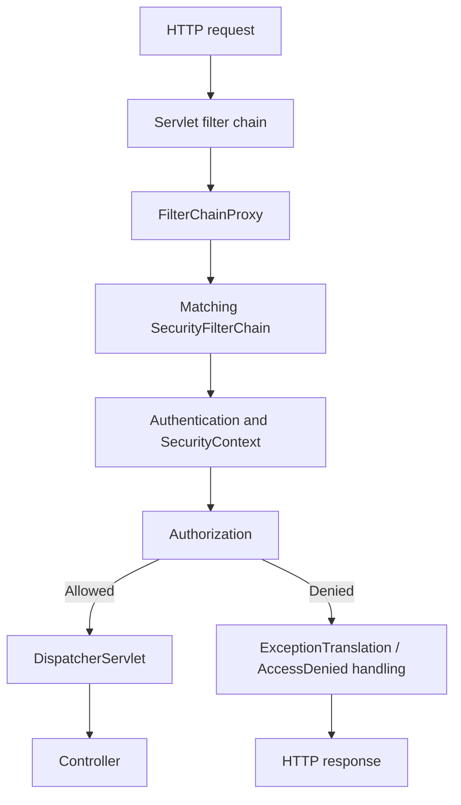
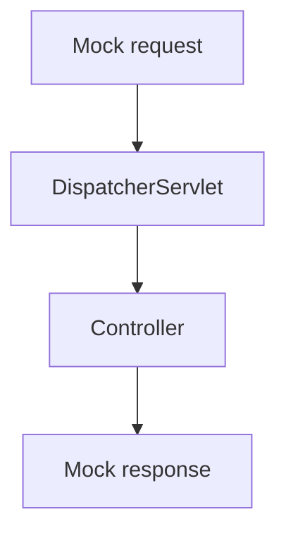

# Limitations of Security Assertions Without Spring Security Loaded

## 1. Why Can Test Configuration Mislead Security Conclusions?

A Spring MVC test can invoke a controller with `MockMvc`, attach a mock user to the request, and then assert authentication state using matchers such as `authenticated()` or `unauthenticated()`. These tools are useful, but the results are only meaningful when you understand exactly which parts of the system are actually running.

Spring Security protects requests through a servlet filter chain, typically `FilterChainProxy` containing `SecurityFilterChain` instances. The filter chain can authenticate requests, populate `SecurityContext`, check permissions, enforce CSRF, and translate authentication or access-denied errors into HTTP responses.

If a test does not load or run that filter chain, the controller can still be invoked normally. A helper such as `user(...)`, `@WithMockUser`, or `jwt()` can supply a mock identity to test downstream logic, but it does not by itself prove that the application authenticated credentials or enforced URL protection rules.

Therefore, distinguish two separate questions:

1. **During test execution, does the request have an `Authentication` with the expected user and authorities?** Authentication and principal matchers help answer this question.
2. **Does Spring Security actually block or permit requests according to the application's configuration?** This question requires the real filter chain and security configuration to participate in the request.

A test can answer the first question well without having tested the second question at all.

## 2. Where Does Spring Security Sit in the Request Path?

In a Spring MVC application with Spring Security, requests pass through servlet filters before reaching `DispatcherServlet` and the controller. `FilterChainProxy` selects the `SecurityFilterChain` matching the request; filters inside the chain handle authentication, authorization, and other policies.



If `MockMvc` is built without attaching security filters, the path can shorten to:



In the second path, tests can still verify MVC mappings, binding, validation, response bodies, and exception handlers. However, tests cannot conclude that Spring Security filters authenticated or rejected the request, because those filters never participated in processing.

## 3. `spring-security-test` Does Not Mean Runtime Security Is Enabled

Different dependencies serve different roles:

| Component | Role |
|---|---|
| Spring Security runtime, usually brought in via `spring-boot-starter-security` | Provides the APIs and filter infrastructure to protect requests in the application |
| `SecurityFilterChain` configuration | Declares which requests require authentication, which authorities are allowed, and security policies |
| `spring-security-test` | Provides annotations, request post-processors, and matchers to assist security testing |
| `MockMvc` | Simulates MVC requests/responses; runs only the filters configured on the `MockMvc` instance |

Merely adding `spring-security-test` to the test classpath does not create a complete security configuration. Similarly, merely having a `SecurityFilterChain` bean in the `ApplicationContext` is not enough if `MockMvc` is built in a way that excludes servlet filters from requests.

In Spring Boot, test configuration determines which beans and filters are loaded. Verify runtime dependencies, security configuration, test type, and how `MockMvc` is constructed instead of assuming security is active just because an annotation or matcher compiles.

## 4. Common Ways to Build MockMvc

### 4.1. `@SpringBootTest` Combined with `@AutoConfigureMockMvc`

This is usually the right choice when you want requests to pass through real application configuration and filters:

```java
@SpringBootTest
@AutoConfigureMockMvc
class OrderSecurityIntegrationTest {

    @Autowired
    private MockMvc mockMvc;

    @Test
    void rejectsAnonymousRequest() throws Exception {
        mockMvc.perform(get("/api/orders"))
                .andExpect(status().isUnauthorized());
    }
}
```

By default, `@AutoConfigureMockMvc` adds servlet filters registered in the `ApplicationContext` to `MockMvc`. If the application has an appropriate Spring Security configuration, requests go through the security filter chain.

Still, `@SpringBootTest` does not automatically prove a specific chain is active. Confirm that the application actually has the Spring Security runtime, the chain configuration is loaded in the context, and the test does not disable filters.

### 4.2. `@AutoConfigureMockMvc(addFilters = false)`

```java
@SpringBootTest
@AutoConfigureMockMvc(addFilters = false)
class OrderControllerMvcTest {
    // Tests focus on MVC behavior.
}
```

`addFilters = false` tells `MockMvc` not to register servlet filters from the context. This configuration can be useful when tests focus purely on the controller or isolate an MVC slice. However, tests in this class cannot use status codes or authentication results to conclude that Spring Security protected the endpoint.

If a test aims to verify authorization, use a `MockMvc` setup with active security filters. Do not keep `addFilters = false` and treat an `authenticated()` assertion as proof of access rules.

### 4.3. `@WebMvcTest`

`@WebMvcTest` creates an MVC test slice rather than loading the entire application. If the Spring Security runtime is on the classpath, Spring Boot may include default security configuration in the slice; your application's custom security configuration may need to be imported explicitly or included in the slice appropriately.

```java
@WebMvcTest(OrderController.class)
@Import(SecurityConfiguration.class)
class OrderControllerSecurityTest {

    @Autowired
    private MockMvc mockMvc;

    @MockBean
    private OrderService orderService;
}
```

The example imports `SecurityConfiguration` so the test uses the intended security setup. Depending on application structure, you may also need to provide dependent beans required by that configuration. If the slice does not load the chain under test, test results do not represent production configuration.

### 4.4. `standaloneSetup(...)`

```java
MockMvc mockMvc = MockMvcBuilders
        .standaloneSetup(new OrderController(orderService))
        .build();
```

`standaloneSetup(...)` builds `MockMvc` from the provided controller and manually registered MVC components. It neither discovers the application's `ApplicationContext` nor automatically attaches the Spring Security filter chain.

If you need to test security with this setup, you must explicitly configure the necessary filters and security components. In an application that already has an `ApplicationContext` and `FilterChainProxy`, `webAppContextSetup(context).apply(springSecurity())` is usually clearer because it uses the web configuration and filter chain from the context.

## 5. What Do Authentication Matchers Assert?

Spring Security Test provides matchers such as:

```java
import static org.springframework.security.test.web.servlet.response.SecurityMockMvcResultMatchers.authenticated;
import static org.springframework.security.test.web.servlet.response.SecurityMockMvcResultMatchers.unauthenticated;
```

Example:

```java
mockMvc.perform(get("/api/profile")
                .with(user("alice").roles("USER")))
        .andExpect(status().isOk())
        .andExpect(authenticated().withUsername("alice"));
```

`authenticated()` asserts that the authentication state observed after the request satisfies the authenticated condition. Additional conditions can check username, principal, authorities, or other attributes supported by the matcher.

This matcher does not by itself prove that:

- The request passed through `FilterChainProxy`.
- Username/password, session, Basic credentials, or a bearer token were verified by runtime mechanisms.
- The application's `authorizeHttpRequests(...)` rules were enforced.
- The request would be blocked if no identity were supplied.

Conversely, `unauthenticated()` asserts that no valid authentication exists in the observed state. It does not prove that the endpoint is configured to require login. A public endpoint also handles anonymous requests without issue.

Therefore, combine authentication matchers with status assertions and proper test configuration. In particular, to prove an endpoint is protected, write a test that sends an anonymous request through the filter chain and asserts the response from the access policy.

## 6. `@WithMockUser` and `user(...)` Create Mock Identities

### 6.1. Using `@WithMockUser`

```java
@Test
@WithMockUser(username = "alice", roles = "ADMIN")
void adminCanReadAuditLog() throws Exception {
    mockMvc.perform(get("/api/audit-log"))
            .andExpect(status().isOk())
            .andExpect(authenticated().withUsername("alice"));
}
```

`@WithMockUser` establishes a mock user for the test via Spring Security Test. The test can focus on behavior requiring a specific principal and authorities without performing a login flow.

### 6.2. Using the `user(...)` Request Post-Processor

```java
mockMvc.perform(get("/api/audit-log")
                .with(user("alice").roles("ADMIN")))
        .andExpect(status().isOk())
        .andExpect(authenticated().withUsername("alice"));
```

`user(...)` creates a request with a mock user and the specified privileges. `roles("ADMIN")` generates authority `ROLE_ADMIN`; if you want to pass exact authorities, use `authorities(...)`.

```java
mockMvc.perform(get("/api/reports")
                .with(user("alice").authorities(
                        new SimpleGrantedAuthority("report:read"))))
        .andExpect(status().isOk());
```

These helpers are useful for testing application branches with a known identity. They bypass real credential verification. Thus, a test using `user("alice")` does not test the password encoder, `UserDetailsService`, authentication provider, login endpoint, or session creation.

### 6.3. Mock User Authorities Do Not Automatically Test Authorization

Suppose a controller or service reads `Authentication` to obtain the username. `@WithMockUser` can help test reading that principal. But if the goal is to verify that `/api/admin/**` allows only `ADMIN`, the test must run with the security chain and assertions must prove that regular users are denied.

A test asserting only `authenticated().withUsername("alice")` is not enough to prove the `ADMIN` role was enforced. It only proves the mock identity was present.

## 7. Mock JWTs Do Not Verify Real Token Signatures

Spring Security Test provides the `jwt()` request post-processor to create a mock `JwtAuthenticationToken` for the request:

```java
mockMvc.perform(get("/api/orders")
                .with(jwt().jwt(jwt -> jwt
                        .subject("alice")
                        .claim("scope", "orders.read"))))
        .andExpect(status().isOk())
        .andExpect(authenticated());
```

This helper is suitable for testing authorization based on a principal and authorities derived from a JWT. It does not send a bearer token string for the application to decode and verify itself. Therefore, the test above does not verify:

- Whether the JWT signature is valid against the configured public key or secret.
- Whether the token is expired.
- Whether `issuer`, `audience`, or required claims are checked.
- Whether the JWK Set URI, decoder, or introspection endpoint works.
- Whether the bearer token filter reads the `Authorization` header and creates authentication properly.

To test those behaviors, write a test at the appropriate level that sends a real bearer token or a token signed with a test key, routes the request through the resource server filter, and exercises the test configuration's actual decoder/validator.

With OAuth2 opaque tokens, the `opaqueToken()` request post-processor also creates mock authentication for testing downstream logic. It does not prove an introspection request was sent to the authorization server or that a real token was successfully introspected.

## 8. Testing CSRF Also Requires an Active Filter Chain

Spring Security Test supports attaching a CSRF token to a request:

```java
mockMvc.perform(post("/api/orders")
                .with(user("alice").roles("USER"))
                .with(csrf())
                .contentType(MediaType.APPLICATION_JSON)
                .content("{\"productCode\":\"BOOK-01\"}"))
        .andExpect(status().isCreated());
```

`csrf()` sends a valid token using the test support mechanism. You can issue requests without a token or with an invalid token to test rejection behavior:

```java
mockMvc.perform(post("/api/orders")
                .with(user("alice").roles("USER"))
                .contentType(MediaType.APPLICATION_JSON)
                .content("{\"productCode\":\"BOOK-01\"}"))
        .andExpect(status().isForbidden());

mockMvc.perform(post("/api/orders")
                .with(user("alice").roles("USER"))
                .with(csrf().useInvalidToken())
                .contentType(MediaType.APPLICATION_JSON)
                .content("{\"productCode\":\"BOOK-01\"}"))
        .andExpect(status().isForbidden());
```

`403` assertions only prove CSRF protection when the request actually passes through `CsrfFilter` and CSRF is enabled for that endpoint. If the test disables filters or skips the security chain, the request can reach the controller even without a token; the test then fails to verify the CSRF policy.

CSRF does not apply identically to every request. Spring Security typically protects state-changing HTTP methods like POST, PUT, PATCH, and DELETE, while GET is conventionally a safe method. Application configuration may customize matchers or disable CSRF for stateless APIs; tests must reflect the real policy rather than assuming every POST requires a token in every application.

## 9. Verifying Authorization with Three Clear Cases

An authorization test suite should verify at least three states: no user, an authenticated user lacking permission, and a user with the required permission.

Suppose the application configuration protects `/api/admin/**` and allows only authority `ADMIN`:

```java
@Configuration
@EnableWebSecurity
class SecurityConfiguration {

    @Bean
    SecurityFilterChain securityFilterChain(HttpSecurity http) throws Exception {
        return http
                .authorizeHttpRequests(authorize -> authorize
                        .requestMatchers("/api/admin/**").hasAuthority("ADMIN")
                        .anyRequest().authenticated())
                .httpBasic(Customizer.withDefaults())
                .csrf(csrf -> csrf.disable())
                .build();
    }
}
```

This example illustrates authorization rules; CSRF is disabled separately to focus on API access cases. Applications using sessions or browsers must evaluate CSRF according to their actual authentication model.

Tests can be written as:

```java
@SpringBootTest
@AutoConfigureMockMvc
class AdminAuthorizationTest {

    @Autowired
    private MockMvc mockMvc;

    @Test
    void anonymousUserCannotAccessAdminEndpoint() throws Exception {
        mockMvc.perform(get("/api/admin/reports"))
                .andExpect(status().isUnauthorized());
    }

    @Test
    @WithMockUser(authorities = "USER")
    void authenticatedUserWithoutAdminAuthorityIsForbidden() throws Exception {
        mockMvc.perform(get("/api/admin/reports"))
                .andExpect(status().isForbidden());
    }

    @Test
    @WithMockUser(authorities = "ADMIN")
    void adminCanAccessAdminEndpoint() throws Exception {
        mockMvc.perform(get("/api/admin/reports"))
                .andExpect(status().isOk());
    }
}
```

The statuses in the example depend on the configuration's authentication entry point and access-denied handling. With HTTP Basic, anonymous requests typically receive `401`. With form login, browser requests may be redirected to the login page and receive `302`. Tests should assert the response matching the entry point actually configured by the application.

The three tests only verify authorization when `MockMvc` uses the right `SecurityFilterChain`. If the chain is not loaded, anonymous users and under-privileged users could reach the controller, and tests will catch the discrepancy if assertions are written properly. However, if an endpoint or test setup fabricates statuses artificially, that does not replace proof that security filters ran.

## 10. How to Explicitly Attach the Spring Security Filter Chain to MockMvc

When building `MockMvc` manually from a web application context, Spring Security Test provides the `springSecurity()` configurer:

```java
@Autowired
private WebApplicationContext context;

private MockMvc mockMvc;

@BeforeEach
void setUp() {
    mockMvc = MockMvcBuilders
            .webAppContextSetup(context)
            .apply(springSecurity())
            .build();
}
```

Applying `springSecurity()` integrates Spring Security with `MockMvc`, including the security filter chain and test security context helpers. This requires the `ApplicationContext` to contain an appropriate Spring Security configuration, typically including `FilterChainProxy`.

When using `standaloneSetup(...)`, there is no web context from which to pull the full configuration. You must supply any needed filters and components yourself. Do not assume that merely calling `apply(springSecurity())` invents a policy or filter chain that the application has not declared.

With `@AutoConfigureMockMvc`, you normally do not need to build `MockMvc` manually if filters are registered automatically. Still, if custom configuration is involved, verify `addFilters`, filter registration, and which chain is selected for the test URL.

## 11. What a Mock Authentication Test Cannot Prove

| Test setup or helper | Can verify | Insufficient to prove |
|---|---|---|
| `@WithMockUser` | Controller/service handling of mock principal and authorities | Real username/password login succeeds |
| `.with(user(...))` | Behavior with a specified user and privileges | Authentication provider, password encoder, or login flow works |
| `.with(jwt())` | Authorization with mock JWT principal/claims | Signature, issuer, audience, expiry, and decoder verify real tokens |
| `.with(opaqueToken())` | Behavior with mock opaque-token authentication | Introspection endpoint works and real tokens are introspected |
| `authenticated()` | An authentication satisfying the matcher is observed | Filter chain ran or URL authorization was enforced |
| `unauthenticated()` | No valid authentication in the observed state | Endpoint requires login or request was rejected |
| `.with(csrf())` | Request carries a test CSRF token | CSRF filter is active and missing tokens are blocked if chain does not run |
| `status().isForbidden()` in an MVC test without security filters | The request response is 403 | Spring Security rejected the request |

These helpers remain very valuable. They enable focused, fast tests with clearly defined principal privileges. What to avoid is stretching conclusions beyond the scope of the test.

## 12. Signs That a Test Does Not Actually Test Security

- A test class has `@AutoConfigureMockMvc(addFilters = false)` yet concludes endpoints are protected.
- `MockMvc` is built with `standaloneSetup(...)` without adding security filters.
- Tests only use `@WithMockUser` and `authenticated()` without anonymous or insufficient-privilege cases.
- JWT tests use `.with(jwt())` yet claim bearer token signatures were verified.
- CSRF tests only send `.with(csrf())` without missing or invalid token cases.
- Slice tests do not import the security configuration used by the production application.
- Tests only inspect `SecurityContextHolder` afterward without confirming requests went through the chain.

When you spot these signs, revisit the test's objective. The test may only intend to check a controller with a mock principal; if so, describe the results within that scope. If the goal is to ensure endpoints are protected, fix the test setup to run the filter chain and cover both allow and deny paths.

## 13. Organizing Tests by Layer to Avoid False Conclusions

A security test suite can usually be organized into layers with distinct goals:

| Test layer | Appropriate setup | Question to answer |
|---|---|---|
| Controller/MVC slice | `@WebMvcTest`, possibly mocked services and mock principal | Does the controller handle the principal, authorities, and response properly? |
| Authorization integration | `@SpringBootTest` + `MockMvc` with security filters | Do URL and method security rules permit/block the right roles? |
| Authentication integration | Real security chain, appropriate authentication provider/decoder | Are credentials or tokens verified properly? |
| End-to-end | Running application near production config with clients sending real credentials | Do the full login flow, session/token handling, and resource access work? |

Not every test needs to boot the full application. Controller slices provide fast feedback and easy isolation. Integration tests verify the combination of the security chain, filters, and configuration. End-to-end tests cover boundaries `MockMvc` does not simulate, such as TLS, proxies, real cookies, or identity provider integration.

What matters is stating clearly which layer a test verifies. A mock-principal test is not a login test; a filterless MVC test is not an authorization test; a `jwt()` test is not a JWT signature verification test.

## 14. Checklist for Writing Security Assertions in Spring MVC

- Identify whether the test checks principal handling, authorization, authentication flow, or CSRF.
- Verify `spring-security-test` and the Spring Security runtime are on the right classpaths.
- Confirm the expected `SecurityFilterChain` is loaded into the test context.
- Check that `MockMvc` registers servlet filters; watch out for `addFilters = false`.
- With `standaloneSetup(...)`, configure security filters manually if security is part of the test goal.
- Use `@WithMockUser`, `user(...)`, or `jwt()` for mock identities and scope conclusions to behavior with that identity.
- Test anonymous, authenticated-but-forbidden, and authorized cases when verifying access rules.
- Assert the status matching the real entry point: `401`, `403`, or login redirect.
- For JWTs, separate authorization tests using mock JWTs from decoder/validator tests verifying tokens.
- For CSRF, test both valid tokens and missing/invalid tokens when CSRF policy is enabled.
- Do not use `authenticated()` or `unauthenticated()` alone as proof that an endpoint is protected.

Spring Security Test assertions describe the authentication state supplied by the test or produced by the request. Only when the security filter chain actually participates in processing can status and access assertions verify the application's security policy. Recognizing that boundary keeps MVC tests lean while preventing false claims that an application is protected when the protection mechanism never ran.
