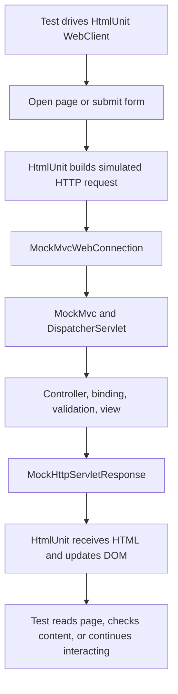

# HtmlUnit for Form Flows When Appropriate for MVC Scope

HtmlUnit is a Java library that simulates a web browser at the HTML, DOM, and user-interaction level. In Spring MVC testing, HtmlUnit can be combined with `MockMvc` to open pages, locate forms, fill in inputs, select options, submit forms, and inspect the resulting page just as a user interacts with a website.

Integrating `MockMvc` with HtmlUnit is especially useful for HTML-rendering Spring MVC applications where a business flow spans multiple pages or relies on form binding, validation, sessions, and redirects. HtmlUnit provides an API for working at the HTML page level; Spring Test routes application requests through `DispatcherServlet` via `MockMvc`. Tests can therefore verify navigation and form experiences at the MVC layer without starting a real HTTP server.

## 1. What Problem Does HtmlUnit Solve?

A standard `MockMvc` test constructs requests with a builder and checks responses with matchers:

```java
mockMvc.perform(post("/signup")
        .param("name", "Lan")
        .param("email", "lan@example.test"))
        .andExpect(status().is3xxRedirection());
```

This approach is direct and suits most API tests. However, it does not interact with the HTML returned by the server. The test itself must know parameter names, the action URL, and how to issue the next request.

HtmlUnit lets tests work against the rendered form:

1. Open a page by URL.
2. Locate a form by `id` or `name`.
3. Locate input fields by HTML name.
4. Enter data as a user would.
5. Click the submit button.
6. Receive the resulting page after server processing, including validation errors or redirects.

This helps verify coordination across controllers, templates, form fields, sessions, and navigation flows. It also catches bugs such as HTML input names not matching model properties, wrong form actions, or redirects pointing to nonexistent pages.

HtmlUnit is not a full graphical browser. It builds and manipulates a DOM and can execute JavaScript to the extent supported by the library, but it does not completely replace real Chrome, Firefox, or Safari. Its proper target is testing HTML flows and simulatable MVC behavior.

## 2. How Does HtmlUnit Combine with MockMvc?

Spring Test provides `MockMvcWebClientBuilder` to create an HtmlUnit `WebClient` wired to `MockMvc`. When `WebClient` accesses a host configured for `MockMvc`, requests are routed into Spring MVC via `MockMvcWebConnection` instead of opening a connection to a servlet container.



HtmlUnit manages client-side interactions such as reading forms, updating field values, and following navigation. `MockMvc` handles server-side requests according to the loaded Spring MVC configuration. Consequently, a test can verify both sides of a form flow within a single test.

Key components:

| Component | Role |
| --- | --- |
| `WebClient` | Represents a browser session, managing page navigation and cookies |
| `HtmlPage` | Represents a loaded and parsed HTML page |
| `HtmlForm` | Represents an HTML form and the controls inside it |
| `HtmlInput`, `HtmlTextInput`, `HtmlSelect` | Allow reading or modifying form field values |
| `HtmlSubmitInput` | Represents an input-based submit button |
| `MockMvcWebClientBuilder` | Builds a `WebClient` connected to `MockMvc` |
| `MockMvcWebConnection` | Routes HtmlUnit requests to `MockMvc` for configured hosts |

With modern HtmlUnit versions, packages typically start with `org.htmlunit`. Projects on older HtmlUnit 2.x may use `com.gargoylesoftware.htmlunit`. Choose an HtmlUnit version compatible with your Spring Test version and use the matching package.

## 3. Adding the Test Dependency

Spring Test provides the `MockMvc` integration; HtmlUnit is a separate dependency. In Spring Boot projects, `spring-boot-starter-test` typically provides Spring Test and common testing libraries, though you must add HtmlUnit if it is not already on the test classpath.

With Gradle:

```groovy
dependencies {
    testImplementation("org.htmlunit:htmlunit")
}
```

With Maven:

```xml
<dependency>
    <groupId>org.htmlunit</groupId>
    <artifactId>htmlunit</artifactId>
    <scope>test</scope>
</dependency>
```

The examples above use HtmlUnit 3.x or later under group ID `org.htmlunit`. If a project uses HtmlUnit 2.x, the legacy Maven coordinate is `net.sourceforge.htmlunit:htmlunit` and the Java package is `com.gargoylesoftware.htmlunit`. Let the project's dependency management govern the version if a BOM provides it; otherwise, pick an explicitly compatible version rather than arbitrarily grabbing the newest release.

Do not add HtmlUnit to production runtime dependencies, as the library is strictly for testing. If the application uses Spring Security, also include `spring-security-test` to configure the security filter chain and support security testing operations.

## 4. Creating a WebClient Wired to WebApplicationContext

For a Spring MVC application with web context configuration, `WebClient` can be created in a test as follows:

```java
import org.htmlunit.WebClient;
import org.junit.jupiter.api.AfterEach;
import org.junit.jupiter.api.BeforeEach;
import org.junit.jupiter.api.extension.ExtendWith;
import org.springframework.beans.factory.annotation.Autowired;
import org.springframework.test.context.ContextConfiguration;
import org.springframework.test.context.junit.jupiter.SpringExtension;
import org.springframework.test.context.web.WebAppConfiguration;
import org.springframework.test.web.servlet.htmlunit.MockMvcWebClientBuilder;
import org.springframework.web.context.WebApplicationContext;

@ExtendWith(SpringExtension.class)
@WebAppConfiguration
@ContextConfiguration(classes = WebTestConfig.class)
class SignupFormBrowserTest {
    @Autowired
    private WebApplicationContext webApplicationContext;

    private WebClient webClient;

    @BeforeEach
    void setUp() {
        webClient = MockMvcWebClientBuilder
                .webAppContextSetup(webApplicationContext)
                .build();
    }

    @AfterEach
    void tearDown() {
        webClient.close();
    }
}
```

`@WebAppConfiguration` instructs Spring Test to create a `WebApplicationContext` backed by a `MockServletContext`. `@ContextConfiguration` specifies bean and MVC configuration. `MockMvcWebClientBuilder.webAppContextSetup(...)` uses this web context to connect HtmlUnit and `MockMvc`.

In the example, `WebTestConfig` must register controllers, view resolvers or template engines, converters, and MVC components needed by the page. If a controller returns a view name but the test context lacks HTML rendering configuration, HtmlUnit will not receive the expected form page.

Alternatively, use `MockMvcWebClientBuilder.mockMvcSetup(...)` when you want to customize the `MockMvc` builder, such as registering filters or a security chain:

```java
WebClient webClient = MockMvcWebClientBuilder
        .mockMvcSetup(MockMvcBuilders.webAppContextSetup(webApplicationContext))
        .build();
```

You can configure a context path if the application is deployed under a sub-path:

```java
WebClient webClient = MockMvcWebClientBuilder
        .webAppContextSetup(webApplicationContext)
        .contextPath("/shop")
        .build();
```

In that case, URLs accessed by the test must include the context path, such as `http://localhost/shop/signup`.

## 5. Example Registration Form Flow

Suppose the application has an account signup page. The user opens the form, enters a name and email, and submits the data. If valid, the application creates the account and redirects to a confirmation page; if invalid, the application redisplays the form with error messages.

Illustrative controller:

```java
@Controller
class SignupController {
    private final SignupService signupService;

    SignupController(SignupService signupService) {
        this.signupService = signupService;
    }

    @GetMapping("/signup")
    String form(Model model) {
        model.addAttribute("form", new SignupForm());
        return "signup/form";
    }

    @PostMapping("/signup")
    String submit(@Valid @ModelAttribute("form") SignupForm form,
                  BindingResult bindingResult,
                  RedirectAttributes attributes) {
        if (bindingResult.hasErrors()) {
            return "signup/form";
        }

        signupService.register(form);
        attributes.addFlashAttribute("notice", "Account created");
        return "redirect:/signup/success";
    }

    @GetMapping("/signup/success")
    String success() {
        return "signup/success";
    }
}
```

The form object can declare validation constraints:

```java
public class SignupForm {
    @NotBlank(message = "Name is required")
    private String name;

    @NotBlank(message = "Email is required")
    @Email(message = "Email is invalid")
    private String email;

    // Getters and setters
}
```

Simple HTML example of the form, assuming the view engine rendered the appropriate action:

```html
<form id="signupForm" name="signupForm" method="post" action="/signup">
    <label for="name">Name</label>
    <input id="name" name="name" type="text">

    <label for="email">Email</label>
    <input id="email" name="email" type="email">

    <input type="submit" name="submit" value="Create account">
</form>
```

In real templates, the action is usually generated by the view engine, such as Thymeleaf's `th:action` or Spring form tags. When Spring Security CSRF protection is active, templates integrated with Spring Security typically add a hidden input containing the CSRF token. HtmlUnit submits existing form fields, so tests can traverse the CSRF flow just like a browser when security and templates are properly configured.

## 6. Filling and Submitting a Form with HtmlUnit

After opening the page, locate the form by `name`, find inputs by `name`, set their values, and click submit:

```java
import org.htmlunit.Page;
import org.htmlunit.WebClient;
import org.htmlunit.html.HtmlForm;
import org.htmlunit.html.HtmlPage;
import org.htmlunit.html.HtmlSubmitInput;

@Test
void submitsSignupFormAndFollowsRedirect() throws Exception {
    HtmlPage formPage = webClient.getPage("http://localhost/signup");
    HtmlForm form = formPage.getFormByName("signupForm");

    form.getInputByName("name").setValueAttribute("Lan Nguyen");
    form.getInputByName("email").setValueAttribute("lan@example.test");

    HtmlSubmitInput submit = (HtmlSubmitInput) form.getInputByName("submit");
    Page submittedPage = submit.click();

    assertThat(submittedPage).isInstanceOf(HtmlPage.class);
    HtmlPage resultPage = (HtmlPage) submittedPage;
    assertThat(resultPage.getUrl().getPath()).isEqualTo("/signup/success");
    assertThat(resultPage.asNormalizedText()).contains("Account created");
}
```

Upon clicking submit, HtmlUnit builds a request based on `action`, `method`, and the controls inside the form. The request is sent through the `MockMvc` connection, processed by the controller, and HtmlUnit receives the response. For ordinary redirects, `WebClient` follows the navigation and returns the final target page.

This is a key difference from calling `mockMvc.perform(post(...))`: the test does not reconstruct the action URL or individual parameters itself, but operates directly on the HTML form returned by the server. If the form is missing a `name`, has the wrong `action`, or an input lacks a matching `name`, the test catches it immediately.

## 7. Testing Validation and Redisplayed Form Pages

When data is invalid, the controller can return the same view with validation errors. HtmlUnit can read error messages directly from the HTML after submitting the form:

```java
@Test
void showsValidationMessageWhenNameIsMissing() throws Exception {
    HtmlPage formPage = webClient.getPage("http://localhost/signup");
    HtmlForm form = formPage.getFormByName("signupForm");

    form.getInputByName("name").setValueAttribute("");
    form.getInputByName("email").setValueAttribute("lan@example.test");

    HtmlSubmitInput submit = (HtmlSubmitInput) form.getInputByName("submit");
    Page submittedPage = submit.click();

    assertThat(submittedPage).isInstanceOf(HtmlPage.class);
    HtmlPage resultPage = (HtmlPage) submittedPage;
    assertThat(resultPage.getUrl().getPath()).isEqualTo("/signup");
    assertThat(resultPage.asNormalizedText()).contains("Name is required");
}
```

This test exercises the full flow from the HTML form through data binding, validation, the controller returning the view, and rendered error messages. It can even catch template bugs, such as validation messages not being placed on the page or the form failing to retain user-entered values.

If the HTML has native `required` attributes, the simulated browser may block submission before any request reaches the server. When the goal is to test server-side validation, design the test so invalid data still reaches the server, or disable browser validation in an appropriate fixture. Then assertions genuinely verify Spring MVC's Bean Validation and `BindingResult`.

## 8. Working with Other Control Types

HtmlUnit provides APIs for many standard HTML controls. Exact method names vary by element type, but the pattern is to fetch the control from the form or page and set its desired state.

Example form with select, checkbox, and radio inputs:

```html
<form name="preferencesForm" method="post" action="/preferences">
    <select name="language">
        <option value="vi">Vietnamese</option>
        <option value="en">English</option>
    </select>

    <input type="checkbox" name="newsletter" value="true">

    <input type="radio" name="theme" value="light">
    <input type="radio" name="theme" value="dark">

    <input type="submit" name="save" value="Save">
</form>
```

Interaction example:

```java
HtmlPage page = webClient.getPage("http://localhost/preferences");
HtmlForm form = page.getFormByName("preferencesForm");

HtmlSelect language = form.getSelectByName("language");
language.getOptionByValue("en").setSelected(true);

HtmlCheckBoxInput newsletter =
        (HtmlCheckBoxInput) form.getInputByName("newsletter");
newsletter.setChecked(true);

HtmlRadioButtonInput darkTheme =
        (HtmlRadioButtonInput) form.getInputByValue("dark");
darkTheme.setChecked(true);

HtmlSubmitInput save = (HtmlSubmitInput) form.getInputByName("save");
Page result = save.click();
```

In real forms, ensure controls have `name` and `value` attributes matching the controller contract. For an unchecked checkbox, browsers normally omit that parameter; the controller must handle the absent parameter. For a radio group, only the selected option is submitted. Details like these are why testing via HTML forms is valuable for complex input flows.

## 9. Cookies, Sessions, and Multi-Step Requests

A `WebClient` represents a browser session and manages cookies across requests. If the first response sets a session cookie, subsequent requests from the same `WebClient` send that cookie back. This lets tests verify session-dependent flows such as shopping carts, multi-step wizards, or temporary registration state.

Example two-step flow:

```java
@Test
void keepsWizardStateAcrossPages() throws Exception {
    HtmlPage firstStep = webClient.getPage("http://localhost/order/step-one");
    HtmlForm firstForm = firstStep.getFormByName("stepOneForm");
    firstForm.getInputByName("customerName").setValueAttribute("Lan");

    Page secondPage = ((HtmlSubmitInput) firstForm.getInputByName("next")).click();
    assertThat(secondPage).isInstanceOf(HtmlPage.class);

    HtmlPage secondStep = (HtmlPage) secondPage;
    assertThat(secondStep.asNormalizedText()).contains("Delivery details");
}
```

The test reuses the same `WebClient`, preserving cookies and sessions across navigations. Creating a new `WebClient` mid-flow can lose session cookies and no longer represent a single user maintaining one browser session.

Create a separate `WebClient` per test or reset client state after each test. Do not share a single mutable `WebClient` across tests running in parallel if they could interfere with each other's cookies, sessions, or browser state.

## 10. Redirects and Link Navigation

Because HtmlUnit operates at the browser level, it can follow links and redirects. After clicking a link, the test receives the target page and inspects its URL or content:

```java
HtmlPage home = webClient.getPage("http://localhost/");
HtmlAnchor productsLink = home.getAnchorByText("Products");
HtmlPage productsPage = productsLink.click();

assertThat(productsPage.getUrl().getPath()).isEqualTo("/products");
assertThat(productsPage.asNormalizedText()).contains("Product catalog");
```

For redirects after POST, HtmlUnit normally follows redirects automatically according to the configured `WebClient` behavior. If you need to assert the exact 302/303 status code or `Location` header of an intermediate response, `MockMvc` matchers are usually more direct and explicit. HtmlUnit is well suited when asserting the final page the user sees after a navigation flow.

## 11. Customizing Host and Context Path

`MockMvcWebClientBuilder` configures which hosts are routed to `MockMvc`. By default, the integration targets local hosts commonly used in tests. If the application uses another hostname, specify which host to route through `MockMvc`:

```java
WebClient webClient = MockMvcWebClientBuilder
        .webAppContextSetup(webApplicationContext)
        .useMockMvcForHosts("shop.example.test")
        .build();
```

Then URLs use that hostname:

```java
HtmlPage page = webClient.getPage("http://shop.example.test/signup");
```

If the application is mounted under context path `/shop`, configure `.contextPath("/shop")` and access matching URLs. Host and context path must align with how URLs are generated in HTML, especially when templates emit absolute URLs.

Requests to hosts not routed through `MockMvc` may be handled by HtmlUnit's real network connection. Therefore, tests should control external hosts and resources referenced by pages. If a page loads scripts, images, or APIs from another domain, decide explicitly whether those requests are in scope; never let an MVC test accidentally depend on external internet services.

## 12. Spring Security and CSRF Integration

If the application secures forms with Spring Security, `MockMvc` needs the security filter chain for HtmlUnit to accurately test authentication and authorization behavior. You can configure the `MockMvc` builder before creating the `WebClient`:

```java
MockMvcBuilder mockMvcBuilder = MockMvcBuilders
        .webAppContextSetup(webApplicationContext)
        .apply(springSecurity());

WebClient webClient = MockMvcWebClientBuilder
        .mockMvcSetup(mockMvcBuilder)
        .build();
```

`springSecurity()` is provided by Spring Security Test. The actual test setup requires the `spring-security-test` dependency and the application's security configuration.

When an HTML form is rendered with CSRF protection, Spring Security-integrated templates may include a hidden field such as `_csrf`. HtmlUnit submits valid form fields, so the token is sent along with the request. If a template fails to render the token, or a test hand-crafts HTML lacking the hidden field, POST requests can be rejected with 403. In that case, check template/security configuration and the test's objective.

If the goal is to test an already logged-in user, establish authentication via an appropriate Spring Security Test mechanism or exercise the login flow through the HTML login form. For real login form tests, keep the same `WebClient` across the login page and protected pages to verify post-authentication redirects and sessions.

## 13. When to Use HtmlUnit vs. When MockMvc Alone Is Enough?

Not every MVC test needs HtmlUnit. Choose the tool based on the behavior you want to protect:

| Testing goal | Appropriate tool |
| --- | --- |
| Asserting status, headers, and JSON body of a REST endpoint | `MockMvc` |
| Asserting a controller returns the expected view name and model attributes | `MockMvc` with `view()` and `model()` |
| Testing request parameter binding and validation | Usually `MockMvc`; use HtmlUnit if verifying the HTML form |
| Opening a page, locating a form, filling inputs, and submitting like a user | HtmlUnit combined with `MockMvc` |
| Testing multiple pages within one session or redirect chain | HtmlUnit combined with `MockMvc` |
| Testing complex JavaScript or browser-specific behavior | Browser automation such as Selenium or Playwright |
| Testing TLS, connectors, ports, servlet containers, and deployment | Integration tests against a real server/container |

HtmlUnit adds a test layer at the HTML page level. It is especially valuable when form structure and navigation are key parts of the user contract. For REST APIs without HTML forms, direct `MockMvc` is usually easier to read, faster, and carries fewer dependencies.

## 14. Limitations to Understand When Using HtmlUnit with MockMvc

Combining HtmlUnit with `MockMvc` tests many behaviors, yet still runs in a simulated Servlet environment:

- It does not open a real HTTP port and does not test connector settings, TLS handshakes, or network timeouts.
- It does not reproduce every difference across real browser engines. JavaScript, CSS layout, and browser-specific quirks can differ from real browsers.
- It does not replace a real servlet container when verifying JSP compilation, deployment descriptors, or container-specific behavior.
- It does not automatically mock every external resource request; host routing must be configured intentionally.
- HTML must actually be rendered in the test context. If view resolvers or template engines are missing or inactive, HtmlUnit cannot interact with an unrendered form.

When the requirement is verifying real UI rendering in a browser engine, supplement with end-to-end tests using Selenium or Playwright on the target browsers. HtmlUnit can still serve as fast form-flow testing at the MVC layer.

## 15. Common Mistakes and Troubleshooting

| Symptom | Possible cause | How to resolve |
| --- | --- | --- |
| Form not found by name | HTML lacks expected `name` or returned page is not the form page | Inspect the returned HTML and initial URL |
| `getInputByName` cannot find control | Control lacks `name` or name differs from controller binding parameter | Inspect markup and form binding |
| Submit never reaches controller | Button is not a submit control, form lacks action, or browser validation blocked submit | Check `type`, `action`, method, and HTML validation attributes |
| Server returns 403 on submit | Missing CSRF token or misconfigured security filter chain | Render token in form and integrate Spring Security Test |
| Page after submit is unexpected | Redirect, validation, or exception handler returned another page | Check final URL and response content; use `MockMvc` to inspect intermediate status/headers |
| Session lost between two pages | New `WebClient` created or cookies not retained | Reuse the same `WebClient` across one user flow |
| View returns empty HTML or render error | Test context lacks view resolver/template engine or template resources | Load required MVC and template configuration |
| Test calls external host | Absolute URL in HTML points to a host not routed through `MockMvc` | Configure host routing or control external requests |
| Test does not reflect real-browser JS | Engine differences or JavaScript disabled/misconfigured | Add real-browser tests when behavior depends on JavaScript |

When diagnosing issues, first verify `WebClient` opens the intended URL and receives an `HtmlPage`. Next inspect the form, action, method, and control names. If the request reached the server but the resulting page is wrong, use `MockMvc` or Spring MVC logs to pinpoint whether the issue lies in mapping, binding, validation, security, or view rendering.

## 16. Principles for Organizing HtmlUnit Tests

1. Use HtmlUnit only when HTML form behavior, navigation, or sessions are part of what must be tested; use `MockMvc` directly for straightforward HTTP assertions.
2. Wire `WebClient` to `WebApplicationContext` via `MockMvcWebClientBuilder` so application requests flow through `MockMvc`.
3. Reuse one `WebClient` throughout a single user flow to preserve cookies and session state.
4. Locate forms and controls by stable `id`/`name` attributes; those attributes also make HTML easier to test and maintain.
5. Assert the final URL, page content, and validation messages instead of merely checking that clicking does not throw an exception.
6. When testing server-side validation, ensure client-side browser validation does not block the request before it reaches the server.
7. Integrate the security filter chain and CSRF tokens if the real application requires them.
8. Control hosts and external resources so tests never accidentally rely on external networks.
9. Add real-browser/container tests when verifying complex JavaScript, CSS, JSP, or deployment behavior.

Combining HtmlUnit with `MockMvc` provides an effective testing approach for Spring MVC form flows: the test interacts with HTML like a browser, while Spring Test processes requests through the simulated MVC infrastructure. Used within the right scope, tests verify that forms render, data submits, validation displays, and users navigate to the expected pages after each action.
