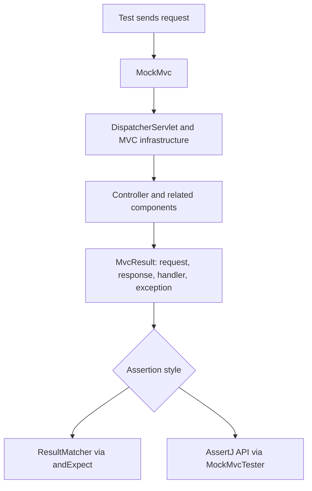

# Distinguishing AssertJ Assertions from Traditional `ResultMatcher`

In Spring MVC testing with `MockMvc`, there are two common ways to verify the result of a request. The traditional approach uses `ResultMatcher` instances such as `status().isOk()`, `content().json(...)`, `jsonPath(...)`, `view().name(...)`, and `model().attribute(...)`. Starting with Spring Framework 6.2, `MockMvcTester` provides an AssertJ-based assertion API, allowing checks to be written fluently such as `hasStatusOk()`, `bodyText()`, and `bodyJson()`.

Both approaches verify results processed by Spring MVC through `MockMvc`. The difference lies in the assertion interface and how tests are organized. `ResultMatcher` is Spring Test's callback contract for inspecting an `MvcResult`; AssertJ is a general-purpose assertion library, while `MockMvcTester` connects MockMvc results to dedicated AssertJ assertions.

## 1. The Role of MockMvc in Both Approaches

`MockMvc` executes simulated requests through `DispatcherServlet` and the Spring MVC infrastructure configured for the test. Requests do not go through a real HTTP server. After controllers, filters, interceptors, message converters, view resolvers, or exception resolvers handle the request, Spring Test provides the result for the test to verify.

Basic processing flow:



Because both rely on MockMvc results, they can verify the same kinds of behavior: HTTP status, headers, response body, JSON paths, view names, model attributes, redirects, forwards, and resolved exceptions. Switching from `ResultMatcher` to `MockMvcTester` does not turn the test into a browser test or an integration test against a real server.

## 2. What Is the Traditional `ResultMatcher`?

`ResultMatcher` is a Spring Test functional interface in the `org.springframework.test.web.servlet` package. It receives an `MvcResult` after the request has been executed and checks an expected condition. The `MockMvc.perform(...)` method returns `ResultActions`; tests chain matchers with `andExpect(...)`.

Example:

```java
mockMvc.perform(get("/api/greetings")
                .accept(MediaType.APPLICATION_JSON))
        .andExpect(status().isOk())
        .andExpect(content().contentTypeCompatibleWith(MediaType.APPLICATION_JSON))
        .andExpect(jsonPath("$.message").value("Hello, Lan"));
```

Matchers such as `status()`, `content()`, and `jsonPath()` are usually obtained from `MockMvcResultMatchers`. Each matcher describes a condition on the result. `andExpect` invokes that matcher with the `MvcResult`; if the condition is not met, the assertion fails and the test is marked failed.

### Commonly Used Matchers

| Matcher | Purpose | Example |
| --- | --- | --- |
| `status()` | Check HTTP status | `status().isOk()` |
| `header()` | Check response headers | `header().exists("ETag")` |
| `content()` | Check body or content type | `content().string("Hello")` |
| `jsonPath()` | Check values in JSON | `jsonPath("$.message").value("Hello")` |
| `cookie()` | Check cookies | `cookie().exists("SESSION")` |
| `view()` | Check logical view name | `view().name("home")` |
| `model()` | Check model and binding errors | `model().attributeExists("product")` |
| `redirectedUrl()` | Check redirect URL | `redirectedUrl("/login")` |
| `forwardedUrl()` | Check forward URL | `forwardedUrl("/WEB-INF/views/home.jsp")` |
| `request()` | Check request attributes/state | `request().asyncStarted()` |
| `flash()` | Check flash attributes | `flash().attribute("notice", "Saved")` |

Matchers are chained sequentially on the same `ResultActions`. This creates a clear pipeline: execute the request once, then check multiple conditions on the same result.

## 3. What Is AssertJ in the Context of MockMvc?

AssertJ is a Java assertion library providing the `assertThat(...)` API and chainable assertions. Rather than calling a matcher factory for each condition, the test starts from the target object and invokes methods describing expectations.

Plain AssertJ example:

```java
assertThat(response.getStatus()).isEqualTo(200);
assertThat(response.getContentAsString()).contains("Hello");
```

Here, AssertJ knows nothing specifically about Spring MVC. It merely checks the Java values passed to it. Spring Framework 6.2 adds `MockMvcTester`, an AssertJ-based API for asserting directly on MockMvc request results without manually extracting fields from `MvcResult`.

Example with `MockMvcTester`:

```java
assertThat(mockMvcTester.get().uri("/api/greetings")
                .accept(MediaType.APPLICATION_JSON))
        .hasStatusOk()
        .bodyJson()
        .extractingPath("$.message")
        .isEqualTo("Hello, Lan");
```

The code reads sequentially: send a GET request, assert a successful status, read the body as JSON, extract the `message` field, and compare the value. These assertions are provided by Spring's AssertJ API for MockMvc results.

## 4. MockMvcTester and Version Requirements

`MockMvcTester` was introduced in Spring Framework 6.2. This API resides in `org.springframework.test.web.servlet.assertj` and requires AssertJ on the test classpath.

| Environment | Usage |
| --- | --- |
| Spring Framework 6.2 or later | `MockMvcTester` can be used if AssertJ is added to the test classpath |
| Spring Framework 6.1 or earlier | Use `MockMvc` with `ResultMatcher`; manual AssertJ on `MvcResult` can be used if needed |
| Spring Boot 3.4 or later | `MockMvcTester` can be injected in tests when MockMvc configuration and AssertJ are supported by Boot |
| Older Spring Boot | Check the managed Spring Framework version and create `MockMvcTester` manually if the Framework supports it |

With Spring Boot, the `spring-boot-starter-test` dependency already brings AssertJ and Spring Test onto the test classpath. For non-Boot Spring Framework projects, declare the corresponding test dependencies, such as Spring Test and AssertJ.

If you already have a `MockMvc` instance, you can create the tester directly:

```java
import org.springframework.test.web.servlet.assertj.MockMvcTester;

MockMvcTester mockMvcTester = MockMvcTester.create(mockMvc);
```

In Spring Boot 3.4+ with an appropriate MVC test setup, you can inject the tester:

```java
@WebMvcTest(GreetingController.class)
class GreetingControllerTest {
    @Autowired
    private MockMvcTester mockMvcTester;
}
```

If the project reports that `MockMvcTester` cannot be found, first check the Spring Framework version selected by dependency management. Adding an import cannot fix the issue when the actual `spring-test` version is still earlier than 6.2.

## 5. Comparing the Same Test in Both Styles

Suppose a controller returns JSON:

```java
@RestController
class GreetingController {
    @GetMapping("/api/greetings")
    Greeting greeting(@RequestParam(defaultValue = "World") String name) {
        return new Greeting("Hello, " + name);
    }
}

record Greeting(String message) {
}
```

### Style A: MockMvc and ResultMatcher

```java
@Autowired
MockMvc mockMvc;

@Test
void returnsGreetingUsingResultMatchers() throws Exception {
    mockMvc.perform(get("/api/greetings")
                    .param("name", "Lan")
                    .accept(MediaType.APPLICATION_JSON))
            .andExpect(status().isOk())
            .andExpect(content().contentTypeCompatibleWith(MediaType.APPLICATION_JSON))
            .andExpect(jsonPath("$.message").value("Hello, Lan"));
}
```

### Style B: MockMvcTester and AssertJ

```java
@Autowired
MockMvcTester mockMvcTester;

@Test
void returnsGreetingUsingAssertJ() {
    assertThat(mockMvcTester.get().uri("/api/greetings")
                    .param("name", "Lan")
                    .accept(MediaType.APPLICATION_JSON))
            .hasStatusOk()
            .bodyJson()
            .extractingPath("$.message")
            .isEqualTo("Hello, Lan");
}
```

Both tests protect the same contract: GET `/api/greetings?name=Lan` must return HTTP 200 and JSON with `message` equal to `Hello, Lan`. The traditional approach expresses each condition as a Spring matcher; the AssertJ approach starts from the request result and chains dedicated assertions.

## 6. Comparing Status, Header, and Response Body Assertions

With `ResultMatcher`, status and headers are typically verified as follows:

```java
mockMvc.perform(get("/api/version"))
        .andExpect(status().isOk())
        .andExpect(header().string("X-Api-Version", "v1"))
        .andExpect(content().contentTypeCompatibleWith(MediaType.TEXT_PLAIN))
        .andExpect(content().string("v1"));
```

With `MockMvcTester`, you can chain status, content type, and body assertions:

```java
assertThat(mockMvcTester.get().uri("/api/version"))
        .hasStatusOk()
        .hasContentTypeCompatibleWith(MediaType.TEXT_PLAIN)
        .bodyText()
        .isEqualTo("v1");
```

AssertJ-style assertions can read like a sentence describing expectations. When you need to check a custom header or a detail without a dedicated assertion, you can inspect the raw result or use the traditional matcher API. Do not assume every legacy matcher has a one-to-one AssertJ method counterpart.

## 7. Comparing JSON Assertions

For JSON, `ResultMatcher` typically uses `jsonPath()` or `content().json(...)`:

```java
mockMvc.perform(get("/api/products/42")
                .accept(MediaType.APPLICATION_JSON))
        .andExpect(status().isOk())
        .andExpect(jsonPath("$.id").value(42))
        .andExpect(jsonPath("$.name").value("Notebook"))
        .andExpect(jsonPath("$.active").value(true));
```

With `MockMvcTester`, you can access the JSON body and extract via JSONPath:

```java
assertThat(mockMvcTester.get().uri("/api/products/42")
                .accept(MediaType.APPLICATION_JSON))
        .hasStatusOk()
        .bodyJson()
        .extractingPath("$.id")
        .isEqualTo(42);
```

You can verify the entire JSON with the traditional matcher:

```java
mockMvc.perform(get("/api/products/42"))
        .andExpect(content().json("""
                {
                  "id": 42,
                  "name": "Notebook",
                  "active": true
                }
                """));
```

Or use the tester's JSON body assertions to compare JSON content in a mode fitting the test's contract. When only one field matters, JSONPath extraction keeps assertions focused on important data and less coupled to unrelated fields.

## 8. Checking View Names and Models

Traditional matchers strongly support MVC applications returning views:

```java
mockMvc.perform(get("/products/42"))
        .andExpect(status().isOk())
        .andExpect(view().name("products/detail"))
        .andExpect(model().attributeExists("product"))
        .andExpect(model().attribute("pageTitle", "Product detail"));
```

With `MockMvcTester`, you can use dedicated assertions for view and model:

```java
assertThat(mockMvcTester.get().uri("/products/42"))
        .hasStatusOk()
        .hasViewName("products/detail")
        .model()
        .containsEntry("pageTitle", "Product detail");
```

In both approaches, the view name is the logical name returned by the controller; this test does not necessarily render a real template. If you want to verify the final HTML, configure the view resolver/template engine and assert the response content, or use HtmlUnit when interacting with forms.

## 9. `ResultMatcher` Is a Contract, While AssertJ Is an Assertion Library

These two concepts are not competing libraries of the same kind:

| Concept | Nature | How It Participates in Tests |
| --- | --- | --- |
| `ResultMatcher` | Spring Test functional interface | Passed into `andExpect(...)` to check `MvcResult` |
| `MockMvcResultMatchers` | Factory suite creating built-in matchers | Provides `status()`, `content()`, `jsonPath()`, `view()`, `model()`, etc. |
| AssertJ | General-purpose assertion library | Provides `assertThat(...)` and fluent assertions |
| `MockMvcTester` | Spring API integrating MockMvc with AssertJ | Provides dedicated assertions on request results |

Because `ResultMatcher` receives `MvcResult`, you can still use AssertJ inside a custom matcher:

```java
ResultMatcher responseContainsGreeting = result ->
        assertThat(result.getResponse().getContentAsString())
                .contains("Hello");

mockMvc.perform(get("/api/greetings"))
        .andExpect(status().isOk())
        .andExpect(responseContainsGreeting);
```

This combines both mechanisms: the pipeline still uses `andExpect(ResultMatcher)`, while the content check is written with AssertJ. This is useful when built-in matchers cannot express an application-specific condition.

## 10. Creating a Custom ResultMatcher

When a condition appears across multiple tests, it can be packaged into a custom matcher to avoid code duplication:

```java
static ResultMatcher responseHeaderContains(String name, String expectedPart) {
    return result -> assertThat(result.getResponse().getHeader(name))
            .contains(expectedPart);
}
```

Usage:

```java
mockMvc.perform(get("/api/version"))
        .andExpect(responseHeaderContains("X-Api-Version", "v1"));
```

A custom `ResultMatcher` is suitable when the project team already has a shared matcher suite or needs compatibility with tests using traditional MockMvc. If it is a one-off assertion, using AssertJ directly on `MvcResult` after `andReturn()` may be simpler:

```java
MvcResult result = mockMvc.perform(get("/api/version"))
        .andReturn();

assertThat(result.getResponse().getStatus()).isEqualTo(200);
assertThat(result.getResponse().getHeader("X-Api-Version")).contains("v1");
```

Do not create custom matchers for every minor assertion. A custom matcher should represent a meaningful rule or be reusable.

## 11. Obtaining the Raw Result When Special Inspection Is Needed

Traditional MockMvc provides `andReturn()` to obtain `MvcResult`, from which you can read the request, response, handler, model and view, or exception:

```java
MvcResult result = mockMvc.perform(get("/products/42"))
        .andExpect(status().isOk())
        .andReturn();

assertThat(result.getResponse().getStatus()).isEqualTo(200);
assertThat(result.getModelAndView()).isNotNull();
assertThat(result.getModelAndView().getViewName())
        .isEqualTo("products/detail");
```

`MvcResult` is Spring Test's raw result object. It is useful when you need to inspect details lacking a matcher or use the general AssertJ API. Check for null before accessing `getModelAndView()` because REST endpoints returning a body typically have no view/model result.

With `MockMvcTester`, the main goal is using the assertion facade. When lower-level details or behavior not provided by the tester API are needed, you can continue using the underlying `MockMvc` in the test or keep an inspection path appropriate to the available API. Do not force every case into a single assertion style.

## 12. Reading Errors When Assertions Fail

With `ResultMatcher`, errors usually indicate which matcher failed and the expected/actual values. For example, expecting status 200 but receiving 404:

```java
mockMvc.perform(get("/missing"))
        .andExpect(status().isOk());
```

The matcher's failure message identifies the incorrect status. You can add `.andDo(print())` while diagnosing to inspect the request and response:

```java
mockMvc.perform(get("/missing"))
        .andDo(print())
        .andExpect(status().isOk());
```

With AssertJ, messages are typically presented along the assertion chain, such as expecting a successful status or a specific JSON value. Body assertions can provide details about the mismatched JSON path or content. When you need the full request/response, you can use `MockMvc` logging or retrieve the raw result appropriately.

Do not confuse an assertion failure with an exception thrown inside the application. An assertion failure means the request produced a result, but that result did not meet expectations. An exception from a controller, filter, or converter is an error during request processing; Spring may handle that exception into a response via `@ExceptionHandler`/`HandlerExceptionResolver`, or let the exception propagate out of the test. Distinguish these two cases when reading stack traces.

## 13. Which Style Should You Choose?

| Scenario | Recommendation |
| --- | --- |
| Project uses Spring Framework prior to 6.2 | Use `ResultMatcher`; use manual AssertJ if needed |
| Project uses Spring Framework 6.2+ and AssertJ | `MockMvcTester` can be used for new tests |
| Tests rely heavily on built-in Spring matchers or custom `ResultMatcher` | Keep the `perform(...).andExpect(...)` pipeline |
| Tests focus on JSON/body and prefer fluent assertions | `MockMvcTester` is often concise and readable |
| Need to inspect very specific `MvcResult` data | `andReturn()` and direct AssertJ may fit well |
| Codebase has an established assertion convention | Prioritize the shared convention for maintainability |

There is no need to migrate all existing tests just because a new API exists. You can use `MockMvcTester` for new tests and keep `ResultMatcher` in tests with custom matchers or stable structures. If standardizing style within a module, choose the expression style that is most readable and consistent for the development team.

## 14. Common Mistakes When Using Both APIs

| Symptom | Possible Cause | Resolution |
| --- | --- | --- |
| Cannot import `MockMvcTester` | `spring-test` is at a version prior to 6.2 | Check the dependency tree and actual Spring Framework version |
| `MockMvcTester` is not injected | Boot version or test auto-configuration does not support it yet, or AssertJ is missing | Check Boot version, AssertJ, and MockMvc configuration; tester can be created from `MockMvc` |
| `assertThat(...)` does not accept the result as expected | Wrong `assertThat` imported or input type is not a MockMvc tester result | Use `org.assertj.core.api.Assertions.assertThat` and the version-appropriate tester API |
| `jsonPath` matcher cannot find field | Body is not JSON, path is wrong, or response differs from expectation | Inspect content type/body and JSON path |
| View assertion fails | Handler returns a REST body, redirect, or different view name | Use the matcher corresponding to the actual result type |
| AssertJ chain is hard to read | Chaining too many unrelated conditions | Split into smaller assertions or use an intermediate result variable |
| Custom matcher is hard to maintain | Matcher is too generic or depends on internal implementation | Only encapsulate meaningful rules and keep failure messages clear |
| Assertion failure mistaken for controller bug | Failing to distinguish an incorrect response from an unhandled exception | Read the matcher failure, response, and exception in `MvcResult` |

## 15. Principles for Writing Maintainable Assertions

1. Understand that `ResultMatcher` is a callback inspecting `MvcResult`, whereas AssertJ is an assertion library; `MockMvcTester` bridges AssertJ with MockMvc.
2. Use `MockMvcTester` when the project runs Spring Framework 6.2 or later and has AssertJ on the test classpath.
3. Use built-in matchers for status, header, content, JSON path, view, and model when the traditional pipeline is already clear.
4. Keep one request for multiple related assertions so you do not repeat calling the endpoint.
5. Choose assertions that focus on key contract elements such as status, media type, body fields, view name, or model attributes.
6. Use a custom `ResultMatcher` when a check rule needs to be reused across traditional MockMvc pipelines.
7. Use `andReturn()` when you need to inspect `MvcResult` data directly that built-in matchers do not cover.
8. Do not mechanically convert all existing tests; maintain a consistent and readable style within each module.
9. Distinguish assertion failures from exceptions thrown during dispatch to find the true root cause.

`ResultMatcher` and AssertJ assertions both help verify Spring MVC behavior after MockMvc processes a request. `ResultMatcher` expresses expectations through the `andExpect` pipeline, while `MockMvcTester` provides an AssertJ-based fluent syntax starting in Spring Framework 6.2. Choosing the API based on platform version, project conventions, and assertion clarity helps tests stay focused on the contract the application must uphold.
