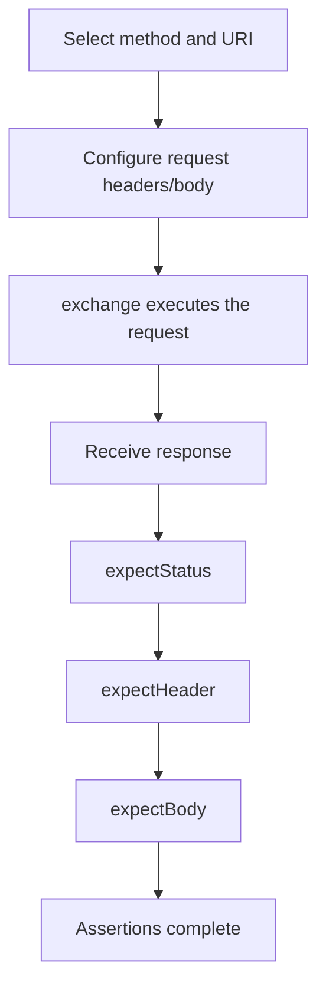

# `exchange` and the `expectStatus`, `expectHeader`, `expectBody` Chain

`WebTestClient` provides a fluent API to send an HTTP request and assert the response step by step. After describing the request method, URL, headers, and body, the test calls `exchange()` to execute the request. The returned result allows chaining `expectStatus()`, `expectHeader()`, and `expectBody()` to verify the status code, response headers, and body content.

In Spring Framework Testing, `WebTestClient` can test both WebFlux and Spring MVC applications. When the goal is to test a Spring MVC application without starting a real server, use `MockMvcWebTestClient` to connect WebTestClient to MockMvc. Thus, the same `exchange()` and `expect...` chain can verify the HTTP contract while server-side requests still pass through `DispatcherServlet` and the mock MVC infrastructure.

## 1. Overview of the request and assertion chain

A test request with WebTestClient typically has this structure:

```java
webTestClient.get()
        .uri("/api/products/42")
        .accept(MediaType.APPLICATION_JSON)
        .exchange()
        .expectStatus().isOk()
        .expectHeader().contentTypeCompatibleWith(MediaType.APPLICATION_JSON)
        .expectBody()
        .jsonPath("$.id").isEqualTo(42);
```

Each part has its own responsibility:

1. `get()` selects the HTTP method; it can be replaced with `post()`, `put()`, `patch()`, `delete()`, and other methods.
2. `uri(...)` specifies the target path or URI.
3. Request methods such as `accept(...)`, `contentType(...)`, `header(...)`, and `bodyValue(...)` configure the outgoing information.
4. `exchange()` executes the request and returns a response specification.
5. `expectStatus()` verifies the HTTP status.
6. `expectHeader()` verifies the response headers.
7. `expectBody()` reads and asserts the response body.

There is no need to call a separate assertion function on each `MvcResult` as when using `MockMvc.perform(...).andExpect(...)`. WebTestClient expresses the verification process as a method chain on the response.



## 2. Using WebTestClient with Spring MVC and MockMvc

`WebTestClient` belongs to the `org.springframework.test.web.reactive.server` package. The package name includes `reactive` because this API is designed in the WebFlux style, but the client can also be connected to Spring MVC through the MockMvc adapter.

For Spring MVC, the integration class is `MockMvcWebTestClient`, in the `org.springframework.test.web.servlet.client` package. This class creates a WebTestClient that routes requests into MockMvc instead of sending them over the network to a running server.

```java
import org.springframework.test.web.reactive.server.WebTestClient;
import org.springframework.test.web.servlet.client.MockMvcWebTestClient;
import org.springframework.web.context.WebApplicationContext;

WebTestClient webTestClient = MockMvcWebTestClient
        .bindToApplicationContext(webApplicationContext)
        .configureClient()
        .baseUrl("http://localhost")
        .build();
```

This configuration uses the `WebApplicationContext` loaded by Spring Test. Controllers, handler mappings, message converters, exception resolvers, interceptors, and related MVC beans will be obtained from that context.

The test class can be configured as follows:

```java
@ExtendWith(SpringExtension.class)
@WebAppConfiguration
@ContextConfiguration(classes = WebTestConfig.class)
class ProductApiTest {
    @Autowired
    private WebApplicationContext webApplicationContext;

    private WebTestClient webTestClient;

    @BeforeEach
    void setUp() {
        webTestClient = MockMvcWebTestClient
                .bindToApplicationContext(webApplicationContext)
                .configureClient()
                .baseUrl("http://localhost")
                .build();
    }
}
```

`@WebAppConfiguration` creates a mock web environment for `WebApplicationContext`; `@ContextConfiguration` provides the necessary bean configuration. Either Java or XML configuration can be used depending on the project.

### Direct setup with a controller

If you only need to test a few controllers with minimal MVC configuration, you can bind directly to the controller:

```java
WebTestClient webTestClient = MockMvcWebTestClient
        .bindToController(new ProductController())
        .build();
```

This approach is suitable for controller-focused tests. Components such as controller advice, validators, interceptors, or custom converters must be registered on the builder if the test depends on them. When you want to use the application's actual MVC configuration, you should bind to `WebApplicationContext`.

## 3. `exchange()` executes the request

`exchange()` is the boundary between describing the request and verifying the response. Before calling `exchange()`, the test configures the method, URI, query parameters, headers, cookies, and body. After calling it, the request is sent and the test receives a response specification to start assertions.

Simple GET example:

```java
webTestClient.get()
        .uri("/api/products")
        .exchange()
        .expectStatus().isOk();
```

GET example with path variable and query parameter:

```java
webTestClient.get()
        .uri(uriBuilder -> uriBuilder
                .path("/api/products/{id}")
                .queryParam("includeReviews", true)
                .build(42))
        .exchange()
        .expectStatus().isOk();
```

You can pass the URI template and variables directly:

```java
webTestClient.get()
        .uri("/api/products/{id}", 42)
        .exchange()
        .expectStatus().isOk();
```

With POST, PUT, or PATCH, it is usually necessary to configure the request body before calling exchange:

```java
webTestClient.post()
        .uri("/api/products")
        .contentType(MediaType.APPLICATION_JSON)
        .bodyValue(new CreateProductRequest("Notebook", 12.5))
        .exchange()
        .expectStatus().isCreated();
```

`bodyValue(...)` tells WebTestClient to write the object into the body using a codec matching the content type. When sending JSON, the test needs Jackson or a corresponding JSON codec on the test classpath. If you want to send a pre-built JSON string, you can use `.bodyValue(jsonString)` with the appropriate content type, making sure that the string itself is valid JSON.

## 4. Verifying HTTP status with `expectStatus()`

`expectStatus()` returns a status assertion spec. This API provides commonly used status verification methods:

| Method | Checked status |
| --- | --- |
| `isOk()` | 200 OK |
| `isCreated()` | 201 Created |
| `isAccepted()` | 202 Accepted |
| `isNoContent()` | 204 No Content |
| `isBadRequest()` | 400 Bad Request |
| `isUnauthorized()` | 401 Unauthorized |
| `isForbidden()` | 403 Forbidden |
| `isNotFound()` | 404 Not Found |
| `isNotAcceptable()` | 406 Not Acceptable |
| `isUnsupportedMediaType()` | 415 Unsupported Media Type |
| `is4xxClientError()` | Any status in the 4xx group |
| `is5xxServerError()` | Any status in the 5xx group |
| `isEqualTo(HttpStatus)` | Compare with a specific status |

Resource creation check example:

```java
webTestClient.post()
        .uri("/api/products")
        .contentType(MediaType.APPLICATION_JSON)
        .bodyValue(new CreateProductRequest("Notebook", 12.5))
        .exchange()
        .expectStatus().isCreated();
```

If you need an exact status without a convenience method, use `isEqualTo(...)`:

```java
webTestClient.get()
        .uri("/api/products/42")
        .exchange()
        .expectStatus().isEqualTo(HttpStatus.OK);
```

Or check an error family when the test only cares that the request failed on the client side:

```java
webTestClient.get()
        .uri("/api/products/unknown")
        .exchange()
        .expectStatus().is4xxClientError();
```

For a stable API contract, you should check a specific status such as 404 or 400 rather than only checking the entire 4xx group. The more specific the assertion, the better it detects when endpoint behavior changes unexpectedly.

## 5. Verifying response headers with `expectHeader()`

`expectHeader()` returns a header assertion spec. You can check `Content-Type`, `Location`, `ETag`, `Cache-Control`, custom headers, and the presence or absence of headers.

```java
webTestClient.get()
        .uri("/api/products/42")
        .accept(MediaType.APPLICATION_JSON)
        .exchange()
        .expectStatus().isOk()
        .expectHeader().contentType(MediaType.APPLICATION_JSON);
```

If the response may include parameters such as charset, check media type compatibility:

```java
.expectHeader()
.contentTypeCompatibleWith(MediaType.APPLICATION_JSON);
```

Some useful header assertions:

| Method | Purpose |
| --- | --- |
| `contentType(mediaType)` | Verify Content-Type |
| `contentTypeCompatibleWith(mediaType)` | Verify compatible media type |
| `exists(name)` | Verify header exists |
| `doesNotExist(name)` | Verify header does not exist |
| `valueEquals(name, values...)` | Verify header values |
| `values(name, consumer)` | Read and inspect the list of header values |
| `location(uri)` | Verify the Location header |
| `cacheControl(value)` | Verify Cache-Control |
| `lastModified(timestamp)` | Verify Last-Modified |
| `etag(value)` | Verify ETag |

Custom header and cache check example:

```java
webTestClient.get()
        .uri("/api/products/42")
        .exchange()
        .expectStatus().isOk()
        .expectHeader().valueEquals("X-Api-Version", "v1")
        .expectHeader().cacheControl(org.springframework.http.CacheControl.noStore());
```

Redirect check example:

```java
webTestClient.post()
        .uri("/api/products")
        .contentType(MediaType.APPLICATION_JSON)
        .bodyValue(new CreateProductRequest("Notebook", 12.5))
        .exchange()
        .expectStatus().is3xxRedirection()
        .expectHeader().location(java.net.URI.create("/api/products"));
```

`Location` typically contains the target URI of a redirect or newly created resource. Verify that the value matches the application contract, especially when the application has a context path or generates absolute URLs.

## 6. Verifying the response body with `expectBody()`

`expectBody()` is used when you want to verify the body as bytes, text, JSON, or a data structure. There are three common forms:

- `expectBody()` to check raw body bytes, JSON paths, or JSON content.
- `expectBody(Class<T>)` to deserialize the body into a Java type.
- `expectBodyList(Class<T>)` to deserialize the body into a list of elements of the same type.

### Text body

```java
webTestClient.get()
        .uri("/api/greeting")
        .exchange()
        .expectStatus().isOk()
        .expectBody(String.class)
        .isEqualTo("Hello, world");
```

### JSON body via JSONPath

```java
webTestClient.get()
        .uri("/api/products/42")
        .accept(MediaType.APPLICATION_JSON)
        .exchange()
        .expectStatus().isOk()
        .expectBody()
        .jsonPath("$.id").isEqualTo(42)
        .jsonPath("$.name").isEqualTo("Notebook")
        .jsonPath("$.active").isEqualTo(true);
```

Each `jsonPath(...)` returns a path assertion to verify values in the JSON. JSONPath lets the test verify part of the response without comparing the entire JSON string.

### Deserialize into an object

```java
webTestClient.get()
        .uri("/api/products/42")
        .accept(MediaType.APPLICATION_JSON)
        .exchange()
        .expectStatus().isOk()
        .expectBody(ProductView.class)
        .value(product -> {
            assertThat(product.id()).isEqualTo(42L);
            assertThat(product.name()).isEqualTo("Notebook");
        });
```

`value(...)` allows using standard AssertJ or JUnit assertions on the deserialized object. This approach is useful when you need to check multiple properties, data types, or relationships between fields.

### List body

```java
webTestClient.get()
        .uri("/api/products")
        .accept(MediaType.APPLICATION_JSON)
        .exchange()
        .expectStatus().isOk()
        .expectBodyList(ProductView.class)
        .hasSize(2);
```

When the body has a complex generic type such as `List<ProductView>` or `Map<String, List<ProductView>>`, use `ParameterizedTypeReference` to preserve generic type information:

```java
ParameterizedTypeReference<List<ProductView>> productListType =
        new ParameterizedTypeReference<>() {};

webTestClient.get()
        .uri("/api/products")
        .exchange()
        .expectStatus().isOk()
        .expectBody(productListType)
        .value(products -> assertThat(products).hasSize(2));
```

## 7. Verifying an empty body and responses without content

For an endpoint returning 204 No Content, the test should verify both the status and the empty body:

```java
webTestClient.delete()
        .uri("/api/products/42")
        .exchange()
        .expectStatus().isNoContent()
        .expectBody().isEmpty();
```

Another option is to request the `Void` type if you do not need to read the body:

```java
webTestClient.delete()
        .uri("/api/products/42")
        .exchange()
        .expectStatus().isNoContent()
        .expectBody(Void.class);
```

Do not call JSON path on a response without a body. If an endpoint returns 204, its contract is to complete the operation without a representation in the response body.

## 8. Combining multiple expectation groups in a single request

An advantage of the fluent API is that it can verify the status, headers, and body of the same response in an easy-to-read sequence:

```java
webTestClient.get()
        .uri("/api/products/42")
        .accept(MediaType.APPLICATION_JSON)
        .exchange()
        .expectStatus().isOk()
        .expectHeader().contentTypeCompatibleWith(MediaType.APPLICATION_JSON)
        .expectHeader().valueEquals("X-Api-Version", "v1")
        .expectBody()
        .jsonPath("$.id").isEqualTo(42)
        .jsonPath("$.name").isEqualTo("Notebook");
```

The test sends only one request. Subsequent expectations inspect that same response without calling the endpoint again. This matters if the request has side effects such as creating an order or updating data.

When there are many assertions on the body, you can extract the body into an object and inspect it:

```java
webTestClient.get()
        .uri("/api/products/42")
        .exchange()
        .expectStatus().isOk()
        .expectBody(ProductView.class)
        .value(product -> assertThat(product)
                .extracting(ProductView::id, ProductView::name)
                .containsExactly(42L, "Notebook"));
```

Choose the appropriate body check: JSONPath is convenient for JSON contracts, while deserializing into an object helps verify data types and multiple conditions in Java.

## 9. Request body, Content-Type, and Accept

`Content-Type` describes the request body format; `Accept` describes the response format the client wants to receive. WebTestClient provides `.contentType(...)` and `.accept(...)` before `exchange()`:

```java
webTestClient.post()
        .uri("/api/products")
        .contentType(MediaType.APPLICATION_JSON)
        .accept(MediaType.APPLICATION_JSON)
        .bodyValue(new CreateProductRequest("Notebook", 12.5))
        .exchange()
        .expectStatus().isCreated()
        .expectHeader().contentTypeCompatibleWith(MediaType.APPLICATION_JSON)
        .expectBody(ProductView.class)
        .value(product -> assertThat(product.name()).isEqualTo("Notebook"));
```

If a request sends a media type not supported by the endpoint, it may receive 415 Unsupported Media Type. If `Accept` requests a representation the endpoint cannot produce, it may receive 406 Not Acceptable. Tests can verify these scenarios:

```java
webTestClient.post()
        .uri("/api/products")
        .contentType(MediaType.TEXT_PLAIN)
        .bodyValue("Notebook")
        .exchange()
        .expectStatus().isUnsupportedMediaType();

webTestClient.get()
        .uri("/api/products/42")
        .accept(MediaType.APPLICATION_XML)
        .exchange()
        .expectStatus().isNotAcceptable();
```

The 415 and 406 expectations depend on `consumes`/`produces` mappings and configured converters. If the application supports XML or another media type, adjust the test according to the actual contract.

## 10. Retrieving the body result for custom assertions

When you want to use another assertion library or inspect a complex structure, you can use `consumeWith(...)` or `returnResult()`.

Example using `consumeWith`:

```java
webTestClient.get()
        .uri("/api/products/42")
        .exchange()
        .expectStatus().isOk()
        .expectBody(ProductView.class)
        .consumeWith(result -> {
            ProductView product = result.getResponseBody();
            assertThat(product).isNotNull();
            assertThat(product.id()).isEqualTo(42L);
        });
```

`consumeWith` receives the result after the body is read and allows executing custom assertions. `returnResult()` returns the exchange result so the test can use it in subsequent steps:

```java
EntityExchangeResult<ProductView> result = webTestClient.get()
        .uri("/api/products/42")
        .exchange()
        .expectStatus().isOk()
        .expectBody(ProductView.class)
        .returnResult();

assertThat(result.getResponseBody()).isNotNull();
assertThat(result.getResponseBody().name()).isEqualTo("Notebook");
```

For a raw response body, you can use `expectBody()` and retrieve the corresponding result. Choose the result type matching the `expectBody` overload in use.

## 11. Combining WebTestClient with MVC-specific assertions

When using `MockMvcWebTestClient`, requests are processed through MockMvc, so tests may still need to verify Spring MVC-specific details such as model attributes or view names. You can obtain an `EntityExchangeResult` from the expectation chain and convert it back to `ResultActions` using `MockMvcWebTestClient.resultActionsFor(...)`.

```java
EntityExchangeResult<String> result = webTestClient.get()
        .uri("/products/42")
        .exchange()
        .expectStatus().isOk()
        .expectBody(String.class)
        .returnResult();

MockMvcWebTestClient.resultActionsFor(result)
        .andExpect(view().name("products/detail"))
        .andExpect(model().attributeExists("product"));
```

This code combines two layers of assertions:

- `WebTestClient` checks the HTTP response through the status, header, and body chain.
- `resultActionsFor(...)` reopens MVC-specific assertions based on the corresponding MockMvc result, such as `view()` and `model()`.

This is useful when a test needs to verify both the HTTP contract and internal controller processing results. If only status/header/body are needed, there is no need to convert to `ResultActions`.

## 12. Distinguishing WebTestClient from MockMvcTester

Spring Framework has multiple HTTP testing APIs with similar syntax. Choose the right one for the test topic:

| API | How to start | How to assert | Scope |
| --- | --- | --- | --- |
| `MockMvc` | `mockMvc.perform(get(...))` | `andExpect(ResultMatcher)` | Spring MVC, mock request/response |
| `MockMvcTester` | `mockMvcTester.get().uri(...)` | AssertJ such as `hasStatusOk()`, `bodyJson()` | Spring MVC, fluent assertions since Spring Framework 6.2 |
| `WebTestClient` | `webTestClient.get().uri(...)` | `exchange().expectStatus().expectHeader().expectBody()` | WebFlux or MVC when bound via adapter |
| `MockMvcWebTestClient` | Builder connecting WebTestClient with MockMvc | Still uses WebTestClient chain; can bridge to MVC assertions | Spring MVC without a real server |

`MockMvcTester` and `WebTestClient` do not share the same API. If a requirement calls for `exchange()`, `expectStatus()`, `expectHeader()`, and `expectBody()`, that is the WebTestClient assertion chain. For MVC applications, bind WebTestClient via `MockMvcWebTestClient` so requests flow through MockMvc.

## 13. When do you need WebTestClient with a real server?

`WebTestClient` can be bound to a controller, an application context, a router function, or a running server. The binding method determines how requests are executed.

When bound with `MockMvcWebTestClient`, requests are processed in a mock environment. There is no network socket or real servlet container. This is the right choice for testing MVC handlers, status, headers, and bodies quickly.

When you need to test the running application over a real HTTP port, you can connect WebTestClient to a running server or use an integration test configuration that starts the server. That case is suitable for testing networking, connectors, TLS, server configuration, and deployment interactions. It has higher overhead and belongs to a different testing scope.

| Goal | Suitable binding |
| --- | --- |
| Test a simple MVC controller | `MockMvcWebTestClient.bindToController(...)` |
| Test MVC configuration in a Spring context | `MockMvcWebTestClient.bindToApplicationContext(...)` |
| Test a WebFlux controller/router | WebTestClient bound to WebFlux infrastructure |
| Test HTTP over a running server | `WebTestClient.bindToServer()` or client connected to the server base URL |

## 14. Common mistakes when writing expectation chains

| Symptom | Possible cause | How to fix |
| --- | --- | --- |
| `MockMvcWebTestClient` not found | Spring Test version too old or missing test module | Check `spring-test` version and dependencies |
| `exchange()` returns status 404 | URI does not match mapping or controller is not registered | Check URL, component scan, and test context |
| Receiving 415 when sending JSON | Missing `Content-Type`, mismatched `consumes` mapping, or unsupported converter | Set `.contentType(APPLICATION_JSON)` and check converters |
| Receiving 406 when requesting JSON | `Accept` does not match `produces` or converter cannot write response | Check `.accept(...)`, mapping, and message converters |
| `expectBody(Class)` fails to deserialize | Body has wrong media type or JSON does not match Java type | Check response Content-Type, body, and DTO |
| JSONPath field not found | Body is not JSON or path is wrong | Inspect actual response and adjust JSONPath |
| Header assertion fails | Header missing or value has different parameters/format | Check actual header and use compatible matcher if appropriate |
| Body assertion fails despite right status | Controller returns content different from contract | Check DTO, serialization, and response data |
| MVC view/model assertions unusable | Only checking HTTP response without bridging back to MockMvc result | Obtain `EntityExchangeResult` and call `resultActionsFor(...)` |

When diagnosing, check in order: request method/URI, request headers/body, status, response headers, and then body. A 4xx status usually indicates the request does not match a mapping or data constraint; a 5xx status usually suggests a server-side error. If the test uses the MockMvc adapter, you can also inspect exceptions and MVC results via the bridge when needed.

## 15. Principles for organizing tests with `exchange()` and `expect...`

1. Use WebTestClient when you want to express HTTP requests/responses with a fluent chain.
2. For Spring MVC without a real server, create the client with `MockMvcWebTestClient` and bind it to a controller or `WebApplicationContext`.
3. Call `exchange()` exactly once per request, then chain expectations on the same response.
4. Use `expectStatus()` to verify a specific status; avoid checking only a status group if the contract requires an exact code.
5. Use `expectHeader()` to verify media type, Location, cache, or custom headers.
6. Use `expectBody()` with JSONPath for field-level assertions; use `expectBody(Class)` when you need a Java object; use `expectBodyList` for lists.
7. Assert an empty body for 204 responses and do not perform JSON assertions on responses without a body.
8. Use `returnResult()` or `consumeWith(...)` when custom assertions or downstream result processing are needed.
9. For MVC-specific assertions such as view name and model, bridge the result with `MockMvcWebTestClient.resultActionsFor(...)`.
10. Choose binding to mock vs. a real server according to the scope under test: MVC logic vs. deployment behavior over HTTP.

`exchange()` marks the point where the request is executed; `expectStatus()`, `expectHeader()`, and `expectBody()` describe the conditions the response must satisfy. With `MockMvcWebTestClient`, this syntax brings the WebTestClient style to Spring MVC testing while still using MockMvc on the server side. When you choose the right binding and verify status, headers, and body together, tests describe the endpoint's HTTP contract more completely.
