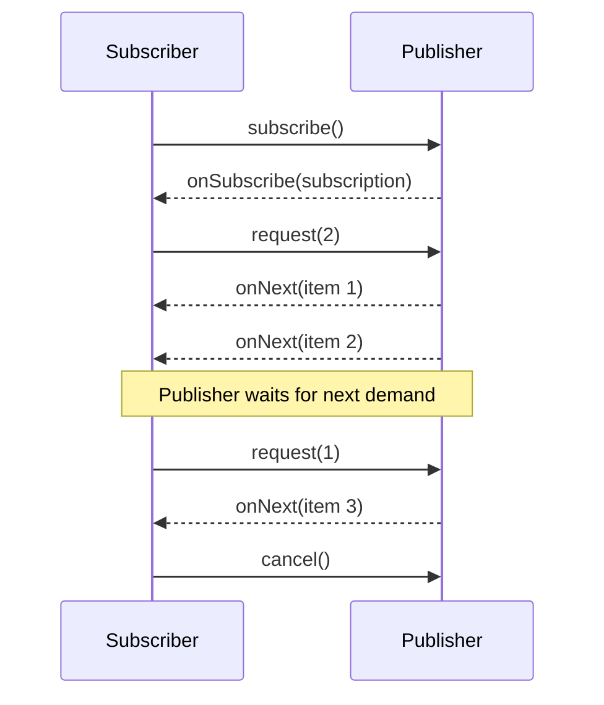
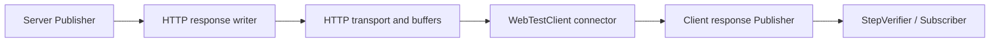

# Testing Backpressure Impact Within Scope

## 1. What is backpressure in a reactive stream?

In Reactive Streams, a `Subscriber` does not have to receive all data as soon as the `Publisher` produces it. The subscriber can request the number of elements it is ready to process via `Subscription.request(n)`. The publisher emits at most the requested number of elements until additional demand arrives or the subscription is cancelled.

Backpressure is the mechanism for regulating the emission rate according to the subscriber's demand. It prevents a slow consumer from forcing a producer to generate unbounded data in memory. When the consumer needs to stop, `Subscription.cancel()` ends consumption and signals the processing chain to release associated work.



Three signals to observe when testing backpressure are:

- **Demand**: the number of elements the subscriber requests via `request(n)`.
- **Emission**: the number of elements the publisher actually emits via `onNext`.
- **Cancellation**: the point at which the subscriber cancels the subscription.

A test that only checks whether the final body has enough data does not verify backpressure behavior. To test the impact of demand, the test must control the consumption pace or observe the publisher at the exact boundary under test.

## 2. Backpressure in Reactive Streams and HTTP are two different boundaries

In a WebFlux application, a controller can return `Flux<T>`. The server-side publisher emits data to the HTTP response writer. On the client side, `WebTestClient` decodes the response into another publisher for the test to consume.



Reactive Streams backpressure exists between publishers and subscribers within each layer. The HTTP protocol does not carry `Subscription.request(n)` calls verbatim from the client to the server-side publisher. TCP flow control or HTTP/2 flow control can throttle byte transmission, but that does not mean a `request(1)` call in the test makes the server publisher emit exactly one object.

Between server and client there are also encoders, decoders, buffers, sockets, and connectors. These components may prefetch or temporarily buffer data. Therefore, when testing over HTTP, distinguish:

1. Whether the client response publisher honors the subscriber's demand.
2. How the server-side source publisher receives demand and cancellation.
3. Whether the overall pipeline bounds buffers or regulates throughput as configured.

`WebTestClient` can test client-side response consumption very well. To draw conclusions about the source publisher, instrument or test that publisher on the server side. Do not assume server-side demand equals the exact count requested by `StepVerifier` on the client side.

## 3. Using StepVerifier to control demand

Reactor Test's `StepVerifier` lets you create a subscriber with a defined initial demand. The second argument of `StepVerifier.create(publisher, initialRequest)` sets the initial request count.

For example, a subscriber starts with zero demand, then requests two elements:

```java
AtomicLong requested = new AtomicLong();

Flux<Integer> source = Flux.range(1, 5)
        .doOnRequest(requested::addAndGet);

StepVerifier.create(source, 0)
        .expectSubscription()
        .expectNoEvent(Duration.ofMillis(100))
        .thenRequest(2)
        .expectNext(1, 2)
        .thenCancel()
        .verify(Duration.ofSeconds(2));

assertThat(requested.get()).isEqualTo(2);
```

In this example:

- `create(source, 0)` subscribes the subscriber without requesting any elements yet.
- `expectSubscription()` confirms the subscription has been established.
- `expectNoEvent(...)` confirms no elements are emitted to the subscriber during the checked interval.
- `thenRequest(2)` generates demand for two elements.
- `expectNext(1, 2)` confirms exactly two elements are consumed.
- `thenCancel()` cancels the subscription after the assertions.
- `doOnRequest(...)` records the demand received by the source publisher.

This is a direct in-process test of the publisher. With `Flux.range`, a demand of two elements propagates to the source in the exact requested count. This result demonstrates how to verify backpressure signals at the Reactive Streams layer without HTTP transport buffers in between.

## 4. Testing streaming responses through WebTestClient

For an endpoint returning a streaming response, `WebTestClient` can retrieve the response publisher with `returnResult(...)`. The following test starts with zero demand, requests a few elements, and cancels the subscription.

```java
@SpringBootTest(webEnvironment = SpringBootTest.WebEnvironment.RANDOM_PORT)
@AutoConfigureWebTestClient
class NumberStreamHttpTest {

    @Autowired
    private WebTestClient webTestClient;

    @Test
    void clientConsumesStreamOnlyWhenItRequestsData() {
        FluxExchangeResult<Integer> result = webTestClient.get()
                .uri("/api/numbers")
                .accept(MediaType.APPLICATION_NDJSON)
                .exchange()
                .expectStatus().isOk()
                .returnResult(Integer.class);

        StepVerifier.create(result.getResponseBody(), 0)
                .expectSubscription()
                .expectNoEvent(Duration.ofMillis(100))
                .thenRequest(2)
                .expectNext(1, 2)
                .thenCancel()
                .verify(Duration.ofSeconds(5));
    }
}
```

Example server-side endpoint:

```java
@RestController
class NumberStreamController {

    @GetMapping(value = "/api/numbers", produces = MediaType.APPLICATION_NDJSON_VALUE)
    Flux<Integer> numbers() {
        return Flux.range(1, 100);
    }
}
```

`returnResult(Integer.class)` does not collect the entire response into a `List`. It returns a `FluxExchangeResult` whose `getResponseBody()` is a publisher allowing the test to control consumption. If `expectBodyList(...)` were used, WebTestClient would collect the body before assertions, so the test could no longer step-control demand as in the example above.

This test proves that the response publisher at the client API boundary emits items to the subscriber only according to the demand granted by `StepVerifier`. It does not prove the server produced only two items. The connector may read ahead and buffer socket data; the HTTP server may also request ahead from the source publisher.

## 5. Observing demand and cancellation on the server-side publisher

When you need to understand how the server receives demand and cancellation, instrument the source publisher using hooks such as `doOnRequest`, `doOnNext`, and `doOnCancel`.

A small probe can record the signals:

```java
@Component
class StreamProbe {

    private final AtomicLong requested = new AtomicLong();
    private final AtomicLong emitted = new AtomicLong();
    private final AtomicBoolean cancelled = new AtomicBoolean();

    void recordRequest(long n) {
        requested.addAndGet(n);
    }

    void recordEmission() {
        emitted.incrementAndGet();
    }

    void recordCancellation() {
        cancelled.set(true);
    }

    void reset() {
        requested.set(0);
        emitted.set(0);
        cancelled.set(false);
    }

    long requested() {
        return requested.get();
    }

    long emitted() {
        return emitted.get();
    }

    boolean cancelled() {
        return cancelled.get();
    }
}
```

Controller attaching the probe to the publisher:

```java
@RestController
class ObservedStreamController {

    private final StreamProbe probe;

    ObservedStreamController(StreamProbe probe) {
        this.probe = probe;
    }

    @GetMapping(value = "/api/observed-numbers", produces = MediaType.APPLICATION_NDJSON_VALUE)
    Flux<Integer> numbers() {
        return Flux.<Integer, Integer>generate(
                        () -> 0,
                        (state, sink) -> {
                            int next = state + 1;
                            sink.next(next);
                            return next;
                        })
                .doOnRequest(probe::recordRequest)
                .doOnNext(value -> probe.recordEmission())
                .doOnCancel(probe::recordCancellation);
    }
}
```

`Flux.generate(...)` generates data synchronously according to the demand granted to the publisher by the server-side subscriber. The probe helps observe request, emission, and cancellation at the source boundary. In a real application, a probe should be replaced with metrics, tracing, or a test-only component with a controlled lifecycle; do not leave shared counters across production requests.

When running the HTTP test, you can retrieve the probe from the ApplicationContext and assert that the server publisher received demand:

```java
@SpringBootTest(webEnvironment = SpringBootTest.WebEnvironment.RANDOM_PORT)
@AutoConfigureWebTestClient
class ObservedStreamHttpTest {

    @Autowired
    private WebTestClient client;

    @Autowired
    private StreamProbe probe;

    @BeforeEach
    void resetProbe() {
        probe.reset();
    }

    @Test
    void observesServerPublisherSignals() {
        FluxExchangeResult<Integer> result = client.get()
                .uri("/api/observed-numbers")
                .accept(MediaType.APPLICATION_NDJSON)
                .exchange()
                .expectStatus().isOk()
                .returnResult(Integer.class);

        StepVerifier.create(result.getResponseBody(), 0)
                .expectSubscription()
                .expectNoEvent(Duration.ofMillis(100))
                .thenRequest(2)
                .expectNext(1, 2)
                .thenCancel()
                .verify(Duration.ofSeconds(5));

        assertThat(probe.requested()).isGreaterThan(0L);
        assertThat(probe.emitted()).isGreaterThan(0L);
    }
}
```

The final assertions confirm that the source publisher received demand and emitted data. Do not replace them with `assertThat(probe.requested()).isEqualTo(2)`: the server writer and transport may request in batches, read ahead, or buffer multiple elements. Server-side demand does not necessarily match the demand requested by the test subscriber.

If you need to verify that cancellation reaches all the way to the source publisher, use a source that does not complete naturally, record `doOnCancel`, and wait for the signal within a finite timeout. Whether cancellation reaches the source can depend on the connector, server container, and how the response is closed. Test the specific behavior of the stack in use; do not treat client subscription cancellation as automatic proof that every layer stopped immediately.

## 6. Testing the impact of cancellation

`cancel()` is a vital part of backpressure. When a consumer no longer needs data, the subscription is cancelled so the producer can stop work. In a long-lived HTTP stream such as SSE, the client may close the response body before the server finishes the stream.

```java
FluxExchangeResult<ServerSentEvent<Long>> result = client.get()
        .uri("/api/events")
        .accept(MediaType.TEXT_EVENT_STREAM)
        .exchange()
        .expectStatus().isOk()
        .returnResult(new ParameterizedTypeReference<ServerSentEvent<Long>>() {});

StepVerifier.create(result.getResponseBody(), 0)
        .expectSubscription()
        .thenRequest(1)
        .assertNext(event -> assertThat(event.data()).isEqualTo(1L))
        .thenCancel()
        .verify(Duration.ofSeconds(5));
```

The test intentionally consumes only one event and cancels the response publisher. If the endpoint produces an infinite stream, this avoids waiting for the body to finish. To verify whether the server frees resources after the client disconnects, instrument the source with `doOnCancel` or inspect related resources. Cancellation assertions should include a timeout to avoid hanging tests.

Do not use a very short finite publisher and conclude that cancellation propagated to the server: the publisher may have finished emitting all data before the client cancelled. To observe cancellation, the source must still be active when the client ends the subscription.

## 7. Distinguishing backpressure from buffering and dropping

Backpressure regulates demand between publisher and subscriber. Certain operators change behavior when a source emits faster than the consumer:

| Operator | Behavior when downstream cannot keep up | What to test |
|---|---|---|
| `onBackpressureBuffer(...)` | Temporarily stores items awaiting consumption, optionally with capacity bounds | Number of buffered items, behavior when buffer is full, and overflow strategy |
| `onBackpressureDrop(...)` | Drops items that cannot be delivered immediately downstream | Which items are dropped and whether drop callback runs |
| `onBackpressureLatest()` | Retains only the latest value while downstream cannot keep up | Consumer receives the latest value according to semantics |
| `limitRate(...)` | Splits upstream demand into smaller batches | Upstream request pattern and prefetch count |

These operators cannot be thoroughly tested with a single fast-completing HTTP request. Create a source capable of emitting independently of demand (a hot source) or test the operator directly with Reactor Test to reproduce a producer outpacing a consumer.

For example, testing a drop operator with a hot source can use `Sinks.Many` and a subscriber with zero initial demand. Sink configuration, buffer, and emission timing must be designed so values emitted before demand are not automatically held inside another sink buffer. In the test, record both the dropped list and received list to demonstrate the exact semantics.

For bounded buffer operators, test both when the buffer is not yet full and when capacity is exceeded. Depending on the overload and overflow strategy, the publisher may emit an error, drop elements, or apply another policy. Assertions must match the strategy chosen by the application.

## 8. Testing `limitRate` and upstream demand volume

`limitRate(n)` throttles downstream requests into batches of upstream requests. It is useful when a source can generate large amounts of data and you want to limit how many elements are requested per turn.

```java
AtomicLong upstreamDemand = new AtomicLong();

Flux<Integer> source = Flux.range(1, 20)
        .doOnRequest(upstreamDemand::addAndGet)
        .limitRate(4);

StepVerifier.create(source, 0)
        .expectSubscription()
        .thenRequest(2)
        .expectNext(1, 2)
        .thenCancel()
        .verify(Duration.ofSeconds(2));

assertThat(upstreamDemand.get()).isPositive();
```

`limitRate(4)` may request upstream according to Reactor's threshold and replenishment mechanism. Do not assume observed total demand always equals 4 or equals the number of elements received downstream; prefetch and low-tide parameters affect request patterns. When verifying an exact request pattern, check the specific overload, configuration, and Reactor version in use, then observe with `doOnRequest`.

When `limitRate` sits on the server side before the HTTP writer, the server may have additional buffering layers. Testing the operator directly with `StepVerifier` gives clearer conclusions about its semantics; real-server tests add evidence that the endpoint still streams responses properly when consumed over HTTP.

## 9. Backpressure in request bodies and response bodies

Backpressure can occur in both directions:

- **Request body**: the server receives data from the client. With WebFlux, a controller can accept `Flux<T>`; the application should process the publisher according to demand and avoid collecting the entire request body into memory for large payloads.
- **Response body**: the server emits data to the client. The client can consume the publisher on demand, cancel the subscription, or process the stream incrementally.

Example endpoint receiving a stream of items and returning the element count:

```java
@PostMapping(value = "/api/import", consumes = MediaType.APPLICATION_NDJSON_VALUE)
Mono<ImportSummary> importItems(@RequestBody Flux<ImportItem> items) {
    return items
            .count()
            .map(count -> new ImportSummary(count));
}
```

The test can send a finite publisher:

```java
Flux<ImportItem> items = Flux.just(
        new ImportItem("A"),
        new ImportItem("B"),
        new ImportItem("C"));

client.post()
        .uri("/api/import")
        .contentType(MediaType.APPLICATION_NDJSON)
        .body(items, ImportItem.class)
        .exchange()
        .expectStatus().isOk()
        .expectBody(ImportSummary.class)
        .value(summary -> assertThat(summary.count()).isEqualTo(3));
```

This test verifies that the request stream is sent and handled properly at the HTTP level. To verify that the server consumes the request body on demand, instrument the client-side publisher and server-side processing pipeline. For request bodies over the network, connectors and sockets also buffer; you cannot conclude that one upstream request corresponds to one JSON record.

If the application calls `collectList()` or an operation buffering the entire body, tests with small payloads may still pass without proving bounded-memory handling of large streams. Add tests with realistic data sizes, body limits, memory metrics, or pipeline inspections when operational requirements demand that guarantee.

## 10. Designing tests to avoid false conclusions

A good backpressure test clearly states the boundary it measures:

| Goal | Suitable testing approach | What can be concluded |
|---|---|---|
| Publisher honors `request(n)` | `StepVerifier` directly on the publisher and `doOnRequest` | Demand and emission at that publisher |
| Client response publisher honors demand | `WebTestClient.returnResult(...)` combined with `StepVerifier` | Client-side subscriber receives only per its demand |
| How server publisher receives demand/cancel | Instrument server publisher with `doOnRequest`/`doOnCancel` in real-server test | Signals observed at server source; may be affected by buffering/transport |
| Buffer/drop/latest operator works properly | Test operator directly with hot source and controlled consumer demand | Operator semantics under constructed conditions |
| HTTP stream works over the network | `bindToServer()` or Spring Boot `RANDOM_PORT` | Response behavior over the running HTTP stack |
| System sustains heavy production load | Load tests, metrics, and resource monitoring in production-like environment | Load behavior under measured configuration and infrastructure |

Do not use a single test to assert that every layer implements backpressure correctly. Publisher unit tests verify Reactor semantics; WebTestClient tests verify HTTP responses; load tests and metrics evaluate behavior under heavy load and producer/consumer speed mismatches on real infrastructure.

## 11. Common mistakes when testing backpressure

| Symptom | Common cause | How to fix |
|---|---|---|
| Test receives data even with initial request 0 | Test observes a different publisher than intended or assertion runs before subscription | Use `StepVerifier.create(publisher, 0)`, `expectSubscription()`, then test demand |
| Server emits more elements than client requested | HTTP writer, connector, or socket buffered/prefetched data | Do not assume 1-to-1 demand across HTTP; instrument server source separately |
| `doOnCancel` is not called immediately | Publisher already completed, server has not detected closed connection, or transport latency | Use an active source, finite timeout, and verify cancellation at the proper layer |
| Test hangs reading response | Endpoint returns non-terminating stream while test collects full body | Use `returnResult`, `StepVerifier`, `thenCancel()`, and timeout |
| Memory grows when consumer is slow | Unbounded operator or transport buffer, or application collects data | Check buffers, overflow strategy, `collectList()`, and codec limits |
| Elements are lost | Using `onBackpressureDrop` or an overflow strategy that discards data | Check operator semantics and verify drops are intentional |
| Request count does not equal received elements | Operator prefetches or requests in batches | Inspect demand pattern rather than assuming one request per element |

When debugging, record demand, emission, cancellation, and actual items reaching the consumer. When HTTP is involved, place probes on both the source publisher and client response publisher to identify which layer introduces buffering or changes consumption pace.

## 12. Scoped backpressure testing workflow

1. Identify which publisher needs testing: data source, request body, response body, or an operator.
2. Test the publisher directly with `StepVerifier` to control demand and verify `request(n)`.
3. If the publisher is used in an endpoint, add `doOnRequest`, `doOnNext`, and `doOnCancel` on the server side to observe source signals.
4. Use `WebTestClient` to retrieve the response publisher via `returnResult(...)`, then control consumer demand with `StepVerifier`.
5. Cancel the subscription once enough data is received and verify cancellation at observable layers.
6. Evaluate buffers, codecs, transport, and memory limits separately; do not infer them solely from how many items the subscriber received.
7. For high-load requirements, add load tests and metrics rather than stretching a single integration test.

Backpressure should be tested against the exact publisher and consumption boundary. `StepVerifier` verifies demand at the Reactive Streams layer; `WebTestClient` verifies the client-side response publisher over HTTP; server-side probes observe demand and cancellation at the source. Separating these layers lets tests draw accurate conclusions about flow control, buffering, and stream termination when consumers stop needing data.
