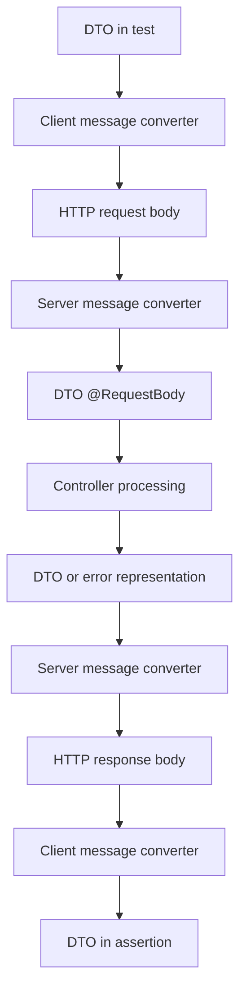

# Testing Serialization, Deserialization, and Error Mapping

When testing a REST API with `RestTestClient`, a request and response pass through several data conversion steps. A Java object in the test is serialized into an HTTP request body; Spring MVC or WebFlux deserializes that body into a controller parameter; the controller returns an object or error; the server serializes the result into a response; and finally `RestTestClient` deserializes the response into the type requested by the test.

Checking only the status code is not enough to verify the data contract. An endpoint may return 201 while the JSON is missing a field, has the wrong type, or is incompatible with the client DTO. Likewise, business errors can be mapped to a status or error body that violates the contract. Tests should verify both request/response conversion and how errors are represented over HTTP.

## 1. Four Conversion Steps in a REST Request

A test that uses a Java object as the request body and reads the response into a DTO can exercise four steps:

1. **Client serialization:** `RestTestClient` converts the Java object into bytes according to the request's `Content-Type`.
2. **Server deserialization:** the application's message converter reads the bytes and constructs the object for the `@RequestBody` parameter.
3. **Server serialization:** the object or error representation returned by the controller is converted into a response body according to `Accept`, `produces`, and server-side converters.
4. **Client deserialization:** `RestTestClient` reads the response body into the Java type requested by the test, based on the response's `Content-Type` and client-side converters.



Each side may use a different set of converters and configuration. In a test bound directly to an application context, these steps still run in a simulated environment while using the loaded MVC/WebFlux configuration. When bound to a live server, requests travel through the HTTP stack and the running server.

## 2. Message Converters and Media Types

Spring uses `HttpMessageConverter` in Spring MVC to read request bodies and write response bodies. WebFlux uses a corresponding codec system. `RestTestClient` also needs client-side converters to serialize requests and deserialize responses.

Some common data formats:

| Media type | Data | Typical converter in Spring MVC |
| --- | --- | --- |
| `application/json` | JSON | `MappingJackson2HttpMessageConverter` in corresponding Spring versions |
| `application/xml` | XML | XML converter when supporting libraries are on the classpath |
| `text/plain` | Plain text | `StringHttpMessageConverter` |
| `application/octet-stream` | Bytes | `ByteArrayHttpMessageConverter` |
| `application/x-www-form-urlencoded` | Form key/value | `FormHttpMessageConverter` |
| `multipart/form-data` | Multipart/file form | Multipart converter and appropriate part converters |

`Content-Type` describes the format of the request body. `Accept` describes the response format the client wants to receive. When a test sends a JSON DTO, set `Content-Type: application/json`; if expecting a JSON DTO back, set `Accept: application/json`.

```java
restTestClient.post()
        .uri("/api/products")
        .contentType(MediaType.APPLICATION_JSON)
        .accept(MediaType.APPLICATION_JSON)
        .body(new CreateProductRequest("Notebook", 12.5))
        .exchange()
        .expectStatus().isCreated()
        .expectHeader().contentTypeCompatibleWith(MediaType.APPLICATION_JSON)
        .expectBody(ProductView.class)
        .value(product -> assertThat(product.name()).isEqualTo("Notebook"));
```

If the request declares the wrong `Content-Type`, the server may fail to find a converter to read the body and return 415 Unsupported Media Type. If `Accept` is incompatible with representations the endpoint can produce, the server may return 406 Not Acceptable.

## 3. Preparing the Test Client and Application Context

`RestTestClient` is the REST service testing API introduced in Spring Framework 7.0. You can bind the client to a controller, an application context, a router function, or a running server. When testing converters, exception handlers, and real application configuration, binding to the application context is usually preferable because the test uses registered beans and configuration.

Example Spring MVC test setup:

```java
@SpringJUnitConfig(WebTestConfig.class)
@WebAppConfiguration
class ProductApiTest {
    @Autowired
    private WebApplicationContext applicationContext;

    private RestTestClient restTestClient;

    @BeforeEach
    void setUp() {
        restTestClient = RestTestClient
                .bindToApplicationContext(applicationContext)
                .build();
    }
}
```

`WebTestConfig` must register the controller, MVC configuration, message converters, validation, and `@RestControllerAdvice` that the test wants to verify. With WebFlux, use the application context or router function matching the reactive application.

If the test only needs a simple controller, you can bind directly:

```java
RestTestClient restTestClient = RestTestClient
        .bindToController(new ProductController(productService))
        .build();
```

When binding directly, additional components such as controller advice, validators, or custom converters must be registered on the builder using the API of the version in use. If the goal is verifying full application configuration, use `bindToApplicationContext(...)`.

To test a started application over real HTTP, use `bindToServer()` and configure the base URL. That scope also covers networking, server connectors, and deployment configuration, unlike tests bound to mock infrastructure.

## 4. Testing Request Serialization and Server Deserialization

Suppose an API accepts a product creation request:

```java
public record CreateProductRequest(
        @NotBlank String name,
        @Positive BigDecimal price) {
}

public record ProductView(
        Long id,
        String name,
        BigDecimal price) {
}
```

The controller receives the request via `@RequestBody`:

```java
@RestController
@RequestMapping("/api/products")
class ProductController {
    @PostMapping(consumes = MediaType.APPLICATION_JSON_VALUE,
                 produces = MediaType.APPLICATION_JSON_VALUE)
    ResponseEntity<ProductView> create(
            @Valid @RequestBody CreateProductRequest request) {
        ProductView result = new ProductView(
                42L, request.name(), request.price());
        return ResponseEntity.status(HttpStatus.CREATED).body(result);
    }
}
```

The test sends a Java object as the request body:

```java
@Test
void serializesRequestAndBindsItToController() {
    CreateProductRequest request = new CreateProductRequest(
            "Notebook", new BigDecimal("12.50"));

    restTestClient.post()
            .uri("/api/products")
            .contentType(MediaType.APPLICATION_JSON)
            .accept(MediaType.APPLICATION_JSON)
            .body(request)
            .exchange()
            .expectStatus().isCreated()
            .expectBody(ProductView.class)
            .value(product -> {
                assertThat(product.id()).isEqualTo(42L);
                assertThat(product.name()).isEqualTo("Notebook");
                assertThat(product.price()).isEqualByComparingTo("12.50");
            });
}
```

When the test passes, the client converter produced a request body that the server converter could read into `CreateProductRequest`. The controller received the expected values and built the response. This test verifies compatibility between both sides in a single flow.

To demonstrate even more clearly that data bound to the right properties, the controller can echo received values or invoke a service with that request. If you need to assert the exact JSON bytes on the wire, test at a separate outbound HTTP client boundary; `RestTestClient` primarily tests the endpoint and server-side processing result.

## 5. Testing Response Deserialization

After the server returns JSON, the test can instruct `RestTestClient` to convert the body into a DTO:

```java
restTestClient.get()
        .uri("/api/products/{id}", 42)
        .accept(MediaType.APPLICATION_JSON)
        .exchange()
        .expectStatus().isOk()
        .expectHeader().contentTypeCompatibleWith(MediaType.APPLICATION_JSON)
        .expectBody(ProductView.class)
        .value(product -> {
            assertThat(product.id()).isEqualTo(42L);
            assertThat(product.name()).isEqualTo("Notebook");
        });
```

`expectBody(ProductView.class)` tells the client-side converter to read the response body into `ProductView`. If the JSON omits an optional field, the Java value may be `null` or a default value depending on the type. If the JSON has a type-incompatible field or an undeserializable structure, the converter may raise a message-reading error.

If you only need to inspect a few JSON fields without creating a DTO, use JSONPath:

```java
restTestClient.get()
        .uri("/api/products/42")
        .exchange()
        .expectStatus().isOk()
        .expectBody()
        .jsonPath("$.id").isEqualTo(42)
        .jsonPath("$.name").isEqualTo("Notebook");
```

JSONPath checks the JSON representation directly. It is helpful when tests focus on the HTTP contract and do not want to couple to a specific Java DTO.

## 6. Deserializing Collections and Generic Types

When the response is a list, do not deserialize into `List.class` and expect elements to automatically have the DTO type. Java type erasure strips element type information unless a full generic type is supplied.

Use `ParameterizedTypeReference`:

```java
ParameterizedTypeReference<List<ProductView>> productListType =
        new ParameterizedTypeReference<>() {};

restTestClient.get()
        .uri("/api/products")
        .accept(MediaType.APPLICATION_JSON)
        .exchange()
        .expectStatus().isOk()
        .expectBody(productListType)
        .value(products -> {
            assertThat(products).hasSize(2);
            assertThat(products.get(0).name()).isEqualTo("Notebook");
        });
```

The same approach can test nested generic types:

```java
ParameterizedTypeReference<ApiEnvelope<List<ProductView>>> responseType =
        new ParameterizedTypeReference<>() {};

restTestClient.get()
        .uri("/api/products")
        .exchange()
        .expectBody(responseType)
        .value(envelope -> assertThat(envelope.data()).isNotEmpty());
```

`ParameterizedTypeReference` retains generic type metadata so the converter can deserialize elements into `ProductView` rather than generic maps. This also gives assertions better type safety.

## 7. Testing Custom Converters

An application may use custom media types or data formats, such as a vendor JSON format `application/vnd.example.product+json`, XML, or an internal format. In that case, tests must use the exact converter configuration deployed by the application.

With Spring MVC, converters can be registered via `WebMvcConfigurer`:

```java
@Configuration
@EnableWebMvc
class ApiWebConfig implements WebMvcConfigurer {
    @Override
    public void extendMessageConverters(
            List<HttpMessageConverter<?>> converters) {
        // Register or adjust custom converters here.
    }
}
```

Use `extendMessageConverters(...)` when adding to or adjusting default converters. `configureMessageConverters(...)` can replace the default converter list if the configuration does not re-add required converters; understand its impact before using it.

The test must set the corresponding media type:

```java
restTestClient.post()
        .uri("/api/products")
        .contentType(MediaType.parseMediaType(
                "application/vnd.example.product+json"))
        .accept(MediaType.APPLICATION_JSON)
        .body(request)
        .exchange()
        .expectStatus().isCreated();
```

To verify that the custom converter is actually used, tests should send and receive data through an endpoint with matching `consumes`/`produces` mappings. If the converter is only registered on the server side while the test client lacks a converter to write or read that media type, an error can occur on the client side before or after the server handles the request.

## 8. Mapping Exceptions to HTTP Responses

In a REST API, business exceptions should not leak stack traces or internal details into responses. Spring MVC can map exceptions to HTTP statuses and error bodies via:

- `@ResponseStatus` on an exception or handler method.
- `ResponseStatusException` thrown from a controller/service.
- `@ExceptionHandler` inside a controller.
- `@RestControllerAdvice` for shared exception handling.
- `ProblemDetail` to represent errors in Problem Details format.

Example business exception:

```java
class ProductNotFoundException extends RuntimeException {
    ProductNotFoundException(long id) {
        super("Product " + id + " was not found");
    }
}
```

The controller throws the exception when the resource is not found:

```java
@GetMapping("/{id}")
ProductView find(@PathVariable long id) {
    return productService.findById(id)
            .orElseThrow(() -> new ProductNotFoundException(id));
}
```

A global exception handler turns the exception into 404 and `ProblemDetail`:

```java
@RestControllerAdvice
class ApiExceptionHandler {
    @ExceptionHandler(ProductNotFoundException.class)
    ResponseEntity<ProblemDetail> handleProductNotFound(
            ProductNotFoundException exception) {
        ProblemDetail problem = ProblemDetail.forStatusAndDetail(
                HttpStatus.NOT_FOUND, exception.getMessage());
        problem.setTitle("Product not found");
        problem.setProperty("code", "PRODUCT_NOT_FOUND");
        return ResponseEntity.status(HttpStatus.NOT_FOUND).body(problem);
    }
}
```

Spring can write `ProblemDetail` under the `application/problem+json` media type. Tests should request and verify the exact status, media type, and error body properties.

## 9. Verifying Error Mapping with RestTestClient

Test for the missing product scenario:

```java
@Test
void mapsMissingProductToProblemDetail() {
    restTestClient.get()
            .uri("/api/products/{id}", 999)
            .accept(MediaType.APPLICATION_PROBLEM_JSON)
            .exchange()
            .expectStatus().isNotFound()
            .expectHeader().contentTypeCompatibleWith(
                    MediaType.APPLICATION_PROBLEM_JSON)
            .expectBody(ProblemDetail.class)
            .value(problem -> {
                assertThat(problem.getStatus()).isEqualTo(404);
                assertThat(problem.getTitle()).isEqualTo("Product not found");
                assertThat(problem.getDetail()).contains("999");
                assertThat(problem.getProperties()).containsEntry(
                        "code", "PRODUCT_NOT_FOUND");
            });
}
```

This test verifies three parts of the error contract:

1. The business exception is mapped to HTTP 404.
2. The response carries the Problem Details media type.
3. The error body contains the status, title, detail, and error code clients can rely on.

Do not check only `is4xxClientError()` when the API explicitly promises 404. An unintended change from 404 to 400 can break client handling even though both are client errors.

If the project returns a custom error DTO instead of `ProblemDetail`, use `.expectBody(ApiError.class)` and assert the corresponding fields. What matters is that tests reflect the error format published to clients.

## 10. Testing Validation Errors and Request Body Read Errors

Validation errors typically occur when `@Valid` checks the DTO after the request body has been deserialized:

```java
@PostMapping
ResponseEntity<ProductView> create(
        @Valid @RequestBody CreateProductRequest request) {
    // Process when data is valid.
}
```

If `name` is blank or `price` is non-positive, Spring may map `MethodArgumentNotValidException` to 400. If the application has `@RestControllerAdvice` standardizing validation errors, tests should assert that error format:

```java
restTestClient.post()
        .uri("/api/products")
        .contentType(MediaType.APPLICATION_JSON)
        .accept(MediaType.APPLICATION_PROBLEM_JSON)
        .body(new CreateProductRequest("", new BigDecimal("-1")))
        .exchange()
        .expectStatus().isBadRequest()
        .expectBody(ProblemDetail.class)
        .value(problem -> {
            assertThat(problem.getStatus()).isEqualTo(400);
            assertThat(problem.getTitle()).isEqualTo("Validation failed");
        });
```

Body-reading errors occur earlier than validation. For example, malformed JSON or an unconvertible data type can raise `HttpMessageNotReadableException`, typically mapped to 400 Bad Request.

```java
restTestClient.post()
        .uri("/api/products")
        .contentType(MediaType.APPLICATION_JSON)
        .body("{invalid-json")
        .exchange()
        .expectStatus().isBadRequest();
```

A malformed-JSON test does not prove Bean Validation works; it tests request body reading. To test validation, send syntactically valid JSON that violates constraints.

## 11. Distinguishing Common HTTP Errors

Errors related to request serialization, deserialization, and mapping usually produce different statuses:

| Status | Common cause | Assertion to check |
| --- | --- | --- |
| 400 Bad Request | Malformed JSON, unreadable data type, validation failure | Status and error body describing the input error |
| 401 Unauthorized | Missing or invalid authentication credentials | Status and `WWW-Authenticate` header if contract requires |
| 403 Forbidden | Authenticated but unauthorized, or invalid CSRF | Status and error representation if present |
| 404 Not Found | Resource does not exist | Status and business error code |
| 406 Not Acceptable | Cannot produce response matching `Accept` | Status; check which media types endpoint supports |
| 415 Unsupported Media Type | Request `Content-Type` is unsupported | Status and `consumes`/converter mapping |
| 500 Internal Server Error | Server error not handled under a specific contract | Status and safe error response without internal details |

Do not collapse every case into one generic assertion. For example, malformed JSON is typically 400, whereas JSON sent with an unsupported `Content-Type` is typically 415. Distinguishing these cases pinpoints whether the bug lies in the body content or the media type.

## 12. Testing `ResponseStatusException` and `@ResponseStatus`

For simple errors, a controller can throw `ResponseStatusException`:

```java
@GetMapping("/{id}")
ProductView find(@PathVariable long id) {
    if (id < 1) {
        throw new ResponseStatusException(
                HttpStatus.BAD_REQUEST, "id must be positive");
    }
    return productService.findById(id)
            .orElseThrow(() -> new ResponseStatusException(
                    HttpStatus.NOT_FOUND, "Product not found"));
}
```

Test asserting statuses:

```java
restTestClient.get()
        .uri("/api/products/0")
        .exchange()
        .expectStatus().isBadRequest();

restTestClient.get()
        .uri("/api/products/999")
        .exchange()
        .expectStatus().isNotFound();
```

A custom exception can use `@ResponseStatus(HttpStatus.NOT_FOUND)`. However, if the API needs a stable error body with error code, title, detail, or extra fields, `@RestControllerAdvice` generally gives clearer control over the representation.

## 13. Verifying Errors Do Not Leak Internal Details

Error responses are both part of the API contract and a security boundary. Tests should ensure responses include useful information for clients without exposing stack traces, SQL, file paths, or infrastructure details.

Example:

```java
restTestClient.get()
        .uri("/api/products/999")
        .accept(MediaType.APPLICATION_PROBLEM_JSON)
        .exchange()
        .expectStatus().isNotFound()
        .expectBody()
        .jsonPath("$.code").isEqualTo("PRODUCT_NOT_FOUND")
        .jsonPath("$.detail").value(detail ->
                assertThat(detail.toString()).doesNotContain("SQLException"))
        .jsonPath("$.trace").doesNotExist();
```

Specific field names depend on the application's error schema. Do not assert a `trace` field if the contract does not define it; instead, verify that sensitive information does not appear in the actual response body or use an error DTO containing only public fields.

For 500 errors, verify a generic error code and safe message. Exception details should be written to server-side logs with a correlation ID for operations teams to trace.

## 14. Distinguishing RestTestClient from Outbound RestClient Testing

The names are similar, but the two problems differ:

| Tool | Target under test | Goal |
| --- | --- | --- |
| `RestTestClient` | REST endpoints of the application under test | Send requests to controllers/routers and assert status, headers, body, and error mapping |
| `RestClient` | HTTP client the application uses to call external services | Test outbound requests, converters, response mapping, and client code error handling |
| `MockRestServiceServer` | Transport boundary of `RestClient` or `RestTemplate` | Simulate external HTTP server, verify requests, and supply mock responses |

If you need to test a service using `RestClient` to call another system, use `MockRestServiceServer`:

```java
RestClient.Builder builder = RestClient.builder()
        .baseUrl("https://catalog.example.test");

MockRestServiceServer mockServer =
        MockRestServiceServer.bindTo(builder).build();

RestClient restClient = builder.build();
```

Then set request expectations and a mock response:

```java
mockServer.expect(requestTo("https://catalog.example.test/products/42"))
        .andExpect(method(HttpMethod.GET))
        .andExpect(header(HttpHeaders.ACCEPT, MediaType.APPLICATION_JSON_VALUE))
        .andRespond(withSuccess("""
                {"id":42,"name":"Notebook","price":12.50}
                """, MediaType.APPLICATION_JSON));

ProductView product = restClient.get()
        .uri("/products/42")
        .accept(MediaType.APPLICATION_JSON)
        .retrieve()
        .body(ProductView.class);

assertThat(product.name()).isEqualTo("Notebook");
mockServer.verify();
```

`MockRestServiceServer` verifies outbound requests and response deserialization of `RestClient`. This is the right way to verify exact HTTP client serialization without hitting the real network. `RestTestClient` focuses on testing the application's own endpoints.

## 15. Common Mistakes and Fixes

| Symptom | Possible cause | Fix |
| --- | --- | --- |
| Server returns 415 when sending DTO | Request missing/wrong `Content-Type` or server lacks converter for that type | Set the right media type and check server-side converters |
| Server returns 400 on valid JSON | JSON shape mismatches DTO or binding/validation failed | Check field names, data types, constructors, and validation constraints |
| Client fails to deserialize response | Mismatched response `Content-Type` or missing client-side converter | Check response headers and client converter setup |
| DTO has `null` fields despite JSON data | Field names, visibility, constructors, or mapping mismatch | Check Jackson/serializer config and DTO |
| Collection holds maps instead of DTOs | Generic type erased during deserialization | Use `ParameterizedTypeReference<List<...>>` |
| Test receives 406 | `Accept` incompatible with `produces` or converter cannot write representation | Check `Accept`, mapping, and server-side converters |
| Business error returns status 500 | Exception handler not loaded or exception unmapped | Register `@RestControllerAdvice` and check test context |
| Error body has wrong schema | Handler returns wrong DTO or wrong content negotiation | Assert status, media type, and every error body field |
| Malformed JSON confused with validation | Request failed deserialization before reaching Bean Validation | Separate malformed JSON tests from valid-JSON constraint-violation tests |
| Test ignores custom converter | Client/controller binding lacks application MVC config | Bind to application context or register converter on builder |

When troubleshooting, determine whether the error happened on the client or server side. If the request failed to serialize, the controller never received it. If the server returned 400/415, inspect `Content-Type`, body, and reading converters. If the server returned a response yet the test failed to deserialize it, inspect response `Content-Type`, target type, and client-side converters. If the status is right but the error body is wrong, check `@RestControllerAdvice` and error views/representations.

## 16. Guidelines for Writing Serialization, Deserialization, and Error Mapping Tests

1. Use DTOs representing the request/response contract and set `Content-Type`/`Accept` explicitly.
2. Verify that request objects bind properly to the controller by asserting echoed data or business effects.
3. Use `expectBody(Class)` to verify response deserialization into DTOs.
4. Use `ParameterizedTypeReference` when responses contain collections or nested generic types.
5. Distinguish 415 media type errors, 400 body-reading errors, 400 validation errors, and 406 response negotiation errors.
6. Verify that business exceptions map to stable statuses and error representations.
7. Use `ProblemDetail` or error DTOs to assert title, detail, error code, and public properties.
8. Never let error responses expose stack traces or infrastructure details.
9. Load the right application context when tests need application converters, validators, or `@RestControllerAdvice`.
10. Use `MockRestServiceServer` for outbound `RestClient`/`RestTemplate`; use `RestTestClient` to test REST endpoints.

A reliable REST test verifies the entire data path: requests serialize properly, the server binds DTOs, responses serialize under published media types, clients read expected types, and errors map to stable HTTP responses. Separating client converters, server converters, and exception handling ensures tests pinpoint exactly which layer violates the contract.
