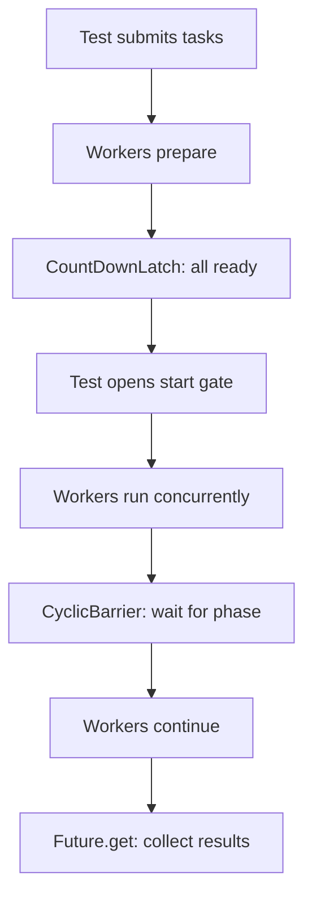

# Latches, Barriers, and Futures for Controllable Ordering

## 1. Why does asynchronous testing need ordering control?

A synchronous test typically calls a method and checks the result right after the method returns. With asynchronous or parallel processing, multiple pieces of work may run on different threads. Start order, completion time, and when one thread sees another thread's data depend on OS and executor scheduling.

If a test uses `Thread.sleep(...)` to wait for a task, it is only guessing that the task has had enough time to run. A fast machine might let the test pass, while a slow machine or heavily loaded CI might cause it to fail. Sleep also does not prove that a thread reached the exact synchronization point the test wants to verify.

Java provides synchronization primitives that help tests establish deterministic ordering:

- `CountDownLatch` allows one or more threads to wait until a counter reaches 0.
- `CyclicBarrier` allows a group of threads to meet at the same point before proceeding together.
- `Future` represents the result of asynchronously executed work; tests can wait, retrieve results, receive errors, or cancel the work.

These tools do not force threads to run on a fixed schedule. They create explicit synchronization points so tests control start conditions, continuation conditions, and how results are collected.

## 2. `CountDownLatch`: waiting for multiple tasks to complete or opening a start gate

`CountDownLatch` is initialized with a count. Each call to `countDown()` decrements the count by one. Threads calling `await()` wait until the count reaches 0. Once at 0, the latch cannot be reset.

```java
CountDownLatch latch = new CountDownLatch(2);

Future<?> first = executor.submit(() -> {
    try {
        prepareFirstResource();
    } finally {
        latch.countDown();
    }
});

Future<?> second = executor.submit(() -> {
    try {
        prepareSecondResource();
    } finally {
        latch.countDown();
    }
});

boolean completed = latch.await(2, TimeUnit.SECONDS);
assertThat(completed).isTrue();
first.get(1, TimeUnit.SECONDS);
second.get(1, TimeUnit.SECONDS);
```

In this example, the test thread only proceeds once both tasks have called `countDown()`. `finally` ensures the count is decremented even if preparation throws an exception; the two `Future.get(...)` calls afterward expose any error from each worker. The `await(timeout, unit)` overload returns `false` if time expires before the latch reaches 0. Using a timeout makes the test fail with a clear error instead of hanging indefinitely.

`CountDownLatch` can also be used in reverse: multiple workers signal they are ready, and then the test opens a shared gate so all start nearly at the same time.

```java
CountDownLatch ready = new CountDownLatch(3);
CountDownLatch start = new CountDownLatch(1);

Callable<Void> worker = () -> {
    ready.countDown();
    start.await();
    performConcurrentWork();
    return null;
};
```

`ready` is a latch counted down when a worker reaches the waiting point. `start` is a one-shot gate latch: initialized with a count of 1, all workers wait on `await()`, and the test calls `start.countDown()` to release them all. This is a useful technique for creating repeatable concurrent contention, such as multiple requests updating the same resource simultaneously.

### 2.1. Distinguishing a completion latch from a start-gate latch

| Purpose | Initialization | Which thread calls `countDown()`? | Which thread calls `await()`? |
|---|---|---|---|
| Wait for N tasks to finish | `new CountDownLatch(N)` | Each worker when finishing the tracked work | Test or coordinator thread |
| Wait for N workers to be ready then start | `new CountDownLatch(N)` for `ready` and `new CountDownLatch(1)` for `start` | Workers decrement `ready`; test decrements `start` | Workers wait on `start`; test waits on `ready` |

Do not call `countDown()` merely because a worker was submitted to an executor. It should be called at the point the test wants to verify, such as after the worker finishes preparation or after the work completes.

### 2.2. Characteristics to remember

- `countDown()` does not block the thread, and calling it again when the count is already 0 has no effect.
- `await()` without a timeout can wait forever if a worker never calls `countDown()`.
- `await(timeout, unit)` returns a boolean; tests must assert this result.
- `await()` can throw `InterruptedException`; preserve interrupt status or propagate the exception per the method signature.
- A latch is single-use. If multiple synchronization rounds are needed, consider `CyclicBarrier` or create a new latch for each round.

Actions before `countDown()` have a happens-before relationship with actions following a successful `await()` on the same latch. Thus a latch does not just wake threads; it also establishes a visibility boundary for data prepared beforehand.

## 3. Using two latches to build a deterministic concurrent test

The following example has two workers waiting together at a start gate. The test opens the gate only after both workers are ready. Then the test waits for results via `Future`.

```java
@Test
void startsTwoWorkersOnlyAfterBothAreReady() throws Exception {
    ExecutorService executor = Executors.newFixedThreadPool(2);
    CountDownLatch ready = new CountDownLatch(2);
    CountDownLatch start = new CountDownLatch(1);

    Callable<Integer> task = () -> {
        ready.countDown();
        if (!start.await(2, TimeUnit.SECONDS)) {
            throw new TimeoutException("Start gate was not opened");
        }
        return calculateValue();
    };

    Future<Integer> first = executor.submit(task);
    Future<Integer> second = executor.submit(task);

    try {
        assertThat(ready.await(2, TimeUnit.SECONDS)).isTrue();
        start.countDown();

        assertThat(first.get(2, TimeUnit.SECONDS)).isEqualTo(10);
        assertThat(second.get(2, TimeUnit.SECONDS)).isEqualTo(10);
    } finally {
        // Open the gate even if a prior assertion fails.
        start.countDown();
        executor.shutdownNow();
        executor.awaitTermination(2, TimeUnit.SECONDS);
    }
}
```

In a real test, `calculateValue()` is the logic that needs to run in parallel. The key point is that both workers must call `ready.countDown()` before waiting on `start`. If one worker fails before that point, `ready.await(...)` times out and the test reports an error instead of hanging.

`finally` opens the gate again to avoid keeping workers waiting if an assertion fails. Afterward, the executor is instructed to stop. If tasks need time to finish cleanly, call `shutdown()` first, wait with `awaitTermination(...)`, and only then call `shutdownNow()` when the deadline is exceeded.

Do not use a static `CountDownLatch` shared across multiple tests. Latch state is mutable and cannot be restored once it reaches 0. Each test should create fresh latches to avoid test-order dependencies or parallel tests interfering with each other.

## 4. Testing race conditions with a start gate

A common example is multiple threads incrementing a counter simultaneously. If the increment operation is not atomic, threads can overwrite each other's updates.

```java
class UnsafeCounter {
    private int value;

    void increment() {
        value++;
    }

    int value() {
        return value;
    }
}
```

A test can spawn multiple workers, hold them at a start gate, and release them together:

```java
@Test
void exposesConcurrentUpdates() throws Exception {
    int workers = 8;
    int incrementsPerWorker = 1_000;
    ExecutorService executor = Executors.newFixedThreadPool(workers);
    CountDownLatch ready = new CountDownLatch(workers);
    CountDownLatch start = new CountDownLatch(1);
    CountDownLatch finished = new CountDownLatch(workers);
    UnsafeCounter counter = new UnsafeCounter();

    try {
        List<Future<?>> futures = IntStream.range(0, workers)
                .mapToObj(index -> executor.submit((Callable<Void>) () -> {
                    ready.countDown();
                    try {
                        if (!start.await(2, TimeUnit.SECONDS)) {
                            throw new TimeoutException("Start gate timed out");
                        }
                        for (int i = 0; i < incrementsPerWorker; i++) {
                            counter.increment();
                        }
                    } finally {
                        finished.countDown();
                    }
                    return null;
                }))
                .toList();

        assertThat(ready.await(2, TimeUnit.SECONDS)).isTrue();
        start.countDown();
        assertThat(finished.await(5, TimeUnit.SECONDS)).isTrue();
        for (Future<?> future : futures) {
            future.get(1, TimeUnit.SECONDS);
        }

        assertThat(counter.value()).isEqualTo(workers * incrementsPerWorker);
    } finally {
        start.countDown();
        executor.shutdownNow();
        executor.awaitTermination(2, TimeUnit.SECONDS);
    }
}
```

This test increases the likelihood of interleaved operations by bringing workers to the same point and opening the gate together. However, a race condition does not necessarily manifest on every run. Concurrent tests can help reproduce bugs, but they do not replace choosing the right synchronization mechanism in production, such as `AtomicInteger`, `synchronized`, or an appropriate lock.

To test a safe counter, replace `UnsafeCounter` with an implementation using `AtomicInteger` and assert the final sum. Do not use the outcome of a single run of an unsafe counter to conclude it is always right or always wrong.

## 5. `CyclicBarrier`: multiple workers meeting at a point

`CyclicBarrier` is initialized with a number of parties. Each thread calls `await()` when it reaches the barrier. Once enough parties arrive, the barrier opens and the threads continue. Unlike `CountDownLatch`, a barrier can be reused for the next synchronization round after the group of threads has passed the current round.

```java
CyclicBarrier barrier = new CyclicBarrier(3);

Callable<Void> worker = () -> {
    prepareLocalState();
    barrier.await();
    runNextPhase();
    return null;
};
```

In this example, the barrier has three parties. If only two workers call `await()`, they will keep waiting until the third party arrives or the barrier is broken. The party count must match the number of threads actually participating in each round.

### 5.1. Using a barrier to test two processing phases

```java
@Test
void waitsUntilBothWorkersFinishPreparation() throws Exception {
    ExecutorService executor = Executors.newFixedThreadPool(2);
    CyclicBarrier barrier = new CyclicBarrier(2);

    Future<String> first = executor.submit(() -> {
        prepareFirstPart();
        barrier.await(2, TimeUnit.SECONDS);
        return "first-ready";
    });

    Future<String> second = executor.submit(() -> {
        prepareSecondPart();
        barrier.await(2, TimeUnit.SECONDS);
        return "second-ready";
    });

    try {
        assertThat(first.get(3, TimeUnit.SECONDS)).isEqualTo("first-ready");
        assertThat(second.get(3, TimeUnit.SECONDS)).isEqualTo("second-ready");
    } finally {
        executor.shutdownNow();
        executor.awaitTermination(2, TimeUnit.SECONDS);
    }
}
```

The barrier ensures both workers have reached the synchronization point before either can cross it. It does not guarantee the first worker will run the subsequent section before the second worker. After the barrier opens, the scheduler still determines execution order.

If a problem requires a specific order—for example, B may only run after A finishes—use a latch or a dependency between tasks. A barrier is for a convergence point of multiple workers, not a sequential queuing tool.

### 5.2. Barrier action

`CyclicBarrier` can accept a `Runnable` that runs once when the last party reaches the barrier, before the parties are released:

```java
AtomicInteger completedPhases = new AtomicInteger();

CyclicBarrier barrier = new CyclicBarrier(2, completedPhases::incrementAndGet);
```

A barrier action is suited for short operations, synchronizing phase state, or recording that all workers have arrived at the meeting point. The action runs on the thread that arrives at the barrier last. Do not put long blocking work or wait on one of the other parties inside the action, as that can deadlock the whole group.

## 6. Reusing a barrier across multiple phases

A barrier can be reused after all parties cross the current round. This suits algorithms divided into multiple phases—for example, each worker computes its own data slice, synchronizes, and then processes the next round.

```java
@Test
void synchronizesTwoPhases() throws Exception {
    ExecutorService executor = Executors.newFixedThreadPool(2);
    AtomicInteger barrierTrips = new AtomicInteger();
    CyclicBarrier barrier = new CyclicBarrier(2, barrierTrips::incrementAndGet);

    Callable<Integer> worker = () -> {
        int localTotal = 0;

        localTotal += calculatePhaseOne();
        barrier.await(2, TimeUnit.SECONDS);

        localTotal += calculatePhaseTwo();
        barrier.await(2, TimeUnit.SECONDS);

        return localTotal;
    };

    Future<Integer> first = executor.submit(worker);
    Future<Integer> second = executor.submit(worker);

    try {
        assertThat(first.get(5, TimeUnit.SECONDS)).isEqualTo(30);
        assertThat(second.get(5, TimeUnit.SECONDS)).isEqualTo(30);
        assertThat(barrierTrips.get()).isEqualTo(2);
    } finally {
        executor.shutdownNow();
        executor.awaitTermination(2, TimeUnit.SECONDS);
    }
}
```

Each worker passes the barrier twice. The barrier action runs once at the end of each phase, so the `barrierTrips` counter reaches 2. In a real test, the return values and `calculatePhase...()` methods must correspond to the algorithm under test.

A barrier is only safely reusable after the previous phase completes. If one party fails or times out while waiting, the barrier can enter the broken state and the remaining parties receive `BrokenBarrierException`. Do not assume the barrier will automatically recover and continue to the next phase.

## 7. Broken barrier, timeout, and interrupt

A barrier can break when one party is interrupted, times out, or fails while waiting. The remaining threads waiting on the same barrier wake up with `BrokenBarrierException`.

```java
try {
    barrier.await(2, TimeUnit.SECONDS);
} catch (InterruptedException ex) {
    Thread.currentThread().interrupt();
    throw new IllegalStateException("Worker interrupted", ex);
} catch (BrokenBarrierException | TimeoutException ex) {
    throw new IllegalStateException("Could not complete the phase", ex);
}
```

If you want to reuse it after a broken barrier, you can call `reset()` once all participating threads have been handled and no thread is still waiting from the old round. `reset()` should not be used to mask synchronization bugs; first find out why a party failed to reach the barrier.

Both `CountDownLatch` and `CyclicBarrier` support waiting with a timeout. Set timeouts on both the synchronization point and `Future.get(...)`. If a timeout is only placed on the outer Future while the worker waits indefinitely in a latch or barrier, the executor may fail to shut down cleanly.

## 8. `Future`: waiting for the result of asynchronous work

`Future<T>` represents the eventual result of a task. When submitting a `Callable<T>` to an `ExecutorService`, the executor returns a Future for the caller to retrieve the result later.

```java
ExecutorService executor = Executors.newSingleThreadExecutor();

try {
    Future<Integer> future = executor.submit(() -> calculateTotal(10, 20));

    Integer result = future.get(2, TimeUnit.SECONDS);
    assertThat(result).isEqualTo(30);
} finally {
    executor.shutdownNow();
    executor.awaitTermination(2, TimeUnit.SECONDS);
}
```

Key methods:

| Method | Meaning |
|---|---|
| `get()` | Waits for completion and returns the result; can wait indefinitely |
| `get(timeout, unit)` | Waits up to the specified time, throwing `TimeoutException` if expired |
| `isDone()` | Indicates whether the task completed, was cancelled, or ended with an exception |
| `isCancelled()` | Indicates whether the Future was cancelled |
| `cancel(true)` | Requests cancellation; can interrupt the running thread if the task supports interruption |

`isDone()` neither retrieves the result nor waits. If the test needs the result or needs to know whether the task threw an exception, it must call `get()`.

### 8.1. Task errors are propagated to the caller

If a `Callable` throws an exception, `Future.get()` throws `ExecutionException`; the real cause is in `getCause()`:

```java
Future<String> future = executor.submit(() -> {
    throw new IllegalArgumentException("Invalid input");
});

ExecutionException error = assertThrows(
        ExecutionException.class,
        () -> future.get(2, TimeUnit.SECONDS));

assertThat(error.getCause())
        .isInstanceOf(IllegalArgumentException.class)
        .hasMessage("Invalid input");
```

This helps tests verify errors originating on the execution thread. Checking only `future.isDone()` could miss a task that terminated due to an error.

### 8.2. Timeout does not automatically cancel the task

```java
Future<String> future = executor.submit(() -> performSlowWork());

assertThrows(TimeoutException.class,
        () -> future.get(100, TimeUnit.MILLISECONDS));
```

`TimeoutException` only indicates the caller waited past the deadline. The task may still keep running. To request cancellation, call `future.cancel(true)` and ensure the task responds properly to interruption.

`cancel(true)` is a best-effort request. It cannot force-stop a task that ignores interrupts or is blocked in an API that does not support cancellation. Asynchronous code should check for interruption or use APIs with appropriate timeout/cancellation support.

### 8.3. `Future.get()` creates a synchronization point and guarantees visibility

By the memory consistency guarantee of `Future`, actions inside the asynchronous computation happen-before actions following a successful `get()` on that Future from another thread. Therefore, tests can wait for the Future to complete and then read the result produced by the task.

Avoid reading a mutable variable updated by a worker while the task is still running and expecting a stable value. Retrieve results through the Future or use synchronized constructs such as atomics, locks, or concurrent collections when sharing state.

## 9. `Future` does not guarantee execution order

If multiple tasks are submitted in sequence, the order of `submit()` calls does not guarantee the order in which they start or finish. Similarly, calling `futureA.get()` before `futureB.get()` only means the test thread waits for A's result first; it does not prove task A ran before task B.

```java
Future<String> first = executor.submit(() -> doFirstWork());
Future<String> second = executor.submit(() -> doSecondWork());

String firstResult = first.get(2, TimeUnit.SECONDS);
String secondResult = second.get(2, TimeUnit.SECONDS);
```

The two tasks can still run in parallel or the second task can finish before the first. If business ordering is mandatory, express the dependency with a latch, queue, `CompletableFuture` chain, or an explicit coordination mechanism.

For example, task B must wait for task A to complete a preparation step:

```java
CountDownLatch firstStepDone = new CountDownLatch(1);

Future<String> first = executor.submit(() -> {
    try {
        performFirstStep();
        return "first-done";
    } finally {
        firstStepDone.countDown();
    }
});

Future<String> second = executor.submit(() -> {
    if (!firstStepDone.await(2, TimeUnit.SECONDS)) {
        throw new TimeoutException("First step did not finish");
    }
    performSecondStep();
    return "second-done";
});
```

This latch guarantees B does not start its dependent step before A has passed the first step. Because `countDown()` is in `finally`, B is still unblocked if A fails; the test must call `first.get()` to detect A's failure instead of only looking at B's result. If B is only allowed to run when A succeeds, propagate success/failure state explicitly or use `CompletableFuture.thenApply/thenCompose` to chain the dependency.

## 10. Combining Latch, Barrier, and Future

The three tools have distinct roles and are often used together:



- Latch fits one-shot signals: waiting for N workers to be ready or waiting for N tasks to complete.
- Barrier fits a meeting point for a group of workers at each phase.
- Future fits retrieving results, observing exceptions, enforcing timeouts, or cancelling individual tasks.

Do not use a barrier just to wait for task completion if a latch expresses the intent more clearly. Do not use Future to infer execution order between tasks when no dependency exists. Do not use a single-use latch for an algorithm requiring multi-round synchronization.

## 11. Applying when testing Spring `@Async`

In Spring, `@Async` allows a method to run on a configured executor. The method can return `Future<T>` or `CompletableFuture<T>` so callers can observe the result. A test can call the Spring bean and await the Future with a timeout.

```java
@Service
class ReportService {

    @Async
    public CompletableFuture<String> generateReport(String reportId) {
        String result = doGenerate(reportId);
        return CompletableFuture.completedFuture(result);
    }
}
```

```java
@SpringBootTest
class ReportServiceTest {

    @Autowired
    private ReportService reportService;

    @Test
    void generatesReportAsynchronously() throws Exception {
        CompletableFuture<String> future = reportService.generateReport("R-100");

        assertThat(future.get(3, TimeUnit.SECONDS)).isEqualTo("READY");
    }
}
```

This example illustrates how to wait for the result of an `@Async` call. The application needs async processing enabled, typically with `@EnableAsync`, and a suitable executor configured. In a real application, `doGenerate(...)` is the work to be processed. `@Async` works through a Spring proxy; calls must go through a Spring-managed bean. Calling an `@Async` method from another method on the same object normally bypasses the proxy and therefore does not create an asynchronous task as expected.

If you need to confirm a task starts or pauses at a specific point, you can inject a test dependency using `CountDownLatch` or an explicitly configured test executor. Do not use `Thread.sleep(...)` to guess that the executor has finished running.

With `@Async`, the processing thread differs from the test thread. A transaction bound to the test method does not automatically propagate to the async thread. If the work needs a transaction, configure transactions on the method/service running in the executor and test transaction boundaries separately.

## 12. Configuring executors and cleaning up after tests

Concurrency tests need to manage executor lifecycles. An executor that is not shut down can keep threads alive after the test completes and slow down or hang the test process.

Common cleanup pattern:

```java
executor.shutdown();
if (!executor.awaitTermination(2, TimeUnit.SECONDS)) {
    executor.shutdownNow();
    executor.awaitTermination(2, TimeUnit.SECONDS);
}
```

`shutdown()` stops accepting new tasks while allowing submitted tasks to finish. `shutdownNow()` requests immediate stop by interrupting running workers and returning tasks that have not started. Even after calling `shutdownNow()`, wait with `awaitTermination(...)` for a finite duration.

Practical rules:

- Use a local executor for simple tests; when using a Spring-managed executor, avoid shutting down the shared bean of the ApplicationContext yourself.
- Choose enough threads to cover the workers waiting on barriers/latches. If all threads in the pool are blocked waiting on another unscheduled task, the test can deadlock.
- Always set timeouts on `await()`, `barrier.await(...)`, and `Future.get(...)`.
- Open latches in `finally` to release workers if an assertion fails.
- Do not share latches, barriers, or mutable state across tests running in parallel without an isolation mechanism.
- Check exceptions on every Future; do not ignore a task just because the test already saw another result.
- Do not swallow `InterruptedException`; if the exception cannot be propagated, restore the interrupt flag via `Thread.currentThread().interrupt()`.

## 13. Common issues and how to handle them

| Symptom | Common cause | How to handle |
|---|---|---|
| Test hangs at `CountDownLatch.await()` | A worker never called `countDown()` or failed before reaching it | Use `await(timeout, unit)`, place `countDown()` at the right point, and check the Future |
| Workers do not pass start gate | Test forgot to call `start.countDown()` | Open the gate after confirming enough workers are ready and open it again in `finally` |
| `CyclicBarrier` is broken | A party timed out, was interrupted, or failed to reach the barrier | Check party count, timeouts, and exceptions from each worker |
| Barrier waits forever | Participating threads are fewer than parties or executor lacks threads | Match party count with worker count and provide enough threads in the pool |
| Test produces unstable results | Using sleep or assuming scheduler ordering | Use latches/barriers to control synchronization points and Future to collect results |
| `Future.get()` throws `ExecutionException` | Task terminated with an exception | Inspect `getCause()` to identify the root error |
| Test times out while task keeps running | `get(timeout)` does not automatically cancel the task | Call `cancel(true)` when appropriate and make the task responsive to interrupts |
| Threads remain alive after test | Executor was not shut down or task ignores interrupts | Shut down the executor, await termination, and set timeouts inside tasks |
| Task B runs even though task A failed | Latch only signaled A left a step, not success | Pass explicit success/failure results or use a dependency chain |

## 14. Choosing a tool by testing goal

| Goal | Tool to use | Reason |
|---|---|---|
| Wait for a number of tasks to complete | `CountDownLatch` | One-shot countdown to 0 |
| Let multiple workers start after all are ready | Two `CountDownLatch` instances | One latch collects ready signals, one acts as the start gate |
| Synchronize multiple workers across phases | `CyclicBarrier` | All parties must arrive before continuing; reusable |
| Retrieve task result and exception | `Future.get(...)` | Caller waits and receives the result with a timeout |
| Request task cancellation | `Future.cancel(true)` | Sends a cancellation/interrupt request |
| Enforce order A before B | Latch or dependency chain | Expresses the dependency explicitly |

When testing asynchronous processing in Spring, identify clearly which points need synchronization, who emits signals, and who waits for them. Latches fit one-shot events, barriers fit meeting points across multiple workers, and Futures fit individual task results and errors. Using the right tools, finite timeouts, and executor cleanup makes parallel tests repeatable, easy to diagnose, and independent of whether threads happen to be scheduled faster or slower.
