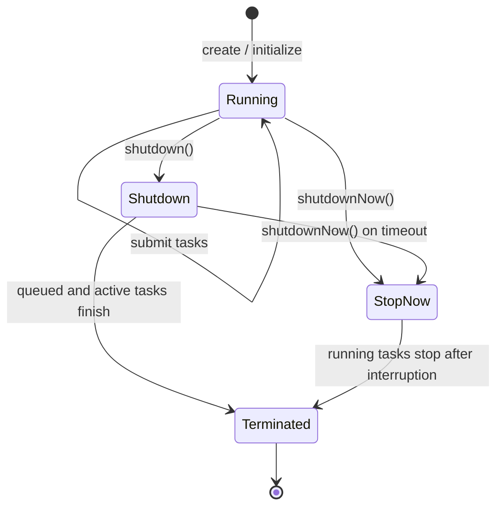

# Shutting Down Executors and Verifying No Tasks Remain After Tests

Asynchronous tests often create or use an `ExecutorService`, `TaskExecutor`, or `ThreadPoolTaskExecutor` to run work outside the main test thread. If an executor is not shut down properly, background threads can keep running after the test finishes, hold onto resources, leak state into other tests, or prevent the test process from exiting.

A reliable test must manage the full task lifecycle: know which tasks were submitted, wait for tasks that must complete, cancel remaining work when needed, shut down the executor, and verify that the thread pool has terminated. Checking only business results without verifying executor shutdown can hide thread leaks.

## 1. Lifecycle of an executor

`Executor` only defines how to submit a `Runnable` for execution. `ExecutorService` extends that abstraction with lifecycle management, returning `Future`, shutdown, and awaiting termination. Implementations such as `ThreadPoolExecutor` maintain worker threads, a task queue, and shutdown state.

The lifecycle typically has these states:



The two main termination operations have distinct semantics:

| API | Behavior | Effect on tasks |
| --- | --- | --- |
| `shutdown()` | Stops accepting new tasks | Already submitted tasks can still run to completion |
| `shutdownNow()` | Attempts to stop the executor immediately | Sends interrupts to running tasks and returns tasks still in the queue that have not started |
| `awaitTermination(timeout, unit)` | Waits for the executor to finish within a deadline | Returns `true` if the executor terminated, `false` if time expired |
| `isShutdown()` | Checks whether the executor has received a shutdown command | Does not prove tasks have finished |
| `isTerminated()` | Checks whether the executor has completely finished | Only `true` after all running tasks have finished |

`shutdown()` does not wait for tasks to finish. To confirm no workers are still running, call `awaitTermination(...)` after shutdown and check the terminated state.

## 2. Shutting down `ExecutorService` in tests

For an executor created specifically for a test, the clearest approach is creating it in `@BeforeEach` or inside the test, then closing it in `@AfterEach` or a `finally` block.

```java
class AsyncJobTest {
    private ExecutorService executor;

    @BeforeEach
    void setUp() {
        executor = Executors.newFixedThreadPool(2);
    }

    @AfterEach
    void tearDown() throws InterruptedException {
        executor.shutdown();

        if (!executor.awaitTermination(5, TimeUnit.SECONDS)) {
            executor.shutdownNow();
            assertThat(executor.awaitTermination(5, TimeUnit.SECONDS))
                    .as("executor should terminate after forced shutdown")
                    .isTrue();
        }

        assertThat(executor.isShutdown()).isTrue();
        assertThat(executor.isTerminated()).isTrue();
    }

    @Test
    void runsJob() throws Exception {
        Future<String> result = executor.submit(() -> "completed");

        assertThat(result.get(2, TimeUnit.SECONDS)).isEqualTo("completed");
    }
}
```

`Future.get(timeout, unit)` both retrieves the result and sets a wait limit. If the task hangs, the test fails with a timeout instead of waiting forever. `tearDown()` still runs shutdown to reclaim the executor.

In practice, shutdown logic can be extracted into a shared helper. The helper should call `shutdown()` first, wait for a finite period, and then call `shutdownNow()` if the deadline expires. Afterward, wait again to confirm workers have finished.

## 3. Distinguishing an empty queue from a terminated executor

An empty queue does not mean the executor has no tasks left. A worker may have already taken a task from the queue and be running it. Conversely, an executor may be in shutdown state while still having tasks waiting to complete.

With `ThreadPoolExecutor`, commonly observed metrics are:

| API | Meaning | Limitation |
| --- | --- | --- |
| `getQueue().isEmpty()` | No tasks currently waiting in the queue | Does not detect tasks already taken by workers and running |
| `getActiveCount()` | Number of workers executing tasks at sample time | Approximate metric; can change immediately after reading |
| `getTaskCount()` | Approximate total number of tasks scheduled for execution | Does not tell exactly which tasks finished |
| `getCompletedTaskCount()` | Number of completed tasks | Does not replace terminated status |
| `isTerminated()` | Executor finished after shutdown | Strong condition confirming the pool has no workers executing tasks |

Therefore, checking `isTerminated()` after `awaitTermination(...)` is the primary evidence. `queue.isEmpty()` and `getActiveCount() == 0` are useful supplemental assertions for diagnostics.

```java
ThreadPoolExecutor pool = (ThreadPoolExecutor) executor;

executor.shutdown();
assertThat(executor.awaitTermination(5, TimeUnit.SECONDS)).isTrue();

assertThat(pool.isTerminated()).isTrue();
assertThat(pool.getActiveCount()).isZero();
assertThat(pool.getQueue()).isEmpty();
```

Do not check `getActiveCount()` right after submitting and conclude a task has finished. The task might not have been picked up by a worker yet, or the count could change between reads.

## 4. Waiting deterministically for tasks to finish

Asynchronous tests should synchronize using `Future`, `CountDownLatch`, `CyclicBarrier`, or a synchronization mechanism suited to the behavior under test. Avoid using `Thread.sleep()` to guess that a task has finished running.

Example using `CountDownLatch` to confirm a task started and finished:

```java
@Test
void waitsForBackgroundTaskBeforeShuttingDown() throws Exception {
    CountDownLatch started = new CountDownLatch(1);
    CountDownLatch finished = new CountDownLatch(1);

    Future<?> future = executor.submit(() -> {
        started.countDown();
        try {
            performWork();
        } finally {
            finished.countDown();
        }
    });

    assertThat(started.await(2, TimeUnit.SECONDS)).isTrue();
    future.get(2, TimeUnit.SECONDS);
    assertThat(finished.await(2, TimeUnit.SECONDS)).isTrue();
}
```

`started` indicates the worker started executing. `finished` is decremented in `finally`, so the test is still notified if the task ends with an exception. If a task throws an exception without a `Future` to read the result, the test needs a separate error-recording channel or should use `Future` so exceptions propagate to the test thread.

If the test needs to control when the task finishes, use a latch as a synchronization gate:

```java
CountDownLatch release = new CountDownLatch(1);
CountDownLatch finished = new CountDownLatch(1);

Future<?> future = executor.submit(() -> {
    try {
        release.await();
        performWork();
    } finally {
        finished.countDown();
    }
});

assertThat(finished.getCount()).isEqualTo(1);
release.countDown();

future.get(2, TimeUnit.SECONDS);
assertThat(finished.await(1, TimeUnit.SECONDS)).isTrue();
```

The test can control exactly when the task is released and await `Future` completion. When a test assertion can fail before `release.countDown()` is called, ensure cleanup still releases the latch or interrupts the task so workers are not held forever.

## 5. Handling timeouts and interrupts properly

`shutdownNow()` does not forcibly kill threads immediately. It sends interrupts to running threads and returns tasks that have not started. Tasks must respond to interruption so the executor can terminate.

A task can support stopping as follows:

```java
void processUntilStopped() {
    while (!Thread.currentThread().isInterrupted()) {
        doOneUnitOfWork();
    }
}
```

If a task waits via `sleep()`, `wait()`, or `CountDownLatch.await()`, interruption normally raises `InterruptedException`. When catching the exception without rethrowing it, restore the interrupt status:

```java
try {
    blockingOperation();
} catch (InterruptedException ex) {
    Thread.currentThread().interrupt();
    return;
}
```

A shutdown helper can apply this flow:

```java
static void shutdownAndAwaitTermination(ExecutorService pool)
        throws InterruptedException {
    pool.shutdown();

    if (!pool.awaitTermination(5, TimeUnit.SECONDS)) {
        List<Runnable> notStarted = pool.shutdownNow();
        if (!pool.awaitTermination(5, TimeUnit.SECONDS)) {
            throw new AssertionError("Executor did not terminate");
        }
        if (!notStarted.isEmpty()) {
            // Record tasks that never started if the test needs to guarantee all ran.
        }
    }
}
```

If `awaitTermination(...)` throws `InterruptedException`, cleanup should continue requesting the executor to stop and then restore the test thread's interrupt status before returning. Do not swallow interruption because it can break test cancellation or runner shutdown.

## 6. Using Spring's `ThreadPoolTaskExecutor`

`ThreadPoolTaskExecutor` is Spring's `TaskExecutor` implementation, wrapping a `ThreadPoolExecutor` and integrating with the Spring container lifecycle. Spring-managed beans are closed when the application context is destroyed.

Example executor configuration:

```java
@Bean
ThreadPoolTaskExecutor applicationTaskExecutor() {
    ThreadPoolTaskExecutor executor = new ThreadPoolTaskExecutor();
    executor.setCorePoolSize(2);
    executor.setMaxPoolSize(2);
    executor.setQueueCapacity(10);
    executor.setThreadNamePrefix("app-async-");
    executor.setWaitForTasksToCompleteOnShutdown(true);
    executor.setAwaitTerminationSeconds(5);
    return executor;
}
```

Two notable shutdown properties:

| Configuration | Meaning |
| --- | --- |
| `setWaitForTasksToCompleteOnShutdown(true)` | When Spring closes the executor, allows already submitted tasks to finish instead of calling `shutdownNow()` immediately |
| `setAwaitTerminationSeconds(5)` | Spring waits at most the configured seconds for the executor to terminate during shutdown |

If `waitForTasksToCompleteOnShutdown(false)` is set, Spring requests immediate shutdown via interruption and queued tasks may never run. Regardless of the policy chosen, long-running tasks should have time limits and respond to interruption.

`ThreadPoolTaskExecutor` also exposes observation APIs such as `getActiveCount()` and `getThreadPoolExecutor()`. The latter returns the underlying executor once initialized; it can be used in tests to inspect the queue, shutdown status, and termination.

## 7. Managing executors owned by the Spring context

When an executor is a singleton bean, the application context is responsible for calling the bean's destroy lifecycle. Spring Test can cache contexts across multiple test classes, so do not call `shutdown()` on a shared bean in `@AfterEach` and expect subsequent tests to still use that bean.

There are two appropriate ways to organize this:

- For a shared executor in the application context, let Spring close the bean when the context is destroyed. Configure completion-waiting policy with `setWaitForTasksToCompleteOnShutdown` and `setAwaitTerminationSeconds`.
- For an executor used by only a single test or test class, create a dedicated instance and close it explicitly during cleanup. This allows immediate termination assertions in the test without affecting the context cache.

Example of a dedicated executor for a test:

```java
class SpringExecutorLifecycleTest {
    private ThreadPoolTaskExecutor executor;

    @BeforeEach
    void setUp() {
        executor = new ThreadPoolTaskExecutor();
        executor.setCorePoolSize(1);
        executor.setMaxPoolSize(1);
        executor.setQueueCapacity(5);
        executor.setThreadNamePrefix("test-worker-");
        executor.setWaitForTasksToCompleteOnShutdown(true);
        executor.setAwaitTerminationSeconds(5);
        executor.initialize();
    }

    @AfterEach
    void tearDown() throws InterruptedException {
        executor.shutdown();

        ThreadPoolExecutor pool = executor.getThreadPoolExecutor();
        assertThat(pool.awaitTermination(5, TimeUnit.SECONDS)).isTrue();
        assertThat(pool.isTerminated()).isTrue();
        assertThat(pool.getActiveCount()).isZero();
        assertThat(pool.getQueue()).isEmpty();
    }
}
```

Here the executor is not a Spring context bean; the test explicitly calls `initialize()` and `shutdown()`. Because the instance is dedicated to the test, closing it after each test does not break cached beans for other tests.

## 8. Testing `@Async` methods

Spring `@Async` dispatches method calls through a configured executor. Tests should invoke the bean through the Spring proxy and wait for the asynchronous result before finishing.

```java
@Configuration
@EnableAsync
class AsyncTestConfig {
    @Bean("taskExecutor")
    ThreadPoolTaskExecutor taskExecutor() {
        ThreadPoolTaskExecutor executor = new ThreadPoolTaskExecutor();
        executor.setCorePoolSize(1);
        executor.setMaxPoolSize(1);
        executor.setQueueCapacity(10);
        executor.setThreadNamePrefix("async-test-");
        executor.setWaitForTasksToCompleteOnShutdown(true);
        executor.setAwaitTerminationSeconds(5);
        return executor;
    }
}
```

Service returning `CompletableFuture`:

```java
@Service
class ReportService {
    @Async("taskExecutor")
    public CompletableFuture<String> generate() {
        return CompletableFuture.completedFuture("report-ready");
    }
}
```

Test awaiting the result:

```java
@SpringJUnitConfig({AsyncTestConfig.class, ReportService.class})
class ReportServiceTest {
    @Autowired
    private ReportService reportService;

    @Test
    void completesAsyncWork() throws Exception {
        CompletableFuture<String> result = reportService.generate();

        assertThat(result.get(2, TimeUnit.SECONDS)).isEqualTo("report-ready");
    }
}
```

Call the method via the injected bean so the call goes through the `@Async` proxy. If one method in the same object directly calls another `@Async` method (self-invocation), that internal call bypasses the proxy under default proxy mechanics and may run synchronously.

If an `@Async` method returns `void`, the test has no `Future` to await or extract exceptions from. In that case, use a synchronization signal like `CountDownLatch`, or design the API to return `CompletableFuture` if callers need to know when work finishes. For failures in `void @Async` methods, configure an `AsyncUncaughtExceptionHandler` to record exceptions.

## 9. Avoid shutting down a shared executor after each test

Spring TestContext Framework caches application contexts to reduce test runtime. Multiple test classes can receive the same singleton bean instance. If one test calls `shutdown()` on a shared `ThreadPoolTaskExecutor` in `@AfterEach`, the next test class may receive the cached context with an already closed executor.

Example unsuitable for a shared singleton bean:

```java
@AfterEach
void tearDown() {
    applicationTaskExecutor.shutdown();
}
```

This cleanup snippet is only appropriate when the test owns the executor and guarantees no other test uses that same instance. For Spring-managed beans, let the context lifecycle close the executor. If you must force context closure after a test class, `@DirtiesContext(classMode = DirtiesContext.ClassMode.AFTER_CLASS)` marks the context as non-reusable and Spring closes it after the class.

`@DirtiesContext` has a cost because the context must be recreated for subsequent tests. Do not use it as the default solution for every asynchronous test; a dedicated executor per test is usually simpler if the goal is solely testing shutdown.

## 10. Verifying no queued or running tasks remain

To prove a test leaves no leftover work, clearly define the expected end conditions:

1. All tasks that were required to run have completed or were intentionally cancelled.
2. No tasks remain in the queue after the executor terminates.
3. No active workers remain.
4. The executor is in the terminated state.

Example with a dedicated `ThreadPoolTaskExecutor`:

```java
@Test
void leavesNoWorkBehind() throws Exception {
    CountDownLatch finished = new CountDownLatch(3);

    for (int i = 0; i < 3; i++) {
        executor.execute(() -> {
            try {
                processItem();
            } finally {
                finished.countDown();
            }
        });
    }

    assertThat(finished.await(3, TimeUnit.SECONDS)).isTrue();

    executor.shutdown();
    ThreadPoolExecutor pool = executor.getThreadPoolExecutor();

    assertThat(pool.awaitTermination(5, TimeUnit.SECONDS)).isTrue();
    assertThat(pool.isTerminated()).isTrue();
    assertThat(pool.getActiveCount()).isZero();
    assertThat(pool.getQueue()).isEmpty();
}
```

In this example, the latch confirms all three tasks finished before shutdown. `awaitTermination` after shutdown confirms the worker pool terminated. Two assertion layers protect two distinct guarantees: expected work completed and the executor was reclaimed.

If a test accepts cancelling unstarted tasks on timeout, record the list returned by `shutdownNow()` and confirm the queue is empty. Do not interpret an emptied queue as tasks having run successfully; those are unstarted tasks evicted from the executor.

## 11. Testing cancelled tasks and Future states

If a test needs to cancel a specific task, use `Future.cancel(true)` to request interruption:

```java
CountDownLatch started = new CountDownLatch(1);

Future<?> future = executor.submit(() -> {
    started.countDown();
    try {
        new CountDownLatch(1).await();
    } catch (InterruptedException ex) {
        Thread.currentThread().interrupt();
    }
});

assertThat(started.await(2, TimeUnit.SECONDS)).isTrue();
assertThat(future.cancel(true)).isTrue();
assertThat(future.isCancelled()).isTrue();
```

`cancel(true)` requests interrupting the running thread if the task has already started. It does not guarantee the task has stopped the instant the method returns. Therefore, still wait for a task-completion signal or wait for the executor to terminate.

`Future.isDone()` returns `true` when a task finishes normally, throws an exception, or is cancelled. It does not distinguish success from failure; use `get()` to retrieve the result and observe exceptions, or check `isCancelled()` when verifying cancellation.

## 12. Periodic tasks and schedulers

`ScheduledExecutorService` and `ThreadPoolTaskScheduler` can run periodic tasks. If a test registers a fixed-rate or fixed-delay task without cancelling the `ScheduledFuture`, the task can keep running after assertions end.

Example:

```java
ScheduledExecutorService scheduler = Executors.newSingleThreadScheduledExecutor();
ScheduledFuture<?> scheduled = scheduler.scheduleAtFixedRate(
        this::refreshCache, 0, 1, TimeUnit.SECONDS);

try {
    assertThat(refreshStarted.await(2, TimeUnit.SECONDS)).isTrue();
} finally {
    scheduled.cancel(true);
    scheduler.shutdown();
    assertThat(scheduler.awaitTermination(5, TimeUnit.SECONDS)).isTrue();
}
```

Cancelling `ScheduledFuture` prevents the next execution and can interrupt the current execution when `true` is passed. Afterward, still shut down the scheduler and await termination. For periodic tasks that may run long, ensure the code responds to interruption.

In Spring, `ThreadPoolTaskScheduler` is also lifecycle-managed as a bean. Configure shutdown and termination waiting per application policy; for test-specific schedulers, retain `ScheduledFuture` to cancel it explicitly during cleanup.

## 13. Parallelism across tests and state leaks

When JUnit runs tests in parallel, multiple tests can submit tasks to an executor simultaneously. One test calling shutdown while another still uses the pool can cause `RejectedExecutionException` or intermittent failures.

Rules to follow:

- Do not share a mutable executor across independent tests if each test must close its own executor.
- Create a separate executor per test, or manage a shared suite-level executor with a clear lifecycle.
- Do not call shutdown from one test if other tests still depend on that singleton bean.
- Wait for the current test's tasks to finish before assertions conclude.
- Do not use thread names or active counts as the sole mechanism to determine which test owns a task.
- When verifying no threads leaked, use a distinct thread name prefix for the test executor and check the pool's official lifecycle rather than scanning all JVM threads fragilely.

If a test must prove threads of a specific executor finished, `ThreadPoolExecutor.isTerminated()` is more reliable than searching every thread in the JVM. The JVM may also hold threads from the test runner, logging, database pools, or other frameworks; do not assert that the entire JVM has zero threads.

## 14. Common issues and how to handle them

| Symptom | Possible cause | How to handle |
| --- | --- | --- |
| Test finishes yet process does not exit | Executor still has live worker threads | Call shutdown and await termination during cleanup |
| `isShutdown()` is true yet tasks keep running | Shutdown does not wait for active tasks to finish | Use `awaitTermination()` and then check `isTerminated()` |
| Queue is empty yet workers keep running | Tasks were already taken from the queue by workers | Check active tasks and termination |
| `shutdownNow()` called yet executor does not terminate | Tasks ignore interrupts or are blocked in uninterruptible operations | Design tasks to respond to interruption and add I/O timeouts |
| Next test gets `RejectedExecutionException` | Previous test shut down the shared executor bean in the context cache | Let Spring manage the lifecycle or create a dedicated executor for the test |
| Test occasionally fails when checking active count | Reading metric while tasks are still transitioning state | Synchronize with Future/latch and await termination before assertions |
| Task fails yet test passes | Fire-and-forget task did not propagate exception to the test | Use Future or record exceptions via a handler/latch |
| Scheduled task keeps running | `ScheduledFuture` was not retained or cancelled | Cancel the task and shut down the scheduler |
| `awaitTermination` times out | Task runs too long, deadlocks, or ignores interrupts | Investigate the task, set timeouts, and use shutdownNow when needed |

## 15. Principles for writing tests that leave no tasks behind

1. Identify whether the executor belongs to the test or the application context.
2. For dedicated executors, close them in `@AfterEach` or `finally` so cleanup still runs if an assertion fails.
3. Call `shutdown()` to stop accepting new tasks; wait with `awaitTermination()` for a finite deadline.
4. If the deadline expires, call `shutdownNow()` and wait another period to confirm workers stopped.
5. Use `Future.get(timeout, unit)` or latches to synchronize tasks; avoid `Thread.sleep()`.
6. Check `isTerminated()` after waiting; an empty queue or `isShutdown()` alone is insufficient.
7. For `ThreadPoolTaskExecutor`, configure an appropriate completion-waiting policy and shutdown timeout.
8. Let Spring close shared executor beans when the context is destroyed; do not shut down that bean after each test if the context is cached.
9. For `@Async`, invoke through the Spring proxy and use `Future`/`CompletableFuture` when results must be awaited.
10. Cancel `ScheduledFuture` for periodic tasks and verify the scheduler has terminated.

Reclaiming executors is part of the correctness of asynchronous testing. Tests must wait for expected work to complete, shut down executors according to ownership, and verify the terminated state. Combining deterministic synchronization with timeouts and explicit shutdown policies ensures tests do not leave behind workers or pending tasks that interfere with other tests.
