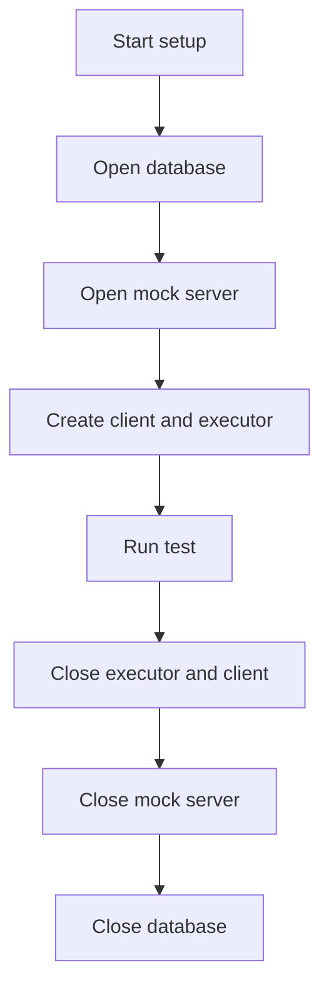

# Recovering Data and Closing Resources When Initialization Fails

## 1. Why Must Test Setup Have a Recovery Path?

An integration test often needs to prepare multiple components before running assertions: a database, schema, container, mock HTTP server, message broker, temporary directory, executor, or Spring `ApplicationContext`. Initialization can fail at any step. For instance, the database starts but the mock server fails to bind a port; the broker connects but migrations fail; or one bean initializes while the next bean throws an exception.

If a test only cleans up at the end of the happy path, a mid-setup failure can leave behind containers, threads, sockets, files, or half-written data. Those leftover resources make subsequent tests order-dependent, hold ports, leak connections, or leave the database dirty.

Reliable setup must guarantee three things:

1. **Track each resource immediately upon acquiring it.** When a later step fails, the test knows what needs closing.
2. **Close in reverse order of acquisition.** Dependent resources must be stopped before the resources they rely on.
3. **Preserve the original initialization failure.** If cleanup also fails, the cleanup error must be recorded as secondary rather than masking the root cause.

Data recovery also requires clear boundaries. Transaction rollback can suffice for tests running on the same thread and within the same transaction, but it does not automatically undo changes committed by real HTTP requests, `@Async` work, or another worker.

## 2. The Acquire-and-Release Principle

Think of setup as a chain of resource allocations:



If the database is opened before the mock server, and the mock server before the executor, teardown should close the executor first, then the mock server, and finally the database. The executor may be querying the database or sending requests to the mock server; closing the database first could cause in-flight work to fail during cleanup.

The general rule is **last acquired, first released**. This mirrors how Java handles multiple resources in `try-with-resources`.

### 2.1. Using `try-with-resources` for Resources Implementing `close()`

If a resource implements `AutoCloseable`, prefer `try-with-resources`:

```java
try (MockWebServer server = new MockWebServer()) {
    server.start();

    WebTestClient client = WebTestClient.bindToServer()
            .baseUrl(server.url("/").toString())
            .build();

    // Send request and verify response.
}
```

When exiting the `try` block, Java invokes `close()` even if the body throws an exception. If the body already failed and `close()` also throws, the cleanup exception is attached to the primary error as a suppressed exception. As a result, the original failure is never lost.

`try-with-resources` also closes multiple resources in reverse declaration order:

```java
try (DatabaseContainer database = startDatabase();
     MockWebServer server = startMockServer(database)) {

    runIntegrationTest(database, server);
}
```

In this example, `server` is closed before `database`. If initializing the second resource fails after the first succeeded, Java still closes the first resource. The requirement is that the second resource's factory must clean up its own internal allocations if it fails before returning a closeable object.

### 2.2. Registering Each Resource Immediately Upon Creation

When setup involves multiple dynamic steps, you can use a scope to manage resources. The scope stores each resource as soon as acquisition succeeds and closes them in reverse order.

```java
final class ResourceScope implements AutoCloseable {

    private final Deque<AutoCloseable> resources = new ArrayDeque<>();
    private boolean closed;

    <T extends AutoCloseable> T add(T resource) {
        if (closed) {
            throw new IllegalStateException("Resource scope is already closed");
        }
        resources.push(resource);
        return resource;
    }

    @Override
    public void close() throws Exception {
        if (closed) {
            return;
        }
        closed = true;

        Exception firstFailure = null;
        while (!resources.isEmpty()) {
            try {
                resources.pop().close();
            } catch (Exception closeFailure) {
                if (firstFailure == null) {
                    firstFailure = closeFailure;
                } else {
                    firstFailure.addSuppressed(closeFailure);
                }
            }
        }

        if (firstFailure != null) {
            throw firstFailure;
        }
    }
}
```

`add(...)` uses `push`, so the most recently added resource sits at the top of the deque and is closed first. The scope continues closing remaining resources even if one `close()` fails; the first failure is thrown, and subsequent cleanup failures are attached as suppressed exceptions.

Using the scope with `try-with-resources`:

```java
try (ResourceScope resources = new ResourceScope()) {
    DatabaseContainer database = resources.add(startDatabase());

    MockWebServer server = resources.add(new MockWebServer());
    server.start();

    ExecutorService executor = Executors.newFixedThreadPool(4);
    resources.add(() -> stopExecutor(executor));

    runTestScenario(database, server, executor);
}
```

The final snippet illustrates registering resources in acquisition order; in real code, wrap the executor in an `AutoCloseable` adapter if you need `shutdown()` and `awaitTermination()` before `shutdownNow()`. What matters is registering the managed object right after creating it, before subsequent initialization steps that may throw.

If `startDatabase()` or a resource constructor allocates several internal components and throws before returning, the outer scope cannot close an object it never received. That factory or constructor must roll back its internal allocations inside `catch` or `finally`.

## 3. Initializing Multiple Resources in JUnit and Cleaning Up on Setup Failure

For resources living across an entire test class, you can use `@BeforeAll` and `@AfterAll`. However, do not assume every step in `@BeforeAll` succeeds before cleanup is registered.

```java
@TestInstance(TestInstance.Lifecycle.PER_CLASS)
class ExternalServiceIntegrationTest {

    private ResourceScope resources;
    private DatabaseContainer database;
    private MockWebServer server;

    @BeforeAll
    void startEnvironment() throws Exception {
        resources = new ResourceScope();
        try {
            database = resources.add(startDatabase());

            server = resources.add(new MockWebServer());
            server.start();

            initializeSchema(database);
        } catch (Exception | Error setupFailure) {
            try {
                resources.close();
            } catch (Exception cleanupFailure) {
                setupFailure.addSuppressed(cleanupFailure);
            }
            throw setupFailure;
        }
    }

    @AfterAll
    void stopEnvironment() throws Exception {
        if (resources != null) {
            resources.close();
        }
    }
}
```

This example registers the database right after starting it, then registers the mock server before calling `start()`. If server startup or schema initialization fails, the `catch` block closes already registered resources. `ResourceScope.close()` is idempotent, so additional cleanup from lifecycle callbacks will not double-close resources.

In a real project, `startDatabase()` and `initializeSchema(...)` must be implemented according to the infrastructure in use. The example does not mandate a specific database.

Do not place cleanup solely in `@AfterAll` while letting `@BeforeAll` perform multi-step initialization without rollback. Later lifecycle callbacks may not run across every kind of initialization failure or extension failure encountered during test setup. Handling errors directly inside the setup step ensures acquired resources are released immediately when setup fails.

For per-method resources, use `@BeforeEach`/`@AfterEach` with the same principle: if setup fails mid-way, close everything already created before throwing. When possible, encapsulate setup inside a factory returning an `AutoCloseable` fixture and use that fixture via `try-with-resources` in the test.

## 4. Self-Closing Fixtures with `AutoCloseable`

A fixture can group multiple resources and test data into a single object. The test opens the fixture in `try-with-resources`, ensuring it is always closed at the end.

```java
final class ApiTestFixture implements AutoCloseable {

    private final ResourceScope resources = new ResourceScope();
    private final DatabaseContainer database;
    private final MockWebServer server;

    private ApiTestFixture() throws Exception {
        try {
            database = resources.add(startDatabase());

            server = resources.add(new MockWebServer());
            server.start();

            initializeSchema(database);
            seedBaselineData(database);
        } catch (Exception | Error setupFailure) {
            try {
                resources.close();
            } catch (Exception cleanupFailure) {
                setupFailure.addSuppressed(cleanupFailure);
            }
            throw setupFailure;
        }
    }

    static ApiTestFixture start() throws Exception {
        return new ApiTestFixture();
    }

    DatabaseContainer database() {
        return database;
    }

    MockWebServer server() {
        return server;
    }

    @Override
    public void close() throws Exception {
        resources.close();
    }
}
```

Test using the fixture:

```java
@Test
void callsExternalApi() throws Exception {
    try (ApiTestFixture fixture = ApiTestFixture.start()) {
        WebTestClient client = WebTestClient.bindToServer()
                .baseUrl(fixture.server().url("/").toString())
                .build();

        // Stub response, call endpoint, and assert.
    }
}
```

If `initializeSchema(...)` or `seedBaselineData(...)` fails, the constructor closes already registered resources before propagating the error. If the test body fails, `try-with-resources` closes the fixture. If `close()` also fails, Java preserves the test error as the primary exception and records the cleanup error under suppressed exceptions.

A constructor should avoid heavy side effects when avoidable. A `start()` factory clearly communicates that the operation can fail and returns the fixture only after all setup steps have succeeded.

## 5. Preserving the Original Error When Cleanup Also Fails

Suppose the database starts successfully, but the mock server fails to start. While closing the database, the Docker daemon also returns an error. If the cleanup exception replaces the port-bind error, the true cause of the setup failure becomes hard to diagnose.

When cleaning up manually, use `addSuppressed(...)` to preserve both:

```java
try {
    startMockServer();
} catch (IOException setupFailure) {
    try {
        database.close();
    } catch (Exception cleanupFailure) {
        setupFailure.addSuppressed(cleanupFailure);
    }
    throw setupFailure;
}
```

With `try-with-resources`, Java applies suppressed exception handling automatically. When managing a resource list manually, keep cleaning up the remaining resources even if one close call throws.

When investigating failures, inspect both the primary exception and the suppressed exceptions list. The primary exception explains why setup or the test failed; suppressed exceptions show which cleanup steps also ran into trouble.

## 6. Spring `ApplicationContext` When Bean Initialization Fails

Spring manages the lifecycle of beans inside an `ApplicationContext`. When a context closes normally, Spring invokes registered destruction callbacks such as `@PreDestroy`, `DisposableBean.destroy()`, or a destroy method declared on `@Bean`.

If context refresh fails, Spring attempts to destroy singletons that were successfully created during refresh. However, a partially initialized bean may not yet be fully registered with the container's destruction mechanism. If an initialization method opens a socket or container itself and then throws mid-way, that bean must close the resources it already created before throwing.

A successfully initialized bean can declare a close method:

```java
@Configuration
class TestInfrastructureConfiguration {

    @Bean(destroyMethod = "close")
    ManagedMockServer managedMockServer() throws IOException {
        ManagedMockServer server = new ManagedMockServer();
        try {
            server.start();
            return server;
        } catch (IOException | RuntimeException | Error setupFailure) {
            try {
                server.close();
            } catch (Exception cleanupFailure) {
                setupFailure.addSuppressed(cleanupFailure);
            }
            throw setupFailure;
        }
    }
}
```

`destroyMethod = "close"` tells Spring to close the bean when the context closes. The `catch` block handles the case where `start()` fails before the factory method returns the bean to the container. These are two separate cleanup paths: internal cleanup for partial initialization, and a destruction callback for a bean that was successfully created.

If a bean implements `DisposableBean`, `destroy()` can be used. If using `@PreDestroy`, ensure Jakarta Annotations is on the classpath and the callback resides on a Spring-managed bean. Never create a resource manually in a static field and expect Spring to discover and close it automatically.

### 6.1. `@DirtiesContext` Does Not Replace Cleanup of External Resources

`@DirtiesContext` marks a Spring test context to be evicted from the cache and closed. Closing the context triggers lifecycle cleanup for Spring-managed beans. It does not automatically know about files, sockets, executors, or containers created manually outside the context.

If a test opens a `MockWebServer`, executor, or temporary directory manually, register it with an appropriate lifecycle or close it directly. Adding `@DirtiesContext` alone does not guarantee external non-Spring resources are released.

## 7. Using JUnit Extension Store for Resources Tied to Test Context Lifecycle

When an extension manages resources shared across a test class or test context, `ExtensionContext.Store` can hold the resource. JUnit closes `CloseableResource` instances when the corresponding store reaches the end of its lifecycle.

```java
class ExternalEnvironmentExtension implements BeforeAllCallback {

    private static final ExtensionContext.Namespace NAMESPACE =
            ExtensionContext.Namespace.create(ExternalEnvironmentExtension.class);

    @Override
    public void beforeAll(ExtensionContext context) throws Exception {
        Environment environment = context.getStore(NAMESPACE)
                .getOrComputeIfAbsent(
                        Environment.class,
                        key -> new Environment(),
                        Environment.class);

        environment.start();
    }

    static final class Environment implements ExtensionContext.Store.CloseableResource {

        private final ResourceScope resources = new ResourceScope();

        void start() throws Exception {
            try {
                resources.add(startDatabase());
                MockWebServer server = resources.add(new MockWebServer());
                server.start();
            } catch (Exception | Error setupFailure) {
                try {
                    resources.close();
                } catch (Exception cleanupFailure) {
                    setupFailure.addSuppressed(cleanupFailure);
                }
                throw setupFailure;
            }
        }

        @Override
        public void close() throws Throwable {
            resources.close();
        }
    }
}
```

The store holds `Environment` before `start()` is called. If `start()` fails, `Environment` is already registered in the store, and the `catch` block still immediately closes any opened resources. When the store closes, JUnit invokes `close()` as a final lifecycle safeguard. `ResourceScope` is idempotent, so cleanup never causes double-closing.

This pattern fits extensions that need to manage context-scoped resources. For a single test, `try-with-resources` is usually simpler. Avoid using `Store` as a global registry when resources must be isolated per test.

## 8. Testcontainers and Mock Servers: Let Extensions Manage Lifecycle

When using Testcontainers with JUnit 5, `@Testcontainers` and `@Container` let the extension manage starting and stopping containers according to the class or test method lifecycle:

```java
@Testcontainers
@SpringBootTest
class RepositoryIntegrationTest {

    @Container
    static final PostgreSQLContainer<?> postgres =
            new PostgreSQLContainer<>("postgres:16-alpine");

    @DynamicPropertySource
    static void databaseProperties(DynamicPropertyRegistry registry) {
        registry.add("spring.datasource.url", postgres::getJdbcUrl);
        registry.add("spring.datasource.username", postgres::getUsername);
        registry.add("spring.datasource.password", postgres::getPassword);
    }
}
```

A static container is managed according to the test class lifecycle by the Testcontainers extension. `@DynamicPropertySource` values are supplied so Spring configures the datasource with the container's actual endpoint. Ensure the container starts before Spring needs to read connection properties, according to your extension's lifecycle and library version.

Do not call `start()`/`stop()` manually again if `@Container` already manages it. If starting a container manually in custom code, use `try/finally` or an `AutoCloseable` object that owns that lifecycle.

For `MockWebServer`, use `try-with-resources`, a JUnit extension, or a Spring bean with `destroyMethod = "shutdown"`/`close` depending on the library version's API. Choose the shutdown method provided by the library and register it immediately after creating the server.

## 9. Restoring Database Data After Tests

There are several strategies for keeping the database clean between tests. Choose based on transaction boundaries and the type of application running.

### 9.1. Rolling Back the Test Transaction

For repositories or services called on the same thread and participating in the test's transaction, `@Transactional` on the test generally rolls back changes after each test:

```java
@SpringBootTest
@Transactional
class OrderRepositoryTest {

    @Autowired
    private OrderRepository orderRepository;

    @Test
    void createsOrder() {
        orderRepository.save(new Order("ORDER-01"));

        assertThat(orderRepository.findByCode("ORDER-01")).isPresent();
    }
}
```

Spring Test rolls back test transactions by default after test completion unless configured otherwise with `@Commit` or `@Rollback(false)`. This works effectively for tests sharing the same transaction manager and thread.

Do not assume this rollback covers all work spawned by the test. With `RANDOM_PORT`, HTTP requests run on server threads; with `@Async`, tasks run on executors; with message listeners, consumers run on separate threads. Those transactions can commit independently, leaving data behind after the test transaction rolls back.

### 9.2. Explicitly Cleaning Up Data After Tests

For real HTTP integration tests or async tasks, clean up data in `@AfterEach`:

```java
@SpringBootTest(webEnvironment = SpringBootTest.WebEnvironment.RANDOM_PORT)
class OrderHttpIntegrationTest {

    @Autowired
    private OrderRepository orderRepository;

    @AfterEach
    void cleanDatabase() {
        orderRepository.deleteByTestRunId(TEST_RUN_ID);
    }
}
```

The example uses an identifier dedicated to the test run. In parallel tests, generate a unique ID per method rather than sharing a common constant. Cleanup should delete only within the test's own data scope so other tests remain unaffected.

When foreign-key relationships exist, delete in dependency order: child tables before parent tables, or use explicitly designed cascades. Ensure cleanup runs in an appropriate transaction and waits for asynchronous tasks to finish before deleting data they might still write.

### 9.3. Using `@Sql` to Prepare and Clean Data

Spring Test supports running SQL scripts at specific test phases:

```java
@SpringBootTest
@Sql(
        scripts = "/sql/order-test-data.sql",
        executionPhase = Sql.ExecutionPhase.BEFORE_TEST_METHOD)
@Sql(
        scripts = "/sql/clean-order-test-data.sql",
        executionPhase = Sql.ExecutionPhase.AFTER_TEST_METHOD)
class OrderControllerIntegrationTest {
    // Test uses the seeded data.
}
```

Setup scripts create required data; cleanup scripts delete data after the test. Write idempotent cleanup scripts so re-running them does not fail if data was only partially created. If a setup script fails mid-way before the test method starts, do not rely solely on `AFTER_TEST_METHOD`; ensure the fixture or lifecycle owner can trigger cleanup for partially initialized state.

For parallel tests or shared databases, avoid full-table wipes such as `DELETE FROM orders` if other tests are using that table. Use namespaces, tenants, or test-run IDs to restrict data scope.

### 9.4. Restoring a Snapshot or Baseline State

For systems hard to roll back via transactions, you can create a baseline state before tests and restore it afterward. For example, create a dedicated schema per test class, load standard fixtures, and drop the schema at the end.

Snapshots fit when creating the initial state is expensive, though you must account for sequences, foreign keys, triggers, extensions, and data written by background workers. Snapshot restoration must occur after all relevant workers have stopped; otherwise workers may write data immediately after the reset.

Never restore an entire shared database while tests run in parallel. Separating databases, schemas, or containers per test class or test run is safer and more predictable.

## 10. Restoring Global State and Non-Database Resources

Tests sometimes alter JVM state such as system properties, default timezone, locale, or working directory. These values do not automatically roll back with database transactions.

Example saving and restoring a system property:

```java
String previous = System.getProperty("app.feature.enabled");
try {
    System.setProperty("app.feature.enabled", "true");
    runTestScenario();
} finally {
    if (previous == null) {
        System.clearProperty("app.feature.enabled");
    } else {
        System.setProperty("app.feature.enabled", previous);
    }
}
```

If changing the default timezone or locale, likewise save the old value and restore it in `finally`. Global mutations can affect parallel tests; when isolation is impossible, use JUnit resource locks or avoid mutating global state in tests.

For temporary directories, prefer JUnit's `@TempDir`:

```java
@Test
void writesTemporaryReport(@TempDir Path tempDir) throws IOException {
    Path report = tempDir.resolve("report.txt");
    Files.writeString(report, "test report");

    assertThat(Files.readString(report)).isEqualTo("test report");
}
```

JUnit manages the temporary directory lifecycle and cleans it up according to its configured scope. If calling `Files.createTempDirectory(...)` manually, register cleanup yourself and delete contents recursively in `finally`/`close()`.

For threads or executors, wait for tasks to finish or cancel them before closing the database, server, or files those tasks use. Cleaning up resources along the dependency graph matters more than calling `close()` on everything in an arbitrary order.

## 11. When Spring Context Initialization Fails

Some failures happen before a test method even starts: a bean cannot be created, the datasource fails to connect, migrations fail, or server configuration is invalid. In those cases, `@BeforeEach` and `@AfterEach` on the test class are not reliable places to recover resources created during context bootstrap.

Divide ownership as follows:

| Resource | Where lifecycle should be owned | Cleanup mechanism |
|---|---|---|
| Spring-managed bean opening sockets or executors | Bean factory and Spring context | `destroyMethod`, `@PreDestroy`, or `DisposableBean` |
| Container managed by Testcontainers extension | JUnit/Testcontainers extension | `@Container` and `@Testcontainers` |
| Resource created by a test method | Test method or fixture | `try-with-resources` |
| Resource created by a JUnit extension | `ExtensionContext.Store` | `Store.CloseableResource` |
| Data in same-thread transaction | Spring Test transaction | Default rollback |
| Data committed by HTTP/async workers | Test fixture or cleanup script | Delete by test ID after workers finish |

If a partially initialized bean opens a resource and fails, the bean factory or initialization method itself must close that resource. If the resource was returned and the bean registered successfully, Spring can close it when the context closes.

Avoid placing external resources into static initializers or static fields without a lifecycle owner. Static initialization can fail before JUnit extensions or the Spring context have a chance to register cleanup.

## 12. Cleanup Must Be Idempotent and Continue When One Step Fails

Cleanup may be invoked from multiple paths: a catch block on setup failure, `@AfterAll`, an extension store, or `try-with-resources`. Therefore, close methods should be safe to call repeatedly if the lifecycle design allows invocation from multiple callbacks.

```java
final class ManagedServer implements AutoCloseable {

    private boolean started;
    private boolean closed;

    void start() throws IOException {
        if (closed) {
            throw new IllegalStateException("Server is already closed");
        }
        if (!started) {
            // Bind socket and initialize server resources.
            started = true;
        }
    }

    @Override
    public void close() throws IOException {
        if (closed) {
            return;
        }
        closed = true;
        if (started) {
            // Stop accepting requests, close connections and release socket.
            started = false;
        }
    }
}
```

This is an illustrative structure; real code must handle the state where socket binding succeeds while a subsequent initialization step fails. Ideally, split acquisition into independently closeable steps and register each resource as soon as it is acquired.

Cleanup should keep closing other resources when one `close()` fails. Otherwise, a failure closing a mock server could prevent the database container from ever stopping. Collecting cleanup errors via suppressed exceptions preserves complete diagnostics while still releasing the remaining resources.

## 13. Avoiding Races Between Cleanup and Asynchronous Work

Do not close a resource while tasks may still use it. For example, if an executor is writing to the database while cleanup drops the schema, the task may fail or recreate data after the reset.

The shutdown sequence should be:

1. Stop accepting new work.
2. Wait for running tasks to complete within a finite timeout.
3. Cancel remaining tasks if the timeout expires and wait for threads to stop.
4. Close clients or mock servers that tasks were calling.
5. Clean up database data and close the database container.

With `ExecutorService`:

```java
static void stopExecutor(ExecutorService executor) throws InterruptedException {
    executor.shutdown();
    if (!executor.awaitTermination(3, TimeUnit.SECONDS)) {
        executor.shutdownNow();
        if (!executor.awaitTermination(3, TimeUnit.SECONDS)) {
            throw new IllegalStateException("Executor did not terminate");
        }
    }
}
```

If a task ignores interrupts, `shutdownNow()` cannot force the thread to stop. Tasks should enforce I/O timeouts, check for interruption, and release their own resources in `finally`.

With Spring `@Async`, await `Future`/`CompletableFuture` completion before cleanup. If an async method returns `void`, establish an observable completion signal such as a latch or a completion state checked with a timeout. Never use sleep to guess that a background task has stopped.

## 14. Common Mistakes and How to Fix Them

| Symptom | Common cause | Solution |
|---|---|---|
| Container keeps running after test setup fails | Cleanup only at end of test or `@AfterAll` | Register resource right after acquisition; clean up in catch and lifecycle callbacks |
| Mock server holds port on subsequent run | Server started but never closed when assertion or setup fails | Use `try-with-resources` or an `AutoCloseable` fixture |
| Cleanup error hides initialization failure | Cleanup exception thrown instead of original exception | Use suppressed exceptions or let `try-with-resources` manage them |
| Database retains data after test | HTTP/async request committed in separate transaction | Clean up by test ID after workers complete |
| Test passes alone but fails in parallel | Shared global data or resources | Use dedicated schemas/IDs/containers or lock shared resources |
| Context closed but socket stays open | Socket created manually outside Spring bean lifecycle | Wrap resource in a bean with destroy callbacks or an extension/fixture |
| Context refresh fails and resource bean leaks | Resource opened in init before bean registered completely | Clean up partial initialization inside factory/init method |
| Executor writes data after DB reset | Cleanup ran before async task finished | Shut down executor, wait/cancel tasks, then restore database |
| Failure closing one resource skips closing others | Cleanup loop aborts on first exception | Continue closing all resources and collect suppressed exceptions |
| Database reset breaks other tests | Deleting or restoring all shared data | Isolate databases/schemas or delete by test identifier |

## 15. Checklist for Designing Safe Setup and Teardown

- Identify who owns each resource's lifecycle: Spring, JUnit extension, Testcontainers, or test method.
- Record each resource immediately after creating it.
- If a factory fails before returning a resource, the factory itself must close internal allocations.
- Close resources in reverse acquisition order.
- Use `try-with-resources` for `AutoCloseable` resources.
- For multi-step setup in `@BeforeAll`/`@BeforeEach`, clean up already created parts inside `catch` before rethrowing.
- Keep the setup exception as the primary error and attach cleanup errors via `addSuppressed(...)`.
- Make cleanup idempotent if multiple lifecycle callbacks can invoke it.
- Use transaction rollback only when changes genuinely reside in that transaction.
- For real HTTP, `@Async`, and message consumers, clean up data after workers complete.
- Never reset data or global state currently in use by another test.
- Set finite timeouts when waiting on workers and shutdown.
- Use `@TempDir` or fixtures with cleanup for temporary files.
- Do not treat `@DirtiesContext` as a way to close every external non-Spring resource.

Reliable test infrastructure does more than prepare the success path. It also releases everything already initialized when a mid-way step fails, preserves the root cause, and restores data within the scope owned by the test. Clear ownership design, reverse-order cleanup, and accurate transaction boundaries help tests run independently, repeatably, and without leaking resources into subsequent runs.
