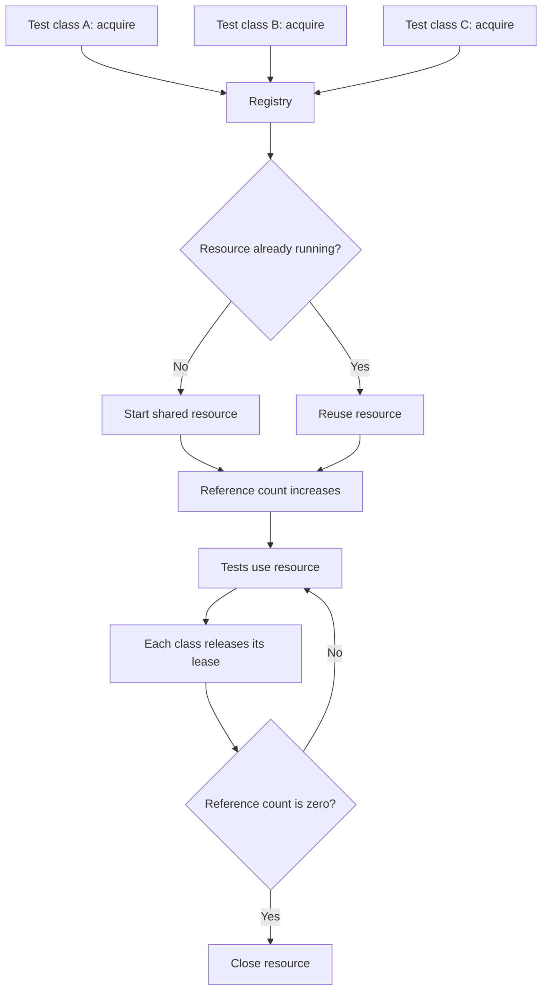

# Writing a Custom Listener to Manage Shared Resources

In Spring Framework Testing, some resources need to be prepared before a group of tests runs and only reclaimed when that group finishes. Examples include a shared test server, a mock service container, a temporary directory, a connection to a test system, or an expensive-to-initialize fixture. If every test method creates and closes the resource on its own, the suite can run slowly and easily produce inconsistent state. Without a clear cleanup mechanism, resources can linger after tests, holding ports, threads, or data and affecting subsequent tests.

The Spring TestContext Framework allows extending the test lifecycle with `TestExecutionListener`. A custom listener can initialize or acquire permission to use a resource before a test class, store a lease in `TestContext`, and release the lease after the class finishes. When multiple test classes run concurrently in the same JVM, a locked registry with reference counting can ensure the resource is started only once and closed only after the last user releases its lease.

## 1. When Should You Write a `TestExecutionListener`?

`TestExecutionListener` is appropriate when an operation must follow the Spring TestContext lifecycle, for example:

- Starting a test server or mock service before the first test class that needs it.
- Granting access to a shared container or fixture across multiple test classes.
- Collecting information after tests finish running.
- Cleaning up data or releasing resources per class or per method.
- Integrating a shared testing mechanism into many test classes without repeating `@BeforeEach` and `@AfterEach`.

Not all setup/cleanup requires a listener. Choose the extension matching the actual lifecycle:

| Need | Typically Appropriate Mechanism |
| --- | --- |
| Simple setup/cleanup for a single test method | JUnit `@BeforeEach` / `@AfterEach` |
| Setup/cleanup for a test class without needing a Spring context | JUnit `@BeforeAll` / `@AfterAll` or a JUnit extension |
| Managing resources along the Spring TestContext lifecycle | `TestExecutionListener` |
| Resource sharing the same lifecycle as an `ApplicationContext` | Bean lifecycle, `DisposableBean`, `@Bean(destroyMethod=...)`, or `SmartLifecycle` |
| Reacting to context close events | `ApplicationListener<ContextClosedEvent>` or `@EventListener` |
| Modifying bean definitions before the context is refreshed | `ApplicationContextInitializer` or an appropriate configuration/AOT mechanism |

`TestExecutionListener` is not a listener for every `ApplicationContext` event. It receives callbacks from the TestContext Framework, so it aligns with the test class or test method lifecycle. If a resource is owned by the application context and should close with the context, letting Spring manage it as a bean is usually simpler and safer.

## 2. Callbacks of `TestExecutionListener`

`TestExecutionListener` belongs to the `org.springframework.test.context` package. The listener receives a `TestContext` in each callback. `TestContext` provides information about the test class, test instance, test method, application context, and an attributes store for keeping state across the lifecycle.

Main callbacks:

| Callback | Timing | Suitable Work |
| --- | --- | --- |
| `beforeTestClass` | Before test methods in the class execute | Acquire resources shared for the whole class |
| `prepareTestInstance` | After the test instance is created, before dependency injection completes | Prepare state tied to the test instance |
| `beforeTestMethod` | Before the test method setup lifecycle | Allocate resources or fixtures specific to the method |
| `beforeTestExecution` | Immediately before the test method body runs, after method setup | Start timing or enable instrumentation for test execution |
| `afterTestExecution` | Immediately after the test method body runs, before method teardown | Record results or stop test instrumentation |
| `afterTestMethod` | After the test method teardown lifecycle | Release resources specific to the method |
| `afterTestClass` | After all test methods in the class complete | Release resources acquired in `beforeTestClass` |

The methods of `TestExecutionListener` have no-op default implementations, so a listener can override only the callbacks it needs.

```java
public class ExampleTestExecutionListener implements TestExecutionListener {
    @Override
    public void beforeTestClass(TestContext testContext) throws Exception {
        // Prepare class-level resources.
    }

    @Override
    public void afterTestClass(TestContext testContext) throws Exception {
        // Release class-level resources.
    }
}
```

If a resource needs to live for the entire class, the `beforeTestClass`/`afterTestClass` pair is the natural choice. If a resource must be created fresh for each method, use `beforeTestMethod`/`afterTestMethod`. If you only want to measure the test body, use `beforeTestExecution`/`afterTestExecution`.

## 3. `TestContext` and Where to Store Listener State

`TestContext` has attribute operations such as `setAttribute`, `getAttribute`, `hasAttribute`, and `removeAttribute`. This is the right place to store a lease or handle created by the listener, because the same `TestContext` is passed through the related callbacks.

Example of storing a lease:

```java
private static final String LEASE_ATTRIBUTE =
        SharedResourceTestExecutionListener.class.getName() + ".lease";

@Override
public void beforeTestClass(TestContext testContext) throws Exception {
    SharedResourceRegistry.Lease lease = SharedResourceRegistry.acquire();
    testContext.setAttribute(LEASE_ATTRIBUTE, lease);
}

@Override
public void afterTestClass(TestContext testContext) throws Exception {
    Object value = testContext.removeAttribute(LEASE_ATTRIBUTE);
    if (value instanceof SharedResourceRegistry.Lease lease) {
        lease.close();
    }
}
```

Storing the lease in `TestContext` lets the listener know exactly which resource handle belongs to the current test class. You should not use a listener instance field to hold state, because how Spring instantiates and uses listeners should not be treated as a contract for a single instance across the entire suite.

Do not store request-scoped or session-scoped bean targets in class-level attributes. The lifetime of such targets is shorter than the class; store only handles of resources with an appropriate lifetime that can be safely released.

## 4. Designing Shared Resources with Leases

A shared registry typically needs to satisfy four requirements:

1. Start the resource only when the first test class requests it.
2. Multiple test classes in the same JVM can use the same resource.
3. One class finishing must not close the resource while another class is still using it.
4. The resource is closed when the last user releases its lease.

This management pattern is commonly called reference counting. Each successful `acquire()` increments the lease count by one; the first time `close()` is called on a lease, the lease count decrements by one. When the count reaches 0, the registry closes the resource.



A lease represents permission to use a resource for a period of time. It also serves as proof of ownership so cleanup can be idempotent: calling `close()` multiple times on the same lease must decrement the counter only once.

## 5. Example Registry Managing a Shared Test Server

The example below illustrates the registry structure. `SharedTestServer.start()` represents the project-specific server startup logic; it could create an embedded server, start a container, or prepare a mock service. Lease management does not depend on the resource type.

```java
final class SharedResourceRegistry {
    private static final Object monitor = new Object();

    private static SharedTestServer server;
    private static int referenceCount;

    private SharedResourceRegistry() {
    }

    static Lease acquire() throws Exception {
        synchronized (monitor) {
            if (server == null) {
                server = SharedTestServer.start();
            }

            referenceCount++;
            return new Lease(server);
        }
    }

    static URI baseUri() {
        synchronized (monitor) {
            if (server == null) {
                throw new IllegalStateException("Shared server is not running");
            }
            return server.baseUri();
        }
    }

    static int activeLeases() {
        synchronized (monitor) {
            return referenceCount;
        }
    }

    static final class Lease implements AutoCloseable {
        private final SharedTestServer leasedServer;
        private boolean closed;

        private Lease(SharedTestServer leasedServer) {
            this.leasedServer = leasedServer;
        }

        SharedTestServer server() {
            if (closed) {
                throw new IllegalStateException("Lease is already closed");
            }
            return leasedServer;
        }

        @Override
        public void close() throws Exception {
            synchronized (monitor) {
                if (closed) {
                    return;
                }
                closed = true;

                referenceCount--;
                if (referenceCount == 0) {
                    SharedTestServer toClose = server;
                    server = null;
                    toClose.close();
                }
            }
        }
    }
}
```

`SharedTestServer` is the resource abstraction provided by the project:

```java
interface SharedTestServer extends AutoCloseable {
    URI baseUri();

    static SharedTestServer start() throws Exception {
        // Start the test suite server or container.
        // Return a handle with baseUri() and close() performing cleanup.
        throw new UnsupportedOperationException("Implement with the test resource");
    }
}
```

The `start()` part here is the integration point to replace with a real implementation. The key points in the registry are that starting, incrementing/decrementing the reference count, and closing the resource are all guarded by the same monitor. As a result, two test classes running in parallel cannot simultaneously start two instances or close the resource while another class still holds a lease.

The registry sets `server = null` before calling `close()`. If cleanup throws an exception, the registry state still indicates the resource is no longer allocated for use; the error closing the resource will be reported through the cleanup callback. Depending on the resource type, you can add logging or cleanup retries, but you should not silently swallow exceptions.

## 6. Writing a `TestExecutionListener` to Acquire/Release Leases

The listener's responsibility is to connect the `TestContext` lifecycle with the registry:

```java
import org.springframework.test.context.TestContext;
import org.springframework.test.context.TestExecutionListener;

public class SharedResourceTestExecutionListener
        implements TestExecutionListener {

    private static final String LEASE_ATTRIBUTE =
            SharedResourceTestExecutionListener.class.getName() + ".lease";

    @Override
    public void beforeTestClass(TestContext testContext) throws Exception {
        if (testContext.hasAttribute(LEASE_ATTRIBUTE)) {
            return;
        }

        SharedResourceRegistry.Lease lease = SharedResourceRegistry.acquire();
        testContext.setAttribute(LEASE_ATTRIBUTE, lease);
    }

    @Override
    public void afterTestClass(TestContext testContext) throws Exception {
        Object value = testContext.removeAttribute(LEASE_ATTRIBUTE);
        if (value instanceof SharedResourceRegistry.Lease lease) {
            lease.close();
        }
    }
}
```

`hasAttribute(...)` helps avoid acquiring twice if the callback is invoked again due to custom configuration or wrappers. `removeAttribute(...)` removes the handle from the context before closing to prevent duplicate cleanup. The lease guards itself with a `closed` flag, so releasing is also idempotent at the registry level.

If `acquire()` fails while starting the resource, the exception is thrown and the test class does not proceed with an unready resource. The `SharedTestServer.start()` factory must clean up partially initialized components itself before throwing an exception, because the registry only increments the reference count after startup succeeds.

## 7. Registering the Listener with `@TestExecutionListeners`

The explicit way to register for a test class or group of classes is `@TestExecutionListeners`:

```java
@SpringJUnitConfig(TestApplicationConfig.class)
@WebAppConfiguration
@TestExecutionListeners(
        listeners = SharedResourceTestExecutionListener.class,
        mergeMode = TestExecutionListeners.MergeMode.MERGE_WITH_DEFAULTS)
class ProductApiIntegrationTest {
    // Tests using the shared resource.
}
```

`MERGE_WITH_DEFAULTS` is critical when you want to add a custom listener while still keeping Spring's default listeners, such as dependency injection, transaction management, dirties context, and servlet test support. If the default list is replaced unintentionally, other Spring Test features can stop working.

You can place the annotation on a base test class or a composed annotation so multiple test classes share the configuration. When inheriting, pay attention to listener inheritance rules and merge configuration so you do not accidentally drop listeners registered on the superclass.

## 8. Registering the Listener via `SpringFactoriesLoader`

If a listener needs to be applied broadly across test classes in a module or test support library, it can be registered via `META-INF/spring.factories`:

```properties
org.springframework.test.context.TestExecutionListener=\
com.example.test.SharedResourceTestExecutionListener
```

The Spring TestContext Framework can autodetect `TestExecutionListener` implementations through the `SpringFactoriesLoader` mechanism. This approach causes the listener on the test classpath to be applied more broadly, so only use it when the resource is truly shared infrastructure for the entire test suite.

Do not register a listener globally if only a few test classes need the resource. In that case, `@TestExecutionListeners` is clearer and avoids starting unnecessary containers or servers for tests that do not use them.

## 9. Listener Execution Order

When multiple listeners are registered, ordering can affect whether a resource is ready before other listeners run. A listener can implement `Ordered` or use `@Order` to specify its order.

Typically:

- `before...` callbacks are invoked in ascending order.
- `after...` callbacks are invoked in reverse order so teardown occurs in a stack-like fashion.

If your listener must start a resource before other listeners, set an appropriate order so it runs early. If a resource needs to remain alive until other listeners finish teardown, the reverse callback order allows the listener to clean up later.

Do not assign order values arbitrarily. First identify dependencies between listeners: for example, does a post-test log collector listener still need the resource alive; does a transaction listener need to run before or after a specific cleanup? Only set an order when a real relationship exists.

## 10. Choosing Class-Level vs. Method-Level Lifecycle

A listener can manage resources at two common scopes:

| Scope | Acquire | Release | Example |
| --- | --- | --- | --- |
| Single test class | `beforeTestClass` | `afterTestClass` | A container used by every method in the class |
| Single test method | `beforeTestMethod` | `afterTestMethod` | A temporary directory or fixture that needs resetting between methods |
| Test method body only | `beforeTestExecution` | `afterTestExecution` | A profiler or trace measuring only test duration |
| Entire ApplicationContext | Bean initialization | Bean destroy/context close | An embedded service belonging to and owned by the context |

If a method-level lease is needed, use a different attribute key or a structure storing multiple leases per context. Do not use the same key for both class-level and method-level if they could overwrite each other's lease.

Example of a method-level resource:

```java
private static final String METHOD_RESOURCE =
        SharedResourceTestExecutionListener.class.getName() + ".methodResource";

@Override
public void beforeTestMethod(TestContext testContext) throws Exception {
    testContext.setAttribute(METHOD_RESOURCE, MethodResource.open());
}

@Override
public void afterTestMethod(TestContext testContext) throws Exception {
    Object value = testContext.removeAttribute(METHOD_RESOURCE);
    if (value instanceof MethodResource resource) {
        resource.close();
    }
}
```

With a method-level resource, `afterTestMethod` is the appropriate place when teardown needs to happen after Spring Test's teardown callbacks. If you only need to measure the test method execution and want to exclude `@BeforeEach`/`@AfterEach`, use `afterTestExecution` to end instrumentation.

## 11. Handling Failed Test Classes and Safe Cleanup

Cleanup must run even when an assertion fails or a test method throws an exception. The listener should retain the lease as soon as acquisition succeeds and release it in the corresponding teardown callback. Do not close the resource only at the end of a test method on the success path.

Key principles:

- Acquire must be atomic: only increment the reference count once the resource has started successfully.
- Release must be idempotent: the same lease must never decrement the counter more than once.
- Cleanup must not mask the original test exception by swallowing errors or overwriting state.
- If a resource has multi-step initialization, the factory must roll back completed steps itself when a later step fails.
- Set a shutdown timeout so the suite does not hang indefinitely.
- After cleanup, remove the handle from `TestContext` to avoid holding unused objects.

If `afterTestClass` throws an exception while closing the resource, Spring Test will report a teardown failure. This is important information: the resource was not reclaimed properly. Do not catch and ignore all exceptions just to make the test suite appear green.

## 12. Parallel Test Execution and Thread Safety

When test classes run in parallel within the same JVM, the listener may be called concurrently on multiple `TestContext` instances. A shared registry must be thread-safe. `synchronized` on a single monitor is a simple approach for starting, incrementing/decrementing the reference count, and stopping a single resource.

If the resource is accessed concurrently while tests run, the resource itself must also support concurrency. The registry only guards the lifecycle; it does not automatically make an HTTP server, database schema, directory, or test data safe when multiple tests modify it simultaneously.

Points to watch out for:

- Do not use a plain static field without synchronization when tests can run in parallel.
- Do not close a shared resource from `afterTestMethod` if another class is still using it.
- Use reference counting or a suite-level owner with a clear lifecycle.
- If tests need isolated data, namespace data by test class/method or provision separate fixtures even though the server is shared.
- Use dynamic ports instead of hard-coding a port that might already be in use.
- Avoid holding locks for a long time outside the start/stop operations that need consistency protection.

Reference counting in the example works within a single JVM. If the build tool runs tests across multiple forks/processes, each process has its own static registry. In that case, each fork may start its own resource. True sharing across multiple processes requires an external service with an independent lifecycle or an inter-process coordinator; static fields cannot be used to share across JVMs.

## 13. Interaction with Spring TestContext Cache and `@DirtiesContext`

The Spring TestContext Framework can cache `ApplicationContext` instances so multiple test classes reuse an already-initialized context. A `TestExecutionListener` following the class lifecycle and the context lifecycle operate at two different scopes:

- `afterTestClass` is called when a test class finishes.
- Bean destruction or `ContextClosedEvent` occurs only when the application context is actually closed.
- A context can remain cached after a class finishes.

Therefore, if a resource is owned by the context, you should not close it in `afterTestClass` just because one class finished; another class may continue using the same context. Let the bean lifecycle manage that resource.

Conversely, if a listener manages an external shared resource outside the context via leases, `afterTestClass` only releases the current class's lease. The registry closes the resource when the last lease is released.

`@DirtiesContext` marks the context to be evicted from the cache and closed according to the Spring Test lifecycle. If a resource is tied to the context, it should be closed when the context is destroyed. If a resource is shared independently across multiple classes, it must not be closed just because one context is dirtied; the lease registry should accurately reflect ownership.

## 14. When Should You Use Bean Lifecycle Instead of a Listener?

If a resource is created to serve beans within an application context and has no meaning outside the context, manage it with the Spring container:

```java
@Bean(destroyMethod = "close")
SharedTestServer sharedTestServer() throws Exception {
    return SharedTestServer.start();
}
```

Spring invokes the destroy method when the context closes. This integrates directly with the context cache and `@DirtiesContext`, while avoiding a static registry manually managing reference counts.

You can use `SmartLifecycle` when a resource needs start/stop ordering and participates in the context lifecycle. Use `ApplicationListener<ContextClosedEvent>` when you need to react to the context closing event without necessarily needing a bean with its own destroy method.

Choose `TestExecutionListener` when ownership is tied to the test class/method or when the resource is shared across application context boundaries. Do not use a listener just because you want to write a cleanup hook; simple hooks can live right inside JUnit lifecycle or bean lifecycle methods.

## 15. Considerations When Using with AOT

The Spring TestContext Framework supports preparing the application context for AOT in corresponding Spring Framework versions. AOT focuses on analyzing and generating code/configuration needed for the context; `TestExecutionListener` remains a test lifecycle extension invoked during test execution.

When writing a listener for use in an AOT environment:

- Register the listener explicitly via annotation or a factory mechanism supported by Spring Test, and ensure the class is on the test runtime classpath.
- Keep the listener focused on managing external resources such as servers, containers, files, or fixtures.
- Do not rely on classpath scanning or dynamic bean definition registration at runtime if those beans must exist in the AOT-processed context.
- If the listener needs to alter the bean graph structure, use a supported configuration/AOT contribution mechanism instead of trying to add beans after the context has been prepared.
- Do not assume that registering a listener automatically makes every third-party resource or library native-image compatible; check the limitations of the AOT/native tooling in use.
- Separate resource startup code from listener registration code so JVM tests, AOT tests, and CI environments can be configured independently.

For example, a listener starting a test server along the test class lifecycle generally impacts the AOT bean graph far less than a listener attempting to register additional controllers or converters after the context is created. If you need to modify bean definitions, use `ApplicationContextInitializer`, test configuration, or an AOT extension point appropriate for your Spring version.

## 16. Diagnosing Listeners Not Being Invoked or Resources Not Being Reclaimed

| Symptom | Possible Cause | Resolution |
| --- | --- | --- |
| `beforeTestClass` does not run | Listener is not registered or test does not use Spring TestContext | Check `@TestExecutionListeners`, `SpringExtension`, and the test runner |
| Custom listener breaks dependency injection | Default listener list was replaced | Use `MergeMode.MERGE_WITH_DEFAULTS` |
| Resource starts multiple times | Registry is unsynchronized or listener acquires per method unintentionally | Use locking and pick the right lifecycle callback |
| Resource is closed while another class is still running | Cleanup lacks reference counting or ownership is wrong | Each class holds its own lease; close only when the last lease is released |
| Resource never closes | Missing release, teardown callback not called, or lease retained | Check attributes, `afterTestClass`, and reference count logs |
| `afterTestClass` reports cleanup error | Resource close throws an exception or shutdown times out | Check resource logs and design close with a timeout |
| Individual test passes but suite fails | Shared state, context cache, or parallel tests interfering with each other | Check registry, session, static state, and fixture data |
| CI starts multiple containers | Tests run across multiple forks/JVMs | Share per process or use an external resource coordinator |
| AOT test does not see the listener | Listener is not on the test runtime classpath or registration is not processed in build | Check dependencies and supported registration mechanism |

When diagnosing, log the test class name, callback, lease count, start/stop timestamps, and resource identifier. Do not log secrets, tokens, or connection strings containing credentials. This information is sufficient to identify which class acquired/released a lease and why a resource is still alive.

## 17. Design Principles for Resource-Managing Listeners

1. Choose the right extension point: `TestExecutionListener` for TestContext lifecycle, bean lifecycle for context-owned resources, JUnit callbacks for simple setup.
2. Choose the right acquire/release scope: class, method, method execution body, or entire context.
3. Use `TestContext` attributes to store leases/handles belonging to a test class or method.
4. Use a thread-safe registry if multiple test classes in the same JVM share a resource.
5. Use leases/reference counting so one class does not close a resource another class is still using.
6. Make `close()` idempotent and ensure acquire increments the counter only after startup succeeds.
7. Keep cleanup in teardown callbacks and report errors if a resource fails to close.
8. Register the listener with `MERGE_WITH_DEFAULTS` when using `@TestExecutionListeners` to retain Spring's default listeners.
9. Use factory autodetection only when the listener truly needs global application; otherwise register explicitly.
10. Verify thread safety, parallel tests, context cache, `@DirtiesContext`, and cross-JVM sharing limits.
11. In AOT environments, keep listeners focused on resource lifecycle and use appropriate AOT extension points if the bean graph must change.

A custom listener is useful when a resource's lifecycle is tied to a test class or method and needs to be shared across multiple tests. `TestExecutionListener` provides lifecycle callbacks, `TestContext` holds each class's lease, and the registry safely manages start/stop. When ownership is clearly modeled, cleanup is idempotent, and concurrency is controlled, a test suite can reuse expensive resources while avoiding leaks of threads, ports, containers, or data into other tests.
