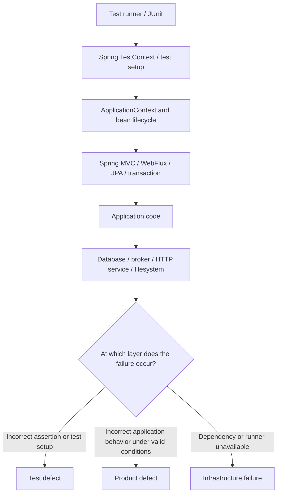
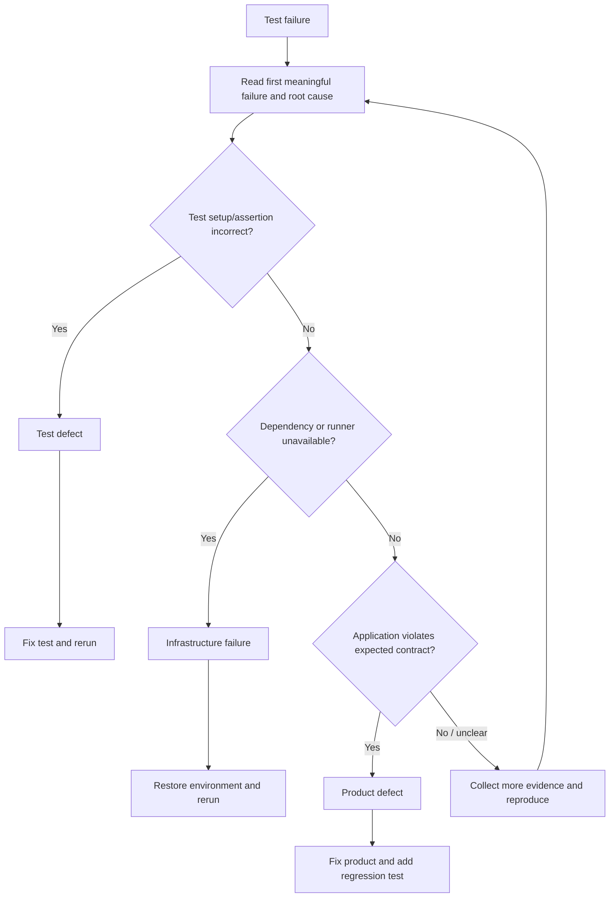

# Distinguishing Product Defects, Test Defects, and Infrastructure Failures

When a Spring test fails on a developer machine or in CI, the red output indicates only one thing: that run did not produce the expected outcome. It does not by itself prove the application has a bug. The root cause may lie in product behavior, in the test itself, or in the execution environment. Classifying the cause accurately helps fix the right layer, prevents changing production code to appease a flawed test, and avoids dismissing real bugs under the label “flaky CI.”

In Spring Framework Testing, these three categories typically appear in different forms: a controller returns the wrong status or body; a test misconfigures the application context or uses an incorrect assertion; or a database, container, network, or runner is unavailable. A single failure can involve multiple categories, so evidence must be collected before jumping to conclusions.

## 1. Three Primary Cause Categories

**Product defect** occurs when the application fails to satisfy requested behavior or its published contract. Examples: an endpoint that should return 404 returns 500; a transaction fails to roll back; validation is not applied; or one request leaks state into another request.

**Test defect** occurs when the test specifies the wrong behavior, sets up wrong preconditions, checks the wrong object, or relies on false assumptions. Examples: a test expects `@PreUpdate` to fire immediately on a setter call without flushing; a session-scope test creates a new session per request while expecting data to persist; or a mock returns a result incompatible with the real contract.

**Infrastructure failure** occurs when the test execution environment fails to provide required conditions. Examples: CI cannot reach the database, the Docker daemon fails to start, a port is already occupied, DNS fails, disk space runs out, the runner is killed for out-of-memory, or a dependent service is temporarily unavailable.

| Category | Core question | Examples in Spring testing |
| --- | --- | --- |
| Product defect | Does the application violate its contract when running in a valid environment? | Controller returns wrong status; service updates wrong data; exception handler maps error incorrectly |
| Test defect | Does the test set up the right scenario and verify the right behavior? | Missing `flush()`, wrong `Accept`, inaccurate mock, overly brittle assertion |
| Infrastructure failure | Does the environment meet the prerequisites for the test to execute? | Database unreachable, container startup timeout, runner out of resources |

This is a classification of root causes, not a classification by exception type. The same `ConnectException` can come from a misconfigured endpoint in the application (product/configuration defect), a test pointing at the wrong host (test defect), or an interrupted CI network (infrastructure failure). Identify which request failed, which destination was called, and which environment was running.

## 2. Start from the First Failure and Primary Evidence

When a test suite fails, do not start by tweaking assertions or re-running the entire suite repeatedly. Identify the first causal failure, read the full exception, and capture the execution context.

Information to collect:

- Test class and method name, module, and CI task executed.
- Exception type, message, stack trace, and nested causes (`Caused by`).
- Request/response details if the failure occurred in MockMvc or an HTTP client test.
- Whether the application context loaded successfully; which bean was being created last before failure.
- Which database, broker, container, or external service the test used.
- JDK, Spring Framework/Boot version, profiles, timezone, locale, and CI configuration.
- Whether the test fails consistently in isolation, or only when run alongside the suite or in parallel.

Do not read only the final log line. For instance, `Failed to load ApplicationContext` is usually a summary message; the specific cause may lie deeper, such as a missing bean, property binding failure, unreachable database, or an exception inside a bean constructor.

## 3. Analyze the Stack Trace Layer by Layer

The stack trace reveals where along the test execution path the error arose. In Spring, look for the first layer belonging to the application or infrastructure rather than stopping at the test runner layer.



Common log signals:

| Log signal | First investigation step |
| --- | --- |
| `AssertionFailedError`, expected/actual mismatch | Verify contract, input data, and actual response |
| `Failed to load ApplicationContext` | Read the deepest `Caused by`; distinguish broken bean/config from unavailable dependency |
| `NoSuchBeanDefinitionException` | Check test slice, component scanning, profiles, and bean configuration |
| `ScopeNotActiveException` | Check request/session context and when the scoped proxy is accessed |
| `HttpMessageNotReadableException` | Check request body, `Content-Type`, DTO, and converters |
| `DataIntegrityViolationException` | Check test data, schema, constraints, and write logic |
| `ConnectException`, connection timeout | Identify endpoint/database/container and reachability from the runner |
| `BindException: Address already in use` | Check fixed ports, lingering processes, or parallel tests |
| `OutOfMemoryError`, abnormal process exit | Check heap, container limits, forks/test workers, and runner resources |

These signals are only starting points. For example, `DataIntegrityViolationException` can be a product defect when the application allows invalid data, or a test defect when a fixture intentionally introduces duplicate unique keys.

## 4. Distinguish Product Defects in Spring MVC

With `MockMvc`, inspect the request, selected handler, response status, headers, and body. If a test fails because it receives 404 instead of 200, first determine whether the request matches the mapping, whether the controller is loaded in the test context, and whether the real application registers that endpoint.

Example test:

```java
mockMvc.perform(get("/api/products/42")
                .accept(MediaType.APPLICATION_JSON))
        .andExpect(status().isOk())
        .andExpect(jsonPath("$.id").value(42));
```

If it actually returns 500, use `.andDo(print())` to inspect the request/response and examine the exception. If the controller was invoked yet the service returned wrong data or the exception handler mapped the status incorrectly, it may be a product defect. If the handler was never invoked because the test used the wrong URL or `@WebMvcTest` omitted necessary configuration, it may be a test defect.

Examples of product defects:

- A `@PostMapping` saves an entity without the required transaction boundary, leaving data unpersisted contrary to the contract.
- `@RestControllerAdvice` maps `ProductNotFoundException` to 500 instead of 404.
- Incorrect `consumes` or `produces` mapping causes valid clients to receive 415 or 406.
- A controller uses a singleton field to store per-request state, exposing one user's data to another.
- An endpoint returns 200 with an error body even though the contract mandates an error status.

To confirm a product defect, reproduce it with a test using valid setup and deterministic data. When possible, confirm it further with a test at a more representative layer or in a near-production integration environment.

## 5. Distinguish Defects Caused by Test Slices or Test Configuration

Spring provides several test slices, each loading only a portion of the application context:

| Annotation | Primary scope |
| --- | --- |
| `@WebMvcTest` | Controllers and Spring MVC infrastructure needed for the web slice |
| `@DataJpaTest` | Entities, repositories, and JPA infrastructure |
| `@JsonTest` | JSON serialization/deserialization configuration |
| `@RestClientTest` | REST client components and related configuration |
| `@SpringBootTest` | Broader application context, per Boot configuration |

If a controller requires a service that `@WebMvcTest` does not load, `NoSuchBeanDefinitionException` can occur. This is not necessarily a product defect; the test slice may need `@MockitoBean`/`@MockBean` depending on version, or import a specific test configuration.

Example:

```java
@WebMvcTest(ProductController.class)
class ProductControllerTest {
    @Autowired
    MockMvc mockMvc;

    @MockitoBean
    ProductService productService;
}
```

If a test must verify real services, repositories, transactions, and database working together, `@WebMvcTest` may be too narrow. In that case, use an integration test with `@SpringBootTest` or a more suitable setup. Conversely, if only controller mapping and responses are under test, loading the full context can make the test depend on many unrelated beans.

Another test configuration defect is a profile or property differing from assumptions. For example, a test uses `@ActiveProfiles("test")` yet that profile lacks required datasource properties. Verify the actual loaded configuration rather than inferring from the profile name.

## 6. Distinguish Test Defects from JPA and Transaction Bugs

In JPA tests, some operations only modify the persistence context and have not yet synchronized to the database. Assertions before `flush()` may observe only in-memory objects.

For example, `@PreUpdate` is typically invoked when the provider prepares to issue an update statement during flush. A test that merely calls a setter and expects the callback to have run already may be a test defect:

```java
entity.setName("Updated");
entityManager.flush();
entityManager.clear();

Entity reloaded = entityManager.find(Entity.class, entity.getId());
assertThat(reloaded.getName()).isEqualTo("Updated");
```

If after `flush()` and reloading, data is still wrong, investigate callbacks, mappings, dirty checking, and transactions. If the test forgot `flush()` or did not `clear()` and instead read the same managed entity, the assertion may not have verified persisted data.

Classification indicators:

- **Test defect:** expecting callbacks to run at the wrong time; omitting flush; using the wrong transaction; test fixtures intentionally violating constraints.
- **Product defect:** callbacks fail to update required fields; transactions commit wrong data; cascade or orphan removal fails to behave per intended mapping.
- **Infrastructure failure:** database container not ready, connection pool exhausted due to runner, or test environment fails to provision datasource.

With `@DataJpaTest`, transactions normally roll back after each test. Do not classify rollback as a product defect if the test assumed data would persist after the test finishes.

## 7. Distinguish Async Test Defects from Product Race Conditions

Asynchronous tests are easily written around estimated timing. Example:

```java
service.startAsyncJob();
Thread.sleep(500);
assertThat(repository.findAll()).hasSize(1);
```

This test may pass on a fast machine and fail in slow CI. `sleep()` does not guarantee the task has started or finished. This is usually a test design defect.

Synchronize using `Future`, `CompletableFuture`, `CountDownLatch`, or a bounded-timeout synchronization mechanism:

```java
CompletableFuture<JobResult> result = service.startAsyncJob();

assertThat(result.get(5, TimeUnit.SECONDS).status())
        .isEqualTo(JobStatus.COMPLETED);
```

However, if a test synchronizes properly yet concurrent requests still corrupt data, a race condition may exist in the product. Distinguish carefully:

- Test defect: not awaiting the task; sharing mutable fixtures across parallel tests; timeout too short for the environment.
- Product defect: missing required locking/transaction isolation; lost updates; tasks processing the same event multiple times.
- Infrastructure failure: overloaded runner, unusually delayed thread scheduling, throttled container resources.

When a test fails only under parallel execution, try running the test in isolation and running related test groups. If it fails only when parallel, inspect both shared test state and application concurrency bugs. Never assume it is merely a flaky test and immediately disable parallel execution.

## 8. Signs of Infrastructure Failures in CI

Infrastructure failures typically surface before business assertions run or at boundaries with external dependencies. Examples:

- Testcontainers cannot connect to the Docker daemon.
- Database container starts, yet its health check has not passed when tests begin.
- A fixed port is already bound by another process.
- The runner cannot resolve the hostname of the database or mock service.
- CI runs out of disk space creating database volumes or storing artifacts.
- The JVM is killed by container memory limits, without necessarily producing a complete Java stack trace.
- Test tokens, certificates, or secrets are missing due to pipeline configuration.

Signals like `Connection refused`, `UnknownHostException`, `Could not start container`, `No space left on device`, or OS-killed exit codes often point to infrastructure. Still, verify the target address and configuration before concluding.

For example, the test datasource points to `localhost:5432` while the CI database runs at service hostname `postgres:5432`. If the pipeline provides hostname `postgres` yet the test still uses localhost, that is a test/CI configuration defect. If the hostname is right yet the database service is unhealthy, that is an infrastructure or orchestration failure.

## 9. Testcontainers and Database Readiness

When using Testcontainers, do not merely wait for the container process to exist. The database must be ready to accept connections. Testcontainers provides wait strategies; health checks, log messages, or service ports can verify readiness.

Example:

```java
static PostgreSQLContainer<?> postgres = new PostgreSQLContainer<>("postgres:16")
        .withDatabaseName("app_test")
        .withUsername("test")
        .withPassword("test");

@DynamicPropertySource
static void databaseProperties(DynamicPropertyRegistry registry) {
    registry.add("spring.datasource.url", postgres::getJdbcUrl);
    registry.add("spring.datasource.username", postgres::getUsername);
    registry.add("spring.datasource.password", postgres::getPassword);
}
```

If a container fails to start, inspect Docker availability, image pulls, registry access, architecture, and resources. If the container is healthy yet the application context fails to connect, inspect dynamic properties, networking, and datasource configuration.

Do not handle startup errors by raising every timeout to huge values without reading container logs. Long timeouts can mask static configuration bugs and drag out the pipeline. Increasing a timeout is justified only with evidence that the CI environment needs extra startup time within defined bounds.

## 10. Identifying Flaky Tests

A flaky test has the same code and commit yet produces inconsistent results across runs due to uncontrolled factors. Flakiness can originate in the test, the product, or infrastructure.

| Failure pattern | Common causes |
| --- | --- |
| Fails only when run in parallel | Shared mutable state, fixed ports, race conditions |
| Fails only at a specific time of day | Timezone, clock, month/year rollover, time-dependent data |
| Occasional timeouts | Improper synchronization, slow tasks, overloaded runners, or external dependencies |
| Fails randomly based on test order | Static state, mutated singleton beans, unisolated database data |
| Fails only in CI | Different JDK, OS, locale, timezone, database dialect, memory, or network |
| Fails after a preceding test runs | Context/bean/session/executor or database data leaking between tests |

Do not use retries to turn flaky tests green without investigating. Retries may help measure transient failure rates for integration tests hitting external services, yet they never fix race conditions or nondeterministic tests. If a pipeline uses retries, log the first failure and separate retried outcomes from initial outcomes.

## 11. Step-by-Step Triage Workflow

A practical workflow helps classify failures without modifying code prematurely:

1. **Isolate:** record the first failing test, module, commit, JDK, Spring version, and environment.
2. **Read the root cause:** inspect the full stack trace and `Caused by` chain; determine whether the failure happened before or after the request was handled.
3. **Check test preconditions:** verify URL, headers, body, profile, mocks, transactions, fixtures, and timeouts.
4. **Check dependencies:** verify database, broker, container, HTTP service, DNS, ports, credentials, and filesystem readiness.
5. **Reproduce in a controlled way:** run the test alone, then run the related group; keep the same JDK, profile, and configuration if possible.
6. **Classify by evidence:** product defect, test defect, infrastructure failure, or insufficient data.
7. **Fix the cause:** modify only the layer proven faulty; keep logs and artifacts to verify after the fix.
8. **Re-verify:** run the targeted test and related test set; for infrastructure failures, confirm the pipeline/dependency is stable.



## 12. Using Logs and Diagnostic Output Effectively

When a test fails, structured output is usually more helpful than scattering `println` statements. With MockMvc, `.andDo(print())` displays request and response details:

```java
mockMvc.perform(post("/api/products")
        .contentType(MediaType.APPLICATION_JSON)
        .content("""{"name":"Notebook","price":12.5}"""))
        .andDo(print())
        .andExpect(status().isCreated());
```

With JPA, logging SQL and bind parameters helps verify whether statements were emitted. Enable verbose logging only within the scope of tests under diagnosis because SQL logs may contain sensitive data or bloat output.

For context startup failures, retain logs starting from the first bean creation failure down to the deepest `Caused by`. With Testcontainers, save container logs. For async tests, log task IDs, thread name prefixes, start/end times, and original exceptions.

Never place tokens, passwords, session cookies, or personal data in public CI artifacts. When saving requests/responses, mask sensitive values before uploading logs.

## 13. Saving Artifacts for CI Analysis

CI should retain details needed to reproduce failures:

- JUnit XML or HTML test reports.
- Full console logs and stack traces.
- Container/database logs when using Testcontainers.
- JDK, Spring, build tool versions, and runner information.
- Profile configurations and required environment variable names (without storing secret values).
- Thread dumps on timeouts or deadlocks.
- Heap/GC reports or exit metadata when processes are killed for resource limits.

Artifacts distinguish failures inside test logic from failures before tests start. For example, if JUnit XML lists zero executed test cases and logs stop during context startup, the failure lies in environment/test context initialization. If a specific test finishes and expected/actual assertions mismatch, investigate the request and application behavior.

## 14. When to Re-Run and at What Scope?

Re-running is an evidence-gathering tool, not a way to erase failure symptoms. Choose an appropriate scope:

| Action | When to use | What to observe |
| --- | --- | --- |
| Run a single test method | Verify whether the failure reproduces independently | Minimal setup, data, and timing |
| Run the full test class | Detect state leaking between methods in the class | Execution order, lifecycle, and shared fixtures |
| Run a test group/module | Detect context cache, database, or shared singleton issues | Whether an earlier test mutated state |
| Run with parallel execution | Investigate race conditions or shared resources | Ports, database data, executors, static state |
| Run in CI with identical config | Confirm environment differences | JDK, timezone, memory, network, and containers |
| Run against matching real database | Investigate dialect/constraint/locking differences | SQL, isolation, type mapping, and transactions |

If a test fails once and passes on retry, that alone is insufficient to blame infrastructure. Record the failure, reproduction rate, and execution conditions. If the failure is nondeterministic, find the uncontrolled input or shared state.

## 15. Concrete Examples of Failure Classification

| Failure | Likely product defect when... | Likely test defect when... | Likely infrastructure failure when... |
| --- | --- | --- | --- |
| MockMvc receives 404 | Mapping is missing or controller is not registered in the app | Test URL is wrong or slice does not import the controller | Context fails to load due to dependency environment |
| Receives 415 on JSON POST | Endpoint declares wrong `consumes` or converter is misconfigured | Test sets wrong `Content-Type` | Converter dependency fails to resolve in build environment |
| JPA does not persist data | Transaction/mapping/flush behavior is wrong | Test forgets flush or transaction rolls back by design | Database unavailable or connection pool exhausted |
| Async test times out | Task deadlocks or fails to finish per contract | Test uses sleep or unreasonable timeout | Runner overloaded or thread resources constrained |
| Context startup failure | Production bean has constructor/configuration bug | Test lacks mock bean or profile/properties | Database/broker/container fails to start |
| Fails only in CI | Configuration difference exposes a real bug | Test depends on timezone, locale, ordering, or local paths | Runner/network/registry/secrets encounter an outage |
| HTTP client test gets connection refused | App calls wrong host/port | Test configures wrong base URL | Target service or container is not running |

A single failure can have combined causes. For example, an application has an overly short timeout (product configuration defect) and the CI runner is overloaded (infrastructure condition), causing the test to time out. Separate each factor by measuring timings, checking configuration, and reproducing in a controlled environment.

## 16. Actionable Failure Reporting

A good report describes what was observed first, then gives a classification with a confidence level:

```text
Test: ProductApiTest.createsProduct
Environment: CI Linux, JDK 21, Spring Boot <version>
Observed: POST /api/products returned 500; expected 201.
Root cause: ProductService threw DataIntegrityViolationException for a valid request.
Classification: Product defect (high confidence).
Evidence: Request payload, response body, root-cause stack trace, SQL constraint name.
Next action: Correct product persistence mapping/logic and add a regression assertion.
```

If evidence is insufficient, explicitly state what remains unknown:

```text
Classification: Undetermined.
Observed: ApplicationContext failed while creating DataSource.
Known: CI could not connect to configured database host.
Unknown: Whether the host is wrong in test configuration or the database service was unavailable.
Next evidence: Inspect effective datasource URL and database service health/logs.
```

Avoid reports saying “flaky test,” “CI broken,” or “Spring bug” unless logs and reproduction steps back that conclusion.

## 17. Principles to Reduce Misclassification in CI

1. Keep test data independent with explicit cleanup; avoid test order dependencies.
2. Use `Future`, latches, or bounded-timeout synchronization for async work; avoid sleep to guess timing.
3. Use dynamic ports and endpoints supplied by the test environment instead of hardcoding conflicting ports.
4. Wait for database/container health before initializing the application context.
5. Pin or explicitly declare timezone, locale, clock, and profiles for tests that require them.
6. Choose properly scoped test slices; mock external dependencies when the test does not verify that integration.
7. Save JUnit reports, stack traces, container logs, and runner info when pipelines fail.
8. Never use retries or raised timeouts to hide unclassified failures.
9. When failures appear only during parallel runs, inspect both shared test state and product concurrency behavior.
10. Close a failure only after evidence confirms the root cause and post-fix results.

Distinguishing product defects, test defects, and infrastructure failures is the first step in responsible failure triage. Trace failures to their root cause, verify the test established proper preconditions, inspect environment dependencies, and compare actual behavior against the contract. When classification rests on evidence rather than exception names or a passing retry, the team can fix the right layer and keep CI trustworthy.
