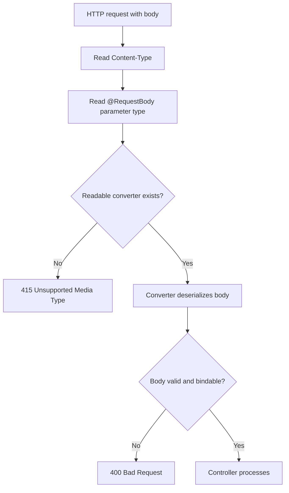
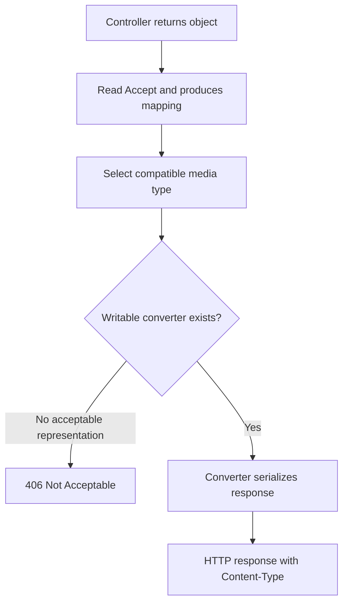

# 415, 406, and Message Converter Errors

In Spring MVC, HTTP 415 Unsupported Media Type and 406 Not Acceptable typically appear when a request or response does not use a format the application can handle. Both status codes involve content negotiation and `HttpMessageConverter`, yet they occur in opposite directions: 415 mainly involves the data sent by the client; 406 involves the representation the server can return as requested by the client.

When diagnosing, inspect the HTTP method, URI, `Content-Type`, `Accept`, `consumes`/`produces` mappings, the Java type to read or write, and the converters actually registered. Looking only at the status code without checking those factors easily leads to the wrong fix: for example, malformed JSON is usually 400, whereas JSON sent with an unsupported media type is usually 415.

## 1. Meaning of 415 and 406

| Status | Name | Question to answer | Data direction |
| --- | --- | --- | --- |
| 415 | Unsupported Media Type | Can the server read the request body with this `Content-Type`? | Request into server |
| 406 | Not Acceptable | Can the server produce a response in a media type acceptable to the client? | Response from server |

**415** commonly occurs when:

- The request sends a `Content-Type` not included in the handler's `consumes` list.
- No `HttpMessageConverter` can read both the media type and the target parameter type.
- The client sends a body format unsupported by the endpoint, such as sending `text/plain` to a JSON-only endpoint.

**406** commonly occurs when:

- The client's `Accept` header is incompatible with the handler's `produces`.
- No representation is both acceptable to the client and producible by the application.
- No matching converter can write the return type in the selected media type.

These two errors differ from invalid body content errors. Once the server selects a JSON converter, if the JSON has invalid syntax or cannot bind to the DTO, the result is usually 400 Bad Request. If the server cannot write the response due to an error during serialization, the error may become a server error depending on the situation and exception handling.

## 2. Role of `Content-Type` and `Accept`

`Content-Type` describes the format of the body being sent in the HTTP message. In a POST request carrying JSON, the client typically sends:

```http
POST /api/products HTTP/1.1
Content-Type: application/json
Accept: application/json

{"name":"Notebook","price":12.50}
```

`Accept` lists the media types the client wants to receive in the response. A client may accept one or multiple formats:

```http
Accept: application/json, application/xml;q=0.8
```

In the example above, JSON is preferred over XML. If the endpoint only returns JSON and has a JSON converter, the server can select JSON. If the client accepts only XML while the endpoint produces only JSON, the server has no suitable representation and may return 406.

Do not confuse the two headers:

- Setting `Accept: application/json` does not turn the request body into JSON.
- Setting `Content-Type: application/json` does not force the server to return JSON.
- For GET requests without a body, usually only `Accept` is needed if you want to constrain the response format.
- For POST/PUT/PATCH requests with a body, set `Content-Type` to match the actual body format.

## 3. What Does `HttpMessageConverter` Do?

Spring MVC uses `HttpMessageConverter` to convert data between an HTTP body and Java objects. A converter can read a request body into an object or write an object into a response body.

Common converters:

| Converter | Common purpose |
| --- | --- |
| `MappingJackson2HttpMessageConverter` | Reads and writes JSON using Jackson |
| `StringHttpMessageConverter` | Reads and writes `String` |
| `ByteArrayHttpMessageConverter` | Reads and writes `byte[]` |
| `ResourceHttpMessageConverter` | Reads and writes `Resource` |
| `FormHttpMessageConverter` | Reads/writes URL-encoded form data and supports multipart per configuration |
| XML converter | Reads/writes XML when the corresponding library and converter are present |

When reading a request body, Spring considers the parameter type, such as `CreateProductRequest`, along with the request's media type. The converter must support both the Java type and that media type. Conceptually, the converter must answer `canRead(targetType, contentType)`.

When writing a response, Spring considers the returned object type, the media types accepted by the client, and the media types declared by the handler. The converter must support writing that object type in the chosen media type, analogous to `canWrite(returnType, selectedMediaType)`.





Converter selection details also depend on Spring version, MVC configuration, custom converters, return type, and whether the response content type was already set earlier. Therefore, tests should run under a configuration close to the application when the goal is to verify real converters.

## 4. `consumes` and `produces` Mappings

Spring MVC lets you constrain media types directly on mappings:

- `consumes` describes the request body types the handler accepts; it is matched against `Content-Type`.
- `produces` describes the representation types the handler can create; it is matched against `Accept` and response-writing converters.

Example of an endpoint accepting and returning only JSON:

```java
@RestController
@RequestMapping("/api/products")
class ProductController {
    @PostMapping(
            consumes = MediaType.APPLICATION_JSON_VALUE,
            produces = MediaType.APPLICATION_JSON_VALUE)
    ResponseEntity<ProductView> create(
            @RequestBody CreateProductRequest request) {
        ProductView result = new ProductView(
                42L, request.name(), request.price());
        return ResponseEntity.status(HttpStatus.CREATED).body(result);
    }

    @GetMapping(
            value = "/{id}",
            produces = MediaType.APPLICATION_JSON_VALUE)
    ProductView find(@PathVariable long id) {
        return new ProductView(id, "Notebook", 12.50);
    }
}

record CreateProductRequest(String name, BigDecimal price) {
}

record ProductView(long id, String name, double price) {
}
```

For POST, `Content-Type: application/json` matches `consumes`. For GET, `Accept: application/json` matches `produces`. Sending `text/plain` to POST or requesting XML from GET while the handler declares only JSON prevents Spring from selecting the handler/representation as requested and triggers the corresponding media type error.

Multiple media types can be declared:

```java
@PostMapping(
        consumes = {
            MediaType.APPLICATION_JSON_VALUE,
            MediaType.APPLICATION_XML_VALUE
        },
        produces = {
            MediaType.APPLICATION_JSON_VALUE,
            MediaType.APPLICATION_XML_VALUE
        })
ProductView create(@RequestBody CreateProductRequest request) {
    // Process request.
}
```

Declaring `consumes` or `produces` does not automatically install converters. To support XML, the application still needs an XML converter and its backing dependencies. If only a JSON converter exists, XML mappings can be declared yet XML requests/responses still fail to convert.

## 5. Diagnosing 415 Unsupported Media Type

When receiving 415, start from the request:

1. Does the request have a body? If so, is the actual body JSON, XML, form data, multipart, or bytes?
2. Does `Content-Type` accurately reflect the body?
3. Does the handler declare `consumes`, and is the sent media type compatible?
4. Which converters are registered in the application context?
5. Can a converter read the `@RequestBody` parameter type?

Example test sending the wrong media type:

```java
@Test
void rejectsTextBodyWhenEndpointConsumesJson() throws Exception {
    mockMvc.perform(post("/api/products")
                    .contentType(MediaType.TEXT_PLAIN)
                    .content("Notebook"))
            .andExpect(status().isUnsupportedMediaType());
}
```

The endpoint accepts only JSON, so the `text/plain` request does not match `consumes`. This test verifies the endpoint's contract.

Valid request test:

```java
@Test
void acceptsJsonRequest() throws Exception {
    mockMvc.perform(post("/api/products")
                    .contentType(MediaType.APPLICATION_JSON)
                    .accept(MediaType.APPLICATION_JSON)
                    .content("""
                            {"name":"Notebook","price":12.50}
                            """))
            .andExpect(status().isCreated())
            .andExpect(content().contentTypeCompatibleWith(
                    MediaType.APPLICATION_JSON));
}
```

If a request body is JSON yet lacks `Content-Type`, Spring may treat the media type as a default or unknown type in a way that fails converter/mapping matching. Do not rely on guessing; clients should declare the header matching the body.

## 6. Distinguishing 415 from 400 When Reading Request Bodies

This is the most important distinction when debugging JSON requests:

| Scenario | Cause | Common status |
| --- | --- | --- |
| Sending `text/plain` to a JSON-only endpoint | Unsupported media type | 415 |
| Sending malformed JSON with `Content-Type: application/json` | JSON converter is selected but cannot parse the body | 400 |
| Sending valid JSON whose value cannot bind to the Java type | Body conversion/binding error | 400 |
| JSON parses cleanly yet violates Bean Validation | Validation failed | Usually 400, though custom handlers may map differently |
| No converter can read the parameter type for the media type | Cannot read the request representation | 415 |

Example of malformed JSON:

```java
@Test
void returnsBadRequestForMalformedJson() throws Exception {
    mockMvc.perform(post("/api/products")
                    .contentType(MediaType.APPLICATION_JSON)
                    .content("{invalid-json"))
            .andExpect(status().isBadRequest());
}
```

Example of syntactically valid JSON that violates validation:

```java
@Test
void returnsBadRequestForInvalidProductFields() throws Exception {
    mockMvc.perform(post("/api/products/validated")
                    .contentType(MediaType.APPLICATION_JSON)
                    .content("""
                            {"name":"","price":-1}
                            """))
            .andExpect(status().isBadRequest());
}
```

These two tests verify different layers. The malformed JSON test verifies message reading; the validation test verifies object constraints after deserialization. Do not merge them into a single test, as failures become harder to pinpoint.

## 7. Diagnosing 406 Not Acceptable

When receiving 406, inspect the response side:

1. Which `Accept` header did the request send? Is there a wildcard `*/*`, or does it accept only a specific media type?
2. Does the handler declare `produces`?
3. What type is the returned object? `String`, DTO, `Resource`, a collection, or a custom type?
4. Which converter can write that object type?
5. Is any content negotiation configuration or default content type affecting selection?

Example of a handler returning only JSON:

```java
@GetMapping(
        value = "/{id}",
        produces = MediaType.APPLICATION_JSON_VALUE)
ProductView find(@PathVariable long id) {
    return productService.find(id);
}
```

Test requesting XML:

```java
@Test
void rejectsXmlWhenOnlyJsonIsProduced() throws Exception {
    mockMvc.perform(get("/api/products/42")
                    .accept(MediaType.APPLICATION_XML))
            .andExpect(status().isNotAcceptable());
}
```

The handler publishes only JSON while the client accepts only XML. With no overlapping media type, Spring cannot pick an acceptable representation.

If the client accepts JSON:

```java
@Test
void returnsJsonWhenClientAcceptsJson() throws Exception {
    mockMvc.perform(get("/api/products/42")
                    .accept(MediaType.APPLICATION_JSON))
            .andExpect(status().isOk())
            .andExpect(content().contentTypeCompatibleWith(
                    MediaType.APPLICATION_JSON));
}
```

## 8. Distinguishing `Accept`-Related 406 from Response Writing Errors

Not all response-writing failures are the same. Distinguish among them:

- **No media type compatible with `Accept`:** Spring cannot find a representation acceptable to the client; usually 406.
- **Handler `produces` incompatible with `Accept`:** the mapping may not be selected; Spring usually returns 406.
- **No converter can write the return type:** depending on timing and response state, Spring may report no acceptable representation or throw `HttpMessageNotWritableException`; do not assume every case is 406.
- **Converter selected, yet serialization hits a data error or exception:** may be a server error, usually investigated as 500 or an exception-handler-mapped error.

Example of a controller returning a custom type with no matching converter:

```java
@GetMapping(value = "/report", produces = "application/x-report")
CustomReport report() {
    return reportService.create();
}
```

Declaring `produces = "application/x-report"` alone does not teach Spring how to write `CustomReport`. The application must register a converter capable of writing this type in that media type. Without it, response writing fails; inspect the exact exception and converter setup before concluding what status is expected.

If the response already had `Content-Type` set earlier yet no converter can write the body, the exception may differ from when negotiation has not yet chosen a media type. Do not merely tweak `Accept` to mask a missing converter.

## 9. `Accept` Wildcards and Quality Factors

The `Accept` header can list multiple media types with quality factors `q`:

```http
Accept: application/xml;q=0.8, application/json;q=1.0
```

A higher `q` value means higher client preference for that media type. If `q` is omitted, it defaults to `1.0`. Common wildcards:

| Value | Meaning |
| --- | --- |
| `*/*` | Accepts any media type |
| `application/*` | Accepts any subtype under `application` |
| `application/json` | Accepts JSON only |
| `application/*+json` | Accepts subtypes with a `+json` suffix if supported by mapping/converter |

A client can send:

```java
mockMvc.perform(get("/api/products/42")
        .header(HttpHeaders.ACCEPT,
                "application/xml;q=0.8, application/json;q=1.0"))
        .andExpect(status().isOk())
        .andExpect(content().contentTypeCompatibleWith(
                MediaType.APPLICATION_JSON));
```

If a client sends `Accept: application/xml` while the endpoint only produces JSON, the server must not silently return JSON as if the client accepted it. The result is normally 406. When testing multiple media types, assert the actual response `Content-Type` rather than inferring from header order alone.

When `Accept` is absent, many clients/requests are interpreted as accepting any type (`*/*`), though default behavior can still be influenced by content negotiation settings. For deterministic tests, set `Accept` explicitly whenever response format is part of the contract.

## 10. Unregistered or Misconfigured Converters

In Spring MVC, default converters are registered by MVC configuration. If an application uses `@EnableWebMvc`, customizes `WebMvcConfigurer`, or replaces the converter list, it can inadvertently remove default converters.

Example extending the converter list:

```java
@Configuration
@EnableWebMvc
class ApiWebConfig implements WebMvcConfigurer {
    @Override
    public void extendMessageConverters(
            List<HttpMessageConverter<?>> converters) {
        // Add or adjust converters while keeping default converters intact.
    }
}
```

`extendMessageConverters(...)` is usually appropriate when adding to or adjusting the default list. `configureMessageConverters(...)` can replace the default list unless you re-add the needed converters. Thus, a configuration change seemingly meant only to add an XML converter can accidentally drop the JSON converter and trigger 415/406 across other endpoints.

With Spring Boot, auto-configuration typically registers converters based on classpath dependencies. If Jackson is missing, the application may lack the expected JSON converter. If an XML library is added without configuring the matching converter or mapping, having the dependency alone may still not be enough.

## 11. Checking Converters in the Test Context

When an error appears only in tests, check whether the test loads the right MVC configuration. `@WebMvcTest` loads only the web slice; a custom converter or `WebMvcConfigurer` may not be discovered if it lies outside the slice's scope.

Example importing extra configuration:

```java
@WebMvcTest(ProductController.class)
@Import(ApiWebConfig.class)
class ProductControllerTest {
    @Autowired
    MockMvc mockMvc;
}
```

If the test needs to verify the full application configuration, use `@SpringBootTest` combined with `@AutoConfigureMockMvc`. This loads a broader context and verifies converters, controller advice, and MVC settings together, at a higher initialization cost.

When testing a single controller with `standaloneSetup`, register custom converters via the builder if the test depends on them. A standalone test does not automatically represent all converters in the production application context.

## 12. Testing with `MockMvc`

`MockMvc` is a convenient tool for reproducing requests and asserting 415/406 status codes without a real server.

```java
@WebMvcTest(ProductController.class)
class ProductMediaTypeTest {
    @Autowired
    MockMvc mockMvc;

    @Test
    void returns415ForUnsupportedRequestContentType() throws Exception {
        mockMvc.perform(post("/api/products")
                        .contentType(MediaType.TEXT_PLAIN)
                        .content("Notebook"))
                .andExpect(status().isUnsupportedMediaType());
    }

    @Test
    void returns406ForUnacceptableResponseType() throws Exception {
        mockMvc.perform(get("/api/products/42")
                        .accept(MediaType.APPLICATION_XML))
                .andExpect(status().isNotAcceptable());
    }
}
```

Both tests require endpoints with `consumes`/`produces` as in the earlier example. If the controller has a `@RestControllerAdvice`, that handler may change the error body or status; tests should assert the actual behavior published by the application.

For deeper diagnostics, add `.andDo(print())`:

```java
mockMvc.perform(post("/api/products")
        .contentType(MediaType.TEXT_PLAIN)
        .content("Notebook"))
        .andDo(print())
        .andExpect(status().isUnsupportedMediaType());
```

The output displays request headers, the selected handler (if any), response status, headers, and body. This helps separate unmatched mappings from errors inside the controller.

## 13. Testing with `WebTestClient` Using the `MockMvc` Adapter

If your test uses the fluent `WebTestClient` API for a Spring MVC application, you can wire it via `MockMvcWebTestClient`:

```java
WebTestClient client = MockMvcWebTestClient
        .bindToApplicationContext(webApplicationContext)
        .build();
```

415 test:

```java
client.post()
        .uri("/api/products")
        .contentType(MediaType.TEXT_PLAIN)
        .bodyValue("Notebook")
        .exchange()
        .expectStatus().isUnsupportedMediaType();
```

406 test:

```java
client.get()
        .uri("/api/products/42")
        .accept(MediaType.APPLICATION_XML)
        .exchange()
        .expectStatus().isNotAcceptable();
```

With WebFlux, the conversion layer consists of codecs (`HttpMessageReader`/`HttpMessageWriter`) rather than Spring MVC's `HttpMessageConverter`. The HTTP principles around `Content-Type`, `Accept`, 415, and 406 remain similar, but exception types, configuration, and processing paths can differ. Do not use MVC class names to explain WebFlux stack traces.

## 14. Verifying the Error Body with `ControllerAdvice`

Spring Boot or the application may standardize errors using `@RestControllerAdvice` and `ProblemDetail`. In that case, tests should not check only the status; verify the error representation clients will receive.

Example handler:

```java
@RestControllerAdvice
class ApiErrorHandler {
    @ExceptionHandler(HttpMediaTypeNotSupportedException.class)
    ResponseEntity<ProblemDetail> unsupportedMediaType(
            HttpMediaTypeNotSupportedException ex) {
        ProblemDetail problem = ProblemDetail.forStatusAndDetail(
                HttpStatus.UNSUPPORTED_MEDIA_TYPE,
                "The request media type is not supported.");
        problem.setTitle("Unsupported media type");
        problem.setProperty("code", "UNSUPPORTED_MEDIA_TYPE");
        return ResponseEntity.status(HttpStatus.UNSUPPORTED_MEDIA_TYPE)
                .body(problem);
    }
}
```

The test can assert:

```java
mockMvc.perform(post("/api/products")
                .contentType(MediaType.TEXT_PLAIN)
                .content("Notebook")
                .accept(MediaType.APPLICATION_PROBLEM_JSON))
        .andExpect(status().isUnsupportedMediaType())
        .andExpect(content().contentTypeCompatibleWith(
                MediaType.APPLICATION_PROBLEM_JSON))
        .andExpect(jsonPath("$.title").value("Unsupported media type"))
        .andExpect(jsonPath("$.code").value("UNSUPPORTED_MEDIA_TYPE"));
```

By default, Spring has exception resolvers handling many framework errors. If the application declares its own `@ExceptionHandler`, the outcome may differ from the default. Standardize the error schema across the API and test it as part of the contract.

Do not expose converter implementation details, stack traces, or internal class names in public responses. Those details belong in server logs; the error body should explain the error at a level actionable to the client.

## 15. Common Message Converter Errors

| Symptom | Possible cause | Resolution |
| --- | --- | --- |
| POST JSON returns 415 | Missing/wrong `Content-Type`, unmatched `consumes`, or no converter reading the DTO | Set `APPLICATION_JSON`, check mappings and converters |
| POST JSON returns 400 | Malformed JSON, unbindable field, or validation failure | Separate tests for malformed JSON, binding, and validation |
| GET JSON returns 406 | `Accept` incompatible with `produces` or no converter writing the representation | Check `Accept`, `produces`, and write converters |
| XML cannot be read despite XML in mapping | Missing XML converter or supporting library | Add and register the appropriate converter |
| JSON suddenly returns 406 after config change | Default converters were dropped from the list | Check `configureMessageConverters` vs. `extendMessageConverters` |
| Slice test returns 415 while real app works | Test context lacks production converters/configuration | Import configuration or use an appropriate integration context |
| Response body serialization throws an exception | DTO cannot serialize, or getter/record mapping/custom serializer error | Read the root cause and inspect the converter/DTO |
| `Accept: */*` works yet `Accept: application/xml` returns 406 | Endpoint only supports JSON | Confirm contract; add XML converter/mapping if truly needed |
| Header with charset breaks assertions | Overly strict `Content-Type` comparison | Use compatible matchers when charset parameters are not part of the contract |

## 16. Quick Diagnostic Workflow

When encountering 415 or 406, follow this sequence:

1. **Record the actual request:** method, URI, body, `Content-Type`, and `Accept`.
2. **Identify the handler:** which `consumes`/`produces` does the mapping declare; is the controller registered in the test context?
3. **Check converters:** which converters are present; can a converter read/write the required Java type and media type?
4. **Separate body errors:** if a converter can read the media type yet parsing/binding fails, inspect 400 and message-reading exceptions.
5. **Check response negotiation:** determine the intersection among `Accept`, `produces`, and converter write capabilities.
6. **Read the root exception:** `HttpMediaTypeNotSupportedException`, `HttpMediaTypeNotAcceptableException`, `HttpMessageNotReadableException`, or `HttpMessageNotWritableException` point to different handling branches.
7. **Compare test and application configurations:** test slices, profiles, custom MVC config, and dependencies can produce different converter lists.
8. **Verify the contract:** write assertions for status, response `Content-Type`, and concrete error body.

| Common Spring MVC exception | Common diagnostic meaning |
| --- | --- |
| `HttpMediaTypeNotSupportedException` | Request media type is not supported; usually maps to 415 |
| `HttpMediaTypeNotAcceptableException` | No matching response media type; usually maps to 406 |
| `HttpMessageNotReadableException` | Request body could not be read/deserialized; usually maps to 400 |
| `HttpMessageNotWritableException` | Response body could not be written; usually a server-side error requiring inspection |
| `MethodArgumentNotValidException` | Bean Validation on the bound argument failed; usually maps to 400 |

The exception name is strong evidence, yet it does not replace reading the cause chain and actual response. A custom exception resolver or controller advice can alter the default status and error body.

## 17. Principles for Writing Tests for 415, 406, and Converters

1. Set `Content-Type` matching the request body and `Accept` matching the desired representation.
2. Declare `consumes` to express the request body types a handler supports and `produces` to express the response types it provides.
3. Test 415 for unsupported request media types; test 400 separately for malformed JSON or validation failures.
4. Test 406 when the client accepts only a media type the endpoint cannot return.
5. Verify that a converter can read/write both the Java type and the media type, not merely that a dependency is present.
6. When using a custom converter, confirm it is registered in the exact application context used by the test.
7. Use test slices for narrow scope; use integration tests when you need to verify full converters and MVC configuration.
8. Assert the error body if the API publishes an error schema, especially when using `@RestControllerAdvice` or `ProblemDetail`.
9. Distinguish Spring MVC `HttpMessageConverter` from WebFlux codecs when reading stack traces.
10. Do not change `Accept` or `Content-Type` to hide a missing converter or wrong mapping; align with the defined HTTP contract.

415 and 406 reflect opposite sides of representation exchange: the server cannot read the request format or cannot produce a response format acceptable to the client. By combining checks of headers, `consumes`/`produces` mappings, converters, and root exceptions, your tests will pinpoint whether the fault lies in the request media type, body content, response negotiation, or message conversion configuration.
