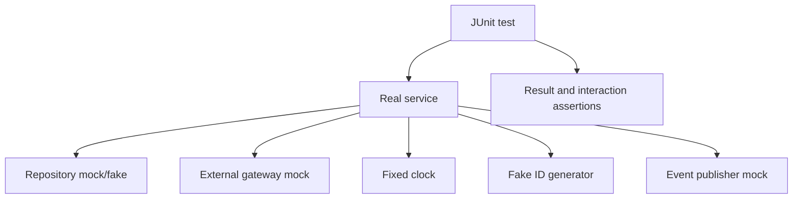

# Service Unit Testing with Controlled Dependencies

## 1. Goal of a Service Unit Test

A service typically orchestrates business rules and calls multiple other components: repositories, HTTP gateways, message publishers, clocks, ID generators, or a calculation policy. A service unit test verifies the behavior of the service while replacing external collaborators with controlled mocks, stubs, or fakes.

The goal is not to boot the entire Spring application. The test creates an instance of the service, passes in prepared dependencies, invokes a method, and verifies the result and side effects belonging to the service's contract.



The service is the system under test. Dependencies are controlled so the test can deliberately produce the results, errors, and states that the service must handle.

A good unit test helps answer:

- Given valid input, what result does the service return and what state does it produce?
- When a dependency returns empty data, rejects, or throws an error, how does the service react?
- Which collaborators must be called, and with what arguments?
- When business logic fails, which side effects must not occur?
- Is the result deterministic across runs and independent of time, network, or environment data?

## 2. Designing a Service to Accept Injected Dependencies

Constructor injection makes the dependencies required for the service to operate explicit. Tests can instantiate the service directly by passing mocks or fakes, without needing an `ApplicationContext`.

```java
@Service
public class OrderService {

    private final ProductCatalog productCatalog;
    private final OrderRepository orderRepository;
    private final OrderIdGenerator idGenerator;
    private final Clock clock;
    private final ApplicationEventPublisher eventPublisher;

    public OrderService(
            ProductCatalog productCatalog,
            OrderRepository orderRepository,
            OrderIdGenerator idGenerator,
            Clock clock,
            ApplicationEventPublisher eventPublisher) {
        this.productCatalog = productCatalog;
        this.orderRepository = orderRepository;
        this.idGenerator = idGenerator;
        this.clock = clock;
        this.eventPublisher = eventPublisher;
    }

    public OrderReceipt placeOrder(PlaceOrderCommand command) {
        if (command.quantity() <= 0) {
            throw new InvalidOrderException("Quantity must be positive");
        }

        Product product = productCatalog.findSellableBySku(command.sku())
                .orElseThrow(() -> new ProductNotFoundException(command.sku()));

        BigDecimal total = product.unitPrice()
                .multiply(BigDecimal.valueOf(command.quantity()));

        Order order = new Order(
                idGenerator.nextId(),
                product.sku(),
                command.quantity(),
                total,
                clock.instant());

        Order saved = orderRepository.save(order);
        eventPublisher.publishEvent(new OrderPlacedEvent(saved.id(), saved.total()));

        return new OrderReceipt(saved.id(), saved.total(), saved.createdAt());
    }
}
```

The dependencies clearly express the boundaries:

- `ProductCatalog` provides product data.
- `OrderRepository` persists orders.
- `OrderIdGenerator` issues IDs.
- `Clock` provides the current instant.
- `ApplicationEventPublisher` publishes Spring events.

Passing `Clock` and an ID generator into the constructor is especially useful for tests. If a service calls `Instant.now()` or `UUID.randomUUID()` directly in multiple places, tests have to tolerate time-varying and random data. When sources of variability are represented as dependencies, tests can supply fixed values.

Data types in the example:

```java
public record PlaceOrderCommand(String sku, int quantity) {}

public record Product(String sku, BigDecimal unitPrice) {}

public record Order(
        UUID id,
        String sku,
        int quantity,
        BigDecimal total,
        Instant createdAt) {}

public record OrderReceipt(UUID orderId, BigDecimal total, Instant createdAt) {}

public record OrderPlacedEvent(UUID orderId, BigDecimal total) {}
```

The dependency interfaces can be defined as follows:

```java
public interface ProductCatalog {
    Optional<Product> findSellableBySku(String sku);
}

public interface OrderRepository {
    Order save(Order order);
}

public interface OrderIdGenerator {
    UUID nextId();
}
```

This is a design example to illustrate testing. In a real application, a domain model may be a class with invariants, factories, or aggregates; the key point is that the service receives its dependencies via its constructor and does not instantiate infrastructure inside its methods.

## 3. Creating Service Tests with JUnit and Mockito

JUnit Jupiter runs the tests; Mockito creates mocks and controls dependency behavior. With JUnit 5, add the Mockito extension:

```java
@ExtendWith(MockitoExtension.class)
class OrderServiceTest {

    @Mock
    private ProductCatalog productCatalog;

    @Mock
    private OrderRepository orderRepository;

    @Mock
    private OrderIdGenerator idGenerator;

    @Mock
    private ApplicationEventPublisher eventPublisher;

    private Clock clock;
    private OrderService orderService;

    @BeforeEach
    void setUp() {
        clock = Clock.fixed(
                Instant.parse("2025-04-10T09:30:00Z"),
                ZoneOffset.UTC);

        orderService = new OrderService(
                productCatalog,
                orderRepository,
                idGenerator,
                clock,
                eventPublisher);
    }
}
```

`@ExtendWith(MockitoExtension.class)` initializes and manages mocks for each test. `@Mock` creates a fake collaborator. The service is instantiated directly in `setUp()` to make clear which dependencies are passed in.

With this approach, the test does not need `@SpringBootTest`, `@ContextConfiguration`, or `@Autowired`. Spring does not need to create a context because the goal is to test the logic of a standalone Java object.

If the project uses Spring Boot, the testing dependencies are typically provided by the test starter. If using Mockito standalone, you need the `mockito-junit-jupiter` dependency alongside JUnit Jupiter. Specific versions must match the project's dependency management.

## 4. Stubbing Dependencies to Create Deterministic Scenarios

Stubbing specifies the value a mock returns when the service invokes a method. Mockito uses `when(...).thenReturn(...)` for methods with a return value:

```java
when(productCatalog.findSellableBySku("BOOK-01"))
        .thenReturn(Optional.of(new Product(
                "BOOK-01", new BigDecimal("25.00"))));

when(idGenerator.nextId())
        .thenReturn(UUID.fromString("00000000-0000-0000-0000-000000000123"));

when(orderRepository.save(any(Order.class)))
        .thenAnswer(invocation -> invocation.getArgument(0));
```

Here:

- Catalog returns a product with a fixed price.
- ID generator returns a known UUID.
- Repository returns the saved object so the service can continue using it.

Stubbing lets the test control inputs to the service without depending on a database, remote catalog, or random ID source.

Do not stub every method mechanically. Only stub the calls needed to construct the scenario. The Mockito extension checks for unused stubs in strict mode by default; redundant stubs are often a sign that the test has leftover configuration or the implementation has changed.

## 5. Verifying Results and Contract Side Effects

A happy-path test should verify the returned result, the data sent to the repository, and the published event:

```java
@Test
void placesOrderAndPublishesEvent() {
    UUID orderId = UUID.fromString(
            "00000000-0000-0000-0000-000000000123");
    Instant createdAt = Instant.parse("2025-04-10T09:30:00Z");
    Product product = new Product("BOOK-01", new BigDecimal("25.00"));

    when(productCatalog.findSellableBySku("BOOK-01"))
            .thenReturn(Optional.of(product));
    when(idGenerator.nextId()).thenReturn(orderId);
    when(orderRepository.save(any(Order.class)))
            .thenAnswer(invocation -> invocation.getArgument(0));

    OrderReceipt receipt = orderService.placeOrder(
            new PlaceOrderCommand("BOOK-01", 2));

    assertThat(receipt.orderId()).isEqualTo(orderId);
    assertThat(receipt.total()).isEqualByComparingTo("50.00");
    assertThat(receipt.createdAt()).isEqualTo(createdAt);

    ArgumentCaptor<Order> orderCaptor = ArgumentCaptor.forClass(Order.class);
    verify(orderRepository).save(orderCaptor.capture());

    Order savedOrder = orderCaptor.getValue();
    assertThat(savedOrder.id()).isEqualTo(orderId);
    assertThat(savedOrder.sku()).isEqualTo("BOOK-01");
    assertThat(savedOrder.quantity()).isEqualTo(2);
    assertThat(savedOrder.total()).isEqualByComparingTo("50.00");
    assertThat(savedOrder.createdAt()).isEqualTo(createdAt);

    verify(eventPublisher).publishEvent(
            new OrderPlacedEvent(orderId, new BigDecimal("50.00")));
}
```

This test verifies the returned result and the contents of the data the service sends to collaborators. `ArgumentCaptor` is useful when you need to inspect an object created inside the service.

You do not need to verify every internal call. Only check interactions meaningful to the contract, such as the repository receiving the right data or the event publisher emitting the right event. If a test verifies getters, helpers, or an exact call order not required by the business rules, the test becomes brittle when refactoring without changing behavior.

## 6. Testing Validation Branches Before Calling Dependencies

With an invalid quantity, the service must reject immediately. The test should assert the exception and verify that collaborators were not called:

```java
@Test
void rejectsNonPositiveQuantityBeforeLookingUpProduct() {
    assertThatThrownBy(() -> orderService.placeOrder(
            new PlaceOrderCommand("BOOK-01", 0)))
            .isInstanceOf(InvalidOrderException.class)
            .hasMessage("Quantity must be positive");

    verifyNoInteractions(
            productCatalog,
            orderRepository,
            idGenerator,
            eventPublisher);
}
```

This assertion checks both the rejection condition and that the service produces no side effects. If you only assert the exception, the code could still call the catalog or generate an ID before detecting the invalid quantity.

For string, monetary, or date inputs, choose representative data for each equivalence class and boundary. For example, quantity equal to 0, minus one, and a valid value; there is no need to create hundreds of identical tests if they do not check additional rules.

## 7. Testing Dependency Not-Found Results

When a product does not exist or is no longer sellable, the service must report an error and not save the order:

```java
@Test
void rejectsUnknownProductWithoutSavingOrder() {
    when(productCatalog.findSellableBySku("MISSING"))
            .thenReturn(Optional.empty());

    assertThatThrownBy(() -> orderService.placeOrder(
            new PlaceOrderCommand("MISSING", 1)))
            .isInstanceOf(ProductNotFoundException.class);

    verify(productCatalog).findSellableBySku("MISSING");
    verifyNoInteractions(orderRepository, idGenerator, eventPublisher);
}
```

This test controls the dependency to steer the service into the error branch. There is no need to build a complex fake catalog if only one method needs to be controlled; a mock fits this simple interaction well.

If business rules need to distinguish between non-existent, discontinued, and out-of-stock products, represent each state explicitly in the model or catalog result and test the corresponding outcomes.

## 8. Testing Collaborator Failures and Ensuring No Event Is Published

The repository may throw an exception when saving. The service needs to propagate the error or translate it into a business error according to the contract. In the current example, the error is propagated and no event is published:

```java
@Test
void doesNotPublishEventWhenPersistenceFails() {
    Product product = new Product("BOOK-01", new BigDecimal("25.00"));
    RuntimeException databaseFailure = new RuntimeException("Database unavailable");

    when(productCatalog.findSellableBySku("BOOK-01"))
            .thenReturn(Optional.of(product));
    when(idGenerator.nextId()).thenReturn(UUID.randomUUID());
    when(orderRepository.save(any(Order.class))).thenThrow(databaseFailure);

    assertThatThrownBy(() -> orderService.placeOrder(
            new PlaceOrderCommand("BOOK-01", 1)))
            .isSameAs(databaseFailure);

    verifyNoInteractions(eventPublisher);
}
```

The test verifies that the event is only published after `save(...)` returns successfully. This is an ordering rule belonging to the service's behavior. If the code publishes the event before saving, the test will catch it.

This is still a unit test: it verifies that the service invokes collaborators in the right order within a single object. It does not prove that the database transaction has committed before the event is processed. If the event must run after commit, an integration test with a real transaction and `@TransactionalEventListener` is needed.

## 9. Using `Clock` to Control Time

Tests should not depend on the system clock. `Instant.now()` can differ between two calls, be affected by time zones, or make assertions sensitive to machine speed.

Inject `Clock` into the service:

```java
Instant createdAt = clock.instant();
```

In the test, use a fixed clock:

```java
Clock fixedClock = Clock.fixed(
        Instant.parse("2025-04-10T09:30:00Z"),
        ZoneOffset.UTC);
```

Every call to `fixedClock.instant()` returns the same instant. If business logic needs to test advancing time, you can use `Clock.offset(...)` or a test-specific clock implementation to advance time deliberately.

For date logic, pay attention to `ZoneId`. `Instant` is an absolute point in time; `LocalDate` depends on the time zone when converting from an instant. Tests should pass the zone explicitly:

```java
Clock fixedClock = Clock.fixed(
        Instant.parse("2025-04-10T23:30:00Z"),
        ZoneId.of("Asia/Ho_Chi_Minh"));
```

When testing date-based expiration policies, pick instants just before, right at, and just after the boundary to verify inclusive/exclusive rules.

## 10. Controlling IDs, Randomness, and Other Non-Deterministic Sources

Beyond time, a service may use UUIDs, random numbers, sequences, locale, timezone, environment variables, or system configuration. These sources need to be controlled when they affect test results.

For example, instead of calling `UUID.randomUUID()` directly in a method, create a small abstraction:

```java
public interface OrderIdGenerator {
    UUID nextId();
}
```

The production implementation can use UUID:

```java
@Component
class UuidOrderIdGenerator implements OrderIdGenerator {
    @Override
    public UUID nextId() {
        return UUID.randomUUID();
    }
}
```

The test stubs a fixed ID so assertions do not need wildcards:

```java
when(idGenerator.nextId()).thenReturn(
        UUID.fromString("00000000-0000-0000-0000-000000000123"));
```

For random numbers, you can inject `RandomGenerator` or a dedicated domain interface and use a fixed seed. For locale and timezone, pass explicit configuration rather than relying on JVM defaults. For environment variables or system properties, consider supplying configuration via an injected object so tests do not have to mutate global state.

There is no need to turn every value into a dependency. Only extract a non-deterministic source when it affects the logic under test or causes flaky tests.

## 11. Choosing Between Mock, Stub, and Fake

Test doubles serve different purposes:

| Type | Characteristics | Use When |
|---|---|---|
| Stub | Returns predefined results | You need to control input data from a dependency |
| Mock | Records interactions so tests can verify calls | What matters is whether a collaborator was called, and with what arguments |
| Fake | Simple working implementation, such as an in-memory map repository | You need state that can be read and written across multiple calls |
| Spy | Wraps a real object and allows stubbing/verifying selected methods | You need to observe part of a real object; use sparingly |

Example in-memory fake repository:

```java
class InMemoryOrderRepository implements OrderRepository {

    private final Map<UUID, Order> orders = new HashMap<>();

    @Override
    public Order save(Order order) {
        orders.put(order.id(), order);
        return order;
    }

    Optional<Order> findById(UUID id) {
        return Optional.ofNullable(orders.get(id));
    }
}
```

A fake is useful when a test needs to verify multiple operations on simple repository state. However, this fake does not test SQL, transactions, constraints, JPA mapping, or real database behavior. Those properties require an integration test with an appropriate database.

Do not use mocks for every dependency if a small fake makes the test easier to understand. Conversely, do not write a complex fake for a collaborator with only one call and one return value; stubbing a mock can be clearer.

## 12. Avoiding Mocking Domain Objects and Implementation Details

Domain objects are usually the data the service operates on. Create real objects to test rules on actual values:

```java
Product product = new Product("BOOK-01", new BigDecimal("25.00"));
```

Mocking `Product` to stub getters can couple the test to how the implementation reads data, while failing to exercise the domain object's constructors or invariants.

Similarly, do not mock the service under test itself or mock an internal helper just to reach coverage. If a method has too many dependencies or overly complex logic, consider extracting a collaborator with a clear responsibility and testing each unit separately.

Tests should observe public outputs and side effects. Avoid asserting on private methods, the call order of internal helpers, or non-contractual object structures. When refactoring without changing behavior, good tests should continue to pass.

## 13. Using `@InjectMocks` or Instantiating the Service Manually?

Mockito provides `@InjectMocks` to instantiate the object under test and attempt to inject mocks via constructor, setter, or field:

```java
@ExtendWith(MockitoExtension.class)
class OrderServiceWithInjectMocksTest {

    @Mock ProductCatalog productCatalog;
    @Mock OrderRepository orderRepository;
    @Mock OrderIdGenerator idGenerator;
    @Mock ApplicationEventPublisher eventPublisher;

    @InjectMocks OrderService orderService;
}
```

With constructor injection and clear dependencies, this approach is concise. However, Mockito chooses how to inject according to its own rules; if there are multiple constructors or dependencies of the same type, injection may not behave as expected. `@InjectMocks` also does not create a Spring bean, nor does it apply `@Transactional`, `@Async`, AOP, or context configuration.

Instantiating the service manually in `@BeforeEach` is often more transparent when you need to pass a real dependency such as `Clock.fixed(...)`, a fake, or special configuration. Both approaches are valid; choose the one that makes the test's dependencies clearest.

## 14. Using `ArgumentCaptor` at the Right Time

`ArgumentCaptor` lets you capture the argument a mock received so you can inspect its contents:

```java
ArgumentCaptor<Order> captor = ArgumentCaptor.forClass(Order.class);

verify(orderRepository).save(captor.capture());

Order order = captor.getValue();
assertThat(order.quantity()).isEqualTo(2);
assertThat(order.total()).isEqualByComparingTo("50.00");
```

A captor is useful when the service constructs a complex object and the test needs to verify the fields passed in. For simple values, direct matchers are usually easier to read:

```java
verify(paymentGateway).charge(eq("token-123"), eq(new BigDecimal("50.00")));
```

Do not capture every argument. Only capture when assertions on the contents help the test express behavior clearly.

## 15. Verifying Interaction Order When Order Is Part of the Business Logic

Normally, you only need to verify that the required side effects occurred. Sometimes, however, order is part of the contract. For example, the service must save the order successfully before publishing the event.

```java
InOrder order = inOrder(orderRepository, eventPublisher);

order.verify(orderRepository).save(any(Order.class));
order.verify(eventPublisher).publishEvent(any(OrderPlacedEvent.class));
```

`InOrder` verifies the order between two collaborators. Use it only when changing the order would break business logic. If the order of calling two metrics or two internal helpers does not affect behavior, verifying order makes the test fragile.

If an event must be published after the transaction commits, verifying method order in a unit test is not enough. A unit test only verifies that the service calls the publisher after `save()` returns. Transaction commit and listener phase must be verified in an integration test with a real transaction.

## 16. Testing Exceptions Without Losing the Cause

When a dependency throws an error, the service may propagate the original error or translate it into a domain exception. The test should assert both the error type and the cause if that is part of the contract.

```java
@Test
void translatesCatalogFailure() {
    RuntimeException networkFailure = new RuntimeException("Catalog unavailable");

    when(productCatalog.findSellableBySku("BOOK-01"))
            .thenThrow(networkFailure);

    assertThatThrownBy(() -> orderService.placeOrder(
            new PlaceOrderCommand("BOOK-01", 1)))
            .isInstanceOf(ProductLookupException.class)
            .hasCause(networkFailure);

    verifyNoInteractions(orderRepository, eventPublisher);
}
```

This example assumes the service translates catalog errors into `ProductLookupException`; if the implementation simply propagates the original error, the assertion must match that contract. Do not catch any `Exception` and merely check that an exception was thrown, because the test could pass due to an unrelated error.

If the service retries when a dependency fails transiently, verify the invocation count and final result:

```java
when(productCatalog.findSellableBySku("BOOK-01"))
        .thenThrow(new TransientCatalogException())
        .thenReturn(Optional.of(product));

OrderReceipt receipt = orderService.placeOrder(command);

assertThat(receipt.total()).isEqualByComparingTo("25.00");
verify(productCatalog, times(2)).findSellableBySku("BOOK-01");
```

Retry tests need to control backoff and schedulers. If the logic uses real delays, inject a `Sleeper`, scheduler, or time abstraction so tests do not wait long. For retries managed by Spring Retry or a resilience library, an integration test may be needed to verify that annotations/AOP are actually applied.

## 17. When Is `@SpringBootTest` Needed Instead of a Plain Unit Test?

A unit test that instantiates the service directly does not run the Spring container. Therefore, it does not verify:

- Whether component scanning finds the service.
- Whether dependency injection in the ApplicationContext is wired correctly.
- Whether `@Transactional` is activated by a proxy.
- Whether `@Async`, `@Cacheable`, method security, or retry annotations work.
- Whether bean configuration, qualifiers, profiles, or conditional configuration are right.
- Whether repository queries, ORM mappings, or database transactions are correct.

Those behaviors belong to the Spring integration boundary. You can use `@SpringBootTest`, slice tests, or a narrow test context depending on the goal.

For example, a unit test calling `orderService.placeOrder(...)` directly does not test transaction rollback. If the service is annotated with `@Transactional`, instantiating it with `new OrderService(...)` creates no transaction proxy. To verify rollback when the repository throws an error, you need to invoke the bean through the Spring proxy in an integration test and inspect the database after the transaction ends.

Similarly, a unit test calling an `@Async` method directly on an object usually runs synchronously because there is no Spring proxy. To verify that the executor actually runs the task on another thread, you need a test context with async enabled and an executor configured.

## 18. Controlling External Dependencies Without Turning the Test into an Integration Test

A service may depend on an HTTP gateway, message publisher, filesystem, or clock. Unit tests should control those dependencies at the service boundary.

Gateway example:

```java
@Mock
private ShippingGateway shippingGateway;

when(shippingGateway.estimate(any(ShippingRequest.class)))
        .thenReturn(new ShippingQuote(new BigDecimal("8.00")));
```

The test verifies that the service uses the quote to compute the total. It does not send a real HTTP request and does not verify JSON serialization, authentication, or HTTP client timeouts. Those behaviors belong to the HTTP adapter and should be tested separately with a mock server or contract test.

Message publisher example:

```java
verify(eventPublisher).publishEvent(
        argThat(event -> event instanceof OrderPlacedEvent placed
                && placed.orderId().equals(expectedOrderId)));
```

The unit test verifies that the service publishes the right event object. It does not prove that the broker received the message or that a consumer processed it successfully. If using Spring application events, an integration test can check the listener; if using a broker, an adapter test or an integration test with an appropriate broker is needed.

## 19. Common Mistakes in Service Unit Tests

| Symptom | Common Cause | How to Fix |
|---|---|---|
| Test has to boot the entire Spring context just to check service logic | Service creates dependencies internally or test uses `@SpringBootTest` unnecessarily | Use constructor injection and instantiate the service directly |
| Test passes sometimes and fails other times due to timestamps | Calling `Instant.now()` or relying on default timezone | Inject `Clock` and use `Clock.fixed(...)` |
| IDs change on every run | Service calls UUID/random directly | Inject an ID generator or seeded random source |
| Test passes even though business result is wrong | Assertions only check `isNotNull()` or status | Assert specific values, states, and side effects |
| Too many mocks make the test hard to follow | Mocking domain objects or every internal helper | Use real domain objects, simple fakes, and mock only boundaries |
| Test breaks after refactoring | Verifying too many calls or non-contractual ordering | Verify results and meaningful interactions |
| Test does not observe `@Transactional` rollback | Service created with `new`, without a Spring proxy | Use an integration test through the Spring bean and database |
| `@Async` runs synchronously in tests | Calling method directly on object or self-invocation | Test through a bean proxy in a context with async enabled |
| Unused stubs | Test has leftover configuration or execution path changed | Remove unnecessary stubs; avoid `lenient()` unless clearly justified |
| Test misses side effects on error | Only asserting the exception | Verify repository, publisher, or gateway are not wrongly invoked |
| Retry tests take a long time | Backoff uses real delays | Control scheduler/clock or test retry policy separately |

## 20. Process for Writing a Service Unit Test

1. Identify one business behavior of the service to test.
2. List the dependencies that behavior uses.
3. Extract non-deterministic sources such as time, IDs, or randomness if they affect the result.
4. Instantiate the real service using constructor injection.
5. Stub dependencies to produce the needed success data, empty data, and errors.
6. Invoke exactly one public behavior of the service.
7. Assert the returned result and domain state.
8. Verify meaningful side effects; verify side effects do not occur on error branches.
9. Keep tests independent without sharing mock state between tests.
10. Move to integration tests when you need to verify Spring proxies, transactions, databases, HTTP, or real brokers.

A service unit test is valuable when it isolates the logic under test and makes clear what must happen in each scenario. Mocks, stubs, and fakes provide controllable dependencies; `Clock` and ID generators eliminate unnecessary variability; concrete assertions verify results and side effects. Keeping the boundary between unit tests and integration tests clear makes the test suite fast, readable, and accurate evidence for the scope it actually executes.
