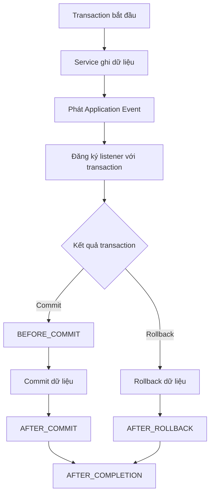

# TransactionalEventListener và thời điểm commit hoặc rollback

## 1. Vì sao cần gắn sự kiện với transaction?

Trong Spring, một sự kiện ứng dụng thông thường được gửi bằng `ApplicationEventPublisher.publishEvent(...)`. Listener dùng `@EventListener` thường được gọi ngay trong quá trình phát sự kiện. Điều này phù hợp với những phản ứng có thể thực hiện độc lập với kết quả lưu dữ liệu.

Tuy nhiên, nhiều sự kiện chỉ có ý nghĩa khi transaction đã hoàn tất. Ví dụ, sau khi tạo đơn hàng, hệ thống có thể cần gửi email xác nhận, cập nhật chỉ mục tìm kiếm hoặc thông báo cho một dịch vụ khác. Nếu listener chạy ngay khi `publishEvent(...)` được gọi, nó có thể gửi thông báo thành công dù transaction sau đó bị rollback. Người nhận sẽ thấy một đơn hàng mà cơ sở dữ liệu không hề lưu.

`@TransactionalEventListener` giải quyết vấn đề về **thời điểm gọi listener**. Spring đăng ký listener với transaction hiện tại và chỉ gọi phương thức ở phase được chọn. Nhờ vậy, listener có thể phản ứng trước khi commit, sau khi commit, sau rollback hoặc sau khi transaction kết thúc.

Điểm cần nhớ: `@TransactionalEventListener` không tự mở transaction và cũng không biến sự kiện trong bộ nhớ thành một thông điệp được lưu bền vững. Nó liên kết việc xử lý một sự kiện Spring với vòng đời của transaction đang hoạt động tại thời điểm phát sự kiện.

## 2. Vòng đời của một transactional event

Giả sử một service đang chạy trong transaction và phát sự kiện:

```java
@Transactional
public void createOrder() {
    Order order = orderRepository.save(new Order());
    eventPublisher.publishEvent(new OrderCreatedEvent(order.getId()));
}
```

Khi `publishEvent(...)` được gọi, listener transactional không nhất thiết chạy ngay. Nếu có transaction synchronization đang hoạt động, Spring đăng ký callback tương ứng với transaction đó. Khi transaction đi đến phase đã chọn, Spring mới gọi listener.



Sơ đồ mô tả các phase có thể được chọn. Mỗi phương thức listener chỉ chạy ở phase khai báo của nó. `BEFORE_COMMIT` chỉ có ở nhánh commit; `AFTER_ROLLBACK` chỉ có ở nhánh rollback; `AFTER_COMPLETION` chạy sau khi transaction hoàn tất theo cả hai kết quả.

## 3. Bốn phase của `@TransactionalEventListener`

Thuộc tính `phase` nhận giá trị từ `TransactionPhase`.

| Phase | Thời điểm gọi | Trường hợp sử dụng phù hợp |
|---|---|---|
| `BEFORE_COMMIT` | Sau khi công việc chính hoàn tất nhưng trước khi transaction commit | Kiểm tra điều kiện cuối, ghi dữ liệu phụ cần cùng commit với dữ liệu chính |
| `AFTER_COMMIT` | Chỉ sau khi transaction commit thành công | Gửi thông báo, làm mới cache hoặc khởi động công việc tiếp theo |
| `AFTER_ROLLBACK` | Sau khi transaction rollback | Ghi nhận thất bại, giải phóng tài nguyên bên ngoài hoặc thực hiện xử lý bù |
| `AFTER_COMPLETION` | Sau khi transaction kết thúc, dù commit hay rollback | Dọn dẹp tài nguyên hoặc ghi nhận kết quả hoàn tất chung |

### 3.1. `BEFORE_COMMIT`

```java
@Component
public class OrderValidationListener {

    @TransactionalEventListener(phase = TransactionPhase.BEFORE_COMMIT)
    public void validate(OrderCreatedEvent event) {
        // Kiểm tra điều kiện cần đúng trước khi đơn hàng được commit.
    }
}
```

Listener chạy khi transaction vẫn có thể commit hoặc rollback. Nếu listener phát hiện dữ liệu không hợp lệ và ném exception phù hợp, exception có thể làm transaction rollback. Vì vậy, phase này thích hợp với kiểm tra hoặc thao tác cơ sở dữ liệu cần nằm trong cùng transaction.

Không nên gọi dịch vụ bên ngoài có side effect khó đảo ngược ở phase này. Ví dụ, nếu listener gửi email rồi transaction rollback, email đã gửi không thể tự biến mất.

### 3.2. `AFTER_COMMIT`

Đây là phase mặc định. Hai cách khai báo sau có cùng ý nghĩa:

```java
@TransactionalEventListener
public void sendConfirmation(OrderCreatedEvent event) {
    // Chạy sau khi transaction commit thành công.
}
```

```java
@TransactionalEventListener(phase = TransactionPhase.AFTER_COMMIT)
public void sendConfirmation(OrderCreatedEvent event) {
    // Chạy sau khi transaction commit thành công.
}
```

Phase này phù hợp khi hành động chỉ nên bắt đầu sau khi dữ liệu chính đã được commit. Ví dụ, hệ thống chỉ gửi email xác nhận sau khi đơn hàng đã được lưu thành công.

Nếu transaction rollback, listener `AFTER_COMMIT` không chạy. Điều đó ngăn việc gửi thông báo thành công cho một thao tác thất bại.

Một chi tiết quan trọng: callback `AFTER_COMMIT` chạy sau khi commit đã hoàn tất. Các resource của transaction có thể vẫn đang được giữ và truy cập được trong callback, nhưng sẽ không có lần commit tiếp theo cho transaction vừa kết thúc. Vì vậy, nếu listener cần ghi dữ liệu mới, hãy dùng một transaction mới, thường là `Propagation.REQUIRES_NEW`.

```java
@Component
public class OrderAuditListener {

    private final OrderAuditRepository auditRepository;

    public OrderAuditListener(OrderAuditRepository auditRepository) {
        this.auditRepository = auditRepository;
    }

    @TransactionalEventListener(phase = TransactionPhase.AFTER_COMMIT)
    @Transactional(propagation = Propagation.REQUIRES_NEW)
    public void record(OrderCreatedEvent event) {
        auditRepository.save(new OrderAudit(event.orderId(), "CREATED"));
    }
}
```

`REQUIRES_NEW` yêu cầu Spring mở transaction độc lập cho thao tác ghi audit. Nếu bỏ transaction mới trong tình huống cần ghi dữ liệu, lệnh ghi có thể chạy trên resource đã hoàn tất mà không có commit nào tiếp theo để lưu thay đổi.

### 3.3. `AFTER_ROLLBACK`

```java
@Component
public class OrderRollbackListener {

    @TransactionalEventListener(phase = TransactionPhase.AFTER_ROLLBACK)
    public void handleFailure(OrderCreationRequestedEvent event) {
        // Ghi nhận hoặc xử lý hậu quả của transaction bị rollback.
    }
}
```

Listener chỉ chạy khi transaction rollback. Đây là nơi phù hợp để ghi nhận một lần xử lý thất bại hoặc thực hiện hành động bù đối với tài nguyên bên ngoài đã được chuẩn bị trước đó.

Không nên giả định rằng mọi thao tác trong listener này đều nằm trong transaction đã rollback. Transaction cũ đã thất bại; nếu cần lưu trạng thái thất bại vào cơ sở dữ liệu, hãy mở transaction mới một cách rõ ràng.

### 3.4. `AFTER_COMPLETION`

```java
@TransactionalEventListener(phase = TransactionPhase.AFTER_COMPLETION)
public void releaseResource(OrderCreatedEvent event) {
    // Dọn dẹp sau khi transaction kết thúc.
}
```

Phase này chạy sau khi transaction hoàn tất, bất kể kết quả là commit hay rollback. Nó hữu ích cho công việc dọn dẹp không phụ thuộc vào kết quả. Nếu logic cần phân biệt thành công và thất bại, hãy chọn `AFTER_COMMIT` hoặc `AFTER_ROLLBACK` để ý nghĩa được thể hiện rõ trong cấu hình.

## 4. Ví dụ từ lúc phát sự kiện đến lúc commit

Một event thường là đối tượng nhỏ mang dữ liệu cần thiết cho listener. Với Java hiện đại, có thể dùng `record`:

```java
import java.util.UUID;

public record OrderCreatedEvent(UUID orderId) {
}
```

Service lưu đơn hàng và phát event trong cùng phương thức có `@Transactional`:

```java
import org.springframework.context.ApplicationEventPublisher;
import org.springframework.stereotype.Service;
import org.springframework.transaction.annotation.Transactional;

import java.util.UUID;

@Service
public class OrderService {

    private final OrderRepository orderRepository;
    private final ApplicationEventPublisher eventPublisher;

    public OrderService(
            OrderRepository orderRepository,
            ApplicationEventPublisher eventPublisher) {
        this.orderRepository = orderRepository;
        this.eventPublisher = eventPublisher;
    }

    @Transactional
    public UUID createOrder(Order order) {
        Order savedOrder = orderRepository.save(order);
        eventPublisher.publishEvent(new OrderCreatedEvent(savedOrder.getId()));
        return savedOrder.getId();
    }
}
```

Listener đăng ký xử lý sau commit:

```java
import org.springframework.stereotype.Component;
import org.springframework.transaction.event.TransactionPhase;
import org.springframework.transaction.event.TransactionalEventListener;

@Component
public class OrderNotificationListener {

    private final NotificationService notificationService;

    public OrderNotificationListener(NotificationService notificationService) {
        this.notificationService = notificationService;
    }

    @TransactionalEventListener(phase = TransactionPhase.AFTER_COMMIT)
    public void onOrderCreated(OrderCreatedEvent event) {
        notificationService.sendOrderConfirmation(event.orderId());
    }
}
```

Trình tự xảy ra như sau:

1. Spring mở transaction khi gọi `createOrder(...)` qua proxy quản lý transaction.
2. Repository lưu đơn hàng trong transaction đó.
3. Service phát `OrderCreatedEvent`.
4. Spring đăng ký callback `AFTER_COMMIT` cho transaction hiện tại.
5. Phương thức service kết thúc; transaction manager thực hiện commit.
6. Nếu commit thành công, Spring gọi `onOrderCreated(...)`.
7. Nếu transaction rollback, bước 6 không xảy ra.

`@Transactional` hoạt động qua cơ chế proxy trong trường hợp thông thường. Vì thế, lời gọi phải đi qua bean do Spring quản lý; một lời gọi nội bộ từ phương thức này sang phương thức khác trong cùng object không tự kích hoạt proxy transaction như một lời gọi từ bean khác.

## 5. Điều gì xảy ra nếu không có transaction?

Mặc định, `@TransactionalEventListener` yêu cầu có transaction đang hoạt động tại thời điểm event được phát. Nếu không có transaction phù hợp, listener sẽ không được gọi. Đây là hành vi có chủ đích: tên phase như `AFTER_COMMIT` không có ý nghĩa nếu không có transaction để commit.

Có thể thay đổi hành vi này bằng `fallbackExecution = true`:

```java
@TransactionalEventListener(fallbackExecution = true)
public void handle(OrderCreatedEvent event) {
    // Nếu không có transaction, listener được gọi theo đường fallback.
}
```

Khi không có transaction, listener chạy ngay theo fallback thay vì chờ một phase transaction. Do đó, cần cân nhắc kỹ trước khi bật tùy chọn này: cùng một event có thể được xử lý ở hai thời điểm khác nhau tùy việc nơi phát event có transaction hay không.

`fallbackExecution` không tạo transaction mới. Nếu listener cần thao tác cơ sở dữ liệu trong transaction, hãy khai báo transaction cho phương thức listener hoặc gọi một service có transaction phù hợp.

Một event được phát trước khi transaction bắt đầu cũng không tự động gắn với transaction sẽ mở sau đó. Spring chỉ có thể đăng ký callback với transaction đang hiện diện khi event được phát.

## 6. Ranh giới transaction ảnh hưởng đến thời điểm listener

Listener gắn với transaction đang hoạt động tại thời điểm phát event. Vì vậy, cần hiểu propagation của phương thức phát event.

- Với `Propagation.REQUIRED`, phương thức thường tham gia transaction hiện có. Event được phát sẽ gắn với transaction đó; listener `AFTER_COMMIT` đợi đến khi transaction chung commit.
- Với `Propagation.REQUIRES_NEW`, Spring tạm dừng transaction bên ngoài và mở transaction mới. Event phát trong transaction mới gắn với transaction mới đó. Nếu transaction mới commit, listener có thể chạy ngay sau lần commit này, kể cả khi transaction bên ngoài sau đó rollback.
- Nếu không có transaction và không bật `fallbackExecution`, listener transactional không được gọi.

Ví dụ, một service bên ngoài đang xử lý đơn hàng rồi gọi service ghi log với `REQUIRES_NEW`. Nếu service ghi log phát event, callback `AFTER_COMMIT` của event đó phụ thuộc vào transaction độc lập của service ghi log. Không nên suy luận thời điểm callback chỉ từ transaction ở tầng gọi bên ngoài.

## 7. Kiểm thử đúng thời điểm commit và rollback

Kiểm thử `@TransactionalEventListener` cần tạo ra ranh giới transaction thật. Một bài test có thể gọi `publishEvent(...)` thành công nhưng vẫn chưa chứng minh listener đã chạy ở đúng phase.

### 7.1. Cách đơn giản: để service tự hoàn tất transaction

Với integration test không gắn `@Transactional` lên phương thức test, lời gọi service sẽ mở và kết thúc transaction theo cấu hình của service. Nếu listener là listener đồng bộ, callback `AFTER_COMMIT` hoàn tất trước khi lời gọi service trả về.

```java
@SpringBootTest
class OrderServiceIntegrationTest {

    @Autowired
    private OrderService orderService;

    @Autowired
    private OrderEventProbe probe;

    @BeforeEach
    void clearProbe() {
        probe.clear();
    }

    @Test
    void invokesListenerAfterSuccessfulCommit() {
        UUID orderId = orderService.createOrder(new Order());

        assertThat(probe.committedOrderIds()).contains(orderId);
    }
}
```

Probe là một bean kiểm thử nhỏ nhận event ở đúng phase cần quan sát:

```java
@Component
public class OrderEventProbe {

    private final List<UUID> committedOrderIds = new CopyOnWriteArrayList<>();

    @TransactionalEventListener(phase = TransactionPhase.AFTER_COMMIT)
    public void onCommitted(OrderCreatedEvent event) {
        committedOrderIds.add(event.orderId());
    }

    public List<UUID> committedOrderIds() {
        return List.copyOf(committedOrderIds);
    }

    public void clear() {
        committedOrderIds.clear();
    }
}
```

Đoạn test tập trung vào ranh giới commit. Trong dự án thực tế, hãy tạo dữ liệu hợp lệ theo constructor hoặc factory của entity, đồng thời cô lập probe giữa các test để tránh trạng thái còn lại từ lần chạy trước.

### 7.2. Bẫy phổ biến: test có `@Transactional` mặc định rollback

Spring Test thường tự mở transaction cho phương thức test có `@Transactional` và rollback transaction đó khi test kết thúc. Nếu service dùng `REQUIRED`, service tham gia transaction của test. Vì vậy, listener `AFTER_COMMIT` chưa chạy trong thân test; cuối test transaction rollback nên listener `AFTER_COMMIT` cũng không chạy.

Ví dụ sau không thể dùng để khẳng định listener `AFTER_COMMIT` hoạt động:

```java
@Test
@Transactional
void misleadingTest() {
    orderService.createOrder(new Order());

    // Transaction của test vẫn đang mở.
    // AFTER_COMMIT chưa chạy tại thời điểm assertion này.
}
```

Đây là lý do một listener có thể hoạt động đúng trong ứng dụng nhưng không được gọi trong test. Vấn đề nằm ở transaction do test quản lý, không nhất thiết nằm ở listener.

### 7.3. Chủ động commit transaction của test bằng `TestTransaction`

Khi cần giữ `@Transactional` trên test, có thể kết thúc transaction ngay trong thân test:

```java
@SpringBootTest
class OrderTransactionalEventTest {

    @Autowired
    private OrderService orderService;

    @Autowired
    private OrderEventProbe probe;

    @BeforeEach
    void clearProbe() {
        probe.clear();
    }

    @Test
    @Transactional
    void invokesAfterCommitWhenTestTransactionCommits() {
        UUID orderId = orderService.createOrder(new Order());

        assertThat(probe.committedOrderIds()).doesNotContain(orderId);

        TestTransaction.flagForCommit();
        TestTransaction.end();

        assertThat(probe.committedOrderIds()).contains(orderId);
    }
}
```

`TestTransaction.flagForCommit()` yêu cầu transaction do Spring Test quản lý được commit khi kết thúc. `TestTransaction.end()` kết thúc transaction ngay tại vị trí gọi; callback `AFTER_COMMIT` được thực thi trong quá trình kết thúc đó. Sau `end()`, test không còn ở trong transaction vừa kết thúc.

Nếu muốn kiểm tra `AFTER_ROLLBACK`, có thể chủ động kết thúc transaction bằng rollback:

```java
@Test
@Transactional
void invokesAfterRollbackWhenTestTransactionRollsBack() {
    eventPublisher.publishEvent(new OrderCreatedEvent(UUID.randomUUID()));

    TestTransaction.flagForRollback();
    TestTransaction.end();

    assertThat(rollbackProbe.events()).hasSize(1);
}
```

Test này cần có một probe riêng được khai báo với `phase = TransactionPhase.AFTER_ROLLBACK`. Cũng có thể dùng transaction mặc định rollback của Spring Test, nhưng khi muốn assertion kiểm tra callback ngay trong test, phải chủ động kết thúc transaction trước assertion.

### 7.4. Kiểm thử rollback bằng lỗi nghiệp vụ

Một cách khác là gọi service thực hiện công việc trong transaction rồi ném runtime exception. Khi lời gọi đi qua proxy Spring, transaction được rollback trước khi exception trả về phía test.

```java
@Test
void invokesAfterRollbackWhenServiceFails() {
    assertThatThrownBy(() -> orderService.createOrderAndFail())
            .isInstanceOf(IllegalStateException.class);

    assertThat(rollbackProbe.events()).hasSize(1);
    assertThat(commitProbe.events()).isEmpty();
}
```

Trong ví dụ này, `createOrderAndFail()` phải phát event khi transaction còn hoạt động rồi ném exception làm transaction rollback. Test không nên tự bọc lời gọi bằng một transaction khác nếu mục tiêu là quan sát transaction do service quản lý.

### 7.5. Dùng `TransactionTemplate` khi muốn điều khiển transaction tường minh

`TransactionTemplate` hữu ích khi test cần tạo transaction, phát event và chọn commit hoặc rollback ngay trong một đoạn mã:

```java
@Autowired
private PlatformTransactionManager transactionManager;

@Test
void invokesRollbackListener() {
    TransactionTemplate transaction = new TransactionTemplate(transactionManager);

    transaction.executeWithoutResult(status -> {
        eventPublisher.publishEvent(new OrderCreatedEvent(UUID.randomUUID()));
        status.setRollbackOnly();
    });

    assertThat(rollbackProbe.events()).hasSize(1);
    assertThat(commitProbe.events()).isEmpty();
}
```

`executeWithoutResult(...)` chỉ trả về sau khi transaction được hoàn tất. Vì vậy, với listener đồng bộ, test có thể kiểm tra probe ngay sau lời gọi. Test này nên chạy mà không có transaction ngoài đang bao quanh, nếu không `REQUIRED` có thể tham gia transaction ngoài và callback chỉ chạy khi transaction ngoài kết thúc.

### 7.6. Phân biệt kiểm tra event được phát và kiểm tra listener đã chạy

Một công cụ ghi nhận application event có thể xác nhận rằng service đã gọi `publishEvent(...)`. Điều đó chưa chứng minh listener transactional đã chạy ở phase mong muốn. Ví dụ, event có thể đã được phát nhưng transaction sau đó rollback; listener `AFTER_COMMIT` sẽ không chạy.

Khi kiểm thử phase, hãy quan sát kết quả của listener hoặc một probe được gọi từ listener. Khi kiểm thử việc phát event, hãy quan sát event được publish. Hai mục tiêu này liên quan nhưng khác nhau.

## 8. Các lưu ý về thứ tự và xử lý bất đồng bộ

### 8.1. Thứ tự giữa nhiều listener

Nếu nhiều listener cùng nhận một loại event và cần thứ tự xác định, có thể dùng `@Order`:

```java
@Component
public class FirstListener {

    @Order(1)
    @TransactionalEventListener(phase = TransactionPhase.AFTER_COMMIT)
    public void handle(OrderCreatedEvent event) {
        // Listener có thứ tự ưu tiên cao hơn.
    }
}
```

Chỉ dựa vào thứ tự khai báo bean hoặc thứ tự file để suy luận thứ tự listener là không an toàn. Nếu thứ tự có ý nghĩa nghiệp vụ, hãy khai báo rõ và kiểm thử hành vi đó.

### 8.2. Kết hợp với `@Async`

Có thể chuyển phần xử lý listener sang executor bằng `@Async` khi công việc tốn thời gian và không cần hoàn tất trước khi lời gọi transaction trả về. Khi đó, phase transaction quyết định lúc công việc được đưa đi xử lý; phần thân listener có thể chạy trên thread khác.

Transaction context không tự truyền sang thread bất đồng bộ. Nếu listener cần ghi cơ sở dữ liệu, hãy cấu hình transaction cho chính phần xử lý đó. Đồng thời, test phải chờ hoặc đồng bộ với kết quả bất đồng bộ thay vì giả định listener đã hoàn tất ngay sau khi service trả về.

Không nên dùng `@Async` chỉ để che giấu một side effect quan trọng. Cần có cách quan sát lỗi, retry và xử lý trường hợp tiến trình dừng giữa lúc commit dữ liệu và lúc công việc bất đồng bộ được thực hiện.

## 9. Giới hạn về độ tin cậy của transactional event

`@TransactionalEventListener` bảo đảm thời điểm callback tương ứng với transaction trong tiến trình hiện tại. Nó không tự cung cấp hàng đợi bền vững. Ví dụ, transaction có thể commit thành công rồi tiến trình dừng trước khi listener gửi email. Khi đó dữ liệu đơn hàng vẫn tồn tại nhưng email có thể chưa được gửi.

Nếu yêu cầu nghiệp vụ đòi hỏi thông điệp phải được phát đi một cách đáng tin cậy, hãy cân nhắc **Transactional Outbox**: ghi bản ghi outbox trong cùng transaction với dữ liệu nghiệp vụ, sau đó một tiến trình riêng đọc và gửi thông điệp, có cơ chế retry và đánh dấu đã xử lý. `BEFORE_COMMIT` có thể hỗ trợ ghi dữ liệu phụ trong cùng transaction, nhưng bản thân callback vẫn không thay thế được outbox bền vững.

Hãy chọn cơ chế theo mức độ đảm bảo cần thiết:

- Chỉ cần phản ứng trong tiến trình sau khi commit và chấp nhận khả năng mất callback khi tiến trình dừng: `@TransactionalEventListener(AFTER_COMMIT)` có thể phù hợp.
- Cần ghi dữ liệu phụ nguyên tử cùng dữ liệu chính: xử lý trong transaction trước commit, ví dụ ghi outbox row.
- Cần gửi thông điệp ra hệ thống khác với khả năng retry và khôi phục: dùng outbox hoặc một cơ chế messaging bền vững phù hợp.

## 10. Những lỗi thường gặp và cách xác định nguyên nhân

| Hiện tượng | Nguyên nhân thường gặp | Cách kiểm tra |
|---|---|---|
| Listener không chạy | Event được phát khi không có transaction và `fallbackExecution` đang là `false` | Kiểm tra vị trí gọi `publishEvent(...)` và transaction đang hoạt động tại thời điểm đó |
| `AFTER_COMMIT` không chạy trong test | Test có `@Transactional` và Spring Test rollback transaction khi kết thúc | Bỏ transaction ở test, hoặc dùng `TestTransaction` để commit rõ ràng |
| `AFTER_COMMIT` chạy nhưng dữ liệu listener ghi không được lưu | Listener ghi sau khi transaction cũ đã commit, không có commit mới | Mở transaction mới, thường bằng `Propagation.REQUIRES_NEW` |
| Listener chạy trước khi dữ liệu được commit | Đang dùng `@EventListener` thông thường hoặc chọn `BEFORE_COMMIT` | Kiểm tra annotation và giá trị `phase` |
| Listener `AFTER_COMMIT` không chạy sau khi service ném exception | Transaction đã rollback | Dùng `AFTER_ROLLBACK` nếu cần xử lý nhánh thất bại |
| Callback chạy ở thời điểm bất ngờ | Event được phát trong transaction `REQUIRES_NEW` hoặc transaction lồng nhau có ranh giới riêng | Theo dõi transaction manager và propagation tại nơi phát event |
| Test thấy event đã phát nhưng probe listener chưa nhận | Test đang quan sát việc publish, trong khi callback đang chờ transaction hoàn tất | Kết thúc transaction trước assertion và quan sát listener trực tiếp |

Khi debug, hãy lần theo ba điểm theo đúng thứ tự: nơi phát event, transaction đang bao quanh nơi đó, và phase được listener đăng ký. Đây là ba dữ kiện quyết định listener có được đăng ký và khi nào callback chạy.

## 11. Checklist khi chọn phase

- Dùng `BEFORE_COMMIT` khi công việc cần hoàn thành trước commit và có thể tham gia transaction hiện tại.
- Dùng `AFTER_COMMIT` khi chỉ nên phản ứng sau khi dữ liệu chính đã được commit.
- Dùng `AFTER_ROLLBACK` khi chỉ cần phản ứng sau thất bại của transaction.
- Dùng `AFTER_COMPLETION` khi công việc dọn dẹp không phụ thuộc kết quả commit hay rollback.
- Kiểm tra event được phát bên trong đúng transaction cần theo dõi.
- Nếu phát event ngoài transaction, chỉ bật `fallbackExecution` khi chấp nhận xử lý ngay ở thời điểm phát.
- Nếu listener ghi dữ liệu sau commit, mở transaction mới.
- Khi test, tạo ranh giới commit/rollback thật và assertion sau khi transaction kết thúc.
- Nếu không thể chấp nhận mất thông điệp khi tiến trình dừng, thiết kế outbox hoặc cơ chế lưu bền vững.

`@TransactionalEventListener` giúp đồng bộ thời điểm xử lý event với kết quả transaction. Chọn đúng phase và kiểm thử đúng ranh giới transaction sẽ tránh được các lỗi như gửi thông báo cho dữ liệu đã rollback, bỏ sót listener trong test, hoặc ghi dữ liệu sau commit mà không có transaction mới.
