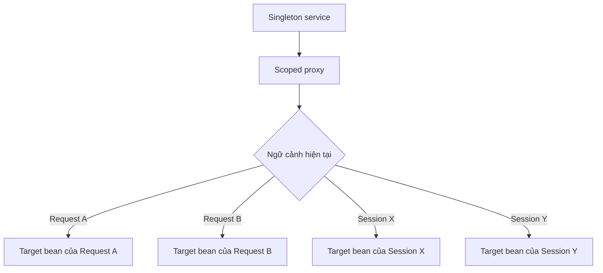

# Scoped proxy và việc truy cập bean đúng ngữ cảnh

Trong Spring Web, một số bean chỉ có ý nghĩa trong phạm vi một HTTP request, một HTTP session hoặc một ứng dụng web. Trong khi đó, service và controller thường là singleton, được tạo một lần trong application context và có thể được nhiều request dùng đồng thời. Nếu singleton giữ trực tiếp một instance có vòng đời ngắn hơn, bean có thể được tạo sai thời điểm hoặc dùng nhầm trạng thái giữa các request.

Scoped proxy giải quyết vấn đề này bằng cách đưa một proxy có thể sống lâu hơn vào bean singleton. Mỗi khi singleton gọi phương thức trên proxy, Spring tìm đúng instance đích theo scope đang hoạt động. Nhờ đó, một service singleton có thể truy cập request-scoped hoặc session-scoped bean mà không phải tự quản lý vòng đời của chúng.

## 1. Vì sao cần scoped proxy?

Giả sử một ứng dụng có service singleton cần đọc thông tin trace riêng cho từng request. Nếu `RequestTrace` là bean request scope và được inject trực tiếp vào singleton, Spring phải giải quyết bean đó khi tạo singleton. Lúc này chưa có HTTP request nào hoạt động để cung cấp instance request-scoped, vì vậy việc tạo context có thể thất bại với lỗi scope chưa hoạt động.

Ngay cả khi tạo được instance theo cách thủ công, giữ một object request-scoped trong singleton cũng làm sai vòng đời: nhiều request có thể dùng chung một object và nhìn thấy trạng thái của nhau.

Scoped proxy tạo ra một lớp trung gian:



Singleton giữ proxy ổn định. Proxy tra cứu target bean theo scope khi được gọi. Vì vậy:

- Trong cùng một request, các lần gọi tới proxy lấy cùng request-scoped target.
- Sang request khác, proxy lấy target mới tương ứng với request mới.
- Với session scope, các request thuộc cùng session dùng chung target; session khác có target riêng.
- Khi không có scope phù hợp đang hoạt động, Spring không thể tìm target và ném lỗi scope.

## 2. Các scope web thường gặp

`WebApplicationContext` hỗ trợ các scope gắn với môi trường Servlet:

| Scope | Vòng đời target bean | Phạm vi chia sẻ |
| --- | --- | --- |
| `request` | Trong một HTTP request | Các thành phần xử lý cùng request |
| `session` | Trong một HTTP session | Nhiều request thuộc cùng session |
| `application` | Trong vòng đời `ServletContext` | Toàn bộ ứng dụng web gắn với ServletContext |
| `websocket` | Trong một WebSocket session | Các thao tác trong cùng WebSocket session |

Các scope này yêu cầu web-aware application context và ngữ cảnh tương ứng phải đang hoạt động. Một application context thông thường không tự cung cấp request hoặc session scope.

Phân biệt thêm với hai scope cốt lõi:

- `singleton`: một instance cho mỗi Spring `ApplicationContext`.
- `prototype`: Spring tạo instance mới mỗi lần bean được yêu cầu từ container; sau khi cấp instance, container không quản lý đầy đủ vòng đời hủy của object đó.

`application` scope không hoàn toàn đồng nghĩa với `singleton`: singleton được chia sẻ trong một Spring application context, còn application-scoped bean được lưu theo `ServletContext` và có thể được chia sẻ giữa các Spring web application context trong cùng ứng dụng web.

## 3. Khai báo request-scoped bean

Có thể khai báo request scope bằng `@RequestScope`:

```java
@Component
@RequestScope
public class RequestTrace {
    private final String id = UUID.randomUUID().toString();

    public String id() {
        return id;
    }
}
```

`@RequestScope` là annotation tiện ích tương đương với `@Scope` dùng `WebApplicationContext.SCOPE_REQUEST`. Annotation này mặc định cấu hình scoped proxy theo kiểu target class, nên bean có thể được inject vào một singleton.

Cũng có thể khai báo tường minh:

```java
@Component
@Scope(
        value = WebApplicationContext.SCOPE_REQUEST,
        proxyMode = ScopedProxyMode.TARGET_CLASS)
public class RequestTrace {
    // Trạng thái chỉ thuộc request hiện tại
}
```

Trong trường hợp không muốn proxy tự động, có thể dùng `ScopedProxyMode.NO`, nhưng khi đó phải tự bảo đảm bean chỉ được truy cập khi scope hoạt động và không inject trực tiếp vào singleton theo cách gây eager resolution.

## 4. Khai báo session-scoped bean

Session scope phù hợp với dữ liệu cần tồn tại qua nhiều HTTP request trong cùng phiên người dùng, ví dụ giỏ hàng hoặc trạng thái một quy trình nhiều bước.

```java
@Component
@SessionScope
public class ShoppingCart {
    private final List<String> productIds = new ArrayList<>();

    public void add(String productId) {
        productIds.add(productId);
    }

    public List<String> productIds() {
        return List.copyOf(productIds);
    }
}
```

`@SessionScope` cũng mặc định dùng scoped proxy kiểu target class. Spring tìm target trong session hiện tại mỗi lần proxy được gọi. Request có cùng session sẽ truy cập cùng giỏ hàng; session khác sẽ có giỏ hàng khác.

Không nên lưu dữ liệu nhạy cảm hoặc object lớn tùy tiện trong session. Session scope kéo dài theo phiên người dùng và có thể tồn tại lâu hơn một request; cần cân nhắc serialization nếu session được lưu ngoài tiến trình, replication hoặc distributed session store.

## 5. `ScopedProxyMode` và các lựa chọn proxy

`@Scope` có thuộc tính `proxyMode` để quyết định Spring tạo proxy như thế nào:

| Giá trị | Hành vi | Khi phù hợp |
| --- | --- | --- |
| `ScopedProxyMode.NO` | Không tạo scoped proxy | Khi bean được tra cứu thủ công trong lúc scope đang hoạt động hoặc không cần inject qua ranh giới scope |
| `ScopedProxyMode.INTERFACES` | Tạo proxy dựa trên các interface mà bean triển khai | Khi client phụ thuộc vào interface và muốn dùng JDK dynamic proxy |
| `ScopedProxyMode.TARGET_CLASS` | Tạo proxy dựa trên class đích bằng cơ chế subclass | Khi inject theo class hoặc bean không có interface phù hợp |
| `ScopedProxyMode.DEFAULT` | Dùng mặc định được cấu hình cho component scan; thông thường tương đương không proxy nếu không cấu hình khác | Khi muốn tuân theo cấu hình scoped proxy chung |

Ví dụ proxy theo interface:

```java
public interface RequestIdentity {
    String id();
}

@Component
@Scope(value = WebApplicationContext.SCOPE_REQUEST,
       proxyMode = ScopedProxyMode.INTERFACES)
class DefaultRequestIdentity implements RequestIdentity {
    private final String id = UUID.randomUUID().toString();

    @Override
    public String id() {
        return id;
    }
}
```

Singleton nên inject interface:

```java
@Service
class RequestIdentityService {
    private final RequestIdentity requestIdentity;

    RequestIdentityService(RequestIdentity requestIdentity) {
        this.requestIdentity = requestIdentity;
    }

    String currentId() {
        return requestIdentity.id();
    }
}
```

Với `INTERFACES`, không nên inject `DefaultRequestIdentity` theo concrete class vì JDK proxy chỉ triển khai interface. Nếu muốn inject theo class, dùng `TARGET_CLASS` và lưu ý các giới hạn của proxy dựa trên subclass.

## 6. Giới hạn của proxy dựa trên class và interface

Proxy kiểu `TARGET_CLASS` cần tạo subclass của class đích. Do đó class không thể là `final`, và các phương thức cần được proxy không nên là `final` hoặc `private`. Constructor và cách thiết kế class cũng cần tương thích với cơ chế proxy của Spring.

Proxy kiểu `INTERFACES` dựa trên JDK dynamic proxy. Client cần gọi qua interface mà proxy triển khai. Không thể ép proxy này thành concrete implementation class.

Một số nguyên tắc thực tế:

- Ưu tiên inject interface khi ứng dụng đã có abstraction tự nhiên.
- Dùng `TARGET_CLASS` khi không có interface phù hợp hoặc API hiện tại phụ thuộc concrete class.
- Tránh class `final` nếu cần class-based proxy.
- Không dựa vào phép so sánh identity giữa proxy và target; proxy và target là hai object khác nhau.
- Không giả định `@PostConstruct` của target đã chạy khi singleton được tạo. Target thường chỉ được tạo lần đầu khi proxy được gọi trong scope hợp lệ.

## 7. Inject scoped proxy vào singleton service

Một service singleton có thể inject request-scoped bean như một dependency thông thường:

```java
@Service
public class TraceService {
    private final RequestTrace requestTrace;

    public TraceService(RequestTrace requestTrace) {
        this.requestTrace = requestTrace;
    }

    public String currentRequestId() {
        return requestTrace.id();
    }
}
```

`TraceService` được tạo một lần. Dependency `requestTrace` được inject vào nó là scoped proxy. Mỗi lần `currentRequestId()` gọi `id()`, proxy tìm target tương ứng với request hiện tại.

Controller có thể gọi service nhiều lần trong cùng request:

```java
@RestController
class TraceController {
    private final TraceService traceService;

    TraceController(TraceService traceService) {
        this.traceService = traceService;
    }

    @GetMapping("/trace")
    TraceView trace() {
        return new TraceView(
                traceService.currentRequestId(),
                traceService.currentRequestId());
    }
}

record TraceView(String first, String second) {
}
```

Hai lần gọi trong cùng request trả về cùng ID. Khi request tiếp theo đến, proxy phân giải target mới và ID khác.

## 8. Kiểm thử request scope bằng MockMvc

`MockMvc` gửi request qua `DispatcherServlet`. Trong quá trình dispatch, Spring thiết lập request context để các web scope có thể truy cập. Đây là cách tự nhiên nhất để kiểm tra scoped proxy trong ứng dụng MVC.

Test context cần có web application context:

```java
@SpringJUnitConfig(WebTestConfig.class)
@WebAppConfiguration
class RequestScopeTest {
    @Autowired
    private WebApplicationContext webApplicationContext;

    private MockMvc mockMvc;

    @BeforeEach
    void setUp() {
        mockMvc = MockMvcBuilders
                .webAppContextSetup(webApplicationContext)
                .build();
    }
}
```

Với controller `/trace` ở phần trước, test có thể xác nhận hai lần truy cập trong cùng request dùng cùng target, còn request độc lập dùng target khác:

```java
@Autowired
private ObjectMapper objectMapper;

@Test
void usesOneRequestScopedTargetPerHttpRequest() throws Exception {
    String firstBody = mockMvc.perform(get("/trace"))
            .andExpect(status().isOk())
            .andReturn()
            .getResponse()
            .getContentAsString();

    TraceView first = objectMapper.readValue(firstBody, TraceView.class);
    assertThat(first.first()).isEqualTo(first.second());

    String secondBody = mockMvc.perform(get("/trace"))
            .andExpect(status().isOk())
            .andReturn()
            .getResponse()
            .getContentAsString();

    TraceView second = objectMapper.readValue(secondBody, TraceView.class);
    assertThat(second.first()).isEqualTo(second.second());
    assertThat(second.first()).isNotEqualTo(first.first());
}
```

Test không cần tự tạo request context. `DispatcherServlet` quản lý context trong thời gian xử lý từng request. Hai lần gọi `mockMvc.perform(...)` là hai request riêng biệt nên request-scoped target không được dùng chung.

## 9. Kiểm thử session scope qua nhiều request

Để kiểm tra session scope, test cần gửi nhiều request với cùng một `MockHttpSession`. Dùng một service singleton inject `ShoppingCart` proxy:

```java
@Service
class CartService {
    private final ShoppingCart cart;

    CartService(ShoppingCart cart) {
        this.cart = cart;
    }

    int addAndGetSize(String productId) {
        cart.add(productId);
        return cart.productIds().size();
    }
}
```

Controller trả số lượng sản phẩm sau khi thêm:

```java
@RestController
class CartController {
    private final CartService cartService;

    CartController(CartService cartService) {
        this.cartService = cartService;
    }

    @PostMapping("/cart/{productId}")
    int add(@PathVariable String productId) {
        return cartService.addAndGetSize(productId);
    }
}
```

Test giữ cùng session giữa hai request:

```java
@Test
void reusesSessionScopedTargetOnlyWithinSameSession() throws Exception {
    MockHttpSession firstSession = new MockHttpSession();

    mockMvc.perform(post("/cart/BK-01").session(firstSession))
            .andExpect(status().isOk())
            .andExpect(content().string("1"));

    mockMvc.perform(post("/cart/PEN-02").session(firstSession))
            .andExpect(status().isOk())
            .andExpect(content().string("2"));

    MockHttpSession secondSession = new MockHttpSession();
    mockMvc.perform(post("/cart/ERASER-03").session(secondSession))
            .andExpect(status().isOk())
            .andExpect(content().string("1"));
}
```

Hai request đầu dùng cùng session nên cùng target `ShoppingCart`; request thứ ba dùng session khác nên có target mới. Khi kiểm thử session scope, không tạo `MockHttpSession` mới cho mỗi request nếu muốn mô phỏng cùng một người dùng.

## 10. Truy cập scope trực tiếp ngoài MVC dispatch

Scoped proxy chỉ có thể phân giải target khi scope tương ứng đang hoạt động. Trong một test gọi service trực tiếp, không thông qua `MockMvc` hoặc `DispatcherServlet`, thường không có request context. Gọi phương thức trên request-scoped proxy lúc này có thể ném `ScopeNotActiveException`.

Ví dụ kiểm tra hành vi khi không có request:

```java
assertThatThrownBy(() -> traceService.currentRequestId())
        .isInstanceOf(ScopeNotActiveException.class);
```

Nếu test cần gọi service trực tiếp, có thể thiết lập request context bằng `RequestContextHolder` và `ServletRequestAttributes`:

```java
MockHttpServletRequest request = new MockHttpServletRequest();
request.setSession(new MockHttpSession());

RequestAttributes previous = RequestContextHolder.getRequestAttributes();
RequestContextHolder.setRequestAttributes(
        new ServletRequestAttributes(request));

try {
    String requestId = traceService.currentRequestId();
    assertThat(requestId).isNotBlank();
} finally {
    RequestContextHolder.resetRequestAttributes();
    if (previous != null) {
        RequestContextHolder.setRequestAttributes(previous);
    }
}
```

Việc reset trong `finally` rất quan trọng vì `RequestContextHolder` lưu request attributes theo thread. Nếu test để sót context, test chạy sau trên cùng thread có thể vô tình nhìn thấy request cũ.

Với session scope, request cần có session. `request.setSession(new MockHttpSession())` hoặc `request.getSession(true)` tạo session cho mock request. Để kiểm tra nhiều request cùng session trong test thủ công, dùng cùng một `MockHttpSession` cho các `MockHttpServletRequest` khác nhau.

## 11. `ObjectProvider` là một lựa chọn khác

Không phải lúc nào cũng cần scoped proxy. Singleton có thể inject `ObjectProvider<T>` hoặc `ObjectFactory<T>` rồi yêu cầu container cung cấp target khi cần:

```java
@Service
class TraceService {
    private final ObjectProvider<RequestTrace> requestTraceProvider;

    TraceService(ObjectProvider<RequestTrace> requestTraceProvider) {
        this.requestTraceProvider = requestTraceProvider;
    }

    String currentRequestId() {
        return requestTraceProvider.getObject().id();
    }
}
```

`getObject()` được gọi trong lúc request scope hoạt động nên Spring có thể phân giải đúng target. Cách này làm dependency theo scope hiện rõ trong code service.

So sánh hai cách:

| Cách | Ưu điểm | Điểm cần lưu ý |
| --- | --- | --- |
| Scoped proxy | Client gọi bean như dependency thông thường; việc phân giải scope được ẩn trong proxy | Có thêm lớp proxy; cần hiểu proxy mode và giới hạn class/interface |
| `ObjectProvider<T>` | Tra cứu target rõ ràng tại đúng thời điểm; dễ biểu đạt dependency tùy chọn | Client phải gọi `getObject()`; tránh lưu target lấy được vào field singleton |

Không được gọi `getObject()` lúc khởi tạo singleton nếu không có scope hoạt động. Mục đích của provider là trì hoãn việc tra cứu cho tới lúc có request hoặc session hợp lệ.

## 12. Scoped proxy không giống prototype injection

Một lỗi thiết kế thường gặp là nghĩ rằng inject bean `prototype` vào singleton sẽ tạo một prototype mới mỗi lần singleton gọi phương thức. Thực tế, Spring giải quyết dependency khi tạo singleton; instance prototype được inject khi đó thường được giữ trong singleton và tái sử dụng.

Nếu cần một prototype mới cho mỗi lần sử dụng, inject `ObjectProvider<PrototypeBean>`:

```java
@Component
@Scope(ConfigurableBeanFactory.SCOPE_PROTOTYPE)
class WorkContext {
}

@Service
class WorkService {
    private final ObjectProvider<WorkContext> provider;

    WorkService(ObjectProvider<WorkContext> provider) {
        this.provider = provider;
    }

    void run() {
        WorkContext context = provider.getObject();
        // Sử dụng instance mới cho lần chạy này.
    }
}
```

Scoped proxy cho request/session scope giải quyết vấn đề tương tự về vòng đời nhưng target được chọn theo ngữ cảnh web đang hoạt động. Không nên đồng nhất request scope với prototype: request scope bảo đảm cùng request truy cập cùng target, trong khi prototype tạo instance mới mỗi lần container được yêu cầu cấp bean.

## 13. Phân biệt `@SessionScope` với `@SessionAttributes`

Hai cơ chế có tên gần nhau nhưng mục đích khác nhau:

- `@SessionScope` khai báo vòng đời của một Spring bean theo HTTP session. Bean có thể được inject vào service singleton qua scoped proxy.
- `@SessionAttributes` là cơ chế Spring MVC lưu một số model attribute của controller qua nhiều request trong một quy trình hội thoại. Nó không biến class thành session-scoped bean.

Ví dụ `@SessionAttributes`:

```java
@Controller
@SessionAttributes("checkout")
class CheckoutController {
    @ModelAttribute("checkout")
    CheckoutForm checkout() {
        return new CheckoutForm();
    }

    @PostMapping("/checkout/finish")
    String finish(SessionStatus status) {
        status.setComplete();
        return "redirect:/checkout/done";
    }
}
```

`SessionStatus.setComplete()` kết thúc việc lưu model attribute được quản lý bởi `@SessionAttributes`. Nó không phải thao tác shutdown một session-scoped bean tùy ý. Chọn cơ chế dựa trên việc cần một object bean sống theo session hay cần giữ model attribute của một controller flow.

## 14. Scope trong tác vụ bất đồng bộ

Request scope gắn với request attributes trên thread đang xử lý request. Khi controller gửi một tác vụ sang `@Async` executor, request context không tự động được truyền sang worker thread theo cách mặc định.

Vì vậy, không nên giữ request-scoped proxy rồi truy cập nó trong tác vụ nền sau khi request kết thúc. Proxy có thể không tìm được request attributes trên thread worker và ném `ScopeNotActiveException`; ngay cả khi context được truyền thủ công, request có thể đã kết thúc trước khi tác vụ dùng nó.

Nên đọc các giá trị cần thiết trong request thread rồi truyền dữ liệu bất biến vào tác vụ:

```java
@RestController
class ExportController {
    private final RequestTrace requestTrace;
    private final ExportService exportService;

    ExportController(RequestTrace requestTrace, ExportService exportService) {
        this.requestTrace = requestTrace;
        this.exportService = exportService;
    }

    @PostMapping("/exports")
    ResponseEntity<Void> startExport() {
        String requestId = requestTrace.id();
        exportService.start(requestId);
        return ResponseEntity.accepted().build();
    }
}
```

Tác vụ nền nhận `requestId` như một tham số thông thường. Nó không cần truy cập request-scoped bean sau khi HTTP request đã hoàn tất.

## 15. Những lỗi thường gặp khi dùng scoped proxy

| Hiện tượng | Nguyên nhân có thể có | Cách xử lý |
| --- | --- | --- |
| Context không khởi tạo được với request scope | Singleton inject bean request scope không có proxy hoặc scope chưa hoạt động | Dùng `@RequestScope`, `@Scope(..., proxyMode=...)` hoặc `ObjectProvider` |
| `ScopeNotActiveException` khi gọi service | Code chạy ngoài request/session context | Gọi qua MockMvc hoặc thiết lập `RequestContextHolder` trong test trực tiếp |
| Nhiều request dùng chung trạng thái | Bean được khai báo singleton hoặc target bị lưu trong field khác | Kiểm tra scope và không giữ target scoped ngoài proxy |
| `ClassCastException` khi inject concrete class | Dùng proxy `INTERFACES` nhưng inject implementation | Inject interface hoặc chuyển sang `TARGET_CLASS` |
| Không tạo được class-based proxy | Class hoặc phương thức cần proxy là `final`/không thể override | Dùng class có thể subclass hoặc proxy interface |
| Test session scope luôn bắt đầu từ trạng thái rỗng | Tạo `MockHttpSession` mới cho từng request | Tái sử dụng cùng session object cho cùng phiên |
| Test request scope giữ trạng thái giữa hai request | Lưu trạng thái ở singleton thay vì request target | Đặt trạng thái vào request-scoped bean và kiểm tra từng request riêng |
| Test trực tiếp làm rò request context | Không reset `RequestContextHolder` | Dùng `try/finally` và gọi `resetRequestAttributes()` |
| `@Async` không truy cập được request bean | Request context không có trên worker thread hoặc request đã kết thúc | Truyền dữ liệu cần thiết vào task thay vì truy cập scoped proxy |

## 16. Nguyên tắc kiểm thử scoped proxy

1. Xác định bean thuộc request, session hay application scope và bảo đảm test dùng `WebApplicationContext`.
2. Dùng `@RequestScope` hoặc `@SessionScope` khi bean cần được inject vào singleton; các annotation này mặc định tạo class-based scoped proxy.
3. Chọn `INTERFACES` khi client phụ thuộc interface; chọn `TARGET_CLASS` khi cần proxy theo class và class có thể subclass.
4. Kiểm tra hành vi qua service/controller được inject thay vì phụ thuộc vào tên bean nội bộ hoặc implementation proxy.
5. Dùng MockMvc để Spring thiết lập request context tự nhiên trong mỗi lần dispatch.
6. Với session scope, truyền cùng `MockHttpSession` qua các request muốn mô phỏng cùng người dùng.
7. Khi gọi service trực tiếp, thiết lập và reset `RequestContextHolder` trong `try/finally`.
8. Dùng `ObjectProvider` nếu muốn trì hoãn tra cứu target và thể hiện rõ thời điểm lấy bean.
9. Không lưu target request-scoped/session-scoped vào field singleton hoặc dùng nó sau khi scope kết thúc.
10. Với tác vụ bất đồng bộ, truyền dữ liệu cần thiết qua tham số thay vì kỳ vọng request context tự truyền sang worker thread.

Scoped proxy cho phép bean có vòng đời ngắn được sử dụng an toàn từ một singleton có vòng đời dài hơn. Proxy giữ vai trò điểm truy cập ổn định, còn Spring chọn target theo request hoặc session hiện tại. Khi test tạo đúng web context, thực hiện request qua MockMvc và quản lý session hoặc request attributes rõ ràng, có thể xác nhận rằng mỗi bean được truy cập đúng ngữ cảnh và không rò trạng thái giữa các request.
