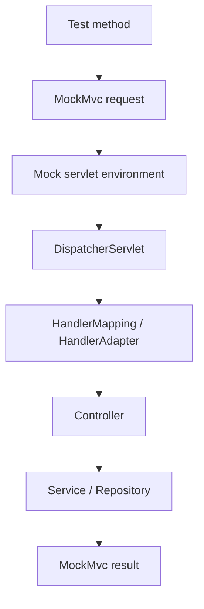
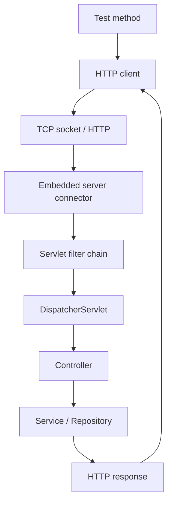

# Phân biệt kiểm thử context web với mở cổng máy chủ

## 1. Có WebApplicationContext không có nghĩa là server đang lắng nghe

Trong Spring MVC, `WebApplicationContext` là một `ApplicationContext` có thêm ngữ cảnh của ứng dụng web servlet, bao gồm `ServletContext`. Nó chứa các bean phục vụ web như controller, handler mapping, handler adapter, message converter, view resolver và các thành phần web khác.

Một bài test có thể tạo `WebApplicationContext`, nạp cấu hình MVC và gọi controller qua `MockMvc` mà không mở socket, không chiếm cổng TCP và không khởi động embedded server. Đây là kiểm thử web context trong tiến trình test.

Ngược lại, khi Spring Boot khởi động ứng dụng với web environment dùng cổng thật, embedded server như Tomcat, Jetty hoặc Undertow được khởi động và bind vào một địa chỉ/cổng. Test phải gửi HTTP request qua client để đi đến server đó.

Hai kiểu test có thể dùng cùng controller, service và cấu hình ứng dụng, nhưng chúng đi qua những ranh giới khác nhau:

- **Web context test** kiểm tra cấu hình và xử lý web trong môi trường servlet mô phỏng, thường qua `MockMvc`.
- **Real-server test** kiểm tra ứng dụng sau khi embedded server đã mở cổng, request đi qua HTTP stack và kết nối mạng thực.

Không nên suy luận server đã mở cổng chỉ từ việc `WebApplicationContext` được tạo thành công hoặc controller được autowire thành công.

## 2. `WebApplicationContext` đại diện cho điều gì?

`WebApplicationContext` mở rộng `ApplicationContext` và cung cấp các khả năng gắn với môi trường servlet. Nó có thể truy cập `ServletContext`, các scope web như request/session và những bean phục vụ quá trình xử lý request.

Trong Spring MVC, `DispatcherServlet` sử dụng web application context để tìm các thành phần xử lý request. Các thành phần thường gặp gồm:

| Thành phần | Vai trò |
|---|---|
| `DispatcherServlet` | Front controller nhận servlet request và điều phối xử lý |
| `HandlerMapping` | Tìm handler phù hợp với request |
| `HandlerAdapter` | Gọi handler đã được chọn |
| `HttpMessageConverter` | Đọc request body và ghi response body |
| `HandlerExceptionResolver` | Chuyển exception thành response phù hợp |
| `Controller` | Thực thi logic ở tầng web và gọi service |
| `ServletContext` | Cung cấp ngữ cảnh servlet cho ứng dụng web |

Khi test tạo `WebApplicationContext`, nó có thể xác nhận các bean web được đăng ký và phối hợp đúng. Nhưng việc bind socket là trách nhiệm của web server, một tầng hạ tầng khác.

## 3. Hai đường đi của request

### 3.1. MockMvc với web application context

Với `MockMvc`, test tạo request theo Servlet API mô phỏng. Request được chuyển qua các thành phần Spring MVC trong cùng tiến trình, thường không đi qua TCP socket hay connector của embedded server.



MockMvc có thể tích hợp các servlet filter nếu test setup đăng ký chúng. Vì vậy, một MockMvc test có thể kiểm tra Spring Security filter chain, filter tùy chỉnh, mapping, binding, validation, exception handling và response serialization. Nhưng nó không kiểm tra cổng mạng, HTTP connector, TLS handshake hoặc việc server tiếp nhận kết nối thật.

### 3.2. HTTP client gọi embedded server

Với real-server test, Spring Boot khởi động server và mở cổng. Test dùng HTTP client gửi request qua socket; server xử lý request trên thread thuộc server runtime.



Real-server test có thể kiểm tra connector, port binding, HTTP parsing, server filter registration, cookie, redirect và các cấu hình transport mà MockMvc không mô phỏng đầy đủ. Đổi lại, nó tốn thời gian khởi động server và cần quản lý dữ liệu, thread, cổng và trạng thái bên ngoài.

## 4. Spring Boot `WebEnvironment.MOCK`

`@SpringBootTest` có thuộc tính `webEnvironment`. Giá trị mặc định là `MOCK`.

```java
@SpringBootTest(webEnvironment = SpringBootTest.WebEnvironment.MOCK)
@AutoConfigureMockMvc
class ProductControllerWebTest {

    @Autowired
    private MockMvc mockMvc;

    @Test
    void returnsProduct() throws Exception {
        mockMvc.perform(get("/api/products/42"))
                .andExpect(status().isOk())
                .andExpect(content().contentTypeCompatibleWith(
                        MediaType.APPLICATION_JSON))
                .andExpect(jsonPath("$.id").value(42));
    }
}
```

Trong chế độ `MOCK`, Spring Boot tạo môi trường web mô phỏng khi có servlet API. `@AutoConfigureMockMvc` cấu hình `MockMvc` để test gửi request đến Spring MVC. Không có embedded server được khởi động để lắng nghe trên cổng HTTP thật.

Test vẫn có thể nạp phần lớn hoặc toàn bộ ApplicationContext, tùy annotation và cấu hình. Điều đó không thay đổi bản chất: request của MockMvc được xử lý trong môi trường mock.

Chế độ này phù hợp để kiểm tra controller, mapping, validation, serialization, exception handler, filter được thêm vào MockMvc và tương tác với service/repository trong test context.

## 5. Phân biệt `@WebMvcTest` với `@SpringBootTest(MOCK)`

Hai cách này đều thường dùng MockMvc và không cần mở cổng mạng, nhưng phạm vi context khác nhau.

| Tiêu chí | `@WebMvcTest` | `@SpringBootTest(MOCK)` + `@AutoConfigureMockMvc` |
|---|---|---|
| Phạm vi context | MVC test slice, chỉ nạp các thành phần web được chọn và auto-configuration liên quan | Thường nạp ApplicationContext của ứng dụng rộng hơn |
| Controller | Có thể chọn controller cụ thể | Nạp theo cấu hình ứng dụng |
| Service/repository | Thường mock hoặc import riêng | Có thể dùng bean thật nếu context cấu hình chúng |
| Thời gian khởi tạo | Thường nhanh hơn | Thường cao hơn |
| Cổng server thật | Không mở | Không mở ở chế độ `MOCK` |
| Mục tiêu | Kiểm tra web layer tập trung | Kiểm tra tích hợp nhiều bean trong môi trường web mô phỏng |

Ví dụ MVC slice:

```java
@WebMvcTest(ProductController.class)
class ProductControllerSliceTest {

    @Autowired
    private MockMvc mockMvc;

    @MockitoBean
    private ProductService productService;

    @Test
    void returnsProductFromService() throws Exception {
        given(productService.findById(42L))
                .willReturn(new ProductResponse(42L, "Spring Guide"));

        mockMvc.perform(get("/api/products/42"))
                .andExpect(status().isOk())
                .andExpect(jsonPath("$.name").value("Spring Guide"));
    }
}
```

`@WebMvcTest` không phải real-server test. Nó tạo slice phục vụ kiểm tra web layer. Nếu cần dùng cấu hình bảo mật hoặc MVC tùy chỉnh, hãy import đúng cấu hình cần thiết và xác nhận các filter liên quan đã được thêm vào MockMvc.

`@MockitoBean` có trong các phiên bản Spring Framework mới. Với dự án Spring Boot cũ hơn, test có thể dùng `@MockBean` tương ứng với phiên bản đang sử dụng.

## 6. Dùng `WebApplicationContext` để dựng MockMvc tường minh

Khi muốn điều khiển cách tạo MockMvc, có thể inject `WebApplicationContext` và dùng `webAppContextSetup(...)`:

```java
@SpringBootTest(webEnvironment = SpringBootTest.WebEnvironment.MOCK)
class ProductControllerContextTest {

    @Autowired
    private WebApplicationContext webApplicationContext;

    private MockMvc mockMvc;

    @BeforeEach
    void setUp() {
        mockMvc = MockMvcBuilders
                .webAppContextSetup(webApplicationContext)
                .build();
    }

    @Test
    void dispatchesRequestThroughConfiguredMvcContext() throws Exception {
        mockMvc.perform(get("/api/products"))
                .andExpect(status().isOk());
    }
}
```

`webAppContextSetup(...)` lấy cấu hình MVC từ web application context. Nó cho phép kiểm tra các thành phần web đã được nạp trong context như controller, mapping, converter và exception resolver.

Nếu muốn test filter bảo mật với cách dựng MockMvc thủ công, có thể tích hợp Spring Security:

```java
mockMvc = MockMvcBuilders
        .webAppContextSetup(webApplicationContext)
        .apply(springSecurity())
        .build();
```

Configuring `springSecurity()` đưa Spring Security vào MockMvc setup khi ApplicationContext có cấu hình security phù hợp. Nếu dùng `@AutoConfigureMockMvc`, Spring Boot thường tự đăng ký các servlet filter trong context; khi đó không cần dựng thêm một MockMvc instance khác trừ khi test có lý do cụ thể.

Điểm cần nhớ là `webAppContextSetup(...)` vẫn là mock servlet request. Việc dùng `WebApplicationContext` thật từ Spring không đồng nghĩa với việc gửi request qua mạng thật.

## 7. `standaloneSetup(...)` cũng không mở cổng

MockMvc còn có cách dựng trực tiếp từ controller:

```java
MockMvc mockMvc = MockMvcBuilders
        .standaloneSetup(new ProductController(productService))
        .build();
```

`standaloneSetup(...)` không cần `WebApplicationContext`. Test đăng ký controller và các thành phần MVC bổ sung trực tiếp. Cách này phù hợp với test hẹp, ít phụ thuộc vào cấu hình ứng dụng.

So sánh:

| Builder | Nguồn cấu hình | Cần WebApplicationContext? | Mở server? |
|---|---|---:|---:|
| `standaloneSetup(...)` | Controller và cấu hình được cung cấp trực tiếp | Không | Không |
| `webAppContextSetup(...)` | Bean và cấu hình từ web context | Có | Không |
| `bindToServer()` của WebTestClient | HTTP server đang chạy tại URL được cấu hình | Không dùng để dựng mock MVC | Có |

Nếu test cần xác nhận cấu hình MVC thật đã được component scan và auto-configuration nạp, `webAppContextSetup(...)` thường phù hợp hơn. Nếu chỉ cần kiểm tra hành vi controller với một số dependency giả, `standaloneSetup(...)` có thể đủ.

## 8. Spring Boot `WebEnvironment.RANDOM_PORT`

Khi cần server thật, dùng `RANDOM_PORT`:

```java
@SpringBootTest(webEnvironment = SpringBootTest.WebEnvironment.RANDOM_PORT)
class ProductHttpIntegrationTest {

    @LocalServerPort
    private int port;

    @Autowired
    private TestRestTemplate restTemplate;

    @Test
    void servesProductOverHttp() {
        ResponseEntity<ProductResponse> response = restTemplate.getForEntity(
                "http://localhost:" + port + "/api/products/42",
                ProductResponse.class);

        assertThat(response.getStatusCode()).isEqualTo(HttpStatus.OK);
        assertThat(response.getBody()).isNotNull();
        assertThat(response.getBody().id()).isEqualTo(42L);
    }
}
```

Spring Boot khởi động embedded web server và yêu cầu hệ điều hành cấp một cổng khả dụng. `@LocalServerPort` nhận cổng thực tế sau khi server đã khởi động. `TestRestTemplate` gửi HTTP request qua kết nối thật.

`RANDOM_PORT` tránh xung đột với cổng cố định khi chạy nhiều test hoặc khi máy phát triển đã có một service khác sử dụng cổng mặc định. Đây thường là lựa chọn tốt cho integration test cần server thật.

Nếu muốn dùng `WebTestClient` làm HTTP client, có thể bind tới cùng cổng:

```java
WebTestClient client = WebTestClient.bindToServer()
        .baseUrl("http://localhost:" + port)
        .build();

client.get()
        .uri("/api/products/42")
        .exchange()
        .expectStatus().isOk()
        .expectBody()
        .jsonPath("$.id").isEqualTo(42);
```

`WebTestClient.bindToServer()` ở đây là HTTP client. Nó không khởi động server; server do Spring Boot quản lý qua `RANDOM_PORT`.

## 9. `WebEnvironment.DEFINED_PORT` và `WebEnvironment.NONE`

Spring Boot cung cấp một số chế độ web environment:

| Giá trị | Hành vi chính | Có mở cổng? |
|---|---|---:|
| `MOCK` | Tạo môi trường web mô phỏng nếu có servlet API; không chạy embedded server | Không |
| `RANDOM_PORT` | Chạy embedded server trên cổng ngẫu nhiên | Có |
| `DEFINED_PORT` | Chạy embedded server trên cổng được cấu hình, thường qua `server.port` | Có |
| `NONE` | Tạo ApplicationContext không phải web environment | Không |

Ví dụ dùng cổng đã cấu hình:

```java
@SpringBootTest(
        webEnvironment = SpringBootTest.WebEnvironment.DEFINED_PORT,
        properties = "server.port=9080")
class FixedPortIntegrationTest {

    @Autowired
    private TestRestTemplate restTemplate;

    @Test
    void respondsOnConfiguredPort() {
        ResponseEntity<String> response = restTemplate.getForEntity(
                "http://localhost:9080/actuator/health",
                String.class);

        assertThat(response.getStatusCode()).isEqualTo(HttpStatus.OK);
    }
}
```

`DEFINED_PORT` phù hợp khi cần kiểm tra cấu hình cổng cố định hoặc tích hợp với một thành phần khác phụ thuộc cổng đã biết. Nó dễ xung đột nếu cổng đã được tiến trình khác chiếm. Trong phần lớn test tự động, `RANDOM_PORT` an toàn hơn.

`NONE` dành cho test không cần web stack. Ví dụ service hoặc batch context không cần `ServletContext`, `DispatcherServlet` hay HTTP server.

## 10. Tại sao mở cổng là một ranh giới kiểm thử khác?

Khi embedded server mở cổng, ứng dụng phải hoàn tất thêm một số bước hạ tầng:

- Tạo và cấu hình server connector.
- Bind socket vào địa chỉ/cổng.
- Tiếp nhận và phân tích HTTP request.
- Quản lý connection, thread pool và timeout.
- Áp dụng cấu hình TLS nếu dùng HTTPS.
- Chuyển request qua filter chain và servlet infrastructure.
- Ghi response qua HTTP stack và đóng hoặc tái sử dụng connection.

MockMvc có thể xác nhận logic MVC mà không cần các bước này. Vì vậy, một MockMvc test pass không chứng minh cổng có thể bind, connector hoạt động hoặc TLS certificate hợp lệ.

Ngược lại, real-server test có thể phát hiện lỗi cấu hình port, context path, compression, cookie, redirect hoặc connector. Nhưng nó thường chậm hơn và khó cô lập hơn do phải khởi động server và quản lý trạng thái bên ngoài.

## 11. Kiểm tra filter và Spring Security ở hai chế độ

MockMvc có thể chạy servlet filter nếu các filter được đăng ký vào MockMvc. Với `@AutoConfigureMockMvc`, thuộc tính `addFilters` mặc định bật việc thêm filter từ ApplicationContext.

```java
@SpringBootTest(webEnvironment = SpringBootTest.WebEnvironment.MOCK)
@AutoConfigureMockMvc(addFilters = true)
class SecurityMockMvcTest {

    @Autowired
    private MockMvc mockMvc;

    @Test
    void rejectsAnonymousRequest() throws Exception {
        mockMvc.perform(get("/api/private"))
                .andExpect(status().isUnauthorized());
    }
}
```

Nếu đặt `addFilters = false`, request bỏ qua các servlet filter đã đăng ký. Khi đó test không thể dùng kết quả để khẳng định Spring Security filter chain hoặc filter tùy chỉnh đã bảo vệ endpoint.

Với real-server test, request đi qua filter chain được đăng ký trong server. Điều này giúp kiểm tra hành vi filter ở môi trường chạy thật hơn. Tuy nhiên, test vẫn phải gửi credential phù hợp và xác nhận policy thực tế; chỉ mở cổng server không tự chứng minh authorization đúng.

## 12. Transaction trong MockMvc test và real-server test

Một khác biệt quan trọng nằm ở thread xử lý request.

Với MockMvc xử lý đồng bộ, request thường được xử lý ngay trong thread test. Nếu test có `@Transactional` và service/repository tham gia cùng transaction manager trên thread đó, thay đổi có thể thuộc transaction test và được rollback khi test kết thúc.

Với `RANDOM_PORT` hoặc `DEFINED_PORT`, request được xử lý trên thread của embedded server. Transaction của test method không tự truyền qua socket sang thread server. Nếu controller ghi database và transaction ở server commit, rollback của test thread không tự hoàn tác dữ liệu đó.

| Trường hợp | Transaction test có bao trùm thay đổi của request không? |
|---|---|
| MockMvc, request đồng bộ trên test thread và tham gia transaction test | Có thể, nếu transaction propagation và transaction manager phù hợp |
| MockMvc async dispatch hoặc công việc chuyển sang thread khác | Không nên giả định; cần kiểm tra transaction ở thread xử lý |
| Real server với `RANDOM_PORT` | Không; server xử lý trên thread riêng |
| `@Async` hoặc message listener | Không tự truyền transaction test sang worker |

Vì vậy, real-server test thường cần dọn dữ liệu rõ ràng theo test id, dùng database/schema riêng hoặc chiến lược fixture phù hợp. Không nên chỉ thêm `@Transactional` vào test rồi cho rằng mọi thay đổi do HTTP request thật sẽ được rollback.

## 13. Context caching và vòng đời server

Spring TestContext Framework có thể cache ApplicationContext để tái sử dụng giữa các test class có cấu hình tương thích. Với mock web test, context và các bean web có thể được tái sử dụng mà không có server socket.

Với `RANDOM_PORT`, embedded server thuộc context được cache cũng có thể tiếp tục chạy khi context được tái sử dụng. Vì vậy:

- Không giả định mỗi test method đều khởi động một server mới.
- Không giả định port sẽ đổi giữa các test class dùng chung context.
- Không ghi cứng cổng nếu dùng `RANDOM_PORT`; lấy giá trị qua `@LocalServerPort`.
- Chỉ dùng `@DirtiesContext` khi cần loại context khỏi cache, vì đóng context có thể làm tăng đáng kể thời gian test.
- Dọn dữ liệu nghiệp vụ và tài nguyên ngoài theo ownership riêng, không dựa vào việc context bị đóng.

`@DirtiesContext` đóng context và cho phép Spring tạo context mới ở lần sử dụng tiếp theo. Nó không thay thế cleanup của tài nguyên được tạo thủ công bên ngoài Spring container.

## 14. Chọn test mode theo mục tiêu

| Mục tiêu | Cách phù hợp | Lý do |
|---|---|---|
| Kiểm tra controller mapping, validation và JSON | `@WebMvcTest` + `MockMvc` | Nhanh, tập trung web layer |
| Kiểm tra nhiều bean cùng phối hợp trong MVC | `@SpringBootTest(MOCK)` + `@AutoConfigureMockMvc` | Nạp context ứng dụng nhưng không cần server |
| Kiểm tra cấu hình từ `WebApplicationContext` | `webAppContextSetup(...)` | Dùng bean MVC thực trong context |
| Kiểm tra một controller độc lập | `standaloneSetup(...)` | Không cần khởi tạo web context đầy đủ |
| Kiểm tra port, connector, HTTP transport | `@SpringBootTest(RANDOM_PORT)` + HTTP client | Request qua server đang lắng nghe |
| Kiểm tra cổng cố định | `@SpringBootTest(DEFINED_PORT)` | Dùng port được cấu hình |
| Kiểm tra service không cần web | `@SpringBootTest(NONE)` hoặc test context phù hợp | Không khởi tạo web environment |

Một chiến lược thực tế thường kết hợp nhiều tầng. MVC slice kiểm tra nhiều nhánh controller nhanh; integration test với MockMvc kiểm tra phối hợp bean và filter; một số real-server test xác nhận HTTP stack, cổng và transport. Không cần chạy mọi trường hợp nghiệp vụ qua server thật nếu ranh giới mạng không liên quan đến điều đang kiểm tra.

## 15. Lỗi thường gặp và cách xác định

| Hiện tượng | Nguyên nhân thường gặp | Cách xử lý |
|---|---|---|
| `WebApplicationContext` được tạo nhưng không gọi được bằng URL | Test đang ở `MOCK`; không có server mở cổng | Dùng MockMvc hoặc chuyển sang `RANDOM_PORT`/`DEFINED_PORT` |
| Connection refused | Server chưa khởi động, sai port hoặc cổng bị giải phóng | Lấy port bằng `@LocalServerPort` sau khi context khởi động |
| Test MockMvc pass nhưng triển khai thật lỗi bind port | MockMvc không tạo socket và không kiểm tra connector | Thêm real-server test cho cấu hình server quan trọng |
| Security filter không chạy trong MockMvc | Filter không được thêm hoặc `addFilters = false` | Bật filter registration hoặc dùng `springSecurity()` khi dựng thủ công |
| Database còn dữ liệu sau real-server test | Transaction của test không bao trùm request thread | Dọn dữ liệu theo test id hoặc dùng database/schema riêng |
| Port cố định bị chiếm | Nhiều test hoặc service dùng chung một cổng | Dùng `RANDOM_PORT` trừ khi cần kiểm tra cổng cố định |
| Context khởi tạo chậm | Nạp full context hoặc dùng `@DirtiesContext` quá rộng | Dùng slice cho test hẹp và tái sử dụng context khi phù hợp |
| Test không kiểm tra được TLS thực tế | Dùng MockMvc hoặc HTTP client tới môi trường không bật TLS | Dùng HTTPS real-server test với trust store/certificate phù hợp |

Khi chẩn đoán, trước tiên xác định test đang dùng `MOCK`, `RANDOM_PORT`, `DEFINED_PORT` hay `NONE`. Sau đó xác định request được gửi bằng MockMvc hay HTTP client. Hai thông tin này cho biết test đã đi qua ranh giới nào và giúp tránh nhầm lỗi cấu hình context với lỗi khởi động server.

## 16. Checklist khi chọn `WebApplicationContext` hay server thật

- Nếu cần kiểm tra bean MVC, mapping, binding hoặc response, bắt đầu với `@WebMvcTest` hoặc MockMvc.
- Nếu cần toàn bộ cấu hình ứng dụng nhưng không cần socket, dùng `@SpringBootTest(MOCK)` và `@AutoConfigureMockMvc`.
- Nếu cần dùng chính các bean từ web context, dựng MockMvc bằng `webAppContextSetup(...)`.
- Nếu dùng `standaloneSetup(...)`, hiểu rằng test chỉ có những thành phần được cung cấp trực tiếp.
- Nếu cần kiểm tra port, connector, HTTP transport hoặc TLS, dùng `RANDOM_PORT` hoặc `DEFINED_PORT` và HTTP client.
- Với `RANDOM_PORT`, lấy cổng qua `@LocalServerPort`; không hard-code port.
- Xác nhận filter có được thêm vào MockMvc nếu test cần kiểm tra filter.
- Không suy luận rằng `authenticated()` hoặc status thành công chứng minh server đã mở cổng.
- Với real-server test, quản lý dữ liệu được commit trên server thread và dọn dẹp sau test.
- Dùng `@DirtiesContext` có chủ đích vì nó đóng context và ảnh hưởng thời gian test.

`WebApplicationContext` mô tả ngữ cảnh web của Spring MVC; nó không phải là bằng chứng rằng một HTTP server đang lắng nghe. MockMvc cho phép kiểm thử web layer trong môi trường servlet mô phỏng. `RANDOM_PORT` hoặc `DEFINED_PORT` mới khởi động embedded server để HTTP client kết nối qua mạng. Chọn đúng ranh giới giúp test nhanh ở nơi phù hợp và vẫn có bằng chứng riêng cho cấu hình server khi ứng dụng cần phục vụ request thật.
