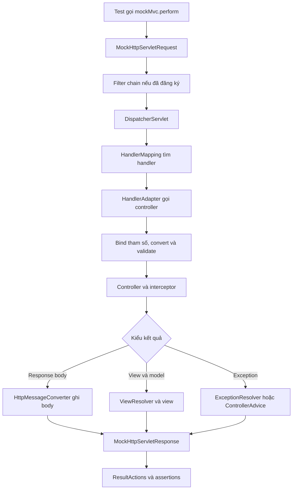

# MockMvc chạy chuỗi xử lý MVC qua request và response mô phỏng

`MockMvc` là công cụ của Spring Test dùng để kiểm thử ứng dụng Spring MVC mà không cần khởi động một máy chủ web thật. Test tạo một request Servlet mô phỏng, chuyển request đó qua `DispatcherServlet` và các thành phần MVC được cấu hình, sau đó nhận một response mô phỏng để kiểm tra status, header, nội dung, model, view hoặc kết quả xử lý lỗi.

Điểm quan trọng là `MockMvc` kiểm tra luồng xử lý ở tầng Spring MVC. Một request vẫn đi qua các bước như ánh xạ URL tới handler, gọi controller, bind tham số, chuyển đổi dữ liệu, validation, interceptor và xử lý exception nếu các thành phần đó có trong cấu hình test. Kết quả được ghi vào `MockHttpServletResponse`, sau đó test dùng các matcher của Spring để xác nhận hành vi.

## 1. MockMvc kiểm tra điều gì?

Một bài unit test gọi trực tiếp phương thức controller chỉ kiểm tra logic của phương thức đó. Nó không tự kiểm tra việc Spring tìm controller theo URL, chọn đúng handler method, bind query parameter hoặc JSON body, gọi validation, áp dụng interceptor hay chuyển kết quả trả về thành HTTP response.

`MockMvc` đưa request qua `DispatcherServlet`, vì vậy có thể kiểm tra nhiều thành phần của chuỗi Spring MVC cùng nhau:

- `HandlerMapping` tìm handler phù hợp với HTTP method và đường dẫn.
- `HandlerAdapter` gọi controller hoặc handler tương ứng.
- `HandlerMethodArgumentResolver` lấy dữ liệu cho tham số như `@PathVariable`, `@RequestParam`, `@RequestHeader`, `@RequestBody` và `Principal`.
- `HttpMessageConverter` chuyển đổi dữ liệu request body thành object và chuyển object trả về thành response body, ví dụ JSON.
- Bean Validation được áp dụng khi tham số hoặc object được đánh dấu validation và cấu hình tương ứng có mặt.
- `HandlerInterceptor` chạy các callback trước và sau handler theo cấu hình MVC.
- `HandlerExceptionResolver` và `@ControllerAdvice` xử lý exception nếu được đăng ký.
- `ViewResolver` và view được cấu hình có thể xử lý tên view và model trong các ứng dụng MVC trả về trang HTML.
- Các servlet filter tham gia nếu được thêm vào MockMvc builder hoặc được tích hợp qua cấu hình test phù hợp.

Như vậy, `MockMvc` phù hợp cho kiểm thử tích hợp ở tầng web: kiểm tra hành vi HTTP của ứng dụng và sự phối hợp giữa controller với hạ tầng Spring MVC. Nó không thay thế kiểm thử service hoặc repository, và cũng không chứng minh ứng dụng hoạt động trên một servlet container thật.

## 2. Chuỗi xử lý request và response mô phỏng

Khi gọi `mockMvc.perform(...)`, Spring Test xây dựng một `MockHttpServletRequest` từ request builder, tạo response giả lập, rồi đưa request qua `DispatcherServlet` được cấu hình cho test. Sau khi xử lý hoàn tất, `ResultActions` cho phép kiểm tra kết quả.



Sơ đồ thể hiện các nhóm xử lý chính. Thứ tự callback interceptor và các bước xử lý exception cụ thể phụ thuộc vào cấu hình MVC và loại handler. Các filter được chạy bao quanh servlet nếu chúng được đăng ký trong chuỗi filter của MockMvc.

Request và response ở đây là object Java mô phỏng Servlet API. Test không mở socket, không gửi byte qua mạng và không cần cổng HTTP. Điều đó làm cho test nhanh, lặp lại được và dễ kiểm soát dữ liệu đầu vào. Tuy nhiên, các đặc tính thuộc server thật như TLS, cấu hình connector, network timeout hoặc hành vi riêng của container nằm ngoài phạm vi của `MockMvc`.

## 3. Các thành phần chính của MockMvc

| Thành phần | Vai trò |
| --- | --- |
| `MockMvc` | Điểm vào để thực hiện request và nhận kết quả xử lý MVC |
| `MockHttpServletRequestBuilder` | Khai báo method, URL, parameter, header, body, cookie, session và thông tin request khác |
| `MockHttpServletRequest` | Request Servlet giả lập được tạo từ builder |
| `MockHttpServletResponse` | Lưu status, header, cookie, body, redirect và các thuộc tính response |
| `ResultActions` | Cung cấp `andExpect`, `andDo` và `andReturn` sau khi thực hiện request |
| `ResultMatcher` | Kiểm tra một điều kiện của kết quả, ví dụ status hoặc JSON path |
| `ResultHandler` | Thực hiện thao tác trên kết quả, ví dụ in request/response ra log |
| `MvcResult` | Chứa request, response, handler, exception và các thông tin của lần thực hiện |

Một test thường bắt đầu từ `MockMvcRequestBuilders`, gọi `perform`, rồi nối các assertion:

```java
mockMvc.perform(get("/api/greetings").param("name", "Lan"))
        .andExpect(status().isOk())
        .andExpect(content().string("Hello Lan"));
```

`perform` thực hiện request và trả về `ResultActions`. `andExpect` kiểm tra một điều kiện; nếu matcher thất bại, test thất bại ngay tại assertion đó. Có thể nối nhiều matcher để kiểm tra status, header và body trong cùng một lần request.

## 4. Hai cách thiết lập MockMvc

Spring Test cung cấp hai builder thường dùng: `standaloneSetup` và `webAppContextSetup`. Chọn builder dựa trên phạm vi hạ tầng MVC mà bài test cần kiểm tra.

### 4.1. `standaloneSetup`

`standaloneSetup` tạo cấu hình MVC tối thiểu quanh các controller được truyền trực tiếp. Cách này phù hợp khi muốn kiểm tra controller và cách Spring MVC bind request/ghi response mà không cần nạp toàn bộ application context.

```java
import org.junit.jupiter.api.BeforeEach;
import org.junit.jupiter.api.Test;
import org.springframework.test.web.servlet.MockMvc;
import org.springframework.test.web.servlet.setup.MockMvcBuilders;

import static org.springframework.test.web.servlet.request.MockMvcRequestBuilders.get;
import static org.springframework.test.web.servlet.result.MockMvcResultMatchers.content;
import static org.springframework.test.web.servlet.result.MockMvcResultMatchers.status;

class GreetingControllerTest {
    private MockMvc mockMvc;

    @BeforeEach
    void setUp() {
        mockMvc = MockMvcBuilders
                .standaloneSetup(new GreetingController())
                .build();
    }

    @Test
    void returnsGreeting() throws Exception {
        mockMvc.perform(get("/greeting").param("name", "Lan"))
                .andExpect(status().isOk())
                .andExpect(content().string("Hello Lan"));
    }
}
```

Controller tương ứng:

```java
import org.springframework.web.bind.annotation.GetMapping;
import org.springframework.web.bind.annotation.RequestParam;
import org.springframework.web.bind.annotation.RestController;

@RestController
class GreetingController {
    @GetMapping("/greeting")
    String greeting(@RequestParam(defaultValue = "World") String name) {
        return "Hello " + name;
    }
}
```

Builder tự đăng ký hạ tầng MVC cần thiết cho controller test. Có thể bổ sung `ControllerAdvice`, validator, message converter, argument resolver hoặc interceptor bằng các phương thức cấu hình của builder khi test cần chúng. Nếu một thành phần không được đăng ký, kết quả có thể khác cấu hình ứng dụng thực tế.

### 4.2. `webAppContextSetup`

`webAppContextSetup` dùng một `WebApplicationContext` đã được nạp. Cách này phù hợp khi cần kiểm tra cấu hình Spring MVC thực tế hơn, bao gồm controller được scan, converter, formatter, interceptor, exception handler, view resolver và các bean web khác đã đăng ký trong context.

```java
import org.junit.jupiter.api.BeforeEach;
import org.junit.jupiter.api.Test;
import org.springframework.beans.factory.annotation.Autowired;
import org.springframework.test.context.ContextConfiguration;
import org.springframework.test.context.junit.jupiter.SpringExtension;
import org.springframework.test.context.web.WebAppConfiguration;
import org.springframework.test.web.servlet.MockMvc;
import org.springframework.test.web.servlet.setup.MockMvcBuilders;
import org.springframework.web.context.WebApplicationContext;
import org.junit.jupiter.api.extension.ExtendWith;

import static org.springframework.test.web.servlet.request.MockMvcRequestBuilders.get;
import static org.springframework.test.web.servlet.result.MockMvcResultMatchers.status;

@ExtendWith(SpringExtension.class)
@WebAppConfiguration
@ContextConfiguration(classes = WebTestConfig.class)
class GreetingWebContextTest {
    @Autowired
    private WebApplicationContext webApplicationContext;

    private MockMvc mockMvc;

    @BeforeEach
    void setUp() {
        mockMvc = MockMvcBuilders
                .webAppContextSetup(webApplicationContext)
                .build();
    }

    @Test
    void dispatchesRequestThroughConfiguredMvcContext() throws Exception {
        mockMvc.perform(get("/greeting"))
                .andExpect(status().isOk());
    }
}
```

Trong ví dụ này, `@WebAppConfiguration` tạo môi trường web giả lập cho `WebApplicationContext`, còn `@ContextConfiguration` chỉ định cấu hình bean. Cấu hình `WebTestConfig` phải đăng ký MVC và controller cần kiểm tra. Có thể dùng `@ContextHierarchy` nếu ứng dụng thực sự có root context và context riêng cho `DispatcherServlet`.

### 4.3. So sánh hai builder

| Tiêu chí | `standaloneSetup` | `webAppContextSetup` |
| --- | --- | --- |
| Nguồn controller | Truyền instance controller trực tiếp | Lấy từ `WebApplicationContext` |
| Application context | Không cần nạp context đầy đủ | Cần web application context |
| Cấu hình MVC | Hạ tầng tối thiểu do builder thiết lập và phần test tùy chỉnh | Dùng cấu hình MVC đã nạp trong context |
| Tốc độ và phạm vi | Nhẹ, tập trung vào controller | Rộng hơn, kiểm tra được sự phối hợp của nhiều bean web |
| Trường hợp phù hợp | Kiểm tra mapping, binding và response của controller với cấu hình gọn | Kiểm tra tích hợp với cấu hình MVC thực tế của ứng dụng |

Không có builder nào luôn tốt hơn. Nếu test cần chứng minh interceptor hoặc `ControllerAdvice` được khai báo trong cấu hình ứng dụng thật, `webAppContextSetup` thường phù hợp hơn. Nếu chỉ cần kiểm tra controller với một cấu hình độc lập và rõ ràng, `standaloneSetup` giúp test đơn giản.

## 5. Tạo request mô phỏng

Các request builder mô phỏng nhiều loại HTTP method và cho phép khai báo dữ liệu mà trình duyệt hoặc client thường gửi. Những builder thường dùng gồm `get`, `post`, `put`, `patch`, `delete`, `options`, `head` và `multipart`.

### 5.1. Path variable, query parameter và header

```java
mockMvc.perform(get("/api/orders/{id}", 42)
                .param("includeItems", "true")
                .header("X-Request-Id", "req-123")
                .accept(MediaType.APPLICATION_JSON))
        .andExpect(status().isOk());
```

Trong ví dụ trên, `42` được gắn vào path variable, `includeItems` là query parameter và `X-Request-Id` là request header. `accept` khai báo media type mà client mong muốn nhận.

`param` mô phỏng request parameter. Với GET, dữ liệu này thường tương ứng query string; với các request khác, nó biểu diễn parameter đã được Servlet API phân tích. Nếu cần kiểm tra chính xác cách container phân tích raw query string hoặc form encoding, cần kiểm thử bổ sung trên server thật.

### 5.2. JSON request body

Với endpoint nhận JSON, test đặt content type và body cho request:

```java
String json = """
        {"productCode":"BK-01","quantity":2}
        """;

mockMvc.perform(post("/api/orders")
                .contentType(MediaType.APPLICATION_JSON)
                .accept(MediaType.APPLICATION_JSON)
                .content(json))
        .andExpect(status().isCreated())
        .andExpect(content().contentTypeCompatibleWith(MediaType.APPLICATION_JSON));
```

Spring MVC chọn `HttpMessageConverter` phù hợp dựa trên content type và kiểu tham số `@RequestBody`. Trong dự án dùng Jackson, converter JSON thường chuyển body thành DTO. Test nên gửi dữ liệu đại diện cho contract HTTP, kể cả trường thiếu, kiểu sai hoặc giá trị không hợp lệ khi cần kiểm tra lỗi binding.

Nếu không muốn viết JSON dạng chuỗi thủ công, có thể dùng `ObjectMapper` để serialize một request DTO:

```java
mockMvc.perform(post("/api/orders")
                .contentType(MediaType.APPLICATION_JSON)
                .content(objectMapper.writeValueAsBytes(command)))
        .andExpect(status().isCreated());
```

### 5.3. Form parameter

Đối với form URL-encoded, khai báo content type và parameter:

```java
mockMvc.perform(post("/login")
                .contentType(MediaType.APPLICATION_FORM_URLENCODED)
                .param("username", "lan")
                .param("password", "secret"))
        .andExpect(status().is3xxRedirection());
```

Spring MVC có thể bind các giá trị này vào `@RequestParam` hoặc object form. Nếu ứng dụng có Spring Security, request POST có thể cần CSRF token theo cấu hình bảo mật; test khi đó cần thêm request post-processor `csrf()` từ Spring Security Test.

### 5.4. Multipart và file upload

Có thể tạo request multipart bằng `multipart()` và `MockMultipartFile`:

```java
MockMultipartFile file = new MockMultipartFile(
        "document",
        "notes.txt",
        MediaType.TEXT_PLAIN_VALUE,
        "hello".getBytes(StandardCharsets.UTF_8));

mockMvc.perform(multipart("/api/documents").file(file))
        .andExpect(status().isOk());
```

Request mô phỏng cho phép kiểm tra controller nhận `MultipartFile`, xử lý tên file, content type và nội dung file. Nó không kiểm tra bộ phân tích multipart của servlet container thật hoặc giới hạn upload được cấu hình ở reverse proxy/server.

### 5.5. Session, cookie và principal

Request builder cũng hỗ trợ session, session attribute, cookie và thông tin người dùng:

```java
MockHttpSession session = new MockHttpSession();

mockMvc.perform(get("/account")
                .session(session)
                .sessionAttr("cartId", "cart-10")
                .cookie(new Cookie("theme", "dark")))
        .andExpect(status().isOk());
```

Có thể dùng `.principal(...)` để đặt `Principal` cho request hoặc dùng request post-processor do Spring Security Test cung cấp để mô phỏng người dùng đã xác thực. Cần phân biệt principal do request builder đặt với authentication thực sự được thiết lập qua Spring Security filter chain; nếu muốn kiểm tra phân quyền, hãy cấu hình filter chain bảo mật trong MockMvc.

## 6. Kiểm tra response mô phỏng

Sau khi request được xử lý, response mô phỏng lưu những gì servlet response nhận được. Spring cung cấp matcher cho status, header, cookie, content, JSON path, redirect, forward, model, view và flash attribute.

```java
mockMvc.perform(get("/api/orders/42").accept(MediaType.APPLICATION_JSON))
        .andExpect(status().isOk())
        .andExpect(content().contentTypeCompatibleWith(MediaType.APPLICATION_JSON))
        .andExpect(header().exists("X-Request-Id"))
        .andExpect(jsonPath("$.id").value(42))
        .andExpect(jsonPath("$.status").value("CREATED"));
```

Một số nhóm matcher thường dùng:

| Matcher | Mục đích | Ví dụ |
| --- | --- | --- |
| `status()` | Kiểm tra HTTP status | `status().isOk()`, `status().isNotFound()` |
| `header()` | Kiểm tra response header | `header().string("Cache-Control", "no-store")` |
| `content()` | Kiểm tra body hoặc content type | `content().string("Hello")` |
| `jsonPath()` | Kiểm tra một giá trị trong JSON | `jsonPath("$.items.length()").value(2)` |
| `cookie()` | Kiểm tra cookie | `cookie().exists("SESSION")` |
| `redirectedUrl()` | Kiểm tra URL redirect | `redirectedUrl("/login")` |
| `forwardedUrl()` | Kiểm tra URL được forward | `forwardedUrl("/WEB-INF/views/home.jsp")` |
| `view()` | Kiểm tra tên view | `view().name("home")` |
| `model()` | Kiểm tra model attribute | `model().attributeExists("orders")` |
| `flash()` | Kiểm tra flash attribute | `flash().attribute("message", "Saved")` |

Khi kiểm tra JSON, nên xác nhận cả status, content type và những trường quan trọng của body. Chỉ kiểm tra status 200 chưa đủ để chứng minh response có đúng cấu trúc mà client cần.

## 7. Kiểm thử controller trả về JSON

Ví dụ dưới đây minh họa một endpoint tạo lời chào từ query parameter và trả về JSON. Controller:

```java
@RestController
@RequestMapping("/api/greetings")
class GreetingApiController {
    @GetMapping
    GreetingResponse greeting(@RequestParam(defaultValue = "World") String name) {
        return new GreetingResponse("Hello " + name);
    }
}

record GreetingResponse(String message) {
}
```

Test với `standaloneSetup`:

```java
class GreetingApiControllerTest {
    private MockMvc mockMvc;

    @BeforeEach
    void setUp() {
        mockMvc = MockMvcBuilders
                .standaloneSetup(new GreetingApiController())
                .build();
    }

    @Test
    void returnsGreetingAsJson() throws Exception {
        mockMvc.perform(get("/api/greetings")
                        .param("name", "Lan")
                        .accept(MediaType.APPLICATION_JSON))
                .andExpect(status().isOk())
                .andExpect(content().contentTypeCompatibleWith(MediaType.APPLICATION_JSON))
                .andExpect(jsonPath("$.message").value("Hello Lan"));
    }
}
```

Ví dụ giả định dự án có Jackson JSON converter trên classpath. Trong test dùng Java phiên bản trước Java 16, thay `record` bằng một DTO thông thường có constructor và getter.

Test này đi qua request mapping, query parameter binding, controller invocation và message conversion. Nó chứng minh JSON được ghi vào response mô phỏng theo cấu hình builder hiện tại. Nếu cần xác minh converter tùy chỉnh của ứng dụng, nên tạo MockMvc từ `WebApplicationContext` có converter đó.

## 8. Kiểm thử validation và xử lý exception

Khi controller nhận DTO có `@Valid`, test có thể gửi JSON hợp lệ và không hợp lệ để xác nhận validation và cách ứng dụng chuyển lỗi thành response.

```java
public record CreateUserRequest(
        @NotBlank String name,
        @Email String email) {
}

@RestController
class UserController {
    @PostMapping("/api/users")
    ResponseEntity<String> create(@Valid @RequestBody CreateUserRequest request) {
        return ResponseEntity.status(HttpStatus.CREATED).body(request.name());
    }
}
```

Test gửi body thiếu tên:

```java
mockMvc.perform(post("/api/users")
                .contentType(MediaType.APPLICATION_JSON)
                .content("""{"name":" ","email":"not-an-email"}"""))
        .andExpect(status().isBadRequest());
```

Status cụ thể phụ thuộc cách ứng dụng xử lý `MethodArgumentNotValidException`. Nếu có `@ControllerAdvice`, test nên kiểm tra cả cấu trúc error body và mã lỗi theo contract API. Với `standaloneSetup`, phải đăng ký controller advice và validator cần thiết; với `webAppContextSetup`, chúng phải có trong application context.

Có thể kiểm tra exception đã được xử lý hoặc chưa được xử lý bằng `MvcResult`:

```java
MvcResult result = mockMvc.perform(get("/api/missing"))
        .andExpect(status().isNotFound())
        .andReturn();

assertThat(result.getResolvedException()).isNotNull();
```

`getResolvedException()` cho biết exception được MVC xử lý trong quá trình dispatch, nếu có. Nếu muốn kiểm tra response do exception handler tạo ra, hãy assert body, content type và status tương ứng.

## 9. Kiểm thử view, model, redirect và flash attribute

Trong ứng dụng MVC trả về view, controller thường trả về tên view cùng model. `MockMvc` cho phép kiểm tra kết quả chọn view mà không nhất thiết phải render template bằng một servlet container thật.

```java
@Controller
class HomePageController {
    @GetMapping("/home")
    String home(Model model) {
        model.addAttribute("title", "Home page");
        return "home";
    }
}
```

Test:

```java
mockMvc.perform(get("/home"))
        .andExpect(status().isOk())
        .andExpect(view().name("home"))
        .andExpect(model().attribute("title", "Home page"));
```

Với thao tác POST thành công, controller có thể redirect và truyền flash attribute:

```java
mockMvc.perform(post("/profile")
                .param("displayName", "Lan"))
        .andExpect(status().is3xxRedirection())
        .andExpect(redirectedUrl("/profile"))
        .andExpect(flash().attribute("message", "Profile updated"));
```

`forwardedUrl` kiểm tra đường dẫn forward nội bộ; `redirectedUrl` kiểm tra URL redirect được đặt trong response. Đây là hai hành vi khác nhau. Kiểm tra tên view và model giúp xác nhận controller chọn đúng kết quả logic, nhưng không đảm bảo template JSP hoặc Thymeleaf được biên dịch và hiển thị giống hệt trên môi trường triển khai.

## 10. Đăng ký filter và Spring Security

Filter nằm ở tầng Servlet, bên ngoài `DispatcherServlet`. Nếu ứng dụng có filter tùy chỉnh hoặc filter bảo mật, test cần bảo đảm filter đó tham gia request khi mục tiêu là kiểm tra hành vi của filter.

Có thể thêm filter trực tiếp vào builder:

```java
mockMvc = MockMvcBuilders
        .webAppContextSetup(webApplicationContext)
        .addFilters(requestLoggingFilter, characterEncodingFilter)
        .build();
```

Thứ tự đăng ký filter có thể ảnh hưởng kết quả vì các filter được gọi theo thứ tự trong chuỗi. Nên dùng thứ tự tương ứng với cấu hình ứng dụng.

Với Spring Security, có thể tích hợp filter chain bảo mật vào MockMvc builder bằng cấu hình Spring Security Test:

```java
mockMvc = MockMvcBuilders
        .webAppContextSetup(webApplicationContext)
        .apply(springSecurity())
        .build();
```

Khi đó, test có thể dùng request post-processor để mô phỏng người dùng và CSRF token:

```java
mockMvc.perform(post("/api/profile")
                .with(user("lan").roles("USER"))
                .with(csrf()))
        .andExpect(status().isOk());
```

Các API `springSecurity()`, `user()` và `csrf()` đến từ Spring Security Test. Chúng cần dependency test tương ứng. Nếu không đưa security filter chain vào MockMvc, một test có thể bỏ qua xác thực và phân quyền dù ứng dụng thật yêu cầu các bước đó.

## 11. In request/response và lấy MvcResult

Khi test thất bại hoặc cần xem dữ liệu được gửi, có thể dùng `andDo(print())` để in request và response:

```java
mockMvc.perform(get("/api/greetings").param("name", "Lan"))
        .andDo(print())
        .andExpect(status().isOk());
```

`print()` hữu ích khi phát triển test hoặc chẩn đoán lỗi. Với test suite lớn, chỉ bật output này ở những test cần thiết để log không quá dài.

Nếu cần truy cập kết quả trong Java, dùng `andReturn()`:

```java
MvcResult result = mockMvc.perform(get("/api/greetings").param("name", "Lan"))
        .andExpect(status().isOk())
        .andReturn();

String responseBody = result.getResponse().getContentAsString();
int statusCode = result.getResponse().getStatus();
```

Thông thường, nên ưu tiên matcher để assertion được hiển thị rõ ràng. `MvcResult` hữu ích khi cần kiểm tra nhiều thuộc tính có quan hệ với nhau, đọc response body để xử lý tiếp hoặc kiểm tra async result.

## 12. Kiểm thử request bất đồng bộ

Một controller có thể trả về `Callable`, `DeferredResult` hoặc kiểu hỗ trợ async khác. Lần dispatch đầu tiên có thể kết thúc khi request đã bắt đầu xử lý bất đồng bộ nhưng response cuối cùng chưa sẵn sàng. Trong trường hợp đó, test cần kiểm tra async đã bắt đầu rồi thực hiện dispatch tiếp theo bằng `asyncDispatch`.

```java
MvcResult mvcResult = mockMvc.perform(get("/api/report"))
        .andExpect(request().asyncStarted())
        .andReturn();

mockMvc.perform(asyncDispatch(mvcResult))
        .andExpect(status().isOk())
        .andExpect(content().string("report-ready"));
```

`asyncDispatch` tiếp tục xử lý kết quả async đã hoàn tất để tạo response cuối cùng và cho phép assert như request thông thường. Không nên giả định response cuối cùng đã có ngay sau lần `perform` đầu tiên. Nếu công việc async phụ thuộc dịch vụ bên ngoài, hãy kiểm soát dependency trong test để tránh thời gian chờ không ổn định.

## 13. MockMvc trong Spring Boot

Spring Boot cung cấp annotation `@AutoConfigureMockMvc` để cấu hình và inject `MockMvc` trong test context. Đây là cách thuận tiện khi ứng dụng đã dùng auto-configuration của Boot.

Kiểm thử web slice:

```java
@WebMvcTest(GreetingApiController.class)
class GreetingApiControllerBootTest {
    @Autowired
    private MockMvc mockMvc;

    @Test
    void returnsGreeting() throws Exception {
        mockMvc.perform(get("/api/greetings").param("name", "Lan"))
                .andExpect(status().isOk());
    }
}
```

`@WebMvcTest` tập trung vào tầng MVC và thường chỉ nạp controller cùng các thành phần web liên quan. Những dependency của controller như service thường cần được thay bằng mock trong test context.

Nếu muốn nạp ứng dụng rộng hơn và dùng cấu hình tích hợp đầy đủ, có thể kết hợp `@SpringBootTest` với `@AutoConfigureMockMvc`:

```java
@SpringBootTest
@AutoConfigureMockMvc
class ApplicationWebIntegrationTest {
    @Autowired
    private MockMvc mockMvc;

    @Test
    void handlesHealthEndpoint() throws Exception {
        mockMvc.perform(get("/health"))
                .andExpect(status().isOk());
    }
}
```

`@WebMvcTest` có phạm vi hẹp hơn, thường chạy nhanh và thích hợp cho controller. `@SpringBootTest` nạp application context rộng hơn, thích hợp khi muốn kiểm tra nhiều bean phối hợp. Cả hai vẫn dùng MockMvc để dispatch request mô phỏng; chúng không tự khởi động HTTP server thật.

## 14. Giới hạn của MockMvc và khi nào cần test server thật

MockMvc kiểm tra Spring MVC thông qua Servlet API giả lập. Nó rất hữu ích nhưng không bao phủ mọi thứ diễn ra trong quá trình triển khai ứng dụng.

| Có thể kiểm tra tốt với MockMvc | Cần cân nhắc kiểm thử bổ sung trên server thật |
| --- | --- |
| Request mapping và HTTP method | Cấu hình connector, cổng và binding địa chỉ |
| Path variable, query parameter và request binding | Cách container phân tích raw request và protocol edge cases |
| Message converter và JSON response | TLS, chứng chỉ và HTTPS handshake |
| Controller advice và exception mapping | Error page hoặc hành vi riêng của servlet container |
| MVC interceptor và filter đã đăng ký | Filter/container integration không được tái tạo trong test |
| Redirect, forward, cookie và session ở mức Servlet API | Cookie behavior qua proxy, domain, SameSite và browser thật |
| Controller xử lý multipart qua request giả lập | Multipart parsing và giới hạn upload của container/proxy |
| Kết quả view/model ở mức Spring MVC | JSP compilation, template deployment và rendering phụ thuộc container |
| Async MVC flow trong test context | Timeout, thread pool và tải thực tế của môi trường triển khai |

Nếu cần xác minh ứng dụng thực sự nhận HTTP request trên cổng mạng, có thể dùng `@SpringBootTest(webEnvironment = SpringBootTest.WebEnvironment.RANDOM_PORT)` và gửi request bằng HTTP client. Kiểm thử với Testcontainers hoặc môi trường gần production cũng có thể cần thiết khi hành vi phụ thuộc database, reverse proxy hoặc hạ tầng khác.

## 15. Lỗi thường gặp khi thiết lập MockMvc

| Hiện tượng | Nguyên nhân có thể có | Cách xử lý |
| --- | --- | --- |
| `404 Not Found` dù controller có method | Controller chưa được đăng ký trong builder/context hoặc URL không khớp mapping | Kiểm tra `standaloneSetup`, component scan và mapping |
| `415 Unsupported Media Type` | Request thiếu hoặc đặt sai `Content-Type` | Đặt `.contentType(...)` đúng với body gửi lên |
| `400 Bad Request` khi gửi JSON | JSON sai định dạng, DTO binding thất bại hoặc validation không đạt | Kiểm tra body, DTO, converter và validation message |
| `406 Not Acceptable` | Không có converter hoặc representation phù hợp với `Accept` | Kiểm tra `Accept`, message converter và kiểu trả về |
| JSON matcher không tìm thấy field | Response không phải JSON hoặc tên field khác dự kiến | Kiểm tra content type và body bằng `andDo(print())` |
| Filter không chạy | Filter chưa được đăng ký vào MockMvc | Dùng `.addFilters(...)` hoặc cấu hình tích hợp tương ứng |
| Security test trả về 401/403 | Chưa mô phỏng user, thiếu role hoặc thiếu CSRF token | Dùng Spring Security Test request post-processors phù hợp |
| `@ControllerAdvice` không xử lý exception | Advice không được nạp hoặc đăng ký trong standalone builder | Dùng web context hoặc `.setControllerAdvice(...)` |
| Async test đọc body quá sớm | Chưa thực hiện `asyncDispatch` | Kiểm tra `asyncStarted()` và dispatch kết quả async |
| View test không tìm thấy template | Chỉ kiểm tra tên view nhưng thiếu view resolver/resource setup cần thiết | Kiểm tra cấu hình view và dùng test container nếu cần engine thật |

Khi chẩn đoán, nên xem request và response trước, sau đó xác định lỗi nằm ở request builder, MVC mapping, binding/conversion, filter/security hay assertion. Một status code đơn lẻ thường chưa đủ để xác định nguyên nhân.

## 16. Nguyên tắc tổ chức test MockMvc

1. Chọn `standaloneSetup` khi cần test controller với cấu hình gọn; chọn `webAppContextSetup` khi cần dùng cấu hình MVC đã nạp trong Spring context.
2. Xây dựng request sát với HTTP contract: đúng method, URL, parameter, header, content type, accept và body.
3. Kiểm tra cả status, content type và dữ liệu response quan trọng thay vì chỉ kiểm tra status.
4. Đăng ký filter và security chain nếu mục tiêu test bao gồm các thành phần đó.
5. Dùng matcher cho view, model, redirect, flash attribute và exception khi kiểm tra ứng dụng MVC dạng server-rendered.
6. Với async request, kiểm tra trạng thái async và gọi `asyncDispatch` trước khi assert response cuối.
7. Giữ test độc lập với mạng và dịch vụ bên ngoài bằng cách mock dependency ở ranh giới phù hợp.
8. Bổ sung kiểm thử server thật cho các yêu cầu liên quan container, TLS, protocol, JSP deployment hoặc hạ tầng mạng.

`MockMvc` cho phép kiểm tra request và response thông qua chính chuỗi dispatch của Spring MVC trong một môi trường Servlet mô phỏng. Khi builder, filter và application context được thiết lập đúng với phạm vi cần kiểm tra, test có thể xác nhận hành vi HTTP của controller và các thành phần web một cách nhanh, rõ ràng và có thể lặp lại.
