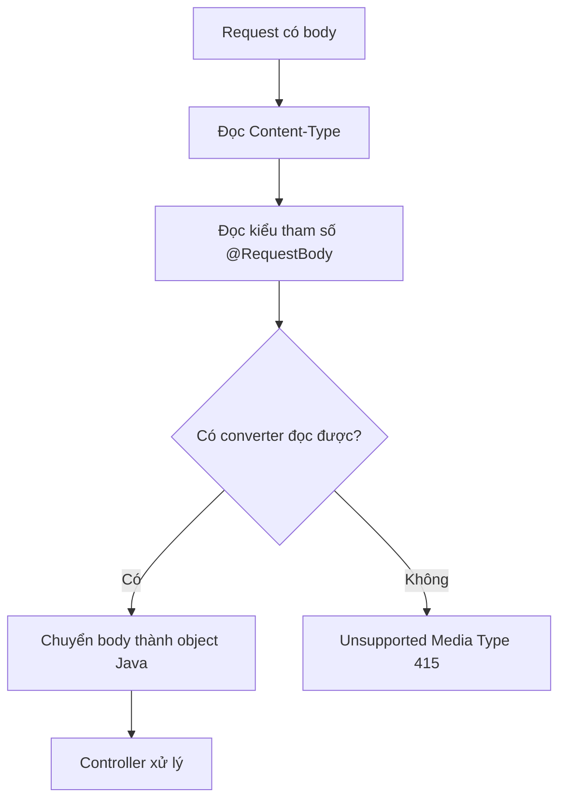
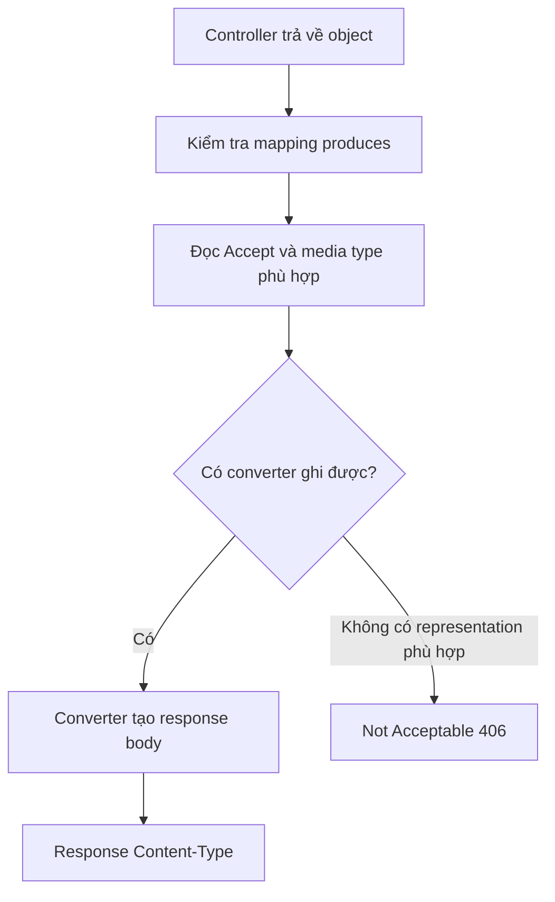

# Content-Type và Accept trong content negotiation

Trong Spring MVC, hai HTTP header `Content-Type` và `Accept` phối hợp với cơ chế content negotiation để xác định dữ liệu được gửi lên có định dạng gì và client muốn nhận dữ liệu trả về theo định dạng nào. Khi kiểm thử bằng `MockMvc`, cần thiết lập hai header đúng với contract của endpoint để Spring chọn đúng handler và `HttpMessageConverter`.

`Content-Type` mô tả representation của request body. `Accept` mô tả những representation mà client chấp nhận trong response. Hai header có hướng sử dụng khác nhau: gửi JSON thường cần đặt `Content-Type: application/json`; muốn nhận JSON thường đặt `Accept: application/json`. Việc đặt một header không tự động thay thế header còn lại.

## 1. Content negotiation là gì?

Content negotiation là quá trình client và server thống nhất định dạng biểu diễn dữ liệu cho một request/response. Cùng một tài nguyên có thể được biểu diễn bằng JSON, XML hoặc một media type khác. Client thông báo khả năng tiếp nhận thông qua `Accept`; server chọn representation phù hợp với endpoint và các bộ chuyển đổi được cấu hình.

Ví dụ, một API có thể nhận JSON và trả về JSON:

```http
POST /api/products HTTP/1.1
Content-Type: application/json
Accept: application/json

{"name":"Notebook","price":12.5}
```

Server đọc request body theo `Content-Type`, chuyển JSON thành object Java, xử lý request rồi ghi response theo định dạng phù hợp với `Accept` và cấu hình MVC. Response có thể có dạng:

```http
HTTP/1.1 201 Created
Content-Type: application/json

{"id":42,"name":"Notebook","price":12.5}
```

Trong Spring MVC, content negotiation liên quan đến nhiều thành phần:

- `@RequestMapping`, `@GetMapping`, `@PostMapping` và các annotation tương tự có thể ràng buộc media type bằng `consumes` và `produces`.
- `HttpMessageConverter` đọc request body thành object Java hoặc ghi object Java thành response body.
- `ContentNegotiationManager` và các `ContentNegotiationStrategy` hỗ trợ xác định media type mong muốn cho response.
- `MockMvc` cho phép test thiết lập request headers và kiểm tra response headers/body mà không cần HTTP server thật.

## 2. Phân biệt `Content-Type` và `Accept`

| Header | Hướng dữ liệu | Ý nghĩa | Ví dụ |
| --- | --- | --- | --- |
| `Content-Type` | Request hoặc response | Định dạng của body đang được gửi trong message đó | `application/json` |
| `Accept` | Request | Các định dạng response mà client muốn nhận | `application/json, application/xml` |

Khi gửi request có JSON body:

```java
mockMvc.perform(post("/api/products")
        .contentType(MediaType.APPLICATION_JSON)
        .content("""{"name":"Notebook","price":12.5}"""));
```

`contentType(...)` đặt `Content-Type` của request. Nó cho Spring biết body cần được đọc như JSON. Nếu endpoint nhận `@RequestBody CreateProductRequest`, Spring tìm một converter có khả năng đọc media type này thành kiểu Java tương ứng.

Khi muốn nhận JSON response:

```java
mockMvc.perform(get("/api/products/42")
        .accept(MediaType.APPLICATION_JSON));
```

`accept(...)` đặt `Accept` của request. Nó cho Spring biết client muốn response ở định dạng JSON. Nếu controller trả về object, Spring tìm converter có khả năng ghi object đó thành JSON.

Một request có thể cần cả hai header:

```java
mockMvc.perform(post("/api/products")
        .contentType(MediaType.APPLICATION_JSON)
        .accept(MediaType.APPLICATION_JSON)
        .content("""{"name":"Notebook","price":12.5}"""))
        .andExpect(status().isCreated())
        .andExpect(content().contentTypeCompatibleWith(MediaType.APPLICATION_JSON));
```

Trong ví dụ này, request body là JSON và client cũng yêu cầu response là JSON. Nếu chỉ gửi body mà thiếu `Content-Type`, Spring có thể không xác định được converter phù hợp. Nếu không khai báo `Accept`, client thường được hiểu là chấp nhận mọi định dạng mà endpoint có thể trả về; khi test contract rõ ràng, nên đặt `Accept` một cách tường minh.

## 3. Media type và các dạng thường gặp

Media type có cấu trúc `type/subtype`, có thể kèm tham số. Ví dụ:

```text
application/json
application/xml
text/plain
text/html
application/x-www-form-urlencoded
multipart/form-data
application/vnd.example.product+json
```

Một số media type phổ biến trong kiểm thử Spring MVC:

| Media type | Mục đích thường gặp |
| --- | --- |
| `application/json` | JSON request và response của REST API |
| `application/xml` | XML request hoặc response nếu ứng dụng có converter XML |
| `text/plain` | Nội dung văn bản thuần |
| `text/html` | HTML response |
| `application/x-www-form-urlencoded` | Form gửi các cặp key/value đã encode |
| `multipart/form-data` | Form có file upload hoặc nhiều phần dữ liệu |
| `application/octet-stream` | Dữ liệu nhị phân không có định dạng ứng dụng cụ thể |

Spring cung cấp lớp `MediaType` để biểu diễn media type mà không phải lặp lại chuỗi literal:

```java
MediaType.APPLICATION_JSON
MediaType.APPLICATION_XML
MediaType.TEXT_PLAIN
MediaType.TEXT_HTML
MediaType.APPLICATION_FORM_URLENCODED
MediaType.MULTIPART_FORM_DATA
```

Có thể tạo media type riêng hoặc parse một giá trị từ chuỗi:

```java
MediaType vendorJson = MediaType.parseMediaType(
        "application/vnd.example.product+json");
```

Một số API hỗ trợ tham số media type, chẳng hạn `application/json;charset=UTF-8`. Với JSON hiện đại, UTF-8 là encoding chuẩn được khuyến nghị; không nên phụ thuộc vào việc mọi converter đều phát lại tham số charset giống nhau. Khi assertion response, `contentTypeCompatibleWith(...)` thường bền vững hơn so với so sánh chuỗi `Content-Type` tuyệt đối nếu tham số có thể khác nhau.

## 4. `consumes` và `produces` trong mapping

Spring MVC cho phép khai báo media type mà handler chấp nhận và media type mà handler có thể tạo ra:

- `consumes` ràng buộc representation của request body, thường được đối chiếu với `Content-Type`.
- `produces` ràng buộc representation của response, thường được đối chiếu với `Accept` và khả năng ghi của converter.

Ví dụ controller chỉ nhận và trả JSON:

```java
import org.springframework.http.HttpStatus;
import org.springframework.http.MediaType;
import org.springframework.http.ResponseEntity;
import org.springframework.web.bind.annotation.PostMapping;
import org.springframework.web.bind.annotation.RequestBody;
import org.springframework.web.bind.annotation.RequestMapping;
import org.springframework.web.bind.annotation.RestController;

@RestController
@RequestMapping("/api/products")
class ProductController {
    @PostMapping(
            consumes = MediaType.APPLICATION_JSON_VALUE,
            produces = MediaType.APPLICATION_JSON_VALUE)
    ResponseEntity<ProductView> create(@RequestBody CreateProductRequest request) {
        ProductView result = new ProductView(42L, request.name(), request.price());
        return ResponseEntity.status(HttpStatus.CREATED).body(result);
    }
}

record CreateProductRequest(String name, double price) {
}

record ProductView(Long id, String name, double price) {
}
```

Với mapping này, request cần có `Content-Type` phù hợp với `application/json`. Response được khai báo là JSON. Để chuyển đổi record thành JSON, ứng dụng cần có JSON message converter tương ứng, thường được Spring Boot auto-configure khi Jackson có trên classpath.

Có thể khai báo nhiều media type:

```java
@PostMapping(
        consumes = {
            MediaType.APPLICATION_JSON_VALUE,
            MediaType.APPLICATION_XML_VALUE
        },
        produces = {
            MediaType.APPLICATION_JSON_VALUE,
            MediaType.APPLICATION_XML_VALUE
        })
ResponseEntity<ProductView> create(@RequestBody CreateProductRequest request) {
    // Xử lý dữ liệu và trả về kết quả
}
```

Khai báo nhiều giá trị chỉ cho phép mapping tham gia lựa chọn với các media type đó. Nó không tự cài đặt converter còn thiếu. Muốn đọc hoặc ghi XML, ứng dụng vẫn cần một `HttpMessageConverter` hỗ trợ XML và cấu hình phù hợp.

## 5. Vai trò của `HttpMessageConverter`

`HttpMessageConverter` là cơ chế Spring MVC dùng để chuyển đổi giữa HTTP message và object Java. Khi đọc request body, Spring xem xét content type của request và kiểu tham số cần nhận. Khi ghi response body, Spring xem xét kiểu object, media type được yêu cầu và các converter có thể ghi kiểu đó.

Một số converter thường gặp:

| Converter | Công việc |
| --- | --- |
| `MappingJackson2HttpMessageConverter` | Đọc/ghi JSON bằng Jackson trong các phiên bản Spring tương ứng |
| `StringHttpMessageConverter` | Đọc/ghi nội dung dạng `String` |
| `ByteArrayHttpMessageConverter` | Đọc/ghi mảng byte |
| `FormHttpMessageConverter` | Xử lý dữ liệu form và multipart theo khả năng được cấu hình |
| Converter XML | Đọc/ghi XML khi thư viện và converter tương ứng có mặt |

Quá trình đọc request body có thể hình dung như sau:



Quá trình ghi response body có thêm bước lựa chọn theo `Accept` và mapping `produces`:



Converter thực tế được lựa chọn phụ thuộc kiểu tham số hoặc kiểu trả về, media type, cấu hình MVC và thư viện có trong ứng dụng. Vì vậy, test nên chạy trong cấu hình gần với ứng dụng nếu mục tiêu là xác nhận đúng converter đã được đăng ký.

## 6. Thiết lập header trong MockMvc

`MockHttpServletRequestBuilder` cung cấp hai phương thức dễ đọc:

- `.contentType(MediaType)` thiết lập `Content-Type` của request.
- `.accept(MediaType...)` thiết lập một hoặc nhiều giá trị `Accept`.

Ví dụ kiểm tra endpoint nhận JSON và trả JSON:

```java
@WebMvcTest(ProductController.class)
class ProductControllerTest {
    @Autowired
    private MockMvc mockMvc;

    @Autowired
    private ObjectMapper objectMapper;

    @Test
    void createsProductUsingJson() throws Exception {
        CreateProductRequest request = new CreateProductRequest("Notebook", 12.5);

        mockMvc.perform(post("/api/products")
                        .contentType(MediaType.APPLICATION_JSON)
                        .accept(MediaType.APPLICATION_JSON)
                        .content(objectMapper.writeValueAsBytes(request)))
                .andExpect(status().isCreated())
                .andExpect(content().contentTypeCompatibleWith(MediaType.APPLICATION_JSON))
                .andExpect(jsonPath("$.id").value(42))
                .andExpect(jsonPath("$.name").value("Notebook"));
    }
}
```

Trong `@WebMvcTest`, controller được nạp trong web slice. Nếu controller phụ thuộc service, test cần cung cấp mock bean hoặc cấu hình phù hợp cho dependency đó. `ObjectMapper` thường được Boot cấu hình tự động; nếu dự án không dùng Boot, cần cung cấp mapper trong test.

Có thể đặt header trực tiếp bằng `.header(...)`, nhưng `.contentType(...)` và `.accept(...)` diễn đạt đúng mục đích hơn:

```java
mockMvc.perform(post("/api/products")
        .header(HttpHeaders.CONTENT_TYPE, "application/json")
        .header(HttpHeaders.ACCEPT, "application/json")
        .content("""{"name":"Notebook","price":12.5}"""));
```

Không nên đặt `Content-Type` cho một GET request không có body chỉ vì muốn nhận JSON. Với request đó, `Accept: application/json` là header liên quan trực tiếp đến định dạng response. `Content-Type` chỉ cần khi message có body và cần mô tả định dạng của body.

## 7. Kiểm tra response Content-Type và body

Sau khi Spring chọn converter và tạo response, test có thể kiểm tra response media type bằng `content()` hoặc `header()`:

```java
mockMvc.perform(get("/api/products/42")
                .accept(MediaType.APPLICATION_JSON))
        .andExpect(status().isOk())
        .andExpect(content().contentTypeCompatibleWith(MediaType.APPLICATION_JSON))
        .andExpect(jsonPath("$.id").value(42));
```

Các matcher thường dùng:

| Matcher | Ý nghĩa |
| --- | --- |
| `content().contentType(MediaType.APPLICATION_JSON)` | So sánh media type response theo điều kiện matcher |
| `content().contentTypeCompatibleWith(MediaType.APPLICATION_JSON)` | Kiểm tra response media type tương thích với JSON, cho phép tham số phù hợp |
| `content().string("...")` | So sánh response body dạng chuỗi |
| `content().json("...")` | So sánh nội dung JSON |
| `jsonPath("$.field").value(...)` | Kiểm tra một giá trị trong JSON response |
| `header().string(HttpHeaders.CONTENT_TYPE, ...)` | Kiểm tra trực tiếp response header |

Ví dụ kiểm tra body JSON theo cấu trúc:

```java
mockMvc.perform(get("/api/products/42")
                .accept(MediaType.APPLICATION_JSON))
        .andExpect(content().json("""
                {
                  "id": 42,
                  "name": "Notebook",
                  "price": 12.5
                }
                """));
```

Khi chỉ quan tâm đến media type, dùng `contentTypeCompatibleWith` giúp test tránh phụ thuộc vào tham số không quan trọng. Khi contract yêu cầu chính xác một header cụ thể, có thể kiểm tra bằng `header().string(...)`.

## 8. Lỗi 415 Unsupported Media Type

HTTP 415 thường xuất hiện khi server không chấp nhận media type của request body. Trong Spring MVC, lỗi này có thể xảy ra khi `Content-Type` không phù hợp với điều kiện `consumes` hoặc không có converter nào đọc được body theo media type và kiểu Java cần thiết.

Giả sử endpoint chỉ nhận JSON:

```java
@PostMapping(consumes = MediaType.APPLICATION_JSON_VALUE)
ProductView create(@RequestBody CreateProductRequest request) {
    return new ProductView(42L, request.name(), request.price());
}
```

Test gửi `text/plain` sẽ không khớp điều kiện `consumes`:

```java
@Test
void rejectsUnsupportedRequestMediaType() throws Exception {
    mockMvc.perform(post("/api/products")
                    .contentType(MediaType.TEXT_PLAIN)
                    .content("name=Notebook"))
            .andExpect(status().isUnsupportedMediaType());
}
```

Một lỗi khác là gửi JSON body nhưng quên `.contentType(MediaType.APPLICATION_JSON)`. Nếu mapping chỉ nhận JSON, request có thể bị từ chối vì thiếu hoặc không phù hợp `Content-Type`. Vì vậy, khi test POST/PUT/PATCH có body, hãy khai báo rõ media type của body.

Không nên nhầm 415 với lỗi JSON sai cú pháp. Nếu `Content-Type` là JSON và converter đã chọn được nhưng nội dung JSON không thể deserialize, Spring thường trả 400 Bad Request do lỗi đọc message. 415 liên quan đến media type hoặc converter không hỗ trợ; 400 thường liên quan đến nội dung body không đọc được hoặc dữ liệu không hợp lệ.

## 9. Lỗi 406 Not Acceptable

HTTP 406 xảy ra khi server không thể tạo response phù hợp với những media type client chấp nhận. Trong Spring MVC, điều này có thể xảy ra khi `Accept` không khớp với `produces` của handler hoặc không có converter nào ghi được kiểu trả về theo media type được yêu cầu.

Ví dụ endpoint chỉ trả JSON:

```java
@GetMapping(
        value = "/{id}",
        produces = MediaType.APPLICATION_JSON_VALUE)
ProductView find(@PathVariable long id) {
    return new ProductView(id, "Notebook", 12.5);
}
```

Test yêu cầu XML trong khi endpoint chỉ cung cấp JSON:

```java
@Test
void rejectsUnacceptableResponseMediaType() throws Exception {
    mockMvc.perform(get("/api/products/42")
                    .accept(MediaType.APPLICATION_XML))
            .andExpect(status().isNotAcceptable());
}
```

Kết quả cụ thể còn phụ thuộc cấu hình MVC và converter. Nếu ứng dụng đã đăng ký converter XML và handler cho phép XML, request có thể được phục vụ thay vì trả 406. Test nên phản ánh cấu hình thật mà ứng dụng muốn hỗ trợ.

## 10. Accept có nhiều media type và quality factor

`Accept` có thể liệt kê nhiều media type, phân tách bằng dấu phẩy. Client có thể chỉ định quality factor `q` trong khoảng từ 0 đến 1 để thể hiện mức ưu tiên:

```http
Accept: application/xml;q=0.8, application/json;q=1.0
```

Trong ví dụ, client ưu tiên JSON hơn XML. Giá trị `q` càng cao thì media type càng được ưu tiên. Giá trị mặc định nếu không ghi `q` là `1.0`.

Có thể thiết lập danh sách này trong MockMvc:

```java
mockMvc.perform(get("/api/products/42")
        .header(HttpHeaders.ACCEPT,
                "application/xml;q=0.8, application/json;q=1.0"))
        .andExpect(status().isOk())
        .andExpect(content().contentTypeCompatibleWith(MediaType.APPLICATION_JSON));
```

Hoặc parse danh sách media type để truyền vào builder:

```java
MediaType[] acceptedTypes = MediaType.parseMediaTypes(
        "application/xml;q=0.8, application/json;q=1.0")
        .toArray(new MediaType[0]);

mockMvc.perform(get("/api/products/42").accept(acceptedTypes));
```

Các wildcard cũng thường gặp:

| Giá trị `Accept` | Ý nghĩa |
| --- | --- |
| `*/*` | Chấp nhận mọi media type |
| `application/*` | Chấp nhận mọi subtype thuộc `application` |
| `application/json` | Chỉ định rõ JSON |
| `application/*+json` | Chấp nhận các subtype có hậu tố `+json`, nếu converter và cấu hình hỗ trợ |

Khi nhiều representation cùng được hỗ trợ, kết quả lựa chọn còn phụ thuộc mapping, specificity của media type, quality factor và converter có thể ghi response. Đừng chỉ dựa vào thứ tự chuỗi `Accept` để suy đoán kết quả; hãy viết assertion cho response `Content-Type` thực tế.

## 11. Phân biệt form, JSON và multipart khi gửi request

Một lỗi thường gặp là dùng cùng một cách thiết lập body cho mọi loại request. Mỗi định dạng cần `Content-Type` tương ứng và cách tạo request phù hợp.

### JSON

```java
mockMvc.perform(post("/api/products")
        .contentType(MediaType.APPLICATION_JSON)
        .content("""{"name":"Notebook","price":12.5}"""));
```

### Form URL-encoded

```java
mockMvc.perform(post("/login")
        .contentType(MediaType.APPLICATION_FORM_URLENCODED)
        .param("username", "lan")
        .param("password", "secret"));
```

### Multipart file upload

```java
MockMultipartFile file = new MockMultipartFile(
        "document", "notes.txt", MediaType.TEXT_PLAIN_VALUE,
        "hello".getBytes(StandardCharsets.UTF_8));

mockMvc.perform(multipart("/documents").file(file));
```

Với multipart, nên để request builder tạo boundary cần thiết. Không tự đặt một `Content-Type: multipart/form-data` thiếu boundary khi body multipart được tạo bởi builder. Nếu cần kiểm tra response JSON của endpoint upload, có thể kết hợp `.accept(MediaType.APPLICATION_JSON)` với request multipart.

## 12. Kiểm tra Content-Type và Accept trong cùng một test

Một test tích hợp nên chứng minh cả request được gửi đúng representation lẫn response được trả về theo định dạng client yêu cầu. Ví dụ:

```java
@Test
void acceptsJsonAndReturnsJson() throws Exception {
    String requestBody = """
            {
              "name": "Notebook",
              "price": 12.5
            }
            """;

    mockMvc.perform(post("/api/products")
                    .contentType(MediaType.APPLICATION_JSON)
                    .accept(MediaType.APPLICATION_JSON)
                    .content(requestBody))
            .andExpect(status().isCreated())
            .andExpect(content().contentTypeCompatibleWith(MediaType.APPLICATION_JSON))
            .andExpect(jsonPath("$.id").value(42))
            .andExpect(jsonPath("$.name").value("Notebook"));
}
```

Nên có thêm test cho các tình huống không hợp lệ để bảo vệ contract:

```java
@Test
void returns415WhenRequestContentTypeIsUnsupported() throws Exception {
    mockMvc.perform(post("/api/products")
                    .contentType(MediaType.TEXT_PLAIN)
                    .accept(MediaType.APPLICATION_JSON)
                    .content("Notebook"))
            .andExpect(status().isUnsupportedMediaType());
}

@Test
void returns406WhenResponseTypeIsNotAccepted() throws Exception {
    mockMvc.perform(get("/api/products/42")
                    .accept(MediaType.APPLICATION_XML))
            .andExpect(status().isNotAcceptable());
}
```

Hai test lỗi giả định endpoint chỉ nhận JSON và chỉ trả JSON. Nếu ứng dụng hỗ trợ thêm media type khác, hãy cập nhật expectation cho đúng contract.

## 13. Cấu hình content negotiation trong Spring MVC

Spring MVC có thể được cấu hình thông qua `WebMvcConfigurer` để điều chỉnh cách xác định media type cho response. Với API HTTP hiện đại, header `Accept` là cách rõ ràng để client yêu cầu representation. Nếu ứng dụng cần một response mặc định khi client không gửi `Accept`, có thể cấu hình default content type.

```java
@Configuration
@EnableWebMvc
class ApiWebConfig implements WebMvcConfigurer {
    @Override
    public void configureContentNegotiation(ContentNegotiationConfigurer configurer) {
        configurer
                .favorParameter(false)
                .ignoreAcceptHeader(false)
                .defaultContentType(MediaType.APPLICATION_JSON);
    }
}
```

Trong ví dụ này, Spring vẫn xem xét `Accept`; khi không có thông tin phù hợp để chọn, JSON được dùng làm mặc định. Tùy chọn và hành vi chi tiết có thể thay đổi theo phiên bản Spring và cấu hình ứng dụng. Nếu dùng Spring Boot, auto-configuration có thể đã thiết lập một số thành phần MVC; chỉ thêm cấu hình cần thiết cho contract của ứng dụng.

Các ứng dụng cũ đôi khi chọn response type bằng query parameter như `?format=json` hoặc phần mở rộng đường dẫn. Những cách đó cần cấu hình chiến lược tương ứng và có thể làm URL phức tạp. Với API mới, ưu tiên header `Accept` và mapping `produces` để contract HTTP được thể hiện trực tiếp.

## 14. Các lỗi thường gặp khi kiểm thử

| Hiện tượng | Nguyên nhân thường gặp | Cách xử lý |
| --- | --- | --- |
| POST JSON trả 415 | Thiếu hoặc sai `Content-Type`; mapping `consumes` không khớp; thiếu converter đọc JSON | Đặt `.contentType(APPLICATION_JSON)` và kiểm tra converter/configuration |
| POST JSON trả 400 | JSON sai cú pháp, deserialize thất bại hoặc validation không đạt | Kiểm tra body, DTO, kiểu dữ liệu và validation |
| GET JSON trả 406 | `Accept` không khớp `produces` hoặc không có converter ghi representation | Đặt `Accept` đúng contract và kiểm tra `produces`/converter |
| Response có media type khác mong đợi | Request không gửi `Accept`, mapping cho phép nhiều định dạng hoặc default content type được cấu hình | Assert response header và kiểm tra negotiation strategy |
| Test chỉ qua khi bỏ `Accept` | Header được gửi không tương thích với endpoint | Kiểm tra danh sách media type và quality factor |
| XML không được đọc/ghi dù đã khai báo `consumes`/`produces` | Chưa có XML converter hoặc thư viện cần thiết | Đăng ký converter và kiểm tra classpath |
| Assertion Content-Type thất bại do charset | So sánh chuỗi header quá chặt | Dùng `contentTypeCompatibleWith` nếu contract cho phép tham số |
| Multipart trả 415 | Request builder hoặc mapping multipart không khớp | Dùng `multipart(...)`, để builder tạo boundary và kiểm tra mapping |

Khi chẩn đoán, nên xem đồng thời request headers, response status, response headers và body. `andDo(print())` giúp hiển thị request/response trong lúc phát triển test:

```java
mockMvc.perform(post("/api/products")
        .contentType(MediaType.APPLICATION_JSON)
        .accept(MediaType.APPLICATION_JSON)
        .content("""{"name":"Notebook","price":12.5}"""))
        .andDo(print())
        .andExpect(status().isCreated());
```

Không nên sửa test bằng cách bỏ header chỉ để làm cho request qua được. Trước tiên cần xác định header đó có thuộc contract của client hay không, rồi điều chỉnh request hoặc cấu hình endpoint tương ứng.

## 15. Nguyên tắc viết test content negotiation

1. Đặt `Content-Type` đúng với định dạng thực tế của request body.
2. Đặt `Accept` để mô tả representation mà client muốn nhận.
3. Dùng `consumes` để giới hạn loại request body và `produces` để giới hạn loại response của handler.
4. Xác nhận ứng dụng có `HttpMessageConverter` đọc hoặc ghi media type cần kiểm tra.
5. Assert response `Content-Type` cùng với status và nội dung body để xác nhận negotiation đã chọn đúng representation.
6. Viết test cho 415 khi request media type không được hỗ trợ và 406 khi response media type không được chấp nhận.
7. Khi `Accept` có nhiều giá trị hoặc quality factor, kiểm tra `Content-Type` thực tế thay vì suy luận từ thứ tự chuỗi.
8. Với form và multipart, dùng media type và request builder đúng với định dạng tương ứng.
9. Dùng cấu hình web context phù hợp khi cần xác nhận converter, negotiation strategy hoặc controller advice của ứng dụng thật.

Trong kiểm thử MockMvc, `Content-Type` và `Accept` là hai phần quan trọng của HTTP contract. Đặt đúng `Content-Type` giúp Spring đọc request body theo định dạng dự kiến; đặt đúng `Accept` giúp Spring chọn representation cho response. Khi kết hợp hai header với `consumes`, `produces`, message converter và assertion response, bài test có thể xác nhận rõ cả khả năng tiếp nhận dữ liệu lẫn định dạng dữ liệu mà API cam kết trả về.
