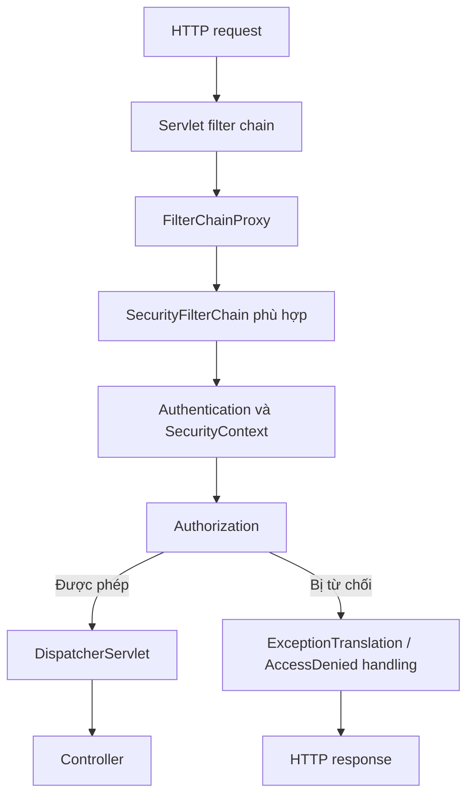
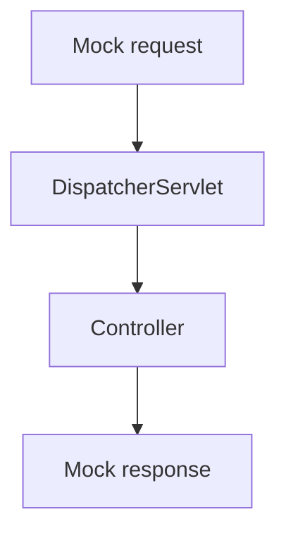

# Giới hạn xác nhận bảo mật khi chưa nạp Spring Security

## 1. Vì sao cấu hình test có thể làm sai lệch kết luận về bảo mật?

Một bài kiểm thử Spring MVC có thể gọi controller bằng `MockMvc`, đặt một người dùng giả vào request rồi xác nhận trạng thái xác thực bằng các matcher như `authenticated()` hoặc `unauthenticated()`. Những công cụ này hữu ích, nhưng kết quả chỉ có ý nghĩa khi ta hiểu chính xác phần nào của hệ thống đang được chạy.

Spring Security bảo vệ request thông qua một chuỗi servlet filter, thường là `FilterChainProxy` chứa các `SecurityFilterChain`. Chuỗi filter có thể xác thực request, tạo `SecurityContext`, kiểm tra quyền, áp dụng CSRF và chuyển lỗi xác thực hoặc từ chối truy cập thành response HTTP.

Nếu test không nạp hoặc không chạy chuỗi filter đó, controller vẫn có thể được gọi bình thường. Một helper như `user(...)`, `@WithMockUser` hoặc `jwt()` có thể cung cấp danh tính giả để kiểm tra logic phía sau, nhưng không tự chứng minh rằng ứng dụng đã xác thực thông tin đăng nhập hay áp dụng quy tắc bảo vệ URL.

Vì vậy, cần phân biệt hai câu hỏi:

1. **Trong lúc chạy test, request có một `Authentication` với người dùng và quyền như mong đợi không?** Các matcher về authentication và principal hỗ trợ trả lời câu hỏi này.
2. **Spring Security có thực sự chặn hoặc cho phép request theo cấu hình của ứng dụng không?** Câu hỏi này đòi hỏi chuỗi filter và cấu hình bảo mật thật phải tham gia request.

Một test có thể trả lời tốt câu hỏi thứ nhất mà chưa hề kiểm tra được câu hỏi thứ hai.

## 2. Spring Security nằm ở đâu trong đường đi của request?

Trong ứng dụng Spring MVC có Spring Security, request đi qua servlet filter trước khi đến `DispatcherServlet` và controller. `FilterChainProxy` chọn `SecurityFilterChain` phù hợp với request; các filter trong chain xử lý authentication, authorization và những chính sách khác.



Nếu MockMvc được dựng mà không gắn các filter bảo mật, đường đi có thể rút gọn thành:



Ở đường đi thứ hai, test vẫn có thể kiểm tra mapping, binding, validation, response body và exception handler của MVC. Nhưng test không thể kết luận rằng các filter Spring Security đã xác thực hoặc từ chối request, bởi chúng không tham gia xử lý.

## 3. `spring-security-test` không đồng nghĩa với việc đã bật bảo mật runtime

Các dependency có vai trò khác nhau:

| Thành phần | Vai trò |
|---|---|
| Spring Security runtime, thường được đưa vào qua `spring-boot-starter-security` | Cung cấp các API và hạ tầng filter để bảo vệ request trong ứng dụng |
| Cấu hình `SecurityFilterChain` | Khai báo request nào cần xác thực, quyền nào được phép và các chính sách bảo mật |
| `spring-security-test` | Cung cấp annotation, request post-processor và matcher hỗ trợ kiểm thử bảo mật |
| `MockMvc` | Mô phỏng request/response MVC; chỉ chạy filter được cấu hình vào MockMvc instance |

Chỉ thêm `spring-security-test` vào test classpath không tự tạo ra một cấu hình bảo mật hoàn chỉnh. Tương tự, chỉ có bean `SecurityFilterChain` trong ApplicationContext cũng chưa đủ nếu MockMvc được dựng theo cách không đưa servlet filters vào request.

Trong Spring Boot, cấu hình test quyết định những bean và filter nào được nạp. Cần kiểm tra dependency runtime, cấu hình bảo mật, loại test và cách dựng MockMvc thay vì suy luận từ việc một annotation hoặc matcher có biên dịch được.

## 4. Những cách dựng MockMvc thường gặp

### 4.1. `@SpringBootTest` kết hợp `@AutoConfigureMockMvc`

Đây thường là lựa chọn phù hợp khi muốn kiểm tra request đi qua cấu hình ứng dụng và filter thực tế:

```java
@SpringBootTest
@AutoConfigureMockMvc
class OrderSecurityIntegrationTest {

    @Autowired
    private MockMvc mockMvc;

    @Test
    void rejectsAnonymousRequest() throws Exception {
        mockMvc.perform(get("/api/orders"))
                .andExpect(status().isUnauthorized());
    }
}
```

`@AutoConfigureMockMvc` mặc định thêm các servlet filters đã được đăng ký trong ApplicationContext vào MockMvc. Nếu ứng dụng có cấu hình Spring Security phù hợp, request sẽ đi qua security filter chain.

Tuy nhiên, `@SpringBootTest` không tự chứng minh rằng một chain cụ thể đang hoạt động. Cần xác nhận ứng dụng thực sự có Spring Security runtime, cấu hình chain được nạp trong context và test không tắt filter.

### 4.2. `@AutoConfigureMockMvc(addFilters = false)`

```java
@SpringBootTest
@AutoConfigureMockMvc(addFilters = false)
class OrderControllerMvcTest {
    // Các test tập trung vào hành vi MVC.
}
```

`addFilters = false` yêu cầu MockMvc không đăng ký các servlet filters từ context. Cấu hình này có thể hữu ích khi test chỉ tập trung vào controller hoặc muốn cô lập một phần MVC. Nhưng các test trong lớp này không thể dùng kết quả status hoặc authentication để kết luận rằng Spring Security đã bảo vệ endpoint.

Nếu test có mục tiêu xác nhận authorization, hãy dùng một cấu hình MockMvc có filter bảo mật đang hoạt động. Đừng giữ `addFilters = false` rồi xem một assertion `authenticated()` thành bằng chứng cho quy tắc truy cập.

### 4.3. `@WebMvcTest`

`@WebMvcTest` tạo một MVC test slice thay vì nạp toàn bộ ứng dụng. Nếu Spring Security runtime có trên classpath, Spring Boot có thể đưa cấu hình bảo mật mặc định vào slice; cấu hình bảo mật riêng của ứng dụng có thể cần được import rõ ràng hoặc được đưa vào slice theo cách phù hợp.

```java
@WebMvcTest(OrderController.class)
@Import(SecurityConfiguration.class)
class OrderControllerSecurityTest {

    @Autowired
    private MockMvc mockMvc;

    @MockBean
    private OrderService orderService;
}
```

Ví dụ import `SecurityConfiguration` để test dùng cấu hình bảo mật được chọn. Tùy cấu trúc ứng dụng, cần bổ sung các bean phụ thuộc mà cấu hình đó yêu cầu. Nếu slice không nạp chain dự định kiểm thử, kết quả của test không đại diện cho cấu hình production.

### 4.4. `standaloneSetup(...)`

```java
MockMvc mockMvc = MockMvcBuilders
        .standaloneSetup(new OrderController(orderService))
        .build();
```

`standaloneSetup(...)` tạo MockMvc từ controller được cung cấp và các thành phần MVC được đăng ký thủ công. Nó không tự khám phá toàn bộ ApplicationContext của ứng dụng, cũng không tự thêm Spring Security filter chain.

Nếu cần kiểm thử bảo mật với cách dựng này, phải cấu hình các filter và thành phần security phù hợp một cách tường minh. Trong ứng dụng đã có ApplicationContext và `FilterChainProxy`, cách `webAppContextSetup(context).apply(springSecurity())` thường rõ ràng hơn vì nó sử dụng cấu hình web và filter chain từ context.

## 5. Matcher authentication xác nhận điều gì?

Spring Security Test cung cấp các matcher như:

```java
import static org.springframework.security.test.web.servlet.response.SecurityMockMvcResultMatchers.authenticated;
import static org.springframework.security.test.web.servlet.response.SecurityMockMvcResultMatchers.unauthenticated;
```

Ví dụ:

```java
mockMvc.perform(get("/api/profile")
                .with(user("alice").roles("USER")))
        .andExpect(status().isOk())
        .andExpect(authenticated().withUsername("alice"));
```

`authenticated()` xác nhận trạng thái authentication quan sát được sau request đáp ứng điều kiện authenticated. Các điều kiện bổ sung có thể kiểm tra username, principal, authority hoặc những thuộc tính khác mà matcher hỗ trợ.

Matcher này không tự chứng minh rằng:

- Request đã đi qua `FilterChainProxy`.
- Username/password, session, Basic credentials hoặc bearer token đã được xác minh bằng cơ chế runtime.
- Quy tắc `authorizeHttpRequests(...)` của ứng dụng đã được áp dụng.
- Request sẽ bị chặn nếu không cung cấp danh tính.

Ngược lại, `unauthenticated()` xác nhận không có authentication hợp lệ trong trạng thái mà matcher quan sát được. Nó không chứng minh rằng endpoint được cấu hình yêu cầu đăng nhập. Một endpoint công khai cũng thường xử lý request ẩn danh mà không có vấn đề.

Do đó, hãy kết hợp matcher authentication với status và cấu hình test thích hợp. Đặc biệt, muốn chứng minh endpoint được bảo vệ, cần có test gửi request ẩn danh qua filter chain và xác nhận kết quả từ chính sách truy cập.

## 6. `@WithMockUser` và `user(...)` tạo danh tính giả

### 6.1. Dùng `@WithMockUser`

```java
@Test
@WithMockUser(username = "alice", roles = "ADMIN")
void adminCanReadAuditLog() throws Exception {
    mockMvc.perform(get("/api/audit-log"))
            .andExpect(status().isOk())
            .andExpect(authenticated().withUsername("alice"));
}
```

`@WithMockUser` thiết lập một người dùng giả cho test thông qua Spring Security Test. Test có thể tập trung vào hành vi cần một principal và authorities cụ thể mà không phải thực hiện quy trình đăng nhập.

### 6.2. Dùng request post-processor `user(...)`

```java
mockMvc.perform(get("/api/audit-log")
                .with(user("alice").roles("ADMIN")))
        .andExpect(status().isOk())
        .andExpect(authenticated().withUsername("alice"));
```

`user(...)` tạo request với một người dùng giả và các quyền đã chỉ định. `roles("ADMIN")` tạo authority `ROLE_ADMIN`; nếu muốn truyền authority chính xác, dùng `authorities(...)`.

```java
mockMvc.perform(get("/api/reports")
                .with(user("alice").authorities(
                        new SimpleGrantedAuthority("report:read"))))
        .andExpect(status().isOk());
```

Các helper này hữu ích để kiểm tra nhánh xử lý của ứng dụng với một danh tính đã biết. Chúng bỏ qua bước xác minh thông tin đăng nhập thật. Vì vậy, một test dùng `user("alice")` không kiểm tra password encoder, `UserDetailsService`, authentication provider, login endpoint hoặc session creation.

### 6.3. Quyền của người dùng giả không tự kiểm tra được authorization

Giả sử controller hoặc service đọc `Authentication` để lấy tên người dùng. `@WithMockUser` có thể giúp kiểm tra việc đọc principal đó. Nhưng nếu mục tiêu là xác nhận URL `/api/admin/**` chỉ cho phép ADMIN, test phải chạy với security chain và assertion phải chứng minh người dùng thường bị từ chối.

Một test chỉ xác nhận `authenticated().withUsername("alice")` không đủ để chứng minh vai trò ADMIN đã được kiểm tra. Nó chỉ xác nhận danh tính giả đang hiện diện.

## 7. JWT giả không xác minh chữ ký token thật

Spring Security Test cung cấp request post-processor `jwt()` để tạo một `JwtAuthenticationToken` giả cho request:

```java
mockMvc.perform(get("/api/orders")
                .with(jwt().jwt(jwt -> jwt
                        .subject("alice")
                        .claim("scope", "orders.read"))))
        .andExpect(status().isOk())
        .andExpect(authenticated());
```

Helper này phù hợp để kiểm tra authorization dựa trên principal và authorities được tạo từ JWT. Nó không gửi một chuỗi bearer token để ứng dụng tự giải mã và xác minh. Do đó, test trên không xác nhận:

- Chữ ký JWT có hợp lệ với public key hoặc secret đang cấu hình không.
- Token có hết hạn hay chưa.
- `issuer`, `audience` hoặc các claim bắt buộc có được kiểm tra không.
- JWK Set URI, decoder hoặc introspection endpoint có hoạt động không.
- Bearer token filter có đọc header `Authorization` và tạo authentication đúng không.

Để kiểm tra các hành vi đó, cần một test ở mức phù hợp gửi bearer token thật hoặc token được ký bằng key test, cho request đi qua resource server filter và sử dụng decoder/validator thực tế của cấu hình test.

Với OAuth2 opaque token, request post-processor `opaqueToken()` cũng tạo authentication giả để kiểm tra logic phía sau. Nó không chứng minh introspection request đã được gửi tới authorization server hoặc token thật được introspect thành công.

## 8. Kiểm thử CSRF cũng cần filter chain đang hoạt động

Spring Security Test hỗ trợ thêm CSRF token vào request:

```java
mockMvc.perform(post("/api/orders")
                .with(user("alice").roles("USER"))
                .with(csrf())
                .contentType(MediaType.APPLICATION_JSON)
                .content("{\"productCode\":\"BOOK-01\"}"))
        .andExpect(status().isCreated());
```

`csrf()` giúp test gửi một token hợp lệ theo cơ chế test support. Có thể tạo request thiếu token hoặc token không hợp lệ để kiểm tra hành vi từ chối:

```java
mockMvc.perform(post("/api/orders")
                .with(user("alice").roles("USER"))
                .contentType(MediaType.APPLICATION_JSON)
                .content("{\"productCode\":\"BOOK-01\"}"))
        .andExpect(status().isForbidden());

mockMvc.perform(post("/api/orders")
                .with(user("alice").roles("USER"))
                .with(csrf().useInvalidToken())
                .contentType(MediaType.APPLICATION_JSON)
                .content("{\"productCode\":\"BOOK-01\"}"))
        .andExpect(status().isForbidden());
```

Các assertion `403` chỉ có ý nghĩa xác nhận CSRF protection khi request thực sự đi qua `CsrfFilter` và cấu hình CSRF đang bật cho endpoint đó. Nếu test tắt filters hoặc bỏ qua security chain, request có thể đến controller dù thiếu token; khi ấy test không kiểm tra được chính sách CSRF.

CSRF không áp dụng giống nhau cho mọi request. Spring Security thường bảo vệ các HTTP method có khả năng thay đổi trạng thái như POST, PUT, PATCH và DELETE, trong khi GET là safe method theo quy ước. Cấu hình ứng dụng có thể tùy chỉnh matcher hoặc bỏ CSRF cho API stateless; test phải phản ánh chính sách thật thay vì mặc định mọi POST đều cần token trong mọi ứng dụng.

## 9. Kiểm tra authorization bằng ba trường hợp rõ ràng

Một bộ test authorization nên kiểm tra ít nhất ba trạng thái: không có người dùng, người dùng đã xác thực nhưng thiếu quyền, và người dùng có quyền phù hợp.

Giả sử cấu hình ứng dụng bảo vệ `/api/admin/**` và chỉ cho phép authority `ADMIN`:

```java
@Configuration
@EnableWebSecurity
class SecurityConfiguration {

    @Bean
    SecurityFilterChain securityFilterChain(HttpSecurity http) throws Exception {
        return http
                .authorizeHttpRequests(authorize -> authorize
                        .requestMatchers("/api/admin/**").hasAuthority("ADMIN")
                        .anyRequest().authenticated())
                .httpBasic(Customizer.withDefaults())
                .csrf(csrf -> csrf.disable())
                .build();
    }
}
```

Ví dụ trên minh họa quy tắc authorization; chính sách CSRF được tắt riêng để tập trung vào các trường hợp truy cập API. Ứng dụng dùng session hoặc trình duyệt cần đánh giá CSRF theo mô hình xác thực thực tế.

Các test có thể viết như sau:

```java
@SpringBootTest
@AutoConfigureMockMvc
class AdminAuthorizationTest {

    @Autowired
    private MockMvc mockMvc;

    @Test
    void anonymousUserCannotAccessAdminEndpoint() throws Exception {
        mockMvc.perform(get("/api/admin/reports"))
                .andExpect(status().isUnauthorized());
    }

    @Test
    @WithMockUser(authorities = "USER")
    void authenticatedUserWithoutAdminAuthorityIsForbidden() throws Exception {
        mockMvc.perform(get("/api/admin/reports"))
                .andExpect(status().isForbidden());
    }

    @Test
    @WithMockUser(authorities = "ADMIN")
    void adminCanAccessAdminEndpoint() throws Exception {
        mockMvc.perform(get("/api/admin/reports"))
                .andExpect(status().isOk());
    }
}
```

Các status trong ví dụ phụ thuộc vào authentication entry point và access-denied handling của cấu hình. Với HTTP Basic, request ẩn danh thường nhận `401`. Với form login, request từ trình duyệt có thể được redirect tới trang đăng nhập và nhận `302`. Test nên xác nhận response đúng với entry point mà ứng dụng thực sự cấu hình.

Ba test chỉ xác nhận authorization khi MockMvc dùng đúng `SecurityFilterChain`. Nếu chain không được nạp, người dùng ẩn danh có thể đi tới controller, người dùng thiếu quyền cũng có thể đi tới controller, và test sẽ phát hiện sai khác nếu assertion được đặt đúng. Tuy nhiên, nếu endpoint hoặc test setup tự tạo status giả, kết quả đó không thay thế bằng chứng rằng security filter đã chạy.

## 10. Cách đưa Spring Security filter chain vào MockMvc tường minh

Khi dựng MockMvc từ web application context bằng tay, Spring Security Test cung cấp configurer `springSecurity()`:

```java
@Autowired
private WebApplicationContext context;

private MockMvc mockMvc;

@BeforeEach
void setUp() {
    mockMvc = MockMvcBuilders
            .webAppContextSetup(context)
            .apply(springSecurity())
            .build();
}
```

Việc áp dụng `springSecurity()` tích hợp Spring Security với MockMvc, bao gồm security filter chain và các thành phần hỗ trợ test security context. Cách này yêu cầu ApplicationContext có cấu hình Spring Security phù hợp, thường gồm `FilterChainProxy`.

Nếu dùng `standaloneSetup(...)`, không có web context để tự lấy toàn bộ cấu hình. Khi đó cần tự cung cấp các filter và thành phần cần thiết. Không nên giả định chỉ gọi `apply(springSecurity())` là tự tạo ra policy hoặc filter chain mà ứng dụng chưa khai báo.

Với `@AutoConfigureMockMvc`, thường không cần tự dựng MockMvc nếu filters đã được đăng ký tự động. Nhưng nếu có cấu hình tùy chỉnh, hãy kiểm tra `addFilters`, filter registration và chain được chọn cho URL test.

## 11. Những điều một test authentication giả không thể chứng minh

| Test setup hoặc helper | Có thể kiểm tra | Không đủ để chứng minh |
|---|---|---|
| `@WithMockUser` | Controller/service xử lý principal và authorities giả | Đăng nhập bằng username/password thật thành công |
| `.with(user(...))` | Hành vi với một người dùng và quyền được chỉ định | Authentication provider, password encoder hoặc login flow hoạt động |
| `.with(jwt())` | Authorization với JWT principal/claims giả | Chữ ký, issuer, audience, expiry và decoder xác minh token thật |
| `.with(opaqueToken())` | Hành vi với opaque-token authentication giả | Introspection endpoint hoạt động và token thật được introspect |
| `authenticated()` | Có authentication thỏa điều kiện matcher quan sát | Filter chain đã chạy hoặc URL authorization đã được áp dụng |
| `unauthenticated()` | Không có authentication hợp lệ trong trạng thái quan sát | Endpoint bắt buộc đăng nhập hoặc request đã bị từ chối |
| `.with(csrf())` | Request được gắn CSRF token test | CSRF filter đang bật và token thiếu sẽ bị chặn nếu chain không chạy |
| `status().isForbidden()` trong test MVC không có security filters | Response của request là 403 | Spring Security đã từ chối request |

Các helper này vẫn rất hữu ích. Chúng cho phép test tập trung, nhanh và xác định rõ quyền của principal. Điều cần tránh là mở rộng kết luận vượt quá phạm vi của test.

## 12. Những dấu hiệu cho thấy test chưa kiểm tra được bảo mật

- Lớp test có `@AutoConfigureMockMvc(addFilters = false)` nhưng lại kết luận endpoint đã được bảo vệ.
- MockMvc được tạo bằng `standaloneSetup(...)` mà không thêm security filters.
- Test chỉ có `@WithMockUser` và `authenticated()` nhưng không có trường hợp anonymous hoặc thiếu quyền.
- Test JWT dùng `.with(jwt())` nhưng mô tả rằng chữ ký bearer token đã được xác minh.
- Test CSRF chỉ gửi `.with(csrf())` mà không có trường hợp thiếu hoặc sai token.
- Test slice không import cấu hình security mà ứng dụng production đang sử dụng.
- Chỉ kiểm tra `SecurityContextHolder` sau test mà không xác nhận request đã đi qua chain.

Khi gặp các dấu hiệu này, hãy xem lại mục tiêu test. Có thể test chỉ nhằm kiểm tra controller với một principal giả; nếu đúng như vậy, mô tả kết quả ở phạm vi đó. Nếu mục tiêu là bảo đảm endpoint được bảo vệ, cần sửa test setup để chạy filter chain và kiểm tra các nhánh cho phép/từ chối.

## 13. Tổ chức test theo tầng để tránh kết luận sai

Một bộ test bảo mật thường có thể chia thành các tầng có mục tiêu riêng:

| Tầng test | Setup phù hợp | Câu hỏi cần trả lời |
|---|---|---|
| Controller/MVC slice | `@WebMvcTest`, có thể mock service và cung cấp principal giả | Controller xử lý principal, authorities và response đúng không? |
| Authorization integration | `@SpringBootTest` + MockMvc có security filters | Quy tắc URL và method security cho phép/chặn đúng vai trò không? |
| Authentication integration | Security chain thật, authentication provider/decoder phù hợp | Credential hoặc token được xác minh đúng không? |
| End-to-end | Chạy ứng dụng với cấu hình gần production và client gửi credential thực | Toàn bộ luồng đăng nhập, session/token và truy cập tài nguyên có hoạt động không? |

Không nhất thiết mọi test đều phải chạy toàn bộ ứng dụng. Controller slice giúp phản hồi nhanh và dễ cô lập lỗi. Integration test kiểm tra sự kết hợp của security chain, filter và cấu hình. Test end-to-end kiểm tra các ranh giới mà MockMvc không mô phỏng, chẳng hạn TLS, proxy, cookie thực hoặc tích hợp với identity provider.

Điều quan trọng là ghi rõ test đang xác nhận tầng nào. Một test principal giả không phải test đăng nhập; một test MVC không có filter không phải test authorization; một test `jwt()` không phải test xác minh chữ ký JWT.

## 14. Checklist khi viết assertion bảo mật trong Spring MVC

- Xác định test cần kiểm tra principal, authorization, authentication flow hay CSRF.
- Kiểm tra `spring-security-test` và Spring Security runtime có mặt đúng classpath.
- Xác nhận `SecurityFilterChain` dự kiến đã được nạp vào test context.
- Kiểm tra MockMvc có đăng ký servlet filters; chú ý `addFilters = false`.
- Với `standaloneSetup(...)`, tự cấu hình security filter nếu mục tiêu cần security.
- Dùng `@WithMockUser`, `user(...)` hoặc `jwt()` cho danh tính giả và chỉ kết luận về hành vi với danh tính đó.
- Kiểm tra anonymous, authenticated-but-forbidden và authorized cases khi xác nhận quy tắc truy cập.
- Xác nhận status phù hợp với entry point thực tế: `401`, `403` hoặc redirect đăng nhập.
- Với JWT, tách test authorization dùng JWT giả khỏi test decoder/validator xác minh token.
- Với CSRF, kiểm tra cả token hợp lệ và trường hợp thiếu/sai token khi chính sách CSRF được bật.
- Không dùng riêng `authenticated()` hoặc `unauthenticated()` làm bằng chứng rằng endpoint được bảo vệ.

Các assertion Spring Security Test mô tả trạng thái authentication mà test cung cấp hoặc request tạo ra. Chỉ khi security filter chain thực sự tham gia xử lý, các assertion về status và quyền truy cập mới có thể xác nhận chính sách bảo mật của ứng dụng. Xác định đúng ranh giới đó giúp test MVC vẫn gọn, đồng thời tránh tuyên bố rằng ứng dụng đã được bảo vệ trong khi test chưa hề chạy cơ chế bảo vệ.
