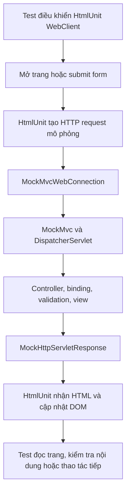

# HtmlUnit cho luồng biểu mẫu khi phù hợp phạm vi MVC

HtmlUnit là thư viện Java mô phỏng trình duyệt web ở mức HTML, DOM và các thao tác người dùng. Trong kiểm thử Spring MVC, có thể kết hợp HtmlUnit với `MockMvc` để mở trang, tìm form, điền input, chọn option, gửi form và theo dõi trang kết quả như một người dùng đang thao tác trên website.

Tích hợp `MockMvc` với HtmlUnit đặc biệt hữu ích cho ứng dụng Spring MVC trả về HTML, nơi một luồng nghiệp vụ đi qua nhiều trang hoặc phụ thuộc vào form binding, validation, session và redirect. HtmlUnit cung cấp API thao tác ở mức trang HTML; Spring Test chuyển các request thuộc ứng dụng qua `DispatcherServlet` bằng `MockMvc`. Test vì vậy kiểm tra được trải nghiệm điều hướng và biểu mẫu trong tầng MVC mà không cần khởi động HTTP server thật.

## 1. HtmlUnit giải quyết bài toán gì?

Một test `MockMvc` thông thường tạo request bằng builder và kiểm tra response bằng matcher:

```java
mockMvc.perform(post("/signup")
        .param("name", "Lan")
        .param("email", "lan@example.test"))
        .andExpect(status().is3xxRedirection());
```

Cách này trực tiếp và phù hợp với phần lớn API test. Tuy nhiên, nó không tương tác với HTML mà server trả về. Test phải tự biết tên parameter, URL action và cách gửi request tiếp theo.

HtmlUnit cho phép test làm việc với form được render:

1. Mở trang bằng URL.
2. Tìm form theo `id` hoặc `name`.
3. Tìm trường input bằng tên HTML.
4. Điền dữ liệu như người dùng.
5. Nhấn nút submit.
6. Nhận trang sau khi server xử lý, bao gồm validation error hoặc redirect.

Điều này hữu ích khi cần kiểm tra sự phối hợp giữa controller, template, form field, session và luồng điều hướng. Nó cũng giúp phát hiện lỗi như tên input trong HTML không khớp với thuộc tính model, form action sai hoặc redirect dẫn đến trang không tồn tại.

HtmlUnit không phải trình duyệt đồ họa đầy đủ. Nó tạo và thao tác DOM, có thể thực thi JavaScript ở mức được thư viện hỗ trợ, nhưng không thay thế hoàn toàn Chrome, Firefox hoặc Safari thật. Mục tiêu phù hợp là kiểm tra luồng HTML và hành vi MVC có thể mô phỏng.

## 2. HtmlUnit kết hợp với MockMvc như thế nào?

Spring Test cung cấp `MockMvcWebClientBuilder` để tạo HtmlUnit `WebClient` được kết nối với `MockMvc`. Khi `WebClient` truy cập host được cấu hình dùng MockMvc, request được chuyển vào Spring MVC thông qua `MockMvcWebConnection` thay vì mở kết nối tới servlet container.



HtmlUnit quản lý thao tác phía client như đọc form, thay đổi giá trị trường và điều hướng. `MockMvc` xử lý request ở phía server theo cấu hình Spring MVC đã nạp. Vì vậy, test có thể kiểm tra cả hai phía của một luồng biểu mẫu trong cùng một bài test.

Các thành phần chính:

| Thành phần | Vai trò |
| --- | --- |
| `WebClient` | Đại diện cho một phiên trình duyệt, điều khiển việc mở trang và quản lý cookie |
| `HtmlPage` | Đại diện cho một trang HTML đã được tải và phân tích |
| `HtmlForm` | Đại diện cho form HTML và các control bên trong |
| `HtmlInput`, `HtmlTextInput`, `HtmlSelect` | Cho phép đọc hoặc thay đổi giá trị trường biểu mẫu |
| `HtmlSubmitInput` | Đại diện cho nút submit dạng input |
| `MockMvcWebClientBuilder` | Tạo WebClient được kết nối với MockMvc |
| `MockMvcWebConnection` | Chuyển request của HtmlUnit tới MockMvc cho host đã cấu hình |

Với các phiên bản HtmlUnit mới, package thường bắt đầu bằng `org.htmlunit`. Dự án dùng HtmlUnit 2.x cũ có thể sử dụng package `com.gargoylesoftware.htmlunit`. Cần chọn phiên bản HtmlUnit tương thích với phiên bản Spring Test và dùng đúng package tương ứng.

## 3. Thêm dependency cho test

Spring Test cung cấp phần tích hợp MockMvc; HtmlUnit là dependency riêng. Nếu dự án dùng Spring Boot, `spring-boot-starter-test` thường đã cung cấp Spring Test và các thư viện kiểm thử phổ biến, nhưng cần thêm HtmlUnit nếu chưa có trong test classpath.

Với Gradle:

```groovy
dependencies {
    testImplementation("org.htmlunit:htmlunit")
}
```

Với Maven:

```xml
<dependency>
    <groupId>org.htmlunit</groupId>
    <artifactId>htmlunit</artifactId>
    <scope>test</scope>
</dependency>
```

Ví dụ trên dùng HtmlUnit 3.x trở lên với group ID `org.htmlunit`. Nếu dự án dùng HtmlUnit 2.x, tọa độ Maven cũ là `net.sourceforge.htmlunit:htmlunit` và package Java thuộc `com.gargoylesoftware.htmlunit`. Nên để dependency management của dự án quản lý version nếu BOM đang hỗ trợ; nếu không, chọn một version tương thích rõ ràng thay vì dùng version mới nhất một cách tùy tiện.

Không cần thêm HtmlUnit vào runtime production vì thư viện chỉ phục vụ kiểm thử. Nếu ứng dụng dùng Spring Security, cần có thêm `spring-security-test` để cấu hình security filter chain và hỗ trợ các thao tác kiểm thử bảo mật.

## 4. Tạo WebClient kết nối với WebApplicationContext

Với một ứng dụng Spring MVC có cấu hình web context, có thể tạo `WebClient` trong test như sau:

```java
import org.htmlunit.WebClient;
import org.junit.jupiter.api.AfterEach;
import org.junit.jupiter.api.BeforeEach;
import org.junit.jupiter.api.extension.ExtendWith;
import org.springframework.beans.factory.annotation.Autowired;
import org.springframework.test.context.ContextConfiguration;
import org.springframework.test.context.junit.jupiter.SpringExtension;
import org.springframework.test.context.web.WebAppConfiguration;
import org.springframework.test.web.servlet.htmlunit.MockMvcWebClientBuilder;
import org.springframework.web.context.WebApplicationContext;

@ExtendWith(SpringExtension.class)
@WebAppConfiguration
@ContextConfiguration(classes = WebTestConfig.class)
class SignupFormBrowserTest {
    @Autowired
    private WebApplicationContext webApplicationContext;

    private WebClient webClient;

    @BeforeEach
    void setUp() {
        webClient = MockMvcWebClientBuilder
                .webAppContextSetup(webApplicationContext)
                .build();
    }

    @AfterEach
    void tearDown() {
        webClient.close();
    }
}
```

`@WebAppConfiguration` yêu cầu Spring Test tạo `WebApplicationContext` gắn với `MockServletContext`. `@ContextConfiguration` chỉ định cấu hình bean và MVC. `MockMvcWebClientBuilder.webAppContextSetup(...)` sử dụng web context này để tạo kết nối giữa HtmlUnit và MockMvc.

Trong ví dụ, `WebTestConfig` cần đăng ký controller, view resolver hoặc template engine, converter và các thành phần MVC mà trang cần. Nếu controller trả về view nhưng test context không có cấu hình render HTML tương ứng, HtmlUnit sẽ không nhận được trang biểu mẫu như mong đợi.

Một cách khác là dùng `MockMvcWebClientBuilder.mockMvcSetup(...)` khi muốn tùy chỉnh MockMvc builder, ví dụ đăng ký filter hoặc security chain:

```java
WebClient webClient = MockMvcWebClientBuilder
        .mockMvcSetup(MockMvcBuilders.webAppContextSetup(webApplicationContext))
        .build();
```

Có thể cấu hình context path nếu ứng dụng được triển khai dưới một đường dẫn con:

```java
WebClient webClient = MockMvcWebClientBuilder
        .webAppContextSetup(webApplicationContext)
        .contextPath("/shop")
        .build();
```

Khi đó, URL test truy cập cần bao gồm context path, ví dụ `http://localhost/shop/signup`.

## 5. Ví dụ một luồng biểu mẫu đăng ký

Giả sử ứng dụng có trang đăng ký tài khoản. Người dùng mở form, nhập tên và email, sau đó gửi dữ liệu. Nếu hợp lệ, ứng dụng tạo tài khoản và chuyển tới trang xác nhận; nếu không hợp lệ, ứng dụng hiển thị lại form cùng thông báo lỗi.

Controller minh họa:

```java
@Controller
class SignupController {
    private final SignupService signupService;

    SignupController(SignupService signupService) {
        this.signupService = signupService;
    }

    @GetMapping("/signup")
    String form(Model model) {
        model.addAttribute("form", new SignupForm());
        return "signup/form";
    }

    @PostMapping("/signup")
    String submit(@Valid @ModelAttribute("form") SignupForm form,
                  BindingResult bindingResult,
                  RedirectAttributes attributes) {
        if (bindingResult.hasErrors()) {
            return "signup/form";
        }

        signupService.register(form);
        attributes.addFlashAttribute("notice", "Account created");
        return "redirect:/signup/success";
    }

    @GetMapping("/signup/success")
    String success() {
        return "signup/success";
    }
}
```

Form object có thể khai báo validation:

```java
public class SignupForm {
    @NotBlank(message = "Name is required")
    private String name;

    @NotBlank(message = "Email is required")
    @Email(message = "Email is invalid")
    private String email;

    // Getter và setter
}
```

Ví dụ HTML đơn giản của form, giả sử view engine đã render action phù hợp:

```html
<form id="signupForm" name="signupForm" method="post" action="/signup">
    <label for="name">Name</label>
    <input id="name" name="name" type="text">

    <label for="email">Email</label>
    <input id="email" name="email" type="email">

    <input type="submit" name="submit" value="Create account">
</form>
```

Trong template thực tế, action thường được tạo bằng cơ chế của view engine, ví dụ `th:action` của Thymeleaf hoặc tag Spring form. Nếu có Spring Security CSRF protection, template tích hợp Spring Security thường thêm hidden input chứa CSRF token. HtmlUnit submit các trường form hiện có, vì vậy test có thể đi qua luồng CSRF giống trình duyệt nếu cấu hình bảo mật và template đúng.

## 6. Điền và gửi form bằng HtmlUnit

Sau khi mở trang, có thể tìm form theo `name`, tìm input theo `name`, đặt giá trị rồi click submit:

```java
import org.htmlunit.Page;
import org.htmlunit.WebClient;
import org.htmlunit.html.HtmlForm;
import org.htmlunit.html.HtmlPage;
import org.htmlunit.html.HtmlSubmitInput;

@Test
void submitsSignupFormAndFollowsRedirect() throws Exception {
    HtmlPage formPage = webClient.getPage("http://localhost/signup");
    HtmlForm form = formPage.getFormByName("signupForm");

    form.getInputByName("name").setValueAttribute("Lan Nguyen");
    form.getInputByName("email").setValueAttribute("lan@example.test");

    HtmlSubmitInput submit = (HtmlSubmitInput) form.getInputByName("submit");
    Page submittedPage = submit.click();

    assertThat(submittedPage).isInstanceOf(HtmlPage.class);
    HtmlPage resultPage = (HtmlPage) submittedPage;
    assertThat(resultPage.getUrl().getPath()).isEqualTo("/signup/success");
    assertThat(resultPage.asNormalizedText()).contains("Account created");
}
```

Khi click submit, HtmlUnit tạo request dựa trên `action`, `method` và các control trong form. Request được gửi qua kết nối MockMvc, controller xử lý, sau đó HtmlUnit nhận response. Với redirect thông thường, WebClient theo dõi điều hướng và trả về trang đích cuối cùng.

Đây là điểm khác biệt quan trọng so với việc gọi `mockMvc.perform(post(...))`: test không phải tự dựng lại URL action hoặc từng parameter, mà thao tác trực tiếp trên form HTML mà server đã trả về. Nếu form thiếu `name`, đặt sai `action` hoặc input không có `name` phù hợp, test có thể phát hiện ngay.

## 7. Kiểm tra validation và trang form được hiển thị lại

Khi dữ liệu không hợp lệ, controller có thể trả lại cùng view với lỗi validation. HtmlUnit có thể đọc thông báo lỗi trong HTML sau khi gửi form:

```java
@Test
void showsValidationMessageWhenNameIsMissing() throws Exception {
    HtmlPage formPage = webClient.getPage("http://localhost/signup");
    HtmlForm form = formPage.getFormByName("signupForm");

    form.getInputByName("name").setValueAttribute("");
    form.getInputByName("email").setValueAttribute("lan@example.test");

    HtmlSubmitInput submit = (HtmlSubmitInput) form.getInputByName("submit");
    Page submittedPage = submit.click();

    assertThat(submittedPage).isInstanceOf(HtmlPage.class);
    HtmlPage resultPage = (HtmlPage) submittedPage;
    assertThat(resultPage.getUrl().getPath()).isEqualTo("/signup");
    assertThat(resultPage.asNormalizedText()).contains("Name is required");
}
```

Test này kiểm tra toàn bộ luồng từ form HTML đến data binding, validation, controller trả lại view và thông báo lỗi được render. Nó có thể phát hiện cả lỗi ở template, chẳng hạn thông báo validation không được đặt vào trang hoặc form không giữ lại giá trị người dùng đã nhập.

Nếu HTML có thuộc tính native `required`, trình duyệt giả lập có thể chặn submit trước khi request tới server. Khi mục tiêu là kiểm tra validation phía server, nên thiết kế test để dữ liệu không hợp lệ vẫn được gửi đến server, hoặc tắt browser validation trong fixture phù hợp. Sau đó assertion mới xác nhận được Bean Validation và `BindingResult` của Spring MVC.

## 8. Làm việc với các loại control khác

HtmlUnit cung cấp API cho nhiều control HTML thông dụng. Tên method cụ thể có thể thay đổi theo loại element, nhưng nguyên tắc là lấy control từ form hoặc trang rồi đặt trạng thái mong muốn.

Ví dụ form có select, checkbox và radio:

```html
<form name="preferencesForm" method="post" action="/preferences">
    <select name="language">
        <option value="vi">Vietnamese</option>
        <option value="en">English</option>
    </select>

    <input type="checkbox" name="newsletter" value="true">

    <input type="radio" name="theme" value="light">
    <input type="radio" name="theme" value="dark">

    <input type="submit" name="save" value="Save">
</form>
```

Ví dụ thao tác:

```java
HtmlPage page = webClient.getPage("http://localhost/preferences");
HtmlForm form = page.getFormByName("preferencesForm");

HtmlSelect language = form.getSelectByName("language");
language.getOptionByValue("en").setSelected(true);

HtmlCheckBoxInput newsletter =
        (HtmlCheckBoxInput) form.getInputByName("newsletter");
newsletter.setChecked(true);

HtmlRadioButtonInput darkTheme =
        (HtmlRadioButtonInput) form.getInputByValue("dark");
darkTheme.setChecked(true);

HtmlSubmitInput save = (HtmlSubmitInput) form.getInputByName("save");
Page result = save.click();
```

Trong form thật, cần bảo đảm các control có `name` và `value` đúng với contract của controller. Với checkbox không được chọn, trình duyệt thường không gửi parameter đó; controller cần xử lý trường hợp parameter vắng mặt. Với radio group, chỉ lựa chọn được gửi lên. Những chi tiết này là lý do kiểm thử thông qua form HTML có giá trị trong các luồng nhập liệu phức tạp.

## 9. Cookie, session và nhiều request liên tiếp

Một `WebClient` đại diện cho một phiên trình duyệt và quản lý cookie giữa các request. Nếu response đầu tiên đặt cookie session, các request sau từ cùng WebClient có thể gửi lại cookie đó. Điều này giúp test kiểm tra những luồng phụ thuộc session như giỏ hàng, wizard nhiều bước hoặc dữ liệu tạm trong quá trình đăng ký.

Ví dụ luồng hai bước:

```java
@Test
void keepsWizardStateAcrossPages() throws Exception {
    HtmlPage firstStep = webClient.getPage("http://localhost/order/step-one");
    HtmlForm firstForm = firstStep.getFormByName("stepOneForm");
    firstForm.getInputByName("customerName").setValueAttribute("Lan");

    Page secondPage = ((HtmlSubmitInput) firstForm.getInputByName("next")).click();
    assertThat(secondPage).isInstanceOf(HtmlPage.class);

    HtmlPage secondStep = (HtmlPage) secondPage;
    assertThat(secondStep.asNormalizedText()).contains("Delivery details");
}
```

Test dùng cùng một `WebClient`, do đó cookie và session có thể được giữ qua các lần điều hướng. Nếu tạo WebClient mới ở giữa luồng, test có thể mất cookie session và không còn đại diện cho một người dùng đang duy trì cùng phiên trình duyệt.

Nên tạo một WebClient riêng cho mỗi test hoặc reset trạng thái client sau test. Không dùng chung một WebClient mutable giữa các test chạy song song nếu chúng có thể ảnh hưởng cookie, session hoặc trạng thái trình duyệt của nhau.

## 10. Redirect và điều hướng liên kết

HtmlUnit hoạt động ở mức trình duyệt nên có thể theo dõi link và redirect. Sau khi click link, test nhận trang đích và kiểm tra URL hoặc nội dung:

```java
HtmlPage home = webClient.getPage("http://localhost/");
HtmlAnchor productsLink = home.getAnchorByText("Products");
HtmlPage productsPage = productsLink.click();

assertThat(productsPage.getUrl().getPath()).isEqualTo("/products");
assertThat(productsPage.asNormalizedText()).contains("Product catalog");
```

Đối với redirect sau POST, HtmlUnit thường tự theo redirect theo hành vi WebClient được cấu hình. Nếu cần kiểm tra chính xác status code 302/303 hoặc `Location` header của response trung gian, `MockMvc` matcher thường trực tiếp và rõ ràng hơn. HtmlUnit phù hợp khi cần kiểm tra trang cuối cùng mà người dùng nhìn thấy sau luồng điều hướng.

## 11. Tùy chỉnh host và context path

`MockMvcWebClientBuilder` cấu hình những host nào sẽ được xử lý bởi MockMvc. Mặc định, tích hợp được thiết kế cho host cục bộ thường dùng trong test. Nếu ứng dụng sử dụng hostname khác, có thể chỉ định host cần route qua MockMvc:

```java
WebClient webClient = MockMvcWebClientBuilder
        .webAppContextSetup(webApplicationContext)
        .useMockMvcForHosts("shop.example.test")
        .build();
```

Sau đó, URL dùng hostname đó:

```java
HtmlPage page = webClient.getPage("http://shop.example.test/signup");
```

Nếu ứng dụng được mount dưới context path `/shop`, cấu hình `.contextPath("/shop")` và truy cập URL tương ứng. Host và context path cần thống nhất với cách URL được tạo trong HTML, đặc biệt khi template dùng absolute URL.

Các request tới host không được route qua MockMvc có thể được xử lý bằng kết nối mạng của HtmlUnit. Vì vậy, test nên kiểm soát host và resource bên ngoài mà trang tham chiếu. Nếu trang tải script, ảnh hoặc API từ một domain khác, cần quyết định rõ request đó có nằm trong phạm vi test hay không; không nên để một bài test MVC phụ thuộc ngoài ý muốn vào dịch vụ internet.

## 12. Tích hợp Spring Security và CSRF

Nếu ứng dụng bảo vệ form bằng Spring Security, MockMvc cần có security filter chain thì HtmlUnit mới kiểm tra được đúng hành vi xác thực và phân quyền. Có thể cấu hình MockMvc builder trước khi tạo WebClient:

```java
MockMvcBuilder mockMvcBuilder = MockMvcBuilders
        .webAppContextSetup(webApplicationContext)
        .apply(springSecurity());

WebClient webClient = MockMvcWebClientBuilder
        .mockMvcSetup(mockMvcBuilder)
        .build();
```

`springSecurity()` được cung cấp bởi Spring Security Test. Cấu hình thực tế cần có dependency `spring-security-test` và security configuration của ứng dụng.

Khi form HTML được render với CSRF protection, template tích hợp Spring Security có thể chứa hidden field như `_csrf`. HtmlUnit submit các trường hợp lệ trong form nên token được gửi cùng request. Nếu template không render token hoặc test tự dựng form HTML không có hidden field, request POST có thể bị từ chối với 403. Khi đó cần kiểm tra cấu hình template/security và mục tiêu test.

Nếu mục tiêu là kiểm tra người dùng đã đăng nhập, có thể thiết lập authentication bằng cơ chế phù hợp trong Spring Security Test hoặc kiểm tra luồng đăng nhập qua form HTML. Với bài test form đăng nhập thực sự, nên dùng WebClient giữ cookie qua trang login và trang được bảo vệ để xác nhận redirect và session sau xác thực.

## 13. Khi nào nên dùng HtmlUnit và khi nào MockMvc là đủ?

Không phải mọi MVC test đều cần HtmlUnit. Hãy chọn công cụ theo hành vi cần bảo vệ:

| Mục tiêu kiểm thử | Công cụ phù hợp |
| --- | --- |
| Kiểm tra status, header, JSON body của REST endpoint | `MockMvc` |
| Kiểm tra controller trả đúng view name và model attribute | `MockMvc` với `view()` và `model()` |
| Kiểm tra binding và validation của request parameter | Thường dùng `MockMvc`; dùng HtmlUnit nếu cần xác nhận form HTML |
| Mở trang, tìm form, điền input và submit như người dùng | HtmlUnit kết hợp MockMvc |
| Kiểm tra nhiều trang trong cùng một session hoặc redirect chain | HtmlUnit kết hợp MockMvc |
| Kiểm tra JavaScript phức tạp hoặc hành vi riêng của trình duyệt | Browser automation như Selenium hoặc Playwright |
| Kiểm tra TLS, connector, port, servlet container và deployment | Integration test với server/container thật |

HtmlUnit tạo thêm một lớp kiểm thử ở mức trang HTML. Nó đặc biệt đáng giá khi cấu trúc form và điều hướng là một phần quan trọng của contract người dùng. Với REST API không có HTML form, MockMvc trực tiếp thường dễ đọc, nhanh và ít phụ thuộc hơn.

## 14. Giới hạn cần hiểu khi dùng HtmlUnit với MockMvc

Kết hợp HtmlUnit với MockMvc kiểm tra được nhiều hành vi nhưng vẫn chạy trên môi trường Servlet mô phỏng:

- Không mở cổng HTTP thật và không kiểm tra cấu hình connector, TLS handshake hoặc network timeout.
- Không tái tạo đầy đủ mọi khác biệt giữa các browser engine. JavaScript, CSS layout và browser-specific behavior có thể khác trình duyệt thật.
- Không thay thế servlet container thật khi cần kiểm tra JSP compilation, deployment descriptor hoặc hành vi đặc thù container.
- Không tự bảo đảm mọi request tài nguyên bên ngoài được mock; host routing cần được cấu hình có chủ đích.
- HTML phải được render trong test context. Nếu view resolver hoặc template engine không hoạt động, HtmlUnit không thể tương tác với form chưa được tạo ra.

Khi yêu cầu là xác minh giao diện thực tế trên browser engine, hãy bổ sung test end-to-end bằng Selenium hoặc Playwright trên trình duyệt phù hợp. HtmlUnit vẫn có thể giữ vai trò kiểm thử luồng form nhanh ở tầng MVC.

## 15. Lỗi thường gặp và cách xử lý

| Hiện tượng | Nguyên nhân có thể có | Cách xử lý |
| --- | --- | --- |
| Không tìm thấy form theo tên | HTML không có `name` mong đợi hoặc trang trả về không phải form page | Kiểm tra HTML và URL ban đầu |
| `getInputByName` không tìm thấy control | Control thiếu `name` hoặc tên khác với parameter controller bind | Kiểm tra markup và form binding |
| Submit không tới controller | Button không phải submit control, form thiếu action hoặc browser validation chặn submit | Kiểm tra `type`, `action`, method và thuộc tính validation HTML |
| Server trả 403 khi submit | Thiếu CSRF token hoặc security filter chain cấu hình không đúng | Render token trong form và tích hợp Spring Security Test |
| Trang sau submit không như mong đợi | Redirect, validation hoặc exception handler trả trang khác | Kiểm tra URL cuối và nội dung response; dùng MockMvc để xem status/header trung gian |
| Mất session giữa hai trang | Tạo WebClient mới hoặc cookie không được giữ | Dùng cùng WebClient cho một luồng người dùng |
| View trả về HTML rỗng hoặc lỗi render | Test context thiếu view resolver/template engine hoặc tài nguyên template | Nạp cấu hình MVC và template cần thiết |
| Test gọi host bên ngoài | URL tuyệt đối trong HTML trỏ tới host không được route qua MockMvc | Cấu hình host routing hoặc kiểm soát request ngoài |
| Test không phản ánh JavaScript trên browser thật | Khác biệt engine hoặc JavaScript chưa được bật/cấu hình | Bổ sung test trên browser thật nếu hành vi phụ thuộc JavaScript |

Khi chẩn đoán, trước hết xác nhận `WebClient` mở đúng URL và nhận được `HtmlPage`. Sau đó kiểm tra form, action, method và tên control. Nếu request đã tới server nhưng trang kết quả sai, dùng MockMvc hoặc log của Spring MVC để xác định lỗi nằm ở mapping, binding, validation, security hay view rendering.

## 16. Nguyên tắc tổ chức test HtmlUnit

1. Chỉ dùng HtmlUnit khi hành vi HTML form, điều hướng hoặc session là một phần cần kiểm tra; dùng MockMvc trực tiếp cho assertion HTTP đơn giản.
2. Kết nối WebClient với `WebApplicationContext` bằng `MockMvcWebClientBuilder` để request ứng dụng đi qua MockMvc.
3. Dùng một WebClient xuyên suốt một luồng người dùng để giữ cookie và session.
4. Tìm form và control theo `id`/`name` ổn định; các thuộc tính này cũng giúp HTML dễ kiểm thử và dễ bảo trì.
5. Kiểm tra cả URL cuối, nội dung trang và thông báo validation thay vì chỉ xác nhận thao tác click không ném exception.
6. Khi test server-side validation, bảo đảm browser validation không chặn request trước khi gửi lên server.
7. Tích hợp security filter chain và CSRF token nếu ứng dụng thực tế yêu cầu.
8. Kiểm soát host và tài nguyên ngoài để test không phụ thuộc mạng ngoài ngoài ý muốn.
9. Bổ sung browser/container test thật khi cần xác nhận JavaScript phức tạp, CSS, JSP hoặc hành vi triển khai.

HtmlUnit kết hợp MockMvc tạo ra một cách kiểm thử hữu ích cho các luồng biểu mẫu Spring MVC: test tương tác với HTML như một trình duyệt, còn Spring Test xử lý request qua hạ tầng MVC mô phỏng. Khi dùng đúng phạm vi, bài test có thể xác nhận form được render, dữ liệu được gửi, validation được hiển thị và người dùng được điều hướng đến đúng trang sau thao tác.
